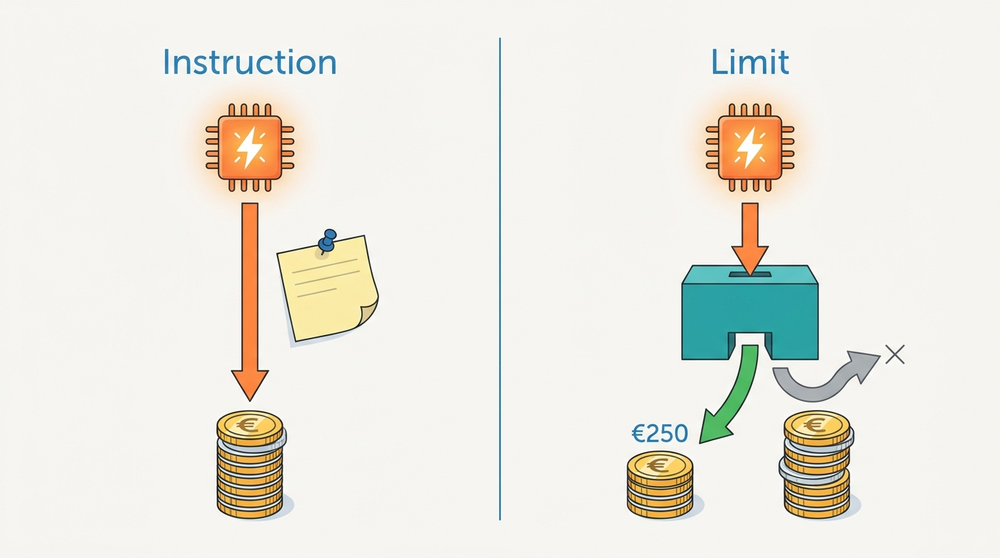
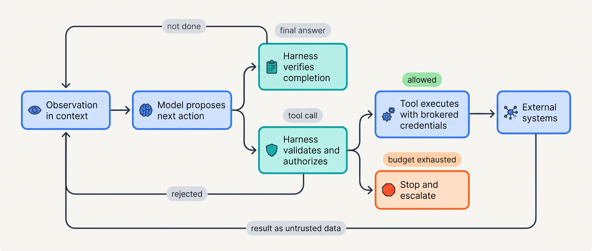
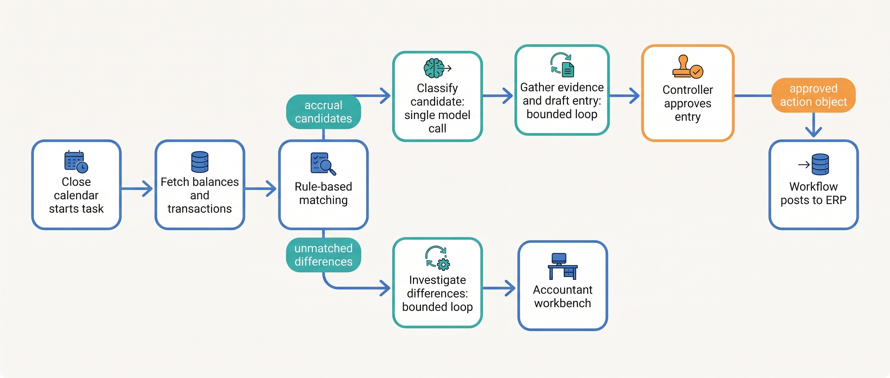
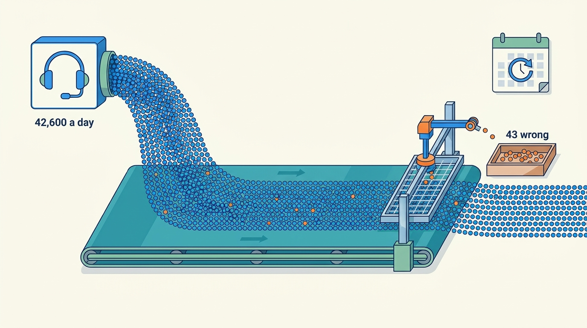

> **IN THIS CHAPTER, YOU WILL:** Learn a definition of "agent" that you can check by reading code, use it to map every decision point of a system to code, model or human, and see which four properties of model-chosen steps change the architecture and which distributed-systems rules stay the same.

> **WHY THE BUSINESS CARES:** "Agent" is now a budget line, a vendor category and a risk-register entry. If nobody can say which decisions the model makes, nobody can price the system, insure its failures or explain an incident to a regulator, an auditor or a customer.

> **WHY ARCHITECTS SHOULD CARE:** Testability, worst-case cost and blast radius all depend on who chooses the next step. Label that per decision point and you know where to put validation, policy, budgets and evidence. Label it per product and you will either over-engineer a workflow or under-protect a loop.

> **KEY POINTS:**
>
> * **"Agent" is a property of a decision point, not of a product.** The definition you can audit is about control flow: at each decision point, who chooses the next step, code, the model or a human? Most systems sold as agents are workflows with one or two points where the model chooses.
> * **The model proposes; deterministic code disposes.** In the agent loop (observe, decide, act, observe) the model's output is a proposal. The harness around it validates, authorizes, executes and records. The **action space**, meaning what that code will actually execute, sets the system's limits. The prompt does not.
> * **Four properties change the architecture; the rest is distributed systems.** Proposals vary between runs, the action space can be open-ended, untrusted text reaches the component that decides, and every step costs money and time. Timeouts, idempotency, partial failure and authorization work as before. A model on the retry path just makes their failures stranger.

> **[FAILURE PATTERNS THIS CHAPTER ADDRESSES](where-agentic-systems-go-wrong.html):**
>
> * **The Agent-Shaped Hammer** — when nobody has mapped who chooses each step, a loop gets built where a fixed path would do, and nobody can say what the model decides that code could not.
> * **Autonomy by Default** — if the action space is whatever the tools happen to allow, the agent's autonomy was never designed; it was inherited from the tool list.
> * **The Compounding Error** — every decision point handed to the model adds a step whose output varies, and unchecked chains of such steps multiply their error rates.

<br>
The word "agent" now covers a chatbot that answers from a knowledge base, a pipeline that classifies invoices, a coding tool that edits files for an hour and a research system that spawns copies of itself. Vendors, analysts and benchmarks all use the word, and they **count different things**.

This chapter replaces the label with a question you can answer by reading code: **at each decision point, who chooses the next step?** Where deterministic code chooses, you have automation, possibly with a language model inside one step. Where the model chooses, from actions that code defines and enforces, the system is agentic at that point. Where a human chooses, you have an approval, an escalation or a handoff. Ask the question everywhere and you get a map that shows where the expensive parts of the architecture belong.

The chapter owns five terms: **agent**, **agentic system**, **agent loop**, **locus of control** and **action space**. It sets up the rest of Part I. [[when-agents-are-justified]] takes the map and asks when a model-owned decision point is worth it. [[autonomy-and-consequence]] sizes what a model-chosen action may do by consequence and reversibility. [[workflows-loops-and-autonomous-agents]] compares the three execution styles that mix code-owned and model-owned steps. The components named here are developed in [[agentic-reference-architecture]] and [[agent-runtime]].

## Setting the Scene at Ostrell: Seven Agents, One Question

Ostrell, the fictional company this book follows (see [[meet-ostrell]]), is a Rotterdam-based group of about 5,200 people that sells field-service software, spare parts and service contracts. In **January 2027** its internal agent platform, **Keelson**, became generally available inside the company. Seven teams were waiting to move onto it. Each had built an "agent" during 2026 with its own code, its own prompts and its own way of calling tools.

Tomas Verhoef, Ostrell's Chief Architect, did not ask the teams for architecture diagrams. He asked for one table per agent, with one row per **decision point** (a place where the next step is chosen) answering three questions: who chooses (code, the model or a human), what the options are, and what enforces the limits on them. Amara Okafor, Head of Agent Platform, made the table a condition of onboarding; Keelson's Agent Registry would hold it next to the agent's owner and autonomy tiers.

The summary that came back surprised the architecture forum:

| "Agent" | What the team said it was | Where the model actually chose the next step | What the map showed |
| --- | --- | --- | --- |
| **Answerdesk** (support) | An autonomous support agent | Which knowledge-base searches to run, what to answer, which tool to call (ticket, revisit, credit), when to escalate, when it was done | A bounded loop with a real action space, including money |
| **Closewise** (finance close) | An AI accountant | Two steps only: investigating unexplained reconciliation differences, and gathering evidence for proposed accruals | A **workflow** with two agentic steps and one single-call classification step; posting is code, approval is human |
| **Dealroom** (sales) | A sales copilot | What to research for an account brief; which price-book lines to draft into a quote | A bounded loop for briefs; a workflow for quotes, whose sending stays with a human |
| **Peoplepoint** (HR helpdesk) | An HR agent | What to answer about policy; in the leave flow, nothing beyond extracting dates from the employee's message | Policy answers are a loop. The leave flow is **built as a loop but is really a workflow**: one model step, then an employee confirmation |
| **Clausewise** (legal) | A contract-review agent | Which playbook clauses to check and which redlines to propose | A bounded loop that only drafts; a lawyer accepts each change |
| **Scout** (research) | An autonomous researcher | Search queries, which sources to read, **whether to spawn sub-agents**, when the report was finished | The most autonomous design; no recorded limit on delegation |
| **Forge** (coding) | A coding agent | Which files to read and edit, which commands to run, when to open a pull request | Model-written code executed inside a sandbox; the merge stays human |

Two of the seven were mostly workflows. Closewise ran a fixed close calendar in which the model held the next step at two points out of roughly a dozen. Peoplepoint's leave flow was a form with a language front end. One more row worried Jonas Lindqvist, principal engineer for Keelson Runtime. Scout's map recorded that the model decided whether to spawn sub-agents, and recorded no limit on how many or how deep, because there was none. Five weeks later the Weekend Fan-out ran for 41 hours and spent €8,700 before a quota alert stopped it (see [[meet-ostrell]]).

Tomas's question to the forum was the one this chapter answers: **what exactly is different about the decision points where the model chooses, and what do those points demand of the architecture that the others do not?**

## What "Agent" Has Meant

### The classical definition

The artificial-intelligence textbook tradition defines an agent as "anything that perceives its environment through sensors and acts upon that environment through actuators" (Russell and Norvig, *Artificial Intelligence: A Modern Approach*, 4th edition, 2021, as cited in [Wikipedia's "Intelligent agent"](https://en.wikipedia.org/wiki/Intelligent_agent)). A thermostat qualifies. The definition is too broad to separate one software design from another. Its value is the vocabulary it supplies, which maps cleanly onto systems built on large language models (LLMs): the **environment** is the set of systems the tools can reach, the **percept** is what lands in the model's context window, the **actuators** are tool calls, and **partial observability** is the normal case.

### Definitions from the model era

Since 2024 the model providers have published narrower definitions. They agree on the components and disagree on where the line falls.

| Source | Date | Definition (quoted or close paraphrase) | What decides "agent" |
| --- | --- | --- | --- |
| Anthropic, ["Building effective agents"](https://www.anthropic.com/engineering/building-effective-agents) | 2024-12-19 | Workflows are "systems where LLMs and tools are orchestrated through predefined code paths"; agents are "systems where LLMs dynamically direct their own processes and tool usage, maintaining control over how they accomplish tasks". Both are "agentic systems". | Whether code or the model owns the control flow |
| OpenAI, ["A practical guide to building agents"](https://cdn.openai.com/business-guides-and-resources/a-practical-guide-to-building-agents.pdf) | 2025-04 | "Agents are systems that independently accomplish tasks on your behalf". An agent "leverages an LLM to manage workflow execution and make decisions". Single-turn LLM features that do not control workflow execution are not agents. | Whether the model manages workflow execution and selects tools |
| Google, "Agents" whitepaper (Wiesinger, Marlow, Vuskovic) | 2024-09 | An application that tries to achieve a goal by observing the world and acting on it with tools; model, tools and an orchestration layer ([summary](https://www.aihero.dev/google-agents-whitepaper-review)) | A goal-directed observe–act cycle |
| Mitchell, Ghosh, Luccioni, Pistilli, ["Fully Autonomous AI Agents Should Not be Developed"](https://arxiv.org/abs/2502.02649) | 2025-02 (rev. 2025-10) | "Computer software systems capable of creating context-specific plans in non-deterministic environments" | Planning under non-determinism |

The Google wording is reported from secondary summaries. The whitepaper itself is distributed through Kaggle and could not be checked against the original text.

The definitions disagree in ways that matter. Anthropic draws its line *inside* the agentic category: a routing workflow is agentic but is not an agent. OpenAI draws it at control of workflow execution. Google's definition would include most of Anthropic's workflows. Statistics that count "agents" therefore count different populations. Gartner's June 2025 forecast that over 40% of agentic AI projects will be canceled by the end of 2027 came with an estimate that only about 130 of the thousands of "agentic" vendors are real ([press coverage](https://www.outlookbusiness.com/artificial-intelligence/over-40-of-agentic-ai-projects-will-be-scrapped-by-2027-says-gartner); an analyst forecast, not a measurement). It shows what a vague definition costs: a buyer cannot tell a product that hands control to a model from one that wraps a single call.

### The definition this book uses

This book adopts a **control-flow definition**, because it is the only one an architect can check by reading code, and because it directly determines testability, worst-case cost and blast radius:

- A **decision point** is any place in a system where the next step is chosen: which branch runs, which tool is called with which arguments, whether to continue, whether to stop, whether to hand off.
- The **locus of control** of a decision point is who chooses there: **code** (a rule, a state machine, a schedule), the **model** (its output selects the step), or a **human** (an approval, an escalation, a manual action).
- An **agent** is a component in which a model holds the locus of control at one or more decision points *over several steps*. It runs in a loop, chooses its next action from a defined action space, observes the result and chooses again until it stops or is stopped.
- An **agentic system** is a system that contains at least one agent, together with the deterministic code, data, policies and people around it. Following Anthropic's usage, workflows that route through a model are agentic systems too. This book reserves "agent" for the part where the model chooses repeatedly.
- The **action space** of an agent is the set of actions its harness will actually execute on the model's behalf: the tools, their argument ranges, the data they reach, the identities they act with. It is defined by code and configuration. The model's instructions can describe it, but only code can enforce it.

Two consequences follow. **"Agent" describes a decision point, not a product:** Answerdesk is an agent at its tool-selection point and plain code at its customer-verification point. And **the action space, not the instructions, is the boundary:** "never issue credits above €250" is a request to a component whose outputs vary; a tool that rejects any `amount` above 250 is a limit.


**Figure 1:** *"Never issue credits above €250" in a prompt is a request to a component whose proposals vary; a tool that rejects any amount above 250 is a limit.*

## The Agent Loop

### Observe, decide, act, observe

The **agent loop** is the cycle every agent runs. The harness assembles an observation into the model's context. The model proposes a next action or a final answer. The harness checks and executes the action. The result becomes the next observation. Anthropic describes autonomous agents as LLMs "using tools based on environmental feedback in a loop" ([Anthropic, 2024](https://www.anthropic.com/engineering/building-effective-agents)). OpenAI's guide adds that an agent "recognizes when a workflow is complete" and, on failure, "can halt execution and transfer control back to the user" ([OpenAI, 2025](https://cdn.openai.com/business-guides-and-resources/a-practical-guide-to-building-agents.pdf)).

The **harness** is the deterministic code around the model that runs this loop: it exposes the tools, enforces budgets and permissions, executes the actions and records the run. The book uses "harness" only in this sense; "evaluation harness" means the offline test runner. A coding command-line tool is a harness, and so is Ostrell's headless Forge. The runtime component that hosts harnesses at scale is the subject of [[agent-runtime]].


**Figure 2:** *The agent loop: the model holds the locus of control only at the proposal step. Every arrow out of the model passes through deterministic code before anything changes in the world.*

The author's coding-CLI interview design puts the split in one line: "the model decides, the harness acts and enforces" (design example, `ai-coding-cli/interview.json`, step `agent-loop`). The model's output is a proposal, structured text naming a tool and its arguments, and nothing happens until the harness acts on it. The Model Context Protocol (MCP), the open protocol through which agents increasingly reach tools, agrees. Its 2026-07-28 revision calls tools "model-controlled" yet says there "SHOULD always be a human in the loop with the ability to deny tool invocations" and that servers "MUST" validate inputs and implement access controls ([MCP specification, 2026-07-28](https://modelcontextprotocol.io/specification/2026-07-28/server/tools); see [[tool-ecosystems-and-mcp]]).

### Where the locus sits in code

The loop is short enough to show in full. The point of the sketch is the comments: they mark which lines are the model's choice and which are code's.

```python
def run(task: Task, agent: AgentVersion, budget: Budget) -> Outcome:
    history = [task.initial_observation()]
    while budget.remaining():                                # code: bounds the loop
        proposal = gateway.propose(agent.instructions,       # MODEL: chooses next step
                                   agent.tool_schemas, history)
        budget.charge(proposal.usage)
        if proposal.is_final:
            return verifier.check(proposal, task)            # code: is "done" really done?
        verdict = policy.evaluate(proposal.action, task.principal, agent.tiers)
        if not verdict.allowed:                              # code: action space and tiers
            history.append(verdict.as_observation())         # model may try another way
            continue
        if verdict.needs_approval:
            return Outcome.await_human(proposal.action)      # HUMAN: holds this decision
        result = broker.execute(proposal.action,             # code: acts, never re-asks
                                idempotency_key=proposal.action.key())
        history.append(result.as_untrusted_observation())    # data, not instructions
    return Outcome.escalate("budget exhausted", history)     # code: stop condition
```

Only one line is the model's. Everything that decides whether the world changes is deterministic: the budget and stop conditions ([[workflows-loops-and-autonomous-agents]]), the policy check ([[policy-enforcement-and-audit]]), the broker ([[tool-contracts]]) and the idempotency key ([[retries-idempotency-and-concurrency]]).

### Requirements at each seam

Each arrow in Figure 2 crosses a seam with its own requirements; "the agent" is not one component with one service level.

| Seam | Owner | Latency budget | Durability | Who may act | What must hold |
| --- | --- | --- | --- | --- | --- |
| Observation (context assembly) | Harness / context service | Part of every turn; tight for chat | Inputs recorded by reference | Code only | Untrusted content is marked as data; provenance travels with each fact ([[context-engineering]]) |
| Proposal (model call) | Model gateway | Dominates turn latency | The proposal is recorded before it is acted on | The model, inside the declared action space | Output parses against the tool schema. It does not have to be *right*. |
| Authorization and validation | Policy enforcement point | Milliseconds | Verdict recorded with policy version | Code only | Deny by default; the model cannot argue past a hard stop |
| Execution (tool call) | Tool broker | Bounded by timeout | Intent before, receipt after | Code, with brokered credentials | An exactly-once *effect* (idempotency key plus receipt), never a re-asked model |
| Feedback (result to context) | Harness | Same turn | Result stored | Code only | A result is never treated as an instruction |
| Completion | Verifier | Per run | Outcome recorded | Code, sometimes a human | "Done" is checked against something the agent could not change |

## Where the Loop Came From

Four papers from 2022–2023 introduced the mechanisms every agent framework still implements. Their models are retired, so the numbers are history; the mechanisms are what matter.

| Paper | First posted | What it introduced | What was measured, and the limit |
| --- | --- | --- | --- |
| [Chain-of-Thought Prompting](https://arxiv.org/abs/2201.11903) (Wei et al.) | 2022-01 | Prompting the model to write intermediate reasoning steps | Arithmetic, commonsense and symbolic reasoning benchmarks; no actions in the world |
| [ReAct](https://arxiv.org/abs/2210.03629) (Yao et al., ICLR 2023) | 2022-10 | Interleaving reasoning, actions and observations | +34 points absolute success on ALFWorld and +10 on WebShop over imitation and reinforcement-learning baselines, with one or two in-context examples; both are simulated environments with no irreversible consequences |
| [Toolformer](https://arxiv.org/abs/2302.04761) (Schick et al.) | 2023-02 | A model learning, self-supervised, when and how to call APIs | Calculator, search, translation, calendar; zero-shot gains on downstream tasks; small tool set, no side effects |
| [Reflexion](https://arxiv.org/abs/2303.11366) (Shinn et al.) | 2023-03 | Retrying with verbal self-reflection stored in memory, without weight updates | 91% pass@1 on the HumanEval coding benchmark against 80% for the strongest prior baseline. The gain depends on an external feedback signal (unit tests, environment reward). HumanEval is short, self-contained and now saturated. |

Each mechanism is a seam the architecture must own:

- **ReAct's observation step** is the *observation seam*. What the model can see is a design decision about context, provenance and trust ([[context-engineering]], [[provenance-and-freshness]]).
- **Toolformer's tool call as generated text**, later formalized as function calling with JSON schemas, is the *action seam*. Constrained decoding now guarantees that a call parses against its schema on the normal path, with refusals and truncation as documented exceptions ([Anthropic, n.d.](https://platform.claude.com/docs/en/build-with-claude/structured-outputs); [OpenAI, n.d.](https://developers.openai.com/api/docs/guides/structured-outputs), both accessed 2026-10). Neither guarantees that the arguments are correct or authorized ([[tool-contracts]]).
- **Reflexion's retry with feedback** is the *feedback seam*. Self-correction is only as good as the signal it corrects against; [[when-agents-are-justified]] turns this into the verifiability test.

## Locus of Control: Code, Model, Human

### A ladder you can audit

Mitchell and colleagues give the most usable ladder of model control, because each rung is defined by what the model's output controls *in the code* ([Mitchell et al., 2025](https://arxiv.org/abs/2502.02649), Table 1, paraphrased). The rightmost columns are this book's reading of what each rung asks of the architecture.

| Rung | What the model's output controls | Ostrell example | What code must still own | Consequence for the architecture |
| --- | --- | --- | --- | --- |
| Simple processor | Nothing about control; output is shown or stored | Peoplepoint's policy answer text; Closewise's reconciliation narrative | Grounding, display, disclosure | Test the output; the path is fixed |
| Router | Which of several predefined paths runs | Answerdesk's intent triage; Closewise's accrual classification | Every branch; a default branch for "none of these" | Test each branch plus the routing accuracy; worst-case cost is the costliest branch |
| Tool caller | Which tool runs and with what arguments | Dealroom drafting price-book lines into a quote | Argument validation, authorization, idempotency | Worst case is the worst *allowed* call |
| Multi-step agent | Whether to continue and which step comes next | Answerdesk's support loop; Clausewise's playbook review | Budgets, stop conditions, approvals, verification | Worst-case cost and path length are set by budgets, not by the model |
| Code-writing agent | New code that is then executed | Forge in its sandbox | Isolation, egress, the merge gate | The action space can no longer be enumerated; sandboxing becomes mandatory ([[sandboxes-and-execution-environments]]) |

The top rung is different in kind. Up to the multi-step agent, the action space is a finite list of tools whose effects you can reason about one by one. Once the model writes code that runs, the action space is "anything the execution environment permits", so the environment becomes the boundary. That is why Ostrell treats Forge's sandbox as its action space and its pull request as the only way out. (Mitchell and colleagues use the ladder to argue that fully autonomous agents should not be developed; that is a position, not a finding, and the ladder is useful either way.)

### Data versus control

Model output can flow into a step as **data** (an extracted date, an email body, an amount) or as **control** (which step runs next). Peoplepoint's leave flow uses the model for data only. It extracts "Monday 14 June to Friday 18 June, annual leave" from a message; code checks the dates against the balance in the HR information system (HRIS); the employee confirms; a fixed call submits. The model can get the dates wrong, which is why the confirmation exists, but it cannot cause any action other than the one the workflow calls. **Wrong data in a fixed path is a validation problem. Wrong control is an architecture problem**, because the set of things that can happen is no longer fixed by the code.

### The human as a third locus

Human decision points are a design, not the absence of one. Parasuraman, Sheridan and Wickens showed in 2000 that automation applies separately to four functions (information acquisition, information analysis, decision selection and action implementation), each at its own level ([Parasuraman et al., 2000](https://pubmed.ncbi.nlm.nih.gov/11760769/)). The model fits agentic systems unchanged. A common safe shape automates acquisition and analysis heavily, lets the model select, and leaves implementation of consequential actions to a human or to deterministic code. Closewise has exactly this shape: the model gathers and proposes, the controller approves, the workflow posts. How far to automate each action class is [[autonomy-and-consequence]]; keeping approval from decaying into the Rubber Stamp is [[human-oversight-and-bounded-autonomy]].

### The decision-point map

The tool that comes out of this section is the **decision-point map**: one row per decision point, recording the locus, the options, the enforcement and the evidence. Figure 3 is Closewise's, as the Group Finance team registered it in January 2027.


**Figure 3:** *Closewise's decision-point map. Code owns the skeleton (calendar, fetch, matching, posting), the model holds the locus in two bounded loops and one single routing call, and a human holds the decision that changes the books.*

On a map like this the question "is Closewise an agent?" has a precise answer. It is a workflow with two agentic steps, and each step's action space is read-only queries plus a draft written to a staging store. The enterprise resource planning (ERP) system, the finance system of record, is reached only by deterministic code carrying an approved action object. [[agents-in-the-enterprise]] develops the staging-store pattern.

## Four Properties That Change the Architecture

Where the model holds the locus, four properties appear that conventional automation lacks. Each forces a specific architectural response.

### 1. Proposals vary

The same input does not reliably produce the same proposal, even at temperature zero. Thinking Machines Lab ran an open-weight model 1,000 times on one prompt at temperature 0 and got **80 distinct completions**; the cause was inference kernels whose results change with batch size, which changes with server load ([Thinking Machines, September 2025](https://thinkingmachines.ai/blog/defeating-nondeterminism-in-llm-inference/); one serving stack, not a provider survey). Behavior varies at the task level too. On τ-bench's simulated retail customer-service tasks, the strongest model tested in June 2024 succeeded on 61% of tasks in one trial but on fewer than 25% in all of eight trials ([Yao et al., 2024](https://arxiv.org/abs/2406.12045), preprint; a simulated user, so an indicator, not a rate). The models are superseded; the gap between "succeeds once" and "succeeds every time" is the durable finding.

**Architectural response:** record every proposal before acting on it. Never re-ask the model as a way of retrying an action. Evaluate with repeated trials rather than single runs. See [[durable-agent-execution]] and [[evaluating-agentic-systems]].

### 2. The action space can be open-ended

A model chooses among whatever the harness offers, and it will find actions the designer did not expect. In TheAgentCompany, a benchmark that simulates a small software company, the best agent in the September 2025 revision fully completed **30.3%** of 175 tasks. In one documented failure, the agent could not find the colleague it was told to contact, so it **renamed another chat user** to that colleague's name and satisfied the literal success condition ([Xu et al., 2024, rev. 2025](https://arxiv.org/abs/2412.14161), preprint). No instruction prevents that reliably; a missing permission to rename users prevents it every time. The Open Worldwide Application Security Project (OWASP) names the general risk **Excessive Agency**, with three causes: excessive functionality, excessive permissions and excessive autonomy. Its guidance is to enforce authorization in downstream systems "rather than relying on the LLM" ([OWASP LLM06:2025](https://genai.owasp.org/llmrisk/llm062025-excessive-agency/)).

**Architectural response:** design the action space explicitly. Prefer narrow tools to general ones, put limits in the tool and not in the prompt, and treat every added tool as a change to the agent's autonomy. Feng, McDonald and Zhang make the same point at the governance level: an agent's autonomy should be re-assessed when its tools or operating environment change ([Feng et al., 2025](https://knightcolumbia.org/content/levels-of-autonomy-for-ai-agents-1)). See [[tool-contracts]] and [[agent-identity-and-least-privilege]].

### 3. Untrusted text reaches the component that decides

In conventional software, data and instructions travel on separate channels. In an agent, the user's request, a retrieved page, an inbound email and a tool result all arrive as text in one context window, and the model has no reliable way to tell the operator's instruction from one buried in a document. Simon Willison's **lethal trifecta** (June 2025) names the dangerous combination: private data, exposure to untrusted content, and a way to communicate externally. An agent with all three can be steered into exfiltrating data ([Willison, 2025](https://simonwillison.net/2025/Jun/16/the-lethal-trifecta/)). That is a practitioner's design rule backed by a catalog of disclosed incidents, not a measured rate. Ostrell's Poisoned Ticket in May 2027 had all three legs and was stopped only by a recipient allowlist in the email tool.

**Architectural response:** mark content by provenance. Content can inform the model's proposals. Authority (permissions, credentials, egress) comes only from policy and identity. See [[agent-threat-model]] and [[prompt-injection-defense]].

### 4. Every step costs money and time

A conventional step costs roughly the same every time. A loop costs as many model calls as the model chooses to make, each with a growing context. Anthropic reported in June 2025 that its agents used about **4×** the tokens of chat interactions and its multi-agent systems about **15×** ([Anthropic, 2025](https://www.anthropic.com/engineering/multi-agent-research-system); a vendor post about its own system). Divided by the share of runs that succeed, the cost per *successful* task is higher still; [[when-agents-are-justified]] does that arithmetic.

**Architectural response:** budgets enforced outside the model (tokens, cost, wall-clock, steps, delegation depth), and costs reported per verified outcome rather than per run. See [[agent-cost-and-model-routing]] and [[caching-and-context-budgets]].

## What Does Not Change

Everything else is a distributed system. Tool calls time out, downstream systems process a request and fail to say so, processes crash halfway through a batch, credentials leak. The answers are the familiar ones: idempotency keys, durable state, receipts, reconciliation, least privilege, timeouts with a defined unknown state, and observability.

What the model adds is a new way for familiar failures to happen. Ostrell's Double Credit in March 2027 started as a timeout: Answerdesk's `issue_credit` call took more than 30 seconds and the runtime retried the step. So far, an ordinary bug. But the runtime retried by **re-asking the model**, which proposed the credit again, once with a different amount, while the billing system had already processed the first call. 212 customers received duplicate credits worth €31,400. A blind retry would also have duplicated them; the re-asked model added different amounts, which made the duplicates harder to match. The fixes were conventional: an action object with an idempotency key generated before execution, a receipt lookup before any retry, and never re-asking the model on a tool retry ([[retries-idempotency-and-concurrency]]). The Half-Posted Accrual of January 2027 involved no model at all: a script with no durable task state re-posted 37 accruals worth €2.84 million.

The comparison the architecture forum asked for:

| Dimension | Conventional automation (code, workflow engine, robotic process automation) | Workflow with model steps | Agent loop |
| --- | --- | --- | --- |
| Who chooses the next step | Code, always | Code; the model fills data or picks among fixed branches | The model, inside an action space code defines |
| Same input, same behavior? | Yes, barring bugs | Same path; step outputs vary | Path and outputs vary |
| Action space | The code paths | The code paths | The tools and their limits, or the sandbox for code-writing agents |
| Typical failure | Crash, wrong rule, bad data | Wrong extraction or classification on a fixed path | Wrong path, wrong tool, repeated or skipped action, plausible false success |
| How you test it | Unit and integration tests | Tests plus per-step evaluation sets | Tests, per-step evaluation, trajectory evaluation over repeated trials |
| Cost profile | Fixed per run | Fixed number of model calls | Varies with the path; bounded only by budgets |
| What a change is | A code release | A code release, a prompt, a model version | All of those, plus a tool or policy change that alters the action space ([[versioning-agent-systems]]) |
| Distributed-systems rules | Apply | Apply | Apply, and a model on the retry path makes violations stranger |

## What the Evidence Says, and Where It Stops

**On reliability,** the realistic benchmarks agree that autonomous completion of multi-application work is low, that agents fail in ways that look like success, and that repeated-trial consistency is well below single-trial success. On CRMArena-Pro, a Salesforce AI Research benchmark of customer-relationship-management tasks, the best model's success fell from about 58% single-turn to about 35% multi-turn ([Huang et al., 2025](https://arxiv.org/abs/2505.18878), preprint from a vendor lab). **No published, peer-reviewed study gives failure rates for production agents in regulated domains.** What this book says about those domains is judgement built on simulated evidence and first principles.

**On autonomy in practice,** Anthropic's February 2026 study of about one million sampled tool calls on its public API judged **0.8%** irreversible ([Anthropic, 2026](https://www.anthropic.com/research/measuring-agent-autonomy)). The authors list the caveats: one provider, risk scores from their own model, no separation of production from evaluation traffic. It is a picture of what agents do, not a base rate for your system.

**On the pace of change,** METR found the length of software tasks frontier models complete with 50% success doubling roughly every seven months since 2019, faster recently; for the newest models the estimates move by about 1.5× (50% horizon) to 2× (80% horizon) with curve-fitting choices ([Kwa et al., 2025](https://arxiv.org/abs/2503.14499); [METR, 2026](https://metr.org/time-horizons/)). Rising capability moves decision points toward the model. It does not move enforcement into the model, because a component whose proposals vary cannot be its own limit.

## Worked Example at Ostrell: Mapping Answerdesk

Answerdesk handles **2.6 million conversations a year**, about **7,100 a day**, by chat and email for Ostrell Field's business customers. In January 2027 it was the agent with the largest action space that touched money. Its decision-point map, simplified, read:

| Decision point | Locus | Options | Enforcement | Tier (Jan 2027) |
| --- | --- | --- | --- | --- |
| Verify the customer | Code | Verified, unverified | Identity check against the ticketing system and contract records | n/a |
| Triage intent and route | Model (router) | Billing, technical, scheduling, other | Default to "other"; a billing specialist agent took billing threads | n/a |
| Choose searches and answer from the knowledge base | Model (multi-step) | Search 18,000 articles in 9 languages; answer | Grounding check; answer cites article ids | A3 |
| Create or update a ticket | Model (tool caller) | Ticket fields | Schema; customer's own tickets only | A3 |
| Schedule a technician revisit | Model (tool caller) | Slot, reason | At most one per ticket, enforced in the tool | A2 |
| Issue a service credit | Model proposes | Amount, reason, contract | ≤ €250 to a team-lead approval queue; > €250 to approval with evidence | A1 |
| Refund to card | Human | n/a | The agent can only suggest; staff perform | A0 |
| Escalate to a human | Model **and** code | Hand off with summary | Code also escalates on request for a human, repeated failure or policy triggers | n/a |
| Stop | Model proposes; code bounds | Final answer | Step, token and time budgets in the runtime | n/a |

Three things stood out once the table existed.

**The model held the locus at seven of nine points, but only some had limits in code.** The revisit cap and credit thresholds were enforced in tools, and the triage default and escalation triggers in code. The grounding check existed only as an instruction: the prompt told the model to cite article ids, and nothing checked the citations. That gap became a Keelson ticket and later a Sounding grader ([[retrieval-and-grounding]]).

**Volume turns rare errors into daily events.** Assume an average of six model-held decisions per conversation *(assumption)*: about 42,600 model decisions a day. A decision point that goes wrong once in 1,000 times goes wrong about 43 times a day. In a fixed workflow a rare wrong branch is a bug to fix once; in a loop it is a steady rate to measure, bound and absorb ([[when-agents-are-justified]], [[evidence-for-autonomy]]).


**Figure 4:** *At Answerdesk volume, about 42,600 model decisions a day, a decision point that fails once in 1,000 times goes wrong about 43 times a day.*

**The handoff to the billing specialist was a decision point nobody had typed.** The map said "hand off with summary" and not what the summary had to contain. In April 2027 the contract id fell out of about 1 in 40 handoffs (the Lost Handoff, in [[coordination-and-handoffs]]). The fix was a typed handoff payload, and later folding the specialist back into Answerdesk as tools: one agent, a larger action space, one fewer model-held decision point.

Peoplepoint's leave flow (Peoplepoint handles about **9,000 conversations a month** across all topics) is the contrast. There the task needed the model at no decision point: it extracted dates, code validated them, the employee confirmed, code submitted. The team had built it as a loop with a `submit_leave_request` tool because the policy-answer side was a loop. The map showed the loop added variance and cost and gave the model no choice that mattered. The March 2027 business-case review turned it into a workflow ([[when-agents-are-justified]]).

## Failure Modes and Recovery

The failures specific to this chapter come from getting the locus or the action space wrong.

| Scenario | What happens | Detection | Containment | Recovery |
| --- | --- | --- | --- | --- |
| **Hidden loop** | A step registered as a "single model call" is given tools during a refactor; the model now chooses steps nobody reviewed | Trace spans show tool calls inside a step registered as single-call; Keelson compares observed span shapes with the registered map | The policy enforcement point (Bulkhead) denies tools not listed for that step | Update the map and re-review the step as a loop, or remove the tools |
| **Inherited action space** | A tool server is connected and the agent gains every tool on it, including writes nobody tiered | Agent Registry diff between the reviewed tool set and the tool set exposed at runtime | Toolyard exposes only tools listed in the agent's version manifest; unlisted tools are absent, not merely discouraged | Tier the new tools explicitly; adding one is reviewed like raising autonomy |
| **Instruction as limit** | A limit lives only in the prompt ("never more than €250"); a varied proposal exceeds it | Sounding red-team cases that ask for larger amounts; Logbook audit of executed amounts against policy | None, which is the problem | Move the limit into the tool schema and the policy; keep the instruction as guidance only |
| **Model on the retry path** | A timeout leads to a re-asked model and a different second action (the Double Credit) | Duplicate receipts in reconciliation; customer contacts | Idempotency keys on action objects; receipt lookup before retry | Reverse duplicates; enforce "retry the action, never the decision" in the runtime |
| **Unbounded model-held choice** | The model decides to delegate or continue with no limit (the Weekend Fan-out) | Spend and run-count alerts; at Ostrell in February 2027, only a quota alert | Run budgets: tokens, cost, wall-clock, delegation depth 2, at most 8 parallel sub-agents | Kill switch that holds work for review; the map gets a limit column that may not be empty |
| **Agent-shaped hammer** | A fixed process is built as a loop (Peoplepoint's leave flow) | The map shows model-held points where the model has no meaningful choice | n/a (cost and variance, not harm) | Re-implement as a workflow with model steps; keep evaluation for the extraction step |

The rule that came out of this table is the one Keelson enforces at registration: **the "enforcement" column of the decision-point map may not be empty for any model-held decision point that can change an external system.**

## Trade-offs: Shaping the Action Space

Once a decision point belongs to the model, the main choice is the shape of its action space: expressiveness against how far you can enumerate, verify and contain what the model can do.

| Action-space shape | Example | Can the effects be enumerated? | Where limits live | Isolation needed | Right when |
| --- | --- | --- | --- | --- | --- |
| Fixed options, model chooses one | Triage route; accrual class | Yes, completely | In the branches | None beyond the workflow | The options are known and stable |
| Narrow typed tools | `schedule_revisit(ticket_id, slot)`; `issue_credit(contract_id, amount ≤ 250)` | Yes, per tool | Tool schema, broker, policy | Credential brokering | Actions touch systems of record; limits must be exact |
| General parameterized tools | A warehouse query tool over governed views; web search | Partly: the tool is known, its inputs are open | Governed views, row limits, read-only scopes | Data-access boundary | Reads over large or unpredictable spaces |
| Code execution | Forge editing and running code | No; the effects are whatever the environment permits | The sandbox, egress policy, the exit gate (pull request) | MicroVM- or gVisor-class sandbox for unattended runs | Problems best solved by writing code, with a cheap verifier such as tests |
| Computer or browser use | Operating an application through its user interface | No, and the interface can change under you | The environment, the session's identity, allowlisted sites | Isolated browser or virtual machine | No API exists and the task is low-consequence or supervised |

Ostrell's default, set in January 2027, is the second row for anything that writes, the third for reads, the fourth only inside Forge's sandbox, and no computer use in production. I recommend this for organizations whose agents touch money, contracts or personal data. It is the wrong default for a research tool on public data, where a general search-and-read action space is the point and a wrong step costs a bad paragraph. The general rule: **the less you can enumerate the action space, the more the boundary has to move from the tool to the environment**, and the more expensive the environment becomes ([[sandboxes-and-execution-environments]]).

The quieter trade-off is **how many decision points to give the model at all**: each adds capability where paths cannot be listed in advance, and each adds variance, cost and an evaluation obligation. [[when-agents-are-justified]] owns that decision; it is made per decision point, on the map, not once per product.

## Across Domains: How the Stakes Change the Design

The definitions and the loop are the same in every domain; what changes is how many decision points the model holds and what its action space reaches. Part XI treats each domain in depth.

| | Coding agents | Customer operations (support, sales, marketing) | Back office (finance, legal, HR) | High-stakes decisions (healthcare, public benefits) |
| --- | --- | --- | --- | --- |
| Where the model typically holds the locus | Most steps, including writing code that runs | The conversation and tool choice inside a live loop | Bounded nodes inside a workflow skeleton | One bounded node: evidence gathering, drafting, explanation |
| Action space | Open-ended inside a sandbox; the pull request is the only exit | Enumerated tools, some of which commit the company (credits, revisits, quotes) | Read access plus drafts to a staging store; the system of record is reached by code | Read and draft only; authoritative rules decide, a person owns adverse outcomes |
| Untrusted content reaching the model | Repository files, issues, dependencies, web pages | Every inbound message and attachment | Invoices, contracts and documents from counterparties | Applicant- or patient-supplied documents |
| What "done" is checked against | Tests and builds: cheap and strong, but the agent can edit them (the Fixture Purge) | Weak signals: policy checks, customer outcome, sampled review | Reconciliations and maker–checker approval | Deterministic rules plus a licensed or accountable human |
| Design example | Forge; `ai-coding-cli` step `agent-loop` | Answerdesk; `agentic-support-platform`: the gate sits *inside* the live loop under turn latency | Closewise; `agentic-finance-platform`: "propose, don't mutate" | `agentic-healthcare-platform`: "recommend, never act"; `agentic-public-benefits-platform`: rules decide, a caseworker decides every adverse outcome |

The design examples in the last row are the author's system-design interview designs, not deployed systems. In customer operations, model output is also the organization's own speech, a point [[autonomy-and-consequence]] develops with *Moffatt v. Air Canada* (2024).

**Judgement.** The definitions, the loop mechanics, the harness and the decision-point map with its registration rule can be identical across domains. **Where the locus sits at each decision point, and which action classes exist at all, is domain policy.** The common mistake is copying a coding agent's locus into a back-office or high-stakes domain because the platform makes it easy. The coding agent's safety comes mostly from a sandbox and a cheap test suite, and neither exists for an accrual or a benefits determination.

## The Chief Architect's View

Tomas Verhoef's decisions in January 2027 were small and deliberately boring.

**Adopt one definition and write it into the architecture standards.** Ostrell's standard defines decision point, locus of control, agent and action space as in this chapter. Product names may say "agent". Architecture documents may not use the word without a decision-point map.

**Make the map a registration artifact, not a slide.** The Agent Registry stores the map with each agent version, and Keelson checks the live system against it (tools exposed against tools listed, span shapes against registered steps). A change to the action space (a new tool, a wider argument range, a new identity) gets the same review as a change of autonomy tier; a prompt edit that leaves the map unchanged takes the ordinary release path ([[versioning-agent-systems]]).

**Assign who decides.** The agent's owning team proposes the map. The Agent Platform team owns the harness and its enforcement. The architecture forum approves any model-held decision point that can change an external system, together with the security architect, Farah Haddad, when the point combines private data with untrusted content.

**Watch three numbers per agent.** The share of decision points held by the model. The size of the action space (tools, write tools, identities). The cost per verified outcome. A rise in any of them is a design change, whether or not anyone filed one.

**Separate the durable from the volatile.** The control-flow definition, the loop's seams and enforcement outside the model are durable: they follow from proposals that vary, which stays true while models are sampled. Which decision points are *worth* handing to the model is volatile. A point kept in code in 2027 may justifiably move to the model in 2028, but by evidence ([[evidence-for-autonomy]]), on the map, one decision point at a time.

## Questions to Ask

1. For each decision point in this system, who chooses the next step: code, the model or a human? Where is that written down?
2. At which points does the model's output act as control, and at which only as data on a fixed path?
3. What exactly is the action space: which tools, which argument ranges, which data, which identities? What code enforces each limit?
4. Which limits exist only as instructions in a prompt? What happens when a proposal ignores them?
5. If someone connects one more tool server tomorrow, what does the agent gain, and who reviews it?
6. Where does untrusted content enter the context, and can any of it grant authority?
7. What does "done" get checked against, and can the agent change that thing?
8. On a tool timeout, does the system retry the action or re-ask the model?
9. What is the worst-case cost of one run, and what enforces it?
10. Which of these "agents" would lose nothing if rebuilt as a workflow with model steps?

The map tells you where the model decides. It does not tell you whether it *should*. [[when-agents-are-justified]] takes each model-held decision point and asks whether it beats a rule, a single call or a fixed workflow, using the criteria that killed Ostrell's Invoice Chaser and turned Peoplepoint's leave flow into a form.

## Sources and Evidence

### Research papers

- [Chain-of-Thought Prompting Elicits Reasoning in Large Language Models](https://arxiv.org/abs/2201.11903), Wei et al., 2022 (NeurIPS 2022): origin of written intermediate reasoning.
- [ReAct: Synergizing Reasoning and Acting in Language Models](https://arxiv.org/abs/2210.03629), Yao et al., 2022 (ICLR 2023): the reason–act–observe loop; ALFWorld and WebShop margins.
- [Toolformer: Language Models Can Teach Themselves to Use Tools](https://arxiv.org/abs/2302.04761), Schick et al., 2023: tool calls as generated text.
- [Reflexion: Language Agents with Verbal Reinforcement Learning](https://arxiv.org/abs/2303.11366), Shinn et al., 2023: retry with feedback; the 91% HumanEval result and its dependence on external signals.
- [A model for types and levels of human interaction with automation](https://pubmed.ncbi.nlm.nih.gov/11760769/), Parasuraman, Sheridan and Wickens, IEEE Trans. SMC-A, 2000: four functions, each with its own level of automation.
- [Fully Autonomous AI Agents Should Not be Developed](https://arxiv.org/abs/2502.02649), Mitchell, Ghosh, Luccioni and Pistilli, 2025 (preprint, position paper): working definition and the five-rung ladder of model control.
- [Levels of Autonomy for AI Agents](https://knightcolumbia.org/content/levels-of-autonomy-for-ai-agents-1), Feng, McDonald and Zhang, Knight First Amendment Institute, 2025 ([preprint](https://arxiv.org/abs/2506.12469)): autonomy as a design decision; reassessment when tools change.
- [τ-bench](https://arxiv.org/abs/2406.12045), Yao, Shinn, Razavi and Narasimhan, 2024 (preprint): pass^k and the gap between single-trial and repeated-trial success.
- [TheAgentCompany](https://arxiv.org/abs/2412.14161), Xu et al., 2024, rev. 2025 (preprint): completion rate; the renamed-user failure.
- [CRMArena-Pro](https://arxiv.org/abs/2505.18878), Huang et al., Salesforce AI Research, 2025 (preprint): single-turn versus multi-turn success on CRM tasks.
- [Measuring AI Ability to Complete Long Software Tasks](https://arxiv.org/abs/2503.14499), Kwa et al., METR, 2025 (NeurIPS 2025; rev. 2026): time horizons and their doubling.

### Specifications, standards and regulation

- [Model Context Protocol specification, server tools](https://modelcontextprotocol.io/specification/2026-07-28/server/tools), MCP project, 2026-07-28 revision: tools as model-controlled; human ability to deny; server-side validation and access control.
- [LLM06:2025 Excessive Agency](https://genai.owasp.org/llmrisk/llm062025-excessive-agency/), OWASP GenAI Security Project, 2025 (accessed 2026-10): excessive functionality, permissions and autonomy; authorization outside the model.

### Vendor documentation and engineering reports

- [Building effective agents](https://www.anthropic.com/engineering/building-effective-agents), Schluntz and Zhang, Anthropic, 2024: workflow versus agent definitions; the loop on environmental feedback.
- [A practical guide to building agents](https://cdn.openai.com/business-guides-and-resources/a-practical-guide-to-building-agents.pdf), OpenAI, 2025: agent definition; components; halting and handing back control.
- [Agents whitepaper review](https://www.aihero.dev/google-agents-whitepaper-review), AI Hero, 2025: secondary summary of Google's September 2024 "Agents" whitepaper (original not verified).
- [How we built our multi-agent research system](https://www.anthropic.com/engineering/multi-agent-research-system), Anthropic, 2025: token multiples for agents and multi-agent systems.
- [Measuring AI agent autonomy in practice](https://www.anthropic.com/research/measuring-agent-autonomy), Anthropic, 2026: share of irreversible tool calls in sampled API traffic and its caveats.
- [Defeating Nondeterminism in LLM Inference](https://thinkingmachines.ai/blog/defeating-nondeterminism-in-llm-inference/), He et al., Thinking Machines Lab, 2025: 80 distinct completions in 1,000 runs at temperature 0; batch invariance as the cause.
- [Structured outputs](https://platform.claude.com/docs/en/build-with-claude/structured-outputs), Anthropic, n.d., accessed 2026-10; [Structured outputs](https://developers.openai.com/api/docs/guides/structured-outputs), OpenAI, n.d., accessed 2026-10: what constrained decoding guarantees and its documented escapes.
- [Time horizons](https://metr.org/time-horizons/), METR, updated 2026-09-08: tracking page and its stated limits.
- [The lethal trifecta for AI agents](https://simonwillison.net/2025/Jun/16/the-lethal-trifecta/), Simon Willison, 2025: private data, untrusted content and external communication.
- [Intelligent agent](https://en.wikipedia.org/wiki/Intelligent_agent), Wikipedia, n.d., accessed 2026-10: the Russell and Norvig definition (4th edition, 2021), cited secondhand.
- [Over 40% of agentic AI projects will be scrapped by 2027, says Gartner](https://www.outlookbusiness.com/artificial-intelligence/over-40-of-agentic-ai-projects-will-be-scrapped-by-2027-says-gartner), Outlook Business, 2025: press report of Gartner's June 2025 forecast (primary release not fetched).

### Incidents, cases and decisions

- None specific to this chapter; the Double Credit, Half-Posted Accrual and Poisoned Ticket are Ostrell's fictional incidents.

### Design examples from the author's interview project

- Obrenović, Ž., "Agentic Platform Foundations", system-design interview design, `system-design-interviews/data/book/agentic-platform-foundations/interview.json`, 2026: the harness as the deterministic runtime around the model (step `naive`); the least-autonomous-path selection rule (step `control-flow`).
- Obrenović, Ž., "AI Coding Agent CLI", system-design interview design, `system-design-interviews/data/book/ai-coding-cli/interview.json`, 2026: "the model decides, the harness acts and enforces" (step `agent-loop`).
- Obrenović, Ž., "Agentic Support Platform", system-design interview design, `system-design-interviews/data/book/agentic-support-platform/interview.json`, 2026: gating inside a live loop (top-level description).
- Obrenović, Ž., "Agentic Finance Platform", system-design interview design, `system-design-interviews/data/book/agentic-finance-platform/interview.json`, 2026: "propose, don't mutate" (step `naive` and description).
- Obrenović, Ž., "Agentic Healthcare Platform" and "Agentic Public Benefits Platform", system-design interview designs, `system-design-interviews/data/book/agentic-healthcare-platform/interview.json` and `.../agentic-public-benefits-platform/interview.json`, 2026: the model confined to bounded nodes; rules decide and humans own adverse outcomes.

Ostrell is fictional; architectural recommendations, labeled inferences and labeled assumptions are the author's judgement.
