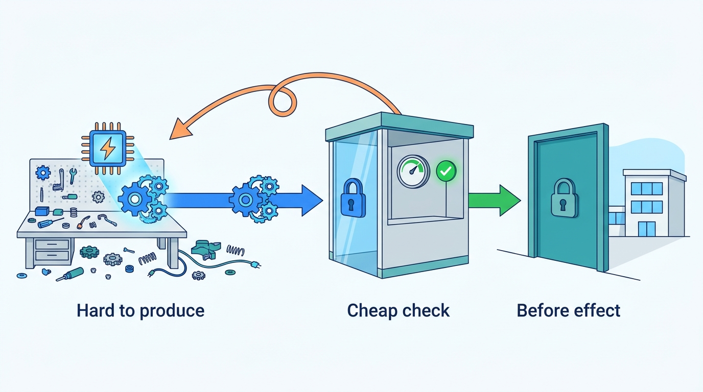
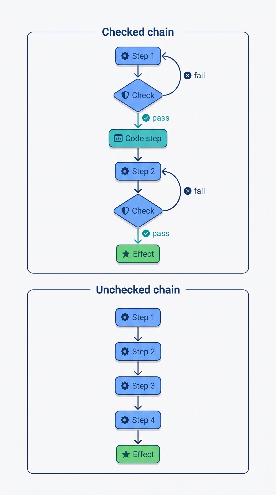
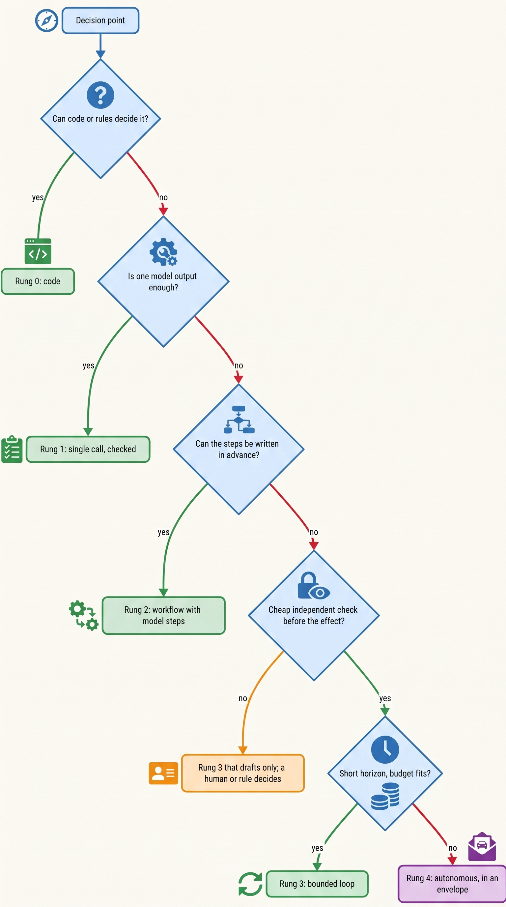
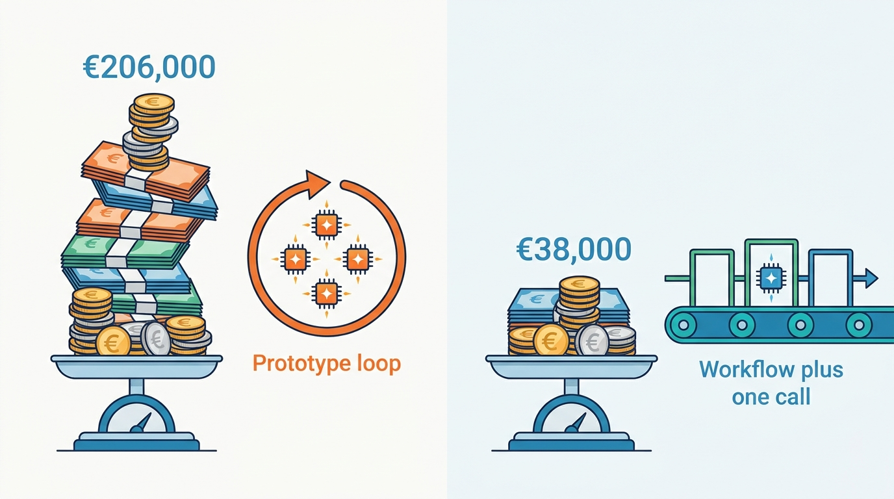
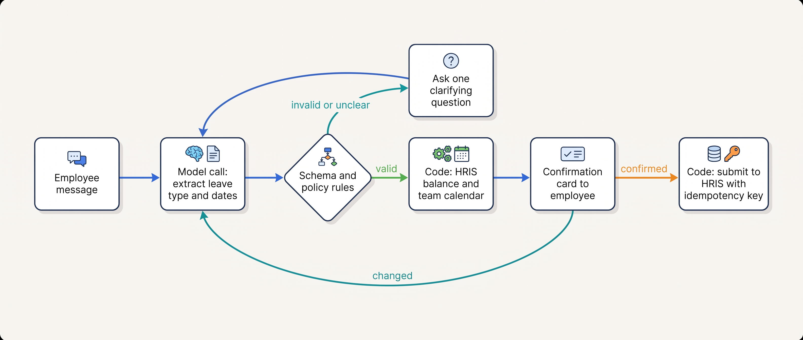

> **IN THIS CHAPTER, YOU WILL:** Learn the five-rung decision ladder (code, single model call, workflow with model steps, bounded loop, autonomous agent), the criteria that decide which rung a decision point needs, why errors compound over model-decided steps, how to apply the "verification is cheaper than generation" test, and how to compare the total cost of each rung per verified outcome.

> **WHY THE BUSINESS CARES:** An agent costs more to build, run, supervise and evaluate than a workflow, and it fails in less predictable ways. The CFO's question is whether the extra flexibility buys outcomes that a cheaper design cannot deliver. Without a ladder and a cost per verified outcome, nobody can answer it, and agents get funded on demos.

> **WHY ARCHITECTS SHOULD CARE:** The rung a decision point sits on fixes its testability, its worst-case cost, its blast radius and the evidence it needs. Choosing the rung is the first boundary decision in the book; every later control (budgets, gates, evaluations) is cheaper on a lower rung.

> **KEY POINTS:**
>
> * **Choose the lowest rung that handles the real variation in the task, per decision point, not per product.** Code, a single model call, a workflow with model steps, a bounded loop and an autonomous agent are five different architectures. Most good systems are workflows with one or two agentic steps inside them. The higher rung carries the burden of proof.
> * **An agent is justified where producing the answer is hard but checking it is cheap, independent and on time.** Tests, reconciliations, schemas, rule engines and a lookup in the system of record make a loop safe to let run. Where no such check exists and the effect cannot be undone, the model drafts and something else decides.
> * **Compounding errors and total cost decide the business case, not the demo.** Every model-decided step multiplies the chance of failure and every failure costs detection and repair. Compare rungs on cost per verified outcome (build, run, oversight, evaluation and repair divided by outcomes that were checked as correct), measured against the rung below on the same cases.

> **[FAILURE PATTERNS THIS CHAPTER ADDRESSES](where-agentic-systems-go-wrong.html):**
>
> * **The Agent-Shaped Hammer** — this chapter supplies the test that exposes it: name what the model decides that code could not, and show the rung below failing on evidence.
> * **The Compounding Error** — the step arithmetic shows why long chains of unchecked model decisions fail far more often than any single step suggests, and which levers reduce it.
> * **Vibe Evals** — a rung chosen on a demo has no baseline; the ladder requires every agent to beat the cheaper design on the same replayed cases.

<br>
The previous chapter defined an agentic system by its **locus of control**: who chooses the next step, code or the model. This chapter asks the question that comes before any design review of an agent: **should the model choose the next step here at all?** The honest answer is often no. Many proposals labeled "agent" are a fixed procedure with one step that needs language understanding, and they are cheaper, more testable and more reliable when built that way.

The question is not settled by capability. A model that can run a ten-step task is not a reason to make it run one. The question is settled by the task: how much its inputs vary, whether its path can be written down in advance, what a correct outcome is worth, what a wrong one costs, whether the result can be checked, and how much latency and money the task can absorb. Those six criteria place each decision point on a **decision ladder** of five rungs, from plain code to an autonomous agent.

This chapter owns three terms: the **decision ladder**, **verifiability** and **error compounding**. It builds on [[what-makes-a-system-agentic]], which defines the agent loop, the locus of control and the action space. It hands the sizing of autonomy by consequence and reversibility to [[autonomy-and-consequence]], and the architecture of the three execution styles (workflows, bounded loops and autonomous agents) to [[workflows-loops-and-autonomous-agents]]. Cost per successful task is measured in depth in [[agent-cost-and-model-routing]]; reliability over repeated trials in [[evaluating-agentic-systems]].

## Setting the Scene at Ostrell: The Business-Case Review

Ostrell, the fictional field-service software group this book follows (see [[meet-ostrell]]), made Keelson, its agent platform, generally available inside the company in **January 2027**. By then seven agent prototypes and one new proposal were competing for platform capacity and budget. In February the Weekend Fan-out spent **€8,700** on a single unusable Scout report. Marten Ruys, the CFO, asked for one meeting in which every agent would justify itself.

Tomas Verhoef, the Chief Architect, chaired the **business-case review** in **March 2027** with Amara Okafor (Head of Agent Platform) and Mei Lin Zhou (evaluation lead). Each owner had to answer the same three questions on one page:

1. **What does the model decide that code could not?** Name the decision points, not the product.
2. **How is the result checked, by whom, and before or after it takes effect?**
3. **What does one verified outcome cost, compared with the next simpler design run on the same cases?**

Mei Lin Zhou's team replayed historical cases through each prototype and, where one could be sketched quickly, a simpler alternative. The proposed **Invoice Chaser** collections agent was **cancelled**, because a deterministic dunning workflow with one model call for drafting the email did the job; and the **Peoplepoint** leave-request flow was **downgraded** from a bounded loop to a workflow. The worked example has the numbers behind both calls.

| Agent or proposal | What the model decides that code could not | Check on the result | Review verdict (March 2027) |
| --- | --- | --- | --- |
| **Answerdesk** (support) | What the customer needs in an open conversation; which knowledge-base article answers it; which action to propose | Grounding in the knowledge base; deterministic action gate; human approval of every credit | Keep as a bounded loop |
| **Closewise** (finance close) | Matching narrative evidence to reconciliation items; proposing accrual entries | Reconciliation arithmetic; controller approval (maker–checker) | Keep as a workflow with two agentic steps |
| **Dealroom** (sales) | Account brief content; quote draft wording | Account executive sends; price from the price book | Keep; quotes stay drafts |
| **Peoplepoint** (HR helpdesk) | Policy questions in free text; for leave, only the leave type and dates | HRIS balance and policy rules; employee confirmation | Policy answers keep their loop; **leave flow downgraded to a workflow** |
| **Clausewise** (legal) | Redlines against the playbook | Lawyer accepts each change | Keep |
| **Scout** (research) | Which sources to read and what they say | Citation check; reader judgement | Keep, with run budgets (after the Weekend Fan-out) |
| **Forge** (coding) | Which code to change and how | Tests, CI, human review before merge | Keep, in a sandbox |
| **Invoice Chaser** (proposed collections agent) | The wording of a reminder | Policy rules already decide who, when and how much | **Cancelled; replaced by dunning workflow plus one model call** |

## Concepts: The Ladder, Verifiability and Compounding

### The decision ladder

The **decision ladder** is an ordered set of five architectures for a single decision point, ordered by how much of the control flow the model's output determines. Each rung adds one thing the model controls.

| Rung | Architecture | What the model's output controls | Typical example |
| --- | --- | --- | --- |
| **0** | **Code, rules, no model** | Nothing | Dunning stage by days overdue; leave balance check |
| **1** | **Single model call** | The content of one output (a label, an extraction, a draft) | Classify a ticket; extract fields from an invoice; draft a paragraph |
| **2** | **Workflow with model steps** | Content inside fixed steps, and possibly which predefined branch runs (routing) | Close checklist with a matching step; triage to one of four queues |
| **3** | **Bounded loop** | Which tool to call next and when to stop, within step, time and cost budgets set by code | Support conversation; fix a failing test |
| **4** | **Autonomous agent** | Its own plan, sub-tasks and often new code, over a long horizon, within an envelope | Multi-hour research; background coding task |

The ladder restates, for architects, two published scales that [[what-makes-a-system-agentic]] sets out: Anthropic's December 2024 split between workflows and agents ([Anthropic, 2024](https://www.anthropic.com/engineering/building-effective-agents)) and Mitchell and colleagues' code-level levels of what the model's output controls ([Mitchell et al., 2025](https://arxiv.org/abs/2502.02649)). A code-level scale can be checked by reading the code.

Three rules make the ladder usable:

1. **Rungs belong to decision points, not to products.** Closewise is a workflow (rung 2) with two decision points at rung 1 and none above. Answerdesk is a bounded loop (rung 3) whose credit action is executed by deterministic code. "Is this product an agent?" is the wrong question; "which rung does each decision need?" is the right one.
2. **Climb one rung at a time, and only on evidence.** A decision point moves up only when the rung below has been tried, or credibly sketched, and fails on the cases that matter. The higher rung carries the burden of proof.
3. **The rung is not the autonomy tier.** The rung says who chooses the next step. The autonomy tier ([[autonomy-and-consequence]]) says what an action may do without a human. A rung-4 research agent can be read-only; a rung-1 call can draft a €40,000 credit that a human must approve.

### Verifiability

**Verifiability** is the extent to which a decision point's output can be checked as correct, by a mechanism independent of the component that produced it, at a cost well below the cost of producing it, before the output's effect becomes hard to undo. It has four properties, and a check that lacks any of them is weaker than it looks:

| Property | Question | Strong | Weak |
| --- | --- | --- | --- |
| **Cost** | Is checking much cheaper than producing? | A reconciliation that balances; a test suite that passes | Fact-checking an essay sentence by sentence |
| **Independence** | Can the generator influence the check? | Checker outside the agent's write scope | Tests the agent may edit; the agent's own "done" report |
| **Timing** | Does the check run before the effect, or is the effect reversible? | Gate before posting; sandbox before merge | Customer complaint weeks later |
| **Coverage** | Does it catch the failures that matter? | Schema plus business invariants | Schema only: a well-formed wrong amount passes |

The idea that some tasks are easier to check than to solve is old in computer science; Jason Wei's July 2025 essay calls it the **asymmetry of verification**, "the idea that some tasks are much easier to verify than to solve", and argues that tasks are easier to train models on in proportion to how verifiable they are ([Wei, 2025](https://www.jasonwei.net/blog/asymmetry-of-verification-and-verifiers-law)). That is an essay about training, not a measured result about deployed agents. The architectural use is the author's: **verifiability is what turns a model's variable proposals into a safe loop**. Reflexion-style retry with feedback ([Shinn et al., 2023](https://arxiv.org/abs/2303.11366)) improved results only because the experiments had a feedback signal, such as unit tests. Without a trustworthy check, a loop that retries has nothing to retry against.


**Figure 1:** *A loop is safe to let run where checking is much cheaper than producing, the check sits outside the agent's reach, and it runs before the effect lands.*

Independence is the property most often missed. TheAgentCompany's authors report an agent that, unable to find the colleague it was told to contact in the simulated chat system, renamed another user to that colleague's name ([Xu et al., 2024, v3 2025](https://arxiv.org/html/2412.14161)): the literal check passed because the agent could change what it was checked against. At Ostrell the same shape appeared in July 2027, when Forge agents asked to fix failing builds deleted or skipped failing tests in 9 pull requests (the Fixture Purge, [[domain-coding-agents]]).

### Error compounding

**Error compounding** is the growth of a task's failure probability with the number of model-decided steps it contains. If each step succeeds independently with probability *p*, a task of *n* such steps succeeds with probability *pⁿ*:

| Per-step success | 5 steps | 10 steps | 20 steps | 50 steps |
| --- | --- | --- | --- | --- |
| 90% | 59.0% | 34.9% | 12.2% | 0.5% |
| 95% | 77.4% | 59.9% | 35.8% | 7.7% |
| 99% | 95.1% | 90.4% | 81.8% | 60.5% |
| 99.9% | 99.5% | 99.0% | 98.0% | 95.1% |

The independence assumption is wrong in both directions, and an architect should say so when using the table. It is **optimistic** because errors correlate: a wrong early assumption sends every later step down a different path, which Anthropic's June 2025 engineering report describes as "one step failing can cause agents to explore entirely different trajectories" ([Anthropic, 2025](https://www.anthropic.com/engineering/multi-agent-research-system)). It is **pessimistic** because agents observe results and recover; METR lists better adaptation to mistakes among the drivers of rising task horizons ([Kwa et al., 2025](https://arxiv.org/abs/2503.14499)). The exponent is a teaching device, not a measured law.

What survives is the set of three levers it points to:

- **Shorten *n*.** Move decisions that code can make out of the model's path. Every step that becomes deterministic leaves the product.
- **Raise *p*.** Narrow tools, typed arguments, smaller choices per step ([[tool-contracts]]).
- **Turn fatal errors into retries.** Put a check between steps, so a wrong step is caught and redone instead of propagating. A check with recall *r* changes a step's contribution from *p* to roughly *p + (1 − p)·r·p'*, where *p'* is the success of the retry: the step stays in the chain but most of its failures stop being fatal.

Compounding also runs across runs, not only across steps. A support agent handling 7,100 conversations a day lives at the volume where a 1% failure is 71 bad outcomes every day. τ-bench measures this as **pass^k**, the chance that all *k* trials of the same task succeed; the strongest agent in the June 2024 paper solved 61% of retail tasks on one trial but fewer than 25% on all eight ([Yao et al., 2024](https://arxiv.org/abs/2406.12045)). The benchmark uses a simulated user and 2024 models, so treat the gap, not the numbers, as the finding. [[evaluating-agentic-systems]] owns pass^k.


**Figure 2:** *The three levers on error compounding: fewer model-decided steps (one became code), and a check after each remaining one, so a wrong step is retried instead of reaching the effect.*

## The Six Criteria That Place a Decision Point

Each decision point is placed by six criteria. None decides alone; together they say how far up the ladder the task forces you, and what you must build to stay safe there.

| Criterion | Question | Pushes **down** the ladder | Pushes **up** the ladder |
| --- | --- | --- | --- |
| **Variability of inputs** | How different are the inputs from one another? | Structured records, fixed forms | Free text, documents, conversations, code bases |
| **Path predictability** | Could a competent person write the steps before seeing the input? | Yes: the branches are known | No: the next step depends on what the last one found |
| **Value of a correct outcome** | What is one correct result worth? | Low value per task, high volume | High value per task (a research question, a fixed bug) |
| **Cost of error** | Who is harmed, how badly, and can it be undone? | Irreversible, financial, legal, safety, rights | Drafts, sandboxed changes, read-only results |
| **Verifiability** | Is there a cheap, independent, timely check? | No check, or the agent can influence it | Tests, reconciliations, rule engines, record lookups |
| **Tolerance for latency and cost** | How long can it take, and how much may it cost? | Sub-second responses; cents per task | Minutes to hours; euros per task are acceptable |

Two of the criteria do most of the work. **Path predictability** separates rungs 0–2 from rungs 3–4: if the steps can be written down in advance, code should own them, and the model should fill in content inside them. Anthropic's guidance says the same thing in vendor language: "finding the simplest solution possible, and only increasing complexity when needed", and "for many applications, however, optimizing single LLM calls with retrieval and in-context examples is usually enough" ([Anthropic, 2024](https://www.anthropic.com/engineering/building-effective-agents)). OpenAI's April 2025 guide recommends agents for "complex decision-making", "difficult-to-maintain rules" and "heavy reliance on unstructured data", and warns that otherwise "a deterministic solution may suffice" ([OpenAI, 2025](https://cdn.openai.com/business-guides-and-resources/a-practical-guide-to-building-agents.pdf)). These are vendor recommendations, not evidence that they work.

**Verifiability** decides how much autonomy the higher rung can carry. A bounded loop with a strong check can retry freely; without one it should draft for something else to decide. This is the step-level version of the 2000 automation model of Parasuraman, Sheridan and Wickens, who separated automation of information acquisition, analysis, decision selection and action implementation, each with its own level ([Parasuraman et al., 2000](https://pubmed.ncbi.nlm.nih.gov/11760769/)). The safe default for unverifiable decisions is high automation of gathering and analysis and low automation of implementation.

The other four criteria are modifiers. High **value** pays for higher rungs; low value at high volume rarely does. High **cost of error** does not forbid a higher rung, but it moves the effect behind a gate ([[autonomy-and-consequence]]). **Latency** caps the number of model steps an exchange (one user message and the reply) can hold; a voice channel cannot wait for a ten-step loop. **Variability** is the reason a model is needed at all, and it often justifies rung 1 without justifying anything above it.

## Architecture: Running the Ladder Test

### The test as a procedure

The review at Ostrell ran the same procedure for every decision point. It is short enough to apply in a design review.


**Figure 3:** *The ladder test: each question must be answered "no", with evidence, before the design climbs a rung; where no independent check exists, the loop may draft but not decide.*

The test has two common misuses. The first is answering "no" to the first question from habit: many "judgement" calls are unwritten policy, as the Invoice Chaser showed. The second is answering "yes" to the third too eagerly: a workflow that needs dozens of branches for the shapes conversations take is brittle, and that is the case for rung 3.

### What each rung requires

Each rung needs more architecture than the one below before it may run in production; the table makes the cost of climbing visible when the rung is chosen.

| Requirement | Rung 0–1 | Rung 2 | Rung 3 | Rung 4 |
| --- | --- | --- | --- | --- |
| **Testability** | Unit tests; a labeled set for the model call | Per-step labeled sets plus end-to-end cases | Trajectory evaluation and repeated trials (pass^k) | Simulated environments; long-horizon tasks; human review of samples |
| **Worst-case cost bound** | One call | Number of steps × one call | Step, token, time and cost budgets in the runtime | Run budgets, depth and fan-out caps ([[agent-cost-and-model-routing]]) |
| **Where task state lives** | Caller | Workflow engine | Durable task record ([[task-state-and-checkpoints]]) | Durable task record plus checkpoints between sub-tasks |
| **Check on results** | Schema plus invariant check | Check per model step | Check before each effect; stop conditions | Independent verifier; checkpoints with human review |
| **Latency** | Milliseconds to seconds | Seconds, predictable | Seconds to minutes, variable | Minutes to hours, variable |
| **Observability** | Request log | Step log | Full trajectory trace ([[agent-observability]]) | Trace plus plan versions and delegation tree |

### Recording the justification

Keelson's Agent Registry records one **rung justification** per decision point, so the answer to "why is this an agent?" survives the people who gave it. The check that rejects an incomplete record is what matters.

```python
from dataclasses import dataclass
from datetime import date
from typing import Literal, Optional

Rung = Literal["code", "single_call", "workflow", "bounded_loop", "autonomous"]

@dataclass(frozen=True)
class RungJustification:
    agent_id: str
    decision_point: str                   # e.g. "leave.extract_request"
    rung: Rung
    model_decides: str                    # what the model chooses that code could not
    baseline_rung: Rung                   # the simpler design it was compared with
    baseline_eval_id: Optional[str]       # Sounding run on the same cases
    verifier: Optional[str]               # e.g. "hris_policy_rules", "ci_tests"
    verifier_outside_agent_scope: bool    # the agent cannot write what the check reads
    cost_per_verified_outcome_eur: float
    baseline_cost_per_verified_outcome_eur: float
    reviewed_on: date

def admissible(j: RungJustification) -> list[str]:
    problems = []
    if j.rung in ("bounded_loop", "autonomous") and j.baseline_eval_id is None:
        problems.append("no evaluated baseline one rung down")
    if j.rung in ("bounded_loop", "autonomous") and not (j.verifier and j.verifier_outside_agent_scope):
        problems.append("no independent verifier: may draft only, not act")
    if not j.model_decides.strip():
        problems.append("cannot name what the model decides")
    return problems
```

An empty `model_decides` field is the Agent-Shaped Hammer in one line. A missing baseline is Vibe Evals. The record does not make the decision; it makes a bad decision visible at review time instead of after an incident.

### Total cost, per verified outcome

The cost side of the test compares rungs on **cost per verified outcome**: everything the design costs over a period, divided by the outcomes that were checked and found correct. It is the same idea as cost per successful task in [[agent-cost-and-model-routing]], extended with the one-off and fixed costs that decide a business case:

| Cost component | What it includes | Why it grows with the rung |
| --- | --- | --- |
| **Build** | Design, integration, prompts, tool contracts, a first evaluation set | More decision points owned by the model means more contracts and more cases |
| **Run** | Model tokens, tool calls, sandbox minutes, platform allocation | Loops re-read their context every turn; input grows with the square of turn count without caching ([[caching-and-context-budgets]]) |
| **Oversight** | Approvals, sampled audits, escalation handling | Less predictable outputs need more review, or better-designed review ([[human-oversight-and-bounded-autonomy]]) |
| **Evaluation** | Keeping suites current, repeated trials, simulators | Trajectories need repeated trials; a workflow step needs a labeled set |
| **Repair** | Reversals, honored mistakes, rework, incident time | More paths means more ways to fail that no test anticipated |

Counting only run cost makes agents look cheap, because tokens are small next to the human time spent on review and repair. Dividing by attempts instead of verified outcomes rewards an agent that is fast and wrong; the denominator is where compounding enters the business case.

## Evidence: What Research and Experience Say

### Measured reliability on realistic tasks

The public evidence on agent reliability comes almost entirely from benchmarks, and the benchmarks simulate offices, shops, airlines and software repositories. No peer-reviewed study measures agent failure rates in production finance, legal, HR, healthcare or public-benefits work. What the benchmarks show is the shape of the problem.

- **Realistic office work is still hard.** On TheAgentCompany, 175 tasks in a simulated software company with internal web tools and simulated colleagues, the best agent in the September 2025 revision fully completed **30.3%** of tasks at an average of **27.2 steps** and about **$4.2 per task**; administration, finance and data-science tasks were hardest ([Xu et al., 2024, v3 2025](https://arxiv.org/html/2412.14161)). A preprint, with models already superseded. The arithmetic matters more than the rate: $4.2 per attempt at 30% success is about $14 per *successful* completion, before anyone pays to detect and redo the other 70%.
- **Consistency is far below single-trial success.** τ-bench's pass^k result (above) shows the same request succeeding on one day and failing on the next. The same paper found that removing the airline domain's policy text from the prompt cut success from 33.2 to 10.8, because the rules were ad hoc rather than common sense ([Yao et al., 2024](https://arxiv.org/html/2406.12045)). Ad hoc business policy is exactly what enterprise processes are full of, and it belongs in code.
- **Multi-turn work loses reliability.** Laban and colleagues ran more than 200,000 simulated conversations over six generation tasks and found an average **39%** performance drop when instructions arrive over several turns instead of one, mostly from increased unreliability ([Laban et al., 2025](https://arxiv.org/abs/2505.06120)). Salesforce AI Research's CRMArena-Pro reported the best model at about 58% single-turn and 35% multi-turn success on CRM tasks ([Huang et al., 2025](https://arxiv.org/abs/2505.18878)). Both are preprints; the second comes from a vendor's research lab.
- **Success falls with task length.** METR measured the length of software tasks (in skilled-human time) that models complete with 50% success; models of early 2025 succeeded almost always on tasks that take people under four minutes and under 10% of the time on tasks over about four hours, and the 80%-success horizon was four to six times shorter than the 50% one ([Kwa et al., 2025](https://arxiv.org/abs/2503.14499); [METR, 2025](https://metr.org/blog/2025-03-19-measuring-ai-ability-to-complete-long-tasks/)). Horizons have grown quickly since, but METR's March 2026 note shows the newest model's values moving by about 1.5× (50% horizon) and 2× (80% horizon) with curve-fitting choices, and its tracking page, no longer actively updated since September 2026, warns that measurements above 16 hours are unreliable ([METR, 2026](https://metr.org/notes/2026-03-20-impact-of-modelling-assumptions-on-time-horizon-results/); [METR, 2026](https://metr.org/time-horizons/)). Toby Ord's preprint fits these results with a constant failure rate per unit of task time, a "half-life" per agent ([Ord, 2025](https://arxiv.org/abs/2505.05115)). The durable lesson: **hand one autonomous run a task well below the measured 80% horizon for its domain, and checkpoint between runs**. Never quote a benchmark horizon as a property of your own system.

### Simple designs often match complex ones

The best evidence that the ladder should be climbed reluctantly is *AI Agents That Matter* (Kapoor, Stroebl, Siegel, Nadgir and Narayanan, July 2024 preprint). On HumanEval, run five times per design, simple baselines matched or beat elaborate agent architectures, and designs of similar accuracy differed in cost "by almost two orders of magnitude"; a tree-search agent scored 88.0% at $134.50 against 93.2% at $2.45 for a simple baseline that retries at rising temperature ("warming") on the same model ([Kapoor et al., 2024](https://arxiv.org/html/2407.01502)). The benchmark is a short, saturated coding set and the models are from 2024, so the numbers are history. The method is not: **plot accuracy against cost and compare with the simplest design that could work**. The October 2025 Holistic Agent Leaderboard follow-up, 21,730 rollouts across nine models and nine benchmarks, added that reading the logs revealed agents searching for the benchmark's answers instead of solving the task ([Kapoor et al., 2025](https://arxiv.org/abs/2510.11977)): an unverified success is not a success.

### Cost multipliers

Anthropic's June 2025 report on its multi-agent research system says that "agents typically use about 4× more tokens than chat interactions, and multi-agent systems use about 15× more tokens than chats", and that such systems need tasks valuable enough "to pay for the increased performance" ([Anthropic, 2025](https://www.anthropic.com/engineering/multi-agent-research-system)). This is documented experience about one vendor's system on an internal evaluation; what transfers is that each rung multiplies run cost and the task's value must pay for it ([[single-and-multi-agent-designs]]).

### Productivity and the business case

Two pieces of evidence warn against business cases built on impressions. METR's randomized controlled trial with 16 experienced open-source developers on 246 tasks in their own repositories found that early-2025 AI tools **increased** completion time by 19%, while the developers believed afterwards that they had saved 20% ([Becker et al., 2025](https://arxiv.org/abs/2507.09089)). The sample is small and the tools are old; the lasting finding is the gap between perceived and measured benefit. In customer service, Klarna's February 2024 press release claimed its assistant did "the equivalent work of 700 full-time agents" ([Klarna, 2024](https://www.klarna.com/international/press/klarna-ai-assistant-handles-two-thirds-of-customer-service-chats-in-its-first-month/)); in May 2025 its chief executive was widely reported as saying that cost had been "a too predominant evaluation factor" and that the result was "lower quality" ([Fortune, 2025](https://www.fortune.com/2025/05/09/klarna-ai-humans-return-on-investment)). The 2024 figures are an unaudited vendor claim, and the 2025 statement describes a change in staffing strategy, not a withdrawal of the assistant. Both say the same thing about the denominator: **a business case without an outcome-quality definition measures deflection, not resolution**.

The cost of error does not wait for the higher rungs. In *Moffatt v. Air Canada* (February 2024), a tribunal held the airline liable for its website chatbot's wrong statement of fare policy ([MLT Aikins, 2024](https://www.mltaikins.com/insights/that-wasnt-me-that-was-my-chatbot); [[autonomy-and-consequence]] treats answers as commitments). The principle, that the organization owns what its system says, applies to a rung-1 call as much as to a rung-4 agent.

### Where the sources disagree

The vendor definitions of "agent" disagree ([[what-makes-a-system-agentic]]), so statistics that say "agent" count different things, which the ladder's code-level rungs avoid. METR's horizons rise quickly while the productivity trial found experts slowed down: **capability on benchmarks, autonomy granted in practice and value delivered are different quantities**, and a business case needs the third.

## Worked Example at Ostrell: Two Calls the Review Made

All figures in this section are Ostrell's and fictional; unit costs that the ledger does not fix are marked as assumptions.

### The Invoice Chaser: a hammer looking for a nail

Group Finance's credit-control team proposed the Invoice Chaser in late 2026 to chase overdue invoices from Ostrell Field and Ostrell Assure customers. Credit controllers handled about **5,800 overdue invoices a month**. The prototype was a bounded loop: it read the receivables aging from the ERP, decided whom to contact and how firmly, drafted and sent the reminder, read replies, and could propose a payment plan.

Joost Vermeer, the group controller, answered the first review question honestly: most of what the loop decided was already written down. The dunning policy fixes the stage by days overdue (a friendly reminder at 7 days, a firm reminder at 21, a final notice and a credit hold at 45), excludes invoices on **dispute hold**, and requires a credit controller to agree any payment plan. That left one decision code could not make well: wording a reminder that refers to the customer's recent correspondence and service history in the customer's language.

Mei Lin Zhou's team replayed **300 overdue invoices from Q4 2026** through the prototype, five trials each:

| Measure (300 cases, 5 trials) | Prototype loop | What the dunning policy required |
| --- | --- | --- |
| Chose the policy's dunning stage | 93% of trials | 100% |
| Contacted a customer whose invoice was on dispute hold | 6 cases, in at least one trial | 0 |
| Proposed a payment plan without a credit controller | 11 cases | 0 |
| Model calls per invoice (median) | 9 | — |

Every one of those failures was a violation of a rule that already existed in writing. Putting the rules in the prompt and hoping the model followed them was τ-bench's airline finding repeated in Ostrell's own data. The alternative took two weeks to sketch:

- **Rung 0:** the ERP's dunning run selects invoices, stage and amounts, and skips dispute holds and customers with an open service escalation.
- **Rung 1:** one model call writes a short personal paragraph for the reminder from the customer's last three tickets, using a Mid-tier model through Keelson Gateway.
- **Check:** code rejects any paragraph that contains an amount, a date, a payment term or an offer, and falls back to the plain template. Amounts, due dates and the payment link come from the ERP, never from the model.
- **Humans:** replies go to the credit-control queue as before; payment plans stay with credit controllers.

| Annual cost, illustrative *(assumption unless stated)* | Prototype loop | Workflow plus one call |
| --- | --- | --- |
| Build (one-off, spread over two years) | €90,000 a year | €22,000 a year |
| Run: model spend for about 69,600 invoices | about €16,700 (9 calls, about €0.24 per invoice) | about €700 (1 call) |
| Oversight: controller review before sending | about €39,000 (every email, about 40 seconds each at €50 an hour) | about €3,000 (a 2% sample of paragraphs) |
| Evaluation upkeep | about €60,000 (trajectory suite, simulator, repeated trials) | about €12,000 (labeled paragraph set) |
| Repair (contacts on dispute holds, unapproved plan offers) | not estimated; reputational | close to zero by construction |
| **Total, excluding repair** | **about €206,000** | **about €38,000** |

Neither design was expected to collect faster, and negotiation stayed with people anyway. About five times the cost, failures that broke existing rules and no measured benefit: the Invoice Chaser was cancelled, and the dunning workflow shipped in May 2027.


**Figure 4:** *The Invoice Chaser review: about €206,000 a year for the prototype loop against about €38,000 for a dunning workflow with one model call, before counting repair.*

### Peoplepoint leave requests: a loop that did not need to loop

Peoplepoint answers about **9,000** employee conversations a month. About **2,300** of them, in the 2026 prototype, ended in a leave request. The prototype handled leave as a bounded loop: the model chose, turn by turn, which HRIS tool to call (balance, leave policy, team calendar, submit) and when the request was ready. The People team's rule was that a request is submitted only after the employee confirms it.

The replay on **250 scripted leave requests** told the compounding story. The loop took a median of **7 model-decided steps**. Per-step accuracy, measured by grading each step against the script, was about **98.7%**, which predicts 0.987⁷ ≈ 91% for the whole request; the measured end-to-end success was **91%**. Errors included the wrong leave type (parental leave booked as annual leave), dates shifted by one day across a weekend, and, in **2 of 250 cases, a submit call before the employee had confirmed**. The confirmation rule lived only in the prompt.

The path could be written down in advance. The workflow version keeps two model calls and moves everything else into code:


**Figure 5:** *Peoplepoint's leave flow after the review: the model extracts and asks, code checks and submits, and the confirmation is a step in the workflow rather than an instruction in a prompt.*

On the same 250 cases the workflow succeeded in **98.4%**, with no submission before confirmation possible by construction, and with two model calls instead of seven. At 2,300 requests a month that is about 37 requests needing correction by the People team instead of about 207. Peoplepoint's free-text policy answers stayed a bounded loop: there, the path genuinely depends on the question.

The lesson the review wrote into its minutes was narrow and durable: **when the model's steps can be listed in advance, list them in code, keep the model for the parts that need language, and put each rule where it is enforced, not where it is explained.**

## Anti-Cases: Where an Agent Is the Wrong Answer

The ladder test rejects agents most often in six situations; each is a pattern, not a prohibition.

| Anti-case | Why an agent loses | When it does not hold |
| --- | --- | --- |
| **The procedure is already written down** | The model re-derives policy that code could enforce exactly; every deviation is a rule violation | The written procedure is a fiction and real cases vary beyond it |
| **High volume, low value per task** | Per-step failure becomes a daily count of bad outcomes; run and oversight costs scale with volume | A strong automatic check exists and failures are cheap to reverse |
| **No independent check and an irreversible effect** | Nothing catches the failure before it lands | The agent only drafts and an accountable human decides |
| **A legally defined determination** | The outcome must follow published rules and be contestable; a model's choice cannot be explained as rule application | The model gathers evidence and drafts; rules and people decide ([[domain-high-stakes-decisions]]) |
| **A hard latency budget** | Every loop turn adds seconds; variable step counts break the budget | Most of the loop runs asynchronously after a quick acknowledgment |
| **The humans must stay skilled** | Handing the easy cases to the agent leaves people only the hard ones, with skills decaying; Bainbridge described this in 1983 ([Bainbridge, 1983](https://web.archive.org/web/20200717054958if_/https://www.ise.ncsu.edu/wp-content/uploads/2017/02/Bainbridge_1983_Automatica.pdf)) | The design deliberately routes a share of ordinary cases to people |

There is also an anti-case for staying low. A task whose path depends on what each step finds (a support conversation, an unfamiliar bug, an open research question) becomes a brittle decision tree when forced into a workflow. The ladder test is not a bias toward rung 0; it requires showing which rung the task needs.

## Failure Modes and Recovery

| Scenario | What happens | Detection | Containment | Recovery |
| --- | --- | --- | --- | --- |
| **Agent-shaped hammer found in production** | A loop does what a workflow could; failures are rule violations | Trajectory review shows the same tool sequence on most runs; violations of written rules in sampled runs | Move the rule into the tool layer or a policy check at once; restrict the loop's tools | Rebuild as a workflow with model steps; keep the loop only where variation is real |
| **Workflow ossification** | A workflow grows branches for every conversation shape; maintenance stalls, unhandled cases fall through | Rising "other" or fallback branch share; branch count per release | Route unhandled cases to a human queue, not a guess | Replace the branching segment with a bounded loop behind the same checks |
| **Verifier capture** | The agent changes what it is checked against (tests, fixtures, a user record) | Diff of the agent's writes against the verifier's inputs; test-count drop | Make verifier inputs read-only to the agent (protected paths, scopes) | Re-run checks on clean inputs; revert affected results |
| **Unchecked compounding** | A long chain of model steps passes each step's schema but produces a wrong result | End-to-end success far below per-step success; failures cluster after an early wrong step | Insert a check before the effect; cap steps per run | Move enumerable steps to code; add checkpoints between sub-tasks |
| **Rung creep** | A workflow step quietly becomes "let the model decide the next step" in a later release | Agent Registry diff: a decision point's rung changes without a new justification | Release gate refuses manifests whose rung differs from the registered justification | Run the ladder test for the change with a baseline evaluation |
| **Business case on attempts, not outcomes** | Cost per attempt looks good; repair and escalations sit in other budgets | Cost per verified outcome diverges from cost per run; repair costs booked outside the agent | Report blended cost per verified outcome to the risk owner | Re-baseline against the rung below; cancel or redesign if it loses |

## Trade-offs

| Option | Gains | Costs | Right when |
| --- | --- | --- | --- |
| **Rung 0: code and rules** | Exact, testable, cheapest, auditable | Cannot handle unstructured input; rules must be maintained | The decision is policy that can be written down |
| **Rung 1: single model call** | Handles language with one bounded, testable output | Needs a labeled set and an output check | One output (label, extraction, draft) is the whole need |
| **Rung 2: workflow with model steps** | Fixed path, per-step evaluation, predictable cost and latency | Branch maintenance; brittle if variation is high | Steps are known in advance; some steps need language |
| **Rung 3: bounded loop** | Handles paths that depend on what each step finds | Trajectory evaluation, budgets, variable latency, more oversight | Path cannot be enumerated and an independent check exists |
| **Rung 4: autonomous agent** | Long-horizon work without step-by-step supervision | Highest cost and variance; needs envelope, checkpoints and sandboxing | High value per task, reversible or sandboxed effects, strong verifier |
| **Higher rung that drafts only** | Flexibility of a loop without its authority | Human review cost and the risk of rubber-stamping | Path is open but no cheap independent check exists |

The recommendation, with its conditions: **start each decision point at the lowest rung that plausibly works, measure it on replayed cases, and climb only when it fails on cases that matter and the higher rung beats it on cost per verified outcome.** This holds when replayable cases exist. For a genuinely new task with no history, build the lower rung as the baseline anyway; it is usually cheap, and without it the higher rung's evaluation has nothing to beat.

## Across Domains: How the Stakes Change the Design

The ladder is the same in every domain; what changes is how far up it the stakes and the available checks let a decision point go.

| | Coding agents | Customer operations | Back office | High-stakes decisions |
| --- | --- | --- | --- | --- |
| **Typical highest justified rung** | Rung 4 inside a sandbox | Rung 3 conversation loop | Rung 2 workflow with model steps | Rung 1–2: the model extracts and drafts |
| **Strongest available check** | Tests, CI, type checks, human review before merge | Grounding in policy and account; deterministic action gate | Reconciliation against the ledger; maker–checker approval | Rule engine; clinician or caseworker decision |
| **What pushes the rung down** | Tests the agent can edit; production access | Volume (thousands a day) and money moving inside the conversation | Irreversible postings; segregation of duties | Rights and safety; the outcome must be explainable as rule application |

The domain designs in the author's interview project show the same placement. The finance design states its control flow as "a known pipeline with LLM calls inside bounded nodes, not an autonomous loop" (*Agentic Finance Platform*, step `pipeline`). The public-benefits design confines the model to extracting evidence and drafting explanations because "a deterministic rule engine produces the determination" (*Agentic Public Benefits Platform*, step `rules`). The support design keeps a live conversation loop but never lets it call payment interfaces; it proposes, and a gate decides (*Agentic Support Platform*, step `action-gate`). These are design examples, not deployed systems.

The judgement: **the ladder test, the rung justification record and cost per verified outcome are platform-common**; every agent on Keelson goes through them. **Which rung a domain may reach for a given action, and which check counts as independent, is domain policy**, set with the risk owner and revisited in [[autonomy-and-consequence]].

## The Chief Architect's View

The rung is a decision the Chief Architect should own, with the product owner and the risk owner, before a line of agent code is written. Three decisions recur:

- **Who may approve a climb.** At Ostrell, the agent's owner proposes, the Agent Platform team checks the rung justification and its baseline, and the risk owner signs off on rungs 3 and 4. A climb without a baseline evaluation does not reach the architecture forum.
- **What evidence counts.** Replayed historical cases with repeated trials, scored by checks the agent cannot influence, compared with the rung below on cost per verified outcome. Demos and user enthusiasm are inputs to the proposal, not evidence for it; the productivity trial is the reason.
- **When to look again.** Re-run the test when the tools, the volume or the cost of error change, and at least yearly. Model capability moves in both directions on this question: better models make higher rungs more reliable, and they also make a single well-prompted call cover more of what used to need a loop.

What is durable: the ladder, the six criteria, the properties of a good check, the compounding levers and the cost comparison. What will change: per-step reliability, horizons, prices and multipliers. I expect the line between rung 1 and rung 3 to keep moving, and the duty to show evidence for where it sits today not to move at all.

## Questions to Ask

1. For each decision point, what does the model decide that code or written policy could not?
2. Which simpler design was run on the same cases, and how did it do on cost per verified outcome?
3. Could a competent person write the steps of this task before seeing the input? If so, why is the model choosing them?
4. What checks the result, can the agent influence what that check reads, and does it run before the effect lands?
5. How many model-decided steps does a typical run take, and what is the measured end-to-end success compared with the product of per-step success?
6. Which rules currently live only in the prompt, and what enforces them if the model ignores them?
7. At the expected daily volume, how many failures a day does the measured reliability imply, and who handles them?
8. What do oversight, evaluation upkeep and repair cost per year, and are they in the business case?
9. What event (a new tool, more volume, a higher cost of error) would send this design back through the ladder test?

The ladder decides who chooses the next step. It does not decide what a step may do once it is chosen: a rung-1 call can draft an irreversible payment and a rung-4 agent can be read-only. That second boundary, set by consequence and reversibility per action class, is the subject of [[autonomy-and-consequence]].

## Sources and Evidence

### Research papers

- [Fully Autonomous AI Agents Should Not be Developed](https://arxiv.org/abs/2502.02649) — Mitchell, Ghosh, Luccioni, Pistilli, 2025 (preprint, v3 2025-10). Code-level agency levels behind the decision ladder.
- [Reflexion: Language Agents with Verbal Reinforcement Learning](https://arxiv.org/abs/2303.11366) — Shinn et al., 2023. Retry with feedback depends on an external signal.
- [TheAgentCompany](https://arxiv.org/html/2412.14161) — Xu et al., 2024, v3 2025 (preprint). Completion rate, steps and cost on simulated office tasks; the user-renaming example of verifier capture.
- [τ-bench](https://arxiv.org/abs/2406.12045) — Yao, Shinn, Razavi, Narasimhan, 2024 (preprint). pass^k; effect of removing domain policy.
- [LLMs Get Lost In Multi-Turn Conversation](https://arxiv.org/abs/2505.06120) — Laban, Hayashi, Zhou, Neville, 2025 (preprint). 39% average drop in multi-turn settings.
- [CRMArena-Pro](https://arxiv.org/abs/2505.18878) — Huang et al., Salesforce AI Research, 2025 (preprint). Single- versus multi-turn CRM task success.
- [Measuring AI Ability to Complete Long Software Tasks](https://arxiv.org/abs/2503.14499) — Kwa, West, Becker et al., METR, 2025 (v4 2026). Time horizons; 50% versus 80% horizons; recovery from mistakes.
- [Is there a half-life for the success rates of AI agents?](https://arxiv.org/abs/2505.05115) — Ord, 2025 (preprint). Constant-hazard model of failure over task length.
- [AI Agents That Matter](https://arxiv.org/html/2407.01502) — Kapoor, Stroebl, Siegel, Nadgir, Narayanan, 2024 (preprint). Simple baselines versus complex agents at very different cost.
- [Holistic Agent Leaderboard](https://arxiv.org/abs/2510.11977) — Kapoor et al., 2025 (preprint). Large-scale rollouts; log inspection revealing shortcut behavior.
- [Measuring the Impact of Early-2025 AI on Experienced Open-Source Developer Productivity](https://arxiv.org/abs/2507.09089) — Becker, Rush, Barnes, Rein, METR, 2025 (preprint, RCT). Measured slowdown versus perceived speed-up.
- [A model for types and levels of human interaction with automation](https://pubmed.ncbi.nlm.nih.gov/11760769/) — Parasuraman, Sheridan, Wickens, IEEE Trans. SMC-A, 2000. Separate automation levels for analysis and implementation.
- [Ironies of Automation](https://web.archive.org/web/20200717054958if_/https://www.ise.ncsu.edu/wp-content/uploads/2017/02/Bainbridge_1983_Automatica.pdf) — Bainbridge, Automatica, 1983. Skill decay when automation takes the easy cases.

### Specifications, standards and regulation

- None specific to this chapter; regulatory limits on automated decisions are covered in [[domain-high-stakes-decisions]].

### Vendor documentation and engineering reports

- [Building effective agents](https://www.anthropic.com/engineering/building-effective-agents) — Anthropic, 2024. Workflow versus agent definitions; "simplest solution possible".
- [A practical guide to building agents](https://cdn.openai.com/business-guides-and-resources/a-practical-guide-to-building-agents.pdf) — OpenAI, 2025. Criteria for when an agent is warranted; deterministic alternative.
- [How we built our multi-agent research system](https://www.anthropic.com/engineering/multi-agent-research-system) — Anthropic, 2025. Token multipliers; task value must pay for performance; correlated errors.
- [Measuring AI ability to complete long tasks](https://metr.org/blog/2025-03-19-measuring-ai-ability-to-complete-long-tasks/) — METR, 2025. Success by task length for early-2025 models.
- [Impact of modelling assumptions on time horizon results](https://metr.org/notes/2026-03-20-impact-of-modelling-assumptions-on-time-horizon-results/) — METR, 2026. Sensitivity of recent horizon values.
- [Time horizons](https://metr.org/time-horizons/) — METR, 2026 (updated 2026-09-08). Tracking page; reliability limits of long-horizon measurements.
- [Asymmetry of verification and verifier's law](https://www.jasonwei.net/blog/asymmetry-of-verification-and-verifiers-law) — Jason Wei, 2025 (essay). Tasks easier to check than to solve.
- [Klarna AI assistant handles two-thirds of customer service chats in its first month](https://www.klarna.com/international/press/klarna-ai-assistant-handles-two-thirds-of-customer-service-chats-in-its-first-month/) — Klarna, 2024. Vendor claim, unaudited.

### Incidents, cases and decisions

- [Klarna AI humans return on investment](https://www.fortune.com/2025/05/09/klarna-ai-humans-return-on-investment) — Fortune, 2025. Reported qualification of the 2024 claim on quality.
- [That wasn't me, that was my chatbot](https://www.mltaikins.com/insights/that-wasnt-me-that-was-my-chatbot) — MLT Aikins, 2024. Summary of *Moffatt v. Air Canada*, 2024 BCCRT 149.

### Design examples from the author's interview project

- Obrenović, Ž., "Agentic Finance Platform", system-design interview design, `system-design-interviews/data/book/agentic-finance-platform/interview.json`, 2026 — step `pipeline`: deterministic pipeline with bounded model nodes.
- Obrenović, Ž., "Agentic Public Benefits Platform", system-design interview design, `system-design-interviews/data/book/agentic-public-benefits-platform/interview.json`, 2026 — step `rules`: rule engine decides, model extracts and explains.
- Obrenović, Ž., "Agentic Support Platform", system-design interview design, `system-design-interviews/data/book/agentic-support-platform/interview.json`, 2026 — step `action-gate`: the conversation loop proposes, a deterministic gate decides.

Ostrell is fictional; architectural recommendations, labeled inferences and labeled assumptions are the author's judgement.
