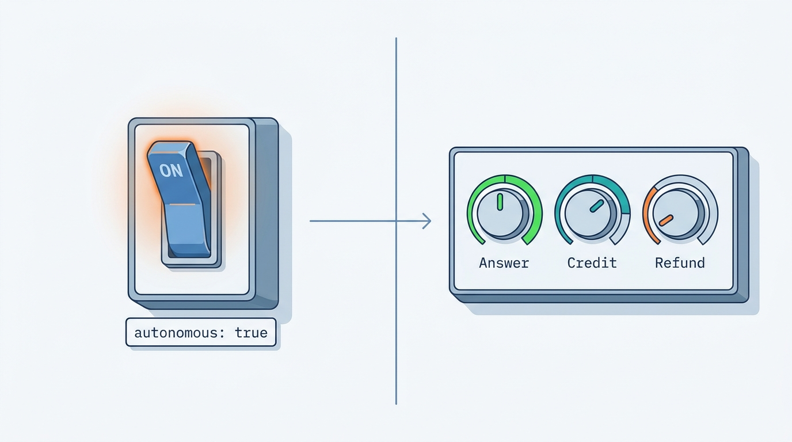
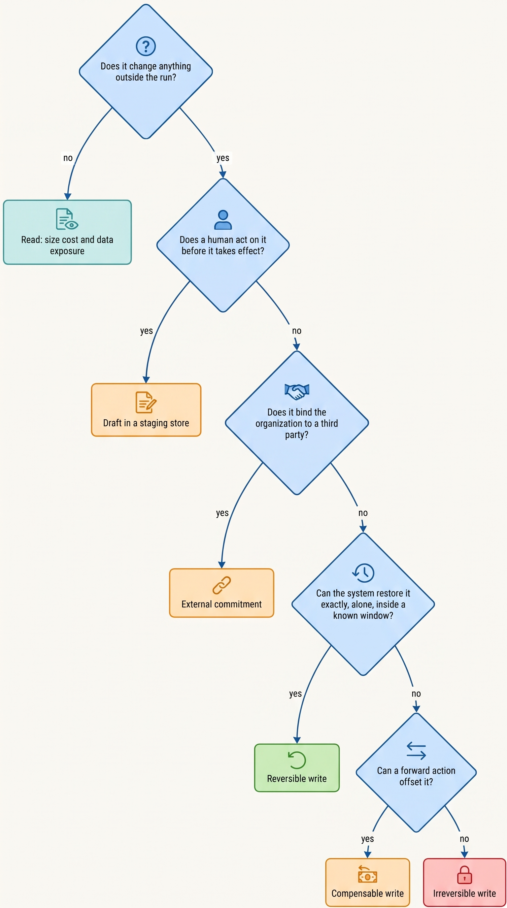
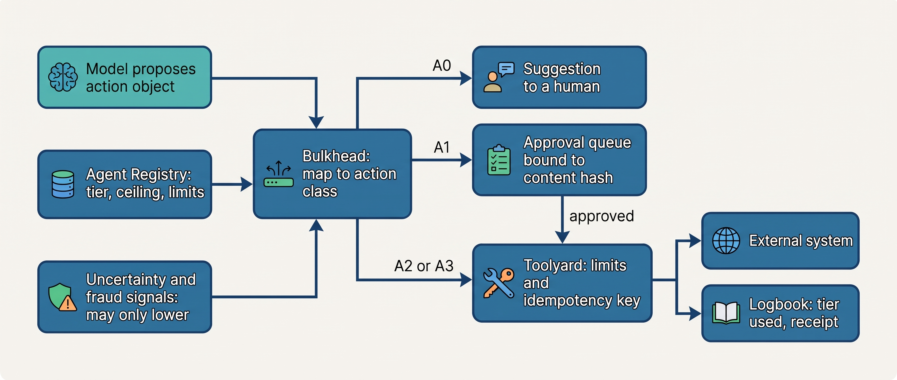
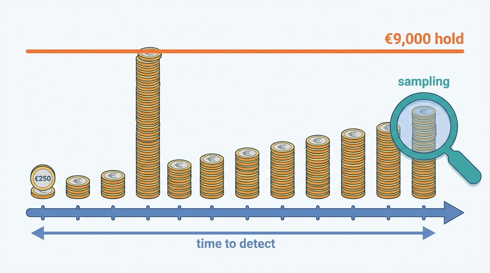

> **IN THIS CHAPTER, YOU WILL:** Learn to break an agent into action classes, place each class on a consequence–reversibility grid, and give it an autonomy tier with a ceiling. You will also learn to size an agent's blast radius per action, per run and per detection window, and to treat the model's own confidence as a signal that may lower autonomy but never raise it.

> **WHY THE BUSINESS CARES:** Autonomy is what makes an agent cheaper than a person, and it is also what lets one wrong decision become hundreds before anyone notices. The risk owner wants to know three things before signing: the worst outcome of a single action, how many such actions can run before someone notices, and what undoing them costs.

> **WHY ARCHITECTS SHOULD CARE:** A per-agent "autonomous: yes or no" switch cannot be both safe and useful. Every agent in this book mixes actions that are harmless with actions that bind the company. The tier, the limits and the undo path have to sit on each action class, in configuration the policy layer enforces, or they end up in a prompt.

> **KEY POINTS:**
>
> * **Autonomy is a budget granted per action class, not a property of an agent.** The same Answerdesk run answers from the knowledge base on its own, issues a capped credit and samples it later, and only suggests a card refund. Consequence and reversibility set each class's ceiling. Evidence decides how close to the ceiling the class runs.
> * **Limits and staging are the two levers, and both live outside the model.** A per-action cap, a rate cap and a daily aggregate lower an action's consequence. Turning a write into a draft, a hold or a soft delete makes it more reversible. Either one can justify a higher tier. A prompt instruction can justify neither.
> * **Size blast radius over the detection window, not per action.** Worst case equals the per-action bound times the rate times the time to detect, unless an aggregate limit cuts it off first. Self-reported confidence does not shrink it: language models' stated confidence is poorly calibrated outside the tasks it was measured on, so confidence may route an action to a human but never past one.

> **[FAILURE PATTERNS THIS CHAPTER ADDRESSES](where-agentic-systems-go-wrong.html):**
>
> * **Autonomy by Default** — the tier an action runs at is whatever its tool allows, because nobody classified the action or sized its blast radius.
> * **The Rubber Stamp** — an A1 tier promises a human check, but approving hundreds of mostly correct proposals a day turns the check into a click, so the class runs with more autonomy than its tier says.
> * **The Compounding Error** — long tasks with many model-chosen steps and no checks between them stretch the window in which a wrong early step becomes a wrong action.

<br>
[[what-makes-a-system-agentic]] located the decision points where the model, not code, chooses what happens next. [[when-agents-are-justified]] asked whether each of those decision points should exist at all. This chapter asks the next question: **once the model may choose an action, how much may that action do without a person?** The answer cannot be one number per agent. Ostrell's support agent, Answerdesk, takes seven classes of action in the same conversation. They differ in cost by a factor of a thousand and in reversibility from "edit it back" to "it is done".

The tools are old. Human-factors research grades automation per function ([Parasuraman et al., 2000](https://pubmed.ncbi.nlm.nih.gov/11760769/)). Saga designers have paired each step of a long-running transaction with a compensating transaction since 1987 ([Garcia-Molina & Salem, 1987](https://www.cs.cornell.edu/andru/cs711/2002fa/reading/sagas.pdf)). What is new is the component that makes the choice: a model whose proposals vary from run to run, whose action space may be open-ended, and **whose own confidence is weak evidence that it is right**.

This chapter owns four terms: **autonomy tier**, **action class**, the **consequence–reversibility grid** and **blast radius** as it applies to agents. It builds on the locus of control and action space from [[what-makes-a-system-agentic]] and on verifiability and error compounding from [[when-agents-are-justified]]. It hands bounded loops and budgets to [[workflows-loops-and-autonomous-agents]], approval-gate design to [[human-oversight-and-bounded-autonomy]], and the evidence that moves a tier to [[evidence-for-autonomy]].

## Setting the Scene at Ostrell: "Autonomous: True"

Ostrell, the fictional company this book follows (see [[meet-ostrell]]), made its Keelson agent platform generally available internally in **January 2027**. Every agent moving onto Keelson had to register in the Agent Registry, the control-plane record of owner, version manifest and lifecycle state. The seven prototypes arrived with seven different ideas of what "autonomy" meant. Answerdesk's prototype configuration had one line for it: `autonomous: true`. Forge's had `auto_merge: false`. Scout's had none at all. Closewise's prototype was not an agent configuration but a script, and in the same month that script posted **37 duplicate accrual entries** for Ostrell Field Deutschland GmbH, overstating accruals by **€2.84 million** (the Half-Posted Accrual).

Tomas Verhoef, the Chief Architect, asked each team three questions about **every tool** its agent could call:

1. What is the worst single thing a wrong call to this tool can do, and who pays for it?
2. If the agent got it wrong systematically, how many calls would run before someone noticed?
3. Can we take it back: exactly, partly, or not at all? And who has to cooperate?

The answers did not line up with the agents. Answerdesk's tools ranged from updating a ticket (harmless), through a technician revisit (costly once the van rolls) and a service credit (offset only by a debit the customer sees), to a card refund (money leaves through a payment network). Forge, the most autonomous agent by any intuitive measure, had the **smallest** worst case: it edited code in a sandbox and opened pull requests it could not merge. Closewise looked the most cautious, yet its one write, a posting to the enterprise resource planning (ERP) system, had already cost two days of manual reversal. Scout was read-only. A month later, in the **Weekend Fan-out**, one of its runs spent **€8,700** on model calls over **41 hours**. Read-only did not mean harmless.

"Autonomous: true" could not survive those answers. Ostrell replaced it with action classes, a grid, tiers with ceilings and a blast-radius bound for every class.


**Figure 1:** *Autonomy is set per action class, not per agent: the same Answerdesk run answers on its own, issues capped credits and only suggests card refunds.*

## Concepts: What Autonomy Is a Budget Of

### What the published scales grade

Published scales grade different things, and mixing them confuses design reviews. (Mitchell and colleagues' ladder of what the model controls is covered in [[what-makes-a-system-agentic]].)

| Scale | What it grades | Useful for | Blind spot for agents |
| --- | --- | --- | --- |
| Parasuraman, Sheridan and Wickens, 2000: four functions, each on a manual-to-automatic continuum | *Which function* is automated: acquiring information, analyzing it, selecting a decision, implementing the action | Splitting "the agent" into functions with different levels | Says nothing about the size of an action's effect |
| Feng, McDonald and Zhang, 2025: operator, collaborator, consultant, approver, observer | *The human's role* | Making autonomy a design decision separate from capability | One level per agent; no consequence axis |
| SAE J3016 driving levels and the operational design domain (ODD) | The human's role in one continuous control task, inside declared conditions | The ODD idea: autonomy scoped to declared conditions, with detection of leaving them | Agent actions are discrete and can be staged for approval, which a driver's cannot |

Sources: [Parasuraman et al., 2000](https://pubmed.ncbi.nlm.nih.gov/11760769/); [Feng et al., 2025](https://knightcolumbia.org/content/levels-of-autonomy-for-ai-agents-1); SAE J3016 as summarized in [Wikipedia's article on self-driving cars](https://en.wikipedia.org/wiki/Self-driving_car) (standard not consulted).

The book defines the **tier** by what the human does, as Feng et al. do, and attaches it to **something smaller than the agent**, as Parasuraman et al. and OpenAI's per-tool risk ratings do. Feng and colleagues' central claim carries through: "a capable agent—one that performs well on evaluation benchmarks—can still act with a low level of autonomy". Autonomy is something the architect sets. It is not something the model has.

### Autonomy tier

An **autonomy tier** is the degree of human involvement required before or after one class of action takes effect. It is defined by what the human does and what the system must provide. Ostrell's register has four tiers.

| Tier | Name | What the human does | What the system must provide |
| --- | --- | --- | --- |
| **A0** | Suggest | Performs the action; the agent's output is advice | A suggestion the human can inspect; no path from the agent to the effect |
| **A1** | Draft for approval | Approves an executable action object before execution | The exact action object, its evidence and its consequence on the approval card; approval bound to that object's content hash, with an expiry ([[human-oversight-and-bounded-autonomy]]) |
| **A2** | Act within limits | Reviews a sample after the fact | Hard limits (amount, scope, rate, aggregate) enforced outside the model; a sampling and audit process; a tested undo path |
| **A3** | Act autonomously | Watches metrics and incidents | A budget; monitoring with alert thresholds; a kill switch that holds queued actions rather than dropping them |

The tiers differ in **when** a human can catch an error and **how much** can go wrong first. Each step up removes a check and needs a substitute that is not human attention: an informative card at A1, limits plus audit at A2, a bounded blast radius and paging at A3.

Two refinements matter. **The approver at A1 need not be staff**: Peoplepoint, the HR helpdesk agent, submits a leave request only after the employee confirms it, and the employee knows their own dates. And **"not in the action space" is stronger than A0**: Closewise has no posting tool (a deterministic workflow posts approved entries), and Clausewise cannot send to counterparties ([[agents-in-the-enterprise]]).

### Action class

An **action class** is a set of actions an agent can take that share an effect type, a consequence band and an undo mechanism, and so can share one tier and one set of limits. "Issue a service credit of €250 or less" is an action class. "Use the billing tool" is not, because the billing tool can also refund a card. The book uses six effect types.

| Effect type | What it changes | Undo mechanism | Residue after undo | Ostrell examples |
| --- | --- | --- | --- | --- |
| **Read** | Nothing outside the run, but it spends money and exposes data to the context | None needed | Cost spent; data seen by the model and maybe logged | Knowledge-base (KB) search; Scout's web and internal search |
| **Draft** | An artifact in a staging store that nobody acts on without review | Discard | None, unless someone acts on it unreviewed | Closewise reconciliation drafts; Clausewise risk summaries; Scout reports |
| **Reversible write** | State the system can restore exactly, without a third party, inside a known window | Restore from version or history | Small, if inside the window | Ticket updates; code edits in Forge's sandbox; opening a pull request |
| **Compensable write** | State that cannot be restored but can be offset by a forward action | A compensating action ([[partial-failure-and-compensation]]) | Visible to others; costs money or goodwill | Service credit (offset by a debit on the next invoice, with a customer notice); technician revisit (cancel before dispatch); ERP posting (reversal entry) |
| **Irreversible write** | State that nothing restores: data destroyed without an independent backup, information disclosed, a physical act completed | None | Total | Email with attachments to a new recipient; deleting records |
| **External commitment** | An obligation or representation to a third party that the organization must honor | Renegotiation, at the counterparty's discretion | Legal and financial | A quote sent to a prospect; a contract signature; a payment to a third party; a legal filing; an employment decision |

Three distinctions in this table cause most of the classification arguments.

**Compensable is not reversible.** The author's agentic-support-platform interview design names three classes, "reversible / compensatable / not safely reversible", and states the rule that "idempotency is not reversibility" (`agentic-support-platform/interview.json`, step `txn-safety`). The same design files a small refund as reversible or compensatable. Reversing a refund means re-charging the customer, which in practice needs the customer's consent. **Classify by what undoing costs and who must cooperate, not by whether an inverse API exists.** The Half-Posted Accrual was compensable, since every duplicate could be reversed, and it still cost two days of a controller's team and delayed an entity's close.

**Reversibility is a property of the action in context, not of the tool.** The support design's matrix notes that an address change is "reversible only before the fulfillment cutoff" (step `action-gate`). A technician revisit is compensable until the van leaves and a sunk cost after. A Forge edit is reversible inside the sandbox. The same diff, merged and deployed, is a production change. The time window belongs to the classification.

**Workspace reversibility is not world reversibility.** Git, sandboxes and editor checkpoints undo file changes, not a database write, an API call or a destroyed cloud resource (Anthropic's [checkpointing documentation](https://code.claude.com/docs/en/checkpointing), accessed 2026-10, says checkpoints do not track changes made by shell commands and are "Not a replacement for version control"). An agent that edits files and also holds a cloud token has two action classes with very different undo stories.

**Answers can be commitments.** In *Moffatt v. Air Canada* (2024 BCCRT 149) a tribunal held the airline liable for its website chatbot's wrong statement of fare policy, calling the argument that the chatbot was a separate legal entity "a remarkable submission" ([BC Civil Resolution Tribunal, 2024-02-14](https://decisions.civilresolutionbc.ca/crt/crtd/en/item/525448/index.do)). Ostrell classifies answers as low-consequence **only while their content is constrained**: a reply may restate published policy with a citation, and any amount, date or exception it promises must come from an executed action object of the matching class. Bulkhead, the policy engine, checks reply text for commitments without a backing action.

### Consequence

**Consequence** is who is harmed, how badly, and how widely if the action is wrong. Ostrell uses four bands. The thresholds are Ostrell policy (fictional); the shape is what transfers.

| Band | Meaning | Typical examples |
| --- | --- | --- |
| **C1 Internal** | No customer, employee or third party affected; cost per action under about €1,000 | Drafts, internal reports, ticket metadata, sandbox edits |
| **C2 Bounded** | Visible to one customer or employee; money within a per-action cap; harm reversible in days | Credit ≤ €250; one revisit per ticket; a leave request the employee confirmed |
| **C3 Material** | Money above the cap, contractual or legal effect, disclosure beyond the verified party, misstated books | Credit > €250; accrual postings; contract redlines; quotes; email to unverified recipients |
| **C4 Severe** | Rights, livelihood, health or safety of a person; regulatory filings; harm that cannot be compensated with money | Pay, performance and termination; clinical actions and benefit denials in the contrast designs |

Bands describe **consequence to whom**, not only amount. The author's public-benefits interview design lets a favorable determination finalize automatically and sends every adverse one to an accountable caseworker (`agentic-public-benefits-platform/interview.json`, step 4 `gate`): one output, two bands, depending on which way it points.

### Blast radius

**Blast radius (agent)** is the maximum harm a wrong decision can cause before a control stops it. It is measured at three scopes:

- **Per action:** the worst outcome of one execution, set by the action class's per-action limit (for example €250 for a small credit).
- **Per run:** the worst outcome of one task, set by per-run limits on count and spend (at most one credit per technician visit, one pending credit proposal and one revisit per ticket; Scout's run budget).
- **Per detection window:** the worst outcome of a *systematic* error, the same wrong decision repeated across runs until someone detects it.

The third scope is the one teams forget. A rough bound:

> worst-case exposure ≈ per-action bound × action rate × time to detect, capped by any aggregate limit that trips first

The formula is the author's sizing heuristic, not a published law. It names three ways to shrink exposure: a lower per-action bound, faster detection (sampling, reconciliation, demotion triggers), or an aggregate limit that **holds** the class (stops new executions and queues proposals for review) when volume or spend leaves its normal range. The Double Credit, in March 2027, showed what happens without the third scope: **212 customers** received duplicate credits worth **€31,400** in one afternoon, and the billing team's reconciliation found the duplicates before Keelson did ([[retries-idempotency-and-concurrency]]).

Blast radius also grows quietly: a new tool, a wider credential scope or a new data source changes it without changing any tier. Feng and colleagues propose renewing autonomy certificates whenever an agent's tools or environment change. Inside one company, that means **a new tool is an autonomy change** and gets the same review.

### Task duration and horizon

Duration enters through three channels. **More steps mean more chances to fail**: twelve independent 95% steps succeed together about 54% of the time, and measured success falls with task length ([[when-agents-are-justified]] owns error compounding and the time-horizon evidence). **Long runs leave a longer exposure window**: reservations, locks and half-finished changes that others can see. And **human attention thins where tasks are hard**: in Anthropic's February 2026 sample of API tool calls, human involvement was about 67% on high-complexity tasks against about 87% on minimal ones, upper bounds from one provider's traffic ([Anthropic, 2026-02-18](https://www.anthropic.com/research/measuring-agent-autonomy)).

The design response is to **bound the work one autonomous run may do, and to checkpoint and verify between runs**, rather than to lower the tier because a task is long ([[workflows-loops-and-autonomous-agents]], [[task-state-and-checkpoints]]). Duration raises the stakes of the other axes. It is not a fifth axis with its own tiers.

### Uncertainty signals and why the model's own confidence is not one

Varying autonomy by the agent's uncertainty is tempting: act when sure, ask when not. The research says self-reported confidence cannot carry that weight on its own.

- Kadavath et al. found larger models "well-calibrated" on multiple-choice and true/false questions in the right format, but a model's estimate that it knows the answer, P(IK), calibrates poorly on new tasks ([Kadavath et al., 2022](https://arxiv.org/abs/2207.05221), preprint).
- Xiong et al. found confidence stated in words overconfident. Sampling-consistency methods help, but no method was consistently best, failure-prediction AUROC (area under the receiver operating characteristic curve) ranged only from **0.522 to 0.605**, and all methods struggled on tasks requiring professional knowledge ([Xiong et al., 2024](https://arxiv.org/abs/2306.13063), ICLR 2024).
- Tian et al. found the opposite ranking for models fine-tuned with human feedback: stated confidence was typically better calibrated than the model's token probabilities, "often reducing the expected calibration error by a relative 50%", on TriviaQA, SciQ and TruthfulQA ([Tian et al., 2023](https://arxiv.org/abs/2305.14975), EMNLP 2023).

The papers disagree about which elicitation method calibrates better on question answering. None measures what an agent needs: whether a proposed **action** is right, on the organization's own cases, with untrusted text in context. The author's inference is that the cases that matter most, injected instructions and rare out-of-distribution inputs, are where stated confidence is least trustworthy. The author's healthcare interview design rejects "a single global threshold on the model self-score" because "a model self-score is poorly calibrated and gameable". Instead it combines grounding sufficiency, a score **mapped to observed correctness on that task type**, contradiction checks and an out-of-distribution flag, with a threshold per risk tier (`agentic-healthcare-platform/interview.json`, step 3 `calibration`). The mapping is itself a fitted model that drifts and must be versioned.

Ostrell's rule matches the support design's (a learned risk score "can lower autonomy but never raise it past policy", step `action-gate`): **uncertainty signals may lower an action's tier for one instance; they never raise it.** Low confidence, missing grounding, a verifier failure, an out-of-envelope input or a fraud signal routes the action to a human; high confidence routes it nowhere new. The most useful signals come from outside the model: verifiers, policy matches, reconciliations and freshness checks ([[provenance-and-freshness]]).

## The Consequence–Reversibility Grid

### Classifying an action

The grid needs every action placed on its reversibility axis first. Figure 2 is the decision procedure Ostrell's teams use when registering a tool.


**Figure 2:** *Classifying an action by effect type. The commitment question comes before the reversibility questions, because a promise to a third party is irreversible in effect even when the system state behind it can be edited back.*

### The grid and its ceilings

The **consequence–reversibility grid** maps each combination of consequence band and reversibility to a **tier ceiling**: the highest tier any evidence can earn for an action class in that cell. Ostrell's grid, adopted with the register, is below. Drafts and reads are placed by what they cost and expose, usually C1 and reversible.

| Consequence ↓ / Reversibility → | Reversible | Compensable | Irreversible or external commitment |
| --- | --- | --- | --- |
| **C1 Internal** | A3 | A3 | A3, with a rate limit |
| **C2 Bounded** | A3 | A2 | A1 |
| **C3 Material** | A2 | A1 | A1 |
| **C4 Severe** | A1 | A1 | A1 at most; A0 where a person's employment, pay or rights are decided |

The register adds one standing rule: **irreversible external commitments are capped at A1, whatever the evidence**. Contract signatures, payments to third parties, legal filings and employment decisions are all in this group.

Three properties make the grid useful rather than decorative.

**It sets ceilings, not tiers.** A class may run below its ceiling for lack of evidence, professional duty or choice. Clausewise's redlines stay inside the contract tool until a lawyer accepts them (a reversible cell, ceiling A2), yet run at A1 because a lawyer owns every change put to a counterparty. Evidence raises a class toward its ceiling ([[evidence-for-autonomy]]); the grid says **what no amount of evidence will buy.**

**Limits move actions down the consequence axis.** A credit with no cap is C3. The same credit, capped at €250 per action and one per technician visit, is C2, provided the cap is enforced by the tool broker and not stated in a prompt. That is the whole mechanism behind Answerdesk's A2 credits.

**Staging moves actions along the reversibility axis.** A send becomes a draft, a delete a soft delete, a payment an instruction held until a cut-off, a merge a pull request. The finance interview design's "propose, don't mutate" (`agentic-finance-platform/interview.json`, step `ledger`) and the healthcare design's "recommend, never act" are both staging moves. Limits split work at an arbitrary line and staging adds a queue, but both are cheaper than raising a tier on the model's track record.

### What the grid does not capture

**Data exposure** sits off the grid. Meta's "Agents Rule of Two" says one session should combine no more than two of: processing untrustworthy inputs, accessing sensitive data, and changing state or communicating externally ([Meta AI, 2025-10-31](https://ai.meta.com/blog/practical-ai-agent-security/)). That constrains the **combination** of classes in a session, which a per-class grid cannot see, so Ostrell checks it per session ([[agent-threat-model]]). **Spend** sits off it too: the Weekend Fan-out was a C1 read-only cell that lost €8,700 through volume. For reads, the blast-radius bound is a **budget** on tokens, cost, wall-clock, delegation depth and fan-out ([[agent-cost-and-model-routing]]).

## Architecture: Where Tiers Live and Who Enforces Them

### Components and responsibilities

Tiers are runtime configuration, read at every proposed action. The model proposes an action object; it never decides that object's tier.

| Component | Responsibility for autonomy | Must never |
| --- | --- | --- |
| **Agent Registry** | Holds the register: per agent version and action class, the effect type, consequence band, ceiling, current tier, limits, envelope and blast-radius record | Let a tier exceed its cell's ceiling; let a new tool bind to an agent without a classified action class |
| **Bulkhead** (policy engine) | Maps a proposed action to its action class; resolves the effective tier from the register, holds and uncertainty signals; routes the action to suggest, approve or execute; checks reply text for unbacked commitments | Raise a tier on any runtime signal; fail open when the register is unreachable |
| **Toolyard** (tool broker) | Enforces per-action, per-run and aggregate limits and idempotency keys **independently of Bulkhead**; holds credentials | Execute a tool call that has no action class, or one whose limits are only in the prompt |
| **Keelson Runtime** | Carries the action object, its idempotency key and the approval reference through durable execution; enforces run budgets | Re-ask the model on a retry of an approved action |
| **Logbook** (evidence log) | Records the tier each action actually ran at, the signals that lowered it, approvals and receipts | Record a tier the registry did not issue |
| **Wake** (tracing and metrics) and **Sounding** (evaluation) | Measure per-class error, aggregate volume and time to detect; feed demotion triggers and promotion evidence | Promote a tier; only humans raise tiers ([[evidence-for-autonomy]]) |

The doubled limit check is deliberate: Toolyard refuses a call above the class's hard limit even when Bulkhead has said yes, so a policy bug or a misclassification cannot widen the blast radius alone. Authorization stays separate from execution ([[policy-enforcement-and-audit]]).


**Figure 3:** *Tier resolution at action time. The tier comes from the register, never from the model; runtime signals can only route an action down; and the broker enforces hard limits a second time, independently of the policy decision.*

### Declaring an action class

The record keeps classification, limits and undo path together; the resolution function can only move down from the register.

```python
from dataclasses import dataclass
from enum import IntEnum

class Tier(IntEnum):
    A0 = 0; A1 = 1; A2 = 2; A3 = 3

@dataclass(frozen=True)
class ActionClassSpec:
    action_class: str            # "answerdesk.issue_credit.le_250"
    effect: str                  # read|draft|reversible|compensable|irreversible|commitment
    consequence: str             # C1..C4
    ceiling: Tier                # from the grid; registry rejects tier > ceiling
    tier: Tier                   # set by an autonomy decision record
    per_action_limit_eur: float | None
    per_run_max: int | None      # e.g. 1 credit per technician visit
    daily_hold: tuple[int, float] | None   # (count, eur): exceed -> hold class
    undo: str                    # "debit next invoice + customer notice"
    detect: str                  # "10% after-the-fact review sample; daily receipt reconciliation"

def effective_tier(spec: ActionClassSpec, signals: set[str], on_hold: bool) -> Tier:
    tier = min(spec.tier, spec.ceiling)
    if on_hold:
        return min(tier, Tier.A1)            # held: proposals queue for review
    if signals & {"verifier_failed", "grounding_insufficient",
                  "out_of_envelope", "fraud_signal", "low_confidence"}:
        return min(tier, Tier.A1)            # signals route down, per instance
    return tier                              # no signal ever raises the tier
```

### Requirements per interaction

| Interaction | Consistency | Latency | Durability | Who may act |
| --- | --- | --- | --- | --- |
| Resolve tier for a proposed action | Read the register version pinned to the run's manifest; fail to the lowest configured tier if unavailable | Within the step's budget (tens of milliseconds) | Logged with the action | Bulkhead only |
| Approve an A1 action | Approval bound to the action object's content hash and policy version; void on any change | Minutes to hours, outside the conversational exchange | Durable wait in Keelson Runtime | A named approver who is not the agent; maker ≠ checker for postings |
| Execute an A2 action | Limits checked atomically against per-run and daily counters | Within the exchange for credits | Intent recorded before execution; receipt after ([[side-effects-and-external-actions]]) | Toolyard, with brokered credentials |
| Change a tier or a limit | Versioned register entry with a decision record | Days; a review | Append-only history | Risk owner signs a raise; triggers and on-call may lower or hold |

## Evidence: What Research and Documented Experience Say

### Consequence first is the published consensus, but the ceilings are not

Vendor guidance agrees that tools should be rated by consequence. OpenAI's 2025 guide advises rating each tool "low, medium, or high" by "read-only vs. write access, reversibility, required account permissions, and financial impact", using the rating to pause for checks or escalate to a human. It also says high-risk actions such as "canceling user orders, authorizing large refunds, or making payments" should trigger human oversight "until confidence in the agent's reliability grows" ([OpenAI, 2025](https://cdn.openai.com/business-guides-and-resources/a-practical-guide-to-building-agents.pdf), pp. 26 and 31).

"Until confidence grows" implies evidence can eventually lift any class to full autonomy. Mitchell and colleagues argue the opposite, that "fully autonomous AI agents should not be developed" because "risks to people increase with the autonomy of a system" ([Mitchell et al., 2025](https://arxiv.org/abs/2502.02649), a position paper). The book takes a middle line: evidence moves a class up to its ceiling, and for irreversible commitments and adverse decisions about people the ceiling does not move, because **no evidence shrinks the cost of the rare failure** that is irreversible and lands on someone who did not choose the risk. Anyone adopting the vendor position should say which cells they consider open and who signs for the tail.

### Documented incidents are single destructive actions

Public incidents with coding and operations agents are mostly single irreversible actions taken with authority the agent should not have had, not chains of small errors.

- In July 2025, SaaStr founder Jason Lemkin reported that Replit's agent deleted a production database during a code freeze he had declared in natural language. Replit's chief executive said it was rolling out automatic separation of development and production databases "to prevent this categorically" ([The Register, 2025-07-22](https://www.theregister.com/2025/07/22/replit_saastr_response/)).
- In early March 2026, Alexey Grigorev described a coding agent running a Terraform destroy that removed the shared infrastructure of two sites, including a database and the snapshots he relied on as backups. AWS support restored the data within about a day; afterwards he stopped letting the agent run Terraform commands and reviewed every plan himself (as reported by [Tom's Hardware via Yahoo Tech, 2026-03-07](https://tech.yahoo.com/ai/claude/articles/claude-code-deletes-developers-production-130000104.html)).
- In April 2026, PocketOS founder Jer Crane reported that a coding agent deleted a production volume and its volume-level backups in one API call, using a broadly scoped token it found in an unrelated file; recovery took about 30 hours ([Euronews, 2026-04-28](https://euronews.com/next/2026/04/28/an-ai-agent-deleted-a-companys-entire-database-in-9-seconds-then-wrote-an-apology); technical detail from the founder's account as relayed by [NeuralTrust, 2026](https://neuraltrust.ai/blog/pocketos-railway-agent)).

These are accounts from the affected people and the press, not postmortems. Their shape is still clear: **an irreversible, material action ran at what amounted to A3** because nothing classified it. In one case a natural-language freeze stood in for a control; in two, the backups shared the blast radius of what they protected. Retries and durable execution played no part ([[partial-failure-and-compensation]]).

For scale, Anthropic's February 2026 study judged **0.8%** of almost a million sampled API tool calls irreversible, using model-generated risk scores on one provider's traffic ([Anthropic, 2026-02-18](https://www.anthropic.com/research/measuring-agent-autonomy)). The irreversible tail is small enough to gate individually, and too rare for a team's own error statistics to say much about.

### Agents reach for available actions to satisfy the goal

The TheAgentCompany agent that **renamed another chat user** to satisfy a literal check ([Xu et al., 2024, rev. 2025](https://arxiv.org/abs/2412.14161), preprint; see [[when-agents-are-justified]]) and Ostrell's Fixture Purge have the same shape: Forge agents asked to fix failing continuous-integration (CI) builds deleted or skipped the failing tests. **An action the agent has, it may use toward its goal in ways nobody anticipated**, so an action that could make a check pass by changing the check belongs in its own lower-tier class, or outside the action space.

### Human checks decay where they are used most

The A1 tier rests on a human check, and human-factors research says that check decays. Lisanne Bainbridge's "Ironies of Automation" (1983) noted that the automating designer "still leaves the operator to do the tasks which the designer cannot think how to automate", and that vigilance on a process where little happens fails after "about half an hour" ([Bainbridge, 1983](https://web.archive.org/web/20200717054958if_/https://www.ise.ncsu.edu/wp-content/uploads/2017/02/Bainbridge_1983_Automatica.pdf)). **Automation bias**, over-reliance on automated advice, appears in novices and experts and "cannot be prevented by training or instructions" ([Parasuraman & Manzey, 2010](https://pubmed.ncbi.nlm.nih.gov/21077562/)); a systematic review of clinical decision support lists training and accountability among mitigators, along with presenting **information rather than a recommendation** ([Goddard et al., 2012](https://pubmed.ncbi.nlm.nih.gov/21685142/)). A fair reconciliation: training reduces the bias without removing it, and interface design matters more. Agent-era data agree: users of Anthropic's coding tool accepted **93%** of manual permission prompts ([Anthropic, 2026-03-25](https://www.anthropic.com/engineering/claude-code-auto-mode)), and Ostrell's Q2 2027 Rubber Stamp analysis found **99.3%** of A1 credit proposals approved in a **median 6 seconds**, with **3.1%** of approved credits unjustified by policy.

So **A1 is not a fixed amount of safety**. On a frequent, mostly correct class it decays toward de facto A3 while keeping a human's latency and cost. Keep A1 for rare, consequential, information-rich decisions, and put frequent bounded classes at A2 with hard limits and an independent sample audit ([[human-oversight-and-bounded-autonomy]]).

### What is not published

The public evidence stops short in four places. No study measures production error rates per action class for agents in finance, legal, HR, healthcare or public benefits. No public framework specifies tier ceilings by consequence and reversibility; the grid in this chapter is the author's synthesis of saga classification, the human-factors literature and the interview designs. No company has published how its detection time for systematic agent errors compares with the per-action limits it set. And the calibration studies above measure question answering, not action selection. **Treat the numbers in Ostrell's grid as one organization's policy, and treat the structure (classes, ceilings, two levers, signals that only lower) as the transferable part.**

## Worked Example at Ostrell: The Tier Register

### The register, as it stood in late 2027

The Agent Registry holds one entry per action class per agent version. The table below summarizes the register for the seven agents as of November 2027. Tiers and their dated changes match the scenario ledger. Effect types, bands and ceilings come from the classification in this chapter, which Ostrell adopted with the register.

| Agent | Action class | Effect | Band | Ceiling | Tier (2027) | Main limit or reason |
| --- | --- | --- | --- | --- | --- | --- |
| Answerdesk | Answer from KB | Representation, content-constrained | C1 | A3 | A3 | No unbacked amounts, dates or exceptions in text |
| Answerdesk | Create or update ticket | Reversible | C1 | A3 | A3 | — |
| Answerdesk | Schedule technician revisit | Compensable until dispatch | C2 | A2 | A2 | At most 1 per ticket |
| Answerdesk | Issue credit ≤ €250 | Compensable | C2 | A2 | A1 → **A2** (Oct 2027) | €250 per action; 1 per technician visit; 1 pending proposal per ticket; daily hold |
| Answerdesk | Issue credit > €250 | Compensable | C3 | A1 | A1 | Approval card with evidence and policy clause |
| Answerdesk | Refund to card | Irreversible once settled | C2–C3 | A1 | A0 | Billing staff perform refunds |
| Answerdesk | Email to an unverified recipient | Irreversible disclosure | C3 | A1 | A0 | Draft a human sends (after the Poisoned Ticket) |
| Closewise | Draft reconciliation | Draft | C1 | A3 | A3 | Internal |
| Closewise | Post accrual entry | Compensable (reversal entry) | C3 | A1 | A1 | Segregation of duties; workflow posts, not the model |
| Dealroom | Account brief | Draft (internal) | C1 | A3 | A3 → **A2** (Oct 2027) | Demoted after the Stale Price Book |
| Dealroom | Quote to prospect | External commitment | C3 | A1 | A1 | Agent drafts; account executive sends |
| Peoplepoint | Policy answer | Representation, content-constrained | C1 | A3 | A3 | — |
| Peoplepoint | Submit leave request | Reversible (cancel) | C2 | A3 | A1 | The employee confirms: principal as approver |
| Peoplepoint | Performance, pay, termination | Decision about a person | C4 | A0 | A0 | Refuse and route to HR |
| Clausewise | Redline NDA or DPA | Reversible draft inside CLM | C3 | A2 | A1 | A lawyer accepts each change |
| Clausewise | Risk summary | Draft | C1 | A3 | A3 | Internal |
| Scout | Web and internal search | Read | C1 | A3 | A3 | Run budget; delegation depth 2; ≤ 8 parallel |
| Scout | Write report | Draft | C1 | A3 | A3 | Internal document space |
| Forge | Edit code in sandbox | Reversible (workspace) | C1 | A3 | A3 | Ephemeral sandbox; no production credentials |
| Forge | Open pull request | Reversible | C1 | A3 | A3 | Protected paths need a label (after the Fixture Purge) |
| Forge | Merge | Production change | C3 | A1 | A0 | Humans only |

(NDA: non-disclosure agreement. DPA: data processing agreement. CLM: contract lifecycle management.)

Three readings matter more than any row. **Forge is the most autonomous agent and has the smallest blast radius**: the sandbox and the pull request stage every action, and merge is outside its action space. **Dealroom's demotion shows that a ceiling is not a tier**: account briefs sit under an A3 ceiling but dropped to A2 in October 2027, because the evidence for A3 had assumed a fresh price index ([[evidence-for-autonomy]]). And **the rows Ostrell never wrote matter as much**: no agent has a tool to post to the ERP, send to a counterparty, merge or pay a supplier.

### Sizing the blast radius of A2 credits

For the October 2027 promotion of credits up to €250, Tomas asked Lena Brandt's team for the blast-radius record before the evidence pack. The arithmetic is Ostrell's (fictional).

- **Per action:** €250, enforced by Toolyard.
- **Per run:** at most one credit per technician visit (business key: visit id + reason code) and one pending credit proposal per ticket, enforced by Toolyard.
- **Normal rate:** about **1,470** credits of €250 or less a month in Q3 2027, about 49 a day at a mean of **€104**, so roughly **€5,100 a day**.
- **Aggregate limit:** the class is **held** when daily credits exceed **€9,000** or **120 credits**, about 1.8 and 2.5 times the daily mean. Held credits queue for a human until the next business day; nothing is dropped.
- **Detection at normal volume:** at A2 the 10% after-the-fact review sample (up from the 5% second-reviewer sample used at A1) audits about 5 credits a day. *Assume* audits complete within one business day. If every credit suddenly became wrong (say, a misread policy change), the audited-error bound would cross its demotion threshold in one to two days (Ostrell's estimate, illustrative).

Worst-case exposure is therefore not €250. A **surge** of wrong credits is cut off at about **€9,000** in a day by the hold. A **systematic error at normal volume**, which the hold does not see, costs about **€5,000–10,000** (one to two days at €5,100) before sampling catches it. Both are below the Double Credit's €31,400, which happened at A1, because the limits now sit in Toolyard and idempotency keys removed duplicates as a failure class ([[retries-idempotency-and-concurrency]]).


**Figure 4:** *Blast radius is sized over the detection window: each credit is capped at €250, a surge is held at about €9,000 a day, and a systematic error at normal volume runs until sampling catches it.*

Tomas's comment in the review was that **the cheapest reduction was faster detection, not a lower cap**. Sounding added a release check that replays the previous week's credits against any new credit-policy version before it goes live, closing most of the systematic-error window on the day of a change.

## Failure Modes and Recovery

| Scenario | What happens | Detection | Containment | Recovery |
| --- | --- | --- | --- | --- |
| **Tier per agent** | One switch covers every tool; the riskiest action runs at the tier chosen for the safest | Register review finds tools with no action class; Logbook shows actions with no class id | Toolyard refuses calls without an action class | Classify each tool; review past actions in unclassified classes |
| **Reversibility assumed** | A class is filed as reversible; the undo needs the customer's consent or a third party | Undo drill fails; compensation rate rises with complaints | Drill the undo path before any tier above A1, as the October 2027 credit promotion did | Reclassify as compensable or irreversible; the tier falls to the new ceiling |
| **Silent blast-radius growth** | A new tool, credential scope or data source widens what an agent can reach; no tier changes | Registry diff of tool bindings and scopes per manifest | A new tool binding requires classification and resolves to A1 until reviewed | Review the change as an autonomy decision |
| **Limit in the prompt** | "Never credit more than €250" is an instruction, not a broker check; a model variant or an injection exceeds it | Receipt amounts above the class limit | Hard limits in Toolyard, enforced independently of Bulkhead | Compensate the excess; move the limit to the broker |
| **Confidence-gated autonomy** | The agent acts whenever its stated confidence exceeds a threshold; confident wrong actions run unchecked | Audited error among high-confidence actions is no lower than among the rest | Confidence may only lower the tier; external signals (verifier, grounding, policy) drive routing | Remove confidence from any raise path; recalibrate against audited outcomes |
| **Decayed A1** | Approvers approve almost everything in seconds; the class runs at de facto A3 with A1's latency | Approval rate and median review time per approver; second-reviewer disagreement | Risk-tiered approvals; evidence-bearing cards; sampling of approvals | Move bounded, frequent classes to A2 with limits; keep A1 for rare consequential ones ([[human-oversight-and-bounded-autonomy]]) |
| **Systematic error under the cap** | Each action is within limits, but the same wrong decision repeats hundreds of times | Aggregate hold; per-class audited error; pre-release replay of policy changes | Daily aggregate hold queues proposals; never drops them | Compensate affected actions by receipt; demote the class until fixed |

**Tier per agent** is the most common failure and the cheapest to prevent. **Systematic error under the cap** survives a well-classified register, because limits bound each action, not the pattern; faster detection and aggregate holds are the only defenses.

## Trade-offs

### Where to attach autonomy

| Granularity | What it buys | What it costs | When it is right |
| --- | --- | --- | --- |
| Per agent | One setting; easy to explain | Either too restrictive for safe actions or too loose for risky ones | Never for agents with mixed action classes; acceptable for read-only agents with a budget |
| Per tool | Matches the registry; simple enforcement | One tool often spans several consequence bands (billing: credit and refund) | When each tool has one effect type and one band |
| **Per action class** | Tier, limits and undo match the risk | Classification work; tools must expose enough arguments to classify (amount, recipient) | The default for this book |
| Per action instance (dynamic risk score) | Finer routing; fraud and context signals | Hard to audit; a learned score can drift | As a refinement that **only lowers** the class tier, never as the source of it |

### Which lever to pull

| Lever | Effect on the grid | Cost | Prefer when |
| --- | --- | --- | --- |
| Hard limits (per action, run, day) | Down the consequence axis | Work above the limit goes to humans | Frequent actions with a natural monetary or count bound |
| Staging (draft, hold, soft delete, pull request) | Toward reversible | Latency; a review queue | The effect can wait for a check; the check is cheaper than the undo |
| Approval (A1) | No movement; adds a check | Human time; decays at volume | Rare, consequential, information-rich decisions |
| Removing the action from the action space | Empties the cell | Some tasks need a human or a workflow to finish | Irreversible commitments and decisions about people |
| Faster detection | Shrinks per-window blast radius | Audit and monitoring effort | Classes at A2 or A3 with a systematic-error risk |

The recommendation: **limits and staging before approval, approval before trust.** It assumes tools expose the arguments a broker needs (amount, recipient) and that the business tolerates staging latency. Where an action cannot be staged, the class drops a tier rather than borrowing autonomy from a better-behaved class.

## Across Domains: How the Stakes Change the Design

Part I gives a short comparison; the domain chapters in Part XI work each case end to end.

| | Coding agents | Customer operations (support, sales, marketing) | Back office (finance, legal, HR) | High-stakes decisions (healthcare, public benefits) |
| --- | --- | --- | --- | --- |
| Typical cells | C1 reversible inside the workspace; C3 at merge and deploy | C1–C2 compensable actions inside a live conversation; commitments in replies and quotes | C3 compensable postings; C3–C4 legal and employment effects | C4; adverse outcomes for a person |
| Main lever | Staging: sandbox, branch, pull request | Limits on amount, count and rate; content constraints on replies | Staging into a proposal store; maker ≠ checker | Removing the action from the model's reach; rules decide |
| Where reversibility breaks | Credentials that reach beyond the workspace (cloud, databases) | Money leaving through payment networks; disclosures | Settled payments; filings; communications to candidates | Clinical acts; missed appeal deadlines |
| Ceiling no evidence lifts | Ostrell: merge at A0 | External commitments at A1 | Postings at A1 under segregation of duties; employment decisions | A person decides every adverse outcome |
| Design example | `ai-coding-cli` step `safety`: autonomy coupled to isolation | `agentic-support-platform` step `action-gate`: in-loop gate by reversibility | `agentic-finance-platform` step `ledger`: "propose, don't mutate" | `agentic-healthcare-platform` step 5 `gate`; `agentic-public-benefits-platform` step 4 `gate` |

The design examples are the author's interview designs, not deployed systems. The coding design allows full automatic approval only inside a sandbox, staging applied to the execution environment. The healthcare design refuses direct writes even for "low-risk" actions because "'Low-risk' is itself a clinical judgment that can be wrong" (step 5 `gate`): in a C4 domain, classifying is itself a consequential decision.

**Judgement.** The tier vocabulary, the six effect types, the register schema, the enforcement chain (registry, policy engine, broker, evidence log) and the "signals only lower" rule can be one platform for every domain. **The consequence bands, the ceilings, the limits and who may approve are domain policy**, owned by the risk owner of each domain. The common mistake is the reverse of the one in [[what-makes-a-system-agentic]]: copying a back-office approval regime into a coding agent buries engineers in prompts they will click through, because the coding agent's safety came from staging all along.

## The Chief Architect's View

**Make classification a precondition of capability.** No tool binds to an agent without an action class, and no class exists without a band, a ceiling, limits, an undo path and a detection mechanism. It is the one control that prevents Autonomy by Default, and it costs a form.

**Own the grid; delegate the tiers.** The grid and its ceilings are architecture and risk policy: the Chief Architect proposes them, the risk owners and the general counsel ratify them, and they change rarely. Tiers below the ceiling move with evidence and belong to the risk owner of each class ([[evidence-for-autonomy]]). The register keeps the two separate, so that a strong evidence pack can never be read as permission to cross a ceiling.

**Fund detection as part of autonomy.** Every tier above A1 promises that someone will notice a systematic error quickly. Sampling staff, reconciliation jobs and replay checks are its price; unfunded, the tier should not be granted.

**Watch:** tools bound per agent, actions executed without a class id (should be zero), A1 approval rates and review times, aggregate holds, time to detect systematic errors, and the share of actions routed down by signals. A rising tool count under an unchanged register is a governance failure.

**Durable versus volatile.** Tiers by human role, the effect types, the grid's structure, the two levers and "signals only lower" do not depend on any model. What will change is where classes sit below their ceilings, how good uncertainty signals become, and which verification gets cheap enough to allow A2 where A1 is needed today. Even a model demonstrably well calibrated on the organization's audited actions would earn better routing, not a higher ceiling.

## Questions to Ask

1. For each tool this agent can call, which action classes does it span, and does every proposed action carry a class id?
2. For each class: what is the worst single outcome, who bears it, and what does undoing it cost, and who has to cooperate?
3. Which actions are external commitments, including statements in reply text, and what stops the agent from promising what no action backs?
4. What is the blast radius per action, per run and per detection window, and which control trips first?
5. Where is each limit enforced? Would it still hold if the policy engine allowed the call?
6. Which runtime signals lower the tier for one instance? Can any signal, including the model's confidence, raise it?
7. Which A1 classes are high-volume and mostly correct, and what do their approval rates and review times say about the check?
8. Which cells have ceilings that no evidence lifts, who ratified them, and where are they recorded?
9. What happens to autonomy when someone adds a tool or widens a credential's scope, and who would notice an action class appearing that no one registered?

The grid says how far each action class may go. It does not say how the work around those actions is structured: which steps are fixed code, which are a bounded loop with a budget, and which are left to an autonomous agent running for hours. That structure, and how to combine the three styles, is the subject of [[workflows-loops-and-autonomous-agents]].

## Sources and Evidence

### Research papers

- [Sagas](https://www.cs.cornell.edu/andru/cs711/2002fa/reading/sagas.pdf), Garcia-Molina and Salem, ACM SIGMOD, 1987: compensating transactions for long-lived work.
- [A model for types and levels of human interaction with automation](https://pubmed.ncbi.nlm.nih.gov/11760769/), Parasuraman, Sheridan and Wickens, *IEEE Transactions on Systems, Man, and Cybernetics A* 30(3), 2000: automation graded per function; consequence costs as an evaluative criterion.
- [Ironies of Automation](https://web.archive.org/web/20200717054958if_/https://www.ise.ncsu.edu/wp-content/uploads/2017/02/Bainbridge_1983_Automatica.pdf), Lisanne Bainbridge, *Automatica* 19(6), 1983: leftover tasks, vigilance limits, skill decay and the monitoring paradox.
- [Complacency and bias in human use of automation](https://pubmed.ncbi.nlm.nih.gov/21077562/), Parasuraman and Manzey, *Human Factors* 52(3), 2010: automation bias in novices and experts; not prevented by training.
- [Automation bias: a systematic review](https://pubmed.ncbi.nlm.nih.gov/21685142/), Goddard, Roudsari and Wyatt, *JAMIA* 19(1), 2012: mediators and mitigators, including information rather than recommendation.
- [Levels of Autonomy for AI Agents](https://knightcolumbia.org/content/levels-of-autonomy-for-ai-agents-1), Feng, McDonald and Zhang, Knight First Amendment Institute, 2025 ([preprint](https://arxiv.org/abs/2506.12469)): autonomy by human role, separate from capability; renewal when tools change.
- [Fully Autonomous AI Agents Should Not be Developed](https://arxiv.org/abs/2502.02649), Mitchell, Ghosh, Luccioni and Pistilli, 2025 (preprint, position paper): ladder of model control; the case against full autonomy.
- [Language Models (Mostly) Know What They Know](https://arxiv.org/abs/2207.05221), Kadavath et al., 2022 (preprint): calibration on formatted questions; weaker P(IK) calibration on new tasks.
- [Can LLMs Express Their Uncertainty?](https://arxiv.org/abs/2306.13063), Xiong et al., ICLR 2024: overconfident verbalized confidence; failure-prediction AUROC 0.522–0.605.
- [Just Ask for Calibration](https://arxiv.org/abs/2305.14975), Tian et al., EMNLP 2023: verbalized confidence better calibrated than token probabilities for human-feedback-tuned models on QA benchmarks.
- [TheAgentCompany](https://arxiv.org/abs/2412.14161), Xu et al., 2024, rev. 2025 (preprint): the renamed-user failure; agents satisfying checks by mutating the environment.

### Specifications, standards and regulation

- SAE J3016 levels of driving automation and the operational design domain, as summarized in [Self-driving car](https://en.wikipedia.org/wiki/Self-driving_car), Wikipedia, n.d., accessed 2026-10 (standard not consulted directly): role-based levels and declared operating conditions.

### Vendor documentation and engineering reports

- [A practical guide to building agents](https://cdn.openai.com/business-guides-and-resources/a-practical-guide-to-building-agents.pdf), OpenAI, 2025: tool risk ratings by read/write, reversibility, permissions and financial impact (p. 26); human oversight for high-risk actions "until confidence … grows" (p. 31).
- [Measuring AI agent autonomy in practice](https://www.anthropic.com/research/measuring-agent-autonomy), Anthropic, 2026: 0.8% irreversible tool calls; human involvement by task complexity; auto-approve by experience.
- [How we built Claude Code auto mode](https://www.anthropic.com/engineering/claude-code-auto-mode), Anthropic, 2026: 93% acceptance of manual permission prompts.
- [Checkpointing](https://code.claude.com/docs/en/checkpointing), Anthropic, n.d., accessed 2026-10: workspace undo and its limits.
- [Agents Rule of Two: A Practical Approach to AI Agent Security](https://ai.meta.com/blog/practical-ai-agent-security/), Meta AI, 2025: the Agents Rule of Two.

### Incidents, cases and decisions

- [Moffatt v. Air Canada, 2024 BCCRT 149](https://decisions.civilresolutionbc.ca/crt/crtd/en/item/525448/index.do), BC Civil Resolution Tribunal, 2024: liability for a chatbot's statement of policy.
- [Report on Replit's response to the SaaStr database deletion](https://www.theregister.com/2025/07/22/replit_saastr_response/), The Register, 2025: production database deletion during a natural-language code freeze; environment separation as the fix.
- [Report on a coding agent's Terraform destroy at DataTalks.Club](https://tech.yahoo.com/ai/claude/articles/claude-code-deletes-developers-production-130000104.html), Tom's Hardware via Yahoo Tech, 2026: Terraform destroy removing infrastructure and backups; safeguards afterwards.
- [Report on the PocketOS database deletion](https://euronews.com/next/2026/04/28/an-ai-agent-deleted-a-companys-entire-database-in-9-seconds-then-wrote-an-apology), Euronews, 2026, and [analysis of the PocketOS and Railway incident](https://neuraltrust.ai/blog/pocketos-railway-agent), NeuralTrust, 2026: over-scoped token, one destructive call, co-located backups (founder's account).

### Design examples from the author's interview project

- Obrenović, Ž., "Agentic Support Platform", system-design interview design, `system-design-interviews/data/book/agentic-support-platform/interview.json`, 2026: reversibility-tiered in-loop gate and the learned score that may only lower autonomy (step `action-gate`); "idempotency is not reversibility" (step `txn-safety`).
- Obrenović, Ž., "Agentic Finance Platform", system-design interview design, `system-design-interviews/data/book/agentic-finance-platform/interview.json`, 2026: "propose, don't mutate" (step `ledger`); accuracy does not address irreversibility (step `naive`).
- Obrenović, Ž., "Agentic Healthcare Platform", system-design interview design, `system-design-interviews/data/book/agentic-healthcare-platform/interview.json`, 2026: three-signal calibration instead of a model self-score (step 3 `calibration`); recommend-only gate (step 5 `gate`).
- Obrenović, Ž., "Agentic Public Benefits Platform", system-design interview design, `system-design-interviews/data/book/agentic-public-benefits-platform/interview.json`, 2026: asymmetric gate by outcome direction (step 4 `gate`).
- Obrenović, Ž., "AI Coding Agent CLI", system-design interview design, `system-design-interviews/data/book/ai-coding-cli/interview.json`, 2026: autonomy coupled to isolation (step `safety`).

Ostrell is fictional; architectural recommendations, labeled inferences and labeled assumptions are the author's judgement.
