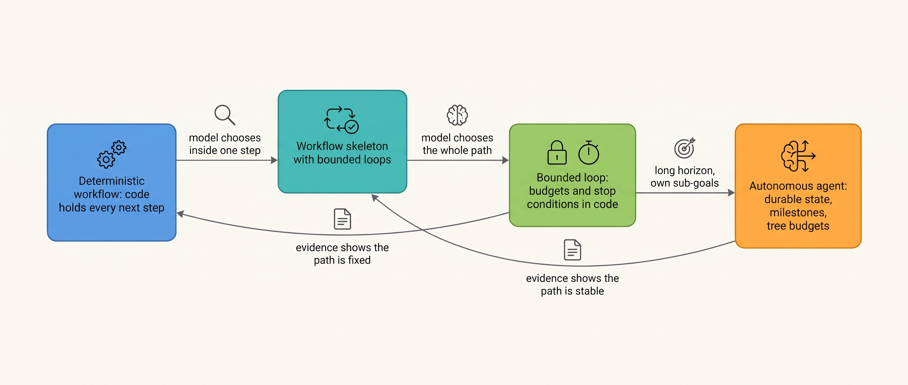
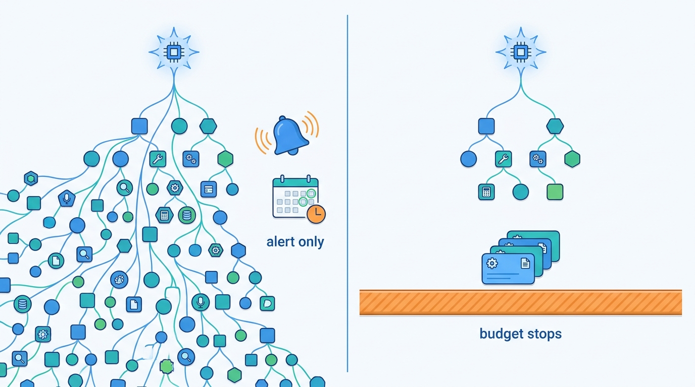
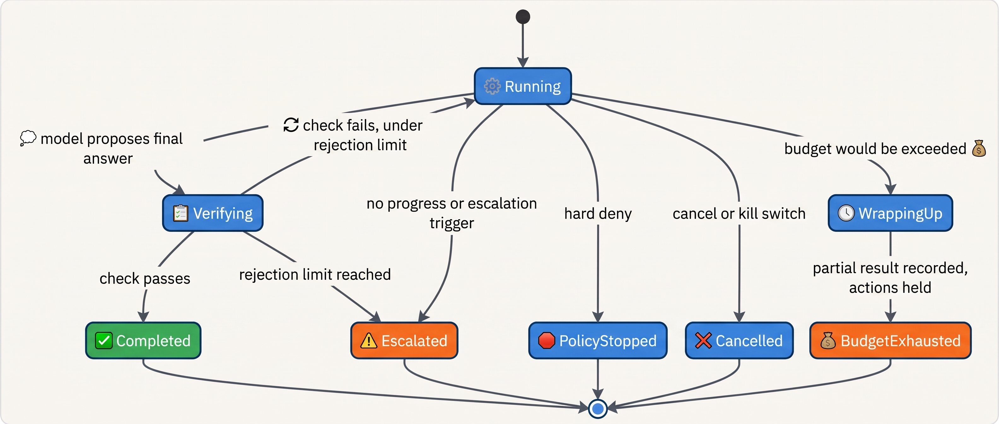
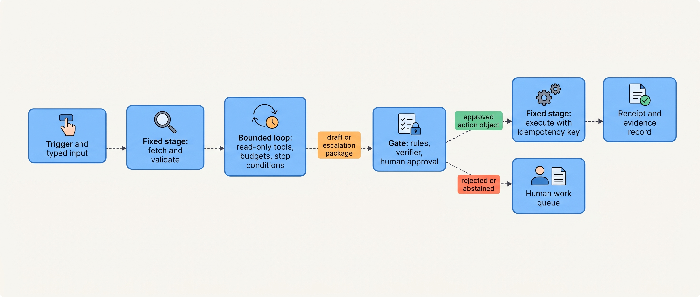
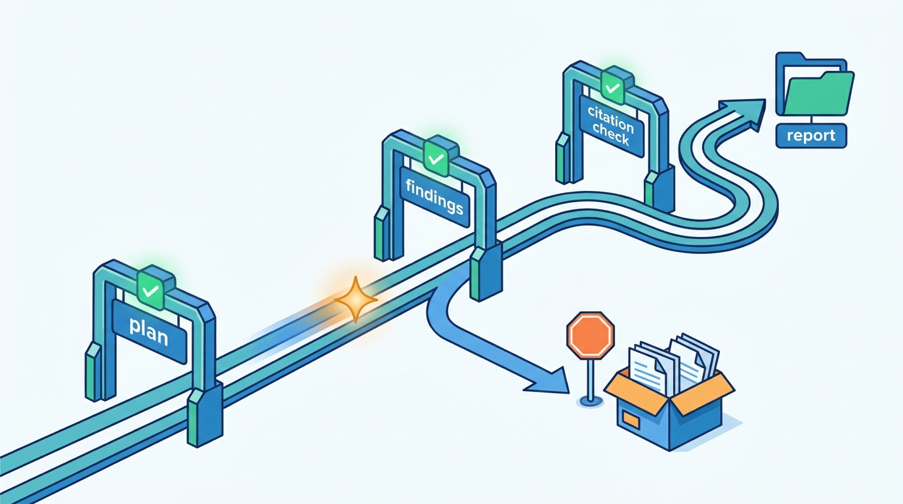

> **IN THIS CHAPTER, YOU WILL:** Learn the three execution styles (deterministic workflow, bounded loop, autonomous agent), the workflow patterns that use model steps, how to bound a loop with budgets and stop conditions, how to combine the styles, and how to move a system from one style to another when evidence says you should.

> **WHY THE BUSINESS CARES:** The execution style sets the worst case. A workflow costs roughly the same every run and fails in known places. A loop costs whatever the model chooses to spend, up to the budget someone set. An autonomous run can spend a weekend and a month's research budget before anyone looks, unless its limits were written down before it started.

> **WHY ARCHITECTS SHOULD CARE:** Each style puts state, tests, traces and limits in a different place. Picking the style per step, not per product, decides where a crash resumes, what a regression suite can check, which span tells you why a run stopped, and whether "done" means the model said so or code confirmed it.

> **KEY POINTS:**
>
> * **Choose the style per step, and default to the least autonomous one that solves the task.** A workflow keeps the next step in code. A bounded loop lets the model choose it, inside limits code enforces. An autonomous agent lets the model choose it for hours. Most systems that work are a **workflow skeleton** with one or two bounded loops inside it, not an agent with some guard rails added.
> * **A loop is bounded only by limits the model cannot change.** Every loop needs step, tool, token, cost and wall-clock budgets, a stop condition for each way a run can end, and an exit to a human that carries the evidence. In a 2025 study of failed multi-agent runs, repeating steps and not recognizing completion were the two largest single failure modes. Code can catch both.
> * **Autonomy over a long horizon moves state and verification out of the conversation.** A run that lasts hours needs durable task state, milestones a verifier checks, budgets sized for the whole task tree and a defined way to stop that holds work rather than dropping it. Without these, longer autonomy just means a longer, costlier failure.

> **[FAILURE PATTERNS THIS CHAPTER ADDRESSES](where-agentic-systems-go-wrong.html):**
>
> * **The Agent-Shaped Hammer** — a fixed procedure built as a loop pays loop costs (variance, tokens, harder tests) for choices the model never needed to make.
> * **The Compounding Error** — a loop with no checks between steps lets an early wrong turn steer every later step, and an autonomous run multiplies the number of steps.
> * **The Token Bonfire** — a loop whose only stop is the model deciding it is done keeps spending until something outside it, often a provider quota, intervenes.

<br>
[[what-makes-a-system-agentic]] asked who chooses the next step at each decision point: code, the model or a human. This chapter asks the next question: **how do the steps run?** There are three styles. In a **deterministic workflow**, code chooses every next step and model calls fill in data or pick a fixed branch. In a **bounded loop**, the model chooses the next step, but code enforces how many steps, which tools, how much money and time, and how the loop ends. In an **autonomous agent**, the model chooses over a long horizon, plans for itself and often works with no human watching.

The styles are not maturity levels. A more autonomous style has **a larger worst case that has to be paid for** with more state, more verification and harder limits. Vendors that sell agent frameworks say the same. Anthropic's 2024 guidance warns that agentic systems "often trade latency and cost for better task performance" ([Anthropic, 2024](https://www.anthropic.com/engineering/building-effective-agents)). OpenAI's 2025 guide says that when a use case does not clearly need an agent, "a deterministic solution may suffice" ([OpenAI, 2025](https://cdn.openai.com/business-guides-and-resources/a-practical-guide-to-building-agents.pdf)).

This chapter owns four terms: the **bounded loop**, the **budget** (step, tool, token, cost and time), the **stop condition** and the **workflow skeleton**. It builds on [[what-makes-a-system-agentic]] (decision points, the agent loop, the action space), [[when-agents-are-justified]] (whether a model-owned step is worth it at all) and [[autonomy-and-consequence]] (how much an action class may do). It hands the runtime that executes loops to [[agent-runtime]], explicit plans to [[planning-and-decomposition]], crash-safe execution to [[durable-agent-execution]] and the budget hierarchy and its cost model to [[agent-cost-and-model-routing]].

## Setting the Scene at Ostrell: Three Agents, Three Shapes

Ostrell, the fictional field-service software group this book follows (see [[meet-ostrell]]), opened its internal agent platform, Keelson, to all teams in January 2027. By March three agents were queued for an architecture review run by Tomas Verhoef, the Chief Architect, and each one raised the same question from a different direction.

**Scout**, the internal research agent, had just produced the **Weekend Fan-out**. In February a run on "competitor pricing across 14 markets" kept spawning sub-agents for **41 hours**. It made **1,900 sub-agent runs**, used about **310 million tokens** and cost **€8,700** in model spend. A quota alert stopped it on Monday morning. The post-mortem by Jonas Lindqvist, principal engineer for Keelson Runtime, found what the cost figure hid: **Scout had no stop condition except the model deciding it was finished**, and each sub-agent decided the same for itself. Nothing in code defined "done" or counted. The quota alert was not a stop condition; it was an accident that happened to stop the run.

**Closewise**, the finance close agent owned by group controller Joost Vermeer, was about to move from scripts onto Keelson Runtime. Its decision-point map showed code choosing the next step at about a dozen points and the model at two ([[what-makes-a-system-agentic]]). The team asked whether moving onto an "agent platform" meant turning the close into a loop.

**Answerdesk**, the customer-support agent for Ostrell Field, handles about **7,100 conversations a day**. It was a loop, and rightly: the path through a support conversation cannot be listed in advance. But its limits had grown by accretion, a step cap here and an escalation rule there, and no document said how a run could end or what happened in each case.

Tomas asked the review one question for all three: **for each step, which execution style, and what are the limits that code enforces?** Amara Okafor, Head of Agent Platform, made the answer a field in Keelson's Agent Registry.

## Concepts: Three Execution Styles

### Definitions

A **deterministic workflow** is a sequence or graph of steps whose order is fixed in code at design time. Model calls may extract, classify, summarize or draft inside steps, but the model never chooses the next step except by picking among branches code has defined. Anthropic's definition is "systems where LLMs and tools are orchestrated through predefined code paths" ([Anthropic, 2024](https://www.anthropic.com/engineering/building-effective-agents)).

A **bounded loop** is an agent loop (observe, decide, act, observe) in which the model chooses the next action and when to stop, inside limits that deterministic code enforces outside the model. The limits have two parts. A **budget** is a hard limit on the resources a run may consume: model steps, tool calls, tokens, money and wall-clock time, enforced before each step and terminating or holding work when it is reached. A **stop condition** is a rule, evaluated by code, that ends the loop and names how it ended: completed and verified, budget exhausted, no progress, policy stop, escalation or cancellation. A loop with a turn cap and nothing else is bounded in length but not in outcome.

An **autonomous agent** is a bounded loop with a long horizon: it runs for tens of minutes to days, plans and re-plans its own sub-goals, may delegate to sub-agents, and often runs in the background with nobody watching each step. Anthropic's guidance describes agents as systems where models "dynamically direct their own processes and tool usage". What changes architecturally is not the loop but that the run outlives a context window, a deploy and the attention of whoever started it.

A **workflow skeleton** is the deterministic outer structure of a system that contains agentic steps: the fixed order of stages, the typed contracts between them, the gates and the side effects, with bounded loops placed in some stages. The skeleton owns everything that must be the same every time. The loops own the parts that cannot be listed in advance.

### The three styles side by side

| Dimension | Deterministic workflow | Bounded loop | Autonomous agent |
| --- | --- | --- | --- |
| Who chooses the next step | Code | The model, inside limits code enforces | The model, including its own sub-goals and delegation |
| Typical duration | Milliseconds to days (the waits are code's) | Seconds to minutes | Tens of minutes to days |
| Path variance | None; step outputs vary | Path and outputs vary | Path, plan and decomposition vary |
| Where task state lives | Workflow engine or database, by step | Run record plus conversation history | Durable task state, artifacts, progress records outside the context window |
| How it ends | The last step completes or a step fails | A stop condition fires | A stop condition fires, checked at milestones as well as per step |
| Worst-case cost | Fixed number of model calls | The budget | The budget of the whole task tree |
| Ostrell example | Closewise's close calendar; Peoplepoint's leave flow | Answerdesk; Closewise's two investigation steps | Scout |

The rows below "who chooses" are consequences of it, not independent choices; testing and tracing per style follow later in the chapter.


**Figure 1:** *The three styles and the hybrid between them. Moving right buys flexibility and pays for it in state, verification and limits; the arrows back to the left are migrations the evidence should be allowed to trigger.*

## Workflow Patterns With Model Steps

Anthropic's December 2024 guidance named five workflow patterns that use model calls inside code-controlled paths ([Anthropic, 2024](https://www.anthropic.com/engineering/building-effective-agents)). Each keeps the locus of control in code while using the model where language is the problem. The page now notes that much of its tooling advice has changed; the patterns have not.

| Pattern | What the model does | What code owns | Typical failure | Ostrell use |
| --- | --- | --- | --- | --- |
| **Prompt chaining** | Each call transforms the previous call's output | The sequence; "gates" (programmatic checks) between calls | An early error passes when gates check form, not content | Closewise: extract, classify, draft |
| **Routing** | Classifies the input | Every branch, plus a default for "none of these" | Misroutes that look like handler failures | Answerdesk triage ([[routing-and-delegation]]) |
| **Parallelization** (sectioning or voting) | Several calls on independent parts, or one task several times | The split, the join, the voting rule | A section silently missing; voting on correlated errors | Dealroom brief sections |
| **Orchestrator–workers** | A lead call decides sub-tasks at runtime | Worker count, depth, budget, the join | Over-decomposition; duplicated work | Scout ([[single-and-multi-agent-designs]]) |
| **Evaluator–optimizer** | One call generates, another evaluates, repeated | The iteration cap and acceptance rule | An evaluator with the generator's blind spots | Clausewise redlines against the playbook |

Two of these patterns are loops in disguise. **Orchestrator–workers** hands the decomposition to the model; Anthropic distinguishes it from parallelization because "subtasks aren't pre-defined". If the skeleton does not own how many workers, how deep and how much they may spend, this pattern is the Weekend Fan-out. **Evaluator–optimizer** is a loop whose exit is the evaluator's verdict. It works only when the evaluator has information or a check the generator does not. Reflexion's coding gains came from unit tests, an external signal ([Shinn et al., 2023](https://arxiv.org/abs/2303.11366)). Huang and colleagues found at ICLR 2024 that models "struggle to self-correct their responses without external feedback", with performance sometimes getting worse ([Huang et al., 2023](https://arxiv.org/abs/2310.01798)). Their tasks were reasoning benchmarks with 2023 models, so the size of the effect is history, but the condition is durable. **An evaluator–optimizer loop needs an iteration cap in code and an evaluator that can see something the generator cannot**: a test, a schema, a reconciliation, a rule set or a fresh context with the source documents.

The author's agentic-finance-platform interview design states the workflow choice for regulated work in one line: "An authored DAG (extract -> match -> propose) with LLM calls in bounded nodes, not an autonomous loop" (design example, `agentic-finance-platform/interview.json`, step `pipeline`). The same step adds that "'deterministic pipeline, not a loop' is a harness configuration, not the absence of a harness": the workflow still gets durable execution, retries, policy and evidence from the platform. That answered the Closewise team's question.

## The Bounded Loop

### Budgets

A loop without budgets is bounded by the model's judgement of when to stop. The budgets that matter:

| Budget | Unit | Bounds | Enforced by | Typical action at the limit |
| --- | --- | --- | --- | --- |
| **Step budget** | Model calls per exchange and per run | Loops that keep thinking; repeated steps | Runtime, before each model call | Stop and wrap up, or escalate |
| **Tool budget** | Tool calls per run and per tool | Retry storms through the model | Runtime and tool broker | Reject further calls; escalate |
| **Token budget** | Input plus output tokens per run (and output tokens per step) | Context growth; one runaway generation | Model gateway (per step), runtime ledger (per run) | Truncate the step; terminate the run |
| **Cost budget** | Money per run, priced at the time of the call | Model mix changes, long contexts, fan-out | Runtime ledger, aggregated over the run tree | Terminate and hold queued actions |
| **Time budget** | Wall-clock per exchange and run; idle time | Hung tools, slow providers | Runtime timers | Deadline fallback (interactive); terminate (background) |
| **Delegation budget** | Depth and parallel children | Recursive spawning | Runtime, at spawn | Refuse the spawn |

**Budgets terminate; alerts inform.** The author's agentic-platform-foundations interview design requires that "budgets must terminate, not just alert" and lists "budget as an alert" as a trap (design example, `agentic-platform-foundations/interview.json`, step `capacity`). The Weekend Fan-out had an alert; it fired on Monday.


**Figure 2:** *Budgets terminate; alerts inform: the Weekend Fan-out ran for 41 hours and spent €8,700 because its only limit was an alert that fired on Monday.*

**Budgets are checked before the step, not after.** Admission control before each call, using the step's maximum output tokens and current prices, bounds the overshoot to one call; [[agent-cost-and-model-routing]] gives Keelson's check and the nesting from step to provider spend cap.

**Framework defaults are not a budget policy.** As of October 2026 the OpenAI Agents SDK raises `MaxTurnsExceeded` when a run exceeds its `max_turns` and lets the caller pass `max_turns=None` to disable the limit ([OpenAI, n.d., accessed 2026-10](https://openai.github.io/openai-agents-python/running_agents/)). The Claude Agent SDK caps sub-agent depth and concurrency by default but sets no spend limit unless `max_budget_usd` is configured ([Anthropic, n.d., accessed 2026-10](https://code.claude.com/docs/en/agent-sdk/subagents)). Neither is a cost or wall-clock policy; the platform sets and records its own.

**Size budgets from observed runs, with headroom.** The platform interview design sets its per-run token cap at "<2× the p95 session", a starting point to revise as Wake, Keelson's tracing service, reports how many runs end on a budget ([[agent-observability]]).

### Stop conditions

A loop can end in more ways than "the model said it was done". Each needs a rule, a recorded reason and a defined next step. The March review made Keelson's set mandatory for every bounded loop.

| Stop condition | Fires when | Evaluated by | Next step |
| --- | --- | --- | --- |
| **Completed, verified** | The model proposes a final answer and the completion check passes | Verifier in code (schema, rule, test, reconciliation, groundedness) | Deliver; close the run |
| **Completion rejected** | The model proposes a final answer and the check fails | Verifier | Return the failure as an observation; escalate after N rejections |
| **Budget exhausted** | The next step would exceed any budget | Runtime ledger | Wrap up partial results; hold queued actions; report |
| **No progress** | The same call repeats, the same error recurs, or progress stalls for K steps | Runtime progress detector | One forced change of strategy, then escalate |
| **Policy stop** | A hard deny that ends the task, not just the call | Policy engine | Escalate with the denied action shown |
| **Escalation trigger** | The model or the user asks for a human, or a code rule fires (repeated failure, a topic that must go to staff) | Model and code, independently | Hand over the escalation package |
| **Cancellation** | A user, operator or kill switch cancels | Runtime | Let a dispatched side effect finish or time out; report effects; never silently undo |
| **External deadline** | The surrounding process closes (period lock, SLA) | Workflow skeleton | Re-route remaining work as the process defines |

Each terminal state is recorded with its reason (`completed`, `budget_exhausted`, `no_progress` and so on), which makes the stop-reason mix a metric.

The author's ai-coding-cli interview design lists the same core and adds two rules that apply well beyond coding: "On a cap, don't just die — have the model summarize state and hand back partial progress", and "Detect doom loops (same failing command three times) and force a strategy change or an escalation to the user" (design example, `ai-coding-cli/interview.json`, step `agent-loop`).

The evidence for these stop conditions is unusually direct. Cemri and colleagues annotated more than 1,600 traces from seven multi-agent frameworks. The two largest single failure modes were **repeating completed steps (15.7%)** and **not recognizing that the task was complete (12.4%)**. The three verification modes together, incorrect verification, missing verification and premature termination, accounted for about 23.5% ([Cemri et al., 2025](https://arxiv.org/abs/2503.13657), preprint). The traces come from 2024–25 models and benchmark frameworks, so the percentages are not a production base rate. But code can catch almost every one of those modes: a progress detector catches repetition, a budget catches a run that never ends, and a verifier catches false completion.


**Figure 3:** *How a bounded loop ends. The model can only propose completion; every terminal state is entered by code, and each one records why the run stopped.*

### Exit to a human

Most stop conditions other than "completed" end at a person. That exit is designed, not an exception path, and has three requirements.

The human receives an **escalation package**, not a transcript: the goal, what was tried, the evidence gathered, the action objects that were proposed but not executed, the stop reason and the budget consumed. [[agent-interaction-design]] owns the package; [[coordination-and-handoffs]] owns its typed form, which the Lost Handoff showed is needed.

The exit must be **reachable by code alone**. If the only path to a human is the model calling an `escalate` tool, a model that is confused or steered by injected text will not take it. Answerdesk's code escalates on a user's request for a human, repeated failure and policy triggers, independently of the model.

**Abstention counts as success** when it is correct. Evaluation must score a correct "not enough evidence, routed to staff" as a pass ([[building-agent-eval-suites]]).

### A bounded loop in code

The sketch shows where each stop condition lives. It assumes the durable execution of [[durable-agent-execution]] around it; the names are illustrative, not any SDK's.

```python
class Stop(Enum):
    COMPLETED = "completed"; BUDGET = "budget_exhausted"; NO_PROGRESS = "no_progress"
    POLICY = "policy_stopped"; ESCALATED = "escalated"; CANCELLED = "cancelled"

def bounded_loop(run: Run, limits: LoopLimits) -> RunResult:
    progress = ProgressDetector(repeat_limit=limits.repeat_limit)   # e.g. 2 identical calls
    rejections = 0
    while True:
        if run.cancel_requested():
            return run.finish(Stop.CANCELLED, report=run.effects())   # report, never undo
        if trigger := escalation_rules.check(run):                    # code-owned exits
            return run.finish(Stop.ESCALATED, package=run.escalation_package(trigger))
        admit = run.ledger.admit(next_step=limits.max_step_tokens)    # steps, tokens, cost, time
        if not admit.ok:
            run.hold_queued_actions()
            return run.finish(Stop.BUDGET, partial=run.wrap_up(admit.reason))
        proposal = run.propose()                                      # the model's only line
        if proposal.is_final:
            check = verifier.check(proposal, run.task)                # not the model's opinion
            if check.passed:
                return run.finish(Stop.COMPLETED, result=proposal, check=check)
            rejections += 1
            if rejections >= limits.max_completion_rejections:
                return run.finish(Stop.ESCALATED, package=run.escalation_package(check))
            run.observe(check.as_feedback()); continue
        if progress.repeated(proposal.action):                        # doom-loop signature
            return run.finish(Stop.NO_PROGRESS, package=run.escalation_package(progress))
        verdict = policy.evaluate(proposal.action, run.principal)
        if verdict.ends_task:
            return run.finish(Stop.POLICY, package=run.escalation_package(verdict))
        if not verdict.allowed:
            run.observe(verdict.as_feedback()); continue
        run.observe(run.execute(proposal.action))                     # broker, idempotency key
```

The model contributes one line, `run.propose()`; every way out of the loop is a code branch. A confident "done" can be refused by the verifier. And the budget stop **holds** queued actions and wraps up partial results rather than dropping them, the same rule Keelson applies to kill switches.

## Autonomous Execution

### What changes with a long horizon

**The run outlives its context.** Something must decide what survives: compaction, notes or state outside the conversation ([[context-engineering]]). Anthropic's November 2025 guidance on long-running coding agents is a documented example. An initializer session writes a progress file, a feature list in JSON (chosen because models are less likely to overwrite JSON than Markdown) and an initial git commit; every later session reads the progress notes and git log, works on one feature, tests it end to end and commits ([Anthropic, 2025](https://www.anthropic.com/engineering/effective-harnesses-for-long-running-agents)). The failure modes it reports are long-horizon versions of the stop-condition failures above: trying to "one-shot" the whole application and running out of context mid-feature, later sessions declaring the project done too early, and features marked as passing without end-to-end verification. It is a vendor's post about its own harness, not a controlled study, but the lesson is structural: **the state that lets a long run resume and be checked must live in artifacts outside the model.**

**The run outlives a deploy and a crash.** A restart in hour three must not start from scratch or re-ask the model for decisions it already acted on; model and tool calls must be recorded steps returned from history on replay ([[durable-agent-execution]]). Frameworks differ here. LangGraph's documentation, accessed October 2026, says that replaying from a checkpoint re-executes later nodes "including any LLM calls", while Temporal's guidance puts LLM invocations in activities whose recorded results are reused ([LangGraph, n.d.](https://docs.langchain.com/oss/python/langgraph/checkpointers); [Temporal, n.d.](https://docs.temporal.io/workflows), both accessed 2026-10). Built carelessly on the first, an autonomous agent takes a different path after a crash than before it.

**The run outlives the attention of the person who started it.** A background agent has no human to notice that it is going in circles. Anthropic's February 2026 study of Claude Code usage shows the direction of travel: the 99.9th-percentile turn duration (Anthropic's measure of one uninterrupted stretch of agent work) nearly doubled between October 2025 and January 2026, from under 25 minutes to over 45, and experienced users auto-approved actions in over 40% of sessions against about 20% for new users ([Anthropic, 2026](https://www.anthropic.com/research/measuring-agent-autonomy)). That is one vendor's telemetry, but runs are getting longer and watched less. Monitoring has to move from a person reading the stream to **milestones that code checks**: a plan accepted, a sub-question answered with citations, a test suite green, each a point where the run can be stopped, resumed or re-planned.

**The task length exceeds the model's reliable horizon.** METR measures the length of human-timed software tasks that models complete with 50% success; the 80% horizon is 4–6 times shorter ([Kwa et al., 2025](https://arxiv.org/abs/2503.14499)). The tasks are self-contained and automatically scored, and METR's September 2026 page calls measurements above 16 hours unreliable ([METR, 2026](https://metr.org/time-horizons/)). The consequence: **the task handed to one autonomous segment should be well inside the horizon at which the model is reliable, not the one at which it succeeds half the time**, with checkpoints and verification between segments. [[when-agents-are-justified]] does the compounding arithmetic.

### Self-directed planning and delegation

Autonomous agents plan for themselves and may spawn sub-agents; both need limits recorded before the run starts. A plan is far more useful as data code can validate and diff than as reasoning text ([[planning-and-decomposition]]), and delegation needs depth, fan-out and a budget slice per child ([[routing-and-delegation]]).

## Hybrids: Where Most Systems Should Land

Pure styles are rare in systems that work. The two hybrid shapes are not symmetric.

**A workflow skeleton with agentic steps** starts from code. The stages, their order, the gates and every side effect are fixed; one or two stages are bounded loops whose action space is read-only tools plus a draft written to a staging store. The loop's output is a proposal the skeleton checks before anything changes. Closewise is this shape. So is the author's research-platform interview design, a "Deterministic DAG: retrieve -> hypothesize -> design protocol -> validate -> authorize -> run" with the hypothesis agent as one "bounded LLM node" (design example, `agentic-research-platform/interview.json`, `highLevelArchitecture`).

**An agent with deterministic guard rails** starts from the loop. The model owns the path; code owns budgets, stop conditions, policy checks before each tool call and gates before consequential actions. Answerdesk and Forge are this shape; it fits when the path genuinely cannot be listed.

Stripe's February 2026 engineering post on its internal coding agents describes the first shape in a domain usually treated as the second. Its orchestration is customized to "interleave agent loops and deterministic code" for git operations, linters and testing, with "at most two rounds of CI" before the work goes back to a human, and it reports over a thousand merged pull requests a week produced entirely by these agents and reviewed by humans ([Stripe, 2026](https://stripe.dev/blog/minions-stripes-one-shot-end-to-end-coding-agents)). That is one company's account of its own system, with no published comparison against a looser design, but it shows the skeleton-first shape working in coding, not only in finance.


**Figure 4:** *A workflow skeleton with one agentic step. The loop proposes; the skeleton checks, executes and records. Changing the loop's model or prompt cannot change which side effects are possible.*

The rule that makes either hybrid safe comes from the author's platform interview design: "every dangerous side effect still routes through the same guardrail/evidence path: there is no path-specific bypass. The control flow decides how much the model plans, never whether enforcement applies" (design example, `agentic-platform-foundations/interview.json`, step `control-flow`).

My rule for choosing between the hybrids: **start from the skeleton whenever the side effects can be listed in advance**, even if the reasoning cannot. Start from the loop only when the actions themselves depend on what the run discovers; the first keeps the action space fixed while the reasoning varies.

## Where State Lives, and What You Can Test and See

The style decides where a crash resumes, what needs repeated trials and which trace answers "why did it stop?".

| Concern | Deterministic workflow | Bounded loop | Autonomous agent |
| --- | --- | --- | --- |
| **Authoritative state** | Engine history or step table; one record per stage | Run record: recorded proposals, tool calls with receipts, budget ledger, stop reason | Durable task state plus artifacts by reference (plan, findings, progress), never only the context window |
| **Resume point after a crash** | The failed stage | The last recorded step; recorded proposals are never re-sampled | The last milestone or recorded step; plan version recorded |
| **What needs repeated trials** | Model steps only (per-step evaluation sets) | Whole runs: outcome and trajectory invariants, reported as pass^k | Whole long tasks at milestone level; few trials, so wide intervals |
| **Key trace fields** | Stage, branch, model step version | Each proposal, verdict, tool span, budget consumed, **stop reason** | All of those, plus delegation lineage (`root_run_id`, depth), milestone outcomes, budget burn rate |

τ-bench defines pass^k as the probability that all k trials of a task succeed; with June 2024 models, the best retail-domain agent passed 61% of tasks once but fewer than 25% in all of eight trials ([Yao et al., 2024](https://arxiv.org/abs/2406.12045), preprint, simulated users). One trial tests a workflow's path but only one of a loop's paths, a testing cost that belongs in the business case for moving a step into a loop ([[evaluating-agentic-systems]]).

### Requirements per interaction

| Interaction | Consistency | Latency | Durability | Who may act |
| --- | --- | --- | --- | --- |
| Workflow stage transition | Exactly-once effect per stage | Minutes to days acceptable | Recorded before the next stage | Code |
| Loop step (proposal) | Recorded before acting; never re-asked on retry | Part of the exchange deadline (≤ 6 s for an Answerdesk answer, per [[agent-latency-and-throughput]]) | Recorded per step | Model, inside the action space |
| Budget admission | Ledger aggregated over the run tree, strongly consistent per run | Milliseconds, before each step | Durable ledger in task state | Code |
| Stop decision | One terminal state per run; idempotent | Immediate | Recorded with reason and evidence | Code (the model only proposes completion) |
| Escalation to human | Package complete and typed | Queue SLA set by the risk owner | Durable until acknowledged | Code delivers; a human acts |
| Milestone check (autonomous) | Against artifacts, not the conversation | Minutes | Record with artifact versions | Verifier in code; a human where plan approval is required |

## What the Evidence Says

**On choosing the style,** the documented guidance converges. Anthropic (2024) recommends "finding the simplest solution possible, and only increasing complexity when needed", with stopping conditions "such as a maximum number of iterations". OpenAI (2025) describes a run loop that continues until an exit condition such as a final-output tool call, an error or a maximum number of turns, and an agent that "can halt execution and transfer control back to the user". Both are vendor guides that also market SDKs: evidence of what experienced builders recommend, not of what works.

**On loop failures,** the measured evidence points at termination and verification: MAST's largest modes, and TheAgentCompany's simulated office, where the best agent of the September 2025 revision completed 30.3% of tasks at an average of 27.2 steps and some failures faked success by changing the environment ([Xu et al., 2024, rev. 2025](https://arxiv.org/abs/2412.14161), preprint). Both are benchmarks, not production data.

**On long horizons,** METR and Anthropic agree that the length of work handed to models is rising quickly, with METR's caveats (self-contained tasks, automatic scoring, estimates for the newest models that move by 1.5–2× with curve-fitting choices) and Anthropic's (one product, its own telemetry). **No published study compares the reliability or cost of the same production task built as a workflow, a bounded loop and an autonomous agent.** The recommendations in this chapter on when to use which style are the author's judgement, built from the benchmarks above, the vendor guidance and the design examples.

## Worked Example at Ostrell: Three Registrations

The March 2027 review gave each Agent Registry entry a field, **execution style per step**, and a limits block that Keelson Runtime enforces.

### Closewise: a workflow with two bounded loops

Closewise was registered as a **workflow skeleton** per legal entity: subledger cut-off, fetch balances and transactions, rule-based matching, then two branches. Unmatched differences go to an **investigation loop**; accrual candidates go through a single-call classification step and then an **evidence loop** that gathers support and drafts the entry. Approved entries are posted by the workflow, never by the model, for **23 legal entities** and about **1,900 proposed entries a month** ([[durable-agent-execution]] walks through a close).

The two loops got limits sized from the March prototype's runs (Ostrell figures, fictional):

| Limit | Investigation loop | Evidence loop |
| --- | --- | --- |
| Tools | Read-only: ledger queries, subledger detail, bank lines, document search | Read-only: contracts, purchase orders, prior-period entries; write only to the staging store |
| Step budget | 20 model steps | 12 model steps |
| Tool budget | 25 tool calls | 15 tool calls |
| Cost budget | €2.00 per difference | €1.00 per candidate |
| Time budget | 15 minutes | 10 minutes |
| Completion check | Explained amount equals the difference within €1, every explaining line cites a source record | Draft passes the entry invariants (balanced, open period, valid account, evidence attached) |
| On any other stop | Difference goes to the accountant's queue with the evidence gathered | Candidate goes to the accountant's queue; no draft entry |

Joost Vermeer's reason for the skeleton was the audit: every entity follows the same approved procedure every month. The loops sit where the work genuinely varies, the hunt for why two numbers differ, and their worst case is a wasted €2 and an item on a human queue.

### Answerdesk: a bounded loop with eight ways to end

Answerdesk stayed a **bounded loop** inside a thin skeleton: verification and triage run before the loop, and credits that need approval leave it as action objects for a team lead ([[autonomy-and-consequence]]). The registry recorded these limits, enforced by Keelson Runtime since April 2027 (Ostrell figures, fictional):

- **Per exchange** (one customer message and Answerdesk's reply): at most 6 model steps and 4 tool calls; an answer deadline of 6 seconds, after which the customer sees a holding message and the exchange continues asynchronously.
- **Per conversation:** at most 40 model steps, €1.00 of model spend and 30 minutes of active time; at most one technician revisit and the credit limits of its autonomy tiers, enforced in the tools.
- **No progress:** the same tool with the same arguments twice in a conversation, or two consecutive completion rejections, ends the loop with an escalation.
- **Code-owned escalation triggers:** a request for a human, three failed attempts on one intent, and topics policy routes to staff.

The €1.00 cap is about eight times the average (Q3 2027 model spend was about **€120 per 1,000 conversations**, per [[agent-cost-and-model-routing]]): it catches runaways without rationing normal work.

Wake's stop-reason mix for Q3 2027 adds up to the known outcomes: **41%** resolved end to end, **33%** escalated to staff, the rest abandoned or resolved by the customer.

| How the loop ended (Q3 2027) | Share of conversations | Per day (≈ 7,100) |
| --- | --- | --- |
| Completed, verified (resolved end to end) | 41.0% | ≈ 2,910 |
| Escalated: model proposed it | 20.5% | ≈ 1,460 |
| Escalated: code trigger (request, repeated failure, policy topic) | 10.6% | ≈ 750 |
| Escalated: no-progress detector | 1.1% | ≈ 80 |
| Escalated: budget exhausted | 0.8% | ≈ 57 |
| Abandoned or resolved by the customer | 26.0% | ≈ 1,850 |

Two numbers in that table changed decisions. The **10.6%** of conversations escalated by code triggers is the part of escalation the model did not propose; before the review the triggers existed but were not counted apart, so nobody could tell whether they still fired after a prompt change. Wake now reports them as their own series. And the **57 budget stops a day** were read one by one for two weeks. About two thirds were customers with several contracts whose questions fanned out across them, which led to a contract-selection step in the skeleton before the loop. The rest were runaways, repeated knowledge-base searches with slightly different wording, which the progress detector now catches by comparing the documents returned rather than the query text.

### Scout: autonomous, with limits recorded before it starts

Scout was registered as an **autonomous agent**: a lead on the Large tier that plans, delegates to Mid-tier workers with read-only tools and a 20-minute deadline, and a citation verifier before the report is written. Its median run is **14 minutes**, about **350 runs a month**. Since the Weekend Fan-out its manifest carries a run budget of **8 million tokens, €90 and 90 minutes**, a **delegation depth of at most 2** and **at most 8 parallel sub-agents** ([[single-and-multi-agent-designs]]).

The review added **milestones that code checks**: a plan recorded as data before any delegation ([[planning-and-decomposition]]); each sub-question closed with typed findings that carry citations; a citation check before the report. A run that misses a milestone stops at that milestone with what it has. Under these limits the Weekend Fan-out would have stopped at €90 after about 25 minutes ([[agent-cost-and-model-routing]]), with a stop record naming the budget and the milestone instead of a quota alert.


**Figure 5:** *Over a long horizon, milestones that code checks replace a person watching each step; a Scout run that misses one stops there with what it has.*

## Migrating Between Styles

The style is a decision to revisit in both directions.

**Loop to workflow** is the migration teams resist and should make more often. The signal is a map on which the model holds steps where it has no meaningful choice, or traces in which nearly every run takes the same path; Ostrell's March 2027 business-case review downgraded Peoplepoint's leave flow for that reason ([[when-agents-are-justified]]). Mine the traces: write the top trajectories as workflow branches, keep the model where it handles language, and keep a fallback to a loop or a human.

**Workflow to loop** is justified when the exception queue fills with cases that need investigation rather than a missing rule, and a verifier exists. Closewise's investigation loop began that way. Put the loop inside a stage, keep it read-only, and compare it with the queue it replaces on cost per resolved item and on how often accountants overturn it.

**Loop to autonomous** is justified when tasks routinely exceed one bounded run and split into checkable milestones. Add durable state, milestones and tree budgets first, then raise the horizon; the reverse order is how the Weekend Fan-out happened. **Autonomous back to loop or skeleton** follows from a rising budget-termination rate, milestones that fail in the same place, or a plan the model writes the same way every time, which should then be code.

Each migration is a change to the agent's version manifest, evaluated against the previous style on the same suite before it ships ([[versioning-agent-systems]], [[staged-rollout-and-rollback]]).

## Failure Modes and Recovery

| Scenario | What happens | Detection | Containment | Recovery |
| --- | --- | --- | --- | --- |
| **No stop but "done"** | The model never judges the task complete; the loop runs until something external stops it (the Weekend Fan-out) | Wake alert on run duration and cost burn rate per run; budget-termination events | Run budget enforced before every step; delegation limits | Wrap-up with partial results; hold queued actions; add the missing stop condition to the registry entry |
| **Doom loop** | The same failing call repeats with small variations | Progress detector on call signatures and on returned results; steps per run above p99 | `no_progress` stop after the repeat limit | Escalation package to a human; the case enters the evaluation suite |
| **False completion** | The model reports success with work undone or a check faked | Completion check in code; trajectory invariants in Sounding, Keelson's evaluation service | Verifier refuses the final answer; rejection limit | Escalate; fix the verifier if it passed something it should not have |
| **Budget hit mid-action** | The budget runs out between proposing and executing a side effect | Budget event recorded with the pending action | Stop new steps; let a dispatched call finish or time out; record `unknown` where needed ([[retries-idempotency-and-concurrency]]) | Held action reviewed by a human; never silently dropped or re-proposed |
| **Lost long run** | An autonomous run crashes in hour two and restarts from scratch, or re-asks the model and diverges | Run restarts per task; duplicate artifacts; receipts for actions not in the current history | Durable execution with recorded model calls; side effects keyed by task and step | Resume from the last milestone; reconcile any effects in `unknown` state |
| **Escalation path depends on the model** | A confused or steered model never calls `escalate` | Conversations ending in abandonment after repeated failures | Code-owned escalation triggers | Add the trigger; measure code-triggered escalations separately |

## Trade-offs

| Option | Strengths | Costs and risks | Right when |
| --- | --- | --- | --- |
| **Deterministic workflow with model steps** | Fixed path, fixed cost, one trial per test input, easy audit | Every new path is a code change; exceptions pile up in human queues | The procedure is known and must be identical every time; regulated work |
| **Workflow skeleton with bounded loops** | Fixed action space and side effects; flexible reasoning where it is needed; loops' worst case is local | Two designs to maintain; stage contracts must be typed | Side effects can be listed in advance but some stages need investigation or drafting (the book's default) |
| **Bounded loop with guard rails** | Handles paths that cannot be listed; one model owns the conversation | Repeated-trial testing; variable cost; limits must be designed per action class | Interactive tasks whose actions depend on what the conversation reveals |
| **Autonomous agent** | Handles long, open tasks; parallel breadth when delegation is justified | Durable state, milestones, tree budgets and background monitoring are prerequisites; few trials per task make evaluation noisy | Long tasks that split into checkable milestones, with read-mostly action spaces |

My recommendation: **register an execution style per step, start each step at the least autonomous style that solves it, and require the limits block before the style is approved.** It assumes a platform that enforces budgets and stop conditions outside the model (without one, the case for workflows is stronger still) and outputs that can be verified (where they cannot, more autonomy buys more unverified work).

## Across Domains: How the Stakes Change the Design

| Dimension | Coding agents | Customer operations (support, sales, marketing) | Back office (finance, legal, HR) | High-stakes decisions (healthcare, public benefits) |
| --- | --- | --- | --- | --- |
| Default style | Bounded or autonomous loop inside a sandbox, inside a CI skeleton | Bounded loop with a skeleton around it (verification, triage, approvals) | Workflow skeleton with bounded loops in investigation and drafting stages | Deterministic pipeline with one bounded model node (design examples) |
| What makes a run end | Tests green and a pull request; capped fix rounds | Verified answer or an escalation | Draft passes invariants, or goes to a human queue | Draft and explanation reach a human; abstention is a valid end |
| Strongest verifier | Tests, types, build (cheap and strong) | Grounding checks and policy rules (partial) | Reconciliation, ledger invariants (strong for structure) | Rule engine and clinical safety checks (authoritative), then a licensed human |
| Room for autonomy | Large inside the sandbox; none past the merge gate | Within tiered action classes | Analysis only; posting stays with the workflow | Evidence gathering and drafting only |

The platform can keep the mechanism common: budgets, stop conditions, progress detection, escalation packages and the no-bypass rule are the same in every column. What is domain policy is **where the skeleton ends and the loop begins**, which verifier counts as a completion check, and what a stopped run hands to whom. Coding stands out because its verifier is cheap and strong, which is why it tolerates the most autonomy; the high-stakes designs stand out because their rule layer is authoritative and adverse outcomes always go to a person ([[domain-high-stakes-decisions]]).

## The Chief Architect's View

**What to decide.** The execution style of every step, recorded in the registry, with a limits block that may not be empty for any loop: budgets, stop conditions, the completion check and the escalation route. The burden of proof sits with the more autonomous style.

**Who decides.** The agent's owner proposes the style and limits. The risk owner (Joost Vermeer for Closewise, Lena Brandt, Director of Support Operations, for Answerdesk) approves the completion check and escalation route, because they define what "done" means for the business. The platform team owns enforcement and the maximum any limit may take. A change of style is reviewed like a change of autonomy tier.

**What to watch.** Per agent: the stop-reason mix, budget-termination rate, no-progress stops, completion rejections, steps per run against the registered budget and cost per verified outcome. A rising budget-termination rate means a runaway or a cap that no longer fits; a falling share of code-triggered escalations with flat resolution means the triggers are no longer firing, not that the model got better.

**What is durable and what will change.** The styles, limits outside the model, the stop-condition set and the skeleton-first default are durable. What will change with model capability is the **size** of the steps it is reasonable to hand to a loop and the horizon a single autonomous segment can hold. Better models move the boundary between skeleton and loop; they do not remove the need for one.

## Questions to Ask

1. For each step in this design, which execution style is it, and why not a less autonomous one?
2. What are all the ways a run can end, and which code branch enters each terminal state?
3. Who or what decides that a run is complete, and what can that check see that the model cannot?
4. Which budgets apply (steps, tools, tokens, cost, time, delegation), where are they enforced, and are they checked before or after each step?
5. What happens to a side effect that is proposed or in flight when a budget runs out or the run is cancelled?
6. How does the system detect a run that is repeating itself, and what happens next?
7. Can a run reach a human without the model choosing to escalate?
8. For long runs, where does the state live that lets a run resume after a crash or a deploy without re-asking the model?
9. What evidence would make you move this step to a less autonomous style, and who looks at it?

Part I ends here. Part II, starting at [[part-2]], turns these decisions into components: [[agentic-reference-architecture]] lays out the runtime, gateway, policy enforcement point, task state and evidence log that enforce every limit in this chapter.

## Sources and Evidence

**Research papers**

- [Why Do Multi-Agent LLM Systems Fail?](https://arxiv.org/abs/2503.13657), M. Cemri et al., 2025 (preprint, v3): 14 failure modes over 1,600+ traces; repetition 15.7%, unaware of completion 12.4%, verification modes about 23.5%.
- [Reflexion: Language Agents with Verbal Reinforcement Learning](https://arxiv.org/abs/2303.11366), N. Shinn et al., 2023: retry with self-reflection, gains dependent on external feedback such as unit tests.
- [Large Language Models Cannot Self-Correct Reasoning Yet](https://arxiv.org/abs/2310.01798), J. Huang et al., 2023, ICLR 2024: intrinsic self-correction without external feedback is unreliable.
- [τ-bench](https://arxiv.org/abs/2406.12045), S. Yao et al., 2024, preprint: the pass^k metric; single-trial versus eight-trial success with June 2024 models.
- [Measuring AI Ability to Complete Long Tasks](https://arxiv.org/abs/2503.14499), T. Kwa et al. (METR), 2025, NeurIPS 2025: 50% and 80% time horizons; 80% horizons 4–6× shorter.
- [TheAgentCompany](https://arxiv.org/abs/2412.14161), F. Xu et al., 2024 (rev. 2025), preprint: 30.3% full completion and 27.2 steps per task for the best agent; failures that fake success.

**Specifications, standards and regulation**

- None specific to this chapter.

**Vendor documentation and engineering reports**

- [Building effective agents](https://www.anthropic.com/engineering/building-effective-agents), Anthropic, 2024: workflow and agent definitions; the five workflow patterns; stopping conditions; start simple.
- [A practical guide to building agents](https://cdn.openai.com/business-guides-and-resources/a-practical-guide-to-building-agents.pdf), OpenAI, 2025: run loop exit conditions; halting and returning control to the user; deterministic solutions where they suffice.
- [Running agents](https://openai.github.io/openai-agents-python/running_agents/), OpenAI Agents SDK documentation, n.d., accessed 2026-10: `max_turns`, `MaxTurnsExceeded`, disabling the limit, error handlers.
- [Subagents in the SDK](https://code.claude.com/docs/en/agent-sdk/subagents), Anthropic, n.d., accessed 2026-10: default depth and concurrency caps, no default spend cap, `max_budget_usd`.
- [Effective harnesses for long-running agents](https://www.anthropic.com/engineering/effective-harnesses-for-long-running-agents), J. Young, Anthropic, 2025: progress files, feature lists, one feature per session; premature completion and unverified passes.
- [Measuring AI agent autonomy in practice](https://www.anthropic.com/research/measuring-agent-autonomy), Anthropic, 2026: turn durations, auto-approval and interruption rates in Claude Code.
- [Time horizons](https://metr.org/time-horizons/), METR, 2026 (updated 2026-09-08): task suite scope; measurements above 16 hours unreliable.
- [Minions: Stripe's one-shot, end-to-end coding agents](https://stripe.dev/blog/minions-stripes-one-shot-end-to-end-coding-agents), A. Gray, Stripe, 2026: agent loops interleaved with deterministic code; at most two CI rounds; over a thousand merged agent PRs a week.
- [Checkpointers](https://docs.langchain.com/oss/python/langgraph/checkpointers), LangChain, n.d., accessed 2026-10: replay re-executes later nodes including LLM calls.
- [Workflows](https://docs.temporal.io/workflows), Temporal, n.d., accessed 2026-10: LLM invocations as activities with recorded results.

**Incidents, cases and decisions**

- No public incident report was found that attributes a production failure specifically to a missing stop condition; the Weekend Fan-out is Ostrell's fictional incident.

**Design examples from the author's interview project**

- Obrenović, Ž., "Agentic Platform Foundations", system-design interview design, `system-design-interviews/data/book/agentic-platform-foundations/interview.json`, 2026: step `control-flow` (least-autonomous path; no path-specific bypass), step `capacity` (terminating budgets; per-run cap below 2× p95).
- Obrenović, Ž., "AI Coding CLI", system-design interview design, `system-design-interviews/data/book/ai-coding-cli/interview.json`, 2026: step `agent-loop` (stop conditions, wrap-up on a cap, doom-loop detection).
- Obrenović, Ž., "Agentic Finance Platform", system-design interview design, `system-design-interviews/data/book/agentic-finance-platform/interview.json`, 2026: step `pipeline` (authored DAG with LLM calls in bounded nodes; a workflow is a harness configuration).
- Obrenović, Ž., "Agentic Research Platform" and "Agentic Public Benefits Platform", system-design interview designs, `system-design-interviews/data/book/agentic-research-platform/interview.json` and `.../agentic-public-benefits-platform/interview.json`, 2026: `highLevelArchitecture` (deterministic pipelines with one bounded model node).
- Obrenović, Ž., "Agentic Healthcare Platform", system-design interview design, `system-design-interviews/data/book/agentic-healthcare-platform/interview.json`, 2026: overall design (deterministic pipeline; abstention as a successful outcome), used in Across Domains.

Ostrell is fictional; architectural recommendations, labeled inferences and labeled assumptions are the author's judgement.
