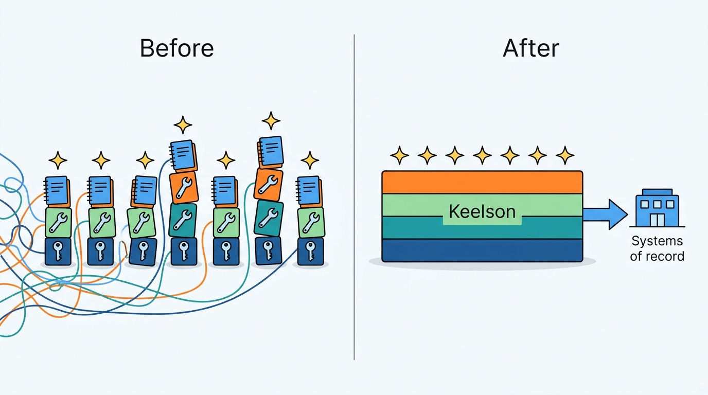
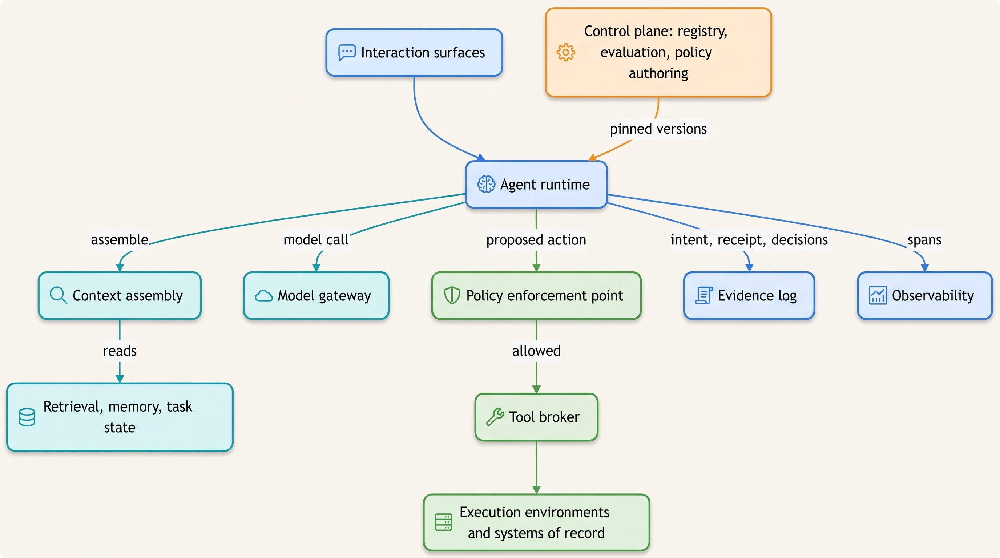
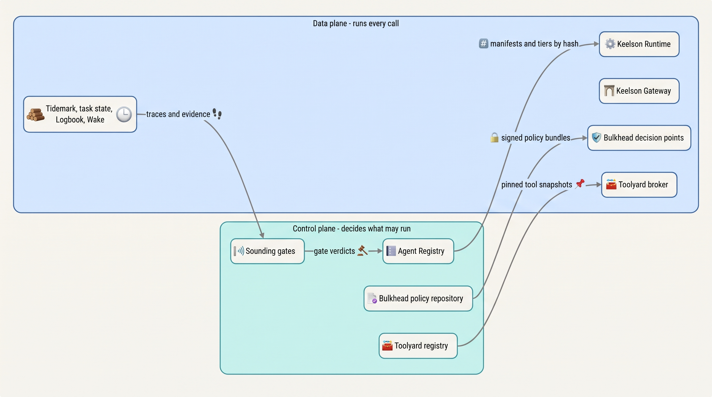
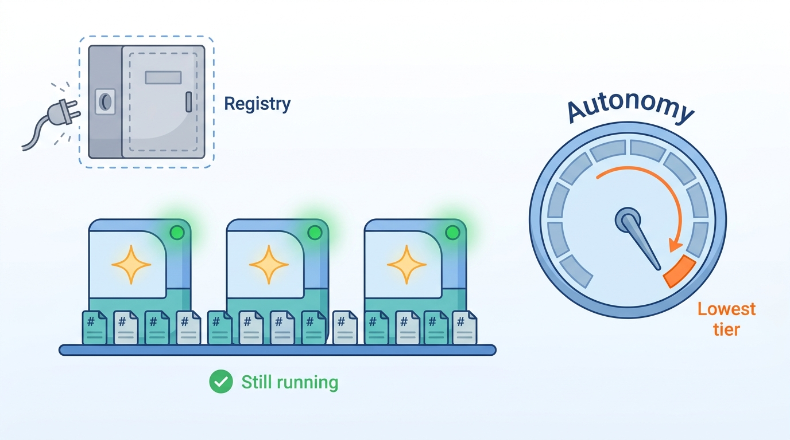
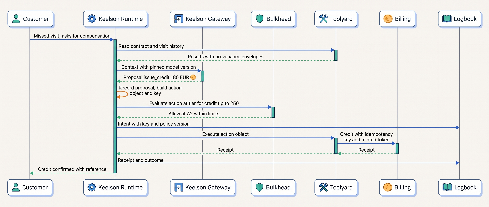

> **IN THIS CHAPTER, YOU WILL:** Get the map of the whole book: every component of an agentic system, what each one owns and must never do, how they connect, which plane each belongs to, and which chapter covers each in depth.

> **WHY THE BUSINESS CARES:** Without a shared architecture, every team that builds an agent also builds its own model client, tool access, logging and approval flow, and gets most of them wrong in a different way. A reference architecture is how a company pays for the hard parts once, and how a risk owner can ask one question of every agent and get comparable answers.

> **WHY ARCHITECTS SHOULD CARE:** The architecture decides whether the controls in later chapters are enforced or only hoped for. A policy check that one path can skip, a credential the agent can read, or a model version nobody pinned turns every other control into documentation.

> **KEY POINTS:**
>
> * **Most of an agentic system is ordinary machinery; the agent-specific part is narrow and should stay narrow.** In every final design this book draws on, the model sits in one or two nodes. Around it are a workflow engine, idempotent APIs, identity, queues and an audit log. The components this chapter adds exist because the model's proposals vary. Each one is justified by a failure it contains.
> * **Every path from model output to the world crosses the same four components.** The runtime records the proposal, the policy enforcement point decides, the tool broker executes with credentials the model never sees, and the evidence log records intent and receipt. A path that skips one of them, even for a "low-risk" tool, is where the next incident starts.
> * **Separate the control plane from the data plane, and degrade autonomy, not availability.** The control plane decides what may run: agent versions, tools, policies, tiers, gates. The data plane runs every call on pinned versions it cached. When the control plane is down, agents keep running on what was last approved, but nothing is promoted and every uncertain autonomy grant falls back to the lowest tier.

> **[FAILURE PATTERNS THIS CHAPTER ADDRESSES](where-agentic-systems-go-wrong.html):**
>
> * **Autonomy by Default** — without a policy enforcement point on every path, an agent's autonomy is whatever its tool list and credentials happen to allow.
> * **Ambient Authority** — when agents reach systems of record directly with their own service accounts, no component sits where least privilege could be enforced.
> * **The Silent Upgrade** — without a control plane that pins and gates versions, models, prompts, tools and policies change underneath running agents with no record of when.

<br>
Every agentic system has the same unusual component: a model whose output **proposes the next action** and whose proposals vary from run to run. Everything else is software architects already know how to build: services, queues, workflow engines, identity, databases, logs. The architectural question is **which components must sit around the model, and what each must own**, so that a variable proposal can never become an unchecked effect.

This chapter is the hub of the book. It introduces each component briefly, assigns it its responsibilities and its prohibitions, and links to the chapter that owns it in depth. It does not teach any component in full. Read it first to get the map, and return to it when a later chapter's component needs placing.

The chapter owns five terms: **reference architecture (agentic)**, **control plane (agent)** and **data plane (agent)**, plus brief definitions of the **policy enforcement point** and the **evidence log**, which [[policy-enforcement-and-audit]] treats in depth. It builds on Part I: [[what-makes-a-system-agentic]] defined the agent loop and the harness, and [[autonomy-and-consequence]] defined the autonomy tiers that the architecture must enforce. The rest of Part II zooms in: [[models-and-the-model-gateway]], [[agent-runtime]], [[agents-in-the-enterprise]] and [[agent-interaction-design]].

## Setting the Scene at Ostrell: Seven Platforms in Disguise

Ostrell, the fictional field-service software group this book follows (see [[meet-ostrell]]), spent 2026 building seven agent prototypes in seven teams. Each prototype was, in effect, a small private platform. Each had its own loop, its own client for a model provider, its own tools and its own logs. When **Keelson**, the internal agent platform, approached internal general availability in **January 2027**, Tomas Verhoef, the Chief Architect, asked each team one question before onboarding: **show me every path by which your model's output can change something outside the process.**

The answers were what the platform team had feared. The tool inventory alone counted **212 agent tools**, 118 of them in-process functions using service-account keys in environment variables; four agents had their own `get_customer` tool with three different service accounts, and two agents could send email to any recipient ([[tool-ecosystems-and-mcp]] tells that story). The paths to the world were just as varied:

| Concern | What the seven prototypes did | Consequence |
| --- | --- | --- |
| Model access | Each called a provider directly with its own key; nobody could list which model versions were in use | Cost, data handling and version changes invisible to anyone outside the team |
| Tool access and credentials | Tools called systems of record with the prototype's own service account | The agent could reach anything that account could reach |
| Policy | Limits written into prompts ("never credit more than €250") and, in two prototypes, into tool code | Limits were requests to the model, not checks |
| State | Conversation history in memory or in a cache; Closewise's posting script kept no record of what it had posted | A crash restarted work from scratch |
| Evidence | Application logs, different per team, some with full prompts and customer data | No answer to "what did the agent do and why" |
| Evaluation | Demos and spot checks | No way to tell whether a change made things better |

The cost of the "State" row arrived in the same month. In the **Half-Posted Accrual**, Closewise's pre-Keelson script crashed after posting **37 of 52** accrual entries for Ostrell Field Deutschland GmbH; an accountant re-ran it, and it re-posted all 52, overstating accruals by **€2.84 million** until the controller's balance review caught it the next day ([[task-state-and-checkpoints]]).

Amara Okafor, Head of Agent Platform, did not need seven better prototypes. She needed one set of components that every agent would use, with responsibilities fixed so that no team could quietly skip one. Tomas's question to the architecture forum was this chapter's question: **which components does an agentic system need, what is each responsible for, and how do they relate?**


**Figure 1:** *Seven prototypes were seven private platforms; a reference architecture lets Ostrell build the hard parts once and gives every agent the same components.*

## Concepts

### Reference architecture (agentic)

A **reference architecture** for agentic systems is a named set of components, each with a defined responsibility, a defined set of things it must never do, defined interfaces to its neighbors and a defined owner, that any agent in the organization is built on. It is not a product and not a framework. It is the contract that lets a security architect, an auditor or an on-call engineer reason about any agent without reading its code.

Two words in that definition do most of the work. **Responsibility** is what the component guarantees (Toolyard guarantees that a side-effecting call carries an idempotency key). **Prohibition** is what it must never do even when it would be convenient (Toolyard never decides policy itself). The prohibitions matter more than the responsibilities, because a component that does too much is the usual way a control ends up in the wrong place.

The book uses "harness" in one sense only: the deterministic code around a model that runs the loop, exposes tools, enforces budgets and permissions and records the run ([[what-makes-a-system-agentic]]). In the reference architecture, the **agent runtime** is the component that hosts harnesses at scale.

### Control plane and data plane

The terms come from networking and cloud infrastructure. AWS's resilience guidance describes control planes as "the machinery involved in making changes to a system" and data planes as "the primary function of those resources", and notes that control planes "tend to have more moving parts and dependencies than data planes" ([AWS, *Advanced Multi-AZ Resilience Patterns*, n.d., accessed 2026-10](https://docs.aws.amazon.com/whitepapers/latest/advanced-multi-az-resilience-patterns/control-planes-and-data-planes.html)). Applied to agents:

- The **control plane (agent)** is the set of components that decide what may run: which agent versions exist and which is in production, which tools exist and who owns them, which policies and autonomy tiers apply, which evaluation gates a change has passed. It changes when people decide something. It runs at human speed.
- The **data plane (agent)** is the set of components on the path of every run: the runtime, the model gateway, context assembly, the policy decision point, the tool broker, the stores they write. It runs at machine speed, on every model call and tool call, using versions the control plane approved.

The rule that connects them: **the control plane publishes versioned, immutable artifacts; the data plane reads them by version and never edits them.** A promotion moves a pointer; a run pins what it resolved at start ([[versioning-agent-systems]]).

### Policy enforcement point and evidence log (brief)

A **policy enforcement point** (PEP) is a place in the call path where a deterministic decision (allow, deny, require approval, downgrade to suggestion) is made outside the model and enforced before anything proceeds. An agentic system needs several: before a model call, before a tool call, before a side effect and on output. The policy engine that computes the decision and the broker that enforces it are separate components. [[policy-enforcement-and-audit]] owns the term.

The **evidence log** is the append-only, curated record of what each run did: inputs by reference, the context manifest, proposed and executed actions with receipts, policy decisions, approvals, outputs and the agent version manifest. It is written by platform components, never by agent code or the model, and it is distinct from both the runtime's recovery history and the traces ([[task-state-and-checkpoints]] compares the three).

## What Published Decompositions Agree On

There is no standard reference architecture for agentic systems, and no study that compares architectures by incident rates. What exists is a set of decompositions from research, vendors and design exercises. They agree on more than their vocabulary suggests.

| Source | Kind | Components it names | What it leaves out |
| --- | --- | --- | --- |
| Anthropic, ["Building effective agents"](https://www.anthropic.com/engineering/building-effective-agents) (2024-12-19) | Vendor engineering post | "The basic building block of agentic systems is an LLM enhanced with augmentations such as retrieval, tools, and memory"; workflows and agents built from it | Policy, identity, durable state, evidence; it is a pattern guide, not a platform |
| Sumers, Yao, Narasimhan, Griffiths, [CoALA](https://arxiv.org/abs/2309.02427) (TMLR, v3 2024-03) | Research framework | "Modular memory components, a structured action space" and a decision procedure | Operations: it is a conceptual framework for organizing agents, not a deployment architecture |
| Lu, Zhu, Xu et al., [reference architecture for foundation-model-based agents](https://arxiv.org/abs/2311.13148) (preprint, v3 2024-04) | Research preprint | A pattern-oriented reference architecture with responsible-AI components | Its evaluation maps the architecture onto two real-world agents; that tests coverage, not whether it prevents failures |
| AWS, [Amazon Bedrock AgentCore overview](https://docs.aws.amazon.com/bedrock-agentcore/latest/devguide/what-is-bedrock-agentcore.html) (n.d., accessed 2026-10) | Vendor documentation | "Modular services" usable "together or independently": Harness, Runtime, Memory, Gateway, Identity, Code Interpreter, Browser, Observability, Payments, Evaluations, Optimization, Policy, Registry | Durable task state and an evidence log as distinct components; how the services must be composed to be safe |
| Author's interview designs, final architectures (design examples, 2026) | Design exercises | Harness/control plane, sandbox, guardrail or policy engine, identity broker, durable log, memory, eval harness, observability; domain designs add staging stores, rule engines, outboxes | Deployed evidence; some designs merge authorization and execution |

Three points of agreement are worth taking as durable. First, **the model is wrapped, never exposed**: every source puts deterministic code between the model and its tools. Second, **tools are reached through a gateway or broker** rather than directly. AWS's Policy service, for example, integrates with its Gateway "to intercept every tool call before execution" (same page). Third, **evaluation and observability are named components**, not activities outside the architecture.

The author's interview designs add a fourth point, and I consider it the most useful. In the agentic-finance-platform design, almost everything downstream of the agent's proposals is classic financial-systems machinery: outbox, idempotency keys, webhook dedupe, write-once storage, maker–checker. The agent-specific parts are a bounded extraction node, a staging store for proposals, an identity model in which the agent can be a maker but never a checker, injection screening at intake and evaluation against ground truth (design example, `agentic-finance-platform/interview.json`, `highLevelArchitecture`). The public-benefits design is narrower still: only the intake agent and the inference tier are agentic, and the rule engine is described with "The model cannot override it" (design example, `agentic-public-benefits-platform/interview.json`, step `rules`). Sculley and colleagues made the same observation about machine-learning systems in 2015: most of the risk sits in the configuration, data dependencies and system around the model, not in the model code ([Sculley et al., NIPS 2015](https://papers.nips.cc/paper_files/paper/2015/hash/86df7dcfd896fcaf2674f757a2463eba-Abstract.html)). That paper predates language models; the observation transfers.

The sources disagree in two places that affect the design. One is **where authorization lives**. Several interview designs have an "identity broker" that both decides and executes side effects. This book separates the two, following OWASP's guidance for LLM06 Excessive Agency to "implement authorization in downstream systems rather than relying on an LLM to decide if an action is allowed or not" ([OWASP Top 10 for LLM Applications 2025, LLM06](https://genai.owasp.org/llmrisk/llm062025-excessive-agency/)). The other is **whether durable task state and an evidence log are separate components**. The agentic-platform-foundations design calls its execution stream and its evidence record "distinct readers of one source of truth" (design example, `agentic-platform-foundations/interview.json`, `finalDesign`), while vendor service lists show neither as a component of its own. This book keeps them separate, for the reasons in [[task-state-and-checkpoints]].

Where the evidence stops: **no published evaluation shows that any particular decomposition reduces incidents.** The case for the architecture below rests on documented failures that each component would have contained, on established distributed-systems practice, and on the author's judgement.

## The Reference Architecture

### The components and the one path


**Figure 2:** *The reference architecture. Every path from a model proposal to a change in the world runs runtime, policy enforcement point, tool broker, evidence log; the control plane feeds the data plane only versioned artifacts.*

Figure 2 has one property that matters more than any box: **there is exactly one path from the model's output to the world.** The model gateway returns a proposal to the runtime. The runtime records it, turns it into a typed action, and sends it to the policy enforcement point. The tool broker executes only what the policy enforcement point allowed, with credentials the model never sees. The evidence log records the intent before the effect and the receipt after it. The author's agentic-platform-foundations design states the same invariant: "there is no direct orchestrator-to-tool bypass for egress or high-risk actions" (design example, `finalDesign`). I would drop the qualifier. A bypass "for low-risk reads only" becomes the path a new tool takes because it is quicker, and reads are what the [[agent-threat-model]] calls one leg of the lethal trifecta.

### Responsibilities and prohibitions

The table is the core of this chapter. Each row names the component, its Keelson name, what it owns, what it must never do, and the chapter that develops it.

| Component | Keelson name | Owns | Must never | In depth |
| --- | --- | --- | --- | --- |
| **Interaction surfaces** | Channels, workbenches, CRM copilot, pull requests | Presenting proposals, plans and evidence; collecting approvals and interruptions; AI disclosure | Hold task state or approvals only in the user interface; let a client-side button execute an effect | [[agent-interaction-design]] |
| **Agent runtime** | Keelson Runtime | Running the loop and workflows; run lifecycle; budgets; delegation limits; deriving idempotency keys; recording every model and tool result before acting on it | Execute a tool itself; re-ask the model on a tool retry; let the model write task state | [[agent-runtime]], [[durable-agent-execution]] |
| **Context assembly** | Library inside Keelson Runtime | Selecting, shaping, ordering, labeling and budgeting what the model sees; writing a context manifest per call | Decide what the agent may do; take facts that must survive from the model's own output | [[context-engineering]] |
| **Retrieval** | Indexes reached through Toolyard read tools | Finding evidence with provenance; permission-aware results | Serve a document the principal could not read directly; drop the `as_of` | [[retrieval-and-grounding]], [[provenance-and-freshness]] |
| **Model gateway** | Keelson Gateway | Provider abstraction; credentials; quotas; tier routing; exact version pinning; redaction; recording requested and served model | Accept an alias in production; hide provider semantic differences behind a fake common interface | [[models-and-the-model-gateway]] |
| **Policy enforcement points** | Bulkhead | Deterministic decisions before model calls, tool calls and side effects and on output; resolving the effective autonomy tier per action | Execute anything; depend on the model recognizing an attack; fail open | [[policy-enforcement-and-audit]] |
| **Tool broker** | Toolyard (broker) | Authorized tool set per run; argument validation; brokered credentials; idempotency keys and receipt lookup; `unknown` on timeout; result shaping; revocation | Decide policy; put a credential into context; retry a non-idempotent call blindly | [[tool-ecosystems-and-mcp]], [[tool-contracts]] |
| **Execution environments** | Forge runners and other sandboxes | Isolating model-written code; filesystem and egress limits; short-lived scoped tokens | Hold production credentials; share a dirty environment between tenants | [[sandboxes-and-execution-environments]] |
| **Durable task state** | Keelson task record on the durable workflow engine | Goal, plan, step records, action intents and receipts, approvals bound to content hashes, waits, budget counters | Accept a write from the model; start a side effect whose intent is not recorded | [[task-state-and-checkpoints]] |
| **Long-term memory** | Tidemark | Memories with provenance, trust level, scope and expiry; write policies | Treat a recalled instruction as a grant of authority; keep a memory without expiry | [[agent-memory]] |
| **Evidence log** | Logbook | Append-only decision record per run, including the manifest hash | Accept writes from an agent's own credentials; be sampled | [[policy-enforcement-and-audit]] |
| **Observability** | Wake | Spans from the components that act; metrics before sampling; alerts | Block a run when telemetry fails; let an agent read or write traces | [[agent-observability]] |
| **Evaluation** | Sounding | Suites, graders, simulators, regression gates, canaries, demotion triggers | Let the team under evaluation change criteria during a window; raise a tier on its own | [[evaluating-agentic-systems]], [[building-agent-eval-suites]], [[evidence-for-autonomy]] |
| **Registries** | Agent Registry; Toolyard registry | Agents, owners, version manifests, autonomy tiers, freshness register; tools, owners, definition hashes, risk classes | Allow an edit to a published manifest; change a tier without a decision record | [[versioning-agent-systems]], [[owning-agentic-systems]] |

Three rows deserve a sentence each because teams get them wrong most often.

**The runtime records; it does not execute.** If one step both asks the model and runs the tool it chose, a crash between the two replays the step, the model is sampled again and may propose something different. That is how the Double Credit happened. [[durable-agent-execution]] makes the model call and the tool call separate recorded activities for that reason.

**The policy engine decides; the broker executes.** Keeping them apart means a bug in one does not silently disable the other: Toolyard enforces hard limits a second time at the tool boundary even when Bulkhead allowed the call ([[autonomy-and-consequence]]). It also means the policy can be reviewed as code by people who do not maintain the broker.

**Identity is not a box; it is a property of every arrow.** Each run carries a principal and an on-behalf-of identity in its task record. Toolyard either makes the downstream call itself or mints a short-lived, audience-bound token from that identity. The model never sees either ([[agent-identity-and-least-privilege]]). Keelson does not run its own identity provider; it uses Ostrell's existing one.

### Making the one path true, not just drawn

A diagram with one path is a claim. The way to make it true is to make the other paths impossible. Keelson does this with network policy on the workers that run agent code, plus a check at onboarding. A sketch of the check, run against each agent's deployment before the Agent Registry accepts it:

```python
ALLOWED_EGRESS = {"keelson-gateway", "toolyard-broker", "tidemark", "workflow-engine", "wake-collector"}

def conformance(agent: AgentDeployment, registry: Registry) -> list[str]:
    problems = []
    if extra := agent.network_policy.egress_targets() - ALLOWED_EGRESS:
        problems.append(f"direct egress to {sorted(extra)}")      # provider APIs, systems of record
    if agent.secrets_mounted():
        problems.append("credentials mounted in agent workload")  # Toolyard holds them
    if not agent.manifest.is_pinned():
        problems.append("manifest has floating references")       # aliases, 'latest'
    for cls in agent.manifest.action_classes():
        if registry.tier(agent.id, cls) is None:
            problems.append(f"no autonomy tier recorded for {cls}")  # Bulkhead would deny
    return problems                                               # empty list or no onboarding
```

The check is deliberately boring. It does not inspect prompts or behavior. It verifies that the agent's workload cannot reach a model provider or a system of record except through the Gateway and Toolyard, holds no secrets, and has a tier for every action class it declares. Logbook is written by the platform components, so it is not on the agent's egress list at all.

### Where existing systems attach

Agents do not replace the enterprise; they become clients of it. The rules are short, and [[agents-in-the-enterprise]] develops them:

- **Systems of record stay authoritative.** The ERP, billing, CRM, HRIS and contract-lifecycle tool own their data and enforce their own rules. Agents reach them only through Toolyard tools built on the systems' existing APIs, never through their databases. The Stale Price Book ended with the CRM itself refusing to send a quote whose price-book version was superseded ([[provenance-and-freshness]]): the system of record is the last enforcement point.
- **Agent output goes to a staging store first.** Closewise's proposed journal entries, Clausewise's redlines and Dealroom's draft quotes live outside the system of record until an approved action object crosses into it, executed by deterministic code.
- **The data platform is reached through governed views** exposed as read tools, with the principal's permissions applied at query time.
- **Existing processes keep their shape.** Approvals land in the queues and tools where approvers already work; escalations become tickets.

### Requirements per interaction

Each arrow in Figure 2 has its own requirements. The values below are those the owning chapters set for Keelson; latency figures are illustrative targets.

| Interaction | Consistency | Latency | Durability | Who may act |
| --- | --- | --- | --- | --- |
| Run start: resolve manifest and tool set | Pointer read once; fixed for the run | Milliseconds *(assumption)*; tool set p95 under 50 ms *(assumption)* | Manifest hash and tool snapshot id in task record | Runtime |
| Model call through the Gateway | Served model must equal the pinned version | Dominates turn latency | Requested and served model on the span; result recorded before use | Model proposes; Gateway enforces |
| Policy decision before an action | Must see a demotion or hold within 60 s | p99 ≤ 5 ms from a cached bundle *(assumption)* | Decision with policy version in Logbook | Bulkhead only |
| Side-effecting tool call | Exactly-once effect: idempotency key, receipt lookup, `unknown` on timeout | Bound by the system of record | Intent before, receipt after, in task record and Logbook | Toolyard, after Bulkhead allows |
| Human approval | Bound to the action object's content hash; void if action, policy or evidence changes | Minutes to days | Approval record with approver, evidence shown and expiry | Named approver role |
| Evidence write | Ordered per action | Synchronous around side effects | Append-only; tamper-evident for back-office agents | Platform components only |
| Span emission | None | Asynchronous; never on the critical path | Best effort | Platform components only |
| Promotion of a version or tier | Strong, single writer | Hours to days | Signed decision record | Gate pipeline; risk owner for tiers |

## Control Plane and Data Plane

### What sits where


**Figure 3:** *The control plane publishes versioned artifacts that the data plane caches and enforces; evidence flows back from the data plane into evaluation, which is how the control plane learns.*

Two components straddle the line, and they are split deliberately. **Toolyard** is a registry (control plane: tools, owners, hashes, change review) and a broker (data plane: every call). **Bulkhead** is a policy repository (control plane: policies as code, reviewed and versioned) and a set of decision points (data plane: evaluated on every action from cached bundles). Splitting each into two deployable parts lets the data-plane half be small, fast and highly available, while the control-plane half carries the review workflow.

**Evaluation belongs to the control plane.** Sounding does not sit on any call path, but its verdicts decide which manifest the pointer names and which tier an action class holds. That is the sense in which "evaluation is part of the architecture, not a phase": the gate is a control-plane component with write access to the registry, and the data plane cannot run a version that did not pass it.

### Static stability, with one exception

Mike Furr's AWS Builders' Library article defines the goal: "In a statically stable design, the overall system keeps working even when a dependency becomes impaired", and notes that the data plane "might not get updates during the period of impairment" ([Furr, AWS, 2019](https://builder.aws.com/content/3K9SiqiJ369TGkkGzqPM95BuYWI/static-stability-using-availability-zones)). The agent data plane should behave the same way: manifests, tool snapshots and policy bundles are cached by hash, so new runs start and running runs continue while the registry is down.

The exception is **autonomy**. A cached tier may be stale in the dangerous direction, because demotions and holds must take effect within a minute ([[evidence-for-autonomy]]). So Keelson applies static stability to *availability* and fail-closed behavior to *authority*:

| Component unavailable | What keeps working | What stops or degrades | Why |
| --- | --- | --- | --- |
| Agent Registry | New and running runs on cached manifests | Promotions, new agents; tier reads that miss the cache fall back to the lowest tier configured for the class | A stale "A2" is worse than an extra approval |
| Toolyard registry | Calls with the pinned snapshot | Tool changes; revocations already pushed still apply | Revocation must not depend on the registry being up |
| Sounding | Everything at run time | Gates, canaries, promotions | No version ships without a verdict |
| Bulkhead decision point | Nothing that has a side effect | All side effects denied; read-only steps continue only if their policy is cached | Policy is never skipped |
| Logbook | Read-only steps | Side effects blocked | Evidence that can be lost turns an incident into a dispute |
| Wake | Everything | Spans dropped and counted | Telemetry must never become an outage ([[agent-observability]]) |
| Toolyard broker | Answers from context | Every tool call; agents escalate to humans | No alternative path exists, by design |


**Figure 4:** *Keelson degrades autonomy, not availability: agents keep running on cached versions when the control plane is down, but uncertain autonomy falls back to the lowest tier.*

The last row is the price of the one-path rule: the broker is a single dependency of every agent that acts. That is acceptable only if it is run like the most critical service in the company: replicated, capacity-planned, with its own rollout discipline (see Failure Modes below).

## Worked Example at Ostrell

### One credit, end to end

In November 2027 an Answerdesk customer reports that a technician visit under a service contract was missed. The resolution the agent will propose is a service credit of **€180**. Since October 2027, credits **up to €250** are tier **A2** (act within limits, sampled review after the fact); larger credits are **A1** and need a support team lead's approval. Figure 5 follows the credit through every component.


**Figure 5:** *A €180 credit crosses every data-plane component once. The model's only contribution is the proposal; the key, the tier, the credential and the receipt are all produced by code.*

What each component contributed:

1. **Context assembly** read the contract and visit history through Toolyard read tools, so the facts arrived with provenance envelopes and the customer's verified identity, not from the chat text.
2. **Keelson Gateway** routed the action-proposal step to the Large tier, as the routing profile requires, at the exact pinned version, and recorded the served version on the span.
3. **Keelson Runtime** recorded the proposal before acting, built a typed action object (`issue_credit`, contract id, €180, reason code) and minted the idempotency key from the agent id, run id and action object id, not from the model's text.
4. **Bulkhead** resolved the action class to A2, checked the amount against the €250 limit and the per-customer rate limit, and allowed it. A €280 proposal would have produced "approval required" and an approval card for a team lead.
5. **Toolyard** re-validated the arguments, minted a short-lived token scoped to the billing server and the tenant, and called billing with the key. Had billing timed out, Toolyard would have marked the action `unknown` and looked up the receipt by key before anything else happened.
6. **Logbook** recorded intent and receipt with the manifest hash and policy version; **Wake** recorded spans from every component; the credit joined the pool from which A2 actions are sampled for after-the-fact review.

None of this is novel machinery. It is what made the March 2027 Double Credit, in which **212 customers** received duplicate credits worth **€31,400**, impossible to repeat in the same form: the retry now looks up a receipt by key and never re-asks the model.

### Nine incidents, one map

The strongest argument for the reference architecture at Ostrell is that each of the 2027 incidents maps to a component that was missing, bypassed or under-specified, and each fix landed in a named component. The table is also a reading guide: each row points to the chapter that tells the story.

| Incident (2027) | What failed | Where the fix landed | Plane |
| --- | --- | --- | --- |
| Half-Posted Accrual (Jan): 37 duplicate postings, €2.84 million | No durable task state; no idempotency keys on ERP postings | Task record on the durable engine; Toolyard posting key = task id + entry id + entry version | Data |
| Weekend Fan-out (Feb): 41 hours, €8,700 | No run budget or delegation depth limit; only a quota alert stopped it | Runtime budget ledger; depth 2, at most 8 parallel sub-agents; Gateway tenant quotas | Data, with budgets set in the Registry |
| Double Credit (Mar): 212 customers, €31,400 | Tool retry re-asked the model | Runtime never re-asks on retry; Toolyard receipt lookup by key | Data |
| Lost Handoff (Apr): contract id lost in about 1 in 40 handoffs | Free-text handoff between agents | Typed handoff payload; specialist folded back as a tool set | Data |
| Poisoned Ticket (May): exfiltration attempt, blocked | One agent held all three trifecta legs; found 6 days later in trace review | Toolyard recipient restriction (it held); quarantined reader in context assembly; Bulkhead egress policy; Sounding injection suite; Wake security alerts | Both |
| Stale Price Book (Jun): 14 quotes, €46,000 | Index refresh failed silently for 23 days | Provenance envelopes; freshness register in Agent Registry; re-read before finalizing; CRM refuses superseded prices | Both, plus the system of record |
| Fixture Purge (Jul): 9 PRs, 2 merged | Agents could delete or skip failing tests | Protected paths in the execution environment; Sounding grader on test count; reviewer checklist | Both |
| Alias Drift (Aug): accuracy 96.1% to 89.4% | A provider alias moved; nothing pinned it | Alias ban and exact pinning (Registry, Gateway); daily canary (Sounding); served-not-pinned alert (Wake) | Both |
| Rubber Stamp (Q2): 99.3% approved, median 6 seconds | Approval surface showed too little; approvers never measured | Approval cards with evidence and policy clause; second-reviewer sample; per-approver metrics | Interaction surface, Wake |

Two observations come out of the table. **Four of the nine fixes span both planes, and two more needed a control-plane setting or a new metric**: the data plane enforces, but the control plane had to learn something first (a freshness bound, a pinning rule, an injection suite). A platform team that owns only the data plane cannot close these. And **the Poisoned Ticket is the one incident the architecture contained before anyone noticed**, because the broker enforced a recipient rule the model could not argue with. That is what the one-path rule buys.

## Failure Modes and Recovery

The reference architecture introduces failure modes of its own: a shared platform concentrates risk as well as controls.

| Scenario | Detection | Containment | Recovery |
| --- | --- | --- | --- |
| **A team adds a direct path** (provider SDK or system-of-record client in agent code) | Onboarding conformance check; Gateway spend reconciled monthly against provider invoices; denied egress counted by network policy | Network policy blocks the call at run time | Remove the path; route through Gateway or Toolyard; re-run conformance |
| **Platform bug in Toolyard or Bulkhead** affects every agent at once | Wake per-agent error and denial rates; Sounding canaries on production manifests | Platform components roll out per agent cohort, lowest-consequence agents first; previous version kept warm | Roll back the component; replay affected `unknown` actions through receipt lookup |
| **Control plane unavailable** | Registry health checks; promotion pipeline failures | Data plane on cached artifacts; tier cache misses fall back to the lowest tier | Restore registry; pending promotions resume; no data-plane restart needed |
| **Version skew**: manifest names a tool contract the broker no longer serves | Toolyard rejects at run start; registration check refuses the manifest | Run does not start; the agent stays on its last valid manifest | Publish a compatible manifest through the gate ([[versioning-agent-systems]]) |
| **Policy decision point overloaded** | Bulkhead latency and timeout rate | Fail closed: side effects deny, runs escalate; no model calls in the policy hot path | Scale decision points; investigate the load source, often a loop |
| **Component boundary erodes**: the runtime starts making policy decisions "for performance" | Architecture review of runtime changes; Bulkhead decision counts per action fall | Ownership rules: policy code lives only in the Bulkhead repository | Move the logic back; add a test that every side-effecting path has a Bulkhead decision in Logbook |

The last row is slow and invisible, so it needs a mechanical check. Keelson's is a daily Logbook query: every executed side effect must have a Bulkhead decision record with a policy version. A side effect without one is treated as an incident, whatever its outcome.

## Trade-offs

### Build, adopt or let each team choose

| Option | What you get | What you still own | When it is right |
| --- | --- | --- | --- |
| **Each team builds its own** | Speed for the first agent; full freedom | Every component, seven times; no common evidence | One or two low-consequence agents; exploration |
| **Adopt a framework per agent** | Loop, tool calling and some state handled | Policy, identity, evidence, evaluation gates, cross-agent governance | Teams with strong platform support who need loop mechanics only |
| **Adopt a managed agent platform** (e.g. a cloud provider's agent services) | Runtime, isolation, gateway, identity, observability, policy as services | Composition, task state and evidence design, domain policy, provider lock-in | Organizations on one cloud that prefer services to staff |
| **Build a thin internal platform on existing infrastructure** (Ostrell's choice) | Components that match the company's identity, systems of record and audit needs | Staffing a platform team; keeping up with protocols and providers | Several agents with real side effects; regulated back-office work; multiple model providers |

Anthropic's December 2024 guidance points in the same direction from the other end: "We suggest that developers start by using LLM APIs directly", warning that frameworks "often create extra layers of abstraction that can obscure the underlying prompts and responses" ([Anthropic, 2024](https://www.anthropic.com/engineering/building-effective-agents)). That is advice about the loop. It does not cover policy, identity or evidence, which no team should build alone.

Managed services do not change the responsibilities table; they change who implements each row. AWS states its services can be used "together or independently" (AgentCore overview, accessed 2026-10). That flexibility means the composition, including whether every tool call crosses the policy service, remains the customer's design decision. A list of managed services is not an architecture until someone has drawn the one path through it.

### How thick the platform should be

The other trade-off is how much the platform does for teams. A thick platform (shared prompts, shared agent templates, a central team writing agents) moves domain knowledge into the wrong team. A thin platform that only offers libraries cannot enforce anything. The line I use: **the platform owns every component whose failure an attacker or a crash could exploit across agents** (gateway, broker, policy decisions, task state, evidence, traces, gates). **Product teams own everything that requires domain knowledge**: the agent's instructions, its tools' business semantics, its evaluation datasets and, with the risk owner, its tiers. The author's agentic-support-platform design takes the same line: it "adds the latency budget and in-loop action gate on top of that harness rather than rebuilding the loop" (design example, step `live-loop`). Ostrell's Agent Platform team grew from **14 engineers in January 2027 to 19 by December 2027** on that line; it did not write any of the seven agents.

## Across Domains: How the Stakes Change the Design

The components are the same in every domain. What changes is how strict each one is and which components a domain adds.

| Component | Coding agents | Customer operations (support, sales, marketing) | Back office (finance, legal, HR) | High-stakes decisions (healthcare, public benefits) |
| --- | --- | --- | --- | --- |
| Interaction surface | Pull request; local CLI prompts | Chat, email, CRM copilot; AI disclosure | Workbench and approval queue in the system of record's process | Clinician or caseworker worklist; notices and appeal path |
| Runtime style | Bounded loop in a sandbox; long sessions | Bounded loop under a turn deadline | Workflow with agentic steps; multi-day waits | Deterministic pipeline with bounded model nodes |
| Execution environment | MicroVM or gVisor-class sandbox; no production credentials | Mostly API tools; no code execution | API tools into staging stores | Read paths scoped to the case; no write path from the model |
| Policy enforcement | Protected paths; merge stays human | Amount and rate limits; recipient allowlists; suppression and consent | Segregation of duties; maker never checker | **Rule engine added as a component**; adverse outcomes need a human decision |
| Evidence log | Git history plus Logbook | Append-only | Append-only and tamper-evident; record-keeping retention | Tamper-evident; explanation and appeal records |
| Evaluation ground truth | Strong and cheap: tests, builds | Weak: judges, simulators, sampled audit | Ground-truth bookings and lawyer acceptance | Expert review; golden cases on every rule change |

The design examples behind the last column come from the author's interview project: in the clinical design, the only write path to the health record runs through the identity service after a clinician acts, with no link from the agent or the pipeline to a record write (design example, `agentic-healthcare-platform/interview.json`, `highLevelArchitecture`), and the benefits design's rule engine is authoritative over the model (`agentic-public-benefits-platform/interview.json`, step `rules`).

My judgement: **the platform keeps every component common, and the domain sets three things**: the policies and tiers Bulkhead enforces, the retention and tamper evidence of the evidence log, and any **added deterministic component** the domain's rules require (a rule engine, a match engine, a maker–checker gate). A domain that asks for a different runtime or a different broker is usually asking for a policy that has not been written yet.

## The Chief Architect's View

The decisions this chapter asks you to make, and who makes them:

- **The component list and the one-path rule.** The architecture forum decides, and the decision is written down as an architecture principle with a conformance check. Without the check, the rule decays.
- **Platform versus product boundary.** The Chief Architect and the head of the agent platform decide which rows the platform owns. Revisit it once a year, or when a team asks for a bypass.
- **Who owns each control-plane artifact.** Manifests belong to the agent owner, tools to the system-of-record owner, policies to security and the risk owner, tiers to the risk owner, gates to the evaluation lead. Write it in the registry, not on a slide.
- **Failure behavior per component**, as in the static-stability table. Decide it before the first outage, because the default in most code is to fail open.

What is durable and what will change. The **responsibilities and prohibitions** are durable. They follow from the model's variability and from distributed-systems practice, and they will hold as models improve. The **implementations** are volatile: protocol revisions (MCP 2026-07-28, A2A 1.0), managed service lists, the OpenTelemetry generative-AI conventions still in Development status as of October 2026. Build the components so that the protocol and the provider sit behind them. When model capabilities improve, expect to widen tiers and remove some workflow scaffolding. Do not expect to remove the broker, the policy point or the evidence log; better proposals do not make an unchecked path safe.

What to watch: the rate of conformance failures at onboarding, the count of side effects without a policy decision (it must be zero), Gateway spend against provider invoices, and how many incident fixes needed both planes. The last one tells you whether the platform team and the evaluation team are actually working as one system.

## Questions to Ask

1. Draw every path by which this agent's model output can change something outside its process. How many are there, and which of the four components does each skip?
2. Where is the authorization decision made, and is it a different component from the one that executes?
3. Can the agent's workload reach a model provider, a system of record or a secret store directly? What enforces that it cannot?
4. Which artifacts does the run pin at start (model version, prompts, tool contracts, policy version), and where is the hash recorded?
5. If the control plane is down for an hour, what keeps running, and which autonomy grants degrade?
6. If the policy decision point or the evidence log is unavailable, does a side effect proceed?
7. Which component would have contained each of your last three incidents, and did the fix land in the data plane, the control plane or both?
8. Which rows of the responsibilities table does the platform own, and which does the product team own? Is that written down?
9. If you adopt a managed agent platform, who has drawn the one path through its services?

The components are now on the map. The next chapter zooms into the first one every run touches on its way to a proposal: [[models-and-the-model-gateway]].

## Sources and Evidence

### Research papers

- [Cognitive Architectures for Language Agents](https://arxiv.org/abs/2309.02427) — Sumers, Yao, Narasimhan, Griffiths, TMLR, 2024 (arXiv v1 2023). Conceptual decomposition into memory, structured action space and decision procedure.
- [Towards Responsible Generative AI: A Reference Architecture for Designing Foundation Model based Agents](https://arxiv.org/abs/2311.13148) — Lu, Zhu, Xu, Xing, Harrer, Whittle, preprint, 2023 (v3 2024). A pattern-oriented reference architecture; evaluated by mapping onto two agents.
- [Hidden Technical Debt in Machine Learning Systems](https://papers.nips.cc/paper_files/paper/2015/hash/86df7dcfd896fcaf2674f757a2463eba-Abstract.html) — Sculley et al., NIPS, 2015. System-level risk sits around the model, not in it.

### Specifications, standards and regulation

- [OWASP Top 10 for LLM Applications 2025: LLM06 Excessive Agency](https://genai.owasp.org/llmrisk/llm062025-excessive-agency/) — OWASP GenAI Security Project, n.d., accessed 2026-10. Authorization in downstream systems, not in the model.
- [Model Context Protocol specification, 2026-07-28](https://modelcontextprotocol.io/specification/2026-07-28/server/tools) — MCP project, 2026. Current protocol revision referenced as a volatile implementation detail.

### Vendor documentation and engineering reports

- [Building effective agents](https://www.anthropic.com/engineering/building-effective-agents) — Anthropic, 2024. The augmented LLM as building block; start with LLM APIs directly.
- [What is Amazon Bedrock AgentCore?](https://docs.aws.amazon.com/bedrock-agentcore/latest/devguide/what-is-bedrock-agentcore.html) — AWS, n.d., accessed 2026-10. A managed platform's list of modular agent services, including Policy intercepting tool calls at the Gateway.
- [Control planes and data planes](https://docs.aws.amazon.com/whitepapers/latest/advanced-multi-az-resilience-patterns/control-planes-and-data-planes.html) — AWS, *Advanced Multi-AZ Resilience Patterns*, n.d., accessed 2026-10. Definitions of control and data plane.
- [Static stability using Availability Zones](https://builder.aws.com/content/3K9SiqiJ369TGkkGzqPM95BuYWI/static-stability-using-availability-zones) — Mike Furr, AWS Builders' Library, 2019. Data planes keep working when control planes are impaired.

### Incidents, cases and decisions

- No public incident is cited in this chapter; the incidents in the worked example are Ostrell's and fictional. Documented real incidents are cited in the chapters each row links to.

### Design examples from the author's interview project

- Obrenović, Ž., "Agentic Platform Foundations", system-design interview design, `system-design-interviews/data/book/agentic-platform-foundations/interview.json`, 2026 — final architecture, the no-bypass invariant, execution stream versus evidence record.
- Obrenović, Ž., "Agentic Finance Platform", system-design interview design, `system-design-interviews/data/book/agentic-finance-platform/interview.json`, 2026 — the narrow agent-specific part of a back-office design; staging store; maker–checker.
- Obrenović, Ž., "Agentic Support Platform", system-design interview design, `system-design-interviews/data/book/agentic-support-platform/interview.json`, 2026 — in-loop action gate on top of a shared harness.
- Obrenović, Ž., "Agentic Healthcare Platform", system-design interview design, `system-design-interviews/data/book/agentic-healthcare-platform/interview.json`, 2026 — write path only through a clinician's identity.
- Obrenović, Ž., "Agentic Public Benefits Platform", system-design interview design, `system-design-interviews/data/book/agentic-public-benefits-platform/interview.json`, 2026 — authoritative rule engine; model assists, engine decides.

Ostrell is fictional; architectural recommendations, labeled inferences and labeled assumptions are the author's judgement.
