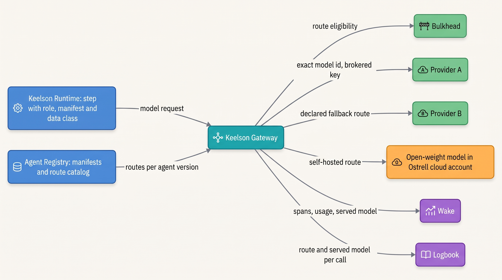
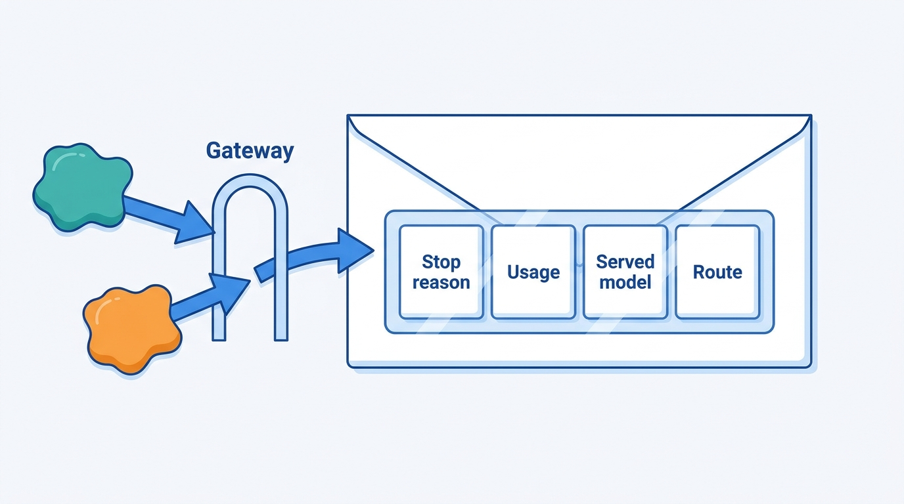
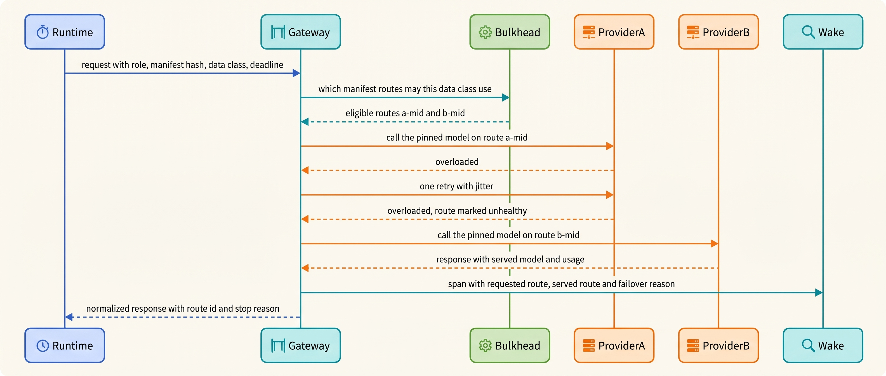
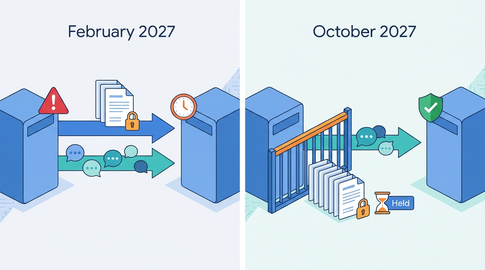

> **IN THIS CHAPTER, YOU WILL:** Learn to describe each model call by the role it plays, choose models by role and tier, and design the model gateway: the single component through which every call reaches a provider, with its credentials, quotas, retries, failover, routing, logging, redaction, version pinning and data-handling rules.

> **WHY THE BUSINESS CARES:** The model providers see every prompt the business sends, and their terms decide how long they keep it, whether they may train on it and where it is processed. A risk owner needs one place that can answer "which provider saw this contract, under which terms?", and a CFO needs one place where model spend is metered and capped.

> **WHY ARCHITECTS SHOULD CARE:** The gateway is the boundary between your system and a set of external dependencies that change their models, prices, limits and terms on their own schedule. Put the wrong things behind it (tool authority, silent failover, prompt rewriting) and it becomes the place where behavior changes without anyone deciding; leave things out of it (credentials, data eligibility, the served model) and nobody can say what ran.

> **KEY POINTS:**
>
> * **Choose models per role, not per agent.** A planner, a worker, a classifier, a judge and an embedder have different needs for capability, structured output, latency, data access and independence. A tier is a catalog label; what an agent version actually names is an exact model on an exact route, recorded on every call.
> * **The gateway is the policy enforcement point for model calls.** It is the only path to any provider: it holds the provider credentials, enforces quotas and the data-handling eligibility of each route, retries transport errors, and records the model that served. It never holds tool authority and never changes a prompt or a model on its own initiative.
> * **Provider differences are semantics, not plumbing.** Retention and training terms, schema support, refusals, caching and rate-limit accounting differ between providers and change over time. A fallback route is a different model, so it needs its own evaluation and its own data-handling clearance. That is the real cost of a multi-provider strategy.

> **[FAILURE PATTERNS THIS CHAPTER ADDRESSES](where-agentic-systems-go-wrong.html):**
>
> * **The Silent Upgrade** — aliases, gateway-wide failover and unrecorded served models let the model behind a step change without a release, an evaluation or a record.
> * **The Token Bonfire** — provider keys scattered across agents, with no metering or quota per agent and tenant, leave the organization-wide spend cap as the only brake.

<br>
Every agentic system depends on models it does not control. Most teams run frontier models through a provider's API, so a component that proposes every action is **an external dependency with its own release schedule, price list, rate limits and data terms**. Self-hosting open-weight models moves the dependency inside without removing it.

This chapter answers two questions that are easy to blur. The first is **which model a step should use**: a question about the step's role and requirements, answered by an evaluated, versioned decision per step. The second is **how the system reaches that model**, and the answer is architectural: one **model gateway** through which every call passes, so that credentials, quotas, data-handling rules and the record of what actually ran sit in one enforced place.

The chapter owns four terms: the **model gateway**, the **model tier**, the **model role** and, briefly, **version pinning** (treated in depth in [[versioning-agent-systems]]). It builds on [[agentic-reference-architecture]], which places the gateway among Keelson's components, and on [[workflows-loops-and-autonomous-agents]], which decides how many model steps a task has. It hands the per-step routing mechanics to [[agent-cost-and-model-routing]], rate limits and capacity to [[agent-latency-and-throughput]], prompt caching to [[caching-and-context-budgets]], and the loop that calls the gateway to [[agent-runtime]], the next chapter.

## Setting the Scene at Ostrell: The Quiet Failover

Ostrell, the fictional field-service software group this book follows (see [[meet-ostrell]]), made Keelson, its agent platform, generally available internally in January 2027. In the first week, Amara Okafor's Agent Platform team took an inventory of how the seven agent prototypes reached their models. They found **31 provider API keys**. Two were in continuous-integration (CI) secrets that Forge's runners could read, and one belonged to an engineer's personal trial account; three prototypes used provider aliases. Moving every agent onto Keelson Gateway was the platform's first required migration.

The gateway they shipped had one set of provider credentials, quotas, request logs and a failover rule per tier. If a provider's Mid-tier model failed repeatedly, the gateway sent Mid-tier calls to the other provider's Mid-tier model. Nothing in the rule mentioned data.

On **Thursday 18 February 2027**, between 13:40 and 15:30, provider A's Mid-tier model class returned overload errors. The gateway failed over as designed. Answerdesk's calls moved to provider B, and so did **46 calls from Clausewise**, the legal contract-review agent. Those calls carried clauses from **9 contracts** (6 non-disclosure agreements and 3 data processing agreements). Ostrell's account with provider A ran under a zero-data-retention arrangement, which General Counsel Ilse de Wit required for contract text. Its account with provider B ran under standard terms: no training use, but prompts kept for up to 30 days for abuse monitoring. The failover also showed a second effect. On 3 of the 46 calls, provider B's model wrote a clause risk level in a different letter case than Clausewise's schema expected. The validator rejected them. Nobody had evaluated Clausewise on provider B.

The deviation went unnoticed until **1 March**. A counterparty's due-diligence questionnaire asked which processors had seen its contract text, and Ilse's team asked the platform team. The gateway logs answered within an hour. Legal recorded a deviation from Ostrell's own data policy (it stayed within the provider's data processing agreement); the prompts left provider B's retention window by 20 March.

Tomas Verhoef, the Chief Architect, put three questions to the architecture forum:

1. **How should a step's model be chosen**, and who decides which models a step may use?
2. **What may the gateway decide on its own**, and what must it refuse to decide?
3. **Which differences between providers must stay visible** to the agent's owner, the evaluation and the risk owner, however good the abstraction is?

## Concepts: Roles, Tiers, Routes and Pins

### Model roles

A **model role** is the function a model call performs in the system. The role, not the agent, sets the call's requirements. One Answerdesk exchange (a customer message and its reply) can include a classifier call, a planner call and a worker call, each with different needs.

| Role | What it does | Needs | Typical tier | Main risk if the wrong model fills it |
| --- | --- | --- | --- | --- |
| **Planner** | Chooses the next step or decomposes a task | Strongest reasoning the latency budget allows; tool-call quality | Large | Wrong plans compound across steps ([[planning-and-decomposition]]) |
| **Worker** | Performs a bounded step: answer, draft, extract, summarize, propose an action object | Schema conformance; instruction following; domain accuracy | Mid | Well-formed but wrong output |
| **Classifier / router** | Labels an input: intent, route, risk class | Low latency; constrained output; calibrated scores (rarely the model's own) | Small, or Embed plus a trained classifier | Silent misroutes ([[routing-and-delegation]]) |
| **Reader** | Reads untrusted content without tools and emits a typed record | No tools; constrained output; data stays where policy requires | Small | Injected instructions reach a tool-using model ([[prompt-injection-defense]]) |
| **Judge** | Grades another model's output, offline or at run time | Independence from the judged model; calibration against humans | Large or Mid, from a different model family | Self-preference inflates scores ([[building-agent-eval-suites]]) |
| **Embedder** | Turns text into vectors for retrieval and routing | Stability over time; the same model at index and query time | Embed | A model change silently breaks every index ([[retrieval-and-grounding]]) |

The **judge** role has a documented constraint. In the MT-Bench study, the authors measured a self-enhancement bias: a GPT-4 judge favored its own answers by about 10 percentage points more than human raters did, and a Claude-v1 judge by about 25 ([Zheng et al., NeurIPS 2023 Datasets and Benchmarks](https://arxiv.org/abs/2306.05685)). Panickssery et al. linked self-preference to a model's ability to recognize its own outputs ([preprint, 2024](https://arxiv.org/abs/2404.13076)). Both studies measured 2023–2024 models, and the size of the bias in current judges is not established. The architectural rule still holds: **a judge should come from a different model family than the model it judges, and the gateway can enforce that.**

### Model tiers and routes

A **model tier** is a catalog grouping of interchangeable-looking models by capability, cost and latency. Ostrell's Keelson Gateway has four: **Large** (frontier reasoning models from two commercial providers), **Mid**, **Small** (including an open-weight model in Ostrell's own cloud account) and **Embed**. A tier helps planning and budgeting, but no agent should run on one: two models in a tier differ in behavior, schema support, caching and data terms.

What a step actually runs on is a **route**: a provider account, an exact model identifier, an API version, a region or processing endpoint, an endpoint kind (synchronous or batch), the data-handling terms of that account and the generation settings. A route is concrete enough to evaluate and to contract for.

### Version pinning, briefly

**Version pinning** means a production agent version names an exact model identifier on each route, never an alias that the provider can move. Providers differ in what an identifier promises: as of October 2026, Anthropic states that "Every Claude model ID is a pinned snapshot" for recent generations, while Google describes `-latest` aliases as "hot-swapped" with each release ([Anthropic models overview](https://platform.claude.com/docs/en/about-claude/models/overview), accessed 2026-10; [Gemini models](https://ai.google.dev/gemini-api/docs/models), updated 2026-10-22). A pin fixes the weights, not the serving stack, and it expires: Anthropic gives "at least 60 days' notice before model retirement for publicly released models" ([model deprecations](https://platform.claude.com/docs/en/about-claude/model-deprecations), accessed 2026-10). The manifest that carries the pin, the alias ban and the migration calendar belong to [[versioning-agent-systems]]. This chapter needs only the consequence: **the gateway must refuse aliases for production manifests and must record the model the provider reports serving, not only the one requested.** Ostrell learned the second half in August 2027, during the Alias Drift, when the gateway recorded only the requested name.

## The Model Gateway

### Definition

A **model gateway** is the single component through which every model call in the system reaches a model, hosted or self-hosted. It holds the provider credentials and owns the route catalog. It enforces quotas, data-handling eligibility and version pins, retries transport errors and fails over only to declared routes. It records each call's requested and served model, usage and cost attribution. It is a **policy enforcement point for model calls**, in the same sense that the tool broker is one for tool calls ([[policy-enforcement-and-audit]]).

The author's interview designs agree on the core and differ at the edges. The finance design says a gateway is "the right abstraction for routing, redaction, token budgets, and provider failover; it must not receive posting authority". The public-benefits design adds that it keeps "the model outside the decision boundary", and the legal design adds "no-train/no-retention configuration" (*design examples*, `agentic-finance-platform/interview.json`, `agentic-public-benefits-platform/interview.json` and `agentic-legal-platform/interview.json`, `technologyChoices`). Two points need a ruling:

- **The API edge is not the model gateway.** In the agentic-platform-foundations design, the node called `Gateway` is the request edge (authentication, tenant quotas, routing of sessions), and model routing sits in a separate `Inference` node (*design example*, `agentic-platform-foundations/interview.json`, `highLevelArchitecture`). This book keeps them apart. The edge faces users and applications; the model gateway faces providers. They scale, fail and change for different reasons.
- **Prompts do not live in the gateway.** The public-benefits design lets the gateway centralize "prompt templates". This book does not: prompts are part of the agent version manifest, held in the repository and evaluated with everything else ([[versioning-agent-systems]]). OpenAI's 3 June 2026 notice that its hosted reusable prompts shut down on 30 November 2026, with the advice to "move reusable prompt content into your application code", shows that a hosted prompt store is itself a dependency with a lifecycle ([OpenAI deprecations](https://developers.openai.com/api/docs/deprecations), accessed 2026-10). The gateway may check that a request's prompt hash matches the manifest; it never renders or edits prompts.

### Where it sits


**Figure 1:** *Every model call takes one path: the runtime states the step's role, manifest and data class; the gateway resolves an eligible route from the registered manifest, asks the policy engine, calls the provider with credentials the agent never sees, and records what actually served.*

### Responsibilities: what it does and what it must never do

| Concern | The gateway does | The gateway must never |
| --- | --- | --- |
| **Credentials** | Holds provider keys in the secrets store; authenticates callers by workload identity (agent principal and run) | Hand a provider key to an agent, a sandbox or a CI job |
| **Routing** | Resolves the step's role to a route named in the registered manifest; routes to warm caches ([[caching-and-context-budgets]]) | Choose a model the manifest does not name, or follow a provider alias in production |
| **Data eligibility** | Matches the request's data class against each route's retention, training-use and region terms, asking Bulkhead | Fail over to a route the data class may not use; it holds the request instead |
| **Quotas and budgets** | Enforces per-agent, per-tenant and per-workload-class quotas and the provider spend caps ([[agent-cost-and-model-routing]], [[agent-latency-and-throughput]]) | Let one workload consume a shared provider limit |
| **Retries and failover** | Retries transport errors (connection errors, 5xx, rate-limit 429 with `retry-after`); fails over to declared, evaluated routes | Retry a spend-cap 429; re-sample a model whose output was already recorded ([[retries-idempotency-and-concurrency]]) |
| **Normalization** | Maps provider responses into one envelope, keeping the stop reason, refusal, usage, cache fields and served model explicit | Turn a refusal or a truncation into an empty success, or "repair" output into schema shape |
| **Redaction** | Removes secrets and credentials by detector before any provider call or log write | Pseudonymize business identifiers the task needs; data minimization belongs in context assembly ([[context-engineering]]) |
| **Recording** | Emits a span per call (requested and served model, route, usage, cost tags, failover reason) and a route record to the evidence log | Store prompt content in span attributes; content goes to an access-controlled store by reference ([[agent-observability]]) |
| **Authority** | Nothing beyond model calls | Execute tools, hold tool credentials or decide an action's autonomy tier |

The last row erodes first. A gateway sees every prompt and output, so it is tempting to let it "just" block a risky tool call. Then the boundary between proposing and acting (the model proposes, Bulkhead decides, Toolyard executes) gains a second, unreviewed enforcement point. **The gateway executes only model calls.**

### Requirements per interaction

| Interaction | Consistency | Latency | Durability | Who may change it |
| --- | --- | --- | --- | --- |
| Runtime → Gateway model request | Route resolved from the registered manifest snapshot the run started with | Gateway overhead < 10 ms p99 *(assumption)*; deadline passed from the runtime | None in the gateway; the runtime records the result before use ([[durable-agent-execution]]) | Nobody at run time |
| Gateway → Bulkhead eligibility | Decision per (manifest version, data class), cached until either changes | < 2 ms from cache *(assumption)* | Decision id recorded on the span | Security and the data owner, through policy as code |
| Gateway → provider | One owner of transport retries | Provider-bound; long tail | Usage events at-least-once, de-duplicated by request id | Nobody at run time |
| Gateway → Wake and Logbook | Span per call; route record per call | Asynchronous, off the critical path | Logbook append-only; spans retained per Wake policy | Nobody; append-only |
| Route catalog change | Versioned; every manifest referencing a changed route is re-checked | Not latency-sensitive | Registry history kept | Agent Platform proposes; Security and Legal approve data terms |

The first row matters for long-running work: a Closewise close task finishes on the manifest and routes it started with ([[task-state-and-checkpoints]]), so a route catalog change applies to new runs, except a suspension, which applies immediately.

## Choosing Models: Capability, Cost, Latency and Structured Output

### Choose by role, evaluate by step

The selection method is the same for every role. Write down the step's requirements, then shortlist routes that meet the hard constraints: data terms, region, structured-output support, context length and latency. Evaluate the shortlist on that step's own suite ([[building-agent-eval-suites]]). Choose on cost per successful task, not on price per token ([[agent-cost-and-model-routing]]). Public benchmarks only filter the shortlist, because the benchmark's scaffold and limits are part of what it measures ([[evaluating-agentic-systems]]).

Three dimensions trade against each other:

- **Capability.** A stronger model can be cheaper per success if it needs fewer turns. Anthropic reported in June 2025 that, on its research workload, a model upgrade gained more than doubling the token budget ([Anthropic, 2025](https://www.anthropic.com/engineering/multi-agent-research-system)).
- **Cost.** As of October 2026, list prices within one provider's catalog span roughly 100× per input token between its cheapest small model and its largest model ([Anthropic models overview](https://platform.claude.com/docs/en/about-claude/models/overview), accessed 2026-10). The same model is also sold at several prices by latency tolerance: batch is about half price at all three providers whose pricing pages I checked, and fast or priority tiers cost about 1.8–2× standard ([Anthropic](https://platform.claude.com/docs/en/about-claude/pricing), [OpenAI](https://developers.openai.com/api/docs/pricing), [Google](https://ai.google.dev/gemini-api/docs/pricing) pricing pages, accessed 2026-10). The figures are volatile; Google's page already schedules price *increases* for two current models.
- **Latency.** Reasoning effort and output length dominate a call's latency ([[agent-latency-and-throughput]]). Thinking tokens are billed as output tokens, and some current models cannot turn thinking off; effort levels are the control ([Claude Code costs](https://code.claude.com/docs/en/costs), accessed 2026-10). Effort is a route setting, evaluated with it.

### Structured output is a route property

Classifiers, routers, readers, judges and every worker that proposes an action object need **structured output**: output constrained to a schema. Provider support differs in ways that decide whether a route can serve a role at all. As of October 2026:

- Anthropic's strict tool use "guarantees" schema-matching tool inputs by grammar-constrained sampling. It documents escapes: a refusal or a `max_tokens` stop may not match the schema, enum values may differ "only in capitalization", and numeric ranges and string-length constraints are unsupported ([structured outputs](https://platform.claude.com/docs/en/build-with-claude/structured-outputs), accessed 2026-10).
- OpenAI's Structured Outputs "ensures" adherence to a supplied schema. Strict function calling requires `additionalProperties: false` and every field listed as required, so optional fields are expressed as nullable. Refusals arrive in a separate `refusal` field ([structured outputs](https://developers.openai.com/api/docs/guides/structured-outputs), [function calling](https://developers.openai.com/api/docs/guides/function-calling), accessed 2026-10).
- JSONSchemaBench (Geng et al., 2025 preprint) tested six constrained-decoding engines on about 10,000 real-world schemas and found coverage varied widely. Closed APIs complied nearly perfectly on the schemas they accepted, and they accepted fewer ([Geng et al., 2025](https://arxiv.org/abs/2501.10868)).

The consequence for the gateway is narrow. **A schema that is valid on one route can be rejected, or silently loosened, on another**, so each route records which schema dialect it supports, and the registration check compiles every tool and output schema of an agent version against every route that version names. The business rules that providers do not enforce (ranges, cross-field checks) are re-checked by the executor in any case ([[tool-contracts]]). The Quiet Failover's three case-mismatched risk levels were a small instance of the same thing.

## What Must Not Hide Behind the Gateway

A gateway invites a promise it cannot keep: "write to one API, swap providers freely". The transport can be unified; the semantics cannot, and **a gateway that hides semantic differences converts them into unrecorded behavior changes**.

| Difference (snapshot, October 2026) ⚠ | Example | What the gateway does | What it must not do |
| --- | --- | --- | --- |
| **Data retention and training use** | Terms differ by provider, by account, by feature and even by model (next section) | Carries the terms as route attributes and enforces eligibility | Treat two accounts as equivalent because they serve similar models |
| **Schema dialect** | Different supported keywords and required-field rules (above) | Records the dialect per route; compiles schemas at registration | Rewrite an agent's schema on the fly to fit a route |
| **Refusal and truncation** | A stop reason on one provider, a separate field on another | Normalizes into an explicit outcome the runtime must handle | Map either to an empty or partial success |
| **Sampling and reasoning controls** | Anthropic's API version 2026-10-21 removed `temperature`, `top_p` and `top_k`, which now return HTTP 400 ([model deprecations](https://platform.claude.com/docs/en/about-claude/model-deprecations), accessed 2026-10) | Records the API version on the route; rejects unsupported settings at registration | Silently drop a setting the manifest asked for |
| **Prompt caching** | Write pricing, minimum lengths and TTLs differ ([[caching-and-context-budgets]]) | Labels failover spend as an expected cold cache | Assume a failover route costs the same per call |
| **Rate-limit accounting** | One provider counts only uncached input tokens toward its limits, another counts all ([[agent-latency-and-throughput]]) | Keeps each route's ceiling in the failover table | Size a fallback route by the nominal limit |
| **Lifecycle** | Notice periods range from about two weeks for previews to six months for some general-availability models ([[versioning-agent-systems]]) | Holds each route's deprecation date and alerts owners | Migrate a pinned route to a successor automatically |
| **Client–model coupling** | Anthropic's Claude Code documentation says a gateway that does not forward new capabilities "breaks the corresponding features", and that Anthropic does not support routing Claude Code to non-Claude models through any gateway ([LLM gateway docs](https://code.claude.com/docs/en/llm-gateway), accessed 2026-10) | Forwards provider-specific headers for harnesses that need them | Promise provider switching for a harness built for one model family |

The principle I use: **the gateway normalizes the envelope and keeps every semantic field explicit**: stop reason, refusal, usage with cache reads and writes, served model and route. The runtime decides what they mean; anything the gateway cannot map faithfully stays a provider-specific field, not a guess.


**Figure 2:** *The gateway unifies the envelope, not the semantics: stop reason, usage, served model and route stay explicit fields that the runtime interprets.*

## Data-Handling Terms Are Routing Constraints

### What the terms say, as of October 2026

Data-handling terms are where model providers differ most, and they change often enough that the architecture must treat them as data, not as background. The table is a dated snapshot of three providers' published terms. Read the current text before relying on any row.

| Provider (as of October 2026) ⚠ | Training use | Retention | Zero-retention arrangements and exceptions | Location |
| --- | --- | --- | --- | --- |
| **Anthropic** (Claude API) | "Retained data is never used for model training without your express permission" | Prompts and outputs "not retained by default", except for designated "Covered Models", which "require 30-day retention" | Zero data retention (ZDR) by arrangement. Stateful features step outside it: batch processing keeps data 29 days, code-execution containers up to 30 days. Even under ZDR, flagged content may be kept "for up to 2 years" | US-only inference via `inference_geo` at 1.1× price ([pricing](https://platform.claude.com/docs/en/about-claude/pricing)) |
| **OpenAI** (API) | "not used to train or improve OpenAI models" by default, since 1 March 2023 | Abuse-monitoring logs "retained for up to 30 days, unless longer retention is required by law"; Responses API application state 30 days by default | ZDR and modified abuse monitoring need approval; stored-state features (files, vector stores, batches, conversations) are not ZDR-eligible | Regional processing in the US, Europe and the UAE; 10% uplift on residency endpoints for models released from 5 March 2026 |
| **Google** (Gemini API) | Unpaid services: content used to improve products, and "human reviewers may read" it. Paid services: prompts and responses not used to improve products | Paid: logged "for a limited period of time" for abuse detection; period not stated | Not described in the terms | Data "may be stored transiently or cached in any country" where Google operates |

Sources: [Anthropic, API and data retention](https://platform.claude.com/docs/en/manage-claude/api-and-data-retention); [OpenAI, Data controls in the OpenAI platform](https://developers.openai.com/api/docs/guides/your-data); [Google, Gemini API Additional Terms of Service](https://ai.google.dev/gemini-api/terms), last modified 2026-04-28; all accessed 2026-10-28. On Amazon Bedrock and Google-managed endpoints, the cloud provider is the data processor and its own terms apply, as Anthropic's page states.

Four architectural facts follow from the table, and they are more durable than its rows:

1. **Terms attach to the account, the feature and the model, not to the provider.** The same provider can be zero-retention for synchronous calls and 29-day retention for batch, or require retention for one model and not another. A route is the smallest unit that has a single set of terms.
2. **The unpaid tier is a different contract.** Google's terms say to "not submit sensitive, confidential, or personal information to the Unpaid Services". A developer's free-tier key in a prototype is a data-handling decision someone made without knowing it.
3. **A retention period is a ceiling the provider sets, and the law can override it.** On 13 May 2025, in the New York Times copyright case, a US court ordered OpenAI to "preserve and segregate all output log data that would otherwise be deleted", which overrode the 30-day deletion for API output logs. Customers on ZDR endpoints were unaffected, because that data was never stored ([Simon Willison, quoting OpenAI and the order, 5 June 2025](https://simonwillison.net/2025/Jun/5/openai-court-order)). The obligation was lifted by a court order of 9 October 2025, with exceptions for data already preserved ([Willison, 23 October 2025](https://simonwillison.net/2025/Oct/23/openai-no-longer-has-to-preserve)). This is documented experience about one provider and one case. Its lesson is general: **only data that was never stored is safe from a later obligation to keep it.**
4. **Residency costs money and narrows choice.** Two of the three price lists add about 10% for location-constrained processing.

### Data classes and route eligibility

Keelson makes the terms enforceable by putting them on both sides of the call. Every route in the catalog carries its terms as attributes. Every model request carries a **data class**, set by the runtime from the agent manifest and the context manifest ([[context-engineering]]), never by the model. Bulkhead holds the rules that say which classes may use which terms. The gateway asks before every call, and the registration check asks again before an agent version can name a route at all.

```python
from dataclasses import dataclass

@dataclass(frozen=True)
class Route:
    route_id: str          # "a-mid-eu-zdr"
    model_id: str          # exact version; aliases rejected at registration
    region: str            # processing location, e.g. "eu"
    retention_days: int    # 0 = zero data retention on this account and endpoint
    training_use: bool
    endpoint: str          # "sync" | "batch"

@dataclass(frozen=True)
class DataRule:            # held in Bulkhead, owned by Security and the data owner
    max_retention_days: int
    regions: frozenset[str]
    allow_training_use: bool = False

def eligible(routes: list[Route], rule: DataRule) -> list[Route]:
    return [r for r in routes
            if r.retention_days <= rule.max_retention_days
            and r.region in rule.regions
            and (rule.allow_training_use or not r.training_use)]

def resolve(step, manifest, rules, health, quotas) -> Route | None:
    # manifest order: primary route first, then declared and evaluated fallbacks
    for route in eligible(manifest.routes_for(step.role), rules[step.data_class]):
        if health.available(route) and quotas.admit(step, route):
            return route
    return None  # no eligible route: the runtime holds, answers with its fallback, or escalates
```

The important line is the last one. **When no eligible route is available, the gateway holds the request instead of widening the set.** The runtime then does what the interaction mode allows: an asynchronous step waits, an interactive exchange gets its designed fallback reply ([[agent-interaction-design]]), and a step past its deadline escalates.

## Credentials, Quotas, Retries and Failover

**Credentials.** Provider keys live in the secrets store and are read only by the gateway. Callers authenticate with their workload identity: the agent principal plus the run ([[agent-identity-and-least-privilege]]). The network enforces this: provider API hosts are reachable only from the gateway's egress, so a sandbox or a CI runner that finds a key in a repository still cannot use it. Forge's sandboxes reach the gateway and nothing else on the model side. The same pattern covers a commercial coding command-line tool that supports a custom endpoint; Anthropic's documentation states the trade-off plainly: "the gateway becomes infrastructure your organization operates" ([Claude Code LLM gateway](https://code.claude.com/docs/en/llm-gateway), accessed 2026-10).

**Quotas.** Provider rate limits and spend caps are organization-wide, so the gateway subdivides them. It runs per-agent and per-tenant quotas ([[agent-cost-and-model-routing]]) and quota pools per workload class (interactive, background, batch) with priority admission ([[agent-latency-and-throughput]]). Production, evaluation and developer tooling use separate provider accounts or workspaces, so that a nightly evaluation run cannot starve customer traffic.

**Retries.** The gateway is the single retrying owner for transport to providers. Keelson allows two retries with backoff and jitter, honors `retry-after`, and keeps retries under 10% of requests per provider ([[retries-idempotency-and-concurrency]]). It distinguishes a rate-limit 429 from a spend-cap 429. Anthropic documents the latter as `enforced_spend_limit_reached` with no `retry-after`, lasting until the next month ([rate limits](https://platform.claude.com/docs/en/api/rate-limits), accessed 2026-10). A spend-cap 429 is a hold, not a retry.

**Failover.** Since March 2027, Keelson failover has three rules:

1. **Only declared routes.** A fallback route is named in the agent version manifest, after the primary, for that role. There is no tier-wide default.
2. **Only evaluated routes.** The route passed the agent's Sounding suite at registration and runs in the daily canary. A failover route is a different model, so without evaluation it is a different agent.
3. **Only eligible routes.** Registration rejects a manifest whose fallback is ineligible for the agent's data class, so the gateway's run-time check is a second line, not the only one.


**Figure 3:** *Failover happens only within the routes the manifest declares and the data class allows; the runtime learns which route served, and the trace records why.*

## Open-Weight Models and Self-Hosting

Self-hosting an open-weight model buys three things: data that never leaves the organization's own account, scheduling and capacity under its own control, and a model whose lifecycle no provider can end with 60 days' notice. It costs capability and operations.

On capability, Epoch AI estimated in November 2024 that the best open model matched closed models "with a lag of about one year", with a 90% confidence interval of 5 to 22 months on benchmarks ([Cottier et al., Epoch AI, 2024](https://epoch.ai/blog/open-models-report)). The author's ai-coding-cli interview design states the same trade-off for coding: "Frontier-quality coding models are usually API-only; self-hosting open weights buys data control and scheduling control at lower model capability" (*design example*, `ai-coding-cli/interview.json`, `technologyChoices`).

On operations, the serving stack is now your system. Serving engines such as vLLM manage the key-value cache with paging and report "2-4×" higher throughput than earlier systems at the same latency ([Kwon et al., SOSP 2023](https://arxiv.org/abs/2309.06180)). The agentic-platform-foundations design names the price: "the team owns GPU utilization, model rollout, and overload behavior". The legal design adds that safety filtering becomes the platform team's job (*design examples*, `agentic-platform-foundations/interview.json` and `agentic-legal-platform/interview.json`, `technologyChoices`). Licenses for open weights vary and some restrict use, so a license review belongs in route qualification.

A self-hosted model is a route like any other: in the catalog with terms the organization sets, pinned to exact weights and a serving version, evaluated per step. Ostrell uses it where all three advantages apply: Answerdesk's **quarantined reader**, a tool-less Small-tier call that reads raw inbound email and attachments and emits a typed record ([[prompt-injection-defense]]), and conversation compaction digests. The healthcare design states the limit: "Tool isolation and prompt-injection defenses still live in the application harness, regardless of where the model runs" (*design example*, `agentic-healthcare-platform/interview.json`, `technologyChoices`).

## Evidence: What Is Known and What Is Not

Two kinds of evidence support this design. **Provider behavior changes underneath a fixed name**: Anthropic's September 2025 postmortem reports a routing error that sent up to 16% of one model's requests to misconfigured servers in the worst hour, with fixes rolled out on different days on Anthropic's own API and on two partner clouds ([Anthropic, 2025](https://www.anthropic.com/engineering/a-postmortem-of-three-recent-issues)). That is one provider's account of its own systems; it supports recording the served model and platform and running canaries against production routes. **Models in one tier are not interchangeable**: the structured-output limits and JSONSchemaBench results above show differences even in output format, and the behavior-drift studies discussed in [[versioning-agent-systems]] show shifts between versions of one named model. That is why a fallback route needs its own evaluation.

What is missing matters as much. I found no published evaluation that measures whether a model gateway reduces incidents, data-handling violations or cost compared with direct provider calls; the case for it is structural (one enforced path is easier to audit than many), and vendor feature lists are not evidence that the features work. Nor did I find a public postmortem of a data-handling violation caused by provider failover. The Quiet Failover is fiction, built from documented terms.

## Worked Example at Ostrell: The Route Catalog and a Provider Outage

### The catalog after March 2027

After the forum's ruling in March 2027, the Agent Platform team, Farah Haddad (security architecture) and Ilse de Wit's team defined six data classes and the routes each could use. All figures are Ostrell's (fictional); the terms are modeled on the published terms above but belong to no real provider.

| Route | Tier | Retention | Training use | Region | Notes |
| --- | --- | --- | --- | --- | --- |
| `a-large-eu-zdr` | Large | 0 (ZDR) | No | EU | Provider A's previous Large model |
| `a-large-next-eu` | Large | 30 days | No | EU | Provider A's newest Large model requires 30-day retention (a model-specific term of the kind Anthropic documents) |
| `b-large-eu` / `b-large-eu-zdr` | Large | 30 days / 0 | No | EU | Provider B; the zero-retention account was added in June 2027 |
| `a-mid-eu-zdr` / `b-mid-eu-zdr` | Mid | 0 / 0 | No | EU | Provider B counts all input tokens toward its limits |
| `a-mid-batch-eu` | Mid | 29 days | No | EU | Batch tier; used by Sounding and Closewise pre-close drafts |
| `ow-small-eu` | Small | Ostrell's own (30-day content store) | No | Ostrell's EU cloud account | Open-weight, self-hosted |
| `a-embed-eu-zdr` | Embed | 0 | No | EU | One pinned embedding model for all indexes |

| Data class | Max retention | Example agents | Eligible tiers and routes |
| --- | --- | --- | --- |
| `legal_privileged` | 0 | Clausewise | `a-large-eu-zdr`, `a-mid-eu-zdr`, `ow-small-eu` |
| `customer_personal` | 0 at the provider (30 days until June 2027) | Answerdesk, Peoplepoint | Zero-retention EU synchronous routes and `ow-small-eu` |
| `finance_confidential` | 30 days | Closewise | All EU routes, including batch |
| `source_code` | 30 days | Forge | Large and Mid sync routes |
| `internal`, `public` | 30 days | Scout, Dealroom briefs | All routes |

In **June 2027** the threat-model review ([[agent-threat-model]]) tightened the table: customer and personal data (its classes D2 and D3) may reach a provider only under zero-retention terms, so `customer_personal` lost its 30-day routes and Ostrell added zero-retention accounts with provider B for the Mid and Large tiers. The table above shows the routes after that change. The table settled two arguments. Clausewise could not move to provider A's newest Large model; Ilse's team weighed its better redlines against the 30-day retention, kept the previous version and set a review date. And one pinned embedding model serves every index, because vectors from different embedding models are not comparable, and changing the model means re-embedding the corpus ([[retrieval-and-grounding]]). For that reason the Embed tier has no fallback route at all.

Answerdesk's Q3 2027 manifest names a Large-tier planner on `a-large-eu-zdr` with fallback `b-large-eu-zdr`, a Mid-tier answer worker on `a-mid-eu-zdr` with fallback `b-mid-eu-zdr`, the quarantined reader and the compaction digest on `ow-small-eu`, and the intake classifier on `a-embed-eu-zdr`. Sounding's judges for Answerdesk's suites run on provider B's models, because the primary routes are provider A's: the gateway rejects an evaluation job whose judge route shares a model family with the judged route.

### Tuesday 19 October 2027

Between **10:05 and 11:19**, provider A's Mid-tier model class returned overload errors. Within 90 seconds the gateway marked `a-mid-eu-zdr` unhealthy. The gateway then resolved each request against the manifests:

- **Answerdesk** answer calls moved to `b-mid-eu-zdr`, which is declared, evaluated in Sounding (canary passed the previous morning) and eligible for `customer_personal`. About **11,400** Mid-tier calls ran on provider B in the window. Because provider B counts all input tokens and its cache started cold, the interactive pool on that route reached its ceiling for **9 minutes** around 10:40. The runtime gave the designed "this is taking a little longer" reply on **4.8%** of chat exchanges in the window. Input spend per Mid-tier call during the failover was about **2.4×** normal, labeled in Wake as a failover cold cache rather than a layout regression. The day's resolution rate stayed within its normal weekly range.
- **Clausewise** had no eligible fallback for `legal_privileged`. The gateway held **23** requests and the runtime showed lawyers a delay banner in the contract-lifecycle tool. The held requests ran when the route recovered, with a median added wait of **41 minutes**. No contract text went to provider B.
- **Scout** workers (data class `internal`) moved to `b-mid-eu-zdr`; six runs in flight continued.

Wake paged nobody: every served model was named in its manifest, so the invariant held, and the Agent Platform on-call got an informational failover notice. The next morning Sounding re-ran the Answerdesk and Scout canaries on `b-mid-eu-zdr` with the failover-window traffic profile. Logbook held, for every run, the route that served each step.


**Figure 4:** *The same overload, twice: in February 2027 contract text followed the tier to provider B; in October 2027 its data class held 23 contract requests while support calls failed over.*

## Failure Modes and Recovery

| Scenario | Detection | Containment | Recovery |
| --- | --- | --- | --- |
| **Ineligible failover** (the Quiet Failover) | Route record per call; a daily report of data class × route; registration check | Fallbacks only from the manifest; eligibility checked at registration and per call; hold when nothing is eligible | Data-owner review; deletion request under the processing agreement where the terms allow; fix the manifest |
| **Unevaluated model serves production** (an alias move, an ad-hoc route) | Served model ≠ manifest routes pages the platform on-call ([[agent-observability]]) | Alias ban; the gateway refuses models the manifest does not name | Re-pin; replay affected runs' inputs against the pinned model to size the impact ([[versioning-agent-systems]]) |
| **Fallback route degrades a step** | Format-error rate and validator rejections per route; outcome-shift alerts | Daily canary on every declared route; suspend the route | Remove the route from the manifest; the next release re-evaluates |
| **Spend-cap 429 treated as retryable** | Retry ratio per provider above 10%; the error code itself | Gateway classifies spend-cap errors as holds | Raise the cap through the budget owner, or shed batch workloads first |
| **Provider changes its terms** (retention, training, region) | Contract and terms review on a calendar; provider notices go to the route owner | Route attributes are versioned; a change re-checks every manifest that names the route | Suspend the route for affected data classes until Legal and Security re-approve |
| **The gateway itself fails** | Health checks; runtime timeouts on model activities | Several stateless instances per region; no bypass path, so model calls fail closed | Runs resume from recorded history ([[durable-agent-execution]]); no step is re-sampled |
| **Provider key leaks** | Secret scanning; usage from an unknown source address | Keys exist only in the gateway's secrets store; provider endpoints reachable only from gateway egress | Rotate the key; review the provider's usage export for the window |

Three of these share a cause: the gateway was allowed to choose. The fix is to make the choice a registered, evaluated, recorded decision and have the gateway refuse everything else.

## Trade-offs

| Option | Gains | Costs | Right when |
| --- | --- | --- | --- |
| **Direct provider calls from each agent** | No extra hop; full access to provider features on day one | Keys everywhere; no shared quotas, attribution or data enforcement; every team reimplements retries | A single prototype with no production data |
| **One provider through a gateway** | Central credentials, quotas, logging and pinning; one set of terms to negotiate | Provider outages are your outages; lifecycle and price changes land all at once | Most agents, if the interaction can wait out an outage |
| **Several providers with declared, evaluated fallbacks** | Availability through provider outages; negotiating position | Each route is evaluated, canaried and contracted separately; cold caches and lower ceilings on failover; temptation toward lowest-common-denominator features | Interactive agents where an outage is a business incident, and only for the roles that need it |
| **Self-hosted open-weight model for some roles** | Data stays in your account; you control capacity and lifecycle | GPU operations, patching, serving stack, safety filtering, lower capability, license review | High-volume narrow roles over sensitive data, or where provider terms do not meet the data class |
| **Adopt a managed or open-source gateway product** | Provider adapters, streaming, basic quotas without building them | Must still add data eligibility, manifest pinning and served-model recording; another dependency to version | When the product exposes those hooks; check before adopting |

Multi-provider strategy has a real price: each fallback route doubles the evaluation work for the roles it covers (every release and the daily canary), and its contract and data terms need their own review. *Assume* Answerdesk's two fallback routes add about €1,400 a month in Sounding runs and two person-days a quarter of Legal and Security review (illustrative). That is worth paying for a customer-facing chat agent. It is not worth paying for a monthly research report that can wait an hour. My rule: **declare a fallback only for roles whose interaction mode cannot wait out a provider outage, and accept a hold everywhere else.**

## Across Domains: How the Stakes Change the Design

| Concern | Coding agents | Customer operations (support, sales, marketing) | Back office (finance, legal, HR) | High-stakes decisions (healthcare, public benefits) |
| --- | --- | --- | --- | --- |
| **Dominant data concern** | Source code and secrets in repositories; secret redaction before every call | Personal data; consent and residency | Privileged and confidential material; zero retention for legal (*design example*, legal step `confidentiality`) | Health or benefits data; managed inference for protected health information (PHI) "only acceptable for PHI under a signed BAA with no-train and no-retention controls that the safety case can cite", a BAA being a US business associate agreement (*design example*, healthcare `technologyChoices`) |
| **Failover posture** | Rarely worth it; the harness is often tied to one model family | Declared, evaluated warm fallback for live chat | Hold rather than fail over; work is asynchronous | Fail over only to an equally validated route, or not at all |
| **Self-hosting** | Lower capability for code generation; fits auxiliary calls | Fits readers and classifiers over personal data | Fits extraction over sensitive documents | Often the default inside the agency's or provider's boundary (*design example*, benefits `technologyChoices`) |
| **Pinning and change** | Pin per harness release; model upgrades are evaluated like code | Pin per manifest; canary on outcomes | Pin per period; no model change during a close | Pin per determination; the model version is part of the case record |

Most of the gateway is **platform-common**: one path, brokered credentials, quotas, pinning, served-model recording, normalization, data-class enforcement and the route catalog. What differs is **domain policy**: the data classes, the retention and region rules, which roles get a fallback, and whether a fallback is allowed at all. The platform should provide the mechanism and refuse to embed any domain's answer in it. The finance design's line applies to every column: the gateway "must not receive posting authority".

## The Chief Architect's View

**Make the gateway the only path, and enforce it in the network.** A policy that says "use the gateway" is a suggestion; provider endpoints that only the gateway can reach make it a property of the system. I would take this decision before any model choice, because every later control depends on it.

**Put the decisions in the manifest and the catalog, not in the gateway.** Which model serves which role, which fallbacks exist and which data may go where are owned decisions. Agent owners choose roles and routes within the catalog. Security and Legal own route terms and data rules. The platform team owns the mechanism. The gateway enforces all of it and decides none of it.

**Treat provider terms as versioned configuration with an owner and a review date.** Retention, training use, region and model-specific requirements change on the provider's schedule, sometimes because a court says so. Someone must read the provider notices, and a change must re-check every manifest that depends on the route.

**What to watch:** failover rate and duration per route; served-model mismatches; format-error rate per route; data class × route reports; deprecation dates against the migration calendar; the share of spend on each provider.

**What is durable and what will change.** Role-based selection, one enforced path, route-level terms, pinning with served-model recording and the refusal to hide semantics are durable. Model names, prices, tiers, schema dialects and provider terms will change, some within a year; the architecture assumes they will and makes each change visible.

## Questions to Ask

1. Can any component other than the model gateway reach a provider's API with a usable credential? How do you know?
2. For each agent, which roles do its model calls play, and which exact routes does its registered manifest name for each role?
3. Does every model call carry a data class set by deterministic code, and which data classes may use each route's retention, training-use and region terms?
4. When the primary route fails, where can each step's call go, and has that route passed this agent's evaluation suite?
5. Does the gateway record the model the provider reports serving, and does a mismatch with the manifest page someone?
6. How does the gateway represent refusals, truncations and cache usage to the runtime, and is any of them ever mapped to success?
7. Who reads provider term changes and deprecation notices, and what happens to manifests that name an affected route?
8. Which roles run on self-hosted models, and who owns the weights, serving stack, patches and license review?
9. Do judges run on a different model family from the models they grade?

The gateway decides how a model call leaves the system. The component that decides *when* a model is called, what happens with its output and how a run moves through its states is the agent runtime, which [[agent-runtime]] takes up next.

## Sources and Evidence

### Research papers

- [Judging LLM-as-a-Judge with MT-Bench and Chatbot Arena](https://arxiv.org/abs/2306.05685) — Zheng et al.; **2023** (NeurIPS 2023 Datasets and Benchmarks). Self-enhancement, position and verbosity biases of model judges; 2023 models.
- [LLM Evaluators Recognize and Favor Their Own Generations](https://arxiv.org/abs/2404.13076) — Panickssery, Bowman, Feng; **2024** (preprint). Self-preference linked to self-recognition.
- [JSONSchemaBench: A Rigorous Benchmark of Structured Outputs for Language Models](https://arxiv.org/abs/2501.10868) — Geng et al.; **2025** (preprint). Coverage and compliance of six constrained-decoding engines on about 10,000 schemas.
- [Efficient Memory Management for Large Language Model Serving with PagedAttention](https://arxiv.org/abs/2309.06180) — Kwon et al.; **2023** (SOSP 2023). vLLM serving; 2–4× throughput at the same latency.
- [How is ChatGPT's behavior changing over time?](https://arxiv.org/abs/2307.09009) — Chen, Zaharia, Zou; **2023** (*Harvard Data Science Review*, 2024). Behavior shifts between versions of one named model.
- [Is GPT-4 getting worse over time?](https://www.normaltech.ai/p/is-gpt-4-getting-worse-over-time) — Narayanan, Kapoor; **2023**. Critique: behavior change rather than capability loss; deployed code breaks either way.
- [How far behind are open models?](https://epoch.ai/blog/open-models-report) — Cottier, You, Martemianova, Owen, Epoch AI; **2024**. Open-weight models lag closed models by about one year (90% CI 5–22 months on benchmarks).

### Specifications, standards and regulation

- [OpenTelemetry GenAI semantic conventions](https://github.com/open-telemetry/semantic-conventions-genai) — OpenTelemetry; **n.d., accessed 2026-10**. Requested and response model attributes on inference spans (status: Development).

### Vendor documentation and engineering reports

- [API and data retention](https://platform.claude.com/docs/en/manage-claude/api-and-data-retention) — Anthropic; **n.d., accessed 2026-10-28**. No training without permission; default non-retention; Covered Models' 30-day requirement; ZDR feature eligibility; flagged-content retention.
- [Data controls in the OpenAI platform](https://developers.openai.com/api/docs/guides/your-data) — OpenAI; **n.d., accessed 2026-10-28**. No training by default; 30-day abuse-monitoring logs; ZDR eligibility by endpoint; regional processing and storage.
- [Gemini API Additional Terms of Service](https://ai.google.dev/gemini-api/terms) — Google; **last modified 2026-04-28, accessed 2026-10-28**. Unpaid vs paid data use; limited-period logging; storage location.
- [Models overview](https://platform.claude.com/docs/en/about-claude/models/overview), [Model deprecations](https://platform.claude.com/docs/en/about-claude/model-deprecations), [Pricing](https://platform.claude.com/docs/en/about-claude/pricing), [Rate limits](https://platform.claude.com/docs/en/api/rate-limits), [Structured outputs](https://platform.claude.com/docs/en/build-with-claude/structured-outputs) — Anthropic; **n.d., accessed 2026-10**. Pinned snapshot IDs; 60-day notice; removed sampling parameters; price spread and location premium; spend-cap 429; schema-guarantee escapes.
- [Claude Code: Other LLM gateways](https://code.claude.com/docs/en/llm-gateway) and [Manage costs effectively](https://code.claude.com/docs/en/costs) — Anthropic; **n.d., accessed 2026-10**. What a gateway centralizes; feature pass-through; no routing to non-Claude models; thinking billed as output.
- [Structured outputs](https://developers.openai.com/api/docs/guides/structured-outputs), [Function calling](https://developers.openai.com/api/docs/guides/function-calling), [Pricing](https://developers.openai.com/api/docs/pricing), [Deprecations](https://developers.openai.com/api/docs/deprecations) — OpenAI; **n.d., accessed 2026-10**. Strict-mode rules and refusal field; price tiers; notice periods; shutdown of hosted reusable prompts.
- [Gemini models](https://ai.google.dev/gemini-api/docs/models) and [Gemini Developer API pricing](https://ai.google.dev/gemini-api/docs/pricing) — Google; **updated 2026-10-22 and 2026-10-27**. Hot-swapped `-latest` aliases; scheduled price increases.
- [How we built our multi-agent research system](https://www.anthropic.com/engineering/multi-agent-research-system) — Anthropic; **2025**. Model upgrade versus doubled token budget.

### Incidents, cases and decisions

- [A postmortem of three recent issues](https://www.anthropic.com/engineering/a-postmortem-of-three-recent-issues) — Anthropic; **2025**. Infrastructure bugs degrading output under unchanged model IDs; staggered fixes across platforms.
- [OpenAI court order to preserve output logs](https://simonwillison.net/2025/Jun/5/openai-court-order) — Simon Willison, quoting OpenAI and the 13 May 2025 order; **2025**. Preservation overriding 30-day API log deletion; ZDR endpoints unaffected.
- [OpenAI no longer has to preserve all of its ChatGPT data](https://simonwillison.net/2025/Oct/23/openai-no-longer-has-to-preserve) — Simon Willison; **2025**. Order of 9 October 2025 ending the obligation, with exceptions.

### Design examples from the author's interview project

- Obrenović, Ž., "Agentic Platform Foundations", system-design interview design, `system-design-interviews/data/book/agentic-platform-foundations/interview.json`, `highLevelArchitecture` and `technologyChoices` (LLM inference, model routing, and prompt caching), 2026. Edge gateway separate from inference; managed APIs make "quotas, data policy, latency variance, and per-token cost" external dependencies.
- Obrenović, Ž., "Agentic Finance Platform", system-design interview design, `system-design-interviews/data/book/agentic-finance-platform/interview.json`, `technologyChoices` (Model serving and model gateway), 2026. Gateway for routing, redaction, budgets and failover, with no posting authority.
- Obrenović, Ž., "Agentic Legal Platform", system-design interview design, `system-design-interviews/data/book/agentic-legal-platform/interview.json`, step `confidentiality` and `technologyChoices`, 2026. Zero-retention and no-train terms in the gateway; self-hosting shifts safety filtering to the platform.
- Obrenović, Ž., "Agentic Public Benefits Platform", system-design interview design, `system-design-interviews/data/book/agentic-public-benefits-platform/interview.json`, `technologyChoices`, 2026. Gateway keeps the model outside the decision boundary; prompt templates in the gateway (not adopted).
- Obrenović, Ž., "Agentic Healthcare Platform", system-design interview design, `system-design-interviews/data/book/agentic-healthcare-platform/interview.json`, `technologyChoices`, 2026. Managed inference for PHI only under BAA, no-train and no-retention; defenses stay in the harness.
- Obrenović, Ž., "AI Coding CLI", system-design interview design, `system-design-interviews/data/book/ai-coding-cli/interview.json`, step `inference` and `technologyChoices`, 2026. Open weights trade capability for data and scheduling control; model tiering for auxiliary calls.

Ostrell is fictional; architectural recommendations, labeled inferences and labeled assumptions are the author's judgement.
