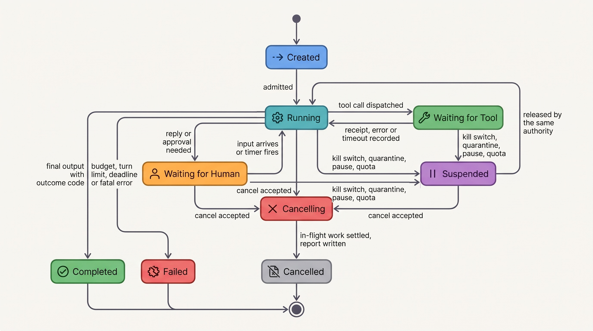
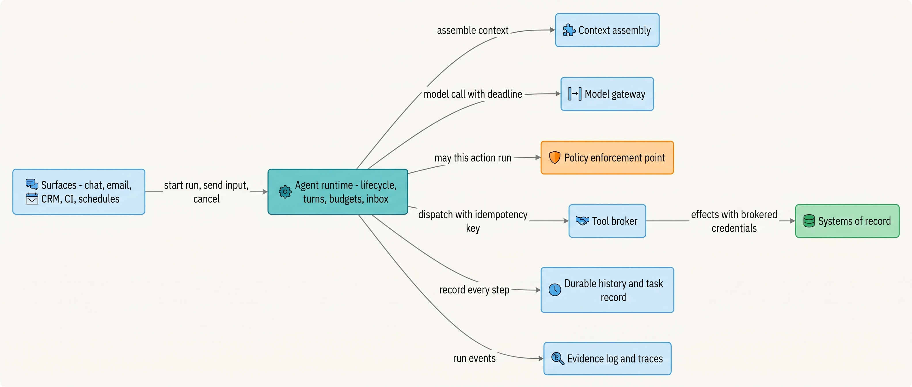
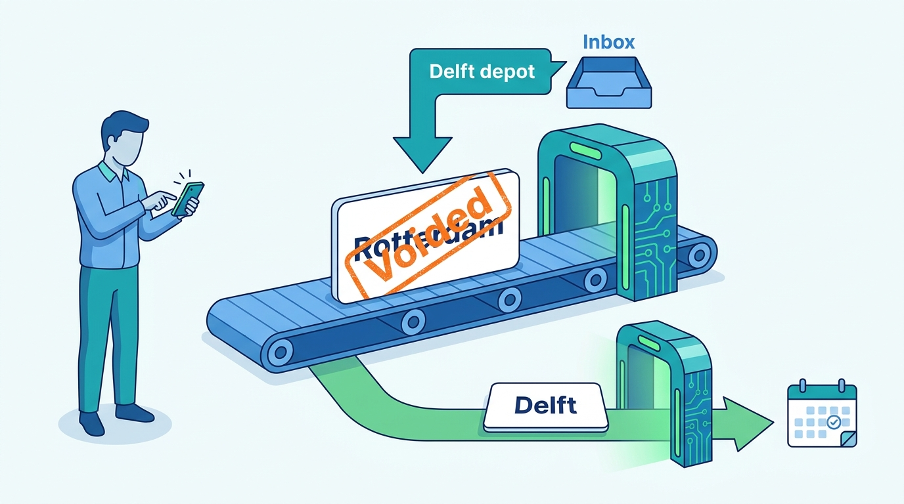
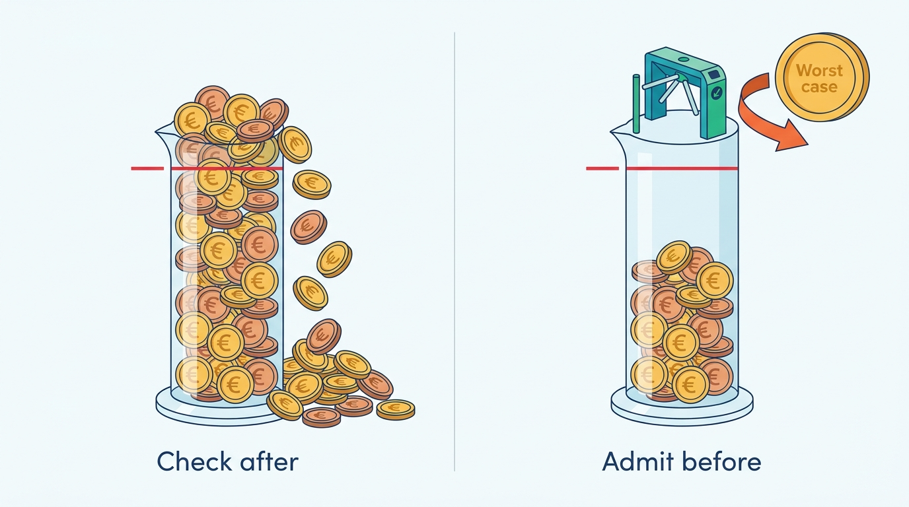

> **IN THIS CHAPTER, YOU WILL:** Learn what an agent runtime is responsible for: the mechanics of a turn (parsing, validating and dispatching tool calls, parallel calls, streaming), the lifecycle of a run from creation to a terminal state, budgets that stop work, interruption and steering, run isolation in a multi-tenant platform, and how to decide between building a runtime and adopting a framework or SDK.

> **WHY THE BUSINESS CARES:** Every agent the business funds runs inside this component. When a run loops all weekend, books a technician for the address the customer just corrected, or cannot be stopped cleanly, the cause is usually not the model. It is the runtime, and the same fault then repeats in every agent built on it.

> **WHY ARCHITECTS SHOULD CARE:** The runtime is the one place where a platform can enforce the same rules for every agent: a run has explicit states, a turn validates model output before acting on it, budgets terminate, new user input is checked before an effect, and no run can see another tenant's data. A rule that is not enforced here has to be rebuilt, slightly differently, by every agent team.

> **KEY POINTS:**
>
> * **The runtime owns the run, not the decisions inside it.** It gives every run an explicit lifecycle (created, running, waiting, suspended, cancelling, and three terminal states), counts turns and spend, and records each transition. Authorization, credentials and side effects belong to the policy engine and the tool broker; the runtime asks and dispatches, it does not decide or execute.
> * **A turn is a pipeline, and the model's output is its untrusted input.** Parse, validate, partition reads from writes, run only registry-verified read-only calls in parallel, allow at most one side effect per turn, and never act on a partial or truncated tool call. Every stop reason the model can return needs a defined runtime response.
> * **Input that arrives during a run must be checked before an effect, not after.** A user's correction, an operator's pause or a cancel request lands in the run's inbox. The runtime reads the inbox at every turn boundary and immediately before dispatching any side effect, so a stale decision never becomes an action.

> **[FAILURE PATTERNS THIS CHAPTER ADDRESSES](where-agentic-systems-go-wrong.html):**
>
> * **The Token Bonfire** — the runtime is where run budgets live; a loop whose limits are prompt instructions or framework defaults has no budget at all.
> * **The Different Second Answer** — a runtime that treats "decide and act" as one retryable unit re-asks the model after the first answer has already been executed.
> * **Amnesiac Execution** — a runtime that keeps the run's state in process memory loses it, and its place in the lifecycle, on the first crash or deploy.

<br>
Every agent has the same loop at its core: assemble context, call the model, act on some of what it proposes, record the result, go round again. In a tutorial the loop is a dozen lines. In production it is the component that decides **when a run is allowed to spend another euro, what happens to a message that arrives in the middle of a turn, and which of five proposed tool calls actually run**.

That component is the **agent runtime**: the deterministic service that executes agent runs, owns their lifecycle and state transitions, enforces their budgets and limits, mediates every model call and tool call, and records what happened. The book's word for the same code in a coding tool is the *harness* ([[what-makes-a-system-agentic]]); a runtime is a harness offered as a platform service to many agents and many tenants. The model is a component the runtime calls. It is not the runtime.

This chapter owns four terms: **agent run**, **run lifecycle**, **turn** and **runtime (agent)**. It builds on [[workflows-loops-and-autonomous-agents]], which defines bounded loops and stop conditions, on [[agentic-reference-architecture]], which places the runtime among the other components, and on [[models-and-the-model-gateway]], which the runtime calls for every model step. It hands durable recording of runs to [[durable-agent-execution]], the task record to [[task-state-and-checkpoints]], retries and idempotency to [[retries-idempotency-and-concurrency]], and the tools themselves to [[tool-contracts]].

## Setting the Scene at Ostrell: The Message That Arrived Four Seconds Late

Ostrell, the fictional field-service software group this book follows (see [[meet-ostrell]]), runs seven agents on its internal Keelson platform. In 2026 each prototype ran its own loop; Keelson Runtime replaced them in January 2027. Two of the platform's early incidents were runtime incidents. In the **Weekend Fan-out** (February 2027), a Scout research run spawned **1,900 sub-agent runs** over **41 hours** and spent **€8,700**, because nothing in the loop counted spend. In the **Double Credit** (March 2027), a timed-out `issue_credit` call made the runtime retry a step that both asked the model and executed its answer; **212 customers** received duplicate credits worth **€31,400**.

In June 2027 a third runtime fault surfaced, smaller and more instructive. Lena Brandt, Director of Support Operations, forwarded a complaint from a maintenance company: Answerdesk, the customer-support agent, had booked a technician revisit to the customer's Rotterdam office although the customer had written, in the same chat, that the faulty unit was at their Delft depot. The trace showed the order of events. The customer's first message asked for a revisit. Answerdesk's model proposed `schedule_revisit` for the site on the ticket. Four seconds later, while the runtime was dispatching that call, the customer typed the correction. The runtime appended the new message to the conversation **after** the turn finished, by which point the booking existed. Because Toolyard, the tool broker, enforces one revisit per ticket, the correct booking was then refused, and a support agent had to cancel and rebook by hand.

A trace review over May and June 2027 found **23** such conversations (Ostrell figures, fictional), each fixed within a day by a human. Jonas Lindqvist, principal engineer for Keelson Runtime, could state the cause in one sentence: *the runtime had no rule for input that arrives while a run is running.*

Tomas Verhoef, Ostrell's Chief Architect, asked the architecture forum for more than a fix: a **runtime contract**, listing what Keelson Runtime guarantees to every agent and what it must never do. The forum adopted it in July 2027. This chapter is that contract and its reasoning.

## Concepts: Runs, Turns, Lifecycles and Runtimes

### Agent run

An **agent run** is one execution of one agent version on one task, from the moment the runtime accepts the task until the run reaches a terminal state. It has an identity (the run id), a principal and an on-behalf-of identity fixed at creation, a pinned agent version manifest ([[versioning-agent-systems]]), a budget, an inbox for input that arrives while it runs, and a task record that the runtime alone writes ([[task-state-and-checkpoints]]). Sub-agent runs are runs too, linked to a parent and a root ([[single-and-multi-agent-designs]]).

What a run spans is a product decision, and it decides most of the runtime's behavior. At Ostrell, an Answerdesk run is **one conversation**, which may last minutes in chat or days by email; a Closewise run is one entity's close for one month; a Scout run is one research request; a Forge run is one coding task that ends in a pull request. Defining a run as one user message instead would have made "the customer corrected me between messages" a cross-run problem, with no single place to enforce the one-revisit limit or a conversation-level budget.

### Turn

A **turn** is one iteration of the agent loop: one model call, followed by the runtime's handling of everything that call proposed (validating it, executing some or all of the proposed tool calls, recording the results) up to the point where the next model call could start. This is the sense in which vendor SDKs count turns. The OpenAI Agents SDK raises `MaxTurnsExceeded` when a run exceeds `max_turns`, which its documentation describes as "agent-loop turns (LLM calls)" ([OpenAI, n.d., accessed 2026-10](https://openai.github.io/openai-agents-python/running_agents/)). The Claude Agent SDK calls "one round trip inside the loop" a turn and counts the final text-only response as one more ([Anthropic, n.d., accessed 2026-10](https://code.claude.com/docs/en/agent-sdk/agent-loop)).

A turn is not a user message. One customer message to Answerdesk typically triggers two to four turns before a reply appears. This book calls a user message and the agent's reply an **exchange**; latency budgets for chat, such as those in [[agent-latency-and-throughput]], are budgets per exchange.

### Run lifecycle

The **run lifecycle** is the finite set of states a run can be in, the transitions between them, and who may cause each transition. A lifecycle exists so that every component and every person can answer three questions about any run at any moment: is it doing work, what is it waiting for, and can it still cause a side effect? Keelson Runtime's lifecycle has nine states.

| State | Meaning | Entered by | Left by | Holds a worker? |
| --- | --- | --- | --- | --- |
| `created` | Accepted, identity and manifest pinned, budget reserved; nothing run yet | Trigger (message, event, schedule, parent run) | Admission control | No |
| `running` | A turn is in progress: context assembly, model call or validation | Runtime | Runtime, at the end of each step | Yes |
| `waiting_for_tool` | A dispatched tool call, CI job, external callback or backoff timer is outstanding | Runtime, on dispatch | Receipt, timeout or definite failure | No (durable wait) |
| `waiting_for_human` | The run asked a person for something: a customer reply, an approval, a clarification | Runtime, on a model or policy request | The person's input, or the wait's timer | No |
| `suspended` | An authority **outside** the run has parked it: kill switch, quarantine, operator pause, tenant quota | Kill switch, security, operator, quota service | Only the authority that suspended it | No |
| `cancelling` | A cancel request was accepted; no new effects start; in-flight work settles | Requester with cancel rights, parent run, deadline | Runtime, when the report is written | Briefly |
| `completed` | Ended normally, with an outcome code | Runtime | — | — |
| `failed` | Ended abnormally: budget exhausted, turn limit, deadline, unrecoverable error | Runtime | — | — |
| `cancelled` | Ended by cancellation, with a report of effects done, unknown and voided | Runtime | — | — |

Two distinctions carry most of the design. **Waiting is the run's own business; suspension is someone else's.** A waiting run resumes under its own manifest's rules; a suspended run resumes only when the authority that suspended it releases it, never because of the model, a timer or, under quarantine, its owner. Mixing the two is how a "paused" agent continues because a timer fired. And **terminal states carry an outcome**: Ostrell's outcome codes for `completed` are `resolved`, `answered`, `abstained`, `escalated` (handed to a human with an escalation package, [[agent-interaction-design]]) and `abandoned` (Scout's planner gave up within its replan limit, [[planning-and-decomposition]]). Abstention and escalation count as successful outcomes when they are correct.


**Figure 1:** *Keelson Runtime's run lifecycle. Only `running` makes model calls; waits hold no worker; suspension is entered and left only by an authority outside the run; every terminal state carries an outcome and a report.*

[[durable-agent-execution]] details how each wait gets its timer, escalation and expiry, and how cancellation settles in-flight work. (A cancel request during `waiting_for_tool` takes effect when the outstanding call settles; the figure omits that edge.)

### Runtime, framework and SDK

Three words are used interchangeably in vendor material, and the confusion costs teams real decisions.

| | **Agent runtime** | **Agent framework** | **Agent SDK** |
| --- | --- | --- | --- |
| What it is | A service that executes runs and owns their lifecycle, budgets, state and isolation | A library of abstractions for writing agent logic: graphs, nodes, agents, handoffs | A provider's or vendor's library that bundles a loop, tool plumbing and often built-in tools |
| Examples (October 2026) | A platform team's own service; a durable workflow engine with a thin loop on top; a provider-hosted agent service | LangGraph, Google Agent Development Kit (ADK), Microsoft Agent Framework, CrewAI | OpenAI Agents SDK, Claude Agent SDK |
| Who runs it | The platform team, as infrastructure | Each agent team, inside its own process | Each agent team, inside its own process |
| Owns the loop? | Yes | Usually, through its own executor | Yes, through its runner |
| Owns durability, tenancy, platform budgets? | Must | Partly (checkpointers), never tenancy | Partly (turn and spend caps), never tenancy |

A framework or an SDK *contains* a loop; it is not a runtime. Something still has to survive the process's crash, carry its tenant boundary, keep its budget across restarts and accept a cancel request from outside. The question is therefore **which component owns each runtime responsibility**; the trade-offs are at the end of the chapter.

## Architecture: What the Runtime Owns and What It Must Never Do

### Responsibilities

The runtime sits between the surfaces that start runs and the components that do the bounded work: the model gateway for model calls, the policy enforcement point for decisions, the tool broker for effects, and the durable engine for recording.


**Figure 2:** *The runtime coordinates; it does not decide authorization, hold credentials or touch systems of record. Every arrow out of it is a request to a component built to enforce something.*

| Responsibility | The runtime owns | It must never |
| --- | --- | --- |
| **Lifecycle** | States, transitions, who may cause each, the run's outcome and report | Let the model move a run between states except by proposing a finish or a request for input |
| **Turn mechanics** | Calling the model, parsing and validating its output, partitioning and dispatching tool calls, recording results | Execute a tool call that failed validation, was truncated, or names a tool outside the manifest |
| **Budgets** | Admission before every model call, tool call and spawn, against a ledger that survives restarts | Treat a prompt instruction or a framework default as a limit |
| **Inbox and steering** | Accepting input during a run, ordering it, reading it at defined points | Append new input after a stale decision has already been acted on |
| **State** | Writing the task record from recorded results ([[task-state-and-checkpoints]]) | Give the model a write path to task state; keep state only in process memory |
| **Isolation** | Fixing tenant and principal at creation and attaching them to every call; per-run state; fair scheduling | Widen a run's tenant, principal or tool set after creation; run model-written code in its own process |
| **Authorization** | Asking the policy engine before effects and honoring the answer | Decide authorization itself, or cache a policy verdict past its version |
| **Credentials and effects** | Sending action objects to the tool broker with idempotency keys | Hold credentials, call systems of record directly, or re-ask the model after dispatch |

Each line in the right-hand column names an incident or a near miss: "never re-ask the model after dispatch" is the Double Credit ([[retries-idempotency-and-concurrency]]); "never treat a prompt instruction as a limit" is the Weekend Fan-out. The policy engine decides and the tool broker executes ([[policy-enforcement-and-audit]]); the runtime is the third party that must not short-circuit either.

### The anatomy of a turn

A turn is a short pipeline with one untrusted input: the model's output. The sketch below is Python-style pseudocode for one turn of a Keelson run; `activity(...)` stands for a recorded step on the durable engine ([[durable-agent-execution]]), and the names are illustrative.

```python
def run_turn(run: Run) -> TurnOutcome:
    ctx = activity(assemble_context, run.task_ref, run.manifest)      # recorded
    adm = run.budget.admit(worst_case_cost(ctx, run.manifest))       # before the call
    if not adm.ok:
        return TurnOutcome.fail(adm.reason)          # budget_exhausted, deadline, turn_limit
    resp = activity(call_model, ctx, run.manifest, stream_to=run.channel)
    run.budget.charge(resp.usage)

    match resp.stop_reason:                           # every stop reason has a rule
        case "refusal":
            return TurnOutcome.complete("escalated", reason="model_refusal")
        case "max_tokens" | "context_window_exceeded" if resp.has_open_tool_call:
            return TurnOutcome.redecide(note="truncated_tool_call")  # never run a partial call
        case "end_turn" if not resp.tool_calls:
            return TurnOutcome.complete(classify_outcome(resp))

    calls = [validate(c, run.manifest.tools) for c in resp.tool_calls]  # schema, enum, ranges
    reads = [c for c in calls if c.ok and registry.read_only(c.tool)]
    writes = [c for c in calls if c.ok and not registry.read_only(c.tool)]
    results = [c.error_result() for c in calls if not c.ok]          # model-fixable errors
    results += [w.error_result("one_action_per_turn") for w in writes[1:]]

    results += parallel(activity(call_tool, c, run.scope) for c in reads)

    if writes:
        if run.inbox.has_input_after(resp.recorded_at):              # steering check
            return TurnOutcome.redecide(void=writes[0])               # nothing dispatched yet
        action = run.task.record_intent(writes[0])                    # idempotency key minted here
        verdict = activity(check_policy, action, run.manifest.policy_version)
        if verdict.requires_approval:
            return TurnOutcome.wait_for_human(action)
        if verdict.allowed:
            results.append(activity(call_tool, action, run.scope))    # receipt or unknown
        else:
            results.append(action.denied_result(verdict))             # denial is a tool result
    return TurnOutcome.next(results)                                  # one result per call
```

Six details are the runtime's real job.

**Every stop reason has a rule.** Providers report why the model stopped, and an agent loop that only checks for "tool use" or "done" mishandles the rest. Anthropic's documentation, accessed October 2026, lists seven values, including `refusal` ("Claude declined to respond", returned "as a normal HTTP 200 response, not an error"), `max_tokens`, `model_context_window_exceeded` and `pause_turn`, which means a server-side tool loop "reached its iteration limit" and must be continued by sending the content back ([Anthropic, n.d., accessed 2026-10](https://platform.claude.com/docs/en/build-with-claude/handling-stop-reasons)). Anthropic also documents that strict schema guarantees do not hold on a refusal or a `max_tokens` stop ([Anthropic, n.d., accessed 2026-10](https://platform.claude.com/docs/en/build-with-claude/structured-outputs)). The gateway normalizes provider vocabularies ([[models-and-the-model-gateway]]); the runtime decides what each normalized reason means for the run.

**Validation happens in the runtime, after the model and before anything else.** Constrained decoding makes malformed arguments rare, not impossible, and it guarantees nothing about whether an amount is plausible or an enum value is the intended one ([[tool-contracts]]). A call that fails validation is returned to the model as an error result it can fix, which is how the Model Context Protocol (MCP) specification of 2026-07-28 says tool execution errors should be handled ([MCP, 2026-07-28](https://modelcontextprotocol.io/specification/2026-07-28/server/tools)). Repeated failures count against a re-ask budget (two per step at Ostrell, [[retries-idempotency-and-concurrency]]).

**Reads run in parallel; writes run one at a time, and at most one per turn.** Models can propose several tool calls in one response. Anthropic's parallel tool use documentation says "The API doesn't prescribe an execution order", that "independent, read-only operations are usually safe to run in parallel", and that every call must receive a result in the next message ([Anthropic, n.d., accessed 2026-10](https://platform.claude.com/docs/en/agents-and-tools/tool-use/parallel-tool-use)). The Claude Agent SDK runs read-only tools concurrently and state-changing tools sequentially, and treats custom tools as sequential unless they carry `readOnlyHint` ([Anthropic, n.d., accessed 2026-10](https://code.claude.com/docs/en/agent-sdk/agent-loop)). But the MCP specification says clients "**MUST** consider tool annotations to be untrusted unless they come from trusted servers" ([MCP, 2026-07-28](https://modelcontextprotocol.io/specification/2026-07-28/server/tools)). Keelson Runtime therefore parallelizes only tools that the Toolyard registry has classified as read-only after review, not tools that declare themselves so. Its stricter rule, one side effect per turn, keeps every effect attributable to one recorded decision and makes the steering check below possible. A model that proposes a credit and a revisit in the same response gets the credit dispatched and an error result for the revisit asking it to propose that next; the cost is one extra turn.

**Partial output is never acted on.** Streaming delivers tool arguments in fragments. Anthropic's streaming documentation describes tool-input deltas as "partial JSON strings", with the final input available as an object only when the content block ends ([Anthropic, n.d., accessed 2026-10](https://platform.claude.com/docs/en/build-with-claude/streaming)). The runtime may stream *text* to the user through the checks described in [[agent-latency-and-throughput]], and may show a progress line as soon as it can name the tool, but it dispatches a call only after the block is complete, parsed and validated.

**The intent is recorded, and the key minted, by the runtime.** The action object, with an idempotency key minted from the agent id, the run id and the action object id (covering the object's version), is recorded before dispatch ([[side-effects-and-external-actions]], [[retries-idempotency-and-concurrency]]). After dispatch the step is frozen: whatever happens to the call, the runtime resolves the outcome by receipt or status lookup and never asks the model to decide again.

**A denial is a result, not an exception.** When the policy engine refuses an action, the model receives a result that says so and why, and the loop continues. The author's ai-coding-cli interview design makes the same choice, "denial returned as a tool result" (design example, step `safety`). Crashing the run on a denial teaches nothing; letting the model argue past one is worse.

### The inbox: interruption and steering

Input arrives while runs run: a correction, a second email, a "stop", an operator's pause, a parent's cancellation. The Keelson fix for the June 2027 bookings gave every run an **inbox**, an ordered, durable queue of input addressed to the run, and three rules about when the runtime reads it.

1. **At every turn boundary.** New user input becomes part of the next turn's context, in arrival order, labeled with its time.
2. **Immediately before dispatching any side effect.** If input arrived after the decision that proposed the effect was recorded, the effect is not dispatched. The action object is voided (it was never executed), and the next turn re-decides with the new input in context. This is safe precisely because nothing has happened yet; it is the opposite of re-asking after dispatch.
3. **Control messages preempt.** A cancel, pause or quarantine is applied at the next safe point, which is at the latest the end of the current step, and moves the run to `cancelling` or `suspended`. An in-flight tool call settles according to its contract ([[durable-agent-execution]]).


**Figure 3:** *The runtime reads the inbox immediately before any side effect: a correction that arrives first voids the proposed action, because nothing has happened yet.*

Vendors document versions of these choices, and they differ. The OpenAI Agents SDK can stop a run with `cancel(mode="after_turn")` and resume it from a saved `RunState`, which can carry "input staged for the next resumed model call" ([OpenAI, n.d., accessed 2026-10](https://openai.github.io/openai-agents-python/running_agents/)). In the Claude Agent SDK's streaming-input mode, a message still queued when a turn ends at the turn limit "stays queued" and starts a new turn ([Anthropic, n.d., accessed 2026-10](https://code.claude.com/docs/en/agent-sdk/agent-loop)). LangGraph's `interrupt` restarts "the entire node from the beginning", so "side effects called before `interrupt` must be idempotent" ([LangChain, n.d., accessed 2026-10](https://docs.langchain.com/oss/python/langgraph/interrupts)). These are different defaults, and a team that adopts one inherits its answer to "what happens to the message that arrived four seconds late".

**Steering** is the softer case: the user changes the goal or a constraint without stopping the run ("not that site", "only list prices"). The runtime does not interpret steering; it guarantees that the model sees it before any effect it could invalidate. Whether the model handles it well is an evaluation question. Laban et al. found that models lose on average 39% of performance when an instruction is spread over several turns rather than given at once, across six generation tasks in more than 200,000 simulated conversations ([Laban et al., 2025](https://arxiv.org/abs/2505.06120), preprint; simulated users, not agent tasks). That is an argument for putting a correction into context explicitly and prominently, as a labeled new constraint, rather than as one more message at the end of a long history ([[context-engineering]]).

### Budgets and stop conditions

The run budget is defined in [[agent-cost-and-model-routing]] and the stop conditions in [[workflows-loops-and-autonomous-agents]]. The runtime's part is enforcement, and three properties make enforcement real.

- **Admission before the call, with a worst-case estimate.** Spend is known only after a response. The Claude Agent SDK documents the consequence: it checks `max_budget_usd` after responses arrive, so "spend can therefore pass the cap by up to the cost of that one response", plus whatever running sub-agents spend before they stop ([Anthropic, n.d., accessed 2026-10](https://code.claude.com/docs/en/agent-sdk/agent-loop)). Keelson admits a model call only if the spend so far plus the call's maximum output cost fits, which turns overshoot into an early stop.
- **The ledger survives the process.** Budget counters live in the task record, so a resumed run continues with what it has already spent ([[task-state-and-checkpoints]]).
- **Several limits, each with its own failure.** Turns per run, turns per exchange, tokens, cost, wall-clock time, delegation depth and parallel children. A doom loop (the model repeating the same failing call) is caught by a repetition detector before any budget: the author's ai-coding-cli design names "doom-loop detection" next to turn, token and wall-clock caps (design example, step `agent-loop`), and step repetition was the most frequent failure mode, at 15.7% of annotated failures, in the MAST study of 1,600+ traces from seven multi-agent frameworks ([Cemri et al., 2025](https://arxiv.org/abs/2503.13657), preprint; benchmark tasks, not production).


**Figure 4:** *Admitting each model call against its worst-case cost, before the call, turns a budget overshoot into an early stop.*

At a limit the run ends `failed` with the reason (`budget_exhausted`, `turn_limit`, `deadline`, `repetition`) and a partial result. Already-dispatched calls settle; queued action objects are **held for review, not dropped**, the book's rule for every stop ([[agent-cost-and-model-routing]]).

### Isolation and multi-tenancy

A platform runtime runs thousands of runs for many tenants on shared workers. Answerdesk alone serves **9,400** business customers. Isolation has four layers, and they fail independently.

| Layer | Rule at Ostrell | Typical failure if missing |
| --- | --- | --- |
| **State** | No mutable state in worker memory between steps; everything a step needs comes from the task record or the context assembler | A cache or global variable in agent code carries one customer's account into another's run |
| **Scope** | Tenant id, principal and on-behalf-of identity are fixed at `created`, immutable, and attached to every context read, model call and tool call; Toolyard and Bulkhead enforce them | A sub-agent or retried step runs with a broader identity than the run that started it ([[agent-identity-and-least-privilege]]) |
| **Resources** | Separate worker pools for interactive, background and batch runs; per-tenant concurrency caps; weighted fair admission | One tenant's batch of email tickets delays every chat; a Scout fan-out starves Answerdesk |
| **Execution** | No model-written code runs in a runtime worker; it runs in a sandbox per run ([[sandboxes-and-execution-environments]]) | A generated script inherits the runtime's network and credentials |

The resource layer follows the author's agentic-platform-foundations interview design: queue-based admission with per-tenant weighted fair scheduling and a retryable rejection under overload (design example, step `capacity`). The execution layer follows its rule that a per-session microVM is a tenant boundary, with no dirty warm-pool slot reused across tenants (step `runtime`).

### Where the runtime hands to durable execution

Keelson Runtime runs every agent on a durable workflow engine: the loop is workflow code, and model calls, tool calls and context reads are recorded activities ([[durable-agent-execution]]). The contract above does not depend on that choice, but the engine supplies three guarantees cheaply: waits that hold no worker, model output that is never re-sampled on recovery, and signals that deliver inbox messages. A runtime without one must build them itself; [[durable-agent-execution]] discusses when a simpler substrate is enough.

**Forge**, the coding agent, shows where the runtime ends and the execution environment begins. A Forge run is a Keelson Runtime workflow that owns the task record, the budget, the credentials proxy, pull-request creation and the Logbook entries; the inner coding loop runs *inside* a per-run microVM as one leased, heartbeated activity of that workflow. Model calls from inside the sandbox leave only through an egress proxy to Keelson Gateway, and the sandbox holds no production credentials, only a run-scoped repository token ([[sandboxes-and-execution-environments]]). The repository branch is the workspace's resume state ([[task-state-and-checkpoints]]). Keeping the run's lifecycle, budget and record outside the sandbox means a prompt-injected repository can corrupt the workspace and waste the lease, but cannot extend its own budget, rewrite its record or open a pull request the workflow did not authorize.

Organizations also run loops they cannot instrument: a bought coding agent, a vendor's hosted agent. The realistic arrangement is a **wrapped loop**: an outer runtime owns lifecycle, budget, isolation and the exit gate (a pull request, a draft for approval), and accepts that the inner loop's turns are opaque and cannot be replayed one by one. The author's ai-coding-harness interview design builds an entire outer harness on this premise, "the agent is bought, the trust is built" (design example, step `naive`).

### Requirements per interaction

| Interaction | Consistency | Latency budget | Durability | Who may act |
| --- | --- | --- | --- | --- |
| Start a run | Exactly one run per triggering event (dedup key on the trigger) | < 100 ms to `created` *(assumption)* | Run record and pinned manifest written before acknowledgment | Surface, scheduler or parent run |
| Model call | Admitted against the budget before; recorded before use | Seconds; streamed | Response, model id and usage recorded | Runtime, through the gateway |
| Side-effecting tool call | One per turn; intent before, receipt or `unknown` after; inbox checked first | Per tool contract | Intent and receipt recorded | Runtime dispatches; policy engine decides; broker executes |
| Input during a run | Ordered per run; read at turn boundaries and before effects | Visible to the next decision | Inbox is durable | User, approver, operator, parent run |
| Cancel, pause, quarantine | Applied at next safe point; idempotent | Seconds | Request and report recorded | Requester with rights, operator, security, kill switch |

## Evidence: What Vendors, Research and Design Examples Say

The loop's shape has not changed since ReAct interleaved reasoning, actions and observations on simulated environments ([Yao et al., 2022](https://arxiv.org/abs/2210.03629), ICLR 2023). What has changed is the production machinery around it.

**Vendor SDKs converge on the same loop and differ on defaults.** Both major vendor SDKs document the same cycle: call the model, run the requested tools, append results, repeat until a response with no tool calls ([OpenAI, n.d., accessed 2026-10](https://openai.github.io/openai-agents-python/running_agents/); [Anthropic, n.d., accessed 2026-10](https://code.claude.com/docs/en/agent-sdk/agent-loop)). The defaults are where they diverge, and several are permissive: as of October 2026 the Claude Agent SDK's `max_turns` and `max_budget_usd` default to "No limit", and its documentation recommends setting a budget for production agents; its sub-agent controls default to a spawn depth of 3 and 20 concurrent sub-agents with no spend limit ([Anthropic, n.d., accessed 2026-10](https://code.claude.com/docs/en/agent-sdk/subagents)). Each SDK ends a run with a typed result (`error_max_turns`, `error_max_budget_usd`, `error_during_execution` in one; a `MaxTurnsExceeded` exception in the other), which a platform must map onto its own lifecycle.

**"Durable agent" integrations record model calls more readily than tools.** Temporal's integration with the OpenAI Agents SDK routes model invocations through recorded activities automatically, while ordinary function tools "execute in the workflow unless explicitly backed by a Temporal activity" ([Temporal, n.d., accessed 2026-10](https://github.com/temporalio/ai-integrations/tree/main/python/openai_agents)). A team that wraps an SDK in a durable engine must check, tool by tool, what is actually recorded.

**Frameworks churn faster than runtimes should.** Microsoft archived AutoGen and stated it provides no further bug or security fixes, pointing users to Microsoft Agent Framework, which reached version 1.0 on 3 April 2026 ([Microsoft, n.d., accessed 2026-10](https://github.com/microsoft/autogen); [Microsoft, 2026](https://devblogs.microsoft.com/agent-framework/microsoft-agent-framework-version-1-0/)). LangChain archived its `langgraph-supervisor` library and now recommends implementing the supervisor pattern "directly with tools" ([LangChain, n.d., accessed 2026-10](https://github.com/langchain-ai/langgraph-supervisor-py)). Anthropic's December 2024 guidance suggested developers "start by using LLM APIs directly" because frameworks hide prompts and responses ([Anthropic, 2024](https://www.anthropic.com/engineering/building-effective-agents)).

**Re-running a turn is not repeating it.** Anthropic's documentation states that even at temperature 0 "identical inputs might produce different outputs across API calls" ([Anthropic, n.d., accessed 2026-10](https://platform.claude.com/docs/en/about-claude/glossary)), and τ-bench's pass^k metric shows that success on every one of k repeated trials falls well below single-trial success ([Yao et al., 2024](https://arxiv.org/abs/2406.12045), preprint; simulated users and 2024 models). The evidence is detailed in [[task-state-and-checkpoints]]; for the runtime it means any behavior that "retries the turn" is a new decision.

**People interrupt more as they trust more.** In Anthropic's February 2026 study of Claude Code usage, experienced users interrupted the agent on about 9% of turns against about 5% for new users, while also auto-approving more ([Anthropic, 2026](https://www.anthropic.com/research/measuring-agent-autonomy); one provider's product, Claude-scored data). Interruption is therefore not an edge case to bolt on later; it is how skilled users supervise.

**Where the evidence stops.** No published study measures how often production agents act on stale decisions because input arrived mid-turn, compares runtime designs for steering, or reports incident rates for build-versus-adopt choices. The rules in this chapter (inbox checks before effects, one effect per turn, registry-verified parallelism) are the author's judgement from the vendor semantics above, the interview designs and Ostrell's illustration.

## Worked Example at Ostrell: One Conversation, Six Turns

The Answerdesk manifest of November 2027 carries this run profile (Ostrell figures, fictional): at most **8 turns per exchange** and **40 per run**, **600,000 tokens** and **€1.20** of model spend per run (widened from the April 2027 limits of 6 model calls per exchange and €1.00 per conversation in [[workflows-loops-and-autonomous-agents]]), a working-context budget of **24,000 tokens per model call**, **14** tools always loaded and 20 behind tool search ([[context-engineering]]), and an idle timer of **72 hours** in `waiting_for_human` before the run completes as `answered`. Credits up to **€250** are autonomy tier A2 (act within limits) since October 2027; one revisit per ticket is a Toolyard limit. Answerdesk's model spend averaged about **€0.12 per conversation** in Q3 2027 ([[agent-cost-and-model-routing]]), so the €1.20 cap is about ten times the mean and roughly twice the 95th percentile.

On a Tuesday in November 2027, the facilities manager of a fictional installation company writes in chat that yesterday's technician visit did not happen.

| # | Time | State | What the runtime does | Notes |
| --- | --- | --- | --- | --- |
| — | 09:12:03 | `created` → `running` | Run created from the chat event; tenant, verified customer and manifest hash pinned; budget reserved | Route `revisit_scheduling` from the intake router ([[routing-and-delegation]]) |
| 1 | 09:12:04 | `running` → `waiting_for_tool` | Model proposes three reads: ticket, visit history, contract. All registry-classified read-only, run in parallel | 0.6 s; results ordered by call id |
| 2 | 09:12:07 | `running` | Model proposes `schedule_revisit` for the ticket's site, Rotterdam, slot Thursday 08:00–12:00, and a reply. Intent not yet recorded | Text streams through the sentence buffer while the runtime validates |
| — | 09:12:08 | `running` | **Inbox check before dispatch:** a message arrived at 09:12:07.6: "It's the Delft depot, not the office." Action voided, never dispatched | The June 2027 fault, now handled |
| 3 | 09:12:09 | `running` → `waiting_for_tool` | Model re-decides with the correction labeled as a new constraint; proposes `schedule_revisit` for Delft. Intent recorded, key minted, Bulkhead allows (A2, first revisit), Toolyard dispatches | Receipt in 1.1 s |
| 4 | 09:12:12 | `running` → `waiting_for_human` | Model writes the confirmation; runtime pins the booking receipt into task state | Exchange 1: 4 turns, 9 s |
| 5 | 09:19:40 | `running` → `waiting_for_tool` | Customer asks for compensation. Model proposes `issue_credit` of €80 citing the missed-visit clause. A2 within limits; dispatched with key; runtime waits up to 8 s for the receipt | Receipt in 2.9 s |
| 6 | 09:19:45 | `running` → `waiting_for_human` | Model confirms the credit and the revisit | Exchange 2: 2 turns |
| — | Fri 09:19 | `completed` (`answered`) | Idle timer fires after 72 h; run report written to Logbook | Revisit and credit receipts in the report |

The run used **6 turns** over **2 exchanges**, about **86,000 input tokens** and **€0.19** of model spend, well inside its budget. Three things in it are the runtime's work rather than the model's. The voided action at 09:12:08 cost one extra turn and about a second, and replaced a manual cancellation. The credit was dispatched once, with a key the runtime minted, and its 8-second receipt wait came from the latency design in [[agent-latency-and-throughput]]: had billing been slow, the customer would have seen "being processed" with a reference, and the run would have moved to `waiting_for_tool` with no worker held. And the conversation's two exchanges were one run, so the one-revisit limit, the budget and the report all applied to the whole conversation.

After the inbox rule shipped in July 2027, wrong-site and wrong-date revisit bookings attributed to mid-turn corrections fell from **23** in May–June to **1** in August–September (Ostrell figures, fictional); the remaining case was a correction that arrived after the booking's receipt, which the runtime correctly treated as a request for a change, not a re-decision. About **3.8%** of Answerdesk chat runs now contain a voided action; Wake, Ostrell's tracing service, charts the rate per agent version, because a jump means the model has started proposing effects before it has gathered what it needs.

The same lifecycle, with different parameters, runs Ostrell's other agents.

| Agent | What one run is | Dominant state by elapsed time | Budget and limits | Typical end |
| --- | --- | --- | --- | --- |
| **Answerdesk** | One conversation | `waiting_for_human` (the customer) | 40 turns, 8 per exchange, €1.20, 600,000 tokens | `answered`, `resolved` or `escalated` |
| **Closewise** | One entity's monthly close (child of the group close) | `waiting_for_human` (controller approvals, 48-working-hour timer) | Per-step clocks in [[durable-agent-execution]] | `completed` by working day 5 |
| **Scout** | One research request | `running` and `waiting_for_tool` (search) | 8 million tokens, €90, 90 minutes; depth 2; ≤ 8 parallel workers | Report, `abstained` or `abandoned` |
| **Forge** | One coding task | `waiting_for_tool` (tool calls in the sandbox, CI) | Turn, token and wall-clock caps; 60-minute sandbox | Pull request; merge stays human |

## Failure Modes and Recovery

| Scenario | What happens | Detection | Containment | Recovery |
| --- | --- | --- | --- | --- |
| **Stale decision executed** | User input arrives after the model proposed an effect, before dispatch; the old decision is executed | Voided-action and correction-after-effect counts in Wake; customer complaints | Inbox check immediately before every dispatch | If it happened anyway: compensating action through the tool's designed compensation ([[partial-failure-and-compensation]]) |
| **Partial tool call executed** | A response truncated at the output limit leaves an incomplete tool call that a lenient parser accepts | Stop reason `max_tokens` with a tool call in the record | Never dispatch a call from a truncated or refused response | Re-decide with a higher output limit; count against the re-ask budget |
| **Self-declared read-only tool runs in parallel with a write** | A server marks a side-effecting tool `readOnlyHint: true`; the runtime parallelizes it | Registry review mismatch; duplicate or out-of-order effects | Parallelism only from registry classification, not server hints | Reclassify; reconcile affected runs |
| **Doom loop** | The model repeats the same failing call each turn | Repetition detector (same tool and arguments hash within a window) | Fail with `repetition` before the turn cap | Partial result to the owner; trace feeds an eval case ([[building-agent-eval-suites]]) |
| **Cross-tenant leakage through worker memory** | A process-level cache in agent code returns another tenant's data | Two-tenant canary runs in Sounding (Ostrell's evaluation service); tenant-mismatch assertion on every tool call | No mutable worker state; tenant attached to every call and checked by Toolyard | Incident process; purge caches; notify affected tenants |
| **Suspended run resumes by itself** | A pause is implemented as a long wait; its timer fires and the run continues | Transitions out of `suspended` not caused by the suspending authority | Suspension as its own state, released only by its authority | Re-suspend; audit actions taken after the false resume |

## Trade-offs: Build, Adopt or Wrap

| Option | What it gives | What it costs | Right when |
| --- | --- | --- | --- |
| **Vendor agent SDK in the agent's own process** | Fastest start; the provider's loop, tool plumbing, compaction and built-in tools; good defaults for coding tasks | Tied to one provider's semantics; lifecycle, tenancy, durable budgets and cross-agent policy are yours to add; defaults change with releases | One team, one agent, low consequence, or a coding agent inside a sandbox |
| **General agent framework** (LangGraph, ADK, Microsoft Agent Framework, CrewAI) | Graph or workflow abstractions; checkpointers; human-in-the-loop interrupts; multi-provider | Its resume semantics (node restart, re-execution on replay) become yours; churn; tenancy and platform budgets still missing | A team that wants explicit graphs and accepts the framework's recovery model, with side-effecting nodes isolated and idempotent |
| **Own thin loop on a durable workflow engine** | Lifecycle, inbox, budgets and recording under your control; recovery without re-sampling; one contract for every agent | A platform team (Ostrell's had 14 engineers in January 2027) and an engine to operate; you write the loop, compaction and tool plumbing | Several agents with side effects, multi-day waits, many tenants, and risk owners who need the same guarantees everywhere |
| **Provider-hosted agent service** | No loop or sandbox to run; managed scaling | Lifecycle and data live with the provider; your policy engine and tool broker must still sit in the path; limited inbox control | Low-consequence agents without access to systems of record, or as an inner loop wrapped by your runtime |
| **Wrap an opaque loop** (bought or hosted agent) | Use the best available inner agent; outer runtime keeps budget, isolation and exit gate | No per-turn record or replay; resume is the workspace; steering is coarse | The inner loop's effects are confined to a disposable workspace and a reviewable output |

Ostrell built the third option in 2026, and wraps the engineers' local coding CLI only through managed configuration, not because frameworks are poor but because the runtime contract has to hold **identically for seven agents and thousands of tenants**, and each framework or SDK answers its questions differently and changes the answers between releases. Agent teams at Ostrell write agent definitions as data (prompts, tool sets, budgets, outcome codes in the manifest) and may use a framework only inside a single activity that makes no external calls except through Toolyard.

The judgement reverses for an organization with one or two agents that touch nothing irreversible: a vendor SDK with explicit limits, a policy check before each tool and a sandbox is enough. The condition I would use: **build or adopt a platform runtime when a second agent with side effects is about to need the same guarantees, not before.**

## Across Domains: How the Stakes Change the Design

| Dimension | Coding agents | Customer operations (support, sales, marketing) | Back office (finance, legal, HR) | High-stakes decisions (healthcare, public benefits) |
| --- | --- | --- | --- | --- |
| What a run is | One task in a workspace, ending in a pull request | One conversation, possibly days long | One case, entity close or contract review | One case step or one drafting task within a case |
| Where the loop runs | Platform runtime with tools in a sandbox, or a bought agent's opaque loop wrapped by an outer harness | In the platform runtime, under turn latency budgets | In the platform runtime, mostly as workflow with agentic steps | In the platform runtime, inside a deterministic rules workflow |
| Steering and interruption | Frequent; the developer is watching; interrupt and redirect are core (CLI design, step `safety`) | Frequent and unannounced; the inbox check before effects is essential | Rare; approvers act through approvals, not mid-turn messages | Rare from users; frequent from the workflow (new evidence arrives) |
| Isolation unit | Sandbox per run; repository-scoped token | Tenant (business customer) and verified end user | Legal entity and segregation-of-duties role | Case and data-subject, with clinical or statutory access rules |
| Terminal outcomes that matter | PR opened, gave up, budget | Resolved, escalated, abstained | Proposed for approval, abstained | Draft for a human, abstained; never a decision |

The platform can keep the lifecycle, the turn pipeline, the inbox points, the admission rules and the isolation layers common: they do not change with the domain. What must stay domain policy is **what a run spans**, **which states may last how long** (a customer's 72 hours, a controller's 48 working hours, an applicant's statutory weeks), **who may suspend or cancel**, and **which outcomes are permitted**. The author's public-benefits interview design shows the high-stakes end: "model assists, engine decides", and a caseworker decides every adverse outcome (design example, step 3; see [[domain-high-stakes-decisions]]). In runtime terms, such an agent has no outcome code that means "decided", and the runtime enforces that by construction rather than by prompt.

## The Chief Architect's View

The decisions I would take, and who takes them:

- **The runtime contract is a platform standard, owned by the platform team and approved by the architecture forum.** It names the lifecycle states, the turn pipeline, the inbox points, the budget admission rule and the isolation layers, and the list of things the runtime must never do. Every agent, including any bought one, is reviewed against it; where an inner loop is opaque, the review checks the wrapper.
- **What a run spans is decided per agent by its product owner, with the platform team.** It determines where limits apply. I would not let it default to "one request".
- **Outcome codes and wait timers are set by the risk owner of each agent.** Lena Brandt decides that an idle conversation completes after 72 hours; Joost Vermeer decides how long an approval may wait. The runtime enforces whatever they set.
- **Suspension rights are explicit.** The kill switch and quarantine belong to security and the agent owner; operator pause belongs to the platform on-call. Releasing a suspension requires the same authority that imposed it.
- **Adopting a framework or SDK is an architecture decision, not a library choice**, because it imports a resume model, an interruption model and a set of defaults.

What to watch, per agent version: turns per exchange, voided actions, budget and repetition terminations, runs stuck in `cancelling` or `suspended`, validation failures of model output, and tenant-mismatch assertions (which should be zero).

What is durable and what will change: the lifecycle, the separation of the runtime from authorization and execution, and the rule that model output is validated before it acts are ordinary distributed-systems discipline applied to a variable component, and they will outlast the current SDKs. Stop-reason vocabularies, SDK defaults, parallel-call behavior and hosted-agent services will change within a year, and models will take more turns per task and delegate more readily, which raises the value of runtime-enforced limits rather than lowering it.

## Questions to Ask

1. What exactly is one run of this agent, and why that span rather than a single request or a whole case?
2. Which states can a run be in, who can move it out of each, and which states can still produce a side effect?
3. What does the runtime do for each stop reason the model can return, including refusal, truncation and a server-tool pause?
4. Which tool calls may run in parallel, and who classified them as read-only: a reviewed registry or the tool's own annotation?
5. If a user's correction arrives between the model's decision and the tool's dispatch, which one wins? Show the check.
6. Where is the run budget enforced, before or after each call, and does it survive a crash and cover sub-agents?
7. How is a suspended run different from a waiting one, and what stops a timer from resuming a paused run?
8. Can anything in a worker process carry one tenant's data into another tenant's run?
9. If you adopted a framework or SDK, what is its resume model, its interruption model and its default for turns and spend, and which of those did you override?
10. For any loop you cannot see inside, what does the wrapper enforce?

The runtime coordinates; it does not touch the world. The next component in a run's path is the one that does: [[agents-in-the-enterprise]] covers how agents reach existing applications, data platforms and processes without becoming a shadow system beside them.

## Sources and Evidence

### Research papers

- [ReAct: Synergizing Reasoning and Acting in Language Models](https://arxiv.org/abs/2210.03629), Yao et al., 2022 (ICLR 2023). Origin of the reason–act–observe loop.
- [τ-bench: A Benchmark for Tool-Agent-User Interaction in Real-World Domains](https://arxiv.org/abs/2406.12045), Yao et al., 2024, preprint. pass^k and the gap between single-trial and repeated-trial reliability.
- [Why Do Multi-Agent LLM Systems Fail?](https://arxiv.org/abs/2503.13657), Cemri et al., 2025, preprint. Step repetition as the most frequent annotated failure mode (15.7%).
- [LLMs Get Lost in Multi-Turn Conversation](https://arxiv.org/abs/2505.06120), Laban et al., 2025, preprint. 39% average performance loss when instructions are spread across turns.

### Specifications, standards and regulation

- [Model Context Protocol specification: Tools](https://modelcontextprotocol.io/specification/2026-07-28/server/tools), MCP, 2026-07-28 revision. Tool execution errors returned to the model; annotations untrusted unless from trusted servers.

### Vendor documentation and engineering reports

- [How the agent loop works](https://code.claude.com/docs/en/agent-sdk/agent-loop), Anthropic, n.d., accessed 2026-10. Turn definition, parallel execution of read-only tools, `max_turns`/`max_budget_usd` defaults and overshoot, result subtypes, streaming input.
- [Subagents in the SDK](https://code.claude.com/docs/en/agent-sdk/subagents), Anthropic, n.d., accessed 2026-10. Default spawn depth, concurrency and absent spend limit.
- [Handling stop reasons](https://platform.claude.com/docs/en/build-with-claude/handling-stop-reasons), Anthropic, n.d., accessed 2026-10. Stop-reason values and recommended handling.
- [Streaming messages](https://platform.claude.com/docs/en/build-with-claude/streaming), Anthropic, n.d., accessed 2026-10. Tool inputs streamed as partial JSON.
- [Parallel tool use](https://platform.claude.com/docs/en/agents-and-tools/tool-use/parallel-tool-use), Anthropic, n.d., accessed 2026-10. No prescribed execution order; read-only calls parallel; one result per call.
- [Structured outputs](https://platform.claude.com/docs/en/build-with-claude/structured-outputs), Anthropic, n.d., accessed 2026-10. Schema guarantees do not hold on refusal or truncation.
- [Glossary](https://platform.claude.com/docs/en/about-claude/glossary), Anthropic, n.d., accessed 2026-10. Non-determinism at temperature 0.
- [Running agents](https://openai.github.io/openai-agents-python/running_agents/), OpenAI Agents SDK, n.d., accessed 2026-10. Runner loop, `max_turns`, cancel after turn, `RunState` resume.
- [Interrupts](https://docs.langchain.com/oss/python/langgraph/interrupts), LangChain (LangGraph), n.d., accessed 2026-10. Node restart after interrupt; idempotent side effects before interrupts.
- [OpenAI Agents SDK integration](https://github.com/temporalio/ai-integrations/tree/main/python/openai_agents), Temporal, n.d., accessed 2026-10. Model calls recorded automatically, function tools not.
- [AutoGen repository README](https://github.com/microsoft/autogen), Microsoft, n.d., accessed 2026-10, and [Microsoft Agent Framework version 1.0](https://devblogs.microsoft.com/agent-framework/microsoft-agent-framework-version-1-0/), Microsoft, 2026. Framework churn and consolidation.
- [langgraph-supervisor-py README](https://github.com/langchain-ai/langgraph-supervisor-py), LangChain, n.d., accessed 2026-10. Archived; supervisor recommended "directly with tools".
- [Building effective agents](https://www.anthropic.com/engineering/building-effective-agents), Anthropic, 2024. Start with model APIs directly; frameworks hide prompts and responses.
- [Measuring agent autonomy](https://www.anthropic.com/research/measuring-agent-autonomy), Anthropic, 2026. Interrupt rates rising with user experience.

### Incidents, cases and decisions

- No public incident report specific to agent-runtime steering or lifecycle faults was found; the incidents in this chapter are Ostrell illustrations.

### Design examples from the author's interview project

- Obrenović, Ž., "Agentic Platform Foundations", system-design interview design, `system-design-interviews/data/book/agentic-platform-foundations/interview.json`, 2026. Steps `naive`, `runtime` and `capacity`: harness as the single choke point, per-session microVM as tenant boundary, weighted fair admission and terminating budgets.
- Obrenović, Ž., "AI Coding Agent CLI", system-design interview design, `system-design-interviews/data/book/ai-coding-cli/interview.json`, 2026. Steps `agent-loop`, `safety` and `cloud`: turn, token and wall-clock caps, doom-loop detection, tool-call ids, denial as a tool result, leased headless tasks.
- Obrenović, Ž., "Coding Agent Harness", system-design interview design, `system-design-interviews/data/book/ai-coding-harness/interview.json`, 2026. Step `naive`: inner versus outer harness, the basis of the wrapped-loop pattern.
- Obrenović, Ž., "Agentic Public Benefits Platform", system-design interview design, `system-design-interviews/data/book/agentic-public-benefits-platform/interview.json`, 2026. Step 3: the model assists, the rule engine decides, a caseworker decides adverse outcomes.

Ostrell is fictional; architectural recommendations, labeled inferences and labeled assumptions are the author's judgement.
