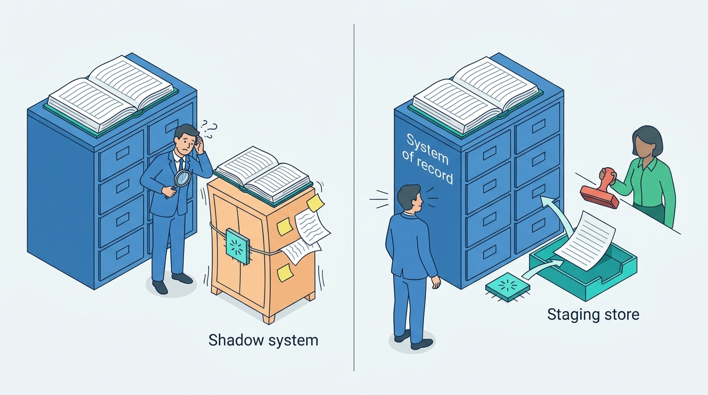
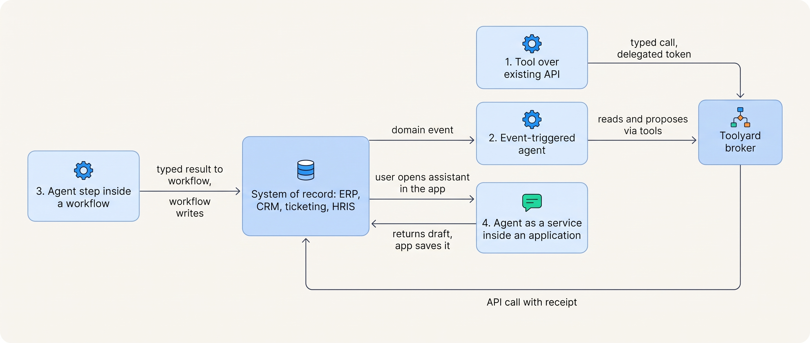
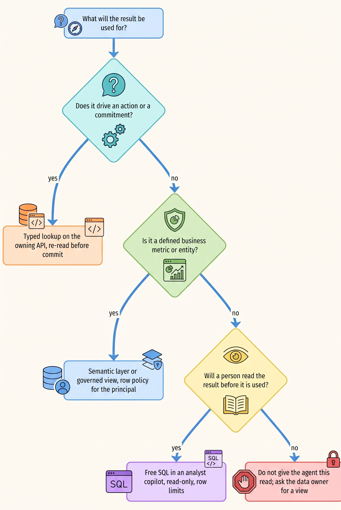
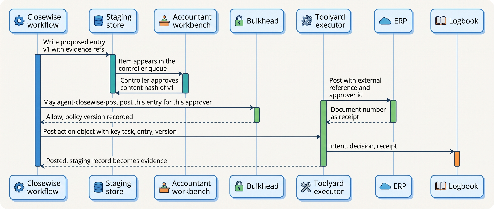
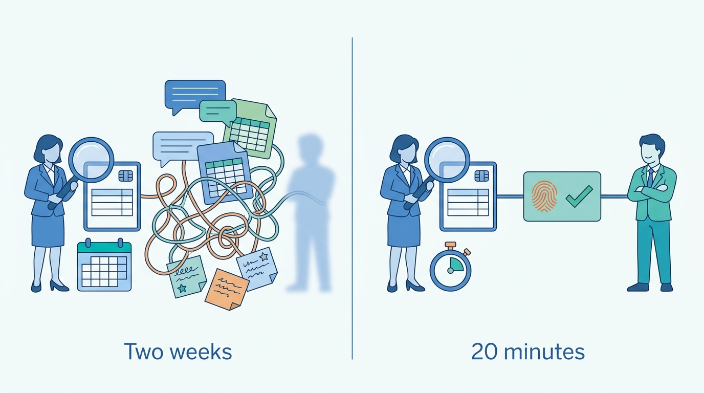

> **IN THIS CHAPTER, YOU WILL:** Learn the four patterns by which an agent attaches to an existing system of record, how to give agents governed read access to applications and the data platform, how agent writes reach a system of record through a staging store and an executor, how identity and accountability travel into the systems the agent touches, and how agent work fits the organization's tickets, queues and approval processes.

> **WHY THE BUSINESS CARES:** An agent that keeps its own copy of customers, entries or promises creates a second version of the truth that auditors, support staff and regulators cannot see. When something goes wrong, the question "who did this, on whose authority, and where is the record?" has to be answerable in the enterprise resource planning (ERP) system, the customer relationship management (CRM) system and the ticketing system the business already trusts, not in a prototype's database.

> **WHY ARCHITECTS SHOULD CARE:** Most of an enterprise agent is integration. The decisions in this chapter (which systems the agent may call and how, where its drafts live, which identity appears in the target system's audit trail, which queue its work lands in) decide whether the agent strengthens the existing architecture or quietly forks it.

> **KEY POINTS:**
>
> * **The system of record stays authoritative; the agent owns only its drafts and its evidence.** An agent reads through the owning application's API or a governed view, writes only through an approved action object executed by deterministic code, and keeps no durable copy of business state that someone else could start to rely on. A staging store for proposals is allowed; a shadow ledger, ticket list or customer table is not.
> * **Reads need governance as much as writes.** Free SQL over a warehouse fails often on realistic enterprise schemas, and agents show little native respect for confidentiality, so the permission boundary has to sit below the prompt: typed lookups for facts that drive actions, governed views and a semantic layer for analysis, the target system's own row-level authorization through a token that names the agent and the human.
> * **Integrate into the organization, not only into its systems.** Agent work must arrive in the queues people already work (tickets, workbench approvals, CRM tasks), every agent-generated artifact must have a named accountable human, and the target system's audit trail must show "agent A for person P". A service account that posts entries or closes tickets "as itself" fails the audit, whatever the agent's accuracy.

> **[FAILURE PATTERNS THIS CHAPTER ADDRESSES](where-agentic-systems-go-wrong.html):**
>
> * **Ambient Authority** — agents connected to the ERP, CRM or ticketing system through shared integration users hold far more rights than any task needs, and the target system's audit trail cannot say who approved what.
> * **The Fire-and-Forget Action** — writes into systems of record without receipts, version checks or reconciliation leave the agent's view and the system's view diverging, with humans editing the same records in between.
> * **The Lost Handoff** — work the agent cannot finish lands in its own store or a free-text message instead of the organization's queues, so promises to customers and pending approvals become invisible to the people who own them.

<br>
Enterprise agents do not work in a vacuum. Answerdesk answers customers whose contracts live in a service-contract system and whose cases live in a ticketing system. Closewise proposes entries for a ledger that belongs to the ERP system, auditors and the controller. The agent is a new kind of client of systems that already have owners, data models, authorization rules, audit trails and the people who use them every day.

The easiest way to build an agent ignores all of that. It reads the database directly, copies what it needs into its own store, writes back with a service account and tracks its own work in its own tables. The prototype works, and **the agent becomes a parallel shadow system**: a second place where customers, entries, promises and approvals live, which nobody outside the agent team can see or audit. The rest of this chapter is about the opposite design, in which **the existing systems remain authoritative and the agent integrates the way any well-behaved application would**, plus the few things that are different because the client proposes its next action.

This chapter owns three terms: the **system of record** in its agent context, the **agent integration pattern** and **governed data access**. It builds on [[agentic-reference-architecture]], which places the tool broker and policy enforcement point, and on [[tool-ecosystems-and-mcp]], which explains how tools are brokered. It hands delegated identity in depth to [[agent-identity-and-least-privilege]], the design of side-effecting actions to [[side-effects-and-external-actions]], and freshness of what agents read to [[provenance-and-freshness]].

## Setting the Scene at Ostrell: The Agent That Kept Its Own Books

Ostrell, the fictional field-service software group this book follows (see [[meet-ostrell]]), entered 2027 with seven agent prototypes built by seven teams. In **February 2027**, during fieldwork for the 2026 year-end audit, the external auditors sampled journal entries from Ostrell Field Deutschland GmbH. **40** of the sampled accrual entries had been posted by an ERP user called `svc_close_auto`, the integration account of the Closewise prototype. The ERP showed that this account had created and posted each entry. It could not show who had approved them.

The approvals existed, mostly. Closewise's prototype kept its proposals and approval flags in its own database, fed by a nightly copy of ERP tables from a reporting replica. Controllers approved in a spreadsheet export or by replying in a chat channel; a script then posted the approved rows. For **9** of the 40 entries the only approval evidence was a chat message; for **2** the team could not find any. The auditors recorded a control deficiency in the management letter (not material): the posting identity could both create and post, and approval evidence sat outside the system of record (Ostrell figures, fictional). A month earlier, the Half-Posted Accrual had shown what happens when that script crashes mid-batch ([[task-state-and-checkpoints]]).

Support had the same shape of problem with a different system. The Answerdesk prototype stored each conversation and its outcome in its own conversation store. When it told a customer "a colleague will call you back about the invoice", it wrote a follow-up record there, not a task in the ticketing system. In January 2027 Lena Brandt's team found about **2,300** open follow-ups in Answerdesk's store that no support agent could see, some of them three weeks old.

Amara Okafor's inventory of how the prototypes reached the business systems read like this (Ostrell figures, fictional):

| Prototype | System of record | How it read | How it wrote | Identity in the target system | Agent-owned business state |
| --- | --- | --- | --- | --- | --- |
| Closewise | ERP | Nightly copy from the ERP reporting replica | ERP posting API via a script | `svc_close_auto`, create and post rights | Proposals, approvals, entity status |
| Answerdesk | Ticketing system; service-contract system | Ticketing API; contract database view | Ticketing API | One shared integration user for all writes | Conversation outcomes, follow-ups |
| Dealroom | CRM; price book | CRM API; price index built from an export | CRM notes and draft quotes | A CRM admin integration user | Account briefs |
| Peoplepoint | HR information system (HRIS) | Nightly extract of employee records | None (leave requests by email to HR) | Extract job's database user | Copy of employee records |
| Clausewise | Contract-lifecycle-management (CLM) tool | Plugin API | Redlines in the CLM | The lawyer's own session | None |
| Scout | Data warehouse; web | Warehouse user with access to raw schemas | Reports in a document space | One shared warehouse user | Report drafts |
| Forge | Code hosting and CI | Repository clone | Pull requests | A bot token | None |

Only Clausewise and Forge were integrated the way the owning teams would have wanted. Tomas Verhoef, Chief Architect, took one question to the architecture forum: **how should agents connect to Ostrell's applications, data platform and processes so that each system of record stays the single truth, its owners keep control of access, and an auditor can follow any agent action from the record back to a person?**

## Concepts: Systems of Record and the Shadow System

A **system of record** is the application that holds the authoritative version of an entity and is accountable for it: the ERP for journal entries and periods, the ticketing system for support cases, the CRM for accounts and quotes, the HRIS for employment data. In the agent context the definition adds one test: **if the agent and the system of record disagree, the system of record wins, and the agent's design must make that disagreement visible rather than resolve it silently.** The author's agentic-support-platform interview design states the rule for its own case: when policy and account data disagree, "the account state wins" (*design example*, `agentic-support-platform/interview.json`, step `grounding`).

A **shadow system** is any durable agent-owned store of business state that people or other systems start to rely on: Closewise's approval flags, Answerdesk's follow-ups, Peoplepoint's copy of employee records. It grows because the agent needs somewhere to keep things between steps. The cure is a sharp line between three kinds of state the agent may keep ([[task-state-and-checkpoints]] owns the first) and the business state it may not.

| State | Where it lives | Who may rely on it | Example at Ostrell |
| --- | --- | --- | --- |
| **Task state** | Keelson Runtime's durable task record | The runtime, for resume and audit | Plan, step records, action intents with receipts |
| **Staging store** | A store owned by the agent's product team, separate from the system of record | The approvers, until approval; nobody afterwards | Closewise's proposed entries awaiting a controller |
| **Evidence** | Logbook, the append-only evidence log | Auditors, investigators, evaluation | Context references, tool calls, approvals, receipts |
| **Business state** | The system of record only | Everybody | Posted entries, tickets, tasks, quotes, employee records |

An **agent integration pattern** is the way an agent run attaches to a system of record: who starts the run, who owns the state while it runs, how the result reaches the system and under which identity. **Governed data access** is read access that goes through an interface the data owner controls (an application API, a governed view, a semantic layer) with authorization evaluated for the principal the agent acts for, rather than through a broad database or warehouse account.

Five invariants follow, and Ostrell adopted them in **March 2027** as the Keelson system-of-record rule:


**Figure 1:** *A shadow system is agent-owned business state that people start to rely on; in the redesign the agent keeps only drafts in a staging store, and approved results live only in the system of record.*

1. **Agents are clients of APIs and governed views, never of operational databases or replicas.** The owning team's interface is where its invariants, authorization and audit live.
2. **Agents write business state only through an approved action object executed by deterministic code** (an executor in Keelson Runtime or Toolyard), with an idempotency key and a receipt ([[side-effects-and-external-actions]]).
3. **Agent drafts live in a staging store until approved; approved results live only in the system of record.** After approval, the staging record is evidence, not truth.
4. **The target system's audit trail names the agent and the human principal.** No shared integration users.
5. **Work the agent hands to people lands in the queue those people already work.** A follow-up is a ticket task; an approval is a workbench item; a quote is a CRM draft.

## Four Ways an Agent Attaches to a System of Record

The four integration patterns differ in who holds control. Most enterprise agents use more than one: Answerdesk is triggered by events, uses tools over existing APIs and hands work back through the ticketing system.


**Figure 2:** *Four agent integration patterns. In every one the system of record keeps its API and its authorization; what changes is who starts the run and who carries the result back.*

**Pattern 1: tool over an existing API.** The system's owning team exposes typed operations as a Model Context Protocol (MCP) server behind Toolyard (`get_ticket`, `add_ticket_task`, `get_contract_terms`); the broker authorizes, injects credentials and records the receipt. This is why [[tool-ecosystems-and-mcp]] organizes servers **per system of record**: the team that understands the ticketing system's invariants writes its tools once, for every agent.

**Pattern 2: event-triggered agent.** The system of record emits a domain event (ticket created, period lock set) and a subscriber starts or signals a run. Events arrive at least once, so the run is keyed by the event id and a redelivery finds the existing run. Events are notifications, not truth: the run re-reads the entity before acting, because a human may have changed it since.

**Pattern 3: agent step inside a workflow.** A durable, deterministic workflow owns the process and its state; the model runs inside bounded steps that return typed results, and the workflow writes to the system of record after the required approvals. Closewise is this pattern ([[workflows-loops-and-autonomous-agents]]). The author's agentic-finance-platform design calls it "the agent harness … pinned to workflow mode", with proposals in a staging store whose invariants are checked before any approval (*design example*, `agentic-finance-platform/interview.json`, steps `ledger` and `pipeline`). A business-process-management engine can play the workflow's role.

**Pattern 4: agent as a service inside an application.** The application owns the interface, the record and the save; the agent returns a draft and the application stores it under the user's action. A Clausewise redline is accepted by a lawyer in the CLM; a Dealroom quote is sent by an account executive from the CRM. Accountability is clear, but the agent's own evidence (context, tool calls, model version) lives outside the application unless the platform records it.

| | Tool over API | Event-triggered | Step inside a workflow | Service inside an application |
| --- | --- | --- | --- | --- |
| **Who starts the run** | A user or another run | The system of record's event | The workflow's schedule or state | A user in the application |
| **Who owns state during the run** | Keelson task record | Keelson task record keyed by event id | The workflow | The application, plus the task record |
| **Who writes business state** | Executor via Toolyard, after policy and approval | Executor via Toolyard | Workflow code after approval | The application, on the user's action |
| **Identity in the target system** | Agent on behalf of the requesting user | Agent on behalf of the record's owner or a named queue | Agent identity for the duty, with approver recorded | The user's session, with agent assistance recorded |
| **Typical failure** | Over-broad tools, blind retries | Duplicate runs, acting on a stale event | Model step blocks the process | Agent evidence missing from the record |
| **Right when** | Interactive tasks with a few typed actions | Work that starts from a record change | Calendar- or rule-driven processes with fixed approvals | The human who owns the outcome already works in that application |
| **Ostrell** | Answerdesk's ticket and contract tools | Answerdesk on inbound email tickets | Closewise and the month-end close | Clausewise, Dealroom |

When the process is defined by a calendar, a control framework or a sequence of approvals, put the agent inside the workflow; when it is defined by a person's judgement in a tool they already use, put the agent inside that tool. A third interface, a separate "agent app" where controllers or lawyers must go to see what the agent did, is the most common way a shadow system starts.

### The system-of-record integration record

Each system of record that agents may touch gets one record in the Agent Registry, maintained by the owning team and reviewed by the Agent Platform team. It is the contract the four patterns rely on:

```typescript
// One per system of record; reviewed by its owning team and Agent Platform.
interface SystemOfRecordIntegration {
  system: "erp" | "ticketing" | "crm" | "hris" | "clm" | "warehouse" | string;
  owner: TeamRef;                      // accountable for tools, scopes and data classes
  entities: EntityContract[];          // which entities agents may read or write
  readInterfaces: ("api" | "governed_view" | "semantic_layer")[];
  writeOperations: {
    tool: string;                      // e.g. "erp.post_journal_entry"
    requiresActionObject: true;        // never a free-form write
    idempotencySupport: "native_key" | "business_key" | "none";
    receiptLookup: string | null;      // how an unknown outcome is resolved
    versionCheck: "if_match" | "compare_fields" | "none";
  }[];
  identityMode: "delegated_token" | "named_agent_user" | "user_session";
  auditFields: string[];               // where agent id, approver and run id land in the target
  events?: { name: string; deliveryGuarantee: "at_least_once"; dedupeKey: string }[];
  rateLimits: { perTenant?: number; global?: number };
  humanQueues: string[];               // queues where agent hand-offs land
}
```

The fields that teams most often leave blank are `idempotencySupport`, `receiptLookup` and `auditFields`. A write operation without idempotency support or a receipt lookup cannot be retried safely after a timeout, so Toolyard refuses to register it as an agent tool until one exists, even a business key such as the ERP's external document reference ([[retries-idempotency-and-concurrency]]).

## Reading: Governed Data Access

Reads are where shadow systems start, because copying data is the easiest way to make it fast and queryable. They are also where confidentiality fails quietly. The agent needs three kinds of read, and each needs a different interface.

**Facts that drive an action** ("which contract does this ticket belong to?", "what is this entity's accrual balance?") go through typed lookups on the owning application's API, scoped to the principal, with a version or `as_of` in the result. [[retrieval-and-grounding]] makes the case for structured lookup over search; [[provenance-and-freshness]] adds that a fact used to commit must be re-read from the system of record, not from an index or cache.

**Analysis** ("parts order lines per market over the last eight quarters", "how many credits above €250 did we issue in Q3?") goes through **governed views** (warehouse views whose columns, joins and row filters the data owner defines) and a **semantic layer**, a governed definition of metrics and dimensions that tools query by name rather than by SQL. A semantic-layer tool looks like `query_metric(metric, dimensions, filters, as_of)`: the agent chooses a metric and a breakdown; the layer compiles the SQL, applies row-level policy and returns the definition version with the numbers.

**Free SQL** against the warehouse is the widest read interface there is. It belongs with analyst copilots whose output a person reads before it informs anything, not with agents whose output feeds an action.

The evidence supports the caution, with limits. On Spider 2.0, 632 text-to-SQL workflows from real enterprise databases, a code-agent framework built on a 2024 reasoning model solved **21.3%** of tasks, against **91.2%** on Spider 1.0 and **73.0%** on BIRD ([Lei et al., 2024](https://arxiv.org/abs/2411.07763), ICLR 2025); the absolute numbers will move with newer models, the gap between toy and enterprise schemas is the durable lesson. Sequeda, Allemang and Jacob asked a 2023 frontier model enterprise questions over one insurance schema: about **16%** accuracy zero-shot against the SQL schema, about **54%** against a knowledge-graph layer with an ontology and mappings ([Sequeda et al., 2023](https://arxiv.org/abs/2311.07509), preprint by a vendor of such tooling). The narrower lesson: **a governed layer that encodes business meaning does more for correctness than a better prompt over raw tables.**

Confidentiality is a separate problem. CRMArena-Pro, a benchmark of business tasks in simulated CRM organizations, found "near-zero inherent confidentiality awareness" in leading 2025 agents, and the best model it tested fell from about 58% single-turn to about 35% multi-turn success ([Huang et al., 2025](https://arxiv.org/abs/2505.18878), preprint from a CRM vendor's lab). OWASP's matching control is to run extensions "in the user's context" with minimum privileges ([OWASP LLM06:2025](https://genai.owasp.org/llmrisk/llm062025-excessive-agency/)). The author's agentic-hr-platform design compares three ways to keep an employee's question from reaching another employee's record (prompt instruction, retrieval filter, token-scoped service boundary) and recommends the last, because "the token simply can't fetch another record", while a filter bug "is a silent cross-record leak" (*design example*, `agentic-hr-platform/interview.json`, step `privacy`).


**Figure 3:** *Choosing the read interface. The more an agent's read drives what happens next, the narrower and more governed the interface must be.*

| Read interface | Who defines meaning | Where authorization is enforced | Freshness | Main risk | Right for |
| --- | --- | --- | --- | --- | --- |
| **Typed lookup on the application API** | The owning team | The application, for the delegated principal | Live | Too many narrow tools ([[tool-ecosystems-and-mcp]]) | Facts that drive actions |
| **Governed view** | The data owner | Warehouse row and column policy | Pipeline lag, minutes to a day | Stale data used to act | Analysis over many records |
| **Semantic layer** | Metric owners | The layer's policy plus the warehouse | Pipeline lag | Metric missing, so the agent improvises | Business questions with defined answers |
| **Free SQL, read-only** | Nobody; the model | Warehouse grants only | Pipeline lag | Wrong joins, confident wrong numbers, over-broad reads | Analyst copilots with human review |
| **Copy into the agent's own store** | The agent team | The agent's code | Whatever the copy job achieves | A shadow system | Never, except caches with a source version and TTL ([[caching-and-context-budgets]]) |

## Writing: Staging Store, Executor and Reconciliation

An agent's write differs from an ordinary integration's in three ways: the payload came from a component whose proposals vary, the approval may come hours later, and humans keep editing the same records in between. The author's back-office interview designs converge on one spine for all three: **staging store → gate → executor → system of record → reconciler → evidence** (*design example*, `agentic-finance-platform/interview.json`, steps `ledger`, `maker-checker` and `idempotency`; the legal and HR designs share it).

The **staging store** holds proposals as versioned records with their evidence by reference and the manifest hash of the agent version that produced them. It checks the target's invariants early (balanced lines, valid accounts, open period), so approvers never see a proposal the ERP would reject. A correction is a new version and voids any approval of the old one. That is the book's approval model, developed in [[human-oversight-and-bounded-autonomy]]: an approval binds the exact content hash of the action and expires when the action, the policy or the evidence changes.

The **executor** is deterministic code that takes an approved action object and calls the system of record with the agent's delegated identity, an idempotency key and a version precondition. It is never the model, and never the identity broker or the policy engine: Bulkhead decides, Toolyard executes. The finance interview design draws its identity broker as the component that posts; the book does not adopt that shortcut, because it puts the authority to decide and the means to act in one component.

The **reconciler** closes the loop with a system that others also write. It handles three cases: a timeout with no receipt (look up by idempotency key; if still unknown, a repair queue, never a blind retry), an asynchronous outcome (a callback deduplicated by event id), and drift (a human edited or reversed the record after the agent wrote it). Drift is not an error; it is the system of record doing its job. The agent's task record marks the action as superseded and the evidence keeps both versions.


**Figure 4:** *Closewise's write path into the ERP. The model's output stops at the staging store; the posting is a deterministic call under a named agent identity, keyed for retry and carrying the approver into the ERP's own record.*

Two rules about the system of record's data model belong here, because teams get them wrong in both directions.

**Do not clobber what people curate.** When an agent enriches or updates a record that humans also maintain (a CRM account's industry, a ticket's priority), write only fields the integration record marks as agent-writable, only when the record has not changed since the agent read it (an `If-Match` version or a compare of the fields read), and never over a field a person set recently. The author's agentic-sales-platform design gives the rule for enrichment: "write only on confidence + freshness thresholds, and resolve conflicts against the CRM's external version" (*design example*, `agentic-sales-platform/interview.json`, step `enrichment`).

**Do not keep in the agent's store what the system lacks a field for.** If the ERP has no place for "approved by", use its extension or reference field, or ask its owners for one. An approval that lives only outside the system of record is the auditors' February finding.

### Requirements per interaction

| Interaction | Consistency | Latency target | Durability | Who may act |
| --- | --- | --- | --- | --- |
| Fact lookup that drives an action | Live read from the system of record; version or `as_of` returned | p95 under 300 ms *(assumption)* | Context manifest records source and version | Model proposes; Toolyard enforces scope for the delegated principal |
| Analytical read through the semantic layer | Snapshot as of the pipeline's last load, stated in the result | Seconds | Metric definition version in Logbook | Model proposes; row policy for the principal |
| Write proposal to staging store | Serializable per proposal; versions only move forward | Under 1 s | Durable before the approver sees it | Agent run |
| Execute an approved write | Exactly-once effect: idempotency key plus receipt; version precondition | Dominated by the target; async for batch postings | Intent before the call, receipt after | Executor under the agent identity; approval bound to content hash |
| Hand-off to a human queue | Task created in the target system before the agent tells anyone it exists | Before the agent's reply is sent | The queue item is the record | Agent via tool; human owner thereafter |

## Identity in the Target System

Auditors, support leads and regulators read the system of record's own audit trail first, and it will say whatever identity the agent called it with. [[agent-identity-and-least-privilege]] owns the mechanics; this section covers the integration decision.

| Option | What the target's audit trail shows | Problem | When acceptable |
| --- | --- | --- | --- |
| **Shared integration user** | "integration user did X" | Ambient authority: every agent and task holds the union of rights; no human; segregation of duties impossible | Never for agents that write |
| **Impersonation with the user's token** | "user U did X" | The agent's involvement is invisible; the agent can do anything U can | Pattern 4 drafts saved by U's explicit action |
| **Delegated token** | "agent A did X for user U" | The target must understand delegation | The default where the target validates tokens |
| **Named agent user per agent and duty** | "agent-closewise-post did X", approver in a reference field | Licence and role management; human recorded by convention, not by protocol | Legacy systems that only understand user accounts |

Delegation is the standard shape: OAuth 2.0 Token Exchange distinguishes impersonation, where A receives "all the rights that B has", from delegation, where A "still has its own identity separate from B", and records the acting party in an `act` claim ([RFC 8693](https://www.rfc-editor.org/rfc/rfc8693.html), 2020). The 2026-07-28 revision of MCP requires servers to accept only tokens issued for them as audience and forbids passing other tokens through ([MCP Authorization, 2026](https://modelcontextprotocol.io/specification/2026-07-28/basic/authorization)); its security guidance names token passthrough because downstream logs then show the wrong identity ([MCP Security Best Practices, accessed 2026-10](https://modelcontextprotocol.io/docs/2026-07-28/tutorials/security/security_best_practices)). Identity vendors have started to ship agent identities as a distinct type; Microsoft's Entra Agent ID documentation describes delegated access and an optional one-to-one "agent user account" for systems that require a user identity ([Microsoft, updated 2026-06-15](https://learn.microsoft.com/en-us/entra/agent-id/what-are-agent-identities)). Product details are volatile; the shape is not.

Most ERPs and many HR systems will not validate a delegated token in 2027, so the fourth row is the realistic one for Closewise. Two disciplines make it acceptable. **One named agent user per duty, with non-overlapping roles**: a user that can create entries must not be able to post or approve them. US law does not name segregation of duties; section 404 of the Sarbanes-Oxley Act (SOX) requires management to assess "an adequate internal control structure" ([15 U.S.C. 7262](https://www.law.cornell.edu/uscode/text/15/7262)), and the duty split comes from the control frameworks auditors use to assess it. An agent that can both propose and post collapses two duties into one identity whatever the prompt says. **The human travels with the call**: the executor writes the approver's identity and the Keelson run id into the target's reference fields, and Logbook holds the full delegation chain. The finance interview design states the requirement: the agent "acts as an automated maker that proposes" and "the maker can never also be the checker", enforced in identity "not by policy hope" (*design example*, `agentic-finance-platform/interview.json`, step `maker-checker`).

## Process Integration: Queues, Approvals and Ownership

An agent changes who does a piece of work, not the organization's need to know who owns it, where it waits and when it is late. That knowledge lives in ticket queues with service levels, workbench approvals, CRM tasks and HR cases. **Make the agent a participant in those processes, not a replacement for them.** Three consequences follow.

**Hand-offs are records in the target's queue.** Answerdesk's escalation is a ticket assignment to a support queue with a structured escalation package (verified customer, contract, what was tried, what was promised), not a message in a chat channel ([[agent-interaction-design]] designs the package; [[coordination-and-handoffs]] the payload). Its follow-up promise is a ticket task with a due date. The order matters: the task exists in the ticketing system **before** the agent tells the customer someone will call. While a human owns the ticket, Toolyard refuses Answerdesk's write tools; the agent may read and draft, not act. The author's support design reaches the same rule: "Identity won't mint a scoped token while a handoff is open" (*design example*, `agentic-support-platform/interview.json`, step `escalation`).

**Approvals happen where approvers already work and in the volume they can sustain.** Closewise's proposals appear in the accountants' workbench, next to the ERP data they check against. The approval queue is a capacity constraint: about 1,900 proposals a month across 23 entities is a sizeable share of the controllers' close work. The finance interview design's rule applies: backlog is handled by queueing and temporary reviewers and "never auto-posts to clear backlog" (*design example*, `agentic-finance-platform/interview.json`, `capacity`). [[human-oversight-and-bounded-autonomy]] owns the design of the gate itself.

**Every agent-generated artifact has a named accountable human.** The organization owns what its agent says and does. In Moffatt v. Air Canada (February 2024), a British Columbia tribunal held the airline liable for a chatbot's wrong statement of its bereavement-fare policy and rejected the argument that the chatbot was responsible for its own actions ([MLT Aikins summary, 2024](https://www.mltaikins.com/insights/that-wasnt-me-that-was-my-chatbot); a small-claims decision, and it is not public whether the chatbot used a language model). In Mata v. Avianca (June 2023), the court sanctioned lawyers who filed fabricated citations and reminded them that existing rules "impose a gatekeeping role on attorneys to ensure the accuracy of their filings" ([S.D.N.Y. opinion, 2023](https://storage.courtlistener.com/recap/gov.uscourts.nysd.575368/gov.uscourts.nysd.575368.54.0.pdf)). Both point to one design rule: the system of record must name, for each agent artifact, the person or role accountable for it (the approving controller, the sending account executive, the accepting lawyer, the queue that owns the ticket).

A responsibility matrix for Closewise after the redesign makes the split explicit:

| Activity | Closewise agent | Workflow and executor | Accountant | Controller (Joost Vermeer's team) | Agent Platform | ERP owner (Finance Systems) |
| --- | --- | --- | --- | --- | --- | --- |
| Draft reconciliations and proposed entries | Responsible | | Consulted | Accountable | | |
| Approve an entry | | | | Responsible and accountable | | |
| Post to the ERP | | Responsible | | Accountable | Consulted | Consulted |
| ERP roles of the agent users | | | | Consulted | Responsible | Accountable |
| Reconcile `unknown` postings | | Responsible | Informed | Accountable | Consulted | |
| Answer an auditor's sample request | | | | Accountable | Responsible (Logbook query) | Consulted |

Organizational fit also has formal steps. Under Article 26(7) of the EU AI Act, employers deploying a high-risk system at the workplace must inform workers' representatives and affected workers before use ([Regulation (EU) 2024/1689](http://publications.europa.eu/resource/celex/32024R1689)); after the Digital Omnibus, Annex III obligations apply from **2 December 2027** ([Regulation (EU) 2026/1744](http://publications.europa.eu/resource/celex/32026R1744)). Ostrell's documented assessment treats Peoplepoint's helpdesk as not high-risk ([[policy-enforcement-and-audit]]); anything that ranks or evaluates employees would be an Annex III use. I treat works-council consultation as a launch gate for any agent that changes what employees do or how they are assessed.

**Where the evidence stops.** The read-interface studies measure text-to-SQL and simulated CRM tasks, not agents acting on results in production. No published study measures whether delegated agent identities reduce incidents or audit findings, and I found no evaluation that compares the four integration patterns on reliability, cost or audit outcomes. The pattern recommendations are the author's judgement, drawn from ordinary enterprise-integration practice and the interview designs.

## Worked Example at Ostrell: Closewise and the ERP, Answerdesk and the Ticketing System

### Closewise after April 2027

When Closewise moved onto Keelson Runtime in **April 2027**, the integration changed with it:

| Before (2026 prototype) | After (from April 2027) |
| --- | --- |
| Nightly copy of ERP tables from the reporting replica | Typed ERP tools for balances, open items and periods; governed warehouse views for history, both via Toolyard |
| Proposals and approval flags in the agent's own database | Proposals in a staging store owned by Finance Systems; approvals in the accountants' workbench, bound to content hashes |
| Script posts with `svc_close_auto` (create and post rights) | Workflow executor posts as `agent-closewise-post`, which can post only entries carrying an approval reference and cannot create vendors, change periods or approve |
| Approver visible only in chat or spreadsheets | Approver id and Keelson run id in the ERP entry's reference fields; full chain in Logbook |
| No idempotency on postings | Idempotency key = task id + entry id + entry version, held in the ERP's external reference field |

A second named user, `agent-closewise-read`, holds read-only ERP roles for the drafting steps. Agent Platform owns both users' role assignments; Finance Systems approves every change to them, and the quarterly entitlement review covers them like any other privileged account.

The September 2027 close, described in [[durable-agent-execution]], produced **1,912** proposed entries, of which **164** were for Ostrell Field Deutschland GmbH. In **November 2027** internal audit repeated the external auditors' February test on that entity: **60** sampled entries posted by `agent-closewise-post`, each with an approval record bound to the content hash of the version posted, the approver's identity, the evidence the approver was shown and the agent version manifest. Finding them took one Logbook query joined on the ERP's external reference, about **20 minutes** of work instead of the **two weeks** of chat archaeology in February (Ostrell figures, fictional). No exceptions were found.


**Figure 5:** *With the approver and run id carried into the ERP entry, internal audit traced 60 sampled postings with one Logbook query in about 20 minutes, against two weeks of chat archaeology in February.*

One integration gap surfaced on the way. The ERP's reference field holds 40 characters, too short for both the idempotency key and the approver id. Finance Systems added a custom field rather than truncating either; the Closewise team had first proposed keeping the approver only in Logbook, and the architecture forum rejected that as the February finding in a new form.

### Answerdesk and the ticketing system

Answerdesk handles about **7,100** conversations a day. Its end-to-end resolution rate was **41%** in Q3 2027, and **33%** of conversations escalate to human support staff, about **2,300** a day. Each escalation is a ticket assignment in the ticketing system, not a record in Keelson:

1. The intake router selects a route ([[routing-and-delegation]]); inbound email arrives as a ticket-created event, keyed by ticket id, so a redelivered event joins the existing run.
2. Answerdesk reads the ticket, the verified customer and the contract through typed tools owned by the Support Systems and Assure teams. It holds no copy of either beyond its task record and the context manifest ([[context-engineering]]).
3. If it promises a callback, it first calls `add_ticket_task(ticket_id, kind, due_at)`; only after the receipt does it tell the customer.
4. On escalation it writes the escalation package to the ticket and reassigns it to the queue chosen by the route. From that moment Toolyard refuses Answerdesk's write tools on that ticket.
5. Every write carries the agent identity with the conversation's verified customer as subject; the ticket's history shows "Answerdesk (agent) for customer C" rather than a shared integration user.

The 2,300 orphaned follow-ups were migrated into the ticketing system as tasks and triaged by Lena Brandt's team leads within a week; the prototype's table was deleted. Toolyard's registry review now fails any agent manifest that writes to a store other than a system of record, a registered staging store, or Keelson's task and evidence stores.

## Failure Modes and Recovery

| Scenario | What happens | Detection | Containment | Recovery |
| --- | --- | --- | --- | --- |
| **Human edits after the agent read** | A controller manually adjusts an entry the agent is about to supersede | Version precondition fails at the executor | Write refused; approval void | Agent re-reads and proposes a new version, or the item goes to the accountant |
| **System of record unavailable** | The ERP is down during the posting window | Executor errors and circuit breaker | Approved actions held in the workflow, not dropped; no "post later from cache" | Resume when the ERP returns; reconcile any `unknown` by external reference |
| **API change by the owning team** | The CRM team renames a field in its API | Contract tests in Toolyard's server release; Sounding tool suites | Old server version stays pinned for running agent versions | Owning team ships a new tool version; agent versions migrate through evaluation ([[versioning-agent-systems]]) |
| **Over-granted agent user** | An ERP role change gives `agent-closewise-post` vendor-maintenance rights | Quarterly entitlement review; segregation-of-duties rule check in the ERP's access tool | Bulkhead still limits the executor to posting tools; the ERP role is the second line | Role reverted; Logbook query confirms no other operation was used |
| **Stale governed view used to act** | A warehouse view behind by a failed load feeds a quote | Stale-at-use rate and index lag in Wake ([[provenance-and-freshness]]) | Commit path re-reads from the system of record | Repair the load; list affected drafts from provenance envelopes |
| **Shadow store regrows** | A team adds a "temporary" cache of customer records to speed up its agent | Registry review of manifests; data-catalog scan for agent-owned tables | Release check fails for unregistered stores | Replace with a TTL cache keyed by source version, or a governed view |
| **Orphaned hand-off** | An escalation is assigned to a queue that was retired in a support reorganization | Queue-age service-level agreement (SLA) alerts in the ticketing system | Integration record's `humanQueues` validated against the ticketing system daily | Reassign; the route table is updated by Support Operations, not the agent team |

The pattern across the table is that **the system of record's own mechanisms do most of the recovery**: its version checks, its queues and SLAs, its entitlement reviews. An agent integrated as a well-behaved client inherits them; a shadow system has to rebuild each one, and usually does not.

## Trade-offs

Two decisions recur in every enterprise agent: where the agent's work lives, and whose agent it is.

| Option | Strength | Cost | When it is right |
| --- | --- | --- | --- |
| **Agent on the platform, system of record via tools** (Ostrell's default) | One identity model, evidence log, evaluation and policy across all systems; the system of record stays authoritative | Integration work per system; the owning team must expose and maintain tools | The agent spans several systems, or acts with consequence |
| **Vendor's embedded agent inside the SaaS system** | Native access to the data model, UI and permissions; little integration | Evidence, evaluation and policy live in the vendor's product; cross-system tasks need a second agent; vendor terms on data use | The task stays inside one application and its consequences are covered by the vendor's controls |
| **Agent with its own store and synchronization** | Fast to build; queryable; independent of the system's API limits | A shadow system: divergence, invisible state, audit gaps, a second set of access rules | A throwaway prototype on test data |
| **Agent writes directly to the database** | No API needed | Bypasses the application's invariants, authorization and audit trail | Never in production |

An agent that spans the CRM, the contract system and the ticketing system (Answerdesk) needs the platform; an agent that helps one professional inside one application (Clausewise) could be a vendor's embedded feature, provided its evidence reaches Logbook. My recommendation assumes more than a handful of agents, systems of record that carry financial, contractual or personal data, and an audit function that will ask. A single team with one agent over one SaaS application, low consequence and no regulated data, can sensibly start with the vendor's embedded agent and skip most of this chapter, as long as it writes nothing anyone else will rely on.

## Across Domains: How the Stakes Change the Design

| Dimension | Coding agents | Customer operations (support, sales, marketing) | Back office (finance, legal, HR) | High-stakes decisions (healthcare, public benefits) |
| --- | --- | --- | --- | --- |
| **System of record** | Repository and CI; the merged branch | CRM, ticketing, billing, consent and suppression lists | ERP and ledger, CLM and document management, HRIS | Electronic health record; case-management and benefit-payment systems |
| **Dominant integration pattern** | Agent as service inside the developer loop; headless runs ending in a pull request | Tool over API plus event triggers, under a per-exchange latency budget | Agent step inside a workflow, writing to a staging store | Workflow with a rules engine; the agent drafts into a case record |
| **Where agent output waits** | A branch and an open pull request | Draft quote, pending credit, ticket task | Staging store of proposals, redlines, recommendations | Recommendation case awaiting a clinician or caseworker |
| **Identity in the target** | Bot or agent identity with repository-scoped token; humans merge | Agent for the verified customer; sends as the account executive only after approval | Named agent user per duty; approver recorded in the target | Write only under the licensed clinician's or caseworker's sign-off |
| **Read governance** | Repository scope per run | Scope resolved from the verified customer before the first read (support design, step `grounding`) | Ethical walls, personal-data (PII) scope by token, governed finance views | Care-team or case scope, minimum-necessary access, break-glass audited |
| **Hand-off to people** | Pull-request review queue | Support queues with SLA; CRM owner, not campaign owner (sales design, step `handoff`) | Workbench approval queues sized to reviewer capacity | Worklists with SLA; every adverse outcome to a human |
| **What the target's audit must show** | Agent run that authored each commit | Who promised what to which customer | Maker, checker and the version approved | The professional who decided, and the AI system's role in it |

The author's healthcare design is the back-office spine with a stricter gate: the electronic health record is both grounding source and action surface, and a write happens only after clinician sign-off, with a case-version check and an explicit `ehr_write_failed` state (*design example*, `agentic-healthcare-platform/interview.json`, steps `gate` and `privacy`).

The platform can keep common the integration record, the read-interface ladder, the staging store, executor and reconciler, agent identities in target audit trails, hand-offs into the target's queues, and the evidence log. Domain policy decides which agent identity holds which roles, which fields are agent-writable, who the accountable human is, and which writes need which approver.

## The Chief Architect's View

The decisions I would insist on making explicitly, and early:

- **A written system-of-record rule**, adopted before the second agent ships: agents read through APIs and governed views, write through approved action objects, keep no business state, and appear in target audit trails as themselves. It costs nothing to adopt early and a great deal to retrofit.
- **The owning team owns the agent tools for its system.** The ERP team decides what agents may do to the ERP, writes and maintains those tools and approves the agent users' roles. The agent platform provides the broker, identity and evidence. If the owning team will not take this on, the agent should not write to that system yet.
- **A named accountable human for every agent artifact**, recorded in the system of record, not in a slide.
- **Process owners sign off integration into their queues.** Support Operations owns the escalation routes; Finance owns the approval workbench. An agent team that adds a queue, or bypasses one, has changed someone else's process.

What to watch: agent-owned tables that are not registered; integration users with more than one duty; queue age for agent hand-offs; the share of agent writes refused by version checks (a rising rate means agents act on stale reads); and audit requests that need anything other than a Logbook query to answer.

What will change: target systems will learn to accept delegated agent tokens and SaaS vendors will ship more embedded agents, so the named-agent-user workaround and some integration code will be thrown away; better models will narrow, not close, the gap between governed and free reads. What will not change with model capability: the system of record is authoritative, its owners control access, and the organization answers "who did this, for whom, approved by whom" from its own records. Build so that a better model makes the agent more useful without giving it a different place to keep the truth.

## Questions to Ask

1. For each system this agent touches, who owns it, and has that team reviewed and taken ownership of the agent's tools?
2. Does the agent keep any durable state other than task state, a registered staging store and evidence? If so, who else relies on it?
3. Which reads drive actions, and do those come from a live read of the system of record or from an index, view or copy?
4. Does the agent use free SQL anywhere? Is a person reading the result before it influences an action?
5. What does the target system's audit trail show for an agent write: the agent, the human, the approver, the run?
6. Can any agent identity both create and approve, or create and post, the same kind of object?
7. When a human edits a record between the agent's read and its write, what happens?
8. Where does a hand-off land, which queue owns it, what is its SLA, and does it exist before the agent tells anyone it does?
9. Who is the named accountable human for each kind of artifact the agent produces?
10. Which formal steps (works council, worker notice, process-owner sign-off) apply before launch?

The integration decides what the agent may touch; the next question is how people meet the agent at all: in a chat, inside an application, as a delegated task or as a hand-off to a person, and what each of those interaction modes demands of the architecture. That is [[agent-interaction-design]].

## Sources and Evidence

### Research papers

- [Spider 2.0: Evaluating Language Models on Real-World Enterprise Text-to-SQL Workflows](https://arxiv.org/abs/2411.07763), Lei et al., ICLR 2025, 2024 — 21.3% on 632 enterprise workflows vs 91.2% on Spider 1.0 and 73.0% on BIRD for the same agent framework.
- [A Benchmark to Understand the Role of Knowledge Graphs on Large Language Model's Accuracy for Question Answering on Enterprise SQL Databases](https://arxiv.org/abs/2311.07509), Sequeda, Allemang and Jacob, arXiv preprint, 2023 — about 16% zero-shot vs 54% with a knowledge-graph contextual layer on one insurance schema.
- [CRMArena-Pro: Holistic Assessment of LLM Agents Across Diverse Business Scenarios and Interactions](https://arxiv.org/abs/2505.18878), Huang et al., arXiv preprint (vendor research lab), 2025 — near-zero inherent confidentiality awareness; about 58% single-turn and 35% multi-turn success for the best tested model.

### Specifications, standards and regulation

- [RFC 8693: OAuth 2.0 Token Exchange](https://www.rfc-editor.org/rfc/rfc8693.html), IETF, 2020 — impersonation vs delegation; the `act` claim.
- [MCP Authorization (2026-07-28)](https://modelcontextprotocol.io/specification/2026-07-28/basic/authorization), MCP project, 2026 — audience-bound tokens; no passthrough.
- [MCP Security Best Practices](https://modelcontextprotocol.io/docs/2026-07-28/tutorials/security/security_best_practices), MCP project, n.d., accessed 2026-10 — token passthrough and the audit damage it causes.
- [OWASP LLM06:2025 Excessive Agency](https://genai.owasp.org/llmrisk/llm062025-excessive-agency/), OWASP, 2025 — run extensions in the user's context with minimum privileges.
- [Regulation (EU) 2024/1689 (AI Act)](http://publications.europa.eu/resource/celex/32024R1689), European Union, 2024 — Article 26(7) worker information; deployer duties.
- [Regulation (EU) 2026/1744 (Digital Omnibus on AI)](http://publications.europa.eu/resource/celex/32026R1744), European Union, 2026 — Annex III obligations from 2 December 2027.
- [15 U.S.C. 7262 (SOX §404)](https://www.law.cornell.edu/uscode/text/15/7262), Legal Information Institute, n.d., accessed 2026-10 — management assessment of internal control; SoD comes from the control frameworks, not the statute.

### Vendor documentation and engineering reports

- [What are agent identities? (Microsoft Entra Agent ID)](https://learn.microsoft.com/en-us/entra/agent-id/what-are-agent-identities), Microsoft, 2025 (updated 2026-06-15) — agent identities as a distinct type; delegated access; agent user accounts for systems that need a user.

### Incidents, cases and decisions

- [Moffatt v. Air Canada, 2024 BCCRT 149, summarized as "That wasn't me, that was my chatbot"](https://www.mltaikins.com/insights/that-wasnt-me-that-was-my-chatbot), MLT Aikins, 2024 — the organization owns its chatbot's statements.
- [Mata v. Avianca, Opinion and Order on Sanctions](https://storage.courtlistener.com/recap/gov.uscourts.nysd.575368/gov.uscourts.nysd.575368.54.0.pdf), U.S. District Court S.D.N.Y., 2023 — the professional's gatekeeping duty for AI-assisted filings.

### Design examples from the author's interview project

- Obrenović, Ž., "Agentic Finance Platform", system-design interview design, `system-design-interviews/data/book/agentic-finance-platform/interview.json`, 2026 — steps `ledger` (propose, don't mutate), `pipeline` (harness in workflow mode), `maker-checker` (agent as maker, never checker), `idempotency`, and `capacity` (never auto-post to clear backlog).
- Obrenović, Ž., "Agentic HR Platform", system-design interview design, `system-design-interviews/data/book/agentic-hr-platform/interview.json`, 2026 — step `privacy` (token-scoped PII boundary vs filter vs prompt) and step `service-eval` (HRIS stays the system of record via reconciliation).
- Obrenović, Ž., "Agentic Support Platform", system-design interview design, `system-design-interviews/data/book/agentic-support-platform/interview.json`, 2026 — step `grounding` (account state wins; scope before first read) and step `escalation` (no token while a handoff is open).
- Obrenović, Ž., "Agentic Sales Platform", system-design interview design, `system-design-interviews/data/book/agentic-sales-platform/interview.json`, 2026 — step `enrichment` (never clobber the CRM; external-version conflict check) and step `handoff` (route to the record owner).
- Obrenović, Ž., "Agentic Healthcare Platform", system-design interview design, `system-design-interviews/data/book/agentic-healthcare-platform/interview.json`, 2026 — steps `gate` and `privacy`: EHR writes only after sign-off, stale-version check, explicit write-failure state.

Ostrell is fictional; architectural recommendations, labeled inferences and labeled assumptions are the author's judgement.
