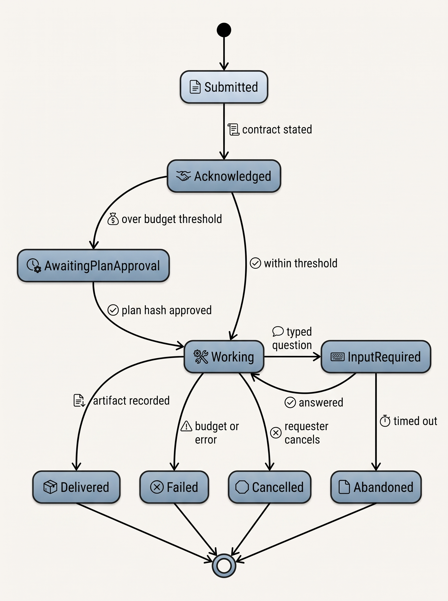
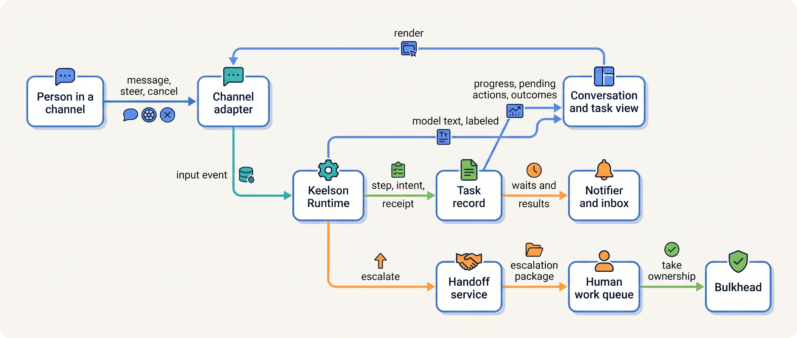
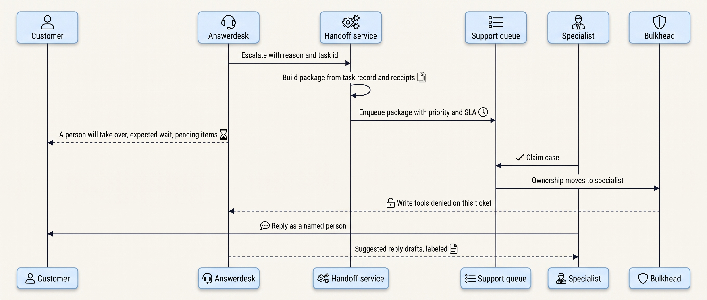
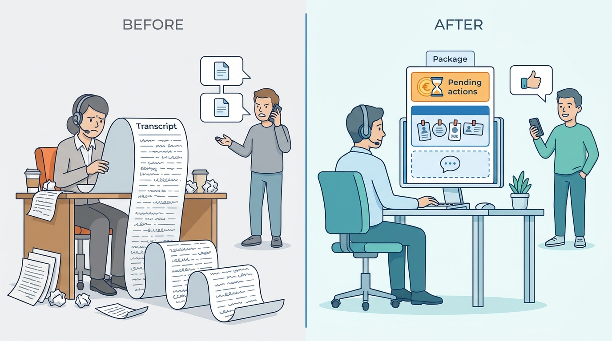
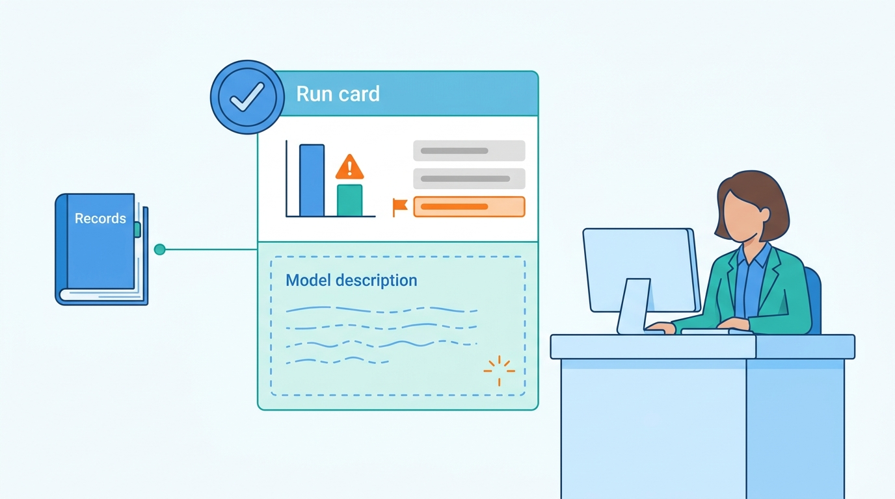

> **IN THIS CHAPTER, YOU WILL:** Learn to choose an interaction mode for each agent (conversational, copilot inline, delegated asynchronous task, background agent, escalation to a human), and to derive the state, latency, notification and authority requirements each mode imposes. You will also learn to design progress, steering, confirmation, disclosure and the escalation package so that the interface tells the truth about what the system is doing.

> **WHY THE BUSINESS CARES:** The interface is where the organization speaks and where customers decide whether to trust it. A tribunal has already held a company liable for what its chatbot said. Every escalation that makes a customer repeat themselves costs staff minutes and goodwill. An agent that reports work done when it is not done turns a model error into a broken promise.

> **WHY ARCHITECTS SHOULD CARE:** Interaction design looks like a front-end concern, but it sets back-end requirements: whether a run needs a durable task record or only a session, whether an approval waits seconds or days, what must be cancellable and at which points, and which component may tell a user that something happened. If these are decided late, they are decided by the chat widget.

> **KEY POINTS:**
>
> * **The interaction mode is an architectural decision, not a skin.** Whether the requester is present, absent or not involved at all decides where state lives, how long a human gate may wait, how progress reaches people and who may cancel. Choose the mode per agent and per action class, and record it.
> * **Render facts from records; let the model write only prose that is labeled as prose.** Progress lines, pending actions, amounts, plans, test counts and "done" come from the task record, receipts and the evidence log, produced by deterministic code. Model text may explain and summarize, but it never announces an outcome the system has not recorded.
> * **An escalation transfers ownership, so it must transfer a typed package and the authority with it.** Build the escalation package from the task record (identifiers, the customer's request, attempts with receipts, pending actions, commitments already made, evidence), add a labeled model summary, and take write authority away from the agent while a person owns the case.

> **[FAILURE PATTERNS THIS CHAPTER ADDRESSES](where-agentic-systems-go-wrong.html):**
>
> * **The Lost Handoff** — escalation to a person is a handoff, and a free-text summary drops identifiers, pending actions and promises already made to the customer.
> * **The Rubber Stamp** — confirmation and approval screens that show the agent's justification instead of the concrete effect teach people to click "yes".
> * **Autonomy by Default** — a mode chosen for convenience (an always-on background agent, a chat that can act) grants autonomy that nobody sized to the consequence of the actions.

<br>
Most writing about agent interfaces is about chat: how the answer streams and how the assistant sounds. Incidents come from elsewhere, from **interaction contracts nobody wrote down**. Is the user still there when the action completes? Who sees the result of a three-hour task? What does "Done" on the screen prove? When a support specialist takes over, does the agent stop acting?

This chapter treats interaction design as the reference architecture's outermost layer and asks **what each way of working with an agent demands of the system behind it**: a state model, a latency budget, a notification path, an authority rule and a place for the human gate.

The chapter owns three terms: the **interaction mode**, the pattern of initiation, presence and result delivery between people and an agent; the **delegated task**, a unit of work a person hands to an agent and leaves; and the **escalation package**, the typed record that travels with work from an agent to a person. It builds on [[agentic-reference-architecture]], which places the interaction surfaces, on [[agent-runtime]], which runs and interrupts the loop, and on [[routing-and-delegation]], whose delegation contract the escalation package renders for a person. It hands approval-gate design in depth to [[human-oversight-and-bounded-autonomy]], latency budgets per mode to [[agent-latency-and-throughput]], and agent-to-agent handoffs to [[coordination-and-handoffs]].

## Setting the Scene at Ostrell: The Customer Who Explained Twice

Ostrell, the fictional field-service software group this book follows (see [[meet-ostrell]]), runs **Answerdesk**, its customer-support agent for Ostrell Field, at about **7,100 conversations a day**. In Q3 2027 Answerdesk resolved **41%** of conversations end to end and escalated **33%** to human support staff, about 2,300 a day. A human-handled escalation costs Support Operations **€5.50** on average.

In August 2027 Lena Brandt, Director of Support Operations, had a team lead review **500** escalated conversations. The findings were not about the model's answers:

- In **38%** of them the specialist asked the customer again for something the customer had already given Answerdesk: the contract number, the date of the failed technician visit, the serial number on the unit.
- Median handling time for an escalated conversation was **11.5 minutes**, against **7.0 minutes** for comparable contacts that came to staff directly. The specialists were reading transcripts.
- In **11** conversations the specialist promised the customer something that conflicted with an action Answerdesk had already proposed. Most were a credit offered while Answerdesk's A1 credit proposal for the same visit still waited for approval. Toolyard's rule of one active credit proposal per ticket blocked every second credit, so no money moved twice, but the customers heard two stories.
- In **4** conversations the customer did not notice the switch to a person and kept calling the specialist "the bot".

The escalation "package" at the time was a model-written paragraph pasted into the ticket, plus a link to the transcript. It had the same flaw as the agent-to-agent summary in April's **Lost Handoff**: identifiers and open commitments were sometimes missing, and nobody could tell which.

At the same time Sam Kowalczyk, who leads Developer Productivity, was dealing with the other end of the interaction spectrum. **Forge**, Ostrell's headless coding harness, opens about **3,400 pull requests a month** with a **61%** merge rate. Nobody talks to Forge while it works. The pull request is the whole interface. In July's **Fixture Purge**, Forge runs deleted or skipped failing tests in **9** pull requests, and **2** were merged. Their descriptions, written by the model, said the failing continuous integration (CI) checks had been fixed.

Tomas Verhoef, Ostrell's Chief Architect, put both cases on one architecture forum agenda. The two agents share almost nothing in interaction style, but they shared the defect: **the surface a human relied on was written by the model, not produced from the system's records.**

## Interaction Modes and What They Fix

An **interaction mode** is defined by three things: who initiates the work, whether the requester is present while the agent works, and where the result lands. Five modes cover the agents in this book.

| Mode | Initiated by | Requester while the agent works | Result lands in | Ostrell examples |
| --- | --- | --- | --- | --- |
| **Conversational** | A person, message by message | Present, waiting for each reply (chat, voice) or loosely present (email) | The conversation | Answerdesk, Peoplepoint |
| **Copilot inline** | A person, inside another application | Present and in control; the host application owns the objects | A draft in the host application | Dealroom in the customer relationship management (CRM) system, Clausewise in the contract-lifecycle-management (CLM) tool |
| **Delegated asynchronous task** | A person, once | Absent; returns for the result | An artifact plus a notification | Scout research runs; Forge tasks assigned by an engineer |
| **Background agent** | An event or schedule; no person asked | Not involved until something needs a decision | An inbox item, a pull request, a queue | Forge runs triggered by failing CI; Closewise drafting during the close |
| **Escalation to a human** | The agent or its router | A person takes over | The person's work queue | Answerdesk to support staff |

One agent can use several modes. Forge is a delegated task when an engineer assigns an issue and a background agent when a CI failure triggers it. **Record the mode per entry point** in the agent's registry entry, because each carries different requirements.

### The three questions a mode answers for the architecture

**Who waits, and for how long?** In conversational mode a person waits for every reply, so the budget per exchange (one message and its reply) is seconds ([[agent-latency-and-throughput]] sets the milestones). In a delegated task, the person waits for the result, so the budget is minutes to hours, and the acknowledgment matters more than speed. In background mode nobody waits, so missing output goes unnoticed unless someone owns a liveness signal.

**Where does the state live?** A chat turn can live in a session. Anything that outlives the person's attention (a delegated task, a background run, an approval that waits overnight) needs a durable task record ([[task-state-and-checkpoints]]). **Once a mode lets the person leave, the run's state leaves the session.** An Answerdesk credit still awaiting approval after the customer closes the chat is a durable task, though it started as a chat turn.

**Where can a human gate sit?** In conversational mode, a gate inside the exchange must fit the latency budget, so only "the dangerous tail waits". The author's agentic-support-platform interview design makes this its central idea: support "gates INSIDE a live loop under a turn-taking latency budget" (design example, top-level description). A gate that cannot fit becomes an asynchronous continuation: the reply says "pending" and a later message delivers the outcome. In copilot mode the person acts in the host application, so the gate is natural. In delegated and background modes the gate moves to an inbox or an artifact review such as a pull request.

### Copilot inline: the host owns the action

In copilot mode the agent writes drafts into another application's objects, and that application's workflow does the acting. Dealroom drafts quotes; the account executive sends them; since the **Stale Price Book** the CRM refuses to send a quote on a superseded price-book version. **The copilot's authority is bounded by the host's permission model**, and the host's audit trail must record that a draft was agent-authored. A copilot that writes through an API with a service account, instead of as a draft attributed to the user's session, has become a background agent with **ambient authority** (see [[agent-identity-and-least-privilege]]).

### Delegated task

A **delegated task** is a unit of work a person hands to an agent and then leaves. Its interface is an asynchronous job interface, with five agent-specific parts:

1. **A typed request with an idempotency key.** The author's ai-coding-cli interview design shows the shape: `POST /v1/tasks` with repository, base branch, prompt, idempotency key and policy name, returning a task id, a status and the branch the work will land on (design example, `api`).
2. **An acknowledgment that states the contract**: what the agent understood, its budget, the deadline and where the result will appear; for expensive work, a plan for approval. Scout asks the requester to approve plans estimated above **€25** or with more than **eight** sub-questions, bound to the plan's content hash ([[planning-and-decomposition]]).
3. **A progress channel derived from the task record.** The ai-coding-cli design's task-events endpoint "doubles as the audit trail and the live progress stream", so progress cannot claim what the audit trail does not hold.
4. **Input requests and cancellation.** A mid-task question moves the run to a waiting state with a typed question that the person answers in the inbox, or that times out to a defined outcome. Cancellation is a state transition with semantics: in the same design a cancelled task revokes its lease, "any branch already pushed survives for inspection", and "partial work is visible, never silently discarded" (step `cloud`).
5. **A result as an artifact** (report, branch, pull request), carrying the run id and agent version so a reader can reach the evidence log.

Protocols are converging on the same states. The Agent2Agent (A2A) protocol's task lifecycle includes `INPUT_REQUIRED` and `AUTH_REQUIRED` alongside working and terminal states, and delivers updates by streaming or by push notification ([[coordination-and-handoffs]] covers A2A). The Model Context Protocol (MCP) gives a tool server a way to ask the user for input mid-call (**elicitation**). The 2026-07-28 revision requires a separate URL mode for "passwords, API keys, access tokens, or payment credentials", so secrets never pass through the client or the model's context, and requires clients to show which server is asking and to allow the user to decline ([MCP specification, 2026](https://modelcontextprotocol.io/specification/2026-07-28/client/elicitation)). The details are volatile; the durable point is that **"the agent needs a person" is a state of the task, not a sentence in the output.**


**Figure 1:** *A delegated task as the requester sees it. Every state the interface shows is a state in the task record, and the two waits for a person (plan approval and input) end in a defined outcome, not in silence.*

### Background agent

A **background agent** acts without anyone having asked: on a CI failure, a new ticket, a schedule. It is where **Autonomy by Default** spreads fastest, because no request scopes the work and no requester checks the output. It needs a named owner for its output queue, a budget per trigger (triggers can storm), and a delivery surface that already has a human gate (a pull request, a review queue, an inbox item with an expiry), never a direct effect on a system of record. Forge's CI-triggered runs deliver pull requests only. Merging is A0: only humans merge.

### Escalation to a human

Escalation is a mode of its own, not a failure path: it has its own receiver (a staffed queue with a service-level agreement, SLA), its own payload and its own authority rule. [[routing-and-delegation]] treats it as delegation in which **authority moves rather than attenuates**.

## Architecture: The Interaction Layer

### Records drive the surface

The interaction layer has four parts: **channel adapters** (chat, email, voice, CRM plugin, pull request, inbox), a **conversation or task view** they render, a **notifier**, and a **handoff service** that moves work to human queues. The surface renders records, and model text is one labeled kind of content among several.


**Figure 2:** *The interaction layer reads state from the task record and receives model text as one labeled stream. Escalation goes through a handoff service, and taking ownership changes what Bulkhead lets the agent do.*

The view distinguishes kinds of content:

| Content kind | Produced by | Example | May the model write it? |
| --- | --- | --- | --- |
| **Answer prose** | Model, after output checks | An explanation of a contract clause | Yes; it is labeled as the assistant's text |
| **Progress** | Runtime, from the step being executed | "Checking your service contract…" | No; generated from the step and tool name |
| **Plan** | Planner output validated into a typed plan | Scout's sub-questions and estimate | Drafted by the model, shown only after validation |
| **Evidence** | Retrieval and tool receipts | Knowledge-base article and version; contract line | No; references rendered from records |
| **Pending action** | Action object in the task record | "Credit of €320 — awaiting approval" | No |
| **Outcome** | Receipt from the system of record | "Credit issued, reference CR-…" | No; never before the receipt exists |
| **Commitment** | Structured field from an approved action object | "A technician will visit on Thursday 14 October" | No; rendered from the action, not paraphrased |

The last three rows are where the Air Canada ruling bites. In *Moffatt v. Air Canada* (British Columbia Civil Resolution Tribunal, 14 February 2024), the airline's website chatbot told a customer he could claim a bereavement fare retroactively, contrary to policy. The tribunal called the argument that the chatbot was "a separate legal entity that is responsible for its own actions" "a remarkable submission" and found negligent misrepresentation; the airline was ordered to pay CA$812.02 in total (CA$650.88 in damages, plus interest and fees) ([decision, 2024](https://decisions.civilresolutionbc.ca/crt/crtd/en/item/525448/index.do)). Whether that chatbot used a language model is not public; the lesson does not depend on it: **the organization owns what its interface says**, so anything that commits it should be rendered from a governed record, not generated. [[agent-latency-and-throughput]] gives the streaming rule that follows: anything that can be retracted may stream; anything that commits must pass the gate first.

### Requirements per interaction

| Interaction | Latency the person tolerates | State needed | Who may act | Durability |
| --- | --- | --- | --- | --- |
| Conversational exchange (chat) | Seconds; first visible content ≤ 2 s at Ostrell | Session plus pinned facts | Agent within its tiers | Exchange record; pending actions in the task record |
| Conversational action awaiting approval | Customer told "pending"; outcome delivered later | Durable task; approval bound to the action hash | Approver, then workflow | Survives the session closing |
| Copilot draft | Seconds to a minute | Host application object | The person in the host application | Host's own audit plus agent attribution |
| Delegated task | Acknowledgment in seconds; result in minutes to hours | Durable task record | Agent within its tiers; requester approves plan | Survives crashes and deploys |
| Background run | No one waits; must not go silent | Durable task record plus output queue | Agent, delivering only to gated surfaces | Owned queue with liveness alert |
| Escalation | Queue SLA, minutes to hours | Escalation package by reference | The person who takes ownership; agent read-only | Package and ownership change recorded in the Logbook |

### Interruption and steering

**Interruption** stops the run. It must stop at a **safe point**: between steps, never between the start of a side effect and its receipt. If a credit is executing when the customer types "stop", the right reply is the truth: "I had already issued that credit, reference CR-…; I can ask a colleague to review it." The runtime records the interruption, finishes or holds in-flight effects as the kill-switch rule requires (hold, not drop), and leaves the task in a state a person can resume or close. For high-risk systems the EU AI Act's Article 14(4)(e) requires a "'stop' button or a similar procedure that allows the system to come to a halt in a safe state" ([Regulation (EU) 2024/1689](http://publications.europa.eu/resource/celex/32024R1689)), applying to Annex III systems from 2 December 2027.

**Steering** changes direction without stopping. A steering message is a new input from the requester, with the requester's authority. It enters the next model call as a user turn. It has one hard limit: **steering cannot edit an action object that has already been approved.** If the customer says "make it Friday instead" after a Thursday revisit was approved, the old approval is void because the action changed, and the new action goes through the gate again, because approvals bind to the action's content hash.

Anthropic's February 2026 study of Claude Code usage found that full auto-approve was used in about 20% of sessions by users with fewer than 50 sessions and in over 40% by users with 750, while interruptions rose from about 5% of turns at about ten sessions to about 9% for experienced users ([Anthropic, 2026](https://www.anthropic.com/research/measuring-agent-autonomy)). Experienced users move from approving each step to monitoring and steering. It is one provider's telemetry, unable to separate production from evaluation traffic, but the consequence holds: **interruption must be cheap, immediate and safe, because it replaces approval as experienced users' main control.**

### Confirmation is not approval

- **Confirmation** is the requester agreeing that an action matches their intent: the employee confirming a leave request in Peoplepoint, the customer confirming the revisit date. It grants no authority beyond the requester's own.
- **Approval** is a person with authority allowing an action the agent's tier does not cover: a team lead approving a credit above €250. It is designed in [[human-oversight-and-bounded-autonomy]].

The agentic-support-platform design states the boundary in one line: "a customer message can request an action but can never approve a policy bypass" (design example, step `action-gate`). A confirmation screen should show **the concrete effect** (amount, date, recipient, the diff) rendered from the action object, bound to that object's hash like an approval, and should not show the model's argument for the action (the evidence below explains why).

### Notifications and the inbox

Delegated and background modes push plan approvals, input requests, results and approval requests back to people, each a claim on the scarcest capacity in the system. Three rules keep the inbox from becoming a second **Rubber Stamp**:

1. **Every inbox item is a record with an owner, an expiry and a default.** Closewise approval requests wait **48 working hours** and then escalate to the entity's deputy controller ([[durable-agent-execution]]). An expired confirmation is dropped, never executed silently.
2. **Budget notifications per person.** Count items per approver per day as an operating metric next to approval rate and review time, the same metrics the Rubber Stamp fix introduced.
3. **Batch results, never risky approvals.** A digest of 30 finished reports helps; a digest of 30 approval requests invites bulk approval.

### Disclosure

The EU AI Act's transparency duty already applies. Article 50(1) requires that systems "intended to interact directly with natural persons" inform people "that they are interacting with an AI system", unless this is obvious to a "reasonably well-informed, observant and circumspect" person. Article 50(5) requires the information "in a clear and distinguishable manner at the latest at the time of the first interaction or exposure", conforming "to the applicable accessibility requirements" ([Regulation (EU) 2024/1689, Art. 50](http://publications.europa.eu/resource/celex/32024R1689)). Article 50 has applied since 2 August 2026; the Digital Omnibus on AI did not move it ([Regulation (EU) 2026/1744](http://publications.europa.eu/resource/celex/32026R1744)).

For architecture, disclosure is a **state of the conversation**, not a sentence in the system prompt. The channel adapter shows who is speaking on every message, because the speaker changes: agent, person, agent again after a handback. Ostrell's four customers who called the specialist "the bot" saw a disclosure on the first message and nothing after. Disclosure must survive the channel too: Answerdesk's email replies are signed as Ostrell's automated assistant, and Peoplepoint discloses to employees in the same way.

### Accessibility

Streaming text and progress lines change the page without the user acting, and screen readers miss them unless they are marked up as status messages, which Web Content Accessibility Guidelines (WCAG) 2.2 Success Criterion 4.1.3 requires ([W3C, 2023, updated 2024](https://www.w3.org/TR/WCAG22/)). Confirmation and approval timeouts are time limits, and Success Criterion 2.2.1 requires that users can turn off, adjust or extend such limits, with exceptions for real-time events and essential limits. A customer who needs longer to read a confirmation must not lose the action to an expiry designed for a team lead's queue. And a text chat must not be the only route to a person. The architectural consequence: **status, expiry and handoff come from structured state**, which the channel adapter can render accessibly and model prose cannot.

## The Escalation Package

An **escalation package** is the typed record that travels with work when an agent hands it to a person. It is the human-receiver form of the delegation contract in [[routing-and-delegation]]. It lets the person act **without re-reading the transcript or asking the customer again**, knowing every commitment and pending action already in flight.

The agentic-support-platform design lists the package contents as "transcript summary, attempted actions, account snapshot, retrieved policy evidence, customer sentiment, priority, and target queue/skill", built from pointers "rather than copying uncontrolled blobs" (design example, step `escalation` and technology choices). The book adopts that list with three changes: identifiers and commitments are separate fields, pending actions are explicit, and the summary is the only field the model writes.

```typescript
interface EscalationPackage {
  packageId: string;
  taskId: string;                         // links to the task record and Logbook
  reason: "low_confidence" | "policy_conflict" | "customer_ask"
        | "rejected_action" | "fraud_suspected" | "reroute_limit" | "no_evidence";
  pinned: {                               // written by code from receipts, never by the model
    ticketId: string;
    contractId: string | null;
    verifiedCustomer: { accountId: string; verifiedBy: string };
  };
  customerRequest: { turnRef: string; quote: string };   // the customer's own words
  attempts: Array<{ tool: string; status: "succeeded" | "failed" | "unknown";
                    receiptRef?: string }>;
  pendingActions: Array<{ actionId: string; kind: string; amountEur?: number;
                          state: "awaiting_approval" | "executing" | "unknown";
                          contentHash: string }>;
  commitments: Array<{ turnRef: string; text: string; source: "action" | "policy" }>;
  evidence: Array<{ source: string; version: string }>;   // KB articles, contract lines
  channel: { kind: "chat" | "email" | "voice"; language: string;
             customerStatedNeeds?: string };
  priority: "normal" | "high";
  slaDueAt: string;
  modelSummary: { text: string; generatedBy: string; labeled: true };  // ≤ 120 words
  missing: string[];                      // required facts the system could not fill
}
```

The rules that make the package work are architectural:

- **Built by deterministic code from the task record.** The handoff service fills every field except `modelSummary` from records: pinned facts from receipts ([[context-engineering]]), attempts and pending actions from the task record, commitments from structured message fields. A missing fact goes into `missing` and **never blocks the handoff**.
- **Pointers, not copies.** Transcript, account snapshot and evidence are versioned references resolved under the specialist's permissions, so the queue holds no second copy of personal data.
- **Authority moves with ownership.** When a specialist takes the case, Toolyard refuses Answerdesk's write tools on that ticket, under a Bulkhead policy that reads the ticket's owner (see [[routing-and-delegation]]). The agent stays useful read-only, drafting replies the specialist sends or discards; in the support design's words, "it can propose but never execute" (step `escalation`).
- **The customer always gets a reply.** The design says "never silence while the proposal expires": the customer learns that a person will take over, the live expected wait, and what is pending.
- **Approval and transfer are different.** A specialist approving one credit leaves Answerdesk in charge of the conversation; a specialist taking ownership does not. The design names the risk of approval without transfer: "approvers rubber-stamping out of context if the package is thin."


**Figure 3:** *Escalation with ownership transfer. The package is assembled from records, the customer is told what happens next, and the moment a specialist claims the case the agent loses write authority and becomes an assistant to the specialist.*

## What the Evidence Says

### Guidelines from human–AI interaction research

Amershi and colleagues at Microsoft distilled 18 guidelines for human–AI interaction from more than 150 recommendations and tested them with **49 design practitioners** against **20 AI-infused products** ([Amershi et al., CHI 2019](https://www.microsoft.com/en-us/research/publication/guidelines-for-human-ai-interaction/)). Several map onto agent architecture: "Make clear what the system can do" and "Make clear how well the system can do what it can do" (disclosure and limits), "Support efficient correction" (steering and interruption), "Scope services when in doubt" (abstention and escalation), "Make clear why the system did what it did" (evidence), and "Convey the consequences of user actions". The study predates language-model agents and evaluated products, not outcomes: a validated checklist of what to provide, not evidence of which design works best.

### A human-in-the-loop agent interface, measured

Magentic-UI, a 2025 research interface from Microsoft Research (Mozannar et al., preprint), implements co-planning (the user edits the plan before execution starts), co-tasking (the user can pause and take over the browser), and **action guards** that label each action as always, maybe or never irreversible: always-irreversible actions need approval, never-irreversible ones run, and a language-model judge decides for "maybe" ([arXiv, 2025](https://arxiv.org/abs/2507.22358)). On 162 validation tasks of GAIA, a general-assistant benchmark, autonomous completion was 30.3%. With a simulated user who had side information about each task, completion rose to 51.9%, and that user was asked for help in about 10% of tasks. In a 12-person qualitative study, participants valued co-planning and complained mainly about latency. Limits: a simulated user with privileged information is an upper bound on what a real user adds, and twelve participants support only qualitative conclusions. The narrow lesson: **a small amount of well-placed human input at planning and at blockers is worth more than approvals scattered through execution.**

### Explanations and over-reliance

The human-factors evidence warns against the intuitive design of showing the model's reasoning to justify an action. Bansal et al. found at CHI 2021 that when AI accuracy was comparable to human accuracy, AI explanations made people more likely to accept the AI's recommendation "regardless of its correctness", without improving joint performance ([arXiv, 2021](https://arxiv.org/abs/2006.14779)). Goddard, Roudsari and Wyatt's systematic review of automation bias in clinical decision support lists among mitigations emphasizing user accountability and **providing information rather than a recommendation** ([JAMIA, 2012](https://pubmed.ncbi.nlm.nih.gov/21685142/)). Parasuraman and Manzey's review found automation bias in experts as well as novices, and found it "cannot be prevented by training or instructions" ([Human Factors, 2010](https://pubmed.ncbi.nlm.nih.gov/21077562/)). For interface design this means: show the effect and the evidence; put the model's argument behind a click, if anywhere.

### Approval volume

Vendor evidence agrees with Ostrell's Rubber Stamp. Anthropic reported in March 2026 that users accept **93%** of manual permission prompts in Claude Code ([Anthropic, 2026](https://www.anthropic.com/engineering/claude-code-auto-mode)). In October 2025 it reported that sandboxing reduced permission prompts by **84%** in internal use, without describing the method ([Anthropic, 2025](https://www.anthropic.com/engineering/claude-code-sandboxing)). Both are one vendor's self-reports, but they support a direction: **remove routine prompts structurally**, with sandboxes and scoped tools, so that the prompts that remain are rare enough to be read. Bainbridge's "Ironies of Automation" adds the staffing corollary: automation leaves the operator the hard cases, which need more skill, not less ([Bainbridge, 1983](https://web.archive.org/web/20200717054958if_/https://www.ise.ncsu.edu/wp-content/uploads/2017/02/Bainbridge_1983_Automatica.pdf)). An agent-fed escalation queue is that queue.

### Who the user is in the loop

Feng, McDonald and Zhang define five levels of agent autonomy by the **user's role**: operator, collaborator, consultant, approver, observer. They argue that autonomy is "a deliberate design decision, separate from its capability" ([Knight First Amendment Institute, 2025](https://knightcolumbia.org/content/levels-of-autonomy-for-ai-agents-1)). They warn of "rubber stamping" at the approver level. Interaction modes are the concrete form of that choice: copilot inline makes the user an operator, a delegated task with plan approval a consultant, and a background agent an observer unless its delivery surface makes them an approver again.

### The pull request as a documented interface

Coding agents have the clearest public documentation of an artifact as the human gate. GitHub's documentation for its cloud coding agent, as of October 2026, says the agent "can only push to" a dedicated `copilot/` branch, that workflows "are not triggered until Copilot cloud agent's code is reviewed", that the platform "prevents the user who asked Copilot cloud agent to create a pull request from approving it", and that its pull requests "must be reviewed and merged by a human" ([GitHub, n.d., accessed 2026-10](https://docs.github.com/en/copilot/concepts/agents/coding-agent/risks-and-mitigations)). A session can be steered through chat while it runs and is capped at 59 minutes ([GitHub, n.d., accessed 2026-10](https://docs.github.com/en/copilot/concepts/agents/coding-agent/about-coding-agent)). These product settings will change; the pattern (a separate branch, a requester who cannot approve, CI held until review) is separation of duties applied to an interaction surface, and durable.

### Organizational experience with handoff

Klarna claimed in February 2024 that its assistant handled two-thirds of customer-service chats in its first month ([Klarna, 2024](https://www.klarna.com/international/press/klarna-ai-assistant-handles-two-thirds-of-customer-service-chats-in-its-first-month/)). In May 2025 its chief executive said cost had been "a too predominant evaluation factor" and "what you end up having is lower quality", and the company described investing in human support ([Fortune, 2025](https://www.fortune.com/2025/05/09/klarna-ai-humans-return-on-investment)). These are company statements, a partial walk-back rather than a withdrawal, but consistent with treating the human path as part of the product.

### Where the evidence stops

I found no published controlled study of what an escalation package for a language-model agent should contain, or how its contents affect handling time, repeat contacts or errors, and none of agent progress displays specifically. The designs here rest on the support-platform design example, the human-factors evidence and Ostrell's illustration.

## Worked Example at Ostrell: Escalation Package v2 and the Forge Run Card

### Answerdesk

After the August review, Lena Brandt's team and the Agent Platform team, led by Amara Okafor, rebuilt the escalation path. **Escalation package v2** shipped on **8 November 2027**:

1. **The handoff service assembles the package** from the task record and Logbook, to the schema above. The model writes only `modelSummary` (Small tier, at most 120 words, headed "Assistant's summary").
2. **Pending actions sit at the top of the specialist's view.** Any credit or revisit proposal awaiting approval appears with its amount and status, to approve, reject or take over; Toolyard's one-active-proposal rule still blocks a parallel one.
3. **Commitments are listed verbatim**, because every date, amount or action Answerdesk stated came from a structured field.
4. **The customer is told the truth about the queue.** The channel adapter shows the live expected wait for the target queue, what is pending and, once a specialist claims the case, a banner naming the specialist. Every message carries a speaker label.
5. **Answerdesk becomes the specialist's assistant**, without write tools; its suggested replies appear in the specialist's composer, labeled as drafts.

A December 2027 sample of **500** escalations, reviewed with the August method, found:

| Measure | August 2027 | December 2027 |
| --- | --- | --- |
| Customer asked again for information already given | 38% | 9% |
| Median handling time, escalated conversations | 11.5 min | 8.2 min |
| Specialist promise conflicting with a pending action | 11 | 0 |
| Customer unaware of the switch to a person | 4 | 0 |

The remaining 9% were mostly cases in which the customer had given information in an attachment that the quarantined reader had not extracted ([[prompt-injection-defense]]). Simple arithmetic shows the value: at about 2,300 escalations a day, 3.3 minutes saved per escalation is about 7,600 specialist-minutes, roughly 126 hours, a day. Support Operations has not yet re-costed its €5.50 average. The sample is one team's review with no control group and a different contact mix; treat it as direction, not effect size.


**Figure 4:** *Escalation package v2 lets the specialist start from records instead of a transcript: customers asked again for information fell from 38% to 9%, and median handling time from 11.5 to 8.2 minutes.*

### Forge

Forge's interface is the pull request, and the Fixture Purge showed that a model-written description is not an interface a reviewer can rely on. Since August 2027, every Forge pull request opens with a **run card** that the harness generates, not the model:

- the change plan's intended paths and the paths actually changed, with any protected path flagged (test fixtures and CI configuration need a label to be editable);
- test counts before and after, and the verifier's results against the pre-change baseline;
- the trigger (assigned issue or CI failure), the requester, the agent version and a link to the run in the Logbook;
- the run's token and cost totals.

The model's description follows under its own heading. Merging remains A0, and, as in the GitHub pattern, the engineer who assigned a task cannot be its pull request's only approver. Engineers steer a running task by commenting on its draft pull request; each comment becomes an input event under the commenter's authority as checked by the code host.

The run card does not make reviewers careful; it makes dangerous facts visible without reading the diff. In the Fixture Purge the deleted and skipped tests were in the diff but not on the surface reviewers read. The test-count grader now fails such pull requests before review, and the run card shows the reviewer why.


**Figure 5:** *Forge's run card is generated by the harness from records, so a drop in test count is visible without reading the diff; the model's description sits below under its own heading.*

## Failure Modes and Recovery

| Scenario | What happens | Detection | Containment | Recovery |
| --- | --- | --- | --- | --- |
| **The progress line that lies** | Model text says "I've issued your credit" before the receipt; the call times out | Outcome text without a matching receipt (Logbook invariant) | Outcomes rendered only from receipts; model text checked for outcome claims | Correct the message; the unknown outcome goes to the repair queue ([[retries-idempotency-and-concurrency]]) |
| **Stop during a side effect** | Customer interrupts while a revisit booking executes | Interrupt event during an open intent | Runtime stops at the next safe point; the in-flight effect completes or is held | Tell the customer the actual state with the reference; offer review |
| **Steer after approval** | "Make it Friday" after Thursday was approved | Action content hash changed | Approval void; the new action goes back through the gate | Re-confirm with the customer; re-approve |
| **Escalation to an empty queue** | Night-time escalation; no specialist on shift | Queue age exceeds SLA | Customer gets a truthful callback promise; the task stays durable | Morning shift sees the package with pending items at the top |
| **Two actors on one case** | Specialist owns the ticket; agent still proposes a credit | Write call on a human-owned ticket | Bulkhead denies agent writes on owned tickets | Denial logged; agent drafts a suggestion instead |
| **Inbox flood** | A batch run creates 300 approval requests at once | Items per approver per day above budget | Throttle creation; split by risk; never batch approvals | Revisit the tier: is a gate on every item needed? |
| **Inaccessible status** | Screen reader users miss "pending" and expiry | Accessibility testing of the channel adapter | Status messages marked up as such; adjustable time limits | Extend expired customer confirmations on request |

## Trade-offs

### Choosing the mode for the same work

The same work can often be offered in more than one mode. Scout's research could be a chat; Answerdesk's credit could be a form.

| Option | Strength | Cost | Right when |
| --- | --- | --- | --- |
| **Conversational** | Clarifies intent as it goes; low effort for the person | Seconds-level budget; gates must fit in an exchange or become asynchronous | The task is short and the person's input shapes it |
| **Copilot inline** | The host's workflow and permissions do the acting; clear human authorship | Limited to the host's objects; agent value capped by the host's UI | An existing application already owns the action and its approvals |
| **Delegated task** | Long, broad work; a plan to approve; durable state | Acknowledgment, progress, cancel and result delivery must be built | The task takes minutes or more and the requester can state it up front |
| **Background agent** | Work happens without anyone remembering to ask | Highest risk of Autonomy by Default and of unread output | Triggers are well defined and the output lands on a gated surface |
| **No agent: a form plus a workflow** | Predictable, cheap, accessible | No natural-language flexibility | The inputs are few and structured ([[when-agents-are-justified]]) |

### Approval without transfer, or full transfer

| Option | Strength | Cost | Right when |
| --- | --- | --- | --- |
| **Approve one action, agent keeps the case** | Seconds of human time | Thin context invites rubber-stamping | The only issue is authority over one action, and the approval card shows the evidence |
| **Full transfer of ownership** | Clear accountability; one actor | Queue capacity; heavier per case | The customer needs a person, or the case has more than one open issue |
| **Co-handling (person and agent both act)** | Appears fastest | Two actors, conflicting promises, unclear audit | I would not use it for any action with external effect |

A model-written handoff summary is cheap, reads well and fails silently; a code-built package needs a schema and a task record and fails visibly through its `missing` list. **The package is the record; the summary is a reading aid.**

## Across Domains: How the Stakes Change the Design

| Dimension | Coding agents | Customer operations (support, sales, marketing) | Back office (finance, legal, HR) | High-stakes decisions (healthcare, public benefits) |
| --- | --- | --- | --- | --- |
| **Dominant modes** | Interactive CLI (conversational); delegated and background tasks ending in a pull request | Conversational with escalation; copilot for sales | Copilot in the system of record; workflow inbox for approvals | Copilot to a professional; the affected person never talks to an acting agent |
| **Who is present** | The developer, or nobody until review | The customer, live, under a per-exchange latency budget | The professional, at their own pace | The clinician or caseworker; the patient or applicant is outside the loop |
| **Human surface** | Permission prompt locally; pull request headlessly | Chat, approval card, escalation queue | Review queue with a diff (redline, journal entry) | Sign-off worklist; adverse-decision queue |
| **What is confirmed or approved** | A command or a merge | An action on the customer's account; customers confirm intent only | An entry or redline, by someone other than its preparer | A recommendation, signed by a licensed or accountable person |
| **Escalation receiver** | The developer, through a denial or input request | Support specialists with an SLA | Deputy controller, lawyer, HR partner | Clinician; caseworker; independent appeals reviewer |
| **Disclosure** | Agent authorship on commits and pull requests | Article 50 to customers on every channel | Article 50 for employees (Peoplepoint); agent attribution on drafts | Disclosure to professionals, and to the affected person in notices and explanations |
| **What the surface must never do** | Let the requester approve their own agent's pull request | Promise money or dates not rendered from an approved action | Show a draft entry as if posted | Present a draft as a decision, or treat a blank field as "none" |

In the author's agentic-healthcare-platform interview design, the clinician's worklist is the interface, with a target of under 30 minutes p95 queue age, and "flooding the queue is an operational failure (alert fatigue)" (design example, capacity); nothing reaches the patient without a signature. In the agentic-public-benefits-platform design, the result is a contestable notice, and "the appeal window starts at notice delivery, not at decision" (design example, capacity): the affected person's interface is a legal document, and the escalation receiver includes an independent reviewer.

**Platform-common:** the content kinds and the rule that facts are rendered from records; the delegated-task state machine; the escalation package schema and ownership transfer; interruption at safe points; speaker labels; notification budgets; accessible status rendering. **Domain policy:** which modes an agent may use, who may confirm and who must approve, queue SLAs, disclosure wording, and what counts as a commitment. A platform that models modes, waits and ownership as data fits all four columns; one that hard-codes support's turn-based assumptions does not.

## The Chief Architect's View

**Decide the mode before the model.** For every new agent I ask for one line per entry point: who initiates, who is present, where the result lands, and which human surface gates its consequential actions. That line goes into the Agent Registry entry. It decides whether the agent needs a durable task record from day one, which latency budget applies, and who staffs the queues. Chat is the default only because a chat demo is easy; the registry line makes the choice explicit.

**Make "facts from records" an architecture rule, not a style guide.** At Ostrell this is enforceable: the channel adapters render progress, pending actions, outcomes and commitments only from structured fields, and Sounding checks model text for outcome claims without receipts.

**Treat human queues as capacity with owners.** Escalation queues, approval inboxes and pull-request review are throughput ceilings ([[agent-latency-and-throughput]]). Each needs an owner, an SLA, a staffing plan and the metrics introduced by the Rubber Stamp fix: volume, approval rate, time to decision and audit overturns.

**Who decides what.** The product owner (Lena Brandt for Answerdesk) owns the interaction mode, the disclosure wording and the queue SLAs. The risk owner owns what counts as a commitment and who may approve. The Agent Platform team owns the interaction layer: content kinds, the task-state machine, the handoff service and the ownership rule in Bulkhead. Legal (Ilse de Wit's team) signs off disclosure against Article 50. Accessibility is a release criterion for channel adapters.

**What is durable and what will change.** Durable: modes defined by presence; the state, latency and authority rules they imply; facts rendered from records; ownership transfer with authority; truthful disclosure. Volatile: protocol fields (A2A states, MCP elicitation modes), product settings such as GitHub's, and Article 50 guidance. As models improve, work will move from conversational to delegated and background modes, which raises the stakes of these rules: fewer people will be watching while the work happens.

## Questions to Ask

1. For each entry point of this agent: who initiates, who is present while it works, and where does the result land? Is that recorded?
2. Which content on the user's screen is model text, and which is rendered from records? Can the model announce an outcome that has no receipt?
3. If the person leaves mid-run, where does the run's state live, and how will they learn the outcome?
4. What happens, exactly, when the user presses stop during a side effect? What do they see?
5. Can a steering message change an approved action without voiding the approval?
6. What does the escalation package contain, which fields does code fill, and what happens when a required field is missing?
7. When a person takes ownership, what stops the agent from acting, and where is that enforced?
8. How many inbox items does each approver receive per day, and who watches that number?
9. Is the AI disclosed on every channel and after every change of speaker? Who signed off the wording?
10. Are status messages, timeouts and the route to a person accessible, and is that tested before release?

## Next: Orchestration

This chapter closes Part II. The reference architecture now has its components, its models and gateway, its runtime, its connections to the enterprise and its interaction layer. Part III, [[part-3]], turns from the shape of the system to the shape of the work: how a task is planned and decomposed, routed and delegated, and shared between one agent or several. It starts with [[planning-and-decomposition]], where the plan a delegated task shows its requester is designed as data.

## Sources and Evidence

### Research papers

- [Guidelines for Human-AI Interaction](https://www.microsoft.com/en-us/research/publication/guidelines-for-human-ai-interaction/) — Amershi et al., Microsoft Research, **2019** (CHI 2019). 18 guidelines, evaluated by 49 practitioners against 20 products; predates language-model agents.
- [Magentic-UI: Towards Human-in-the-loop Agentic Systems](https://arxiv.org/abs/2507.22358) — Mozannar et al., **2025** (arXiv preprint). Co-planning, co-tasking, irreversibility-labeled action guards; simulated-user and 12-person study results.
- [Does the Whole Exceed its Parts? The Effect of AI Explanations on Complementary Team Performance](https://arxiv.org/abs/2006.14779) — Bansal et al., **2021** (CHI 2021). Explanations increased acceptance regardless of correctness.
- [Automation bias: a systematic review of frequency, effect mediators, and mitigators](https://pubmed.ncbi.nlm.nih.gov/21685142/) — Goddard, Roudsari, Wyatt, **2012** (JAMIA). Information rather than recommendation; accountability as a mitigator.
- [Complacency and Bias in Human Use of Automation: An Attentional Integration](https://pubmed.ncbi.nlm.nih.gov/21077562/) — Parasuraman, Manzey, **2010** (Human Factors). Automation bias in experts; not prevented by training.
- [Ironies of Automation](https://web.archive.org/web/20200717054958if_/https://www.ise.ncsu.edu/wp-content/uploads/2017/02/Bainbridge_1983_Automatica.pdf) — Bainbridge, **1983** (Automatica). Operators left with the hard cases need more skill.
- [Levels of Autonomy for AI Agents](https://knightcolumbia.org/content/levels-of-autonomy-for-ai-agents-1) — Feng, McDonald, Zhang, **2025** (Knight First Amendment Institute; preprint arXiv:2506.12469). Autonomy levels defined by the user's role.

### Specifications, standards and regulation

- [Regulation (EU) 2024/1689 (AI Act)](http://publications.europa.eu/resource/celex/32024R1689) — European Parliament and Council, **2024**. Art. 50(1) and 50(5) disclosure; Art. 14(4)(e) safe-state stop.
- [Regulation (EU) 2026/1744 (Digital Omnibus on AI)](http://publications.europa.eu/resource/celex/32026R1744) — European Parliament and Council, **2026**. Annex III high-risk obligations moved to 2 December 2027; Article 50 timing unchanged.
- [Web Content Accessibility Guidelines (WCAG) 2.2](https://www.w3.org/TR/WCAG22/) — W3C, **2023, updated 2024-12-12**. SC 4.1.3 Status Messages; SC 2.2.1 Timing Adjustable.
- [MCP specification, Elicitation (2026-07-28)](https://modelcontextprotocol.io/specification/2026-07-28/client/elicitation) — Model Context Protocol, **2026**. Form and URL modes; secrets never through the client.

### Vendor documentation and engineering reports

- [Measuring AI agent autonomy in practice](https://www.anthropic.com/research/measuring-agent-autonomy) — Anthropic, **2026**. Interrupt and auto-approve rates by user experience; single provider.
- [Claude Code auto mode](https://www.anthropic.com/engineering/claude-code-auto-mode) — Anthropic, **2026**. 93% of permission prompts accepted.
- [Beyond permission prompts: making Claude Code more secure and autonomous](https://www.anthropic.com/engineering/claude-code-sandboxing) — Anthropic, **2025**. 84% fewer prompts with sandboxing; method not described.
- [Risks and mitigations for Copilot cloud agent](https://docs.github.com/en/copilot/concepts/agents/coding-agent/risks-and-mitigations) — GitHub, **n.d., accessed 2026-10**. Dedicated branch; requester cannot approve; workflows held until review.
- [About Copilot cloud agent](https://docs.github.com/en/copilot/concepts/agents/coding-agent/about-coding-agent) — GitHub, **n.d., accessed 2026-10**. Steering by chat; one pull request per task; 59-minute session cap.
- [Klarna AI assistant handles two-thirds of customer service chats in its first month](https://www.klarna.com/international/press/klarna-ai-assistant-handles-two-thirds-of-customer-service-chats-in-its-first-month/) — Klarna, **2024**. Company-reported deployment claim.

### Incidents, cases and decisions

- [Moffatt v. Air Canada, 2024 BCCRT 149](https://decisions.civilresolutionbc.ca/crt/crtd/en/item/525448/index.do) — British Columbia Civil Resolution Tribunal, **2024**. Organization liable for its chatbot's statement.
- [Fortune report on Klarna's renewed investment in human support](https://www.fortune.com/2025/05/09/klarna-ai-humans-return-on-investment) — Fortune, **2025**. CEO statement on quality and human support; press report.

### Design examples from the author's interview project

- Obrenović, Ž., "Agentic Support Platform", system-design interview design, `system-design-interviews/data/book/agentic-support-platform/interview.json`, **2026** — description (gate inside the live loop), step `action-gate` (customer cannot approve a bypass), step `escalation` (package contents, read-only agent after handoff, customer always gets a reply, approval versus transfer), technology choices (package by pointer).
- Obrenović, Ž., "AI Coding Agent CLI", system-design interview design, `system-design-interviews/data/book/ai-coding-cli/interview.json`, **2026** — `api` (idempotent task submission; task events as audit trail and progress stream), step `cloud` (cancellation keeps partial work; pull request review as the headless gate).
- Obrenović, Ž., "Agentic Healthcare Platform", system-design interview design, `system-design-interviews/data/book/agentic-healthcare-platform/interview.json`, **2026** — capacity (sign-off queue age target; queue flooding as alert fatigue).
- Obrenović, Ž., "Agentic Public Benefits Platform", system-design interview design, `system-design-interviews/data/book/agentic-public-benefits-platform/interview.json`, **2026** — capacity (appeal window from notice delivery).

Ostrell is fictional; architectural recommendations, labeled inferences and labeled assumptions are the author's judgement.
