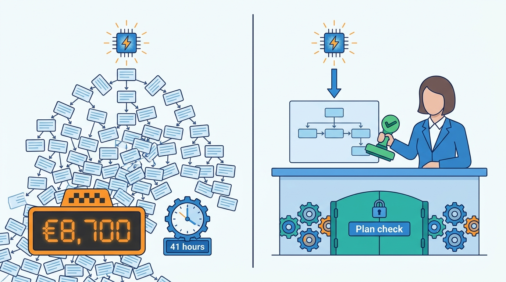
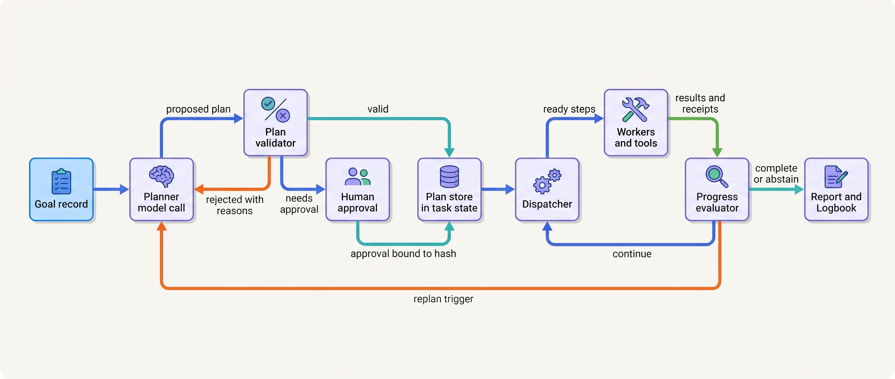
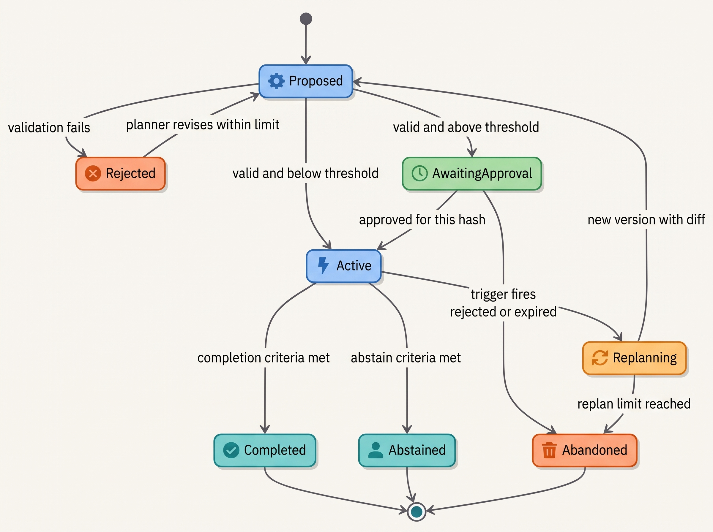
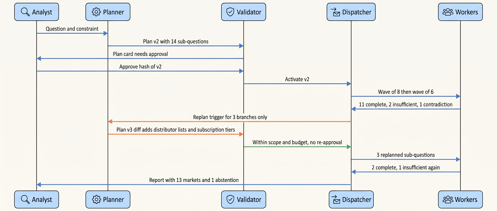
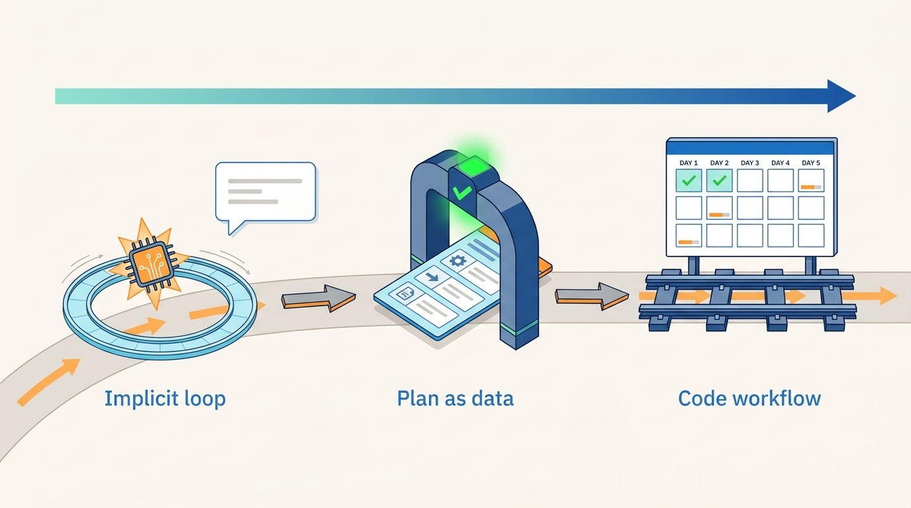

> **IN THIS CHAPTER, YOU WILL:** Learn the difference between implicit planning inside an agent loop and an explicit plan the system can see, and how to design plans as typed data. That means who writes them (code, model or human), how deterministic code validates, budgets and approves them, how a dispatcher executes them, and when the system is allowed to replan.

> **WHY THE BUSINESS CARES:** A plan is the cheapest place to stop a bad run. Rejecting a plan that would spend €8,700, touch a protected file or skip a control costs one model call. Finding the same problem after execution costs the money, the cleanup and sometimes a customer's trust.

> **WHY ARCHITECTS SHOULD CARE:** Where the plan lives decides what the rest of the architecture can do. If the plan exists only in the model's reasoning, nothing can validate it, approve it, resume from it or compare it with what actually ran. If it is a record, the policy engine, the durable runtime, the approval gate and the evidence log can all work on it.

> **KEY POINTS:**
>
> * **Plan explicitly when a run is long, expensive or consequential, and let the loop plan implicitly when it is not.** A support turn that reads two articles and answers needs no plan object. A research run with fourteen sub-questions, or any run that ends in a side effect, needs one, because it is the only point at which cost, scope and policy can be checked before anything happens.
> * **A plan is data, not prose.** Typed steps, declared tools and action classes, dependencies, a budget estimate and stop criteria. Deterministic code validates the plan against schema, policy and budget, stores it as task state, binds any approval to its content hash and dispatches its steps. The model proposes the plan. It does not enforce it.
> * **Replanning is a governed event, not a habit.** Replanning happens on named triggers (a failed step, contradicting evidence, budget burn, a changed goal), is capped in count, produces a diff against the current plan, never re-runs completed side effects, and returns to approval when the diff widens scope. Unbounded self-decomposition is how a 14-market question became 1,900 sub-agent runs.

> **[FAILURE PATTERNS THIS CHAPTER ADDRESSES](where-agentic-systems-go-wrong.html):**
>
> * **The Compounding Error** — a plan with checkable steps and a verifier between them turns a fatal early mistake into a detected, retryable one.
> * **The Token Bonfire** — decomposition the model may extend without limit multiplies runs and tokens. A plan with a budget estimate and a validator stops that before the first worker starts.
> * **The Agent-Shaped Hammer** — letting a model decompose a task whose steps are known in advance (a month-end close) adds variance and audit cost and buys nothing.

<br>
Every agent plans. A loop that reads a ticket, looks up a contract, then decides whether to offer a credit has made a plan, even if the plan only ever existed as the model's next proposal. The question for an architect is not *whether* the system plans but **where the plan lives, who writes it and what is allowed to act on it**. A plan the model keeps to itself can be neither inspected nor enforced. A plan written as a record can be validated, budgeted, approved, resumed after a crash and compared with what actually happened.

Research on planning with language models leans one way. Models are useful at *proposing* decompositions and unreliable at *guaranteeing* that a decomposition is correct, complete or cheap. Papers that add an external verifier report large gains. Papers that rely on the model checking its own plan report small or negative ones. The architecture that follows from this is the one this book applies everywhere: **the model proposes, deterministic code checks, and humans approve where the consequence warrants it.**

This chapter owns three terms: the **explicit plan**, **plan-as-data** and **replanning**. It builds on [[workflows-loops-and-autonomous-agents]], which defines the bounded loop and the workflow skeleton, and on [[agent-runtime]], which runs the steps. It hands routing of steps to models, agents and humans to [[routing-and-delegation]], the question of whether steps should run in separate agents to [[single-and-multi-agent-designs]], and the persistence of plans across crashes to [[task-state-and-checkpoints]].

## Setting the Scene at Ostrell: The Plan Nobody Could See

Ostrell, the fictional company this book follows (see [[meet-ostrell]]), runs seven agents on its Keelson platform. Two of them sit at opposite ends of the planning spectrum.

**Scout**, the internal research agent owned by Strategy & Insights, handles about **350 research runs a month** with a median run time of **14 minutes**. In February 2027 one run asked for "competitor pricing across 14 markets". Scout's lead agent split the question by market and handed each market to a sub-agent. Every sub-agent had the same instructions as the lead, so each one split *its* question again, by competitor, then by product line, then by source. There was no depth limit, no cost limit and no record of the decomposition outside the conversations themselves. The run went on for **41 hours**, made **1,900 sub-agent runs** and used about **310 million tokens**, costing **€8,700** in model spend before a quota alert stopped it on Monday morning. The report was unusable: duplicated sections, some markets covered five times, one not at all. This was the **Weekend Fan-out**.

The post-mortem fixed the obvious things: run budgets for tokens, cost and wall-clock time, a maximum delegation depth of 2 and at most 8 parallel sub-agents. Jonas Lindqvist, principal engineer on Keelson Runtime, pointed out what the budgets did not fix. *Nobody could have looked at the run's plan on Friday evening, because there was no plan to look at.* The decomposition existed only as 1,900 prompts. The budgets would now stop the next fan-out, but only after it had spent its budget. Nothing would stop it at the point where it was obviously wrong, before the first sub-agent started.


**Figure 1:** *The Weekend Fan-out made 1,900 sub-agent runs before anyone could see its plan; a plan written down as data can be checked and stopped before the first worker starts.*

**Closewise**, Group Finance's month-end close agent, sits at the other end. Its plan is the close calendar: for each of Ostrell's **23 legal entities**, a fixed sequence of reconciliations, accrual proposals, reviews and postings. The controller, Joost Vermeer, owns that sequence. The model never decides what comes next. It drafts reconciliations and proposes accrual entries (about **1,900 a month**) inside nodes the workflow has already scheduled. When Scout's redesign was discussed at the architecture forum, Joost asked: "Why would you let a model write the plan at all?"

Tomas Verhoef, Ostrell's Chief Architect, turned both cases into one question for the forum: **for each agent, who should write the plan (code, a model or a person), what form should it take, what must check it before execution, and when may it change?** The rest of this chapter is the answer Ostrell adopted.

## Concepts: Implicit Plans, Explicit Plans and Plans as Data

### Implicit planning

In **implicit planning** the model chooses one next action at a time from the conversation so far, observes the result and chooses again. This is the ReAct pattern (reason, act, observe), introduced by Yao et al. in 2022 and published at ICLR 2023, which interleaves reasoning traces with tool calls ([Yao et al., 2022](https://arxiv.org/abs/2210.03629)). Its strength is adaptivity: every observation can change the next step. Its weakness for an architect is that the plan never exists as an object. The system can see each step only when the model proposes it, so it can check steps one at a time but never the whole course of action, its total cost or whether it covers the goal.

Implicit planning is the right default for short, low-consequence loops. [[workflows-loops-and-autonomous-agents]] covers the bounded loop that contains it, with its step, cost and time budgets.

### Explicit plans

An **explicit plan** is a course of action written down before (most of) it is executed: a set of steps, their order or dependencies, and the condition under which the task is complete. It may be written by code (a workflow definition), by a model (a planner call), by a person (a runbook, a close calendar) or by a model and then edited by a person. What makes it explicit is not who wrote it but that **it exists outside the model's context and can be read by other components**. A markdown checklist in the conversation is a halfway house: people can read it, but code cannot validate it, and the model can rewrite it unnoticed.

### Plan-as-data

**Plan-as-data** is an explicit plan in a typed, versioned schema that deterministic code can parse, validate, store, diff and execute. The minimum fields are a goal reference, typed steps (each with the tool or worker it uses, its action class and its inputs, which may be references to earlier steps' outputs), dependencies, a budget estimate, completion criteria and a version with a content hash. The plan becomes part of the run's **task state** (owned by [[task-state-and-checkpoints]]). Each step's execution record points back to the plan version that authorized it.

```typescript
type ActionClass = "read" | "draft" | "reversible_write" | "compensable_write"
                 | "irreversible_write" | "external_commitment";

interface PlanStep {
  id: string;                         // stable within the plan
  purpose: string;                    // one line, for humans and the evidence log
  executor: { kind: "tool" | "worker" | "human"; ref: string };  // registry ids
  actionClass: ActionClass;           // checked against the autonomy tier register
  inputs: Record<string, string | { fromStep: string; field: string }>;
  dependsOn: string[];
  doneWhen: string;                   // machine-checkable where possible
  maxAttempts: number;
}

interface Plan {
  planId: string;
  version: number;                    // increments on every replan or human edit
  contentHash: string;                // approvals bind to this
  goalRef: string;                    // the task's goal record, not a copy of it
  author: "code" | "model" | "human" | "model+human";
  steps: PlanStep[];
  budget: { tokens: number; costEur: number; wallClockMin: number; maxWorkers: number };
  stopCriteria: { completeWhen: string; abstainWhen: string };
  replanPolicy: { maxReplans: number; triggers: ReplanTrigger[] };
  supersedes?: { version: number; diffRef: string };
}
```

Action classes come from [[autonomy-and-consequence]]: read, draft, reversible write, compensable write, irreversible write and external commitment. Declaring them per step lets the validator compare the plan with the agent's autonomy tiers before anything runs.

### Replanning

**Replanning** is producing a new version of the plan during execution because the current one no longer fits: a step failed beyond its retries, evidence contradicted an assumption, the budget is burning faster than progress, or the goal changed. A replan is a new plan version with a diff against the previous one. It is not "the model decided to do something else this turn". That is plan drift, and the architecture should detect it.

### Who writes the plan

| Plan author | Form | Typical use | What the model decides |
| --- | --- | --- | --- |
| **Code** (workflow definition) | DAG in the workflow engine | Known, repeated procedures: close, onboarding, leave requests | Content inside nodes only |
| **Human** (runbook, calendar, ticket breakdown) | Configured template or checklist | Regulated or audited procedures; one-off engineering work | Content inside steps; may suggest edits |
| **Model, validated by code** | Plan-as-data from a planner call | Variable decomposition: research, investigation, multi-file changes | The decomposition, within schema, policy and budget |
| **Model, approved by human** | Plan-as-data plus approval record | High-cost or high-consequence runs | The proposal; a person accepts or edits it |
| **Model, implicit** | Next action only | Short interactive loops | Everything, one step at a time, within loop budgets |

Each row down lets the model decide more; [[when-agents-are-justified]] argues for going only as far as the task needs. The test for planning: **if a competent person could write the plan before seeing the input, code or that person should write it.**

## Architecture: Where Planning Sits in the Runtime

### Components

Planning adds two small components, a plan validator and a progress evaluator, and new duties for existing ones.


**Figure 2:** *The model proposes the plan and is consulted again only at replan triggers; validation, storage, dispatch and the completion decision are deterministic code.*

| Component | Responsibility | Must never |
| --- | --- | --- |
| **Planner** (a model role, see [[models-and-the-model-gateway]]) | Propose a plan in the schema from the goal and trusted context | See untrusted content before the plan is fixed, when the task allows it; execute anything |
| **Plan validator** (code plus policy engine) | Check schema, references, action classes against tiers, budget estimate against caps, depth and fan-out limits | Ask a model whether the plan is safe as its only check |
| **Approval gate** (see [[human-oversight-and-bounded-autonomy]]) | Show the plan, its estimate and its diff; record an approval bound to the content hash | Accept an approval for a different plan version |
| **Plan store** (durable task state) | Hold every plan version, the active version and step status | Let the model overwrite a version in place |
| **Dispatcher** (code, in the runtime) | Run steps whose dependencies are met, in parallel up to limits; enforce retries and idempotency keys | Re-ask the planner to retry a failed step |
| **Workers and tools** | Execute one step each; return typed results | Spawn further workers outside the plan |
| **Progress evaluator** (code first, model second) | Check `doneWhen` per step and completion criteria per plan; detect replan triggers | Declare completion on the model's say-so alone |
| **Evidence log** (see [[policy-enforcement-and-audit]]) | Record plan versions, validations, approvals and which version authorized each step | Store raw reasoning as the explanation of the plan |

The dispatcher is the LLMCompiler idea in production clothing. Kim et al.'s LLMCompiler (ICML 2024) separates a model planner that emits a task graph with placeholder variables from a "task fetching unit" that substitutes real outputs and dispatches tasks once their dependencies are met. That unit needs no model ([Kim et al., 2023](https://arxiv.org/abs/2312.04511)). Scheduling, concurrency limits, retries and idempotency belong in that code, not in prompts. [[retries-idempotency-and-concurrency]] covers how.

### Requirements per interaction

| Interaction | Consistency | Latency | Durability | Who may act |
| --- | --- | --- | --- | --- |
| Planner → validator | Validator sees exactly the plan version it will store | One model call plus milliseconds of checks | Proposed plan logged even if rejected | Planner proposes; validator decides |
| Validator → approval | Approval names `planId`, `version`, `contentHash` | Minutes to hours; run suspended durably | Approval record with approver, evidence shown, scope, expiry | A named human with the right role |
| Plan store writes | Append-only versions; one active version per run | Milliseconds | Survives crash and deploy | Runtime only |
| Dispatcher → workers | Each step runs at most once per idempotency key; inputs resolved from stored outputs | Parallel up to fan-out cap | Step status and receipts recorded before the next dispatch | Runtime only |
| Evaluator → planner (replan) | Replan sees completed steps as facts, not as suggestions | One planner call | New version, diff, trigger reason logged | Runtime triggers; planner proposes; validator decides |

The approval rules follow the book's single approval model (consistency ruling 6): an approval is bound to the exact plan version by content hash, carries an expiry, and becomes void if the plan, the policy version or the evidence it relied on changes. Approving a plan does not approve the side effects inside it. A plan step that issues a credit or posts a journal still produces its own action object, which goes through its own gate in [[side-effects-and-external-actions]]. Plan approval controls *scope and cost*. Action approval controls *each consequence*.

### Plan validation: what code can check and what it cannot

| Check | Mechanism | Catches | Cannot catch |
| --- | --- | --- | --- |
| **Schema** | Parse into the typed plan; reject on failure | Malformed or free-text plans | Bad plans in good form |
| **Referential** | Every executor exists in the registry; every `fromStep` points to an earlier step's declared output | Invented tools, broken data flow | Wrong choice among real tools |
| **Policy** | Each step's action class against the agent's tier register; protected resources; data-class rules | A research plan that sends email; a code plan that edits CI config | Harm done with permitted actions |
| **Structural limits** | Step count, fan-out, depth, cycles | Over-decomposition, unbounded recursion | A plan that is small but wrong |
| **Budget** | Sum of per-step estimates (from history for that step type) against run caps | The fan-out that would cost €8,700 | Cost overruns from retries and replans (watched at run time) |
| **Coverage** | Each goal constraint maps to at least one step or to `abstainWhen` | Silently dropped requirements | Requirements nobody wrote down |
| **Critique** | A second model reviews the plan against the goal | Some omissions and implausible orderings | Anything it shares a blind spot with; not a safety control |

The first five checks are deterministic and fail-closed. Coverage is deterministic only if goals are structured. Critique is advisory; the evidence below explains why.

### The plan lifecycle


**Figure 3:** *Every path back to "Active" passes through validation, and through approval when the threshold applies; "Abstained" is a successful outcome, not a failure.*

**Abstained** is the defined "cannot answer from the evidence" outcome, which counts as success in evaluation when it is correct. **Abandoned** is where a run ends when replanning stops converging. It goes to a human with the plan history attached, not to a fresh run with the same goal.

### Replanning triggers

| Trigger | Detected by | Default response |
| --- | --- | --- |
| Step failed after `maxAttempts` | Dispatcher | Replan the failed branch only; completed steps are fixed facts |
| Evidence contradicts a plan assumption | Evaluator (typed `contradiction` result from a worker) | Replan the affected branch; record the assumption that broke |
| Budget burn ahead of progress (e.g. 70% spent, under 50% of steps done) | Runtime budget meter | Pause; replan to a cheaper scope or escalate |
| Goal or constraint changed by the requester | Goal record version change | New plan version; previous approval void |
| Policy or source facts the approval relied on changed | Approval re-check before each consequential step | Suspend; re-approve |
| Worker proposes further decomposition | Worker returns a plan amendment instead of spawning | Validator checks the amendment against depth and budget |

The last row is the structural fix for the Weekend Fan-out. **Workers do not decompose. They return amendments**, which the validator either accepts into a new plan version or rejects. Decomposition happens in one place, so it can be bounded.

A replan must also respect side effects already in the world. Completed steps keep their receipts, and the new plan version refers to them rather than repeating them. When a replan wants to undo a completed write, it does so with an explicit compensating step ([[partial-failure-and-compensation]]), not by re-running the branch. The runtime enforces this by keying idempotency on the step's action object, not on the plan version. A re-dispatched step with the same action finds its receipt instead of acting twice.

## Evidence: What Research and Documented Experience Say

### The plan-then-execute family

Most work on explicit planning dates from 2023 and used models two or more generations old. The architectural ideas have lasted; the numbers should not be quoted as the gain to expect today.

| Technique | Source | What it changed | Reported result and limit |
| --- | --- | --- | --- |
| Plan-and-Solve | Wang et al., ACL 2023 | Plan then solve inside one prompt | Beat zero-shot chain-of-thought on ten datasets with GPT-3; planning inside one generation, not an architectural split ([2023](https://arxiv.org/abs/2305.04091)) |
| ReWOO | Xu et al., preprint 2023 | Write the whole tool plan with placeholders; execute without re-prompting on every observation | 5× token efficiency and +4% accuracy on HotpotQA; short multi-hop QA tasks ([2023](https://arxiv.org/abs/2305.18323)) |
| Tree of Thoughts | Yao et al., NeurIPS 2023 | Search over intermediate steps with self-evaluation and backtracking | Game of 24 from 4% to 74%; puzzles, many model calls per problem ([2023](https://arxiv.org/abs/2305.10601)) |
| LLMCompiler | Kim et al., ICML 2024 | Planner emits a DAG; code dispatches ready tasks in parallel; joiner decides answer or replan | Up to 3.7× faster and 6.7× cheaper than ReAct on its benchmarks; planner overhead cannot be parallelized; on WebShop the planner made it slower than ReAct ([2023](https://arxiv.org/abs/2312.04511)) |
| Plan-and-execute agents | LangChain engineering post, February 2024 | Planner, executors, replan step | Claims speed, cost and quality benefits; no measurements ([2024](https://www.langchain.com/blog/planning-agents)) |

What these sources measured is narrow: closed-world question answering, puzzles and a simulated shop, with no side-effecting tools and no change in the world between planning and execution. No 2025–2026 head-to-head comparison of explicit and implicit planning with current reasoning models was found for this chapter. The durable lessons are architectural. Separate the plan from execution, represent dependencies so independent steps run in parallel, pass values by reference rather than re-reading history, and keep a joiner or replan checkpoint.

### Models propose plans well and verify them badly

The most direct evidence comes from classical planning domains, where a plan can be checked mechanically. Valmeekam et al. (NeurIPS 2023) found that when models generated plans autonomously across their test domains, the best model at the time (GPT-4) averaged about **12%** success. They also found that model-generated plans could improve the search of a sound planner, and that an external verifier's feedback improved generation ([Valmeekam et al., 2023](https://arxiv.org/abs/2305.15771)). Kambhampati et al.'s ICML 2024 position paper argues that autoregressive models "cannot, by themselves, do planning or self-verification". It proposes **LLM-Modulo** frameworks, in which the model generates candidates and external model-based verifiers check them in a loop ([Kambhampati et al., 2024](https://arxiv.org/abs/2402.01817)).

Reasoning models moved the numbers without removing the argument. In a September 2024 preprint, the same group evaluated OpenAI's first reasoning model (o1-preview) on PlanBench. It solved **97.8%** of 600 zero-shot Blocksworld instances, against **62.6%** for the best conventional model they tested. But it solved **52.8%** of the obfuscated "Mystery Blocksworld" variant and **23.6%** of longer problems needing 20–40 steps. It correctly identified only **27%** of unsolvable instances as unsolvable. It cost **$42.12 per 100 instances**, while a classical planner (Fast Downward) solved all of them in about a quarter of a second each ([Valmeekam et al., 2024](https://arxiv.org/html/2409.13373)). These are toy domains with complete specifications, and the models are already superseded. The shape is what matters for architecture: high success on familiar, short problems; degradation with length and novelty; weak recognition that no valid plan exists.

Realistic constraints are harder still. TravelPlanner (ICML 2024) gives agents tools over about four million records and asks for itineraries that satisfy many constraints. GPT-4 produced a fully valid plan **0.6%** of the time, and the authors report agents losing track of constraints and of the task ([Xie et al., 2024](https://arxiv.org/abs/2402.01622)). Adding external checking changes this sharply. A workshop paper applying LLM-Modulo critics to TravelPlanner reported a **4.6×** improvement over the GPT-4-Turbo baseline ([Gundawar et al., 2024](https://arxiv.org/abs/2405.20625)). A preprint that had the model translate the request into constraints for a satisfiability solver reported **93.9%** success ([Hao et al., 2024](https://arxiv.org/abs/2404.11891)). Both are single-benchmark results, and the solver approach needs a formalizable problem. The direction is consistent all the same. **Gains come from checking plans against something other than the model.** Huang et al. (ICLR 2024) found the converse: models "struggle to self-correct their responses without external feedback", and sometimes get worse ([Huang et al., 2023](https://arxiv.org/abs/2310.01798)).

For enterprise planning this means the deterministic checks in the validation table carry the weight: schema, references, policy, limits, budget and, where a domain allows, a constraint check. A second model critiquing the plan is a useful extra. It is not a control.

### Decomposition helps when the task decomposes

The best controlled evidence on decomposition across agents is Kim et al.'s scaling study (Google and MIT, arXiv preprint, v3 April 2026). Across 260 configurations, six benchmarks and three model families, the relative change from multi-agent designs ranged from **+80.8%** on decomposable financial reasoning to **−70.0%** on sequential planning. Gains shrank as single-agent baselines got stronger. Architectures without a central verifier propagated more errors ([Kim et al., 2025](https://arxiv.org/abs/2512.08296)). An earlier version described on Google's research blog in January 2026 reported error amplification of 17.2× for independent agents against 4.4× for centralized ones ([Google Research, 2026](https://research.google/blog/towards-a-science-of-scaling-agent-systems-when-and-why-agent-systems-work/)). The planning reading is that **decomposition pays when sub-tasks are independent and a central step validates their results. When each step depends on the last, splitting the work makes it worse.** [[single-and-multi-agent-designs]] takes this further.

Failure taxonomies point at the same weak spots. MAST (Cemri et al., NeurIPS 2025 Datasets and Benchmarks) annotated over 1,600 traces from seven multi-agent frameworks. The largest single failure mode was **repeating completed steps (15.7%)**. Others included **not recognizing that the task was complete (12.4%)**, **disobeying task requirements (11.8%)** and **premature termination (6.2%)**. Incorrect or missing verification together accounted for about 17% ([Cemri et al., 2025](https://arxiv.org/abs/2503.13657)). Most of these are things a plan-as-data runtime can check in code: step status prevents repeats, `doneWhen` and `completeWhen` make completion explicit, and coverage checks catch dropped requirements. In τ-bench's retail domain, 19% of analyzed failures were partial resolution of compound requests, which is a decomposition failure ([Yao et al., 2024](https://arxiv.org/abs/2406.12045)).

### What engineering teams report

In June 2025, Anthropic described its multi-agent research system. A lead agent plans and saves the plan to an external memory, because context beyond 200,000 tokens is truncated. It then spawns sub-agents with task descriptions, and effort-scaling rules are embedded in the prompt: one agent and 3–10 tool calls for simple fact-finding, more than 10 sub-agents for complex research. Observed failures included spawning 50 sub-agents for simple queries, duplicated work from vague task descriptions and continuing after results were sufficient ([Anthropic, 2025](https://www.anthropic.com/engineering/multi-agent-research-system)). This is documented experience about one system on internal evaluations. It shows the plan persisted outside the context, and effort limits written as prompt instructions not always followed.

Anthropic's November 2025 post on harnesses for long-running coding agents is the clearest published case of plan-as-data in practice. An initializer session writes a JSON feature list (over 200 items for one project, all initially failing). Later sessions may change only each item's `passes` field, and the team chose JSON because "the model is less likely to inappropriately change or overwrite JSON files" than Markdown ones. The failure modes it names are planning failures: **one-shotting** (trying to do too much in one go) and **premature completion** (a later session sees progress and declares the project done) ([Anthropic, 2025](https://www.anthropic.com/engineering/effective-harnesses-for-long-running-agents)).

Coding tools now ship plan approval as a mode. Claude Code's documentation, accessed October 2026, describes a plan mode in which the agent "reads files and proposes a plan but makes no edits until you approve" ([Anthropic, n.d.](https://code.claude.com/docs/en/common-workflows)). That is a human approval gate on a model-written plan. The plan is prose, though, and the approval is not bound to a hash. The pattern is right. The enforcement is the client's.

### Plans as a security boundary

Fixing the plan before reading untrusted data is also a prompt-injection defense. Beurer-Kellner et al.'s 2025 design-patterns preprint lists **plan-then-execute**: the action list is fixed before untrusted content is read. Injected text can then no longer add actions, but it can still change the *arguments* of planned ones ([Beurer-Kellner et al., 2025](https://arxiv.org/abs/2506.08837)). On AgentDojo, a "tool filter" defense in which the model picks its tools before seeing untrusted data cut targeted attack success on GPT-4o to 6.8% (Table 5, v3). It could not help in about 17% of cases, where the task's own tools were enough for the attack ([Debenedetti et al., 2024](https://arxiv.org/abs/2406.13352)). CaMeL goes further. A privileged model writes a program from the trusted query alone, and an interpreter tracks where every value came from ([Debenedetti et al., 2025](https://arxiv.org/abs/2503.18813)). [[prompt-injection-defense]] owns these designs. The planning consequence is that **the planner should see trusted inputs only, wherever the task allows it**. A plan written after reading an inbound email has already been influenced by whoever wrote the email.

## Worked Example at Ostrell: Scout's Fourteen Markets, Again

In March 2027 the Agent Platform team rebuilt Scout's orchestration around plan-as-data. The rules (Ostrell facts, fictional):

- Scout's lead planner, a Large-tier model call, writes a typed `ResearchPlan`: sub-questions, the sources each may use, the worker type, a token estimate per sub-question from the history of similar runs, and stop criteria. It sees the requester's question and Ostrell's internal source catalog, not web content.
- Keelson Runtime validates the plan before any worker starts. Validation covers schema, read-only action classes only (Scout's tier register allows nothing else), Bulkhead's data-class rules for internal sources, at most 8 parallel workers, delegation depth 2 and Scout's default run budget of **8 million tokens, €90 and 90 minutes**. Workers are Mid-tier calls with read-only tools that return typed `market_finding` results (the topology is in [[single-and-multi-agent-designs]]).
- **Workers cannot spawn.** A worker that wants to split its sub-question returns a plan amendment. The validator accepts it only if depth and budget allow.
- Plans estimated above **€25** or with more than **8 sub-questions** go to the requester for approval, bound to the plan's content hash. Most runs fall below both thresholds and start immediately.
- At most **3 replans** per run. A replan may proceed without re-approval only if it adds no action class and raises the approved estimate by no more than **20%**. A run that hits the limit stops as *abandoned* with its partial report and plan history.

In April 2027 an analyst in Strategy & Insights re-ran the February question. The numbers below are Ostrell's (fictional). The cost uses the Weekend Fan-out's blended rate of about **€28 per million tokens** as a conservative assumption; Mid-tier workers are cheaper.

**Plan v1.** The planner proposed 14 market sub-questions plus one synthesis step, with a worker per market reading competitor price pages and two internal market reports. The estimate was 1.8 million tokens, about **€51**, and 60 minutes. Validation passed. Because the plan had 14 sub-questions, the runtime suspended the run and sent the plan card to the analyst. The card showed the steps, the estimate, the sources and the budget.

**Plan v2.** The analyst added a constraint: "list prices only, exclude promotions". That changed the goal record, so the planner produced version 2, which added a `doneWhen` check that every price carries a source URL and an `as_of` date and is not tagged as promotional. The new hash was approved. The approval on v1 was void, and the Logbook shows both.

**Execution.** The dispatcher ran the 14 market workers in two waves, 8 and then 6, because of the parallel limit. Eleven returned complete results. Two returned `insufficient_evidence`: in those markets competitor prices sit behind distributor logins. One returned `contradiction`: a competitor had moved to subscription pricing, so the plan's assumption of a per-unit list price no longer held.


**Figure 4:** *The replan touched only the three failed branches; because the diff stayed within the approved action classes and under the approved budget, it did not need a second approval.*

**Plan v3.** The evaluator raised two triggers, step failure and contradiction, for three branches. The planner proposed a diff: try public distributor price lists for the two blocked markets, and compare subscription tiers instead of unit prices for the third. The diff added a source type but no new action class (still read-only web). It raised the estimate by 12%, inside the 20% margin. The validator activated v3 without asking the analyst again. Eleven completed sub-questions were not touched.

**Outcome.** One blocked market resolved from distributor lists. The other did not, and its `abstainWhen` condition fired: the report says "no reliable public list price found", with the sources tried. The subscription market was reported in tiers with a note explaining why it is not directly comparable. The run used **17 worker runs**, about **2.0 million tokens** and about **€57**, in **52 minutes**. The February run had used 1,900 sub-agent runs, 310 million tokens, €8,700 and 41 hours, and its report was unusable.

Budgets alone would have stopped a repeat of February only after it had spent them, at about €90 and 25 minutes ([[agent-cost-and-model-routing]]), with nothing usable to show. Plan-as-data **moved the decision to before the first worker started**, and let the analyst sharpen the question at the cheapest moment.

**Closewise, for contrast.** Closewise has no planner call. Its per-entity close plan is a workflow definition owned by Group Finance and changed through configuration review, never by a model. The two agentic steps, drafting reconciliations and proposing accruals, are nodes in that plan. When a reconciliation cannot be drafted, the node returns an exception to the accountant's queue. It does not ask a model to plan around the problem. Joost Vermeer's reason is the audit: every entity must follow the same approved procedure every month, and a model-written plan would need review 23 times a month for no benefit. This is the author's interview design for the finance platform (step 3, `pipeline`) applied to Ostrell: "a known pipeline with LLM calls inside bounded nodes, not an autonomous loop".

## Failure Modes and Recovery

| Failure | What happens | Detection | Containment | Recovery |
| --- | --- | --- | --- | --- |
| **Over-decomposition** | Planner or workers split work far beyond need; cost and duplicates grow | Validator: step count, depth, fan-out and budget limits; runtime: workers per minute | Workers cannot spawn; amendments validated | Reject plan with reasons; planner revises within limit, or abandon to a human |
| **Under-decomposition (one-shotting)** | One step tries to do too much and fails late or runs out of context | Step-level budget or timeout; evaluator sees `doneWhen` unmet | Per-step budgets, so one step cannot eat the run | Replan that branch into smaller steps |
| **Plan drift** | Execution does things the plan does not contain, or the model ignores the plan | Dispatcher rejects any action not tied to an active step id; evidence log compares executed steps with plan | Workers only receive steps from the dispatcher | Treat as a defect: replan or abandon; add a trajectory check to the eval suite |
| **Stale plan** | The world changes between plan and execution (a price, a policy, a file) | Approval re-check before consequential steps; source `as_of` versus approval time | Approval void on change of plan, policy or evidence | Suspend; re-validate; re-approve |
| **Premature termination** | Run declares success with requirements unmet | Code checks `completeWhen` and coverage; model claims are not enough | Completion is a runtime decision | Resume the remaining steps; record the false claim for evaluation |
| **Replan thrash** | Each replan fails and proposes another; cost rises, nothing finishes | Replan counter; budget burn trigger | `maxReplans`; burn-rate pause | Abandon with history to a human; never restart with the same goal unattended |
| **Injected plan** | Untrusted content shapes the plan or a replan | Plan includes a step or argument derived from untrusted input; policy check on sinks | Planner sees trusted inputs only; untrusted values passed by reference; sinks checked by policy | Block the step; quarantine the source; add the case to the injection suite |
| **Approved plan differs from executed plan** | A person approved v2; v3 ran with wider scope | Hash mismatch at activation | Activation requires approval for the active hash when the diff widens scope | Suspend and re-approve; flag in Logbook |

Two rows deserve a note. **Plan drift** in an implicit loop is invisible by construction: there is nothing to drift from. It becomes a detectable defect only once the plan is data and the dispatcher refuses unplanned actions. **Premature termination** is MAST's "does not recognize completion" seen from the other side, and Anthropic's harness post shows it surviving into production-style coding work. The fix in both cases is the same: completion is a property the runtime checks, not a sentence the model writes. The author's coding-CLI interview design, a design example, takes the same line for a single loop. It adds explicit termination, turn and token caps and doom-loop detection (step `agent-loop`). When it compacts history, it pins the task, the constraints and the acceptance criteria verbatim (step `compaction`), so the plan's goal cannot be summarized away.

## Trade-offs

| Option | Strengths | Costs | Right when |
| --- | --- | --- | --- |
| **Implicit planning in a bounded loop** | Lowest latency; adapts on every observation; least design work | No whole-plan checks; cost and scope visible only as they happen; drift undetectable | Short interactive tasks, read-mostly, few steps (Answerdesk turns) |
| **Model-written checklist in context** | Cheap; helps the model stay on track; humans can read it | Not enforceable; model can rewrite it; no hash, no validation | Personal tooling and early prototypes |
| **Plan-as-data, model-written, code-validated** | Cost, scope and policy checked before execution; resumable; diffable; parallel dispatch | Planner call on the critical path; schema and validator to maintain; replan logic | Variable decomposition with real cost or long duration (Scout) |
| **Plan-as-data plus human approval** | A person can catch a wrong question early; scope accountability | Wait time; approval fatigue if thresholds are low | Expensive runs, or plans that end in consequential actions |
| **Code-authored plan (workflow)** | Repeatable, auditable, testable; no planning variance | Rigid; every new path is a code or config change | Known procedures, regulated work (Closewise) |
My recommendation: **default to implicit planning inside bounded loops and to code-authored plans for known procedures. Add a model-written plan-as-data layer only where the decomposition varies by input and a run's cost or duration justifies a check before execution.** The threshold I use is any run expected to take more than a few minutes, spawn workers or reach a write action class. This rests on two assumptions: the planner call adds seconds, not minutes, and the decomposition is stable enough that most plans pass validation first time. If a domain's plans are routinely invalidated by the first tool result, measure the replan rate. Above roughly one replan per run *(assumption)*, the up-front plan is not earning its latency, and a bounded loop with periodic checkpoints may be the better design.


**Figure 5:** *Planning form follows the task: implicit loops for short read-mostly turns, a validated plan as data where the decomposition varies and costs real money, and a code-authored workflow for known procedures such as the close.*

## Across Domains: How the Stakes Change the Design

| Dimension | Coding agents | Customer operations (support, sales, marketing) | Back office (finance, legal, HR) | High-stakes decisions (healthcare, public benefits) |
| --- | --- | --- | --- | --- |
| **Who writes the plan** | Model, often approved by the developer; organization-level templates for headless runs | Mostly implicit in the loop; code for known flows (refund, revisit) | Code or the process owner; model fills nodes | Code and rule packages; the model never plans the decision path |
| **Plan form** | Change plan (files, tests expected to change) or feature list as data | Bounded loop with per-turn budgets; plan objects only for multi-step cases | Authored DAG with typed node contracts | Deterministic DAG: gather evidence, apply rules, explain, human decides |
| **What validation checks** | Protected paths, test-count changes, scope against ticket | Action classes and limits (credit amounts, recipients) per step | Segregation of duties, period open, control steps present | Rule versions, required evidence present, adverse outcomes routed to a person |
| **Replanning freedom** | High inside the sandbox; bounded fix rounds | Low; escalate rather than improvise | None by the model; exceptions to a human queue | None by the model; "evidence needed" is a state, not a replan |
| **Plan approval** | Developer approves plan or PR | Rare; action approval matters more | Process owner approves the template, not each run | Clinician or caseworker approves the outcome, not a plan |
| **Abstention** | "Cannot fix without changing protected tests" | Escalate to a human with context | Exception with evidence attached | Abstain and hold the case; never default to denial |

The sources behind the right-hand columns are the author's interview designs, which are design examples, not deployed systems. The finance design confines the model to "bounded nodes" of a deterministic pipeline with typed contracts (`DocumentEnvelope → ExtractedFields → MatchResult → ProposedJournal`, step 3). The public-benefits design's pipeline is a "deterministic DAG: gather evidence → apply rules → explain → caseworker decision" in which "the model cannot override" the rule engine (steps 3–4). The research-platform design shows the most transferable idea. The model drafts a **structured protocol IR** (an intermediate representation of typed steps, reagents, quantities and instruments) that a fail-closed validator checks. A human authorization is bound to that protocol's content hash, so "an injected instruction in a paper can't smuggle past prose parsing" (steps 3–4). That is plan-as-data with plan approval, applied where the side effect is physical. On the coding side, the author's coding-harness design scales "spec fidelity to blast radius" (step `behaviour`). At Ostrell, Forge has since August 2027 begun every headless run with a typed change plan listing the paths it intends to touch, which Keelson checks against protected paths before the sandbox grants write access. This was a direct response to the Fixture Purge.

What the platform keeps common: the plan schema, the validator framework, plan storage and versioning, hash-bound approval, the dispatcher, replan triggers and their limits, and the evidence-log records. What must be domain policy: who may author plans, the thresholds for approval, how much replanning is allowed, which action classes a plan may contain, and what counts as abstention. **The further right a domain sits in the table, the more of the plan moves from the model to code and rules.** In the high-stakes column, "planning" by the model is reduced to choosing which evidence to gather next inside a path it does not control.

## The Chief Architect's View

The decisions to make, and who makes them:

- **Plan authorship per agent, recorded in the Agent Registry.** The agent owner proposes; architecture review approves. The default for any new agent is code-authored for known procedures and implicit for short loops. A model-written plan layer needs a stated reason: variable decomposition and material cost or duration.
- **The plan schema as a platform contract.** The platform team owns it, versions it like any API, and keeps it small. If every agent extends the schema freely, the validator stops being shared.
- **Approval thresholds per agent and action class.** The risk owner sets them, using evidence from [[evidence-for-autonomy]]. Plan approval is a cost and scope control. It must never be the only gate on a consequential action.
- **Replan limits and the abandon path.** Set by the agent owner, with an on-call destination for abandoned runs. An abandoned run with no owner becomes a silent failure.

What to watch in operation: plan rejection rate by validation rule (a rising rate usually means a prompt or model change, see [[versioning-agent-systems]]), replans per run, estimate versus actual cost per plan, steps rejected as unplanned, abstention rate and its correctness in evaluation, and approval latency for suspended plans. [[agent-observability]] shows how to record these as spans and metrics. [[building-agent-eval-suites]] shows how to turn plans into trajectory evaluations: the plan is the expected trajectory, so the evaluator can check that it was followed, not only that the answer looked right.

What is durable, and what will change. Models will keep getting better at proposing plans; the 2023–2024 gap has already narrowed on simple domains, and some explicit planner calls will become unnecessary. The checks will stay. Validating scope and cost before execution, binding approvals to exactly what was approved, refusing unplanned actions, recognizing completion in code and limiting replans are properties of a system that takes actions under budgets. They do not depend on how clever the planner is. I would expect to delete planner prompts over the next few years. I would not expect to delete the validator.

## Questions to Ask

1. For this agent, who writes the plan (code, a person, a model or nobody), and could a competent person have written it before seeing the input?
2. Where does the plan live? Can the runtime, the policy engine and the evidence log read it, or does it exist only in the model's context?
3. Which checks run on a plan before the first step executes, and which of them are deterministic and fail-closed?
4. Can a worker or sub-agent decompose further on its own, or must it return an amendment to a single validator?
5. What triggers a replan, how many replans are allowed, and what happens when the limit is reached?
6. Does a replan ever re-run a completed step with side effects, and how does the runtime prevent it?
7. Is approval bound to a plan's content hash, and which changes to the plan, the policy or the evidence void it?
8. Who decides that the task is complete, and what evidence does that decision require beyond the model saying so?
9. Does the planner read untrusted content before the plan is fixed? If so, which arguments could an attacker set?
10. What are the plan rejection rate, replans per run and estimate-versus-actual cost today, and who looks at them?

A plan answers *what* will be done. It does not say *who* should do each part, or which model, agent, tool or person a step goes to, and what authority and budget travel with it. That is the subject of [[routing-and-delegation]].

## Sources and Evidence

### Research papers

- [ReAct: Synergizing Reasoning and Acting in Language Models](https://arxiv.org/abs/2210.03629) — Yao et al., 2022 (ICLR 2023); the implicit-planning loop.
- [Plan-and-Solve Prompting](https://arxiv.org/abs/2305.04091) — Wang et al., 2023 (ACL 2023); planning inside one prompt.
- [ReWOO: Decoupling Reasoning from Observations](https://arxiv.org/abs/2305.18323) — Xu et al., 2023, preprint; plan with placeholders, 5× token efficiency on HotpotQA.
- [Tree of Thoughts](https://arxiv.org/abs/2305.10601) — Yao et al., 2023 (NeurIPS 2023); search over plans, Game of 24 result.
- [An LLM Compiler for Parallel Function Calling](https://arxiv.org/abs/2312.04511) — Kim et al., 2023 (ICML 2024); planner DAG, code dispatcher, stated limits.
- [On the Planning Abilities of Large Language Models: A Critical Investigation](https://arxiv.org/abs/2305.15771) — Valmeekam et al., 2023 (NeurIPS 2023); ~12% autonomous plan success, value of external verifiers.
- [LLMs Can't Plan, But Can Help Planning in LLM-Modulo Frameworks](https://arxiv.org/abs/2402.01817) — Kambhampati et al., 2024 (ICML 2024 position paper); generate-and-verify architecture.
- [LLMs Still Can't Plan; Can LRMs?](https://arxiv.org/html/2409.13373) — Valmeekam, Stechly and Kambhampati, 2024, preprint; reasoning-model PlanBench results, unsolvable instances, cost versus a classical planner.
- [TravelPlanner: A Benchmark for Real-World Planning with Language Agents](https://arxiv.org/abs/2402.01622) — Xie et al., 2024 (ICML 2024); 0.6% valid plans under many constraints.
- [Robust Planning with LLM-Modulo Framework: Case Study in Travel Planning](https://arxiv.org/abs/2405.20625) — Gundawar et al., 2024, workshop paper; 4.6× improvement with critics.
- [Large Language Models Can Solve Real-World Planning Rigorously with Formal Verification Tools](https://arxiv.org/abs/2404.11891) — Hao et al., 2024 (rev. 2025), preprint; 93.9% with a satisfiability solver.
- [Large Language Models Cannot Self-Correct Reasoning Yet](https://arxiv.org/abs/2310.01798) — Huang et al., 2023 (ICLR 2024); limits of self-verification without external feedback.
- [Why Do Multi-Agent LLM Systems Fail?](https://arxiv.org/abs/2503.13657) — Cemri et al., 2025 (NeurIPS 2025 Datasets and Benchmarks); step repetition, completion and termination failure rates.
- [Towards a Science of Scaling Agent Systems](https://arxiv.org/abs/2512.08296) — Kim et al., 2025 (v3 2026), preprint; decomposability predicts benefit, −70% on sequential planning.
- [τ-bench](https://arxiv.org/abs/2406.12045) — Yao et al., 2024; partial resolution of compound requests as a failure class.
- [Design Patterns for Securing LLM Agents against Prompt Injections](https://arxiv.org/abs/2506.08837) — Beurer-Kellner et al., 2025, preprint; plan-then-execute and its residual risk.
- [AgentDojo](https://arxiv.org/abs/2406.13352) — Debenedetti et al., 2024; tool-filter defense result and its limits (Table 5, v3).
- [Defeating Prompt Injections by Design (CaMeL)](https://arxiv.org/abs/2503.18813) — Debenedetti et al., 2025, preprint; program-from-trusted-query with tracked data flow.

### Specifications, standards and regulation

- None specific to planning. Approval and logging duties are covered in [[human-oversight-and-bounded-autonomy]] and [[policy-enforcement-and-audit]].

### Vendor documentation and engineering reports

- [Building Effective Agents](https://www.anthropic.com/engineering/building-effective-agents) — Anthropic, 2024; workflows versus agents, orchestrator–workers pattern.
- [How we built our multi-agent research system](https://www.anthropic.com/engineering/multi-agent-research-system) — Anthropic, 2025; plan persisted to memory, effort-scaling rules, observed over-spawning.
- [Effective harnesses for long-running agents](https://www.anthropic.com/engineering/effective-harnesses-for-long-running-agents) — Anthropic, 2025; JSON feature list as plan-as-data, one-shotting and premature completion.
- [Common workflows: Plan before editing](https://code.claude.com/docs/en/common-workflows) — Anthropic, n.d., accessed 2026-10; plan mode as a human approval gate in a coding CLI.
- [Planning agents](https://www.langchain.com/blog/planning-agents) — LangChain, 2024; plan-and-execute, ReWOO and LLMCompiler as framework patterns (claims, not measurements).
- [Towards a science of scaling agent systems](https://research.google/blog/towards-a-science-of-scaling-agent-systems-when-and-why-agent-systems-work/) — Google Research, 2026; earlier-version error-amplification figures.

### Incidents, cases and decisions

- No public incident report attributing a production failure specifically to agent planning or decomposition was found for this chapter. The Weekend Fan-out is fictional.

### Design examples from the author's interview project

- Obrenović, Ž., "Agentic Research Platform", system-design interview design, `system-design-interviews/data/book/agentic-research-platform/interview.json`, 2026 — steps 3–4: structured protocol IR, fail-closed validation, authorization bound to content hash.
- Obrenović, Ž., "Agentic Finance Platform", system-design interview design, `system-design-interviews/data/book/agentic-finance-platform/interview.json`, 2026 — step 3 (`pipeline`): deterministic pipeline with bounded model nodes and typed contracts.
- Obrenović, Ž., "Agentic Public Benefits Platform", system-design interview design, `system-design-interviews/data/book/agentic-public-benefits-platform/interview.json`, 2026 — steps 3–4: rule engine authoritative, model extracts and explains.
- Obrenović, Ž., "AI Coding Harness", system-design interview design, `system-design-interviews/data/book/ai-coding-harness/interview.json`, 2026 — step `behaviour`: spec fidelity scaled to blast radius.
- Obrenović, Ž., "AI Coding Agent CLI", system-design interview design, `system-design-interviews/data/book/ai-coding-cli/interview.json`, 2026 — steps `agent-loop` and `compaction`: explicit termination and pinned task constraints.

Ostrell is fictional; architectural recommendations, labeled inferences and labeled assumptions are the author's judgement.
