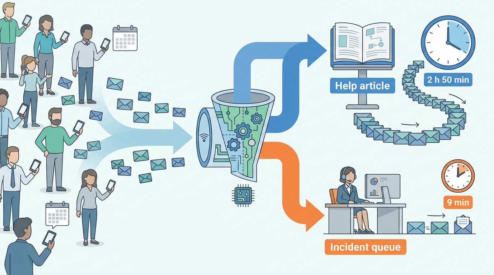
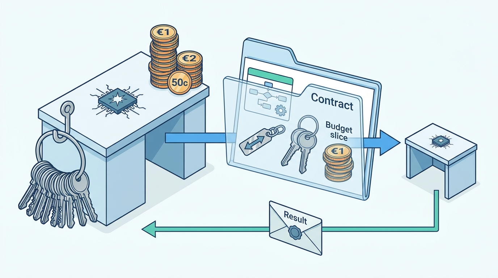
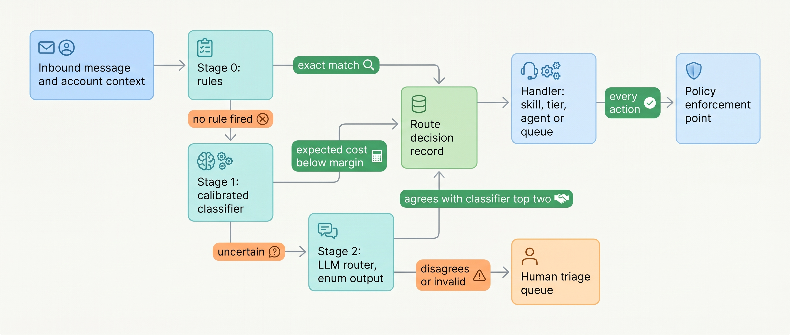
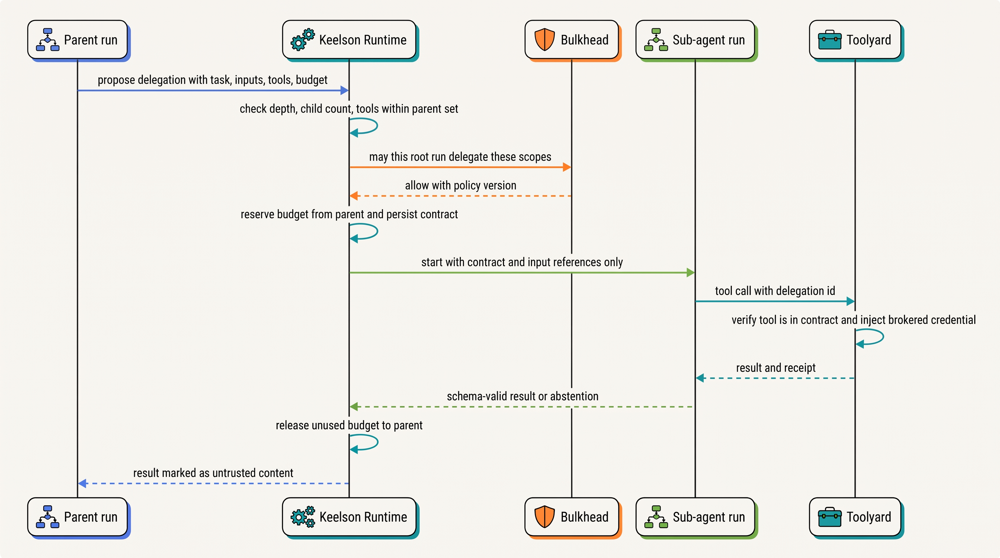

> **IN THIS CHAPTER, YOU WILL:** Learn how to design routers that send work to the right model tier, agent configuration, tool set or human queue, how to set confidence thresholds from the cost of each kind of misroute, and how to write delegation contracts that state exactly what context, authority and budget a sub-agent or a person receives.

> **WHY THE BUSINESS CARES:** A misrouted conversation is the cheapest-looking failure in an agentic system and often the most expensive one: the customer with an outage gets a help-center article, the privacy request misses its legal deadline, and nobody sees it because every component reports success. Delegation without limits turns one request into an invoice.

> **WHY ARCHITECTS SHOULD CARE:** Routing and delegation are where an agentic system decides who acts. A router that grants authority, a sub-agent that inherits everything its parent can do, or a delegation that passes free text instead of a contract will defeat the controls designed everywhere else in the platform.

> **KEY POINTS:**
>
> * **A router is a classifier, so engineer it like one.** Give it a labeled evaluation set, per-route recall targets, calibrated probabilities and thresholds derived from what each misroute costs. A model's self-reported confidence is not a threshold: it is overconfident, and it was in 83% of the misroutes Ostrell audited.
> * **Routing selects; it never authorizes.** A route chooses the model tier, tool set or queue that handles the work. What that handler may do is still decided by the policy engine at each action. A route that grants authority turns a classification error into an incident.
> * **Delegation is a contract, not a prompt.** Every hand-down to a sub-agent or a person names the task, the inputs by reference, the decisions already taken, the authority (always a subset of the delegator's), the budget carved from the parent's, the output schema and the lineage identifiers. The runtime enforces the contract. The prompt only explains it.

> **[FAILURE PATTERNS THIS CHAPTER ADDRESSES](where-agentic-systems-go-wrong.html):**
>
> * **The Lost Handoff** — routing and delegation are where work changes hands, and free-text delegation drops identifiers, constraints and decisions.
> * **Ambient Authority** — a sub-agent that inherits its parent's full tool set and credentials can reach everything the parent could, whatever its task.
> * **The Token Bonfire** — delegation without a budget carved from the parent's turns model-driven fan-out into unbounded spend.

<br>
Every agentic system routes. A support agent decides whether a message is a how-to question, a billing dispute or an outage report; a gateway decides whether a step needs a frontier model or a small one; a research agent decides whether to spawn three sub-agents or thirty. Most of these decisions are made once per task, early, and **every later step inherits them**. If the route is wrong, a well-built downstream agent does the wrong job well.

Delegation is routing plus a transfer: context, authority, budget and an obligation to report back travel with the work. Frameworks make delegation a one-line call, and their defaults decide what travels: the whole conversation, including untrusted content the parent read, or only a prompt string that has lost the constraints the parent had agreed. Neither default is a design. **The architecture has to say what crosses each boundary and enforce it outside the model.**

This chapter owns three terms: the **router**, the component that assigns a unit of work to a handler; the **sub-agent**, an agent run started by another agent run to do a bounded part of its task and return a result; and the **delegation contract**, the typed record of what a delegated task receives and owes. It builds on [[planning-and-decomposition]], which decides how a task splits into parts; on [[models-and-the-model-gateway]], which owns model tiers; and on [[agent-runtime]], which runs the loops being routed. It hands the question of whether to have several agents at all to [[single-and-multi-agent-designs]], and handoffs of control between peers, typed handoff payloads and agent-to-agent protocols to [[coordination-and-handoffs]].

## Setting the Scene at Ostrell: The Outage That Went to the Help Center

Ostrell, the fictional field-service software group this book follows (see [[meet-ostrell]]), runs **Answerdesk**, its customer-support agent for Ostrell Field, at about **7,100 conversations a day**. Every conversation starts with a routing decision. In January 2027, when Answerdesk moved onto the Keelson platform, that decision was made by a triage agent: one Mid-tier model prompt that read the customer's first message, picked one of eleven routes and either answered from the knowledge base, called a tool set or handed the conversation to a specialist agent or a human queue. In April the handoff to the billing specialist lost contract ids in about 1 in 40 handoffs (the Lost Handoff, told in full in [[coordination-and-handoffs]]). Soon after, the billing specialist was folded back into Answerdesk as a tool set. The router stayed.

On **Tuesday 13 July 2027** a release of the Ostrell Field technician app shipped an offline-sync defect: for some customers, work orders scheduled that morning disappeared from technicians' phones. Between 07:40 and 12:50, **143** customers wrote to Answerdesk about it. Their messages looked like how-to questions: "today's jobs are not showing in the app", "how do I refresh the schedule on the phone". The router sent **64** of them to the `kb_answer` route, where Answerdesk answered with the sync-troubleshooting article. Those customers waited a median **2 hours 50 minutes** before reaching a person. The 79 conversations routed to `service_incident` reached the incident queue in a median **9 minutes**. The incident commander saw about half the real volume and sized the incident too small for the first three hours.


**Figure 1:** *On 13 July the router sent 64 of the 143 outage reports to a help-center article, where customers waited a median 2 hours 50 minutes, while the 79 routed as incidents reached a person in 9 minutes.*

Nothing failed loudly. The router returned valid routes with confidence of 0.95; the knowledge-base answer was correct for a normal sync problem; and Sounding, Ostrell's evaluation service, tested answer quality per route but never whether the route was right. Lena Brandt, who owns Answerdesk, saw the problem the next morning as a spike in repeat contacts.

Tomas Verhoef, Ostrell's Chief Architect, asked Mei Lin Zhou's evaluation team to audit the router. They labeled **2,400** conversations from June and July. The router chose the right route in **91.2%** of them, which sounded good until the breakdown. Recall on `service_incident`, the share of real incident conversations that reached that route, was **71%**. The router chose `needs_human_triage` for **0.3%** of conversations; the labelers judged that **2.6%** needed it. And the router reported a confidence of 0.9 or higher on **94%** of all conversations and on **83%** of its misroutes.

Two questions came out of the review, and they are the questions of this chapter. **How should a system decide where work goes, and how sure must it be before it commits?** And, because Scout's Weekend Fan-out in February had already shown what unbounded delegation costs, **when work is handed down, what exactly is handed with it?**

## What a Router Decides and What Delegation Transfers

### Routing decisions and their dimensions

A **router** assigns a unit of work (a conversation, a turn, a task, a plan step) to a handler. The handler can be a model tier, an agent configuration (a prompt plus a tool set, sometimes called a skill), a separate agent, a deterministic workflow, a human queue or an explicit refusal. A router has a fixed, enumerated set of outputs. That property separates it from an agent: a router chooses among options the designers wrote down. An agent can generate options nobody wrote down.

Routers route on four kinds of signal. Real routers combine them, but each one has a different cost of error and usually a different owner.

| Dimension | Question the router answers | Typical target | What a misroute costs | Who should own the threshold |
| --- | --- | --- | --- | --- |
| **Intent** | What is this work about? | A skill, tool set, specialist agent or queue | The wrong job done well; a stranded customer | Product or operations owner of the routes |
| **Complexity** | How hard is it? | A model tier, or single agent vs decomposed plan | Overspend (too strong) or failure and retries (too weak) | Platform team, against cost per successful task |
| **Risk** | How bad is a wrong outcome? | A stricter path, a human queue, an approval tier | An action taken where a person should have decided | Risk owner of the domain |
| **Cost** | What is this work worth? | Batch or interactive tier, budget class | A cheap task on an expensive path, or the reverse | Platform team and budget owner |

Risk routing needs a warning. A risk router can send work to a *stricter* path. It must not send work to a path with *more* authority than policy allows for that action. The author's agentic-support-platform interview design states the rule well: a learned risk score "can lower autonomy but never raise it past policy" (step `action-gate`). Autonomy tiers are set per action class by policy ([[autonomy-and-consequence]]); routing can only move work toward more oversight.

### How routers are built

| Router type | How it decides | Strengths | Weaknesses |
| --- | --- | --- | --- |
| **Rules** | Keywords, account flags, channel, structured fields | Auditable, instant, exact for known patterns | Brittle on free text; grows into a rule swamp |
| **Trained classifier** | A small supervised model, often logistic regression or gradient boosting over embeddings | Cheap, fast, calibratable, evaluable | Needs labeled data; blind to new intents until retrained |
| **Embedding similarity** | Nearest labeled examples or route centroids | No training loop; easy to add a route | Similarity is not intent; thresholds hard to calibrate |
| **LLM router** (large language model) | A model prompted with route descriptions, output constrained to the route enum | Handles new phrasing and long context; no training data | Slower and costlier per call; self-reported confidence is poorly calibrated; version-sensitive |
| **Learned cost–quality router** | A model trained to predict whether a cheap model's answer will be good enough | Directly optimizes cost against quality | Needs preference or outcome data per model pair; drifts when models change |
| **Cascade** | Try the cheap handler, verify, escalate on failure | No prediction needed, only a verifier | Pays twice on hard cases; only as good as the verifier |

These types compose. The design I recommend for intent routing at volume is a **staged router**: rules for the cases that must be exact, a calibrated classifier for the bulk, an LLM router for the uncertain remainder, and a human route below that. Each stage hands down only what it cannot decide.

### Delegation: call-and-return versus transfer of control

**Delegation** hands a part of the work to another handler. There are two semantics, and frameworks name them differently ([[coordination-and-handoffs]] covers the second in depth):

- **Call-and-return.** The delegator stays in charge. It gives a sub-task to a sub-agent (or a person, or a workflow), waits for the result and decides what to do with it. OpenAI's Agents SDK (software development kit) calls this an agent used as a tool; the Claude Agent SDK calls it a subagent; Google's Agent Development Kit has `task` and `single_turn` sub-agent modes.
- **Transfer of control.** The delegator hands over the conversation and steps out. The OpenAI SDK calls this a handoff; the receiver then owns the next step.

A **sub-agent** in this book is a call-and-return delegate: an agent run started by a parent run, with its own context, its own tool set and its own budget, that returns one result. The definition rules out a peer that takes over the conversation (a handoff) and a fixed workflow step (a function call).

A **delegation contract** is the typed record that travels with every delegation: what the delegate is asked to do, with which inputs, under which decisions already taken, with what authority and budget, by when, and what it must return. Delegation to a human uses the same contract with a different receiver. In customer-facing work its rendered form is the escalation package of [[agent-interaction-design]].


**Figure 2:** *A delegation contract hands down the task, inputs by reference, a subset of the delegator's authority and a budget carved from the parent's, and the child's result returns as data.*

## Architecture: The Routing Layer and the Delegation Contract

### Where routing sits

Routing happens at three points, and the three are often confused.

1. **Intake routing**, before the loop: which handler takes this conversation or task. This is Answerdesk's triage decision.
2. **In-loop routing**, inside a run: which model tier serves this step, which tool subset is visible, whether to delegate a sub-task. The runtime ([[agent-runtime]]) and the gateway make these decisions per step.
3. **Action gating**, at a side effect: whether this specific action executes, needs approval or is refused. **This is not routing.** It belongs to the policy enforcement point, Bulkhead at Ostrell ([[policy-enforcement-and-audit]]), and it runs whatever route the work took.

Keeping the third point out of the router is the most important boundary in this chapter. If the `billing_and_credits` route itself grants the right to issue credits, a misroute into it grants authority. At Ostrell a route selects a tool set from Toolyard, the tool registry and broker, and Bulkhead still evaluates every `issue_credit` call against the action-class tier, the amount and the customer's verified identity. A route can make tools visible. It cannot make them permitted.


**Figure 3:** *A staged router decides as cheaply as it safely can and hands down only what it cannot decide; the route picks a handler, and the policy enforcement point still decides every action.*

### Requirements per interaction

| Interaction | Latency budget | Consistency | Durability | Who may decide |
| --- | --- | --- | --- | --- |
| Intake route (live chat) | Stages 0–1 in tens of milliseconds; Stage 2 under one second *(assumption)* | Route recorded before the handler starts | Route decision record in the evidence log | Router; the route owner sets thresholds |
| Re-route inside a conversation | Same as intake | Previous route closed before new one opens | Both decisions recorded with reason | Handler requests; router decides; capped count |
| Model tier per step | Inside the step's budget | Tier pinned per manifest version | Tier and exact model id per call | Agent manifest; gateway enforces |
| Delegation to a sub-agent | Seconds to start; minutes to hours to run | Child budget reserved from parent atomically | Contract persisted before the child starts | Parent proposes; runtime validates and admits |
| Delegation to a human | Queue service-level agreement, SLA (minutes to days by domain) | Agent loses write authority when the human gains it | Contract, assignment and outcome recorded | Router or agent proposes; queue owner accepts |

### The route decision record

A route decision is evidence. It should be recorded the way a tool call is: versioned, with inputs by reference, so that a later audit can ask "why did this conversation go there?" and replay the router on the same input.

```typescript
type RouteId = "kb_answer" | "ticket_ops" | "revisit_scheduling" | "billing_and_credits"
  | "contract_and_assure" | "parts_orders" | "service_incident" | "account_access"
  | "legal_privacy" | "complaint_escalation" | "needs_human_triage";

interface RouteDecision {
  decisionId: string;
  runId: string;               // the run this decision starts or redirects
  routerVersion: string;       // manifest version: rules, classifier, prompt, model id
  stage: "rules" | "classifier" | "llm" | "human";
  route: RouteId;
  probabilities?: Partial<Record<RouteId, number>>; // calibrated, from the classifier
  expectedCost?: number;       // under the route cost matrix, for the chosen route
  ruleIds?: string[];          // which rules fired
  inputRef: string;            // pointer to the message and context snapshot, not a copy
  supersedes?: string;         // previous decisionId when this is a re-route
  reason?: string;             // machine reason code, never free text alone
}
```

The `routerVersion` matters as much as the agent's own version manifest ([[versioning-agent-systems]]). A router whose prompt or model changes is a new router, and its evaluation must re-run before it takes traffic.

### Thresholds from the cost of a misroute

A single confidence threshold ("route if confidence is at least 0.8") treats every mistake as equally bad. They are not. Sending a how-to question to the incident queue costs a few minutes of an incident handler's time. Sending an outage report to the help center costs a customer three hours and the incident commander their picture of the incident. The router should choose the route with the lowest **expected cost**, which needs two things: calibrated probabilities and a cost matrix.

```python
def choose_route(p: dict[str, float], cost: dict[tuple[str, str], float],
                 routes: list[str], margin: float) -> str | None:
    """p: calibrated P(true class) per class. cost[(true, chosen)]: cost of choosing
    `chosen` when the truth is `true` (0 on the diagonal). Returns a route, or None
    to hand the decision to the next stage."""
    expected = {r: sum(p[c] * cost[(c, r)] for c in p) for r in routes}
    ranked = sorted(expected, key=expected.get)
    best, runner_up = ranked[0], ranked[1]
    if expected[runner_up] - expected[best] < margin:   # too close to call
        return None
    return best
```

This is the standard decision rule for cost-sensitive classification, applied to routing. It has two consequences that a single threshold hides. First, a class whose misroute is expensive gets routed to at low probability: if the classifier gives `service_incident` 20% and `kb_answer` 80%, the incident route can still win, because a wrong incident route costs little and a missed incident costs a lot. Second, the rule only works if the probabilities mean what they say. A probability of 0.2 must be right about one time in five. Trained classifiers can be calibrated against held-out labels (Platt scaling or isotonic regression are the usual methods). A model's verbalized confidence cannot be calibrated that way, as the evidence below shows.

The cost matrix is a business document, not a tuning parameter. At Ostrell, Lena Brandt's team owns the support routes' matrix and Ilse de Wit's legal team owns the `legal_privacy` row. The numbers are relative weights agreed in a review, not euros, and they change through the same change process as policy.

### The explicit human route and the fallback route

Every router needs two routes that are not handlers of a topic:

- **`needs_human_triage`**: "I cannot tell." This is the router's abstention. Like abstention in the rest of the book (see the consistency ruling on abstention as a first-class outcome), it counts as a correct outcome in evaluation when the case was genuinely ambiguous. A router that never abstains is not confident. It has no way to say it does not know.
- **A fallback route** for when the router itself fails: the classifier service is down, the LLM stage times out, the output does not parse. The fallback must be safe rather than clever. For Answerdesk it is a generic agent configuration with read-only tools that answers from the knowledge base and offers a human. It is not the most popular route.

Both routes consume human capacity. Size the triage queue, give it an SLA, and alert when the abstention rate moves: a sudden rise usually means the world changed (a new product, an outage, a campaign) before the router was retrained.

### Re-routing and route stickiness

Intent changes inside a conversation. A customer asks how to add a technician, and three turns later disputes the invoice for the extra seat. The handler should be able to ask for a re-route: Answerdesk has a `request_reroute(reason)` tool that closes the current route decision and runs the router again on a summary of the conversation. Two limits keep this from becoming ping-pong: a cap on re-routes per conversation (Ostrell uses two, after which the conversation goes to a human), and a rule that a re-route never returns to a route the conversation already left without a new reason code. **Bounce rate** (conversations re-routed at least once) is one of the router's best production metrics, because a handler that keeps saying "not mine" is reporting a routing error.

Stickiness can hurt too. Anthropic's September 2025 postmortem concerns request routing to servers, not intent routing, but the lesson carries over: a load-balancing change sent up to 16% of one model family's requests in the worst hour to wrongly configured servers, routing was "sticky", and about 30% of Claude Code users active in the period had at least one misrouted message; Anthropic's evaluations did not catch it ([Anthropic, 2025](https://www.anthropic.com/engineering/a-postmortem-of-three-recent-issues)). A route that persists for a whole conversation amplifies a bad decision, and offline evaluation of the handlers will not see it.

### The delegation contract

When a parent run delegates, the runtime, not the model, creates the child. The model proposes a delegation; Keelson Runtime validates the proposal against the parent's contract and the platform limits, reserves the budget and starts the child. The contract is the data structure the runtime checks.

```typescript
interface DelegationContract {
  delegationId: string;
  parentRunId: string;
  rootRunId: string;                 // top of the task tree, for budgets and lineage
  depth: number;                     // parent depth + 1; runtime rejects above the limit
  receiver: { kind: "sub_agent" | "human_queue" | "workflow"; ref: string };
  task: string;                      // what to do, in one paragraph
  inputs: Array<{ ref: string; trust: "trusted" | "untrusted"; asOf?: string }>;
  decisionsTaken: string[];          // constraints the parent already committed to
  authority: {
    tools: string[];                 // must be a subset of the parent's tools
    dataScopes: string[];            // must be a subset of the parent's scopes
    actingFor?: string;              // the delegating human, carried, never widened
  };
  budget: { tokens: number; costEur: number; wallClockSec: number;
            maxChildren: number; maxDepthBelow: number };
  deadline: string;
  output: { schemaRef: string; mustCiteInputs: boolean; mayAbstain: true };
}
```

Five rules make the contract more than documentation.

1. **Authority attenuates.** The child's tools and data scopes are the intersection of the parent's authority and what the contract names. A child can never hold a tool its parent does not hold. When the child acts for a user, the delegation chain is carried into the credentials: RFC 8693, the OAuth 2.0 Token Exchange standard, lets an issued token name the principal served in `sub` and the acting party in an `act` claim, nested to record each actor in a chain, so that a downstream system sees "this sub-agent, acting for this agent, acting for this user" ([IETF, 2020](https://www.rfc-editor.org/rfc/rfc8693.html)). Credentials themselves stay brokered by Toolyard ([[agent-identity-and-least-privilege]]).
2. **Budget is carved, not granted.** The child's token, cost and time budget is reserved from the parent's remaining budget when the child starts, and returned when it finishes. A tree of runs therefore can never spend more than its root was given. Platform-wide caps on depth and parallel children sit on top.
3. **Inputs travel by reference, with their trust label.** The child gets pointers to the documents, records and messages it needs, each marked trusted or untrusted with its `as_of` time ([[provenance-and-freshness]]). It does not get the parent's whole conversation by default, so untrusted content the parent read does not silently become part of the child's instructions.
4. **Decisions travel explicitly.** The parent's committed constraints (the customer's verified contract id, the price-book version, the interface the parent already chose) are a required field, not something the child is expected to infer. This is the contract-level answer to Cognition's warning that "actions carry implicit decisions, and conflicting decisions carry bad results" ([Cognition, 2025](https://cognition.com/blog/dont-build-multi-agents)).
5. **The result is data, not instructions.** The child returns an object that matches the output schema, with citations to its inputs, or an abstention. The parent treats the result as untrusted content: a sub-agent that read a poisoned web page can return a poisoned summary.


**Figure 4:** *The model proposes a delegation; the runtime validates it, reserves the budget and starts the child with only what the contract names, and the child's result returns to the parent as data.*

### Delegation to a person

Delegating to a human uses the same contract with three differences: the receiver is a queue with an SLA; the budget is human time, expressed as priority and deadline; and **authority moves rather than attenuates**: when a person takes ownership of the work, the agent loses its write authority over it. The author's agentic-support-platform interview design makes this mechanical, with an identity broker that "won't mint a scoped token while a handoff is open" (step `escalation`). At Ostrell, Toolyard refuses Answerdesk's write tools on any ticket that has a human owner. A human approving one action is different from a human owning the case: approval leaves the agent in charge ([[human-oversight-and-bounded-autonomy]]), ownership does not.

## What the Evidence Says

### Routing between models

The research on routing between models is mostly about cost against quality on single-turn tasks:

- **FrugalGPT** (Chen, Zaharia and Zou, 2023, preprint) learns a cascade of models per query and claims to match the best single model "with up to 98% cost reduction" ([arXiv, 2023](https://arxiv.org/abs/2305.05176)), on single-turn tasks at 2023 prices.
- **Hybrid LLM** (Ding et al., ICLR 2024) routes each query to a small or a large model based on predicted difficulty and a quality target that can be tuned at test time, reporting "up to 40% fewer calls to the large model, with no drop in response quality" ([arXiv, 2024](https://arxiv.org/abs/2404.14618)).
- **RouteLLM** (Ong et al., preprint) trains routers between one strong and one weak model on human preference data, reporting costs reduced "by over 2 times in certain cases" and routers that kept working when the model pair was swapped at test time ([arXiv, 2024, revised 2025](https://arxiv.org/abs/2406.18665)).
- **RouterBench** (Hu et al., 2024, preprint) released over 405,000 inference outcomes as a common benchmark, because router claims could not otherwise be compared ([arXiv, 2024](https://arxiv.org/abs/2403.12031)).

Two findings cut against routing to the cheapest model. In *AI Agents That Matter* (Kapoor et al., 2024, preprint), an escalation baseline that tried a cheap model first was the cheapest strong baseline on HumanEval, at $0.27 against $2.45, and also the least accurate, at 85.0% against 93.2% for a simple baseline on a strong model ([arXiv, 2024](https://arxiv.org/html/2407.01502)). And Anthropic reported in June 2025 that upgrading to a newer model was a larger gain than doubling the token budget on the older one ([Anthropic, 2025](https://www.anthropic.com/engineering/multi-agent-research-system)). A cheap route that needs retries or human repair costs more than it saves. **The right measure is cost per successful task, not cost per call** ([[agent-cost-and-model-routing]] owns that arithmetic). None of these studies measured multi-turn agents with side-effecting tools.

### Confidence

The case against using a model's own stated confidence as a routing threshold is direct. Xiong et al. (ICLR 2024) evaluated confidence elicitation across five models and five kinds of dataset and found that models asked to verbalize confidence "tend to be overconfident"; sampling consistency and better aggregation reduced the problem without removing it, and white-box methods improved failure prediction only modestly (area under the ROC curve, AUROC, from 0.522 to 0.605) ([arXiv, 2023, revised 2024](https://arxiv.org/abs/2306.13063)). The models tested are older than today's, and the authors found calibration improving with capability, so the size of the effect will move. The architectural conclusion does not: **a threshold needs a probability that has been checked against outcomes**, and that check is the router team's job, not the model's.

The author's interview designs reach the same conclusion from the design side. The agentic-healthcare-platform design rejects "a single global threshold on the model self-score" because "a model self-score is poorly calibrated and gameable" and because one threshold "over-abstains on low-risk lookups and under-abstains on high-risk dosing" (step `calibration`). It sets thresholds per clinical task and risk tier instead. That is the same cost-matrix logic, written for a domain where the cost of a misroute is bodily harm.

### Routing to tools

Routing also decides which tools a handler sees. OpenAI's April 2025 guide observes that some agents manage "more than 15 well-defined, distinct tools while others struggle with fewer than 10 overlapping tools" ([OpenAI, 2025](https://cdn.openai.com/business-guides-and-resources/a-practical-guide-to-building-agents.pdf)); Anthropic's documentation (accessed October 2026) says selection "degrades once you exceed 30–50 available tools" ([Anthropic, n.d.](https://platform.claude.com/docs/en/agents-and-tools/tool-use/tool-search-tool)). These are vendor heuristics whose thresholds will move. The durable point: a route that narrows the visible tool set improves selection. Visibility is relevance, though. **Permission is decided separately**, by which tools the broker will execute for this principal ([[tool-ecosystems-and-mcp]]).

### Delegation

The first-hand evidence on delegating to sub-agents comes from vendors' engineering posts about their own systems:

- **Anthropic, June 2025.** Its multi-agent research system has a lead agent that spawns sub-agents to search in parallel. The prompts encode scaling rules: one agent with 3–10 tool calls for simple fact-finding, 2–4 sub-agents for direct comparisons, more than 10 for complex research. Observed failures included "spawning 50 subagents for simple queries" and duplicated work from vague task descriptions, and the post states that agents "are not yet great at coordinating and delegating to other agents in real time" ([Anthropic, 2025](https://www.anthropic.com/engineering/multi-agent-research-system)). Internal evaluations, not reproducible. The failures are delegation-contract failures: no budget proportional to the task, no clear task boundary.
- **Cognition, June 2025 and April 2026.** The first post argued against multi-agent designs for coding, recommending that agents "share context, and share full agent traces, not just individual messages" ([Cognition, 2025](https://cognition.com/blog/dont-build-multi-agents)). The April 2026 follow-up reported that manager–child delegation, clean-context review and read-only search sub-agents now work for them, while parallel writers still do not, and named a routing problem: a weaker primary model did not know when to escalate to a stronger one ([Cognition, 2026](https://cognition.com/blog/multi-agents-working)). Vendor-reported, not reproducible.
- **Framework defaults** disagree on what crosses the boundary. In the OpenAI Agents SDK, a handoff's receiver sees the full conversation history by default ([OpenAI, n.d., accessed 2026-10](https://openai.github.io/openai-agents-python/handoffs/)). In the Claude Agent SDK, "the only content you pass from parent to subagent is the Agent tool's prompt string"; default limits as of October 2026 are a spawn depth of 3, 20 concurrent subagents and no spend limit, and the documentation adds that prompt instructions "only steer", so the limits must be set too ([Anthropic, n.d., accessed 2026-10](https://code.claude.com/docs/en/agent-sdk/subagents)).

Both camps say delegation pays when sub-tasks are independent and read-mostly and fails when they share decisions, and both put the fix in what the delegate receives. Full history and prompt-only are defaults; neither is a contract. [[single-and-multi-agent-designs]] weighs this evidence for whether to delegate at all.

### Where the evidence stops

I found no published, dated evaluation of an intent router in a production agentic system that reports per-class recall, calibration and downstream cost together. The router research above measures model selection on benchmarks, not intent routing on live traffic. The recommendations on staged routers, cost matrices and abstention rates in this chapter are therefore the author's judgement, built from standard classifier practice and the design examples cited, not from a published operating record.

## Worked Example at Ostrell: Rebuilding the Answerdesk Router

### The audit's cost matrix

Mei Lin Zhou's team and Lena Brandt's support leads agreed relative misroute costs for the eleven routes. An excerpt (relative weights, Ostrell, fictional):

| True class ↓ / chosen route → | `kb_answer` | `billing_and_credits` | `service_incident` | `legal_privacy` | `needs_human_triage` |
| --- | --- | --- | --- | --- | --- |
| How-to question | 0 | 2 | 1 | 1 | 1 |
| Billing dispute | 4 | 0 | 2 | 2 | 1 |
| Ostrell-side incident | 20 | 15 | 0 | 5 | 3 |
| Privacy or legal request | 30 | 25 | 10 | 0 | 2 |

The `legal_privacy` row reflects a statutory clock: under the General Data Protection Regulation (GDPR), a controller must answer a data subject's request "without undue delay and in any event within one month of receipt" ([Regulation (EU) 2016/679, Art. 12(3)](https://eur-lex.europa.eu/eli/reg/2016/679/oj)). A request answered by a help-center article does not stop that clock.

### Router v2

Jonas Lindqvist's runtime team rebuilt the router in three stages. It shipped on **Monday 20 September 2027**, after Ostrell's ban on model aliases, so every stage is pinned in the router manifest.

- **Stage 0, rules.** About 40 rules, each owned and dated. They cover cases that must be exact: an open incident on Ostrell's status page for the customer's region raises the prior on `service_incident`; words and phrases for data-subject requests and legal threats in the nine supported languages send the conversation to `legal_privacy` (a human queue) outright; an account with a fraud hold goes to `account_access` with identity proofing. Rules fire on about **9%** of conversations.
- **Stage 1, calibrated classifier.** A logistic-regression classifier over Embed-tier embeddings of the first message plus structured account features, trained on **38,000** historical conversations labeled with the disposition codes human support staff had assigned, and calibrated with isotonic regression on a held-out month. Expected-cost routing (the function above) decides when the margin is clear. It decides about **79%** of conversations, in about 30 milliseconds.
- **Stage 2, LLM router.** For the remaining **12%**, a Mid-tier model reads the conversation with structured output constrained to the route enum. If its route is one of the classifier's top two, the route stands; otherwise the conversation goes to the human triage queue. That rule turns two unreliable signals into one disagreement detector.
- **Human triage queue.** About **1.9%** of conversations, roughly 135 a day, staffed with an SLA of 10 minutes during business hours.

Before cut-over, v2 ran in **shadow** for three weeks, logging its route while v1 still decided; both were compared with the dispositions staff assigned at close. Shadow routing measures disagreement cheaply; labels remain the ground truth.

### Results

On a fresh labeled set of 2,400 conversations from October 2027 (Ostrell, fictional):

| Metric | v1 (June–July audit) | v2 (October) |
| --- | --- | --- |
| Top-1 route accuracy | 91.2% | 93.8% |
| Recall on `service_incident` | 71% | 97% |
| Recall on `legal_privacy` | 88% | 99% |
| Share routed to human triage | 0.3% | 1.9% |
| Mid-tier model calls for routing | every conversation | 12% of conversations |
| Bounce rate (re-routed at least once) | 6.4% | 3.1% |
| Expected misroute cost per 1,000 conversations (relative units) | 412 | 131 |

Top-1 accuracy barely moved, and it was never the point. The gain is in the expensive cells of the cost matrix, paid for with more human triage and about 30% more false alarms in the incident queue, which the incident handlers accepted in the review. On 13 July, v2's rules alone would have caught most of the outage: the status page had an incident open from 08:25.

### Routing the model tier

Tier choice is routing too, and it belongs in manifest configuration rather than in the model's hands. In Q3 2027 every Answerdesk exchange (one customer message and the reply) made a Large-tier planning call and a Mid-tier answer call, whatever the route. The router's signals later made a cheaper profile possible: in the profile evaluated in November 2027, Large is used only for exchanges marked complex and for drafting credit and revisit action objects. [[agent-cost-and-model-routing]] tells that story, and why a Small-everywhere profile was rejected. Tier choices are re-evaluated with every model version change.

### Delegation at Scout

The router decides where work goes. Scout, Ostrell's internal research agent, shows what travels with it. After the Weekend Fan-out (February 2027: **41 hours**, **1,900 sub-agent runs**, about **310 million tokens**, **€8,700** in model spend), Keelson Runtime enforces Scout's delegation contract: a maximum delegation depth of **2**, at most **8 parallel sub-agents**, and a default run budget of **8 million tokens, €90 and 90 minutes**. Each sub-agent's slice is reserved from the root budget when it starts, so the root caps the whole tree. Workers get read-only search tools (a subset of Scout's), data scopes no wider than the requesting employee's, a 20-minute deadline and a typed `market_finding` output, returned by reference, or an abstention. Replayed under these limits, the February run would have stopped at €90 after about 25 minutes, with the partial report and the budget-exhausted reason recorded in Logbook, Ostrell's evidence log. Whether Scout should delegate at all for a given request is a topology decision, owned by [[single-and-multi-agent-designs]].

## Failure Modes and Recovery

| Scenario | What happens | Detection | Containment | Recovery |
| --- | --- | --- | --- | --- |
| **Silent misroute of a critical class** | Outage or privacy requests land on a self-service route | Per-class recall on a labeled sample; re-contact within 48 h by route; rules on external signals (status page) | Cost-weighted thresholds route low-probability critical cases to the strict path; rules for statutory intents | Re-route open conversations in the affected window; add the missed phrasing to the training set |
| **Router drift after a change** | A prompt, model or embedding change shifts the route distribution | Route-share monitor per day; canary evaluation of the router on production manifests | Router is versioned and pinned; rollback is a manifest pointer flip | Re-run the router suite; re-label the affected slice |
| **New intent the router has never seen** | A product launch or campaign produces messages no route fits | Abstention and human-triage rate rises; Stage 2 disagreement rate rises | Human triage absorbs it; queue alert before SLA breach | Add a route or rule; retrain; update the cost matrix |
| **Authority amplification in delegation** | A sub-agent receives tools or scopes its parent lacks, or a route grants a tool | Runtime rejects contracts whose tools are not a subset; Bulkhead denies out-of-tier actions | Attenuation enforced in runtime and broker, not prompt | Treat any accepted superset as a security incident; audit Logbook by delegation id |
| **Unbudgeted fan-out** | Model-driven spawning grows a tree of runs | Budget-reservation failures; depth and child-count metrics per root run | Carved budgets, depth and parallelism caps, terminating rather than alerting | Keep the partial result; report budget exhaustion to the requester |
| **Poisoned sub-agent result** | A child that read untrusted content returns instructions to the parent | Output schema validation; instruction-pattern scan; injection suite in evaluation | Parent treats results as untrusted data; the child's result cannot widen the parent's tools | Quarantine the run tree; review the source ([[prompt-injection-defense]]) |
| **Human queue overload** | A spike routes more to people than they can handle | Queue depth and age against SLA | Priority by cost-matrix row; honest wait message to the customer | Temporary staffing; never silently lower the routing thresholds to shed load |

The last row needs a principle. When a human queue overflows, the tempting fix is to raise the thresholds so fewer conversations reach people. That changes the cost matrix without asking its owners. **Thresholds belong to the route's risk owner; load is a capacity problem.**

## Trade-offs

### Router design

| Option | Right when | Wrong when |
| --- | --- | --- |
| Rules only | Few routes; structured input; statutory intents that must be exact | Free text in many languages; routes that overlap |
| Classifier only | High volume, stable routes, labeled history | New intents arrive often; no labels |
| LLM router only | Low volume, many or changing routes, no labels yet, latency budget allows | Volume makes per-call cost matter; calibrated thresholds are needed |
| Staged router (rules → classifier → LLM → human) | High volume with expensive tail errors, which is most customer-facing work | Very low volume, where the build cost outweighs the gain |
| Cascade with a verifier | A reliable automatic verifier exists (tests, schema, rule checks) | The verifier is itself a model judge with no calibration |
| No router: one agent with all tools | Few, distinct tools; one owner; misroute impossible because there is one handler | Tool menus large enough to degrade selection; different risk owners per area |

The last row is a real option. Since the fold-back, Answerdesk's "routes" select skills and tool sets inside one agent, not separate agents, and the router still pays for itself because it narrows the tool menu and sets the model tier. A router does not imply many agents.

### What travels with a delegation

| Context transfer | Gains | Costs | Use when |
| --- | --- | --- | --- |
| Full history | Nothing is lost; decisions are visible | Tokens grow with every hop; untrusted content and personal data propagate | The delegate continues the same conversation for the same user, inside one trust zone |
| Prompt string only | Cheap; isolated; small attack surface | Decisions and identifiers drop out (the Lost Handoff) | Independent read-only sub-tasks with nothing to inherit |
| Typed contract with inputs by reference | Explicit decisions, attenuated authority, auditable | Schema design and maintenance per delegation type | Any delegation that can lead to an action, or that crosses an owner boundary |

I use the typed contract for every delegation that can lead to a side effect, prompt-only for independent read-only search, and full history only when the delegate is effectively the same agent in a new configuration. This assumes delegation types are few enough to give each a schema; hundreds of ad hoc delegation types signal a decomposition problem ([[planning-and-decomposition]]).

## Across Domains: How the Stakes Change the Design

| Concern | Coding agents | Customer operations (support, sales, marketing) | Back office (finance, legal, HR) | High-stakes decisions (healthcare, public benefits) |
| --- | --- | --- | --- | --- |
| What is routed | Tasks to model tiers; sub-tasks to read-only search or isolated editing sub-agents | Conversations and replies to skills, tiers and human queues, inside a per-exchange latency budget | Exceptions and proposals to checkers and specialists | Cases by task type and risk tier to pipelines and to licensed humans |
| Costliest misroute | Wasted compute; a weak pull request (PR) caught in review | A stranded customer; a missed opt-out or privacy request | An entry or approval reaching the wrong checker, breaking segregation of duties | A case that should have gone to a human handled by a model path |
| Default router | LLM or configuration choice; volumes are low per repo | Staged router with rules for legal intents | Deterministic routing on thresholds and roles | Deterministic routing by task type; model may only add evidence |
| Human route | PR reviewer; merge stays human | Staffed queue with SLA; human owns the case after handoff | Named checker distinct from the maker | Accountable professional; every adverse outcome |
| Delegation authority | Read-many, write-one; one editing sub-agent per worktree | Sub-agents rare; delegation mostly to humans | Delegates draft; only approved action objects reach the system of record | Delegates gather and explain; never decide |
| Threshold policy | Cost and latency | Cost matrix with recall floors on statutory intents | Amount and risk thresholds route but never authorize | Per-task thresholds; abstention is the safe default |

The domain specifics are design examples from the author's interview project. The ai-coding-cli design gives each editing sub-agent its own worktree, with the parent owning the merge (step `verify`). The agentic-sales-platform design classifies every reply before handoff (step `handoff`) but evaluates reply quality, not opt-out recall; a missed "remove me" is a legal failure, so this book adds a recall floor. The agentic-finance-platform design says "auto-routed and auto-recommended, never auto-authorized" (step `exceptions`). The HR, healthcare and public-benefits designs route every adverse outcome for a person to an accountable human, and the healthcare design sets thresholds per clinical task (step `calibration`).

**What the platform keeps common:** the route decision record, the staged-router machinery, calibration and evaluation tooling, the delegation contract schema, attenuation of authority, budget carving, lineage identifiers and the human-queue interface. **What must be domain policy:** the route set, the cost matrix, recall floors, which intents are rule-only, who may be a human receiver (a checker distinct from the maker, a licensed professional) and whether a route may ever end in an automated outcome for a person. The machinery is the same for a coding agent and a benefits caseworker's assistant. The cost matrices are not.

## The Chief Architect's View

**Treat the router as a production component with an owner.** Ostrell's Answerdesk router now has an owner (Support Operations), a version manifest in the Agent Registry, a Sounding suite with per-class recall floors and a promotion gate. Before September 2027 it had none of these, because it was "just the first prompt".

**Separate three owners.** The platform team owns routing machinery and delegation enforcement. The route owner (Support Operations, the Group Finance controller, Legal) owns the route set and the cost matrix. The risk owner of each action class owns its autonomy tier, which no route can raise. When these three collapse into one team, thresholds get tuned for queue load and autonomy gets granted through routing.

**Enforce delegation in the runtime, never in the prompt.** Depth, child count, budgets, tool subsets and data scopes are runtime checks against a persisted contract. The vendor defaults surveyed above (a depth of 3, 20 concurrent sub-agents, no spend cap, as of October 2026) show that a framework's defaults are not your limits. Set your own, per agent, in the manifest.

**Watch these signals:** per-class recall on a monthly labeled sample; route share per day; abstention and human-triage rates; bounce rate; re-contact rate by route; delegation depth and fan-out distributions per root run; the share of runs that end on budget exhaustion; and human-queue age against SLA.

**What is durable and what will change.** As models improve, LLM routers will take over more intent routing and their calibration will improve. That changes which stage does the work, not the need for a cost matrix, probabilities checked against outcomes, a human route, attenuated authority and carved budgets: those follow from the consequences of error, not from model weakness. Framework vocabulary (subagent, handoff, agent-as-tool, swarm) will keep changing, so keep delegation semantics in your own thin contract.

## Questions to Ask

1. What is the route set, who owns it, and what does each kind of misroute cost? Is the cost matrix written down and signed off by the route owners?
2. What is the per-class recall of the router on a recent labeled sample, especially for classes with legal or safety consequences?
3. Are the router's thresholds based on calibrated probabilities, or on the model's self-reported confidence?
4. Does any route grant authority, or does policy still decide every action whatever the route?
5. Where does "I cannot tell" go, how often does it happen, and who staffs that queue?
6. Is the router versioned and pinned, and does a change to its prompt, model or embeddings trigger its own evaluation before it takes traffic?
7. When an agent delegates, can the child hold any tool, scope or credential its parent does not hold? Where is that checked?
8. Is the child's budget reserved from the parent's, so that the whole task tree is bounded by the root budget?
9. Which decisions and identifiers does a delegation carry explicitly, and what happens to untrusted content the parent read?
10. When a person takes over work, does the agent lose write authority over it, and is that enforced by the broker?

## Next: How Many Agents?

Routing and delegation are the mechanisms. Whether a system should have several agents at all, and what that costs in tokens, latency, shared state and accountability, is a separate decision with its own evidence. Ostrell's Answerdesk went from many agents back to one with a router in front, while Scout kept its sub-agents behind a contract. [[single-and-multi-agent-designs]] explains why both choices were right.

## Sources and Evidence

### Research papers

- [FrugalGPT: How to Use Large Language Models While Reducing Cost and Improving Performance](https://arxiv.org/abs/2305.05176) — Chen, Zaharia, Zou, **2023** (arXiv preprint). Model cascades; up to 98% cost reduction claimed on 2023 models and prices.
- [Hybrid LLM: Cost-Efficient and Quality-Aware Query Routing](https://arxiv.org/abs/2404.14618) — Ding et al., **2024** (ICLR 2024). Difficulty-based routing between a small and a large model; up to 40% fewer large-model calls.
- [RouteLLM: Learning to Route LLMs with Preference Data](https://arxiv.org/abs/2406.18665) — Ong et al., **2024**, revised 2025 (arXiv preprint). Preference-trained routers; over 2× cost reduction in some cases.
- [RouterBench: A Benchmark for Multi-LLM Routing System](https://arxiv.org/abs/2403.12031) — Hu et al., **2024** (arXiv preprint). Benchmark of 405,000+ inference outcomes for evaluating routers.
- [AI Agents That Matter](https://arxiv.org/abs/2407.01502) — Kapoor, Stroebl, Siegel, Nadgir, Narayanan, **2024** (arXiv preprint). Cost-controlled evaluation; the escalation baseline's cost and accuracy.
- [Can LLMs Express Their Uncertainty? An Empirical Evaluation of Confidence Elicitation in LLMs](https://arxiv.org/abs/2306.13063) — Xiong et al., **2023**, revised 2024 (ICLR 2024). Verbalized confidence is overconfident; modest failure-prediction AUROC.

### Specifications, standards and regulation

- [RFC 8693: OAuth 2.0 Token Exchange](https://www.rfc-editor.org/rfc/rfc8693.html) — IETF, **2020**. Delegation versus impersonation; nested `act` claims for delegation chains.
- [Regulation (EU) 2016/679 (GDPR), Article 12(3)](https://eur-lex.europa.eu/eli/reg/2016/679/oj) — European Parliament and Council, **2016**. One-month deadline for responding to data-subject requests.

### Vendor documentation and engineering reports

- [How we built our multi-agent research system](https://www.anthropic.com/engineering/multi-agent-research-system) — Anthropic, **2025**. Delegation scaling rules, observed over-spawning failures, model upgrade versus token budget.
- [A postmortem of three recent issues](https://www.anthropic.com/engineering/a-postmortem-of-three-recent-issues) — Anthropic, **2025**. Sticky request misrouting missed by evaluations.
- [Subagents in the SDK](https://code.claude.com/docs/en/agent-sdk/subagents) — Anthropic, **n.d., accessed 2026-10**. Prompt-only context transfer; default depth, concurrency and spend limits.
- [Tool search tool](https://platform.claude.com/docs/en/agents-and-tools/tool-use/tool-search-tool) — Anthropic, **n.d., accessed 2026-10**. Tool-selection degradation beyond 30–50 tools.
- [Don't Build Multi-Agents](https://cognition.com/blog/dont-build-multi-agents) — Walden Yan, Cognition, **2025**. Shared context and implicit decisions in delegation.
- [Multi-Agents: What's Actually Working](https://cognition.com/blog/multi-agents-working) — Walden Yan, Cognition, **2026**. Manager–child delegation and read-only sub-agents that work; escalation failures of weaker models.
- [A practical guide to building agents](https://cdn.openai.com/business-guides-and-resources/a-practical-guide-to-building-agents.pdf) — OpenAI, **2025**. Single agent first; tool overlap as the splitting criterion.
- [Handoffs, OpenAI Agents SDK](https://openai.github.io/openai-agents-python/handoffs/) — OpenAI, **n.d., accessed 2026-10**. Full-history handoff default; input filters.

### Incidents, cases and decisions

- The Anthropic postmortem above is the only dated public incident report used here; no public incident report attributing harm to agent intent misrouting was found.

### Design examples from the author's interview project

- Obrenović, Ž., "Agentic Support Platform", system-design interview design, `system-design-interviews/data/book/agentic-support-platform/interview.json`, **2026** — steps `action-gate` (risk score may only lower autonomy) and `escalation` (no write token while a handoff is open).
- Obrenović, Ž., "Agentic Platform Foundations", system-design interview design, `system-design-interviews/data/book/agentic-platform-foundations/interview.json`, **2026** — step `control-flow` (orchestrator-workers with per-worker budget and scope; compromised sub-agent containment).
- Obrenović, Ž., "AI Coding Agent CLI", system-design interview design, `system-design-interviews/data/book/ai-coding-cli/interview.json`, **2026** — step `verify` (sub-agents for context isolation; worktree per editing sub-agent).
- Obrenović, Ž., "Agentic Sales Platform", system-design interview design, `system-design-interviews/data/book/agentic-sales-platform/interview.json`, **2026** — step `handoff` (classify replies before handoff).
- Obrenović, Ž., "Agentic Finance Platform", system-design interview design, `system-design-interviews/data/book/agentic-finance-platform/interview.json`, **2026** — step `exceptions` ("auto-routed … never auto-authorized").
- Obrenović, Ž., "Agentic HR Platform", system-design interview design, `system-design-interviews/data/book/agentic-hr-platform/interview.json`, **2026** — requirements (adverse outcomes routed to a human).
- Obrenović, Ž., "Agentic Healthcare Platform", system-design interview design, `system-design-interviews/data/book/agentic-healthcare-platform/interview.json`, **2026** — requirements and step `calibration` (per-task thresholds; self-scores rejected).
- Obrenović, Ž., "Agentic Public Benefits Platform", system-design interview design, `system-design-interviews/data/book/agentic-public-benefits-platform/interview.json`, **2026** — requirements (adverse determinations routed to a caseworker).

Ostrell is fictional; architectural recommendations, labeled inferences and labeled assumptions are the author's judgement.
