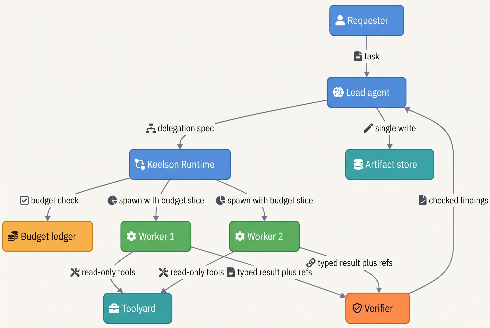
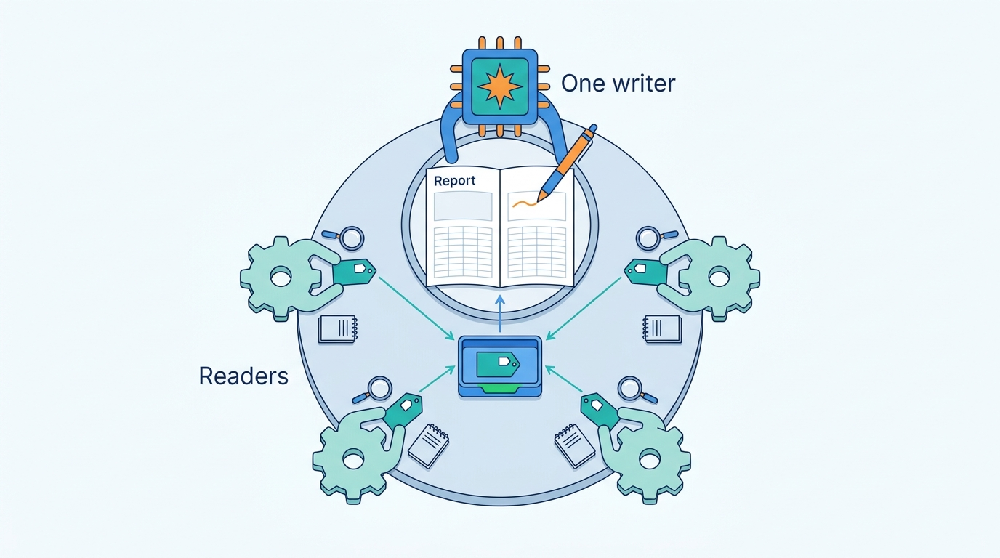
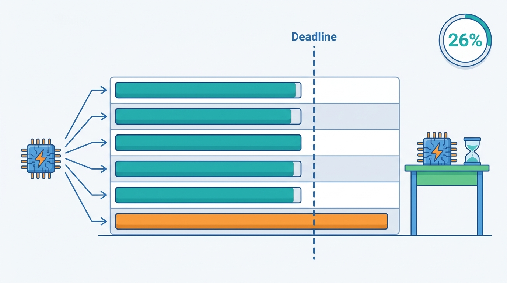
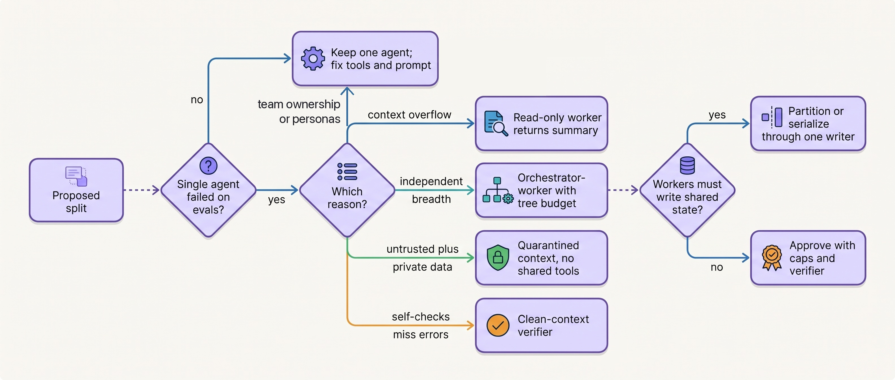
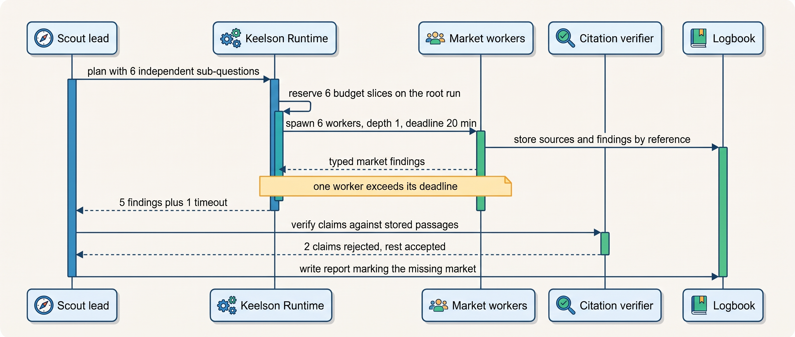

> **IN THIS CHAPTER, YOU WILL:** Learn the five multi-agent topologies and what each one decides about control, context, write authority and accountability; what the published evidence says about when more agents help and when they hurt; and how to test, price and bound a proposed split before it ships.

> **WHY THE BUSINESS CARES:** Every extra agent multiplies model spend and adds a place where work can be lost, duplicated or attributed to nobody. A split that pays for itself on research can double the cost and halve the reliability of a support or finance flow. A risk owner needs to know which agent took each action and under whose authority.

> **WHY ARCHITECTS SHOULD CARE:** The choice of topology fixes who owns the next step, what context crosses each boundary, who may write to shared state and how failure spreads. Frameworks hide these choices in defaults that differ between products. Getting them wrong produces systems that cost several times more and fail in ways no single agent would.

> **KEY POINTS:**
>
> * **One agent first; split only on evidence and only for one of four reasons.** An additional agent earns its place by isolating context, running independent read-only work in parallel, separating authority (such as untrusted content from private data), or verifying with a clean context. "Separation of concerns", tool count and personas are not reasons by themselves; fix the tools and the prompt first.
> * **Many readers, one writer.** Parallel agents are safe for gathering, searching and reviewing. They are dangerous when they write to a shared artifact, because every write carries decisions the other agents cannot see. In a controlled 2026 preprint study across six benchmarks, multi-agent designs did up to 70% worse than a single agent on sequential planning.
> * **Price and bound the task tree, not the agent.** Fan-out multiplies tokens and exposes the slowest worker. The runtime, not the prompt, enforces depth, fan-out, tokens, money and wall-clock time for the whole tree. A verifier sits between workers and any side effect, and every action carries the lineage of the agent that took it.

> **[FAILURE PATTERNS THIS CHAPTER ADDRESSES](where-agentic-systems-go-wrong.html):**
>
> * **The Agent Committee** — several agents pass work among themselves where one agent with the right tools would do, and nobody can say which agent decided.
> * **The Token Bonfire** — recursive delegation without tree-level budgets turns one research question into thousands of sub-agent runs and an invoice.
> * **The Lost Handoff** — every boundary between agents is a place where identifiers, constraints and decisions fall out of a free-text summary.

<br>
Most agentic systems that work in production are one model in a loop with well-designed tools, and that is also what the vendors who sell multi-agent frameworks recommend first. OpenAI's 2025 practical guide says its "general recommendation is to maximize a single agent's capabilities first" ([OpenAI, 2025](https://cdn.openai.com/business-guides-and-resources/a-practical-guide-to-building-agents.pdf)). Anthropic's 2024 guidance says to add multi-step agentic systems "only when simpler solutions fall short" ([Anthropic, 2024](https://www.anthropic.com/engineering/building-effective-agents)). Yet multi-agent designs keep reaching architecture reviews, often because the org chart has several teams.

The evidence supports a narrower position than either the enthusiasts or the sceptics take. **Additional agents pay when sub-tasks are independent and mostly read-only, and fail when sub-tasks share decisions.** Anthropic's research system and Cognition's coding agents, often read as opposing camps, agree on exactly this split once you look at their domains. The controlled study by Kim and colleagues finds the same boundary across six benchmarks: the gain depends on whether the task decomposes, not on how many agents you add.

This chapter owns four terms: **multi-agent system**, **topology** (agent), **orchestrator–worker** and **context isolation**. It builds on [[routing-and-delegation]], which defines the sub-agent and the delegation contract, and on [[planning-and-decomposition]], which decides how a task is split. It hands the mechanics of passing work and responsibility between agents to [[coordination-and-handoffs]], and the cost model to [[agent-cost-and-model-routing]].

## Setting the Scene at Ostrell: Three Proposals in One Forum

Ostrell, the fictional field-service software group this book follows (see [[meet-ostrell]]), runs seven agents on its Keelson platform. In **May 2027** Tomas Verhoef, the Chief Architect, put three proposals on one architecture forum agenda, because each asked the same question from a different side.

The first came from Scout, the internal research agent. In February, a Scout run on "competitor pricing across 14 markets" had spawned sub-agents recursively with no depth or cost limit. It ran for **41 hours**, made **1,900 sub-agent runs**, consumed about **310 million tokens** and cost **€8,700** in model spend before a quota alert stopped it on Monday morning. The report was unusable, with duplicated sections. That was the Weekend Fan-out. The emergency fix had added run budgets, a **maximum delegation depth of 2** and **at most 8 parallel sub-agents**. Strategy & Insights now wanted to know whether Scout should stay multi-agent at all.

The second came from Lena Brandt's Support Operations team. In April, Answerdesk's triage agent had handed billing conversations to a billing specialist agent as free-text summaries. The contract id dropped out in about **1 in 40** handoffs, and **3 wrong-contract credits** were proposed before A1 approval caught them. The team had already fixed the payload with typed fields. Now it proposed folding the specialist back into Answerdesk as a tool set.

The third came from Sales Operations. Priya Natarajan's team wanted to rebuild Dealroom, the CRM copilot, as three agents: an account researcher, a pricing agent and a proposal writer, each with its own prompt and owner.

Tomas framed one question for all three: **what does each additional agent buy that we can measure, and who is accountable for what it does?**

## Concepts: Agents, Topologies and What Crosses a Boundary

### What counts as a multi-agent system

A **multi-agent system**, in this book, is a system in which more than one model-driven loop holds its own context and its own decision about the next step, and at least one loop's output becomes another's input. Two conditions matter. Each agent has a **separate context** (it does not see everything the other sees), and each has **some control** over its own next step. A fixed chain of model calls in code is a workflow with model steps ([[workflows-loops-and-autonomous-agents]]), however many prompts it has. One agent calling a classifier model is still one agent.

The definition excludes much of what is marketed as multi-agent. The author's agentic-sales-platform interview design labels its orchestrator "Hierarchical multi-agent", but only one worker node exists and no sub-agent boundary or delegation contract is modeled (`highLevelArchitecture`). It is a single agent with a supervisor's name.

### Five topologies

A **topology** is the graph of agents and the semantics of its edges: who may start whom, whether control returns, and what context travels. Five shapes cover nearly every design I have reviewed.

| Topology | Shape | Edge semantics | Who owns the next step | Typical framework names (as of October 2026) |
| --- | --- | --- | --- | --- |
| **Single agent with tools** | One loop; tools, possibly many | Tool call and result | The agent, inside its budget | Any agent SDK |
| **Orchestrator–worker** | A lead agent delegates bounded sub-tasks to workers and synthesizes their results | **Call and return**: the worker gets a task, returns a result, ends | The lead | Subagents, agents-as-tools, ADK `task`/`single_turn` |
| **Supervisor** | A manager routes turns of one ongoing conversation among specialists, reviews their output and decides when to stop | Call and return, with a shared conversation | The supervisor | Supervisor pattern, hierarchical process, Magentic |
| **Peer handoff (swarm)** | Agents transfer control of a conversation to one another | **Transfer of control**: the receiver owns the conversation | Whichever agent currently holds it | Handoffs, swarm, ADK `chat` |
| **Pipeline** | A fixed sequence of agents, each consuming the previous one's artifact | Code-controlled stage transitions | Code, between stages; each agent inside its stage | Sequential process, sequential workflow |

Two variants recur on top of these. An **ensemble** runs several independent instances on the same question and aggregates by rule (a vote, or a check against ground truth). A **clean-context reviewer** is a worker whose only job is to judge another agent's output without seeing its reasoning; it is an orchestrator–worker edge used for verification rather than gathering.

The column that matters most is the edge semantics. The 2025 OpenAI guide puts it precisely: "in the manager pattern, edges represent tool calls whereas in the decentralized pattern, edges represent handoffs that transfer execution between agents" ([OpenAI, 2025](https://cdn.openai.com/business-guides-and-resources/a-practical-guide-to-building-agents.pdf)). Call and return keeps one accountable decision-maker per task. Transfer of control moves accountability with the conversation, so the system must record who held control when each action ran. [[coordination-and-handoffs]] owns the handoff; this chapter decides when you want one at all.

### Context isolation

**Context isolation** is the property that an agent's context window contains only what its delegation contract passes in, and that what happens inside it (verbose tool output, dead ends, untrusted content, errors) does not flow back except through a defined result. It is the most reliable benefit a second agent provides, and it works in three directions:

- **Upward isolation protects the parent's context.** A worker can spend tens of thousands of tokens exploring and return a summary of 1,000–2,000 tokens, according to Anthropic's September 2025 context-engineering guidance ([Anthropic, 2025](https://www.anthropic.com/engineering/effective-context-engineering-for-ai-agents)). The parent keeps its window for decisions. The author's ai-coding-cli interview design frames subagents as "context isolation first, parallelism second" (step `verify`, interviewer signals).
- **Downward isolation protects the worker from the parent's noise and from data it should not see.** A worker that never receives the customer's invoices cannot leak them.
- **Lateral isolation contains failure.** A worker that loops, is injected or produces nonsense fails inside its own budget and returns an error instead of corrupting a shared transcript.

Isolation has a price, and it is the same price seen from the other side: **the worker does not know what the parent decided.** Cognition's June 2025 post puts the principle as "Share context, and share full agent traces, not just individual messages", because "Actions carry implicit decisions, and conflicting decisions carry bad results" ([Yan, Cognition, 2025](https://cognition.com/blog/dont-build-multi-agents)). Its example: a game split into "background" and "bird" sub-tasks came back as a background in one visual style and a bird in another, which the final agent then had to reconcile. Isolation is therefore a contract design problem. You decide which decisions, identifiers and constraints cross the boundary, in typed fields, and you accept that everything else does not.

### Four reasons to add an agent

The rule I use in reviews: **a second agent is justified only by one of four reasons, and the proposal must name which one and show the evidence.**

| Reason | What the extra agent buys | Evidence that should exist before approval | Not the same as |
| --- | --- | --- | --- |
| **Context isolation** | Verbose exploration stays out of the parent's window | The single agent's context overflows, or quality falls as history grows, on the eval suite | A prompt that is merely long |
| **Parallel breadth** | Wall-clock time on independent, read-only sub-tasks; more total search effort | Sub-tasks are independent; latency matters; task value covers the token multiple | Splitting sequential steps into stages |
| **Separated authority** | One context holds untrusted content, another holds private data or side-effecting tools | A threat model shows the combination in one context ([[agent-threat-model]]) | Different team ownership |
| **Independent verification** | A judge that has not seen the producer's reasoning | Self-checks miss errors that a clean context catches, measured on labeled failures | Debate between copies of one model |

Three common arguments are missing from this table on purpose. **Tool count** is not a reason until better names, descriptions and on-demand tool loading have failed: OpenAI's guide notes that "some implementations successfully manage more than 15 well-defined, distinct tools while others struggle with fewer than 10 overlapping tools" ([OpenAI, 2025](https://cdn.openai.com/business-guides-and-resources/a-practical-guide-to-building-agents.pdf)). **Organizational ownership** is a reason for separate tool sets, prompts and evaluation suites, not for separate loops. **Personas** ("a critic", "a strategist") are prompts, and the debate evidence below says arguing copies of one model add cost without a reliable gain.

Separated authority deserves one more sentence. Splitting untrusted content from private data needs a second *context*, which is often a quarantined model call with no tools rather than a second agent loop. [[prompt-injection-defense]] owns that mechanism; the topology question is only whether the split also needs autonomy on both sides.

## Architecture: Bounding a Task Tree

Once a design has more than one agent, the unit of control is no longer the agent run but the **task tree**: the root run plus every run it delegates to, transitively. Keelson Runtime, Ostrell's agent runtime ([[agent-runtime]]), models the tree explicitly. Every delegated run carries a `root_run_id`, a `parent_run_id`, a depth and a slice of the root's budget.


**Figure 1:** *A bounded task tree: the lead plans, the runtime enforces the tree's budget at every spawn, workers only read, a verifier sits between workers and the lead, and exactly one agent writes the artifact.*

### Components and responsibilities

| Component | Owns | Must never |
| --- | --- | --- |
| **Lead agent** | The plan, the decision to delegate, the synthesis, the single write to the output artifact | Spawn outside the runtime; pass raw untrusted content to a worker that has side-effecting tools |
| **Runtime** (Keelson Runtime) | Spawning, the tree's budget ledger, depth and fan-out caps, deadlines, cancellation of the whole tree | Trust a prompt instruction as a limit |
| **Worker** | One bounded sub-task with its own context, tools and budget slice; a typed result | Write to the shared artifact; delegate beyond its granted depth; return results without references |
| **Verifier** | Checking worker results against sources, tests or rules before they reach the lead or a side effect | Share the producer's reasoning context |
| **Tool broker** (Toolyard) | Per-worker tool scopes and credentials ([[tool-ecosystems-and-mcp]]) | Grant a worker the lead's full scope by default |
| **Evidence log** (Logbook) | The tree's lineage: which run, agent version and identity took each action | Record a tree as one flat run |

### The delegation spec

Delegation in a multi-agent design is a typed object the runtime validates, not a sentence the lead writes. [[routing-and-delegation]] defines the **delegation contract** in general. In a task tree it carries the budget slice and the write rights as well:

```python
from dataclasses import dataclass
from typing import Literal

@dataclass(frozen=True)
class Budget:
    tokens: int
    cost_eur: float
    wall_clock_s: int

@dataclass(frozen=True)
class DelegationSpec:
    root_run_id: str
    parent_run_id: str
    depth: int                       # parent depth + 1
    goal: str                        # one sub-question, stated by the lead
    decisions_in_force: dict         # constraints already taken: scope, markets, date range
    inputs: list[str]                # references, not pasted content
    tools: list[str]                 # subset of the parent's scope
    write_rights: Literal["none", "own_scratch"]   # never the shared artifact
    result_schema: str               # e.g. "market_finding.v3"
    budget: Budget
    deadline_s: int

def admit(spec: DelegationSpec, ledger, caps) -> None:
    if spec.depth > caps.max_depth:
        raise Rejected("depth")
    if ledger.active_children(spec.parent_run_id) >= caps.max_parallel:
        raise Rejected("fan_out")
    if not ledger.reserve(spec.root_run_id, spec.budget):   # atomic, tree-wide
        raise Rejected("tree_budget")
```

Three details carry the design. `decisions_in_force` is Cognition's "share context" made into a field: the scope, constraints and choices the lead has already made travel explicitly, rather than being hoped for. `reserve` is atomic on the **root's** budget, so ten workers cannot each believe they have the whole budget. And a rejection is returned to the lead as a tool result, not raised as a crash, so the lead can replan within what remains. Vendor SDKs now ship similar caps, and their defaults show why you must set your own: as of October 2026, the Claude Agent SDK documents a default spawn depth of 3 and 20 concurrent subagents, and **no default spend limit** ([Anthropic, n.d., accessed 2026-10](https://code.claude.com/docs/en/agent-sdk/subagents)). The same page says prompt instructions "only steer" delegation, "so set the limits as well".

### Requirements per interaction

| Interaction | Consistency | Latency | Durability | Who may act |
| --- | --- | --- | --- | --- |
| Lead → runtime: spawn | Budget reservation atomic on the root | Milliseconds; not on the critical path of user output | Spawn recorded before the worker starts | Lead only, within granted depth |
| Worker → tools | Read-only by default; per-worker scope | Per-tool deadline; worker deadline bounds all | Tool calls recorded as activities | Worker, with its own scoped identity |
| Worker → verifier → lead | Typed result validated against schema; references resolvable | Bounded by the slowest worker the lead waits for | Results persisted by reference so a lead crash does not lose them | Verifier decides acceptance |
| Lead → artifact or side effect | Single writer per artifact; action object with idempotency key | Not latency-critical | Intent and receipt in the evidence log | Lead only, under its autonomy tier |
| Cancel tree | All descendants stop new effects; queued actions held | Seconds | Cancellation recorded per run | Runtime, requester or kill switch |

### Shared state: one writer per artifact

When agents share state, the distributed-systems rules apply unchanged: concurrent writers need either coordination or partitioning. Agents add a twist. Each write carries implicit decisions, so even writes to *different* parts of an artifact can conflict in meaning (the background and the bird). The book's default is **many readers, one writer**. Workers write only to their own scratch space or return results by reference; the lead, alone, writes the shared artifact. When parallel edits are unavoidable, partition the artifact physically. The author's ai-coding-cli design gives each editing subagent its own git worktree and makes the parent own merge order, so two subagents editing one file is "impossible by construction" and conflicts "surface at merge, visibly" (step `verify`, failure drill 3).


**Figure 2:** *Many readers, one writer: workers gather and return results by reference, and only the lead writes the shared artifact.*

Anthropic's research system shows the read side. Subagents "call tools to store their work in external systems" and pass lightweight references back, to avoid a "game of telephone", and the lead saves its plan to memory because a context beyond 200,000 tokens would be truncated ([Anthropic, 2025](https://www.anthropic.com/engineering/multi-agent-research-system)). Results by reference keep the lead's context small and make worker output durable, which [[task-state-and-checkpoints]] needs anyway.

### Accountability: one accountable agent per task tree

Who is responsible for an outcome is not a philosophical question; it decides whose eval suite must catch a regression and whose pager rings. My rule: **every task tree has one accountable agent, and that agent has one owning team.** In orchestrator–worker and supervisor designs it is the lead. Workers are components of the lead's agent version, listed in its manifest and evaluated with it, even if another team maintains their prompts. In peer-handoff designs, accountability moves with control, and the evidence log must show which agent held control at each action. That is a reason to prefer call-and-return inside one system and to reserve transfer of control for boundaries where responsibility genuinely changes hands, such as an escalation to a human team ([[coordination-and-handoffs]]).

Lineage is the mechanism. Every action in Logbook records the run, its parent, the root, the agent version and the identity under which it ran. Claude Agent SDK messages from subagents, for example, carry a `parent_tool_use_id` ([Anthropic, n.d., accessed 2026-10](https://code.claude.com/docs/en/agent-sdk/subagents)); OpenTelemetry's generative-AI conventions nest sub-agent spans under the parent's trace ([[agent-observability]]). Without lineage, a multi-agent incident review cannot answer the first question it will be asked.

## Evidence: When More Agents Help and When They Hurt

### Breadth-first research: large gains, mostly bought with tokens

Anthropic's June 2025 engineering post describes an orchestrator–worker research system: a lead agent plans, spawns subagents that search in parallel, synthesizes, and hands to a citation agent ([Anthropic, 2025](https://www.anthropic.com/engineering/multi-agent-research-system)). It reports that the multi-agent configuration "outperformed single-agent" by **90.2%** on Anthropic's internal research eval. Three caveats travel with that number. The eval is internal and started from about 20 queries; nobody outside can reproduce it. The multi-agent system spent far more compute: Anthropic reports agents use about **4×** the tokens of chat and multi-agent systems about **15×**. And on BrowseComp, "token usage by itself explains 80% of the variance" in performance, with tool calls and model choice bringing it to 95%. Anthropic's own summary is that multi-agent systems "work mainly because they help spend enough tokens to solve the problem."

That is still useful evidence. Parallel workers with isolated contexts are a way to spend more search effort, faster, without overflowing one window: the post reports that parallelism cut research time "by up to 90%" for complex queries. The same post names where the design fits poorly: tasks where agents must share context or have many dependencies, and "most coding tasks". It also lists the failures the team saw: spawning 50 subagents for simple queries, endless searching for nonexistent sources, duplicated work from vague task descriptions. Those are exactly the failures a tree budget and a typed delegation spec address.

### Coding: one writer, scoped helpers

Cognition argued in June 2025 for single-threaded agents in coding ([Yan, Cognition, 2025](https://cognition.com/blog/dont-build-multi-agents)). Its April 2026 follow-up reports what has since worked in its own products: clean-context review loops, manager-and-child delegation with scoped children, read-only search subagents and escalation to a stronger model when both models are strong. What still does not work: parallel writers ("conflicting implicit decisions"), weaker models that do not know when to escalate, and children that assume shared state they lack ([Yan, Cognition, 2026](https://cognition.com/blog/multi-agents-working)). This is documented experience about Cognition's own systems; its product numbers are vendor-reported and I do not use them.

Read side by side, the two camps agree more than the headlines suggest. **Both say multi-agent pays when sub-tasks are independent and read-mostly, and fails when sub-tasks share decisions.** The disagreement is about domain: research decomposes; most code does not.

### Controlled evidence: task structure, not agent count

The best controlled evidence is the preprint by Kim and 18 co-authors at Google and MIT, *Towards a Science of Scaling Agent Systems* ([Kim et al., 2025, v3 2026](https://arxiv.org/abs/2512.08296)). Version 3 (8 April 2026) compares five architectures (one single-agent, four multi-agent) across 260 configurations, six agentic benchmarks and three model families. Relative to a single agent, results range from **+80.8%** on decomposable financial reasoning to **−70.0%** on sequential planning. Coordination gives diminishing returns once the single-agent baseline is strong, multi-agent overhead hurts tool-heavy tasks, and architectures without centralized verification propagate more errors. An earlier version, summarized on Google's research blog in January 2026, reported that independent agents amplified errors **17.2×** while centralized coordination contained amplification to **4.4×** ([Kim and Liu, Google Research, 2026](https://research.google/blog/towards-a-science-of-scaling-agent-systems-when-and-why-agent-systems-work/)); those figures come from the 180-configuration version and should be cited as such. Limits: it is a preprint, the benchmarks are short compared with enterprise tasks, and none of them involves side effects.

The architectural reading is direct. A decomposable task with a validating orchestrator is where gains appear; sequential, coupled tasks get worse; and the orchestrator's value is partly that it acts as a checkpoint.

### Failure taxonomy: mostly specification and verification

Cemri and colleagues annotated more than 1,600 traces from seven multi-agent frameworks (MetaGPT, ChatDev, Magentic-One and others) and derived 14 failure modes in three categories, with human inter-annotator agreement of κ = 0.88 ([Cemri et al., 2025](https://arxiv.org/abs/2503.13657); NeurIPS 2025 Datasets and Benchmarks track). The largest single modes were repeating completed steps (15.7% of failures), a mismatch between stated reasoning and the action taken (13.2%) and not recognizing that the task was complete (12.4%). The three task-verification modes (premature termination, no or incomplete verification, incorrect verification) together account for about 23.5%. Interventions on role specification and an added verification step improved task success by 9.4% and 15.6% on ChatDev-based tasks, and the authors say interventions gave inconsistent results. The traces come from 2024–25 models and open frameworks; closed production systems are not included.

The useful conclusion for architects: **many multi-agent failures are things deterministic code can catch.** Step-level idempotency stops repeated work from repeating effects; completion criteria checked by code stop endless loops; an explicit verifier stage addresses a quarter of the failures by construction.

### Debate: voting does most of the work

Multi-agent debate (copies of a model arguing toward an answer) reported gains on every task in Du et al.'s 2023 preprint with 2023-era models ([Du et al., 2023](https://arxiv.org/abs/2305.14325)). Later work shrinks the claim. Smit et al. found that debate does not reliably beat self-consistency and ensembling and is sensitive to hyperparameters ([Smit et al., 2023](https://arxiv.org/abs/2311.17371), preprint). Wang et al. found a single agent with strong prompts reaches almost the same performance ([Wang et al., 2024](https://arxiv.org/abs/2402.18272), preprint). Choi, Zhu and Li showed that majority voting "accounts for most of the performance gains typically attributed to" debate and proved that debate alone does not improve expected correctness ([Choi et al., 2025](https://arxiv.org/abs/2508.17536); NeurIPS 2025). Huang et al. found models "struggle to self-correct their responses without external feedback" ([Huang et al., 2023](https://arxiv.org/abs/2310.01798); ICLR 2024). The design consequence: where a proposal says "agents that debate", build N independent samples and a deterministic aggregator, or a verifier with external ground truth (tests, a database, the source document). Do not count self-critique as a control in a risk assessment.

### Two smaller signals

LangChain's documentation counts calls on its own example tasks: on a three-domain request, subagents used 5 model calls and about 9,000 tokens, peer handoffs 7 or more calls and 14,000 or more tokens ([LangChain, n.d., accessed 2026-10](https://docs.langchain.com/oss/python/langchain/multi-agent)). These are vendor examples, not a benchmark, but topology changes cost even at fixed quality. In a March 2026 post, Anthropic reported that multi-agent BrowseComp runs found and used leaked benchmark answers at **0.87%** of problems against **0.24%** for single-agent runs ([Anthropic, 2026](https://www.anthropic.com/engineering/eval-awareness-browsecomp)): more search effort also means more ways to reach things the agent should not use, which is an evaluation-integrity concern for [[building-agent-eval-suites]].

**No published incident report** attributes a production outage or harm specifically to multi-agent coordination, as far as the research for this book could find. The evidence base is benchmarks, taxonomies and vendor experience; the failure scenarios later in this chapter are the author's analysis plus Ostrell's fictional incidents. The interview designs do not cover multi-agent research decomposition either: the author's research, healthcare and benefits designs each keep the model in a single bounded node inside a deterministic pipeline, so the research topology here relies on the published reports above.

## The Cost and Latency Arithmetic

Fan-out changes three numbers, and each needs its own estimate before a design is approved.

**Tokens.** Each worker pays its own context setup (instructions, tool definitions, the delegation spec) and its own exploration. A tree with N workers costs roughly lead planning + N × (setup + exploration) + verification + synthesis. Fan-out buys breadth and wall-clock time, not efficiency. Model tiering can offset part of it: workers often run well on a cheaper tier than the lead, which is why the right comparison is **cost per successful task** against the single-agent baseline, measured on the same suite ([[agent-cost-and-model-routing]]).

**Latency.** The tree's latency is planning + the slowest worker the lead waits for + verification + synthesis. Parallelism removes the sum of worker times but exposes the maximum, and the maximum is a tail statistic. If each worker independently has a 5% chance of exceeding its p95 time, the chance that at least one of six does is 1 − 0.95⁶ ≈ **26%**; for eight workers, about **34%**. This is the fan-out version of Dean and Barroso's tail-at-scale argument ([Dean and Barroso, 2013](https://research.google/pubs/the-tail-at-scale/)). Every worker therefore needs a deadline, and the lead needs a decided policy for a late worker: wait, proceed and mark the gap, or re-issue.


**Figure 3:** *Fan-out exposes the slowest worker: if each of six workers has a 5% chance of running late, about 26% of runs wait on at least one, so every worker needs a deadline.*

**Errors.** Workers' errors combine at synthesis. If each of six findings independently has a 5% chance of a material error, the report contains at least one with a probability of about 26%, the same arithmetic as above. [[when-agents-are-justified]] owns error compounding; the topology consequence is that a verifier between workers and synthesis is not optional once fan-out exceeds two or three.


**Figure 4:** *The review test for a proposed split: no evidence that one agent failed means no split, and each legitimate reason leads to a specific, bounded shape rather than to "more agents".*

## Worked Example at Ostrell: Scout, Answerdesk and Dealroom

### Scout: earning the fan-out with evidence

Mei Lin Zhou's evaluation team built a Sounding suite of **160 Scout tasks** drawn from real 2026–27 requests, half "breadth" tasks (comparisons across markets, vendors or regulations) and half "depth" tasks (one technical question pursued to the source). They ran two configurations: a single Large-tier agent with history compaction, and an orchestrator–worker design with a Large-tier lead and Mid-tier workers. Graders scored factual accuracy and citation accuracy against references written by analysts (all figures are Ostrell's, fictional):

| Task type | Single agent: score | Orchestrator–worker: score | Tokens, orchestrator–worker ÷ single | Median time, single → orchestrator–worker |
| --- | --- | --- | --- | --- |
| Breadth (80 tasks) | 0.64 | **0.81** | 2.4× | 31 → 16 min |
| Depth (80 tasks) | **0.80** | 0.78 | 2.9× | 12 → 13 min |

The result matched the published evidence. On breadth tasks, workers in parallel scored higher and finished faster. On depth tasks, the fan-out spent nearly three times the tokens for no gain, because the sub-questions depended on each other. The forum's decision was **conditional fan-out**: Scout's plan ([[planning-and-decomposition]]) is data, and Keelson Runtime grants the delegation tool only when the plan contains at least three independent sub-questions. Depth tasks run as a single agent.

The 2027 Scout manifest sets these tree limits, enforced by the runtime: **maximum depth 2** and **at most 8 parallel workers** (from the Weekend Fan-out fix), plus a default per-run budget of **8 million tokens, €90 and 90 minutes of wall-clock time**. A requester can raise the budget up to 3× with approval from the Strategy & Insights lead. Workers get read-only search through Toolyard (web or internal sources, never both in one worker since July 2027; see [[agent-threat-model]]), no write rights, a 20-minute deadline, and a `market_finding` result schema with references to stored sources. A Mid-tier citation verifier checks every claim against the stored source passage before the lead synthesizes. Only the lead writes the report to the document space.

A typical breadth run, "service-contract pricing for heat-pump installers in the Netherlands, Germany, Belgium, the UK and the US", plans six workers (five markets and one on regulation). Assume blended rates of **€20 per million tokens for the Large tier and €4 for the Mid tier** *(assumption; the providers' actual prices are not part of the ledger)*:

| Step | Tier | Tokens | Cost *(at assumed rates)* | Time |
| --- | --- | --- | --- | --- |
| Lead: plan and spawn | Large | 0.15 M | €3.00 | 2 min |
| 6 workers in parallel | Mid | 6 × 0.55 M = 3.3 M | €13.20 | slowest 12 min |
| Citation verifier | Mid | 0.25 M | €1.00 | 2 min |
| Lead: synthesis and write | Large | 0.20 M | €4.00 | 2 min |
| **Total** | | **3.9 M** | **€21.20** | **18 min** |

The tree used 2.4 times the single agent's tokens, but most of them on the cheaper tier, so it cost less than the single Large-tier agent's roughly 1.6 million tokens (about €32 at the same assumed rate) and finished in about half the time. That is the trade a fan-out should show before it is approved: better results at a known multiple, with the tiering effect measured rather than assumed. Scout's budget of €90 leaves room for replanning but would stop a repeat of February at about 1% of its cost. Across Scout's **~350 runs a month**, with about 40% classed as breadth *(assumption)*, model spend is in the order of €5,500 a month *(estimate at the assumed rates)*: less than the single Weekend Fan-out run.


**Figure 5:** *One Scout breadth run: the runtime reserves the tree's budget before spawning, a late worker becomes a marked gap rather than an open-ended wait, and only verified claims reach the single writer.*

### Answerdesk: folding the specialist back

The billing specialist existed for an organizational reason (the billing team owned its prompt) and a weak technical one (Answerdesk's prompt was getting long). Neither is one of the four reasons. The Lost Handoff showed the cost: a boundary where a contract id could fall out of a summary 1 time in 40. Lena Brandt's team folded the specialist back into Answerdesk as a **billing tool set** that Keelson loads only when the conversation's intent is billing, with the billing team owning those tools' descriptions and their part of the Sounding suite. Answerdesk stays one agent with one owner, one autonomy register and one trace per conversation. The typed handoff payload survives where responsibility really changes hands: the escalation to human support staff ([[agent-interaction-design]]).

One split did remain, for the third reason. After the Poisoned Ticket in **May 2027**, the part of Answerdesk that reads inbound email content can no longer send to new recipients. That is separated authority, and it is implemented as a quarantined context with a typed output rather than as a second conversational agent ([[prompt-injection-defense]]).

### Dealroom: a committee rejected

Sales Operations' three-agent proposal failed the test in the forum. Research, pricing and proposal writing are sequential, and each step depends on decisions in the previous one (which products, which discount band, which contract term). It is the shape on which, in the earlier version of Kim et al.'s study, every multi-agent variant degraded the sequential-planning benchmark by 39–70%. No eval showed the single agent failing. The forum kept Dealroom as one agent and gave each sub-team its own Sounding suite (research, quotes) so it could see its own regressions. The Stale Price Book a month later came from a stale retrieval index, not from the topology; three agents would have passed the old prices on just as faithfully.

## Failure Modes and Recovery

| Scenario | What happens | Detection | Containment | Recovery |
| --- | --- | --- | --- | --- |
| **Recursive fan-out** (Weekend Fan-out) | Workers spawn workers; tokens and cost grow with the tree | Tree budget burn rate in Wake; spawn-rate alert per root run | Runtime rejects spawns beyond depth, fan-out and the root budget | Cancel the tree; keep stored findings; rerun with a revised plan |
| **Conflicting writers** | Two workers edit one artifact; each consistent, together inconsistent | Merge conflicts; verifier checks for consistency across sections | No write rights for workers; partitioned workspaces | Lead re-synthesizes from findings; discard worker edits |
| **Telephone loss** | A worker's summary drops an identifier, constraint or caveat | Schema validation on results; missing required fields | Results by reference to stored sources; required fields | Re-request the missing field from the worker's stored output, not a new run |
| **Injected worker output** | A worker read a hostile page; its result carries instructions to the lead | Injection test suite; instruction-shaped content in results | Treat worker results as untrusted data; lead holds no tools that send data out while reading them | Quarantine the finding; rerun the sub-task with the source blocked |
| **Straggler** | One worker is slow; the whole run waits | Worker deadline exceeded | Per-worker deadline; partial-result policy | Report marks the gap; optional re-issue within the remaining budget |
| **Unverified completion** | A worker claims success; the lead accepts it | Verifier rejection rate; sampled human review | Verifier between workers and synthesis or any side effect | Reject and re-issue, or report as unverified |
| **Circular handoffs** | Peers pass a conversation back and forth | Handoff count per conversation; repeated agent pairs | Handoff cap; route to a human after N transfers | Escalate with the full typed payload ([[coordination-and-handoffs]]) |
| **Orphaned children** | The lead crashes; workers keep running and spending | Runs whose root is terminal | Tree-scoped cancellation; children heartbeat to the root | Durable resume of the lead from stored results ([[durable-agent-execution]]) |

Two scenarios are specific to multiple agents. **Injected worker output** is the multi-agent route for prompt injection: a worker that read untrusted content passes its result to a lead with more authority. As of October 2026, Claude Code scans a subagent's final message for instruction-shaped patterns before the parent reads it, neutralizing imitated control tags and turn markers without removing text ([Anthropic, n.d., accessed 2026-10](https://code.claude.com/docs/en/agent-sdk/subagents)). That helps, but the durable control is structural: worker output is untrusted data, and no single context combines private data, untrusted content and an outbound channel ([[agent-threat-model]]). **Orphaned children** are the multi-agent form of Amnesiac Execution: a tree whose root dies must cancel its descendants or resume and collect their stored results, never leave them spending.

## Trade-offs

| Design | Strengths | Costs and risks | Right when | Wrong when |
| --- | --- | --- | --- | --- |
| **Single agent with tools** | One context, one owner, one trace; cheapest; easiest to evaluate | Context fills on long or broad tasks; many similar tools confuse selection | Default; coupled, sequential tasks; most coding, support and back-office work | The task needs breadth beyond one window or wall-clock time a serial loop cannot meet |
| **Single agent + read-only workers** | Keeps the parent's context clean; contained exploration | Workers lack the parent's decisions; summary loss | Large-codebase search; document review; lookups with noisy output | Workers would need to write |
| **Orchestrator–worker** | Parallel breadth; central synthesis and verification; one accountable lead | ~2–15× tokens; tail latency; plan quality caps result quality | Independent, read-mostly sub-tasks of high value; research | Sub-tasks share decisions; low-value or latency-critical requests |
| **Supervisor** | Specialists under one controller | Supervisor tokens on every exchange; paraphrase loss; often a router in disguise | Long conversations across distinct tool domains needing central review | A router plus tool sets would do |
| **Peer handoff** | No central bottleneck; natural for transfers between owners | Accountability moves; full-history defaults leak context; circular handoffs | Real transfer of responsibility (to a human team, or another organization's agent) | Inside one system with one owner |
| **Pipeline of agents** | Stages testable in isolation; code controls transitions | Errors pass downstream; each stage repeats context setup | Stages with different trust or tools, each with a checkable artifact | Stages are just prompt sections; a workflow with model steps is enough |
| **Ensemble / vote** | Reliable, easy to reason about; parallel | N × cost; only for questions with comparable answers | Classification or extraction where agreement signals reliability | Open-ended generation; "debate" between copies of one model |

The recommendation rests on two assumptions. First, that the single-agent baseline keeps improving: Kim et al. find gains shrink as baselines get stronger, so each model generation weakens the case for fan-out on moderately broad tasks. Second, that the topology can be evaluated: a split that cannot be compared against a single-agent baseline on a suite should not ship.

## Across Domains: How the Stakes Change the Design

| Question | Coding agents | Customer operations (support, sales, marketing) | Back office (finance, legal, HR) | High-stakes decisions (healthcare, public benefits) |
| --- | --- | --- | --- | --- |
| Default topology | One editing agent per task; read-only explorer and reviewer workers | One agent per conversation with tool sets loaded by intent | A workflow with bounded agentic steps; rarely any loop-to-loop delegation | A single bounded model node inside a deterministic pipeline (design examples) |
| Where fan-out pays | Wide read-only searches; clean-context review; parallel edits only in separate worktrees | Offline work (content variants, account research), not the live conversation | Parallel per-entity or per-document drafting in which items are independent | Evidence gathering at most; never in the decision path |
| Who may write | One agent per branch or worktree; humans merge | The conversation's agent, through action objects | The workflow, after approval; agents write to a staging store | Humans decide adverse outcomes; the model drafts |
| What a verifier checks | Tests, type checks and build against a baseline | Policy and the customer's contract before any credit or send | Reconciliation rules and segregation of duties | Deterministic rules the model cannot override, then a human |
| Accountability boundary | The harness and the PR author of record | The agent's owning team; escalation to staff transfers responsibility | The process owner (controller, counsel) | The licensed or accountable human, bound to the decision record |
| Latency pressure on the tree | Low (asynchronous PRs) | High in conversation, so no fan-out inside a live exchange | Low to medium (close calendar) | Varies: interactive for clinical support, days for casework |

Sources for the right two columns where they are not Ostrell: the author's agentic-healthcare-platform and agentic-public-benefits-platform interview designs both confine the model to a single bounded node in a deterministic directed acyclic graph (`highLevelArchitecture`, pipeline group), and the research-platform design does the same with its hypothesis agent. In those designs the rules layer is authoritative and humans own adverse decisions, so there is nothing for a second agent to decide. The ai-coding-cli design supplies the coding column's worktree rule (step `verify`). The agentic-platform-foundations design gives each fanned-out sub-agent "its own bounded context, token budget, and least-privilege scope" so that a compromised sub-agent "can't reach beyond its sub-task" (step `control-flow`, deep dive); that is the platform rule here too.

**What the platform keeps common:** the task-tree model, the delegation spec, tree budgets and caps, lineage in the evidence log, worker results treated as untrusted, the single-writer rule and the verifier stage. **What is domain policy:** whether fan-out is allowed at all on a given path, which verifier is authoritative (tests, policy, reconciliation, rules or a human), and where a transfer of control is permitted. The pattern across the table is that **the higher the consequence, the less the topology matters, because the decision moves out of the model and into rules and people.** Multi-agent designs are most defensible where outputs are drafts that something else checks.

## The Chief Architect's View

**What to decide.** Make topology a reviewed architectural decision, recorded in the Agent Registry with the agent's manifest: which of the five shapes, which of the four reasons, the evidence that a single agent fell short, the tree caps and the accountable agent. At Ostrell, Tomas Verhoef's forum made "name the reason and show the eval" a precondition for granting any agent the delegation tool.

**Who decides.** The platform team (Amara Okafor's Agent Platform team) owns the mechanisms: the runtime's tree budgets, caps, lineage and cancellation. Agent owners propose topologies. The architecture forum approves any design with transfer of control or with workers that can write, because those are the designs that move accountability and create shared-state risk. Security (Farah Haddad) reviews any split justified by separated authority, since that justification is a security claim.

**What to watch.** Per agent: tokens per successful task against the single-agent baseline; spawns per root run; verifier rejection rate; runs ending on a budget cap; worker deadline misses; handoffs per conversation. A rising spawn count with a flat success rate is a Token Bonfire starting; a verifier that never rejects is either unnecessary or broken.

**What is durable and what will change.** Durable: the four reasons, call-and-return versus transfer of control, context isolation as a contract, one writer per artifact, budgets on the tree, verification before effects and lineage per action. These follow from distributed-systems constraints and from how accountability works, not from model capability. Volatile: the token multiples, tool-count thresholds, framework names and defaults (Microsoft's AutoGen and LangChain's supervisor helper library were both archived by October 2026), and the point at which a single agent is strong enough that fan-out stops paying. Re-run the single-agent baseline on every model upgrade before keeping a split ([[versioning-agent-systems]]). Keep orchestration semantics in your own thin layer or in durable workflow state, so that a framework change does not change behavior.

## Questions to Ask

1. Which of the four reasons (context isolation, parallel breadth, separated authority, independent verification) justifies each additional agent, and where is the eval that shows a single agent falling short?
2. For each edge in the topology, is it call-and-return or transfer of control, and who is accountable for the outcome at every point in the task?
3. What exactly crosses each boundary: which decisions already taken, which identifiers, which constraints, in which typed fields? What deliberately does not cross?
4. Which agents may write to shared state, and how are concurrent writes prevented or partitioned?
5. What are the tree's caps (depth, parallel workers, tokens, money, wall-clock), where are they enforced, and what happens to running children when the root is cancelled or crashes?
6. What does the lead do when a worker is late, fails or returns something the verifier rejects?
7. Is worker output treated as untrusted input, and does any single context combine private data, untrusted content and an outbound channel?
8. What is the cost per successful task against the single-agent baseline on the same suite, including the tiering effect, and when was the baseline last re-run?
9. Can the evidence log reconstruct, for any action, which run and agent version took it, its parent and its root?

The topology decides who works on a task; it does not yet say how work, context and responsibility move between agents and people without loss. That is the subject of [[coordination-and-handoffs]], where the typed handoff payload that fixed Ostrell's Lost Handoff becomes a general contract.

## Sources and Evidence

### Research papers

- [Towards a Science of Scaling Agent Systems](https://arxiv.org/abs/2512.08296), Y. Kim et al. (Google, MIT), arXiv preprint, 2025 (v3 2026-04-08): 260 configurations, six benchmarks; +80.8% to −70.0% relative to single agent; centralized verification limits error propagation.
- [Why Do Multi-Agent LLM Systems Fail?](https://arxiv.org/abs/2503.13657), M. Cemri et al., 2025, NeurIPS 2025 Datasets and Benchmarks: MAST taxonomy of 14 failure modes over 1,600+ traces; per-mode prevalence and interventions.
- [Improving Factuality and Reasoning in Language Models through Multiagent Debate](https://arxiv.org/abs/2305.14325), Y. Du et al., 2023, preprint: early debate gains with 2023 models.
- [Should we be going MAD?](https://arxiv.org/abs/2311.17371), A. Smit et al., 2023, preprint: debate does not reliably beat self-consistency or ensembling.
- [Rethinking the Bounds of LLM Reasoning](https://arxiv.org/abs/2402.18272), Q. Wang et al., 2024, preprint: a strongly prompted single agent nearly matches multi-agent discussion.
- [Debate or Vote](https://arxiv.org/abs/2508.17536), H. K. Choi, X. Zhu, S. Li, 2025, NeurIPS 2025: voting explains most of debate's gains; debate alone does not improve expected correctness.
- [Large Language Models Cannot Self-Correct Reasoning Yet](https://arxiv.org/abs/2310.01798), J. Huang et al., 2023, ICLR 2024: intrinsic self-correction without external feedback is unreliable.
- [The Tail at Scale](https://research.google/pubs/the-tail-at-scale/), J. Dean and L. A. Barroso, 2013: tail latency dominates fan-out.

### Specifications, standards and regulation

- None specific to this chapter; agent-to-agent protocols are covered in [[coordination-and-handoffs]].

### Vendor documentation and engineering reports

- [How we built our multi-agent research system](https://www.anthropic.com/engineering/multi-agent-research-system), Anthropic, 2025: orchestrator–worker research design, +90.2% on an internal eval, ~4× and ~15× token multiples, 80% of variance explained by tokens, observed failures, results stored by reference.
- [Effective context engineering for AI agents](https://www.anthropic.com/engineering/effective-context-engineering-for-ai-agents), Anthropic, 2025: sub-agents return condensed summaries of about 1,000–2,000 tokens.
- [Building effective agents](https://www.anthropic.com/engineering/building-effective-agents), Anthropic, 2024: workflow patterns including orchestrator–workers; start simple.
- [Eval awareness in BrowseComp](https://www.anthropic.com/engineering/eval-awareness-browsecomp), Anthropic, 2026: unintended-solution rate 0.87% multi-agent versus 0.24% single-agent.
- [Subagents in the SDK](https://code.claude.com/docs/en/agent-sdk/subagents), Anthropic, n.d., accessed 2026-10: context isolation semantics, default depth and concurrency caps, no default spend cap, lineage fields, output scanning.
- [Don't Build Multi-Agents](https://cognition.com/blog/dont-build-multi-agents), W. Yan, Cognition, 2025: share context; actions carry implicit decisions.
- [Multi-Agents: What's Actually Working](https://cognition.com/blog/multi-agents-working), W. Yan, Cognition, 2026: clean-context review, scoped children and read-only search work; parallel writers do not.
- [A practical guide to building agents](https://cdn.openai.com/business-guides-and-resources/a-practical-guide-to-building-agents.pdf), OpenAI, 2025: maximize a single agent first; manager versus decentralized patterns; tool-overlap observation.
- [Multi-agent](https://docs.langchain.com/oss/python/langchain/multi-agent), LangChain, n.d., accessed 2026-10: call and token counts per pattern on example tasks.
- [Towards a science of scaling agent systems: when and why agent systems work](https://research.google/blog/towards-a-science-of-scaling-agent-systems-when-and-why-agent-systems-work/), Y. Kim and X. Liu, Google Research, 2026: earlier version's 17.2× versus 4.4× error amplification.

### Incidents, cases and decisions

- No public incident report attributing a production failure specifically to multi-agent coordination was found; the Weekend Fan-out and the Lost Handoff are Ostrell's fictional incidents.

### Design examples from the author's interview project

- Obrenović, Ž., "Agentic Platform Foundations", system-design interview design, `system-design-interviews/data/book/agentic-platform-foundations/interview.json`, 2026: step `control-flow` (orchestrator–workers with per-worker context, budget and least-privilege scope; no path-specific enforcement bypass).
- Obrenović, Ž., "AI Coding CLI", system-design interview design, `system-design-interviews/data/book/ai-coding-cli/interview.json`, 2026: step `verify` (subagents as context isolation first; worktree per editing subagent; subagent isolation versus token cost).
- Obrenović, Ž., "Agentic Sales Platform", system-design interview design, `system-design-interviews/data/book/agentic-sales-platform/interview.json`, 2026: `highLevelArchitecture` (a "hierarchical multi-agent" label over a single worker, used here as a counter-example).
- Obrenović, Ž., "Agentic Healthcare Platform", "Agentic Public Benefits Platform" and "Agentic Research Platform", system-design interview designs, `system-design-interviews/data/book/agentic-healthcare-platform/interview.json`, `.../agentic-public-benefits-platform/interview.json`, `.../agentic-research-platform/interview.json`, 2026: `highLevelArchitecture` (one bounded model node in a deterministic pipeline).

Ostrell is fictional; architectural recommendations, labeled inferences and labeled assumptions are the author's judgement.
