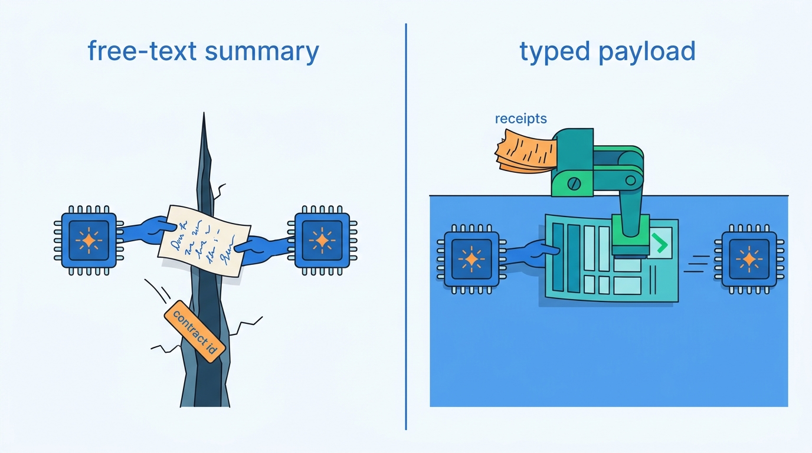
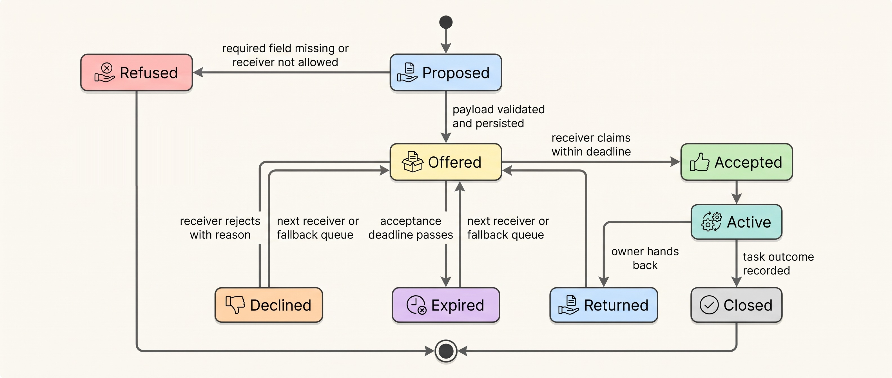
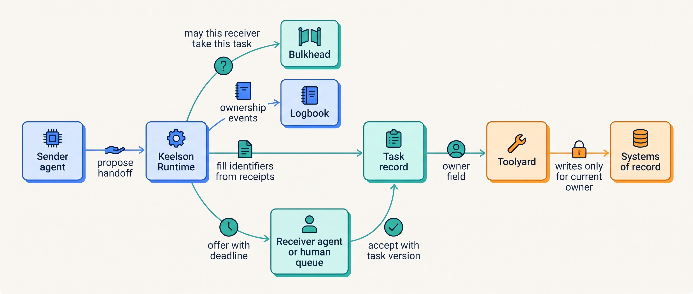
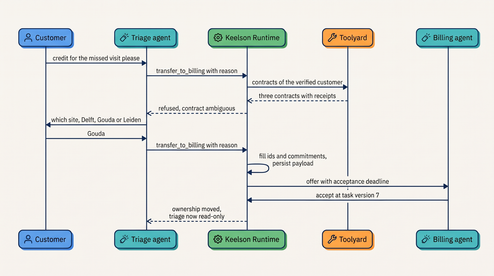
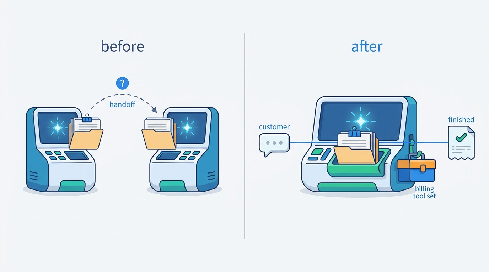

> **IN THIS CHAPTER, YOU WILL:** Learn how a handoff differs from delegation through a tool call, how to design typed handoff payloads and the state machine that makes a handoff complete only when someone has accepted it, when agents should coordinate through a shared task record instead of messages, and how agent-to-agent protocols such as A2A work across organizational boundaries as of October 2026.

> **WHY THE BUSINESS CARES:** Every time work changes hands, a customer can be asked the same question twice, a commitment can be forgotten, or an action can be taken on the wrong account. Each one is small. Across thousands of handoffs a day they become complaints, wrong credits and disputed decisions that nobody owned at the moment they happened.

> **WHY ARCHITECTS SHOULD CARE:** A handoff is the one point where an agentic system moves responsibility, not just data. If the payload is free text, identifiers drop out. If nobody has to accept the work, it can be orphaned. If ownership is not recorded, the evidence log cannot say who was accountable when something went wrong.

> **KEY POINTS:**
>
> * **A handoff transfers ownership, so it is a transaction, not a message.** The sender stays responsible until the receiver accepts. A deadline decides what happens to work nobody accepts. The record of who owned the task at every moment is written by the runtime, not inferred from the conversation.
> * **Identifiers and commitments travel as typed fields filled by code, never as a model's summary.** The model may add its reading of the situation, labeled as model-generated. The verified customer, the contract, the ticket and the promises already made come from receipts and the system of record. A payload missing a required field is refused before the handoff starts.
> * **Coordinate through shared task state inside your boundary; use protocols at the boundary.** Agents you own should read and write one durable task record with one writer per field. A2A-style protocols, with agent cards, tasks and artifacts, are for agents you cannot inspect. Everything that crosses them is untrusted input, and the accountability is contractual.

> **[FAILURE PATTERNS THIS CHAPTER ADDRESSES](where-agentic-systems-go-wrong.html):**
>
> * **The Lost Handoff** — Ostrell's billing handoffs lost the contract id in about 1 in 40 transfers because the payload was a model-written summary.
> * **Amnesiac Execution** — a handoff whose state lives only in a conversation is orphaned when the receiver never picks it up, and nobody notices.
> * **Ambient Authority** — credentials or full histories forwarded along a chain of agents let every receiver act with the sender's reach.

<br>
Delegation, covered in [[routing-and-delegation]], keeps the delegator in charge: it hands down a sub-task, waits and decides what to do with the result. A **handoff** is different. The sender gives up the next step, and with it the responsibility for what happens. Agent frameworks make a handoff one tool call. In most frameworks that call either copies the whole conversation to the receiver or passes a short string the model wrote. **Neither default says what the receiver must know, and neither records who owns the work afterwards.**

The failure this produces is quiet. Each agent behaves sensibly given what it received. The fault is in what did not arrive: an account number, a constraint, a promise the previous agent made. The same problem appears when an agent hands work to a person, when a person hands it back, and when an agent talks to another company's agent over a protocol. **The architecture has to make the transfer explicit, typed, accepted and recorded.**

This chapter owns four terms: the **handoff**, a transfer of ownership of a task from one agent or person to another; the **handoff payload**, the typed record that travels with it; the **agent card**, the published description of a remote agent's identity, skills, endpoint and authentication; and the **task** in the A2A sense, the unit of remote work with its own state machine. It builds on [[routing-and-delegation]], which defines the delegation contract, and on [[single-and-multi-agent-designs]], which sets Keelson's topology rule. It hands durable task state to [[task-state-and-checkpoints]], the human side of escalation to [[agent-interaction-design]], and delegated identity to [[agent-identity-and-least-privilege]].

## Setting the Scene at Ostrell: The Contract Id That Fell Out

Ostrell, the fictional field-service software group this book follows (see [[meet-ostrell]]), moved **Answerdesk**, its customer-support agent for Ostrell Field, onto the Keelson platform in January 2027. Answerdesk was then two agents. A Mid-tier **triage agent** read the customer's first messages, chose a route and either answered or handed the conversation on. A **billing specialist agent**, whose prompt the billing team inside Support Operations maintained, took billing conversations: disputed invoices, Assure contract questions and service credits. In March and April 2027 the triage agent made about **640 billing handoffs a day**, roughly 9% of Answerdesk's 7,100 daily conversations.

The handoff was a framework-style tool call, `transfer_to_billing(summary)`. The triage model wrote the summary, capped at about 80 words. To keep tokens down and keep raw email text out of its context, the specialist received the summary and the last four customer messages, not the whole conversation. Nobody had written down what the summary had to contain.

On **12 April 2027** a support team lead reviewing an A1 credit proposal (every credit was A1, draft for approval, until October 2027) noticed that the contract on the approval card covered a different site from the one the customer was complaining about. She rejected it. Two more appeared in the next three days. Jonas Lindqvist, principal engineer for Keelson Runtime, pulled the **2,000** billing handoffs made between 1 and 14 April from Logbook, Ostrell's evidence log, and compared each summary with the conversation and ticket it came from:

| Finding in 2,000 handoffs (1–14 April 2027) | Count | What the specialist did |
| --- | --- | --- |
| Contract id absent from the summary and from the last four messages | **52** (about 1 in 40) | Re-asked the customer (37); looked up the customer's contracts and picked one (11); escalated to a human (4) |
| Of the 11 picks, the wrong contract | 9 | 3 led to **wrong-contract credit proposals**, all rejected at A1 approval; 6 gave coverage or renewal answers for the wrong contract |
| A commitment the triage agent had made (a call-back, a revisit already booked) missing | 23 | Repeated or contradicted the commitment |
| Customer's disputed amount changed in the summary | 6 | Proposed or discussed the wrong amount |

The contract id usually came from the ticket form or an early message, not from the last four messages. About a third of Ostrell Field's business customers hold more than one Assure contract, one per site, so a lookup by customer name was a guess. The summary was the only channel, and a summary is a lossy compression chosen by the model. That was the **Lost Handoff**.

No wrong credit was paid, because a human approved every credit. Tomas Verhoef, Ostrell's Chief Architect, put the more uncomfortable point to the architecture forum: **the A1 approval had caught three errors that the architecture had created, and Support Operations wanted small credits to move to A2 later in the year, where no human would look first.** The question of this chapter is the forum's question: what must a handoff carry, who fills it in, and when does responsibility actually move?

## Concepts: What Moves When Work Changes Hands

### Four things that can move

Any transfer of work between agents or people moves some subset of four things. Naming them separately is most of the design work.

| What moves | Delegation (call-and-return) | Handoff (transfer of control) | Approval request | Escalation to a human owner |
| --- | --- | --- | --- | --- |
| **Control** (who chooses the next step) | Stays with the delegator | Moves to the receiver | Stays with the agent | Moves to the person |
| **Context** (what the receiver knows) | What the delegation contract names | What the handoff payload carries | The action object and its evidence | The payload, rendered as an escalation package |
| **Authority** (what the receiver may do) | A subset of the delegator's | The receiver's own, for this task | Unchanged; the approval permits one action | The person's; the agent becomes read-only |
| **Responsibility** (who answers for the outcome) | The delegator | The receiver, once it accepts | The agent's owner for the proposal, the approver for the decision | The person and their team |

**Delegation** in this book means call-and-return: the parent stays accountable and the child returns a result ([[routing-and-delegation]]). A **handoff** is a transfer of ownership of a task, after which the receiver chooses the next step and answers for it. OpenAI's 2025 guide describes handoffs as "a one way transfer" in which execution starts on the new agent "while also transferring the latest conversation state" ([OpenAI, 2025](https://cdn.openai.com/business-guides-and-resources/a-practical-guide-to-building-agents.pdf)). The definition I use adds what the framework leaves out: the transfer is not complete until the receiver accepts, and the transfer of ownership is recorded.

An approval and an ownership transfer are easy to confuse because both involve a human. The author's agentic-support-platform interview design separates them: the human support agent is an *approver* for one action while the conversation stays automated, and an *owner* after a handoff, when the agent goes read-only. Its technology notes state: "Approval and handoff are related but not identical" (`agentic-support-platform`, step `escalation`). Approval is the subject of [[human-oversight-and-bounded-autonomy]]. This chapter is about the second case.

### The handoff payload

A **handoff payload** is the typed record that carries what the receiver needs to own the task: identifiers, commitments, decisions taken, evidence by reference, the reason for the transfer and the lineage. It is to a handoff what the delegation contract is to delegation, with two additions. It names the **owner before and after**, and it separates fields by **who may write them**: code from receipts, the model, or the customer.

That separation is what fixed Ostrell's problem. The contract id was never something the model needed to remember. It was in a Toolyard receipt from the account lookup. The free-text design asked a language model to copy an identifier faithfully every time, an operation that code does perfectly and a model does almost perfectly. At 640 handoffs a day, "almost" was about 16 lost contract ids a day.


**Figure 1:** *A free-text summary asks the model to copy every identifier; a typed payload has code fill identifiers from receipts, so a contract id cannot quietly fall out.*

### Coordination substrates: messages, shared task state and blackboards

Agents working on one task need a way to know what the others have done. There are three substrates, all old ideas.

- **Message passing.** Agents send each other messages: a handoff, a request, a result. Each agent's view is what it has received. Framework handoffs and A2A are message passing.
- **Shared task state.** All participants read and write one durable record of the task: its goal, owner, facts, commitments, steps and artifacts. Messages become notifications that the record changed. Keelson's task record ([[task-state-and-checkpoints]]) is this substrate.
- **Blackboard.** A shared workspace where independent specialists post partial results and a controller decides which specialist acts next. The pattern comes from the Hearsay-II speech-understanding system of the 1970s ([Erman et al., 1980](https://dl.acm.org/doi/10.1145/356810.356816)). A July 2025 preprint by Han and Zhang revived it for language-model agents and reported results "competitive with" other multi-agent systems on reasoning and mathematics datasets while using fewer tokens ([Han and Zhang, 2025](https://arxiv.org/abs/2507.01701)). That is a benchmark result on question answering, not a test of systems that take actions.

The difference that matters for architecture is **where the truth lives**. With message passing, the truth is spread across inboxes and each agent reconstructs it. With a shared record, there is one version, and you can version it, lock it and audit it. A blackboard is a shared record with a scheduling policy on top.

## Architecture: The Handoff as a Recorded Transfer

### The handoff state machine

The core design move is to treat a handoff as a small state machine that Keelson Runtime owns, not as a tool call that returns immediately.


**Figure 2:** *A handoff is complete only when it is accepted. Until then the sender owns the task, and a refused, declined or expired handoff goes back to a defined owner rather than disappearing.*

Four rules make the machine useful.

1. **The model proposes; the runtime transfers.** The sender's model may call `handoff(target, reason)`. Keelson Runtime builds the payload, validates it against the target's schema, checks with Bulkhead, Ostrell's policy engine, that this agent may hand this kind of task to that receiver, and persists the payload before anything is offered.
2. **The sender owns the task until acceptance.** While a handoff is `Offered`, the sender's write tools stay active only for the commitments it already holds. If the receiver never accepts, ownership never moved, and the sender (or its fallback) must still act.
3. **Every offer has a deadline and a fallback.** The deadline is a durable timer in the workflow engine, not a check in the prompt ([[durable-agent-execution]]). On expiry the handoff goes to the next receiver or a named fallback queue. It never sits as an unanswered message.
4. **Ownership is a field, written only by the runtime.** The task record holds `owner` and an append-only ownership history. Toolyard, Ostrell's tool broker, reads `owner` on every write call. That is how "the agent is read-only while a human owns the ticket" is enforced at Ostrell: Toolyard refuses Answerdesk's write tools on any ticket with a human owner.

### The payload schema

The payload extends the delegation contract of [[routing-and-delegation]] rather than replacing it, so one schema family covers delegation and transfer. The difference is in the ownership fields and in field provenance.

```typescript
type Source = "system_of_record" | "receipt" | "model_generated" | "untrusted";

interface Field<T> { value: T; source: Source; ref?: string; asOf?: string }

interface HandoffPayload {
  handoffId: string;
  taskId: string;                    // the Keelson task record that is changing hands
  rootRunId: string;
  schema: "billing_handoff.v1" | "escalation_handoff.v2" | string;
  from: { kind: "agent" | "human"; ref: string; agentVersion?: string };
  to:   { kind: "agent" | "human_queue"; ref: string };
  acceptBy: string;                  // deadline; runtime-enforced
  fallback: { kind: "human_queue"; ref: string };

  // Identifiers: required, code-filled from receipts. A model cannot set them.
  verifiedCustomer: Field<string>;   // source must be "receipt"
  contractId: Field<string>;         // resolved against the verified customer
  ticketId: Field<string>;

  // What the sender has already done or promised. Code-filled from Logbook.
  commitments: Array<Field<{ kind: string; detail: string; due?: string }>>;
  actionsTaken: Array<{ actionId: string; status: "done" | "pending" | "unknown" }>;

  // The model's reading of the situation: allowed, labeled, never authoritative.
  reason: Field<string>;             // source "model_generated"
  customerClaim: Field<string>;      // what the customer says they want, in their words

  evidence: Array<{ ref: string; trust: Source; asOf?: string }>;  // by reference
  authorityAfter: { receiverTools: string[]; senderBecomes: "read_only" | "released" };
}
```

The schema makes three choices. First, **identifiers and commitments are code-filled**. The runtime copies them from Toolyard receipts and Logbook events, the same pinned facts the context assembler carries through compaction ([[context-engineering]]). A model-generated value in those fields fails validation. Second, **the model still writes**, in `reason` and `customerClaim`, because the receiver benefits from a reading of the conversation. Those fields are labeled `model_generated`, and the provenance rule of [[provenance-and-freshness]] applies: model-derived facts may never source a commitment. Third, **evidence travels by reference with its trust label**. The receiver gets pointers to the transcript, the account snapshot and the invoice, not pasted copies. The author's agentic-support-platform design states the same rule: the handoff package should "point to transcript, account snapshot, evidence … rather than copying uncontrolled blobs" (technology choices, "Human approval, routing, and handoff queue").

**What if the field cannot be filled?** That is a feature. If the customer has three contracts and has not said which one the dispute concerns, `contractId` cannot be resolved, so the handoff is refused and returned to the sender with the reason. The sender then asks the customer, from the verified list, which site is meant. The ambiguity is resolved where the conversation is, before the work moves.

### Requirements per interaction

| Interaction | Consistency | Latency | Durability | Who may act |
| --- | --- | --- | --- | --- |
| Sender proposes handoff | Payload validated against the target schema; identifiers from receipts | Sub-second; inside the exchange's latency budget | Payload persisted before the offer | Sender's model proposes; runtime decides |
| Offer to receiver | Exactly one active offer per task | Acceptance deadline by receiver type (seconds for an agent, minutes for a staffed queue) | Durable timer; survives deploys | Runtime |
| Receiver accepts | Compare-and-set on `owner` with the task version | Seconds | Ownership change appended to Logbook | Receiver, if Bulkhead allows that receiver for this task type |
| Writes during and after transfer | Toolyard checks `owner` on every write call | Per call | Every write records the owner at the time | Current owner only |
| Hand back or re-offer | New offer on the same task; history preserved | As above | Ownership history is append-only | Current owner or the expiry timer |

### Shared task state, not shared conversation

Inside one platform, I prefer **shared task state with message notifications** to pure message passing, for three reasons. The task record already exists for durability and audit ([[task-state-and-checkpoints]]), so a handoff becomes a change of `owner` on a record both sides can read, not a copy that can diverge. A new owner who needs more than the payload can read the record and its references; it does not have to ask the previous agent, which may no longer be running. And the evidence log records one version of the truth that incident reviews can replay.

The conflict rule is the one [[single-and-multi-agent-designs]] sets for artifacts, applied to fields: **one writer per field at a time**. The owner writes the task's working fields. Code writes identifiers and receipts. Observers (a supervisor, a sampler) read. When two parties may legitimately write, such as two clinicians on one case, the write carries the version it read and fails if the record has moved on. The author's agentic-healthcare-platform design uses exactly this: a `case_version` optimistic-concurrency check that returns a `409 stale_version` when a clinician signs a revision someone else has already changed (step `gate`). That turns a silent overwrite into a visible conflict that a person resolves.

A blackboard suits many independent, read-mostly specialists and reproduces the Agent Committee when they write. With unlabeled, model-written entries it is also Context Soup with a scheduler. If you build one, label every entry with its writer, trust level and derivation, and keep side effects out of the specialists.


**Figure 3:** *The handoff runs through the task record. The runtime fills identifiers from receipts, policy decides who may receive the task, the receiver's acceptance changes the owner field, and the tool broker enforces that only the current owner writes.*

### Timeouts and orphaned tasks

An **orphaned task** is one that no party is working on and no party knows it owns. In a conversation-based design it arises silently: a handoff message nobody reads, a sub-agent whose parent crashed, a remote task stuck waiting for input that nobody will provide. The defenses are mechanical:

- **Every non-terminal state has a timer.** `Offered` has an acceptance deadline; `Active` with no event for a configured period triggers a check on the owner; a remote task in an input-required state has a deadline after which the local side cancels it and takes back the work.
- **A sweeper looks for tasks without a live owner.** Wake, Ostrell's tracing service, already keeps 100% of runs with handoffs in its tail sampling; a nightly query lists tasks whose owner is a retired agent version, a deleted queue or a person who has left.
- **Expiry means re-offer, never drop.** An expired handoff returns to a fallback owner with its payload intact. This is the hold-not-drop rule the book applies to kill switches.
- **The customer is told the truth.** An expired offer to a human queue produces an honest status message ("a colleague will pick this up; expected by…"), not a silent wait.

### Accountability transfer

Who is accountable at the moment of an action decides whose evaluation suite should have caught it, whose autonomy tier applies and whose pager rings. With call-and-return, the answer is the parent's ([[single-and-multi-agent-designs]]). With a handoff, it moves, so the record must show when.

Every action in Logbook carries the owner of its task at the time the action started, alongside the run, agent version and identity. Where a chain of actors acts for a user, the credential should say so: RFC 8693, OAuth 2.0 Token Exchange, lets a token name the principal served in `sub` and carry an `act` claim for the acting party, nested to record a delegation chain, in which "the outermost act claim represents the current actor" ([IETF, 2020](https://www.rfc-editor.org/rfc/rfc8693.html)). A handoff changes the current actor. It must not forward the previous actor's token. The receiver gets its own credential, brokered by Toolyard, for the task it now owns ([[agent-identity-and-least-privilege]]).

## Crossing Organizational Boundaries: A2A

### What the protocol is, as of October 2026

Inside your platform you can see the other agent's tools, version and traces. Across an organizational boundary you cannot. **Agent2Agent (A2A)** is an open protocol for that case. Google launched it in April 2025, and the Linux Foundation took it over as a vendor-neutral project in June 2025 ([Linux Foundation, 2025](https://www.linuxfoundation.org/press/linux-foundation-launches-the-agent2agent-protocol-project-to-enable-secure-intelligent-communication-between-ai-agents)). Version 1.0.0, the first stable specification, was released on 12 March 2026 and patched to 1.0.1 on 28 May 2026 ([A2A releases](https://github.com/a2aproject/A2A/releases)). In August 2026 A2A became a hosted project of the Agentic AI Foundation at the Linux Foundation ([AAIF, 2026](https://aaif.io/blog/a2a-joins-aaif)). In its April 2026 release the Linux Foundation reported more than 150 supporting organizations and integrations in Microsoft's and Amazon's agent platforms ([Linux Foundation, 2026](https://www.linuxfoundation.org/press/a2a-protocol-surpasses-150-organizations-lands-in-major-cloud-platforms-and-sees-enterprise-production-use-in-first-year)). The release claims "active production deployments across multiple industries" but names no customers, so it is not operator evidence; I found no operator's published account of running A2A in production.

The durable concepts in the 1.0 specification ([A2A specification, n.d., accessed 2026-10](https://a2a-protocol.org/latest/specification/)) are these:

- An **agent card** is a JSON document describing a remote agent's identity, capabilities, skills, service endpoint and authentication requirements, published at `/.well-known/agent-card.json`. Cards may be signed. The specification says clients "SHOULD verify at least one signature before trusting an Agent Card", over a canonical form of the card.
- A **task** is the unit of remote work, with states `SUBMITTED`, `WORKING`, `INPUT_REQUIRED`, `AUTH_REQUIRED`, `COMPLETED`, `FAILED`, `CANCELED` and `REJECTED` (written with a `TASK_STATE_` prefix in 1.0); the last four are terminal and a terminal task "cannot accept further messages". A `contextId` groups related tasks; follow-up work is a new task that can reference earlier ones.
- **Artifacts** carry results. Messages "SHOULD NOT be used to deliver task outputs" and "MUST NOT be considered a reliable delivery mechanism for critical information".
- **Cancellation** is a request, and "success is not guaranteed". Repeated cancel requests have the same effect.
- **Opacity** is a design principle: agents collaborate "without needing access to each other's internal state, memory, or tools".
- **Security**: servers must check authorization on every operation. The specification warns that "in-band credential exchange can allow credentials to be passed across chains of multiple A2A agents", and that an `AUTH_REQUIRED` transition is not by itself authorization for anything.

The specification's Appendix B positions A2A as complementary to the Model Context Protocol (MCP): MCP connects an agent to tools and data; A2A lets independent agents exchange tasks and results as peers. Field names, bindings and version numbers are volatile. The task state machine, signed capability documents, results as artifacts and per-operation authorization are the parts I expect to survive.

### When to use it, and what it does not give you

A2A's task model is, in effect, the handoff state machine above, standardized for a peer you cannot inspect. `INPUT_REQUIRED` and `AUTH_REQUIRED` are where your oversight and step-up authorization hook in. `CANCELED` is a request the other side may not honor. That last point is the important one: **across the boundary you lose the ability to enforce, and keep only the ability to check.**

Three rules follow, and they are my judgement, not the specification's.

1. **Use A2A at trust boundaries, not inside your platform.** Between your own agents, a durable workflow and a shared task record give you shared tracing, transactional ownership and a single evidence log. A2A between two of your own agents adds a network protocol and loses all three.
2. **Treat everything that crosses as untrusted input.** An artifact from a remote agent is content from a third party, as an inbound email is. Parse it against a schema, label it `untrusted` in the context manifest, and do not let it set arguments of side-effecting tools without resolution against your own records ([[prompt-injection-defense]]).
3. **Make accountability contractual.** You cannot audit the other side's reasoning or tools. What you can keep is the signed agent card you trusted, the task ids, the artifacts with hashes, and an agreement that says who answers for what. A remote agent never owns a commitment your company makes; it can only supply input to one.

## What the Evidence Says

**Agent communication has been typed before.** Multi-agent research before language models built coordination on explicit message types. The Contract Net Protocol defined announce, bid and award messages for allocating tasks among distributed problem solvers ([Smith, 1980](https://doi.org/10.1109/TC.1980.1675516)). The FIPA Agent Communication Language standardized communicative acts such as `request`, `agree`, `refuse`, `inform` and `failure` ([FIPA, 2002](http://www.fipa.org/specs/fipa00037/SC00037J.html)), so a receiver could say explicitly whether it agreed to a requested task before reporting its outcome. These systems did not have to cope with a component that writes free text. Their lesson transfers anyway: **the type of a message (offer, accept, refuse, done) belongs in the protocol, not in the prose.** A2A's task states are a return to that idea.

**Multi-agent failures cluster at the boundaries.** The MAST study (Cemri et al., NeurIPS 2025 Datasets and Benchmarks Track) annotated more than 1,600 traces from seven multi-agent frameworks and found 14 failure modes ([Cemri et al., 2025](https://arxiv.org/abs/2503.13657)). Several are handoff failures by another name: proceeding on assumptions instead of asking (6.8% of failures), losing conversation context (2.8%), ignoring other agents' input (1.9%) and withholding needed information (0.85%). The largest modes, repeating completed steps (15.7%) and not recognizing completion (12.4%), are what happens when the participants have no shared record of what has been done. The frameworks studied were research systems on 2024–2025 models, and the modes correlate with one another, so treat the percentages as a map of where to look rather than as rates for your system.

**Summaries lose decisions.** Cognition's June 2025 argument against multi-agent coding systems was that agents must "share context, and share full agent traces, not just individual messages", because "actions carry implicit decisions" ([Cognition, 2025](https://cognition.com/blog/dont-build-multi-agents)). In April 2026 it reported that children in manager–child delegation often assume shared state they lack, and that agents do not communicate with one another by default ([Cognition, 2026](https://cognition.com/blog/multi-agents-working)). Anthropic's June 2025 research-system post has sub-agents store their work externally and pass references back, to avoid a "game of telephone" ([Anthropic, 2025](https://www.anthropic.com/engineering/multi-agent-research-system)). In November 2025 Anthropic also reported that, in long-running coding work, compaction "doesn't always pass perfectly clear instructions to the next agent" ([Anthropic, 2025](https://www.anthropic.com/engineering/effective-harnesses-for-long-running-agents)). All are vendor engineering posts with internal, unreproducible evaluations. They agree on the direction: a model-written summary is not a reliable carrier of state.

**Framework defaults disagree on what crosses.** As of October 2026, the OpenAI Agents SDK represents handoffs "as tools to the LLM", and the receiver sees the full conversation history by default unless an input filter rewrites it. Its optional nested-history mode "does not redact sensitive data" ([OpenAI, n.d., accessed 2026-10](https://openai.github.io/openai-agents-python/handoffs/)). LangChain's archived supervisor library also passed the full message history on handoff by default ([LangChain, n.d., accessed 2026-10](https://github.com/langchain-ai/langgraph-supervisor-py)). The Claude Agent SDK's subagents receive only the parent's prompt string ([Anthropic, n.d., accessed 2026-10](https://code.claude.com/docs/en/agent-sdk/subagents)). Google's Agent Development Kit runs `task` sub-agents in their own session branch, where an agent "cannot see what its peer agents are doing" ([Google, n.d., accessed 2026-10](https://adk.dev/workflows/collaboration/)). Full history leaks untrusted content and personal data forward; a prompt string drops identifiers. Neither is a payload contract, and none records acceptance.

**A validating centre contains errors.** The controlled preprint by Kim and colleagues (arXiv v3, April 2026) compared single- and multi-agent architectures across 260 configurations and six benchmarks, and found that architectures without centralized verification propagate more errors ([Kim et al., 2025](https://arxiv.org/abs/2512.08296)). A runtime that validates every payload before an offer is a modest form of that verification.

**Where the evidence stops.** I found no published evaluation comparing free-text and typed handoffs in a production system, no incident report attributing harm to a lost handoff between agents, and no operator report on A2A in production. The state machine, the code-filled identifiers and the boundary rules in this chapter are the author's judgement, built from distributed-systems practice, the vendor reports above and the interview designs cited.

## Worked Example at Ostrell: From Summary to Payload to One Agent

### The typed payload, 28 April 2027

The forum gave Jonas's team two weeks. On **28 April 2027** Keelson shipped `billing_handoff.v1`, the schema shown above in Ostrell's form. The triage model's tool call kept its name and lost its argument: `transfer_to_billing(reason)`. Keelson Runtime filled `verifiedCustomer`, `ticketId` and `contractId` from Toolyard receipts, `commitments` from Logbook's record of what the triage agent had promised, and `customerClaim` from the customer's own words, labeled untrusted. When `contractId` could not be resolved to exactly one contract of the verified customer, the handoff was refused and the triage agent asked the customer which site was meant, offering the verified list.


**Figure 4:** *After 28 April 2027, an ambiguous contract stopped the handoff before it started; identifiers and commitments were filled by the runtime from receipts, and ownership moved only when the billing agent accepted.*

The results over the next 40 days, about **25,000** billing handoffs:

| Measure | Free-text summary (1–14 April) | `billing_handoff.v1` (28 April – 6 June) |
| --- | --- | --- |
| Handoffs missing the contract id | 52 of 2,000 (2.6%) | 0 (cannot be offered without it) |
| Handoffs refused first for contract disambiguation | n/a | 2.1% |
| Missing commitments in the payload | 23 of 2,000 | 0 found in a 2,000-handoff sample |
| Wrong-contract credit proposals reaching A1 approval | 3 in two weeks | 0 |
| Specialist re-asking the customer for an identifier | 37 of 2,000 | 4 in a 2,000-handoff sample (all for an invoice number, not in the schema) |
| Added latency per handoff (p50) | — | about 0.4 s |

The 2.1% refusals are the system working. They are the conversations in which, before, the specialist would have guessed. The remaining re-asks pointed at a missing field, invoice number, which was added to `billing_handoff.v2` a week later.

### Folding the specialist back, 7 June 2027

The typed payload fixed the symptom. The forum's May review of the topology ([[single-and-multi-agent-designs]]) asked the harder question: why was there a handoff at all? The billing specialist existed because the billing team owned its prompt, not for any of the four reasons Keelson's topology rule accepts. On **7 June 2027** Lena Brandt's team folded it back into Answerdesk as a billing tool set, loaded when the route is billing. From then on a billing conversation stayed with one agent, one owner and one trace. **The best handoff is the one you remove.**


**Figure 5:** *Folding the billing specialist back into Answerdesk as a tool set removed the handoff: one agent, one owner and one trace for every billing conversation.*

The schema survived where responsibility really does change hands. About a third of Answerdesk's conversations, some 2,300 a day, escalate to human support staff. Since June 2027 those escalations carry `escalation_handoff.v2` in the task record: the same code-filled identifiers and commitments, the actions taken with their status (including any credit in `unknown` state after a timeout, from the Double Credit fix in [[retries-idempotency-and-concurrency]]), the model's reason, and references to the transcript and account snapshot. Until November 2027 the support desktop still showed specialists a model-written paragraph instead of these fields, and August's escalation review measured the cost of that gap; the escalation package of [[agent-interaction-design]] now renders the payload directly. An offered escalation that no one in the target queue accepts before its deadline is re-offered to the overflow queue, and the customer receives a status message. From acceptance onward, Toolyard refuses Answerdesk's write tools on that ticket.

Sounding's Answerdesk suite gained the Lost Handoff cases as incident replays ([[building-agent-eval-suites]]), so the October 2027 autonomy review for credits up to €250 ([[evidence-for-autonomy]]) could treat the handoff path as tested rather than as a risk approvers silently absorbed.

### The first external agent, late 2027

In **October 2027** the architecture forum wrote Ostrell's A2A position. Inside Keelson, no A2A: agents coordinate through task records and the runtime. Outbound, no Ostrell agent may call another organization's agent in 2027. Inbound, one pilot: an **Ostrell Parts order-status agent** exposed over A2A to three large Field customers whose procurement agents were asking about deliveries by email.

The design follows the three rules. The agent card is signed and lists two read-only skills, order status and delivery estimate. Each customer authenticates with its own OAuth client, and every operation is authorized against that customer's own orders. Requests are parsed into a typed query; free text in a request goes to a tool-less Small-tier extractor, the same quarantined-reader pattern Answerdesk uses for email after the Poisoned Ticket ([[prompt-injection-defense]]). Answers are artifacts with an `as_of` time from the Parts order system. An ambiguous request ends in `INPUT_REQUIRED` with the candidate order numbers. A task left in that state for 24 hours is cancelled. Nothing in the pilot can create or change an order; ordering is an external commitment, and the A1 cap on commitments would apply. The pilot started in **November 2027** and handled about **1,800 tasks a week** by December.

## Failure Modes and Recovery

| Scenario | What happens | Detection | Containment | Recovery |
| --- | --- | --- | --- | --- |
| **Identifier drops out** (the Lost Handoff) | Receiver acts on a guessed contract, account or case | Schema validation; re-ask rate per receiver; approval rejections citing the wrong entity | Identifiers code-filled from receipts; handoff refused if unresolved | Replay affected handoffs from Logbook; correct actions by compensation |
| **Commitment forgotten** | Receiver repeats or contradicts a promise (a second revisit, a different call-back time) | Tool-level limits (Toolyard's one-revisit rule); commitment-consistency eval | Commitments copied from Logbook into the payload | Honor the original commitment; add the case to the eval suite |
| **Orphaned handoff** | Offer to a renamed queue or retired agent; nobody owns the task | Sweeper for tasks without a live owner; queue-age alerts | Acceptance deadline with fallback owner | Re-offer with the payload intact; tell the customer |
| **Two owners** | Agent keeps writing after a human takes the case | Writes by a non-owner in Logbook (should be zero) | Toolyard checks `owner` on every write | Reverse the agent's write; fix the enforcement gap |
| **Handoff ping-pong** | Agents or queues bounce a task back and forth | Handoffs per task; repeated pairs | Cap on transfers per task; then a human owner | Route to a human with the full payload history |
| **Poisoned payload** | Untrusted text in a model-written field steers the receiver | Injection suite over payload fields; instruction-shaped content | Model fields labeled; no identifiers or tool arguments from them | Quarantine the handoff; rerun with the field stripped |
| **Remote task stuck** | A2A task waits in `INPUT_REQUIRED` or `WORKING` indefinitely | Task-age alert per remote agent | Local deadline; cancel request; local side keeps ownership | Take the work back; record the remote failure against the agreement |
| **Forwarded credential** | A token passed in-band along an agent chain is used by a receiver | Token audience and `act` chain mismatch at the resource | No credential forwarding; per-hop brokered tokens | Revoke the token; review the chain |

## Trade-offs

| Option | Gains | Costs | Right when |
| --- | --- | --- | --- |
| **Free-text summary** | No schema work; flexible | Identifiers and commitments drop out; no acceptance | Never for work that can lead to an action; acceptable for an FYI note |
| **Full history to receiver** | Nothing lost | Tokens grow per hop; untrusted content and personal data propagate; still no acceptance | The receiver is effectively the same agent in a new configuration, inside one trust zone |
| **Typed payload by reference** | Exact identifiers, labeled provenance, auditable | A schema per handoff type; refusals to handle | Every handoff that can lead to an action or changes the owner |
| **Shared task record, owner field** | One truth; ownership enforceable at the broker | All participants on one platform and data model | Agents and humans you operate |
| **Blackboard with controller** | Many independent specialists, opportunistic order | Unlabeled entries become shared unverified fact | Read-mostly analysis with many contributors |
| **A2A task with a remote agent** | Standard discovery, task states, opacity | No enforcement inside the remote side; contract-based accountability | Another organization's agent, or a team you cannot share a platform with |
| **Fold the receiver into the sender** | No handoff at all; one owner and one trace | Larger tool set; one team owns more | The split had no topology reason (the Ostrell billing specialist) |

The order of preference I use: **first remove the handoff; if it must exist, make it a typed, accepted change of owner on a shared record; use a protocol only when the other side is outside your control.** This assumes handoff types are few. If a design needs dozens of agent-to-agent handoff schemas inside one product, the topology is probably wrong, not the schemas.

## Across Domains: How the Stakes Change the Design

| Concern | Coding agents | Customer operations (support, sales, marketing) | Back office (finance, legal, HR) | High-stakes decisions (healthcare, public benefits) |
| --- | --- | --- | --- | --- |
| Typical handoff | Agent to human reviewer, as a pull request | Agent to human support staff or sales rep, live | Agent to checker, lawyer or HR case owner | Agent to licensed clinician or accountable caseworker |
| What must not drop out | Intended paths, tests changed, decisions about interfaces | Verified customer, contract or account, commitments, actions in `unknown` | Entity, period, document version, playbook rule, the employee's case scope | Patient or applicant, case version, evidence, rule version, statutory deadline |
| Who may receive | Any reviewer with repository rights | The owning queue; for sales, the CRM account owner, not the campaign owner | A checker distinct from the maker; a licensed attorney; the HR team only | A licensed or accountable principal bound by identity |
| Acceptance deadline | Hours to days | Minutes; the customer is waiting | Hours, tied to close or contract deadlines | Clinical urgency or statutory deadline; aging escalates |
| Conflict rule | Branch and merge; one writer per worktree | Agent read-only once a human owns the ticket | Maker cannot approve own work | Version check on every decision (stale writes fail) |
| Cross-organization exchange | Third-party tool servers, rarely agents | Customers' agents (status, scheduling), read-only first | Counterparties' systems; agents never send to them | Other providers or agencies through regulated interfaces, not agent protocols |

The domain specifics are design examples from the author's interview project. The pull request is Forge's handoff surface: it carries the change plan and the diff, and a human owns the merge. The agentic-sales-platform design routes qualified replies to "the CRM account owner, not the campaign owner" and classifies every reply before handoff (step `handoff`). The agentic-legal-platform design binds approval to a licensed attorney principal (step `attorney`); at Ostrell, Clausewise's redlines are handed to a lawyer who accepts each change, and it never sends anything to counterparties. The agentic-hr-platform design ends a policy question it cannot ground with an "abstain → open HR case" (step `grounding`) and treats the hiring gate as "a queue, not a callback" (step `hiring-gate`); Peoplepoint routes performance, pay and termination topics to HR the same way, carrying only what the HR case needs. The agentic-healthcare-platform design uses soft claims on a worklist and a `case_version` check (step `gate`). The agentic-public-benefits-platform design puts adverse decisions in a review queue with SLA aging and deadline escalation (step `gate`), though its decision endpoint carries no idempotency key or case version, a gap this book would close.

**What the platform keeps common:** the handoff state machine, the payload schema mechanism with field provenance, code-filled identifiers, acceptance deadlines and fallbacks, the owner field enforced at the tool broker, ownership history in the evidence log, and the boundary rules for remote agents. **What must be domain policy:** the required fields per handoff type, who may receive (segregation of duties, professional licensing), acceptance deadlines, what a person may see in the payload (HR and clinical data minimization) and whether any external agent may be a counterpart at all. A support handoff and a benefits case transfer run on the same machine. They differ in who is allowed to accept and how long the work may wait.

## The Chief Architect's View

**Decide that handoffs are platform machinery.** At Ostrell the handoff state machine, payload validation and owner enforcement belong to the Agent Platform team in Keelson Runtime and Toolyard. Each handoff schema belongs to the team that owns the receiving work: Support Operations for escalations, Group Finance for checker queues. A schema change is a versioned change to both sides' agent manifests and is evaluated like any other ([[versioning-agent-systems]]).

**Review every proposed handoff with three questions.** Why is there a transfer at all, given the topology rule? What must the receiver know that only code can supply reliably? Who owns the task while nobody has accepted it? A design that cannot answer the third question will orphan work.

**Hold the line at the organizational boundary.** Remote agents are third parties. Their agent cards are claims, their artifacts are untrusted input and their cancellations are requests. The decision to accept a remote agent as a counterpart belongs to the risk owner of the work it touches, not to the team that finds the protocol convenient. Commitments stay with humans and your own systems of record.

**What to watch:** handoffs per task and per conversation; refusal rate by reason (a sudden rise often means an upstream lookup broke); acceptance time against deadline per queue; expired and re-offered handoffs; tasks without a live owner; writes by non-owners (should be zero); re-ask rate after handoff; and, for remote agents, task age and failure rate per counterpart.

**What is durable and what will change.** Models will get better at summarizing, and framework handoff defaults will keep changing; A2A's field names and bindings will move. None of that changes the rules that come from distributed systems and from accountability: identifiers come from records, ownership moves on acceptance, every wait has a deadline, one writer per field, and nothing from outside your boundary is trusted because it arrived in a well-formed message.

## Questions to Ask

1. For each place work changes hands, is it delegation or a handoff, and does the design say who owns the task afterwards?
2. Which fields does the receiver need, and which of them are filled by code from receipts rather than written by a model?
3. What happens when a required identifier cannot be resolved: does the handoff fail before it starts, or does the receiver guess?
4. When is a handoff complete? Who owns the task between the offer and the acceptance, and what happens at the deadline?
5. Can the sender still write after the receiver has accepted? Where is that prevented: in the prompt, or at the tool broker?
6. Does the receiver get the sender's full history, a summary or references, and what untrusted content travels with each?
7. How would you find tasks that nobody owns today?
8. Where two parties may write the same record, what detects a stale write?
9. If a remote agent is involved, which agent-card signature do you verify, how is each operation authorized, and how are its artifacts labeled in your context?
10. Can the evidence log answer, for any action, which agent or person owned the task when it was taken?

## Next: What the Model Sees

Part III has been about who does the work: how it is planned, routed, delegated, split and handed over. Each of those decisions ends in the same place, a model call whose context somebody assembled. The Lost Handoff was, at bottom, a context failure: the fact the receiver needed was not in what it saw. [[part-4]] turns to context, knowledge, memory and state, starting with [[context-engineering]].

## Sources and Evidence

### Research papers

- [Why Do Multi-Agent LLM Systems Fail?](https://arxiv.org/abs/2503.13657) — Cemri et al., arXiv 2025 (v1 March, v3 October; NeurIPS 2025 Datasets and Benchmarks Track). MAST taxonomy of 14 failure modes over 1,600+ traces; prevalence of context and information-withholding modes.
- [Towards a Science of Scaling Agent Systems](https://arxiv.org/abs/2512.08296) — Kim et al., arXiv preprint, **2025** (v3 April 2026). Architectures without centralized verification propagate more errors.
- [Exploring Advanced LLM Multi-Agent Systems Based on Blackboard Architecture](https://arxiv.org/abs/2507.01701) — Han and Zhang, arXiv preprint, **2025**. Blackboard-based LLM multi-agent system competitive on reasoning datasets with fewer tokens.
- [The Hearsay-II Speech-Understanding System: Integrating Knowledge to Resolve Uncertainty](https://dl.acm.org/doi/10.1145/356810.356816) — Erman, Hayes-Roth, Lesser and Reddy, ACM Computing Surveys, **1980**. Origin of the blackboard architecture.
- [The Contract Net Protocol: High-Level Communication and Control in a Distributed Problem Solver](https://doi.org/10.1109/TC.1980.1675516) — Smith, IEEE Transactions on Computers, **1980**. Typed announce, bid and award messages for task allocation.

### Specifications, standards and regulation

- [Agent2Agent (A2A) Protocol Specification](https://a2a-protocol.org/latest/specification/) — A2A Project, version 1.0, **n.d., accessed 2026-10**. Agent card, task states, artifacts, cancellation, opacity, per-operation authorization, in-band credential warning.
- [A2A releases](https://github.com/a2aproject/A2A/releases) — A2A Project, **2026**. v1.0.0 on 2026-03-12; v1.0.1 on 2026-05-28.
- [FIPA Communicative Act Library Specification (SC00037J)](http://www.fipa.org/specs/fipa00037/SC00037J.html) — Foundation for Intelligent Physical Agents, **2002**. Typed communicative acts (request, agree, refuse, inform, failure) for agent communication.
- [RFC 8693: OAuth 2.0 Token Exchange](https://www.rfc-editor.org/rfc/rfc8693.html) — IETF, **2020**. Delegation vs impersonation; nested `act` claims recording the current actor.

### Vendor documentation and engineering reports

- [A practical guide to building agents](https://cdn.openai.com/business-guides-and-resources/a-practical-guide-to-building-agents.pdf) — OpenAI, **2025**. Handoffs as a one-way transfer of execution and conversation state.
- [Handoffs, OpenAI Agents SDK](https://openai.github.io/openai-agents-python/handoffs/) — OpenAI, **n.d., accessed 2026-10**. Handoffs as tools; full-history default; nested history does not redact.
- [Subagents in the SDK](https://code.claude.com/docs/en/agent-sdk/subagents) — Anthropic, **n.d., accessed 2026-10**. Prompt-string-only context transfer to subagents.
- [langgraph-supervisor-py README](https://github.com/langchain-ai/langgraph-supervisor-py) — LangChain, **n.d., accessed 2026-10**. Archived; full message history passed on handoff by default.
- [ADK collaborative workflows](https://adk.dev/workflows/collaboration/) — Google, **n.d., accessed 2026-10**. Sub-agent modes; task branches that peers cannot see.
- [How we built our multi-agent research system](https://www.anthropic.com/engineering/multi-agent-research-system) — Anthropic, **2025**. Results stored externally and passed by reference to avoid a "game of telephone".
- [Effective harnesses for long-running agents](https://www.anthropic.com/engineering/effective-harnesses-for-long-running-agents) — Anthropic, **2025**. Compaction does not always pass clear instructions to the next agent.
- [Don't Build Multi-Agents](https://cognition.com/blog/dont-build-multi-agents) — Walden Yan, Cognition, **2025**. Share full traces; actions carry implicit decisions.
- [Multi-Agents: What's Actually Working](https://cognition.com/blog/multi-agents-working) — Walden Yan, Cognition, **2026**. Children fail to surface discoveries and assume shared state.
- [Linux Foundation launches the Agent2Agent Protocol Project](https://www.linuxfoundation.org/press/linux-foundation-launches-the-agent2agent-protocol-project-to-enable-secure-intelligent-communication-between-ai-agents) — Linux Foundation, **2025**. Neutral governance from June 2025.
- [A2A protocol surpasses 150 organizations](https://www.linuxfoundation.org/press/a2a-protocol-surpasses-150-organizations-lands-in-major-cloud-platforms-and-sees-enterprise-production-use-in-first-year) — Linux Foundation, **2026**. Supporter count and cloud integrations (press release, not operator evidence).
- [A2A joins AAIF](https://aaif.io/blog/a2a-joins-aaif) — Agentic AI Foundation, **2026**. Hosted project since August 2026.

### Incidents, cases and decisions

- None specific to this chapter. No public incident report attributing harm to a lost handoff between agents was found; the Lost Handoff is Ostrell's fictional incident.

### Design examples from the author's interview project

- Obrenović, Ž., "Agentic Support Platform", system-design interview design, `system-design-interviews/data/book/agentic-support-platform/interview.json`, **2026** — step `escalation` (approval vs ownership; read-only agent after handoff) and technology choices (handoff package by pointer).
- Obrenović, Ž., "Agentic Sales Platform", system-design interview design, `system-design-interviews/data/book/agentic-sales-platform/interview.json`, **2026** — step `handoff` (classify before handoff; route to the CRM account owner).
- Obrenović, Ž., "Agentic Legal Platform", system-design interview design, `system-design-interviews/data/book/agentic-legal-platform/interview.json`, **2026** — step `attorney` (approval bound to a licensed principal).
- Obrenović, Ž., "Agentic HR Platform", system-design interview design, `system-design-interviews/data/book/agentic-hr-platform/interview.json`, **2026** — steps `grounding` (abstain to an HR case) and `hiring-gate` (the gate as a queue).
- Obrenović, Ž., "Agentic Healthcare Platform", system-design interview design, `system-design-interviews/data/book/agentic-healthcare-platform/interview.json`, **2026** — step `gate` (worklist claims; `case_version` concurrency check).
- Obrenović, Ž., "Agentic Public Benefits Platform", system-design interview design, `system-design-interviews/data/book/agentic-public-benefits-platform/interview.json`, **2026** — step `gate` (review queue with SLA aging and deadline escalation).

Ostrell is fictional; architectural recommendations, labeled inferences and labeled assumptions are the author's judgement.
