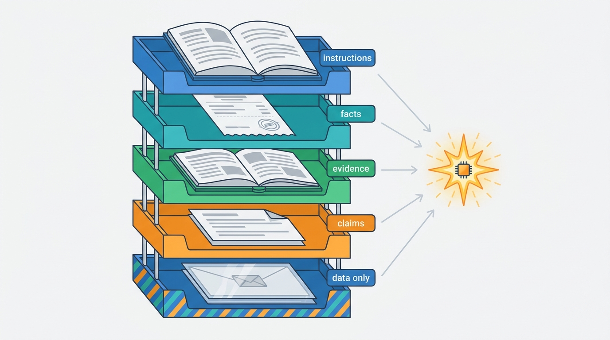
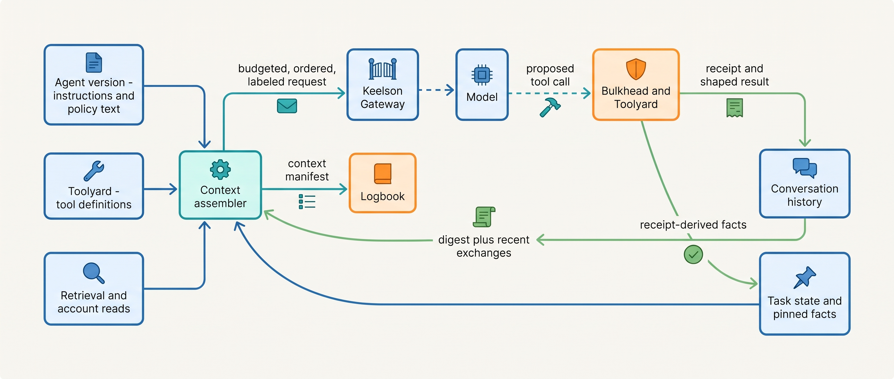
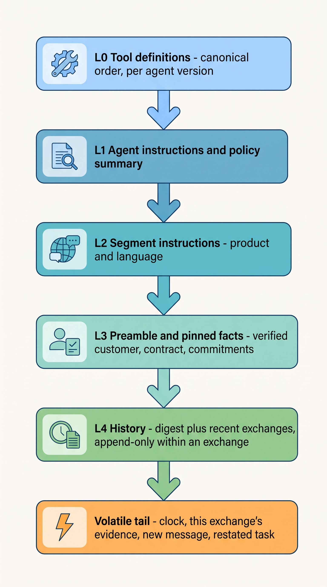
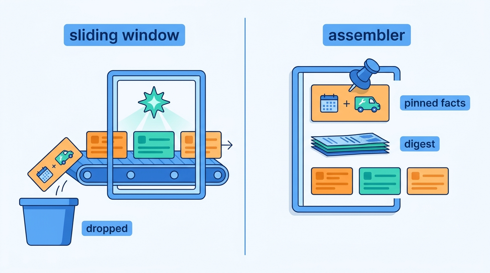
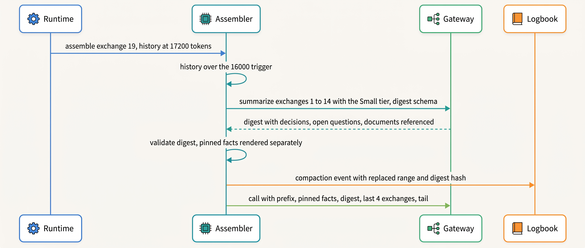

> **IN THIS CHAPTER, YOU WILL:** Learn to treat the working context as an artifact the harness builds for every model call: what goes into it, in which order, under which budget, how it is compacted, how untrusted content is labeled, and how a manifest of each call makes it replayable.

> **WHY THE BUSINESS CARES:** What the model sees decides what it proposes. An overstuffed context costs money on every call and quietly lowers answer quality; a context that loses a commitment makes the agent repeat or contradict it in front of a customer.

> **WHY ARCHITECTS SHOULD CARE:** Context assembly is where the probabilistic component's inputs are decided, so it is a component with an owner, a budget, a version and a log. Treated as string concatenation inside a prompt template, it becomes the place where cost, quality, security and auditability fail together.

> **KEY POINTS:**
>
> * **The working context is computed, not accumulated.** Keep the full conversation history, task state and evidence in durable stores, and build each call's context from them with an explicit token budget per segment. Usable context is shorter than the advertised window, and irrelevant or near-miss content lowers accuracy.
> * **Compaction is a lossy handoff to the agent's own next step.** Summaries are caches, never the record. Facts that must survive (who the customer is, which contract, what was already promised) are pinned fields written by deterministic code from tool receipts, and the model re-reads anything it needs to act on.
> * **Every call leaves a context manifest.** An ordered list of segments with source, version, hash, token count and trust label makes a decision traceable, makes cache regressions visible and lets you replay a call. Trust labels help the model but are not a security boundary; the boundary stays at the tool broker and the policy engine.

> **[FAILURE PATTERNS THIS CHAPTER ADDRESSES](where-agentic-systems-go-wrong.html):**
>
> * **Context Soup** — instructions, tool definitions, documents, untrusted messages and stale tool output are concatenated until the window fills; relevant facts drown and nothing is labeled.
> * **The Lost Handoff** — compaction and sliding-window truncation are handoffs from one step to the next, and identifiers and commitments fall out of them exactly as they fall out of free-text handoffs between agents.
> * **The Token Bonfire** — every token in the context is paid for again on every later call; an unbudgeted context and an unstable prefix multiply the bill with no error to show for it.

<br>
A model call sees only its **working context**: the tokens the harness sends on that call. Everything the model "knows" about the task at that moment (its instructions, the tools it may call, the customer's account, the documents it retrieved, what was said three exchanges ago) is either in those tokens or absent. Most agent frameworks build the working context by appending every message and tool result to a growing list and resending it. That works in a demo. In production it makes cost grow with the square of the conversation's length, lets one verbose tool result push out the task description, and leaves no record of what the model saw when it made a bad proposal.

This chapter argues that **context assembly is a component**, owned by the harness, with an interface, a budget and a log. Anthropic's Applied AI team calls the discipline *context engineering*: "the set of strategies for curating and maintaining the optimal set of tokens" during inference ([Anthropic, 2025](https://www.anthropic.com/engineering/effective-context-engineering-for-ai-agents)). I use the term more narrowly, as the architecture of that curation: which deterministic code decides what enters the window, from which durable sources, under which rules.

This chapter owns three terms: **working context**, **context assembly** and **compaction**. It builds on [[agent-runtime]], which runs the loop that calls the assembler, and on [[models-and-the-model-gateway]], which carries the assembled call to a provider. It hands retrieval quality and citation to [[retrieval-and-grounding]], what persists across sessions to [[agent-memory]], durable task state to [[task-state-and-checkpoints]], the `as_of` stamps on facts to [[provenance-and-freshness]], prompt-cache economics to [[caching-and-context-budgets]], and injection defenses to [[prompt-injection-defense]].

## Setting the Scene at Ostrell: The Second Revisit

Ostrell, the fictional company this book follows (see [[meet-ostrell]]), runs **Answerdesk** for customer support on Ostrell Field: about **7,100 conversations a day**, 2.6 million a year. Answerdesk answers from the knowledge base, creates and updates tickets, schedules technician revisits (A2, at most one per ticket) and issues service credits up to €250 (A1 in early 2027; promoted to A2 in October 2027). After the Lost Handoff in April 2027, the team prepared to fold the billing specialist agent back into Answerdesk as a tool set (it shipped on 7 June 2027; see [[coordination-and-handoffs]]). The fix was right. It also grew Answerdesk's tool definitions from 19 tools to **34 tools, about 11,800 tokens**, which the release candidate sent at the top of every model call.

In May 2027 Jonas Lindqvist, principal engineer for Keelson Runtime, was asked by Lena Brandt (Director of Support Operations) to explain a Toolyard metric. Toolyard enforces Answerdesk's limit of one revisit per ticket, and in April and May it had rejected **57** proposals for a second revisit. Each rejection was correct; nobody received two technicians. But the model should not have proposed them. Jonas pulled the traces. In **41** of the 57 conversations, the runtime's overflow rule had done it: when a conversation exceeded 64,000 tokens, Keelson Runtime dropped the oldest exchanges until it fit. Long email tickets about a recurring fault ran for days. The exchange in which Answerdesk had booked the first revisit, and told the customer so, had been cut. The model saw a customer complaining that the fault was still there and proposed what any reasonable reader of that truncated transcript would propose.

The same trace review produced three more findings (Ostrell figures, fictional):

| Finding (May 2027) | Measurement |
| --- | --- |
| Input tokens per model call | Mean **14,800**; p95 **58,000**; maximum seen 121,000 |
| Share of input tokens served from provider prompt caches | **11%**: the system prompt opened with the current time and the customer's display name |
| Tool definitions | 19 tools in production; the fold-back release candidate carried 34 tools, about 11,800 tokens on every call, 20 of them used in fewer than 1% of conversations |
| Untrusted content | Inbound email bodies sat in the same message role as Answerdesk's own instructions, unmarked; the Poisoned Ticket (May 2027) had arrived this way |

Nobody could say, for any given call, which knowledge-base article versions or which account snapshot the model had seen; the Logbook recorded the run's inputs, tool calls and outputs, but not what had been placed in each model call. Tomas Verhoef, Ostrell's Chief Architect, framed the question for the architecture forum: **who decides what the model sees on each call, under what budget, and how do we prove afterwards what it saw?** The answer, adopted in June 2027, was Keelson Runtime's **context assembler**.

## What the Working Context Is Made Of

### Four stores, one computed view

Four kinds of "what the agent knows" have to be kept apart. The research brief behind this part of the book draws the same lines that Google's Agent Development Kit draws between Session, Events, State and Memory ([Google ADK docs, n.d., accessed 2026-10](https://adk.dev/sessions/)), and that LangGraph draws between checkpointers and stores ([LangChain docs, n.d., accessed 2026-10](https://docs.langchain.com/oss/python/langgraph/persistence)).

| Term | What it is | Lifetime | Written by | Owner chapter |
| --- | --- | --- | --- | --- |
| **Conversation history** | Every message, tool call and tool result of a session, in order | The session plus audit retention | The runtime, append-only | this chapter |
| **Working context** | The tokens sent to the model on one call | One call | The context assembler | this chapter |
| **Durable task state** | Goal, plan, step, pending approvals, side effects with receipts | Until the task ends, plus retention | Deterministic orchestrator | [[task-state-and-checkpoints]] |
| **Long-term memory** | Facts and preferences kept across sessions | Policy-defined, with expiry | Gated write path | [[agent-memory]] |
| **Knowledge corpus** | Documents and records the agent searches but does not own | Owned by another system | Content owners | [[retrieval-and-grounding]] |

The **working context** is a pure function of the other four plus the agent version: `context = assemble(agent_version, task_state, history, memory_reads, retrieval_results, budget)`. Two consequences follow. First, the conversation history is not the working context. Anthropic's context-editing feature makes the split explicit: edits are applied server-side "before the prompt reaches Claude", while the client "keeps the full, unmodified history" ([Anthropic docs, n.d., accessed 2026-10](https://platform.claude.com/docs/en/build-with-claude/context-editing)). Second, because the context is computed, it can be described, budgeted, versioned and logged like any other derived artifact.

### Segments and the context manifest

**Context assembly** is the deterministic step that selects, shapes, orders, labels and budgets the inputs of one model call. Its unit is the **segment**: a contiguous block of tokens with one source and one trust level. Answerdesk's segments are tool definitions, agent instructions, segment instructions (product and language), the conversation preamble (verified customer, contract summary), pinned facts, the conversation digest, recent exchanges, retrieved knowledge-base evidence and the new customer message.

The assembler's output has two parts: the request sent to the gateway, and a **context manifest**, an ordered list of the segments with, for each one, its source reference and version, a content hash, a token count and a trust label. The manifest is small (a few hundred bytes per segment) and goes to the Logbook; the content stays in the stores it came from: versioned sources for the knowledge base and account snapshots, the Logbook's run record for messages, tool calls and receipts, and Wake's tenant-partitioned content store (30-day retention) for transient payloads such as fully rendered requests; compaction digests are kept with their compaction events in the Logbook. Spans in Wake carry the manifest id, not the content. This is the pattern the OpenTelemetry GenAI conventions recommend for production: content capture is off by default, and the preferred production option stores content externally and records references on spans so it can have its own access controls ([OpenTelemetry semantic-conventions-genai, Development status, accessed 2026-10-28](https://github.com/open-telemetry/semantic-conventions-genai/blob/main/docs/gen-ai/gen-ai-spans.md)).

```typescript
type TrustLabel = "platform" | "operator" | "system_of_record" | "corpus" | "model_generated" | "untrusted";

interface ContextSegment {
  kind: "tools" | "instructions" | "preamble" | "pinned" | "digest"
      | "exchanges" | "evidence" | "tool_result" | "message";
  sourceRef: string;        // e.g. "kb:article/4812@v17", "toolyard:answerdesk-tools@a91f"
  sourceVersion: string;    // version or as_of of what was read
  trust: TrustLabel;
  tokens: number;
  contentHash: string;      // sha-256 of the rendered segment
}

interface ContextManifest {
  runId: string; callSeq: number;
  agentVersion: string;     // manifest id, includes exact model id and assembler version
  budget: { total: number; perKind: Partial<Record<ContextSegment["kind"], number>> };
  segments: ContextSegment[];          // in the order sent
  cachedPrefixTokens: number;          // reported by the provider afterwards
  dropped: { kind: string; sourceRef: string; reason: "budget" | "policy" | "stale" }[];
}
```

The `dropped` list matters as much as the segments. When the assembler leaves something out, the reason is recorded, so a reviewer can tell a model error from an assembly decision.

### Trust labels

Every segment carries one of six **trust labels**. They answer one question: whose instructions may this text carry? Platform and operator segments (tool definitions, agent instructions written and reviewed by Ostrell) are instructions. System-of-record segments (the account snapshot, a receipt) are facts but not instructions. Corpus segments (knowledge-base articles) are evidence. Model-generated segments (a digest, a sub-agent's report) are claims. Untrusted segments (customer messages, inbound email, attachments, web pages) are data and nothing else. The labels drive three things: how the segment is rendered (delimited and marked when untrusted), what the policy engine assumes about the run (a run that has read untrusted content has one leg of the *lethal trifecta*: private data, untrusted content and a way to send data out, combined in one agent; see [[agent-threat-model]]), and what a reviewer sees in the trace.


**Figure 1:** *Each segment carries a trust label that says whose instructions it may carry; untrusted customer text is delimited, placed after the instructions and treated as data and nothing else.*

## Architecture: The Context Assembler

### Where it sits


**Figure 2:** *The assembler is the only writer of the working context; it reads from durable stores, writes a manifest per call, and never takes facts that must survive from the model's own output.*

The assembler is a library inside Keelson Runtime, called before every model call, and its version is part of the agent version manifest ([[versioning-agent-systems]]). It does not decide what the agent may do; Bulkhead and Toolyard do. It decides what the model is shown. Its responsibilities, in pipeline order:

1. **Select.** Choose segments for this step: which tools are loaded, which history range is verbatim, which evidence is retrieved, which memory items are read.
2. **Shape.** Render each segment compactly: tool results filtered and capped, records as typed fields rather than raw JSON dumps, identifiers kept, internal noise removed.
3. **Order.** Lay segments out from the most stable to the least stable, so the provider's prompt cache can reuse the prefix.
4. **Label.** Attach trust labels and render untrusted segments inside delimiters.
5. **Budget.** Enforce a total budget and per-kind ceilings, compacting or dropping by rule, and record every drop.
6. **Record.** Write the manifest before the request leaves.

### Requirements per interaction

| Interaction | Latency | Consistency | Durability | Who may write |
| --- | --- | --- | --- | --- |
| Assemble a call | ≤ 150 ms p95 excluding retrieval *(assumption)* | Account snapshot read live at the start of each exchange; knowledge-base (KB) evidence by article version | Manifest written before the request is sent | Assembler only |
| Pin a fact | Same turn as the receipt | Exactly the receipt's values | Stored in task state, survives crash and compaction | Deterministic code from tool receipts; never the model |
| Compact history | Off the critical path when possible; ≤ 1.5 s when inline *(assumption)* | Digest covers a recorded range of exchanges | Compaction event in Logbook with digest hash and replaced range | Assembler, using a Small-tier model call with a schema |
| Replay a call | Minutes, offline | Rebuilt from manifest references and versions | Depends on source retention | Evaluation and incident tooling, read-only |

Two rows deserve emphasis. **Pinned facts are written from receipts, not from the model.** When Toolyard returns the receipt for `schedule_revisit`, the runtime adds `revisit_booked: {ticket, slot, receipt_id}` to task state, and the assembler renders it in every later call. The model never writes a pinned fact; a model note saying "revisit booked" is a claim, and [[task-state-and-checkpoints]] explains why claims cannot stand in for state. **The manifest is written before the call.** If the call crashes or times out, the record of what was sent still exists.

### Layout and budget


**Figure 3:** *Answerdesk's working context runs from the most stable layer to the least stable; everything above the volatile tail is a cacheable prefix, and nothing volatile is allowed above it.*

The layout is shared with [[caching-and-context-budgets]], which owns its economics. The context-engineering reasons for it are separate from cache price. Instructions and tool definitions come first because they frame everything after. The task is restated at the end because, in Liu et al.'s experiments, models used information at the start and end of a long input better than information in the middle (on 2023 models; see Evidence), and because Manus reports that rewriting a to-do list at the end of the context is how its agent keeps "reciting its objectives into the end of the context" over long runs ([Manus, 2025](https://manus.im/blog/Context-Engineering-for-AI-Agents-Lessons-from-Building-Manus)).

The budget is explicit. Answerdesk's working context is capped at **24,000 input tokens per model call**, far below the providers' windows (Ostrell figures, fictional):

| Segment | Ceiling (tokens) | Typical (tokens) | Rule when over |
| --- | --- | --- | --- |
| L0 tool definitions (14 always loaded) | 3,000 | 3,000 | Fixed per agent version; other 20 tools loaded through tool search |
| L1 instructions and policy summary | 1,800 | 1,800 | Fixed per agent version; a longer version fails the release check |
| L2 segment instructions | 400 | 400 | Fixed per product and language |
| L3 preamble and pinned facts | 600 | 450 | Never dropped; an overflow is an error, not a truncation |
| L4 history | 16,000 triggers compaction | 4,000 | Compact older exchanges into a digest; keep the last 4 exchanges verbatim |
| KB evidence (tail) | 6,000 | 3,200 | Drop lowest-ranked passages; record drops |
| New message and tool results (tail) | 2,500 per result | 1,100 | Truncate with a pointer and a "more available" marker |
| **Total** | **24,000** | **≈ 13,900** | Compact history earlier when the tail needs room |

The ceilings add up to more than 24,000 on purpose. The total is the hard limit; when an exchange needs the full 6,000 tokens of evidence and the history is long, the assembler compacts the history before the 16,000-token trigger. Pinned facts and instructions are never what gives way. Before June 2027 the rule was the reverse: the oldest content gave way, and the oldest content included the booking.


**Figure 4:** *Before June 2027 the oldest exchanges gave way, the revisit booking with them; after, pinned facts never give way and older history is compacted into a digest.*

### Just-in-time or preloaded

Each segment is either **preloaded** (assembled into the context before the model asks) or **just-in-time** (left out, with a reference or a tool the model can call to fetch it). Anthropic describes just-in-time retrieval as keeping "lightweight references" such as file paths or queries and loading data with tools only when needed ([Anthropic, 2025](https://www.anthropic.com/engineering/effective-context-engineering-for-ai-agents)). The author's ai-coding-cli interview design (step `context`) defaults to on-demand search for exactly this reason: "Nothing enters the window until the model chooses to read it", with capped match lists and ranged reads.

The rule I use: **preload what every step needs and what the model cannot be trusted to fetch; leave just-in-time what only some steps need.** Answerdesk preloads the verified customer, the contract summary and the pinned commitments, because a model that forgets to look them up acts on the wrong customer. It retrieves knowledge-base evidence per exchange, because the question changes. Tool definitions sit in between. Anthropic reported in November 2025 that five Model Context Protocol (MCP) servers with 58 tools consumed about 55,000 tokens before a conversation started, and that, in a separate example with more than 50 tools, deferring definitions behind a tool-search tool cut context use from about 77,000 to 8,700 tokens while raising accuracy on its internal MCP evaluations ([Anthropic, 2025](https://www.anthropic.com/engineering/advanced-tool-use)). The trade-off is a search step and the risk that the model does not find a tool it needs. Answerdesk keeps the 14 tools used in more than 1% of conversations loaded; the rest are deferred. How tools are described and discovered is [[tool-ecosystems-and-mcp]]'s subject.

### Shaping tool results

A tool result enters the context once and is then re-read on every later call of the run. Shaping it is therefore a contract decision at the tool boundary, owned by [[tool-contracts]], with a consequence here. Anthropic's tool-design guidance recommends "some combination of pagination, range selection, filtering, and/or truncation", notes that Claude Code restricts tool responses to 25,000 tokens by default, and shows a concise response format using about a third of the tokens of the detailed one ([Anthropic, 2025](https://www.anthropic.com/engineering/writing-tools-for-agents)). The ai-coding-cli design names the failure precisely: "One cat of a 30K-line file evicts everything useful; the agent then forgets its own task" (step `context`, traps).

Answerdesk's billing lookup used to return the full invoice record (about 3,900 tokens). Toolyard now returns a shaped view of the fields the support task needs (about 600 tokens) with an `invoice_ref` the model can pass to a detail tool. Errors are shaped too: a denied or failed call comes back as a short structured result the model can act on, not a stack trace. Manus argues for keeping failed actions in context because "Erasing failure removes evidence" the model needs to avoid repeating the mistake ([Manus, 2025](https://manus.im/blog/Context-Engineering-for-AI-Agents-Lessons-from-Building-Manus)). I agree, with one condition: keep the failure, not its 200-line trace.

### Compaction

**Compaction** replaces a range of older history in the working context with a shorter digest, while the full history stays in its store. It is the mechanism every long-running agent needs, and every vendor now offers one: Anthropic's API, for example, offers server-side compaction that "replaces the older turns of a conversation with a summary" and tool-result clearing as a lighter form ([Anthropic docs, n.d., accessed 2026-10](https://platform.claude.com/docs/en/build-with-claude/compaction)). Write your design against the mechanisms (clear, summarize, offload, isolate), not against beta parameter names, which change.


**Figure 5:** *Compaction is a recorded event over a recorded range; the digest is validated against a schema, and pinned facts never pass through it.*

Five rules make compaction safe enough:

1. **Pin before you summarize.** The ai-coding-cli design pins "the task, constraints, and acceptance criteria; they are never summarized" (step `compaction`, traps). Answerdesk pins the ticket id, contract id, verified customer and open commitments. They are rendered from task state, so the digest cannot lose them.
2. **The digest has a schema.** Decisions taken, questions still open, documents and records referenced, the customer's stated goal. A free-form summary drops what the summarizer judged unimportant; a schema forces the categories that later steps rely on.
3. **The digest is model-generated.** It carries the `model_generated` label and never overrides a pinned fact or a system-of-record read. When they disagree, the pinned fact wins and the disagreement is logged.
4. **Knowledge from before compaction is stale.** The digest lists which records and documents were read; the agent re-reads them before acting. The ai-coding-cli design states it for files: "post-compaction, file knowledge is stale by definition" (step `compaction`).
5. **Compaction is an event, not an overwrite.** The full history is never rewritten. Resume after a crash reloads the history and the compaction events, not a model's summary of them.

**Tool-result clearing** (old tool results replaced by a placeholder) is a cheaper alternative for runs whose bulk is tool output. A **sliding window** is what Answerdesk had; it is acceptable only when nothing in the oldest exchanges matters, which is never true once commitments have been made.

### Context per sub-agent

When work is delegated, the delegate's context is assembled too, and the question is what crosses the boundary. Framework defaults differ. In the OpenAI Agents SDK, the receiving agent of a handoff sees the full conversation history by default unless an input filter rewrites it ([OpenAI Agents SDK docs, n.d., accessed 2026-10](https://openai.github.io/openai-agents-python/handoffs/)); a Claude Agent SDK subagent receives only "the Agent tool's prompt string" from its parent ([Claude Agent SDK docs, n.d., accessed 2026-10](https://code.claude.com/docs/en/agent-sdk/subagents)). Both defaults are wrong as a policy. Full history leaks everything the parent saw, including untrusted content, into the delegate; a bare prompt string loses the constraints. Anthropic's multi-agent research system reported that subagents "call tools to store their work in external systems" and pass lightweight references back, to avoid a "game of telephone" ([Anthropic, 2025](https://www.anthropic.com/engineering/multi-agent-research-system)). The book's rule, from [[coordination-and-handoffs]]: a delegate receives a typed brief (goal, constraints, identifiers, budget) plus references, and returns a typed result plus references. Its context is assembled by the same assembler under its own budget and its own trust labels. Scout's sub-agents work this way since the Weekend Fan-out; when to delegate at all is [[single-and-multi-agent-designs]]'s question.

### Context as a security boundary, and its limits

The working context is where untrusted content meets instructions. Greshake et al. showed in 2023 that applications which read retrieved content "blur the line between data and instructions" ([Greshake et al., 2023](https://arxiv.org/abs/2302.12173), preprint). Context assembly can make that line visible: untrusted segments are delimited, marked with their source and placed after the instructions, and the instructions say that content inside the markers is data. Microsoft's spotlighting experiments reported attack success falling from above 50% to below 2% with GPT-family models and static attacks ([Hines et al., 2024](https://arxiv.org/abs/2403.14720), preprint). On the AgentDojo benchmark, a delimiter defense of the same family only cut one model's targeted attack success from 57.7% to 41.7% (Table 5, v3), while a structural tool filter cut it to 6.8% ([Debenedetti et al., 2024](https://arxiv.org/abs/2406.13352)). Adaptive attacks broke most of twelve published defenses with success rates "above 90% for most" ([Nasr et al., 2025](https://arxiv.org/abs/2510.09023), preprint).

So labeling is worth doing and not worth trusting. It lowers the probability that untrusted text is followed; it does not bound what happens when it is. The Poisoned Ticket did not fail because of a missing delimiter. It failed safely because Toolyard's email tool only allowed recipients in the verified customer's domain, and it was fixed by splitting the trifecta in [[prompt-injection-defense]]. What context assembly contributes to security is different and more reliable: the manifest tells Bulkhead, deterministically, that this run has read untrusted content, and Bulkhead can apply the stricter policy that follows. The assembler also removes things: credentials never enter the context (the tool broker injects them at the call, per [[agent-identity-and-least-privilege]]), and fields the task does not need are not read.

## What the Evidence Says

### Usable context is shorter than the window

The research on long inputs is consistent in direction and inconsistent in numbers, because the models tested keep being retired.

- **Position can matter.** Liu et al. measured accuracy on multi-document question answering as the relevant document moved through the input. Accuracy was highest at the start or end and lower in the middle; with 20 documents and the answer in the middle, one model scored below its own closed-book result ([Liu et al., 2023](https://arxiv.org/abs/2307.03172), TACL). All models tested are retired. Chroma's 2025 tests found needle position made no notable difference in its experiment ([Chroma, 2025](https://www.trychroma.com/research/context-rot)). The defensible statement is "position can matter; measure it on your agent".
- **Advertised length overstates usable length.** RULER found that of 17 long-context models, all near-perfect on simple needle tests, only about half kept satisfactory performance at 32,000 tokens, although all claimed 32,000 or more ([Hsieh et al., 2024](https://arxiv.org/abs/2404.06654), COLM 2024). NoLiMa removed literal word overlap between question and answer; at 32,000 tokens, 11 of 13 models claiming at least 128,000 tokens fell below half their short-context score ([Modarressi et al., 2025](https://arxiv.org/abs/2502.05167), ICML 2025). Agent questions ("which earlier tool result contradicts the customer?") are associative, closer to NoLiMa than to a needle test.
- **Distractors hurt more than padding.** Adding irrelevant sentences to grade-school maths problems "dramatically decreased" accuracy ([Shi et al., 2023](https://arxiv.org/abs/2302.00093), ICML 2023). Chroma found that one near-miss distractor reduced performance and four reduced it further, across 18 models, and that focused prompts of about 300 tokens did much better than full prompts of about 113,000 on a conversational-memory task ([Chroma, 2025](https://www.trychroma.com/research/context-rot)). Chroma sells a retrieval database; its method is published and its direction matches the independent work, but it is a vendor report, not peer reviewed.

**Limits.** No benchmark here measures an agent with tools over a multi-turn task, and no post-2025 measurement of current frontier models on NoLiMa-style tasks was available to this book. The durable conclusion is the architectural one: **context is a finite resource with diminishing and sometimes negative returns**, and the effective budget for your agent is something you measure at the lengths it actually reaches.

### Long context versus retrieval

Li et al. found that long-context models beat retrieval-augmented generation on average on their benchmarks when cost was no object, while retrieval cost much less; their router sent each query to one or the other and cut cost at comparable quality ([Li et al., 2024](https://arxiv.org/abs/2407.16833), EMNLP 2024 industry track). Anthropic suggested in 2024 that a knowledge base under about 200,000 tokens can simply be placed in the prompt, with caching ([Anthropic, 2024](https://www.anthropic.com/news/contextual-retrieval)). These results do not contradict the degradation evidence; they price it. Preloading a small, stable, relevant corpus is reasonable. Preloading Answerdesk's 18,000 articles in nine languages is not, and neither is preloading a large corpus whose relevant part changes every exchange.

### What builders report

The engineering reports are documented experience about their authors' own systems.

- Anthropic's Applied AI team (September 2025) frames the goal as finding "the smallest set of high-signal tokens that maximize the likelihood of your desired outcome", and names just-in-time retrieval, compaction, structured note-taking and sub-agents as the main techniques ([Anthropic, 2025](https://www.anthropic.com/engineering/effective-context-engineering-for-ai-agents)).
- Anthropic's harness post (November 2025) states that "compaction isn't sufficient" for long coding projects, and that compaction "doesn't always pass clear instructions to the next agent". Its fix was harness-owned artifacts: a progress file, a JSON feature list the agent may only flip, and git commits as recovery points ([Anthropic, 2025](https://www.anthropic.com/engineering/effective-harnesses-for-long-running-agents)).
- Manus (July 2025) reports an input-to-output token ratio of about 100:1 in its agent, calls the cache hit rate "the single most important metric for a production-stage AI agent", and advises against adding or removing tools mid-task because it breaks the cache and confuses the model ([Manus, 2025](https://manus.im/blog/Context-Engineering-for-AI-Agents-Lessons-from-Building-Manus)). It also treats the file system as restorable compression: page content can be dropped "as long as the URL is preserved".
- Claude Code's documentation (accessed October 2026) says longer instruction files "consume more context and reduce adherence", that contradictory instructions may be resolved arbitrarily, and that an instruction given only in conversation may disappear after compaction while the project file survives because it is re-read from disk ([Claude Code docs, n.d., accessed 2026-10](https://code.claude.com/docs/en/memory)).

**Where they disagree.** Manus keeps context append-only and failures in it; Anthropic's API clears old tool results; Cognition argued in June 2025 for a single continuous context and, for long tasks, a dedicated model that compresses history into its key details, events and decisions, which it said was hard to get right ([Cognition, 2025](https://cognition.com/blog/dont-build-multi-agents)). The disagreement is real but narrower than it looks. Append-only within a run maximizes cache reuse and keeps evidence of failure; clearing and compaction bound growth. Answerdesk does both: append-only across the turns (model calls) inside one exchange, re-assembly at the exchange boundary.

## Worked Example: Answerdesk's Context Budget per Turn

Assume an average Answerdesk conversation has **5.2 exchanges** (customer message and reply) and each exchange takes **2.8 model calls**, that is, 2.8 turns in [[agent-runtime]]'s sense (a planning call, tool-call iterations, the reply). At 7,100 conversations a day, that is about **103,000 model calls a day** *(assumption)*.

**One turn, after June 2027.** A customer on day 4 of an email ticket writes that the compressor fault is back. The runtime starts exchange 19:

1. Keelson Runtime reads task state: ticket `T-88213`, contract `SC-20417`, verified customer, and one pinned commitment, `revisit_booked {slot: 2027-07-14 08:00–12:00, receipt: rv-5531}`, written from Toolyard's receipt in exchange 6.
2. History is 17,200 tokens, over the 16,000 trigger. The assembler compacts exchanges 1–14 into a 1,300-token digest with a Small-tier call and keeps exchanges 15–18 verbatim (2,900 tokens).
3. Retrieval returns four knowledge-base passages on the compressor fault, 3,400 tokens, each labeled `corpus` with its article version.
4. The customer's email is rendered as an `untrusted` segment, 700 tokens, inside delimiters.
5. The prefix (L0–L3, including the pinned commitment) is 5,650 tokens and identical to the prefix of the previous call in this conversation, so the provider serves it from cache.
6. Total: 13,950 tokens, under the 24,000 cap. The manifest, with twelve segments and no drops, goes to the Logbook before the call.

The model proposes an answer that refers to the booked visit on 14 July and asks whether the fault occurred before or after the technician's visit, plus an `update_ticket` call. It does not propose a second revisit, because the booking is in front of it.

**Before and after (Ostrell figures, fictional):**

| Measure | May 2027 | July 2027 |
| --- | --- | --- |
| Input tokens per call, mean | 14,800 | 13,900 |
| Input tokens per call, p95 | 58,000 | 23,600 (cap 24,000) |
| Share of input read from provider caches | 11% | 76% |
| Input token-equivalents per conversation, cache reads at 10% of list *(assumption)* | ≈ 194,000 | ≈ 64,000 |
| Input spend per conversation at an assumed €1.50 per million uncached tokens (blended across tiers) | ≈ €0.29 | ≈ €0.10 |
| Second-revisit proposals rejected by Toolyard per month | ≈ 29 | 2 |
| Sounding long-conversation suite (400 replayed conversations over 15 exchanges): commitment consistency | 71% | 94% |
| Same suite: task correctness | 79% | 85% |

Three things in this table are worth noticing. The **mean barely moved**: most conversations were already short, so the budget changed the tail, not the typical call. The **spend fell by about two thirds** mostly because of the layout and cache, which [[caching-and-context-budgets]] works through. And the **quality gain sits in the long conversations**, which is where the old overflow rule did its damage. Answerdesk's end-to-end resolution rate is a business metric with many causes (41% in Q3 2027 against a 45% target); the context change is not credited with moving it, and Mei Lin Zhou's team reports the suite numbers, not a resolution claim.

The cost of the change is real. Compaction adds a Small-tier call on about 6% of exchanges and about 0.9 seconds when it runs inline *(Ostrell figure, fictional)*; the assembler is now code that the Agent Platform team owns, versions and tests; and the tool-search step occasionally fails to surface a deferred tool, which Sounding tracks as a tool-recall metric.

## Failure Modes and Recovery

| Scenario | What happens | Detection | Containment | Recovery |
| --- | --- | --- | --- | --- |
| **Overflow drops a commitment** | Sliding-window truncation removes the exchange where an action was taken; the model re-proposes it | Policy rejections for repeated actions; manifest shows history dropped | Hard limits in Toolyard (one revisit per ticket); pinned facts from receipts | Replace truncation with compaction plus pins; replay affected conversations in Sounding |
| **Digest drops a constraint** | The summary omits "customer refused weekend visits"; the agent offers Saturday | Digest-schema check; long-conversation suite's constraint-retention cases | Constraints stated by the customer are extracted into pinned fields, not left to the digest | Add the constraint type to the pin schema; re-run the suite |
| **Tool result floods the window** | A verbose lookup returns 30,000 tokens; the task and instructions are pushed out or the call fails | Per-segment token counts in the manifest; alert when a single tool result exceeds its ceiling | Toolyard caps results per tool; assembler truncates with a pointer | Fix the tool's response shape in its contract |
| **Silent cache regression** | A deploy puts a timestamp or reorders JSON keys above the volatile tail; cost rises with no error | Cache-read share per agent version in Wake; manifest prefix hash changes on every call | Release check fails a version whose prefix hash is unstable across identical inputs | Roll back the agent version ([[staged-rollout-and-rollback]]) |
| **Unmarked untrusted content** | An email body is rendered as plain text next to instructions; it is followed | Manifest audit finds untrusted sources without the label; injection suite in Sounding | Bulkhead treats the run as having read untrusted content regardless of rendering; egress policy | Fix the segment mapping; add the source to the label registry |
| **Stale knowledge after compaction** | The model acts on an account balance it read before compaction | Re-read rule violation in trace review | Tools that act take values from a fresh system-of-record read, not from model arguments | Enforce re-read in the tool contract ([[provenance-and-freshness]]) |
| **Delegate inherits everything** | A sub-agent receives the parent's full history, including untrusted text and private data | Manifest of the delegate shows parent-history segments | Typed briefs only; delegate's context built by the assembler under its own labels | Change the delegation contract ([[coordination-and-handoffs]]) |
| **Context cannot be reconstructed** | An incident review asks what the model saw; sources were overwritten or not versioned | Replay tool fails to resolve a manifest reference | Versioned sources (KB article version, account snapshot version); Logbook run record for messages and receipts | Extend source retention to the agent's audit retention ([[policy-enforcement-and-audit]]) |

The pattern across the table: **the model's mistakes are contained by code outside the context, and diagnosed with data the assembler writes.**

## Trade-offs

| Decision | Option | Right when | Cost |
| --- | --- | --- | --- |
| **How history reaches the model** | Full history resent | Short sessions with no growth risk | Quadratic input growth; degradation in long runs |
| | Sliding window | The oldest exchanges never matter (rare) | Silently drops commitments and identifiers |
| | Tool-result clearing | Bulk is tool output; conversation is short | Cache rewrite on clearing; lost evidence if cleared too early |
| | Compaction with pinned facts | Long conversations with commitments | A summarizer call, a schema to maintain, residual loss |
| **What is preloaded** | Preload | Every step needs it, or the model cannot be trusted to fetch it | Tokens on every call; distraction if irrelevant |
| | Just-in-time | Only some steps need it; corpus large or changing | Extra turns and latency; model may not fetch what it needs |
| **Tool definitions** | All loaded | Under ~15–20 tools, or tool use is unpredictable *(judgement)* | Thousands of tokens per call |
| | Deferred with tool search | Large catalog, skewed usage | Search step; tool-recall failures |
| **Context across delegation** | Full history | Rarely; the delegate is effectively the same agent | Leaks untrusted content and private data; cost |
| | Typed brief plus references | Default | Contract design work; delegate may miss implicit context |
| **Assembly strategy** | Append-only within a run | Long tool loops; cache reuse matters | Context grows until compaction |
| | Re-assembled every call | Steps need different views | Cache reuse limited to the stable prefix |

My recommendation for an enterprise platform: **compaction with pinned facts, a hard per-call budget well below the window, deferred tool loading above a catalog threshold, typed delegation briefs, append-only within an exchange and re-assembly at exchange boundaries.** It assumes long conversations with commitments, a skewed tool catalog and a need to audit decisions. For a short, stateless classification step none of this is needed: a fixed prompt template with one input slot is the right context engineering. The recommendation changes if models improve at long-context use. If future evaluations on your agent show no degradation at the lengths it reaches, the budget can rise; the pinned facts, the labels and the manifest stay, because they serve audit and security, not only quality.

## Across Domains: How the Stakes Change the Design

| Dimension | Coding agents | Customer operations (support, sales, marketing) | Back office (finance, legal, HR) | High-stakes decisions (healthcare, public benefits) |
| --- | --- | --- | --- | --- |
| **Dominant content** | Source files, tool output, test results, project instruction files | Knowledge base plus the customer's account (two-sided grounding) | Ledger extracts, contracts, policies, playbooks | Chart facts, guidelines, eligibility rules, applicant evidence |
| **Main untrusted sources** | Repository content, issue text, dependency docs, web pages; a project instruction file is "guidance, not authority" (ai-coding-cli design, step `context`) | Customer messages, inbound email, attachments | Counterparty-drafted contracts, supplier invoices, employee free text | Applicant free text and uploaded documents, partitioned from the rule engine (public-benefits design, step `grounding`) |
| **Budget driver** | Session length: long, file-heavy, append-only runs | Turn latency and volume | Document size and the number of entities per run | Minimum-necessary data, then latency |
| **Compaction stance** | Required; pin task, constraints and acceptance criteria; re-read files after | At exchange boundaries; pin customer, contract, commitments | Prefer per-document or per-entity map steps over compacting one long run | Avoid; re-derive from the record of truth each step; a summary is never the evidence |
| **What must be pinned** | Task, constraints, files touched, baseline test results | Verified customer, contract, open commitments | Entity, period, materiality threshold, approval scope | Patient or applicant identity, encounter or case, rule package version |
| **Context logging** | Full transcript for headless runs; local transcripts on developer machines are an audit gap the CLI design does not close | Manifest per call; transcripts with personal data under retention rules | Inputs by reference in a tamper-evident decision record | Manifest plus versioned evidence, retained for appeal and safety review |
| **Privacy rule in the assembler** | Secrets redacted before prompts and logs | Only the authenticated customer's scope is read | Segregation of duties: the proposer's context is not the checker's evidence | Minimum-necessary by task type: a dosing query reads medications, allergies and renal labs, not the whole chart (healthcare design, step `privacy`) |

The healthcare and benefits columns come from the author's interview designs and are design examples, not deployed systems. The healthcare design also sizes its bounded context at about 4,000–8,000 tokens per query, chart facts plus cited spans, which shows the same principle from the other direction: in a high-stakes domain the budget is set by what the task justifies reading, and cost is a side effect.

**What the platform keeps common:** the assembler, the segment model, trust labels, the manifest, compaction events, pinned facts from receipts, per-call budgets as configuration, and content held by reference under access control. **What is domain policy:** which sources are untrusted, which fields are pinned, the budget numbers, whether compaction is allowed at all, what minimum-necessary means, and how long manifests and payloads are kept. Ostrell's Closewise and Clausewise add one rule a support agent does not need: a counterparty's contract draft is untrusted content even though a lawyer uploaded it.

## The Chief Architect's View

Tomas Verhoef's decisions, and the reasons they hold beyond Ostrell:

- **Make the assembler a platform component.** Seven agents each building their own context in prompt templates produced seven overflow rules, one of which dropped commitments. The Agent Platform team (Amara Okafor) owns the assembler; agent teams own their segment configuration and budgets.
- **Put context in the agent version.** The assembler version, segment configuration and budget are part of the agent version manifest and go through Sounding like a prompt change. A change to how history is compacted is a behavior change.
- **Make the manifest mandatory.** No model call leaves Keelson without a manifest in the Logbook. It costs little and is the only way to answer "what did the model see?" in an incident review, a customer complaint or an audit.
- **Keep enforcement out of the context.** Limits, scopes and approvals live in Bulkhead and Toolyard. The context carries the instructions that make good proposals likely; code makes bad ones harmless. Claude Code's documentation states the same split for its own memory files: they are context, "not enforced configuration" ([Claude Code docs, n.d., accessed 2026-10](https://code.claude.com/docs/en/memory)).
- **Measure context quality on the long tail.** Mean tokens and mean quality hide the problem. Sounding's long-conversation suite and Wake's p95 tokens per call are the metrics that would have caught the second revisits in April.

**Who decides.** Segment configuration and budgets: the agent's owning team, within platform limits. Trust-label registry and the untrusted-content rules: Farah Haddad (security architecture). Manifest schema and retention: the Agent Platform team with legal, because manifests reference personal data.

**What is durable and what will change.** Durable: the separation of history from working context, receipts over summaries, labels on provenance, the manifest, and enforcement outside the model. Volatile: the numbers (the 24,000 cap, the 16,000 trigger, the 14 loaded tools), provider compaction and context-editing features, and the shape of the degradation curve. If models get better at long contexts, budgets will rise. They will not become unnecessary, because every token is still paid for on every call and every unlabeled token is still a place for an instruction to hide.

## Questions to Ask

1. For any model call in production, can you list what the model saw: each segment, its source, its version and its trust level?
2. What happens when a conversation exceeds its budget? Which content gives way, and is that rule written down?
3. Which facts must survive compaction, who writes them, and can the model alter them?
4. What is your agent's quality at the context lengths it reaches at p95, not at the lengths in your demo?
5. How many tokens do tool definitions take on every call, and how many of those tools are used in more than 1% of runs?
6. Is anything volatile (time, request ids, user names, unstable serialization) above your cacheable prefix?
7. When work is delegated, what exactly crosses into the delegate's context, and who decided that?
8. Which segments are untrusted, how are they rendered, and does your policy engine know a run has read them, independently of how the model was told?
9. Is the context assembler versioned and evaluated like a prompt change?
10. If a regulator or a customer asks why the agent proposed an action a year from now, can you rebuild its context from retained, versioned sources?

The working context decides which evidence the model sees; [[retrieval-and-grounding]] takes up how that evidence is found, cited and checked.

## Sources and Evidence

### Research papers

- [Lost in the Middle: How Language Models Use Long Contexts](https://arxiv.org/abs/2307.03172) — Liu et al., TACL, 2023. Position sensitivity in long inputs; retired models.
- [RULER: What's the Real Context Size of Your Long-Context Language Models?](https://arxiv.org/abs/2404.06654) — Hsieh et al., COLM 2024, 2024. Effective context shorter than claimed.
- [NoLiMa: Long-Context Evaluation Beyond Literal Matching](https://arxiv.org/abs/2502.05167) — Modarressi et al., ICML 2025, 2025. Degradation without lexical overlap.
- [Large Language Models Can Be Easily Distracted by Irrelevant Context](https://arxiv.org/abs/2302.00093) — Shi et al., ICML 2023, 2023. Irrelevant content lowers accuracy.
- [Retrieval Augmented Generation or Long-Context LLMs?](https://arxiv.org/abs/2407.16833) — Li et al., EMNLP 2024 industry track, 2024. Long context vs retrieval on quality and cost.
- [Not What You've Signed Up For: Indirect Prompt Injection](https://arxiv.org/abs/2302.12173) — Greshake et al., preprint, 2023. Retrieved content as an instruction channel.
- [Defending Against Indirect Prompt Injection Attacks With Spotlighting](https://arxiv.org/abs/2403.14720) — Hines et al. (Microsoft), preprint, 2024. Marking untrusted input; static attacks.
- [AgentDojo](https://arxiv.org/abs/2406.13352) — Debenedetti et al., preprint (v3), 2024. Delimiter vs tool-filter defenses on tool-using agents.
- [The Attacker Moves Second](https://arxiv.org/abs/2510.09023) — Nasr et al., preprint, 2025. Adaptive attacks break published defenses.

### Specifications, standards and regulation

- [OpenTelemetry GenAI semantic conventions: spans](https://github.com/open-telemetry/semantic-conventions-genai/blob/main/docs/gen-ai/gen-ai-spans.md) — OpenTelemetry, Development status, n.d., accessed 2026-10. Content capture off by default; external content with references in production.

### Vendor documentation and engineering reports

- [Effective context engineering for AI agents](https://www.anthropic.com/engineering/effective-context-engineering-for-ai-agents) — Anthropic, 2025. Definition, finite-resource framing, just-in-time retrieval, compaction, sub-agents.
- [Effective harnesses for long-running agents](https://www.anthropic.com/engineering/effective-harnesses-for-long-running-agents) — Anthropic, 2025. Compaction is not sufficient; harness-owned progress artifacts.
- [How we built our multi-agent research system](https://www.anthropic.com/engineering/multi-agent-research-system) — Anthropic, 2025. Sub-agents store work externally and pass references.
- [Writing effective tools for agents](https://www.anthropic.com/engineering/writing-tools-for-agents) — Anthropic, 2025. Tool-result shaping, truncation defaults, concise formats.
- [Introducing advanced tool use](https://www.anthropic.com/engineering/advanced-tool-use) — Anthropic, 2025. Tool-definition token cost and deferred loading.
- [Introducing Contextual Retrieval](https://www.anthropic.com/news/contextual-retrieval) — Anthropic, 2024. Whole-corpus-in-prompt threshold.
- [Context editing](https://platform.claude.com/docs/en/build-with-claude/context-editing) and [Compaction](https://platform.claude.com/docs/en/build-with-claude/compaction) — Anthropic, n.d., accessed 2026-10. History vs working context; server-side compaction and tool-result clearing (beta features, volatile).
- [How Claude remembers your project](https://code.claude.com/docs/en/memory) — Anthropic (Claude Code), n.d., accessed 2026-10. Instruction files as context, not enforcement; survival across compaction.
- [Subagents in the Agent SDK](https://code.claude.com/docs/en/agent-sdk/subagents) — Anthropic, n.d., accessed 2026-10; [Handoffs](https://openai.github.io/openai-agents-python/handoffs/) — OpenAI Agents SDK, n.d., accessed 2026-10. Default context transfer to delegates.
- [Context Engineering for AI Agents: Lessons from Building Manus](https://manus.im/blog/Context-Engineering-for-AI-Agents-Lessons-from-Building-Manus) — Y. Ji, Manus, 2025. Cache hit rate, stable prefixes, tool masking, restorable compression, recitation, keeping errors.
- [Context Rot](https://www.trychroma.com/research/context-rot) — Hong, Troynikov, Huber, Chroma (vendor research report), 2025. Degradation with length and distractors across 18 models.
- [Don't Build Multi-Agents](https://cognition.com/blog/dont-build-multi-agents) — W. Yan, Cognition, 2025. Continuous context and history compression.
- [ADK Sessions, State and Memory](https://adk.dev/sessions/) — Google, n.d., accessed 2026-10; [LangGraph persistence](https://docs.langchain.com/oss/python/langgraph/persistence) — LangChain, n.d., accessed 2026-10. Framework separation of history, state and memory.

### Incidents, cases and decisions

- No public incident report attributes a production failure specifically to context truncation or compaction; the Ostrell incident in this chapter is fictional.

### Design examples from the author's interview project

- Obrenović, Ž., "AI Coding Agent CLI", system-design interview design, `system-design-interviews/data/book/ai-coding-cli/interview.json`, 2026 — steps `context` (agentic search, project memory as guidance, token budget, capped tool output) and `compaction` (pinned task, files-read list, full transcript retained).
- Obrenović, Ž., "Agentic Support Platform", system-design interview design, `system-design-interviews/data/book/agentic-support-platform/interview.json`, 2026 — step `grounding` (two-sided grounding, scope resolved before reads, customer input as untrusted).
- Obrenović, Ž., "Agentic Platform Foundations", system-design interview design, `system-design-interviews/data/book/agentic-platform-foundations/interview.json`, 2026 — step `durable` (reversible compaction, separate short-term and long-term stores).
- Obrenović, Ž., "Agentic Healthcare Platform", system-design interview design, `system-design-interviews/data/book/agentic-healthcare-platform/interview.json`, 2026 — step `privacy` (minimum-necessary context by task type) and capacity (bounded context per query).
- Obrenović, Ž., "Agentic Public Benefits Platform", system-design interview design, `system-design-interviews/data/book/agentic-public-benefits-platform/interview.json`, 2026 — step `grounding` (applicant text untrusted and partitioned from the rule engine).

Ostrell is fictional; architectural recommendations, labeled inferences and labeled assumptions are the author's judgement.
