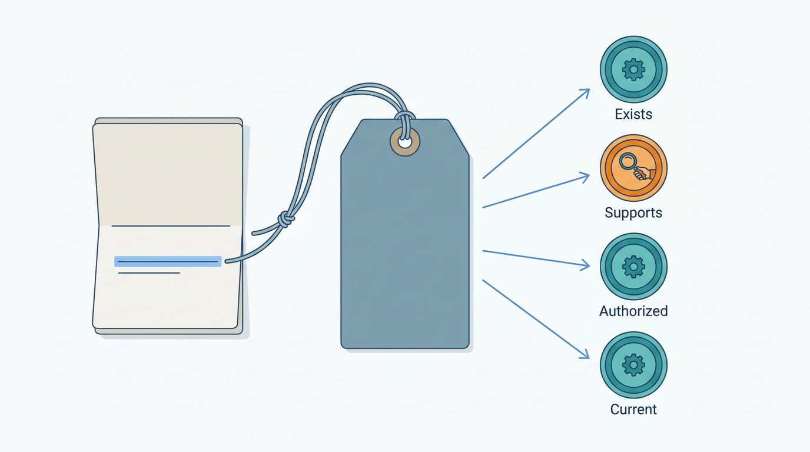
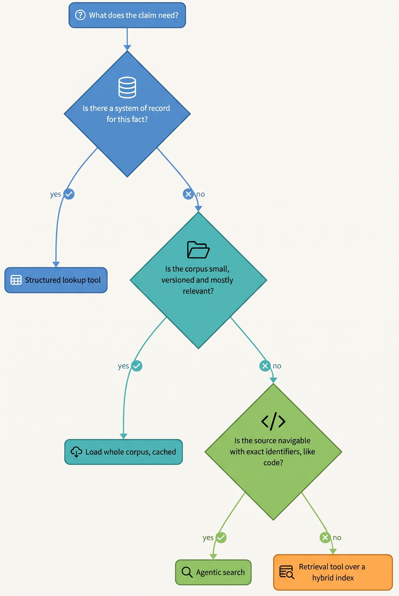
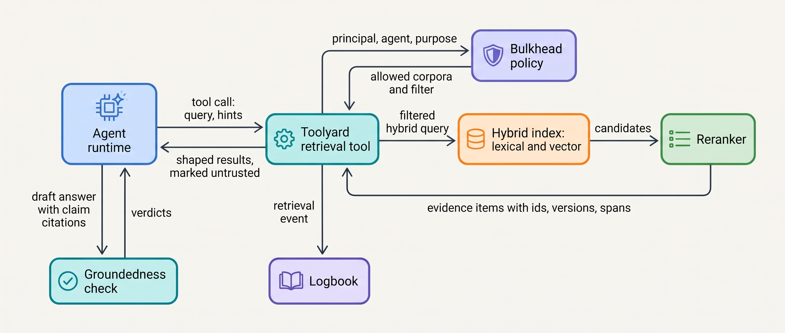
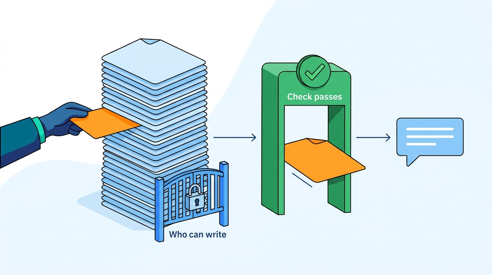
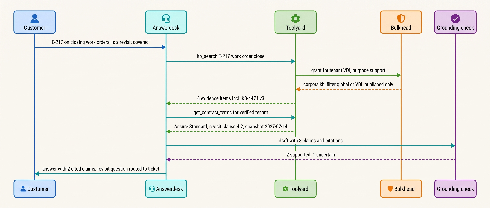

> **IN THIS CHAPTER, YOU WILL:** Learn how to design retrieval as a tool with a contract, how to choose between pre-retrieval, agentic search, structured lookups and loading a whole corpus, how to enforce permissions inside the retrieval query, and how to check, evaluate and record whether an agent's answer is actually supported by the sources it cites.

> **WHY THE BUSINESS CARES:** An agent that answers customers, employees or lawyers speaks for the company. In 2024 a Canadian tribunal held Air Canada liable for a refund policy its chatbot made up. An answer that cites a source looks trustworthy. If the source does not support the answer, or belongs to another customer, the citation makes the mistake more expensive.

> **WHY ARCHITECTS SHOULD CARE:** Retrieval decides what the model believes, whose data it can see and what a reviewer can check afterwards. Whether permissions, versions and verification live in code or in a prompt is an architectural decision.

> **KEY POINTS:**
>
> * **Retrieval is a tool, and the authorization is in the query.** The model chooses what to look for. Deterministic code chooses where it may look: tenant, corpus and document permissions come from the run's verified identity and are applied inside the index query, before ranking. An instruction such as "only use this customer's articles" is not access control.
> * **A citation is a pointer, not proof.** A grounded claim passes four checks: the cited span **exists**, it **supports** the claim, it comes from an **authoritative** source the requester may see, and it is **current**. Code can check existence, authorization and version. Support needs a model or human check with an uncertain band that escalates rather than passes.
> * **Measure retrieval and grounding separately, and make "no evidence" a success.** Evaluate recall on the queries the agent actually issues, support rate on sampled answers, and correct abstentions. Published systems with retrieval and citations still left about half of long-form answers without full citation support (2023) and hallucinated in 17–33% of legal research queries (2024).

> **[FAILURE PATTERNS THIS CHAPTER ADDRESSES](where-agentic-systems-go-wrong.html):**
>
> * **Context Soup** — a fixed top-k of loosely relevant chunks is pasted into every model call, unranked by authority, unmarked as untrusted and without versions, and the model is left to sort it out.
> * **Ambient Authority** — the retrieval service queries the whole index with one service account and relies on the prompt to keep tenants apart, so any query can surface any customer's documents.
> * **Vibe Evals** — retrieval changes (chunking, embeddings, filters) ship because the answers "look better", with no labeled retrieval set and no measured support rate.

<br>
Most of what an enterprise agent needs to know is not in the model. It is in support articles, playbooks, price books, contracts and tickets. **Retrieval** is how the agent gets that knowledge at the moment it needs it. **Grounding** is the property that what the agent then says or does is supported by what it retrieved.

The two are often bought as one feature, retrieval-augmented generation (RAG): a vector database plus a prompt. That works for a demo. In production the index returns plausible but wrong passages, returns passages the requester was never entitled to see, and the model cites passages that do not say what it claims. Each is a design failure with a design fix. Better embeddings fix none of them.

This chapter owns four terms: **grounding**, the **citation** (as an agent emits it), the **retrieval tool** and **permission-aware retrieval**. It builds on [[context-engineering]], which decides how retrieved evidence is budgeted and placed in the working context, and on [[tool-contracts]], whose rules for tool inputs and outputs apply to retrieval tools too. It hands the provenance envelope and freshness service-level objectives (SLOs) to [[provenance-and-freshness]], what the agent should remember between sessions to [[agent-memory]], and injected instructions inside retrieved content to [[prompt-injection-defense]].

## Setting the Scene at Ostrell: The Grounding Audit

Ostrell, the fictional company this book follows (see [[meet-ostrell]]), runs **Answerdesk**, the customer-support agent for Ostrell Field. Answerdesk handles about **2.6 million conversations a year**, about **7,100 a day**. Most of its exchanges answer questions from the knowledge base (KB): about **18,000 articles in 9 languages**. About **1,600** of them are **tenant-scoped**: the custom service levels, escalation contacts and runbooks of about **240 enterprise Field customers** with negotiated Ostrell Assure contracts, meant only for that customer's users.

The 2026 Answerdesk prototype embedded each customer message, took the top 8 chunks by vector similarity from one index of all articles, and pasted them into the prompt. The system prompt said: "Only use articles that apply to this customer. Cite the article you used." The retrieval service queried the index with a single service account.

In **February 2027** Mei Lin Zhou's evaluation team ran a grounding audit. Two support specialists and a Sounding grader reviewed **600** sampled conversations with knowledge answers (Ostrell figures, fictional):

| Finding | Share or count | What it showed |
| --- | --- | --- |
| Answers with at least one claim the cited article did not support | **11.2%** | The model cited a real article for a statement it did not contain, usually a merged or extrapolated detail |
| Questions containing an error code or part number where no retrieved chunk mentioned it | **38%** of such questions | Vector search ranked semantically similar articles above the one with the exact code |
| Answers grounded in an article older than its replacement | **4.1%** | Two versions of the same article were both indexed; the older Dutch translation often ranked first |
| Answers that quoted another customer's tenant-scoped article | **2** conversations | A question about response times retrieved another customer's negotiated 4-hour service level; the model quoted it |
| Questions the KB could not answer, where the agent answered anyway | **63%** of unanswerable questions | No path existed to say "I don't have a documented answer" |

Farah Haddad, the security architect, handled the two cross-tenant answers as a confidentiality incident. The prompt had asked the model to enforce the tenant boundary, and it did so most of the time. Tomas Verhoef, the Chief Architect, asked the architecture review: **who decides what the agent may look at, how do we know its answer is supported by what it found, and what should it do when nothing supports an answer?**

The redesign shipped in **April 2027** and is this chapter's worked example. Clausewise (legal contract review) and Scout (internal research) faced the same question with different stakes, which is why the platform shares one retrieval architecture while verification policy differs by domain.

## What Retrieval and Grounding Mean

### Four kinds of source

Retrieval design starts by asking which of four sources a question needs:

| Source | Examples at Ostrell | Owned by | Right access path |
| --- | --- | --- | --- |
| **Parametric knowledge** (in the model's weights) | General language, common technical knowledge | The model provider; frozen at training | None to design; never authoritative for company facts |
| **Knowledge corpus** (documents the agent searches but does not own) | KB articles, the legal precedent library, research papers, web pages | Content owners | Search: lexical, semantic, hybrid |
| **System of record** (structured, authoritative, changing) | A customer's contract and tier, a ticket, a price, an entity's ledger balance | The owning application | A typed tool over the application's API or a governed view |
| **Agent memory** (facts kept across sessions) | A user's language preference | The memory service (Tidemark) | Owned by [[agent-memory]] |

The most common grounding error is answering a system-of-record question from the knowledge corpus. "Does my contract cover a revisit?" is not a search question: the general rule is in an article, but whether it applies depends on the contract in Ostrell Assure. The author's agentic-support-platform interview design (step `grounding`) calls this **two-sided grounding**: the policy corpus says what is allowed, the account record says what is true for this customer, and "the account state wins" when they disagree. The book adopts this rule for every domain.

### Definitions

**Grounding.** An agent output is *grounded* when every factual claim in it that matters to the decision is supported by evidence the system retrieved from an identified source at a recorded version, which the requester was entitled to see. Grounding is a property of claims, not answers: an answer with four supported claims out of five contains one unsupported claim, and the design must decide what happens to it.

**Citation (agent).** A *citation* is a structured pointer emitted with a claim: source identifier, source version, the span (character range, page or block), and the retrieval event that produced it. It is data the system can check. Rashkin et al.'s AIS framework ([2021](https://arxiv.org/abs/2112.12870)) frames the underlying question for evaluators: is the statement *attributable to an identified source*?

**Retrieval tool.** A *retrieval tool* is retrieval exposed to the model as a tool with a typed contract. The model supplies the query and hints; the tool's code supplies scope, filters, ranking and result shape. Retrieval tools follow [[tool-contracts]], and are **read-only but still dangerous**: what they return becomes the model's belief.

**Permission-aware retrieval.** *Permission-aware retrieval* evaluates authorization inside the retrieval query, from the run's verified principal, before ranking. A document the requester may not see is never a candidate, so it cannot be ranked, quoted, summarized or leaked through a citation. The author's agentic-legal-platform interview design (step `grounding`) states the invariant: "a walled document is never retrieved, not merely never shown."

### The four checks on a cited claim

The legal interview design checks every citation for "existence, currency, relevance" (step `citation-gate`). It notes that "a real-but-overruled citation is worse than a fabricated one", because it survives a casual check. The book generalizes this to four checks that apply in every domain:

| Check | Question | Who can decide it | Typical mechanism |
| --- | --- | --- | --- |
| **Exists** | Does the cited span exist in the cited source version? | Code | Pointer validation; quote match against stored text |
| **Supports** | Does the span entail the claim it is attached to? | Model or human; code only for structured facts | Claim-level entailment check; reviewer |
| **Authorized and authoritative** | Was the requester entitled to this source, and is it the right kind of source for this claim? | Code | Permission filter at query time; source-class rules (contract terms only from the contract system) |
| **Current** | Is this the version in force, and was it fresh enough for this action? | Code | Version pins; freshness SLO ([[provenance-and-freshness]]) |

Three of the four checks can be done exactly in code. Only support needs a model or a human. Do not ask a model judge to catch authorization or staleness.


**Figure 1:** *A citation is a pointer the system can check: code decides whether it exists, is authorized and is current, and only support needs a model or a human.*

## Choosing How the Agent Retrieves

### Five retrieval modes

| Mode | How it works | Main cost or risk | Right when |
| --- | --- | --- | --- |
| **Load the whole corpus** | The full, versioned document set goes into the context, cached | Cost; long-context degradation | Small corpus that changes rarely (a playbook) |
| **Pre-retrieval** | Code retrieves from the user's message before every model call | Raw-message queries; retrieves when not needed; misses follow-ups | Single-turn Q&A over one corpus, tight latency |
| **Retrieval as a tool** | The model calls a search tool with its own queries | Extra round trips; the model may skip it | Multi-turn agents; several corpora |
| **Agentic search** | The model explores with general tools (grep, reads, links, web) | Many steps and tokens; harder to evaluate | Code, research, navigable sources |
| **Structured lookup** | Typed tools over APIs, governed views or a graph | Answers only what the tool was built for | Any fact with a system of record |

The modes combine: Answerdesk now uses lookups for contract and ticket plus a KB retrieval tool; Clausewise loads its playbook whole and searches precedent clauses; Scout uses agentic search.

**Load the whole corpus** is underused. In September 2024 Anthropic advised that a knowledge base under about 200,000 tokens can go into the prompt whole, with prompt caching ([Anthropic, 2024](https://www.anthropic.com/news/contextual-retrieval)). Li et al. found long-context models beat RAG on average when cost was no object, while RAG cost much less ([Li et al., 2024](https://arxiv.org/abs/2407.16833), EMNLP 2024 industry track, 2024 models). Against that, the evidence in [[context-engineering]] shows usable context is shorter than advertised. The reconciliation I use: **load a corpus whole when it is small, versioned and mostly relevant to every call; retrieve when most of it is irrelevant to any given call.** Clausewise's non-disclosure agreement (NDA) playbook passes that test. Answerdesk's 18,000 articles do not.

**Retrieval as a tool versus pre-retrieval** is the main design choice for conversational agents. Pre-retrieval searches with the user's raw words. That fails on follow-ups ("and for the other site?"), on questions that need two lookups, and on exchanges that need none. Self-RAG trained a model to retrieve only when needed and reported better factuality and citation accuracy ([Asai et al., 2023](https://arxiv.org/abs/2310.11511), preprint, 7B and 13B models). Production agents get a similar effect by putting the retrieval tool in the tool list. The risk is that the model answers from parametric knowledge without searching, so a rule outside the model closes the gap: a reply that makes a factual claim about Ostrell's products with no retrieval or lookup in its trace fails the groundedness check.

**Agentic search** is the default in coding agents. The author's ai-coding-cli interview design (step `context`) chooses agentic search (file listing, grep, reads) over an embedding index, noting that "the calculus shifts toward" an index "at 20M-line monorepo scale" and that "hosted indexes turn source code or embeddings into a data-governance decision, not just a latency decision". Code favors it: exact identifiers, navigable structure, the file is the source. How results are *shaped* matters as much as the mode. In SWE-agent's ablations on SWE-bench Lite, with the model held fixed, a search tool that returned summarized results resolved **18.0%** of tasks. Iterative grep-like paging resolved **12.0%**, below the **15.7%** with no search tool at all ([Yang et al., 2024](https://arxiv.org/abs/2405.15793), a 2024 model; the relative effect is the durable finding). A badly shaped retrieval tool can be worse than none.

**Structured lookup** deserves more trust than text-to-SQL suggests. Letting the model write free SQL against a warehouse is retrieval with a very wide interface. On Spider 2.0, 632 real enterprise text-to-SQL workflows, a code-agent framework built on a 2024 reasoning model solved **21.3%** of tasks. The same setup scored **91.2%** on Spider 1.0 and **73.0%** on BIRD ([Lei et al., 2024](https://arxiv.org/abs/2411.07763), ICLR 2025). For agents that act, I prefer narrow typed lookups over governed views (`get_price(sku, as_of)`), and reserve free SQL for analyst copilots whose output a human reads first. [[agents-in-the-enterprise]] covers governed views and the semantic layer.


**Figure 2:** *The retrieval mode follows from the source. Facts that have a system of record are looked up, never searched for. Small corpora are loaded whole. Search is for everything else.*

### Hybrid search, chunking and contextual retrieval

For corpora that need search, the evidence favors **hybrid retrieval**: a lexical leg (BM25 or similar) and a semantic leg (dense embeddings), fused and then reranked. BEIR (18 datasets, zero-shot) found BM25 "a robust baseline", dense retrievers often worse out of domain, and rerankers best at "high computational costs" ([Thakur et al., 2021](https://arxiv.org/abs/2104.08663), NeurIPS 2021). Embeddings have improved since, but the reason for a lexical leg has not changed: error codes, part numbers, contract identifiers, statute numbers and drug names are exact strings, and embeddings blur them. The author's agentic-healthcare-platform interview design makes the same choice for guidelines: hybrid retrieval "is safer than pure vector search for clinical lookups because exact drug names ... matter" (technology choices, guideline index).

**Reciprocal Rank Fusion** (RRF) merges the legs by summing 1/(k + rank) over rankers, with k = 60 "near-optimal, but ... not critical" ([Cormack et al., SIGIR 2009](http://cormack.uwaterloo.ca/cormacksigir09-rrf.pdf)); it needs no score calibration between legs.

**Chunking** decides what the index can return; a chunk without its document's context ("the limit is 30 days") is retrievable but uninterpretable. Anthropic's **contextual retrieval** prepends a short model-generated description of where each chunk sits in its document before embedding and lexical indexing. In its September 2024 evaluation across codebases, fiction and papers, top-20 retrieval failure fell from 5.7% to 3.7% with contextual embeddings, to 2.9% when contextual BM25 was added, and to **1.9%** with reranking ([Anthropic, 2024](https://www.anthropic.com/news/contextual-retrieval)). It is a vendor evaluation on non-public data; the post itself says to "run evals" on your own corpus.

**Graph-based retrieval** answers a different class of question. Microsoft Research's GraphRAG builds entity-community summaries for corpus-wide "sensemaking" questions and won LLM-judged comparisons on comprehensiveness (72–83%), while vector RAG gave more direct answers; fabrication was not measured ([Edge et al., 2024](https://arxiv.org/abs/2404.16130), preprint). It is not "more accurate RAG". Scout's market-landscape questions sometimes need it; Answerdesk's do not.

## The Retrieval Architecture

### Components and responsibilities


**Figure 3:** *The model writes the query. Bulkhead and the tool's code decide the scope. Every result carries an identifier, a version and a span, and every retrieval is logged so a citation can be checked later.*

| Component | Responsibility | Must never |
| --- | --- | --- |
| **Retrieval tool** (in Toolyard, the tool broker) | Accept the model's query; obtain the scope from policy; run the filtered query; shape results; emit a retrieval event | Accept tenant, user or corpus scope from the model's arguments |
| **Policy** (Bulkhead) | Decide which corpora this agent may search for this purpose, and the document-level filter for this principal | Depend on the query text |
| **Index** (lexical and vector, one logical index per corpus) | Store chunks with access-control list (ACL) attributes, source id, version, language, validity dates | Be the system of record; it is a derived view of the corpus registry |
| **Groundedness check** | Decompose the draft into claims; check each against its cited spans; return verdicts | Pass the "uncertain" band silently |
| **Evidence log** (Logbook) | Record retrieval events, cited spans and verdicts by reference | Store full retrieved text where retention rules forbid it |
| **Corpus registry** | Own documents, versions, owners, ACLs and lifecycle (draft, published, superseded, withdrawn) | Let the index decide what is current |

The public-benefits and healthcare interview designs both say "search indexes should be derived views" of a governed registry. The registry is what makes the "current" check deterministic: a citation to a version the registry marks superseded fails, even if a stale copy is still indexed or cached.

### Requirements per interaction

| Interaction | Consistency | Latency target | Durability | Who decides scope |
| --- | --- | --- | --- | --- |
| Answerdesk KB search in a live chat exchange | Index may lag the registry by an SLO; superseded versions excluded | p95 ≤ 350 ms *(assumption)* | Retrieval event logged | Bulkhead from verified tenant and user |
| Answerdesk contract lookup | Read live from Ostrell Assure; re-read before any action | p95 ≤ 250 ms *(assumption)* | Logged with snapshot version | Tool from verified tenant; contract id from the account, never from the message |
| Clausewise precedent search | Approved-clause library pinned per review run | Seconds acceptable | Pinned library version stored with each redline | Legal's matter permissions (ethical walls) |
| Scout web and internal search | Best effort; source quality graded | Minutes acceptable | Full source snapshot stored for cited pages | Requester's document permissions; web allowlist policy |

### The retrieval tool contract

Arguments shape relevance; the run context shapes authorization.

```python
@dataclass(frozen=True)
class KbSearchArgs:            # what the model may supply
    query: str                 # max 400 chars
    language: str | None       # hint; ranking boost, not a filter
    article_type: str | None   # "howto" | "policy" | "release_note"

@dataclass(frozen=True)
class EvidenceItem:            # what the model receives
    evidence_id: str           # stable handle the model must cite
    source_id: str             # article id in the corpus registry
    source_version: int
    span: tuple[int, int]      # character offsets in that version
    text: str                  # chunk text, delimited as untrusted data
    title: str
    valid_from: date
    scope: Literal["global", "tenant"]

def kb_search(args: KbSearchArgs, run: RunContext) -> list[EvidenceItem]:
    # Scope comes from the verified run identity, never from args.
    grant = bulkhead.retrieval_grant(agent=run.agent_id,
                                     principal=run.principal,
                                     tenant=run.verified_tenant_id,
                                     purpose="customer_support")
    flt = Filter(corpus_in=grant.corpora,
                 tenant_in=["global", run.verified_tenant_id],
                 status="published")            # superseded never matches
    hits = index.hybrid(args.query, flt, k_lexical=40, k_vector=40)
    ranked = reranker.rank(args.query, rrf(hits))[:6]
    logbook.retrieval_event(run, args, flt, [h.evidence_id for h in ranked])
    return [shape(h, max_chars=3200) for h in ranked]
```

Four details matter. The filter is part of the index query, so a forbidden document is never a candidate. Results carry an `evidence_id` the model must cite, which makes the "exists" check a set-membership test. The tool returns six shaped items, not twenty raw chunks, because every extra item is a distractor ([[context-engineering]] owns the budget). And the retrieval event goes to Logbook, the evidence log, so an auditor can later see what the agent was shown, not only what it said. Since July 2027 each item also carries the full provenance envelope defined in [[provenance-and-freshness]].

### Permission-aware retrieval in practice

It is harder than adding a `tenant_id` filter, for three reasons.

**Permissions live in the source systems, not the index.** The index holds a copy of each ACL, so an ACL change propagates with a delay, like a content change. Make ACL sync part of the freshness SLO. Where a revocation must take effect at once (an ethical wall raised on a new matter), also check the live ACL for the final candidates.

**The principal is not always the user.** For Answerdesk it is a verified customer user within a tenant. For Scout it is the employee who delegated the run, so Scout must not find documents that employee could not open. A background agent uses its own identity and grant. [[agent-identity-and-least-privilege]] owns the identity model; the rule here is that the retrieval tool receives a verified principal from the runtime and never infers one from text.

**Shared corpora are a cross-user channel.** OWASP's 2025 entry on vector and embedding weaknesses (LLM08) lists unauthorized access, cross-context leaks in multi-tenant stores, embedding inversion and data poisoning. It recommends permission-aware, partitioned vector stores and "detailed immutable logs of retrieval activities" ([OWASP, 2025](https://genai.owasp.org/llmrisk/llm082025-vector-and-embedding-weaknesses/)). In PromptArmor's August 2024 disclosure, an instruction posted in a public Slack channel made Slack AI, answering another user's question, render a link carrying that user's private-channel data. Slack's first response called retrieval of public-channel content "intended behavior" ([PromptArmor, 2024](https://www.promptarmor.com/resources/data-exfiltration-from-slack-ai-via-indirect-prompt-injection)). In EchoLeak (CVE-2025-32711, published 11 June 2025), a crafted inbound email retrieved by Microsoft 365 Copilot led to data disclosure across trust boundaries ([NVD, 2025](https://nvd.nist.gov/vuln/detail/CVE-2025-32711)). In both cases retrieval worked as designed: content from one principal reached another principal's context next to private data. [[agent-threat-model]] treats this as the lethal trifecta; here the lesson is narrower. **Decide per corpus who may write into it and whose queries may read from it, and mark every retrieved item as untrusted data in the context.**

## Grounding: Citations and Verification

### Claim-level citations

The model drafts an answer in which each claim carries one or more `evidence_id`s, a check verifies each claim, and the system decides what the user sees. Citations as structured data, not prose footnotes, make the existence check exact.

Vendor citation features help, within limits. As of October 2026, Anthropic's Citations feature extracts the cited text itself, so "citations are guaranteed to contain valid pointers to the provided documents"; it cannot be combined with structured outputs ([Anthropic docs, accessed 2026-10](https://platform.claude.com/docs/en/build-with-claude/citations)). That guarantees *existence* only. Support, currency and authorization remain the application's job.

### Checking support

ALCE scored models that must retrieve and cite. On its long-form ELI5 ("explain like I'm five") questions, the best 2023 models lacked complete citation support about half the time ([Gao et al., 2023](https://arxiv.org/abs/2305.14627), EMNLP 2023). FActScore splits long-form output into atomic facts and scores the share supported by a knowledge source. Its automated estimator had an error rate under 2% against human annotation, and it found a 2023 chat model's biographies only 58% supported ([Min et al., 2023](https://arxiv.org/abs/2305.14251), EMNLP 2023). Ragas computes similar faithfulness metrics with a model judge ([Es et al., 2023](https://arxiv.org/abs/2309.15217), preprint). The numbers are dated. The method has lasted: **decompose into claims, check each claim against its cited span, and aggregate.**

```python
def check_grounding(draft: Draft, evidence: dict[str, EvidenceItem]) -> Verdicts:
    verdicts = []
    for claim in decompose(draft):                    # model call, Small tier
        cited = [evidence.get(e) for e in claim.evidence_ids]
        if not claim.evidence_ids or None in cited:
            verdicts.append(Verdict(claim, "unsupported", "missing or invalid citation"))
            continue
        if not all(registry.is_current(c.source_id, c.source_version) for c in cited):
            verdicts.append(Verdict(claim, "stale", "cited version superseded"))
            continue
        score = entailment(claim.text, [c.text for c in cited])   # separate judge
        label = ("supported" if score >= HI else
                 "unsupported" if score < LO else "uncertain")
        verdicts.append(Verdict(claim, label, f"score={score:.2f}"))
    return Verdicts(verdicts)
```

Exact checks run first. Entailment runs in a **fresh context with a different prompt**, and where possible a different model family, from the drafting call. The MT-Bench study found that strong 2023 judges agreed with human raters about as often as humans agreed with each other, and also documented position, verbosity and self-enhancement biases ([Zheng et al., 2023](https://arxiv.org/abs/2306.05685), NeurIPS 2023). Anthropic's January 2026 evaluation guidance recommends giving judges an "Unknown" option and calibrating them against human experts ([Anthropic, 2026](https://www.anthropic.com/engineering/demystifying-evals-for-ai-agents)). Following the legal interview design (step `citation-gate`), **"an uncertain middle band [is] a flag, not a pass"**: what happens to an uncertain claim is domain policy, set out in the Across Domains section.

### When the evidence is wrong

Grounding moves trust from the model to the source, and models defer to what they retrieve. ClashEval perturbed the answers in retrieved passages across more than 1,200 questions. Six top 2024 models adopted the incorrect retrieved content over their own correct prior knowledge more than 60% of the time ([Wu et al., 2024](https://arxiv.org/abs/2404.10198), preprint). PoisonedRAG showed that about five injected texts per target question achieved about 90% attack success against knowledge bases of millions of texts ([Zou et al., 2024](https://arxiv.org/abs/2402.07867), USENIX Security 2025). A groundedness check catches neither: a claim faithfully supported by a wrong or planted passage passes. The defenses sit upstream: control who can write into a corpus, rank sources by authority, apply the version and freshness rules of [[provenance-and-freshness]], and before an action re-read the fact from its system of record.


**Figure 4:** *A claim faithfully supported by a planted passage passes the groundedness check, so the defense sits upstream: control who can write into the corpus.*

Source *quality* is a separate problem. In June 2025 Anthropic reported that human testers caught its research agents preferring "SEO content farms" over authoritative sources, which its automated judge missed, and described a separate citation agent that attaches citations afterwards ([Anthropic, 2025](https://www.anthropic.com/engineering/multi-agent-research-system)). Scout takes both lessons: source-class rules shape ranking, and citations are attached and checked in a separate pass.

### "No evidence" is an outcome

When nothing supports an answer, the agent can say so, ask a clarifying question or escalate. The book's rule (consistency ruling 8) is that **abstention is a valid, first-class outcome in every domain**, and evaluation counts a correct abstention as success. The healthcare interview design (step `calibration`) calls abstaining "a successful outcome here, not a failure", and adds that "a stale or incomplete snapshot ... is itself a reason to abstain" (step `grounding`), and that "a blank allergy list never reads as 'no allergies'" (step `safety`).

Abstention has to be designed, not just allowed:

- **A defined exit.** An `escalate(reason)` tool and a "not in our documentation" response, so abstaining is as easy for the model as answering.
- **A trigger outside the model.** If no claim survives the groundedness check, or the retrieval tool returned nothing above a relevance floor, the runtime routes to abstention even if the model drafted a confident answer.
- **A measured rate.** Too few abstentions means guessing; too many means gaps. Sampled abstentions are reviewed for correctness, the "abstention precision" of the healthcare design (step `eval`), and clusters become missing-article tickets for content owners.

## Evidence: What Research and Practice Show

Three items deserve emphasis. The Stanford study by Magesh et al. tested retrieval-grounded products that their vendors marketed as reducing hallucination. Lexis+ AI and Thomson Reuters' Westlaw AI-Assisted Research and Ask Practical Law AI each hallucinated on 17–33% of the authors' queries: better than a general-purpose chatbot, far from zero ([Magesh et al., 2024](https://arxiv.org/abs/2405.20362), preprint). In *Mata v. Avianca* (S.D.N.Y., opinion and order on sanctions of 22 June 2023, 678 F. Supp. 3d 443), lawyers who filed a brief citing non-existent cases generated by ChatGPT were sanctioned $5,000; when asked, the chatbot had said the cases were real ([widely reported; case summary](https://en.wikipedia.org/wiki/Mata_v._Avianca,_Inc.)). For customer-facing agents the analogue is *Moffatt v. Air Canada* (BC Civil Resolution Tribunal, 14 February 2024). After the airline's chatbot said bereavement fares could be claimed retroactively, the tribunal found negligent misrepresentation, called the argument that the chatbot was responsible for its own actions "a remarkable submission", and awarded CAD 812.02 ([2024 BCCRT 149](https://decisions.civilresolutionbc.ca/crt/crtd/en/item/525448/index.do)). The amount was small. The principle is not: **the operator owns every statement its agent makes, grounded or not.**

The evidence has gaps. No published study measures how often production enterprise agents cite unsupported or unauthorized sources; the Ostrell audit is fiction. No independent study compares retrieval-as-a-tool with pre-retrieval for multi-turn agents; my preference is judgement. And 2023 citation-support rates have probably improved, but I found no 2026 measurement to replace them. Measure your own.

## Evaluating Retrieval and Grounding

[[building-agent-eval-suites]] owns eval suites in general. Retrieval adds measurements that must stay separate; a blended "answer quality" score lets a better model hide a retrieval regression.

| Level | Metric | Ground truth | Runs |
| --- | --- | --- | --- |
| **Retrieval** | Recall@k and failure rate per query class (identifier, how-to, policy, language) | Labeled query → relevant-article set | Offline, on every index, chunking, embedding or filter change |
| **Authorization** | Cross-scope leakage on canary queries: zero tolerated | Synthetic tenants with planted documents | Offline and nightly in production |
| **Grounding** | Claim support rate; uncertain-band rate; citation validity | Human-labeled sample; calibrated judge | Offline on a fixed set; online on a sample |
| **Abstention** | Abstention rate; abstention precision (correct abstentions / abstentions) | Human review of sampled abstentions | Online sample |
| **End task** | Resolution, escalation, reopen rate | Business outcome | Online |

Two rules matter. First, **build the retrieval set from the queries the agent actually issues**, which Logbook records. With retrieval as a tool the model writes the query, so a model upgrade can change retrieval quality with no change to the index; the retrieval suite runs on model changes too. Second, **keep authorization tests deterministic and zero-tolerance**: a canary document planted in tenant A that no query from tenant B may ever return is a unit test of the filter, not a statistical metric.

## Worked Example: Answerdesk's Retrieval Redesign

### What changed

The April 2027 redesign replaced pre-retrieval with three tools brokered by Toolyard, plus a check:

1. **`kb_search`** over a hybrid index with the Bulkhead-derived filter shown earlier. Chunks were re-cut at headings and given a contextual header (title, product area, applies-to); superseded versions are excluded by registry status.
2. **`get_contract_terms`** and **`get_ticket`**, structured lookups against Ostrell Assure and the ticketing system, scoped to the verified tenant. The contract summary is preloaded ([[context-engineering]]); clause text is looked up, never searched for in the KB.
3. **A groundedness check** on every answer that makes a factual claim, on the Small tier in a fresh context, after the exact validity and version checks.
4. **An abstention path** to a human colleague, triggered by the model or by the check.

The retrieval evaluation set, built from 1,500 logged Answerdesk queries in all 9 languages and labeled by support specialists, showed what hybrid search fixed (Ostrell figures, fictional):

| Query class | Share of set | Recall@10, vector only (prototype) | Recall@10, hybrid + rerank + contextual chunks |
| --- | --- | --- | --- |
| Error codes and part numbers | 22% | 0.48 | 0.94 |
| How-to questions | 41% | 0.83 | 0.91 |
| Policy and contract-type questions | 24% | 0.74 | 0.88 |
| Non-English queries | 31% (overlapping) | 0.66 | 0.87 |
| **All** | 100% | **0.71** | **0.90** |

### One exchange, end to end

A technician manager at a fictional Field customer, Van Dijk Installatietechniek, writes in Dutch: *"Since the update, the technician app shows E-217 when closing work orders. Is a revisit for the affected jobs covered by our contract?"*


**Figure 5:** *One Answerdesk exchange. The model chooses the queries, policy chooses the scope, the contract comes from the system of record, and a claim the check cannot confirm is not stated to the customer.*

The draft had three claims. **Claim 1**, that clearing the app's offline form cache fixes E-217, cited KB-4471 version 3: supported. **Claim 2**, that the Assure Standard contract covers a revisit when the fault is in Ostrell software, cited clause 4.2: supported. **Claim 3**, "no charge applies to the affected jobs", cited the same clause, which covers revisits "subject to fault confirmation by Ostrell support". The judge scored it 0.58, in the uncertain band. Answerdesk's policy for uncertain claims about money is to drop the claim and route the question, so the revisit request (an A2 action, at most one per ticket) went into the ticket for a specialist. Nothing committed Ostrell to waive a charge: the Air Canada lesson applied.

### Cost and latency

Assume (illustratively) that 60% of Answerdesk's ~7,100 daily conversations contain knowledge answers, about 2.2 each: roughly **9,400 checked answers a day**. On those assumptions the check adds about 400 ms at p95 and roughly 15% to the model cost of a knowledge answer. The team judged that cheaper than one more cross-tenant incident ([[agent-latency-and-throughput]] covers hiding the latency).

### Results

The Q3 2027 audit repeated the February method on 600 conversations (Ostrell figures, fictional):

| Measure | February 2027 (prototype) | Q3 2027 (redesign) |
| --- | --- | --- |
| Answers with an unsupported claim reaching the customer | 11.2% | 2.4% |
| Identifier questions with no relevant chunk retrieved | 38% | 6% |
| Answers citing a superseded article | 4.1% | 0.3% (index lag inside the SLO) |
| Cross-tenant retrievals | 2 conversations | 0; nightly canaries pass |
| Unanswerable questions answered anyway | 63% | 14% |
| Abstentions, share of knowledge questions | under 1% | 7%, of which 81% judged correct on review |

The remaining 2.4% were mostly claims the judge passed and reviewers did not, a calibration gap the team tracks. Abstentions fed 140 missing-article tickets. Lena Brandt kept the 45% resolution target; the Q3 2027 rate of 41% no longer counts guessed answers as resolutions.

### Clausewise: retrieval when the source is the law of the deal

Clausewise redlines NDAs and data-processing agreements (DPAs) against Legal's playbook, about **600 contracts a month**. A lawyer accepts every change (A1). Its retrieval looks nothing like Answerdesk's.

- **The playbook is loaded whole.** Each playbook is well under 200,000 tokens, so Clausewise loads the one for the contract type at a pinned version and cannot "miss" a rule. Every redline cites a **rule id and playbook version**, and the contract **span** it changes.
- **Precedent clauses are searched.** Fallback language comes from a library of previously accepted clauses, searched with a hybrid retrieval tool filtered by matter permissions, so clauses from walled matters are never candidates.
- **Verification is mostly deterministic.** Rule id in the pinned version, span in the contract revision, playbook version in force: each is an exact check. Whether the redline implements the rule is model-checked, and an uncertain verdict appears on the lawyer's review card as "verify". Overrides follow consistency ruling 17: recorded with a reason, never overwriting the machine verdict.
- **A playbook change invalidates pending work.** When Ilse de Wit's team publishes a new version, unaccepted redlines drafted under the old one are flagged, following the marketing interview design's "approval that expires on a policy-corpus change" and the book's approval rule (ruling 6).

## Failure Modes and Recovery

| Scenario | What happens | Detection | Containment | Recovery |
| --- | --- | --- | --- | --- |
| **Cross-tenant retrieval** | A tenant-scoped document reaches another tenant | Canary queries; Logbook check for principal–source tenant mismatch | Filter in the query; live ACL check | Incident process; purge caches; notify per contract |
| **Index lags a new version** | The agent cites version 2 after version 3 is published | Version check fails; registry-vs-index lag metric | A stale citation is "stale", not "supported" | Re-sync; re-check answers from the lag window |
| **Silent index failure** | Refresh job stops; the index freezes | Freshness SLO alarm on last successful sync per corpus | Retrieval tool refuses or warns past the SLO | Rebuild; the Stale Price Book in [[provenance-and-freshness]] is the full case |
| **Supported by a wrong source** | A poisoned or mistaken passage supports a wrong claim; the check passes | Content-owner review; reopened tickets | Corpus write control; authority ranking; re-read before actions | Withdraw the document; find every answer that cited it |
| **Judge drift** | Judge model or prompt changes; verdicts shift | Calibration set re-run on change | Judge pinned by version | Roll back; re-score the period |
| **Retrieval skipped** | The model answers from parametric knowledge | Grounding check: factual claim with no citation | Unsupported claims are dropped or the reply abstains | Prompt and tool-description fix, eval case added |
| **Injected instruction in a retrieved document** | Retrieved text tries to steer the agent | Injection tests in Sounding; trace review | Retrieved text delimited as data; sinks guarded | See [[prompt-injection-defense]] |

Logging retrieval events by reference gives two recovery capabilities: **reverse lookup** (every answer, ticket or redline that cited a document version later found wrong) and **re-checking** (re-running the support check on a stored citation months later). Neither works if the evidence log stores only the final answer text.

## Trade-offs

| Decision | Option A | Option B | Choose A when | Choose B when |
| --- | --- | --- | --- | --- |
| Retrieval trigger | Pre-retrieval before every model call | Retrieval as a tool | Single-turn Q&A, strict latency, one corpus | Multi-turn, several sources, follow-up questions |
| Search method | Hybrid lexical + vector + rerank | Vector only | Identifiers, multiple languages, mixed query types | Purely semantic queries over prose, cost-sensitive |
| Permission enforcement | Filter in the index query plus live check | Post-filter results | Always for multi-tenant or confidential corpora | Never as the only control |
| Support verification | Per-claim check before showing | Sampled offline audit only | Customer-facing, legal, health, money | Internal, low-consequence drafts a human edits anyway |
| Uncertain claims | Drop, flag or escalate | Pass | Always for consequential claims | Never silently |
| Corpus versioning | Pinned snapshot per run | Live index | Reproducibility and audit (legal, research) | Freshness matters more than reproducibility (support how-tos) |

The last row needs reconciling. The research interview design (step `grounding`) rejects "retrieval-only RAG over a live index" as "not reproducible — the index moves under you", and accepts that "pinning can hide newer evidence unless freshness is surfaced". The support design caches the KB "keyed by KB version". The book adopts both, by consequence. **Every retrieval records the version it read**, always. **Pinning a corpus for the whole run** is required where the output must be reproducible or approved against a fixed basis: Clausewise, Scout reports, and any high-stakes casework.

## Across Domains: How the Stakes Change the Design

| Dimension | Coding agents | Customer operations (support, sales, marketing) | Back office (finance, legal, HR) | High-stakes decisions (healthcare, public benefits) |
| --- | --- | --- | --- | --- |
| What grounds a claim | The code, tests and build output | KB and policy plus the customer's account record | Ledger, contracts, playbooks, HR policy, matter documents | Guidelines and rules plus the patient or applicant record |
| Default retrieval mode | Agentic search; optional index at monorepo scale (ai-coding-cli, step `context`) | Retrieval tool plus structured account lookups (agentic-support-platform, step `grounding`) | Load playbook whole; search precedent; lookups for ledger and HR data | Deterministic retrieval in a pipeline; two-sided grounding (agentic-healthcare-platform, step `grounding`) |
| Authorization in retrieval | Repository scope of the sandbox token | Tenant and customer scope from verified identity | Ethical walls, entity and role scope; walled documents never retrieved (agentic-legal-platform, step `grounding`) | Care-team or caseworker scope; minimum necessary by task (healthcare, step `privacy`) |
| Citation granularity | File and line; commit | Article id, version, span | Rule id, version, span; ledger entry id | Guideline version, rule package version, record snapshot time |
| Support verification | Run the tests and build: cheap, exact ground truth | Per-claim model check on answers; sampling for internal drafts | Deterministic checks for existence and currency; model-checked relevance with a flagged band | Deterministic rule layer is authoritative; the model may not override it (ruling 7) |
| Uncertain claim | Developer reviews the pull request (PR) | Drop the claim or escalate; never commit money | Flag on the review card; human accepts each change | Abstain; stale or missing data is itself a reason to abstain |
| Cost of a grounding failure | A failed PR or a reviewer's time | Wrong commitment to a customer; cross-tenant exposure | Malpractice, misstatement, privilege loss | Harm to a person; unlawful decision |

**What the platform keeps common:** the retrieval tool contract, filtering by the verified principal in the query, evidence items with ids, versions and spans, logging retrieval events in the evidence log, the four checks as a library, the abstention exit, and the retrieval and grounding eval levels. **What is domain policy:** which sources count as authoritative for which claim types, whether a corpus is pinned per run, the support-check thresholds and what happens in the uncertain band, and whether a deterministic rule layer outranks the model. The legal existence–currency–relevance check and the healthcare abstain-on-stale-data rule are domain settings of one mechanism, not separate platforms.

Coding is where grounding is cheapest, because the ground truth runs: "the tests pass" is checked by running them. That is why coding agents rely on agentic search without a support judge. It also explains the Fixture Purge: when an agent can edit the ground truth (the tests), the check stops being independent. [[domain-coding-agents]] covers protected paths.

## The Chief Architect's View

The decisions I would put in the platform's architecture record, with owners:

- **Retrieval scope is a policy decision, not a prompt.** Bulkhead owns the grant: agent × purpose × corpus. The platform team owns the filter mechanism. Corpus owners own document ACLs. Security reviews corpora that mix principals.
- **Every corpus has a registry and an owner.** No production content lives only in a vector store without owner, version or lifecycle.
- **Facts with a system of record are looked up, not retrieved.** Every new agent's design review lists its claim types and the source of truth for each.
- **The grounding policy is set per agent by its risk owner**: which claims are checked, what the uncertain band does, the abstention target range. Lena Brandt sets it for Answerdesk, Ilse de Wit for Clausewise.
- **Judges are versioned models**, pinned and re-calibrated on change like the agent's own models ([[versioning-agent-systems]]).

What to watch: claim-support and uncertain-band rates, abstention rate and precision, recall@10 per query class, index lag, canary leakage (zero), and answers with no retrieval call.

The durable parts are ordinary information-retrieval and data-governance ideas: lexical plus semantic search, authorization at query time, versioned sources with owners, claim-level attribution and labeled evaluation. The balance between modes will change: longer usable context moves more corpora to "load whole", better models need fewer checks for routine claims, and vendor features absorb chunking and citation plumbing. None of this moves authorization or the "current" check into the model, and none of it lowers the operator's liability for what the agent says.

## Questions to Ask

1. For each claim type this agent makes, what is the authoritative source, and is it retrieved, looked up or loaded whole?
2. Where does the retrieval scope come from? Can any argument the model supplies widen it?
3. Is the permission filter applied inside the index query? How long does an ACL change in the source system take to reach the index?
4. Can you find every answer that cited a given document version?
5. Which of the four checks (exists, supports, authorized, current) run before the user sees an answer, and which run in code?
6. What happens to a claim in the uncertain band, and who decided that?
7. What is the agent's "no evidence" exit, what triggers it outside the model, and what are the abstention rate and precision?
8. Is the retrieval eval set built from the queries the agent issues? Does it run when the model changes as well as when the index does?
9. Who may write into each corpus the agent searches, and is content from one principal ever retrieved into another principal's context?

Retrieval gives the agent knowledge it does not own and must re-find each time. The next chapter, [[agent-memory]], turns to what the agent keeps: what persists across sessions, who may write it, and how it expires.

## Sources and Evidence

### Research papers

- [Retrieval-Augmented Generation for Knowledge-Intensive NLP Tasks](https://arxiv.org/abs/2005.11401) — Lewis et al., 2020 (NeurIPS 2020). Origin of RAG; names provenance and updating knowledge as open problems.
- [BEIR: A Heterogeneous Benchmark for Zero-shot Evaluation of Information Retrieval Models](https://arxiv.org/abs/2104.08663) — Thakur et al., 2021 (NeurIPS 2021 Datasets and Benchmarks). BM25 as a robust baseline; dense retrievers out of domain; rerankers' cost.
- [Reciprocal Rank Fusion Outperforms Condorcet and Individual Rank Learning Methods](http://cormack.uwaterloo.ca/cormacksigir09-rrf.pdf) — Cormack, Clarke and Büttcher, 2009 (SIGIR). RRF and k = 60.
- [Measuring Attribution in Natural Language Generation Models (AIS)](https://arxiv.org/abs/2112.12870) — Rashkin et al., 2021. Attribution to identified sources as an evaluation framework.
- [Enabling Large Language Models to Generate Text with Citations (ALCE)](https://arxiv.org/abs/2305.14627) — Gao et al., 2023 (EMNLP 2023). About half of ELI5 answers lacked complete citation support.
- [FActScore: Fine-grained Atomic Evaluation of Factual Precision in Long Form Text Generation](https://arxiv.org/abs/2305.14251) — Min et al., 2023 (EMNLP 2023). Atomic-claim decomposition; estimator error under 2%; 58% for a 2023 chat model.
- [Ragas: Automated Evaluation of Retrieval Augmented Generation](https://arxiv.org/abs/2309.15217) — Es et al., 2023, preprint. Reference-free faithfulness and context metrics.
- [Self-RAG: Learning to Retrieve, Generate, and Critique through Self-Reflection](https://arxiv.org/abs/2310.11511) — Asai et al., 2023, preprint. Retrieval on demand with self-critique.
- [Retrieval Augmented Generation or Long-Context LLMs? A Comprehensive Study and Hybrid Approach](https://arxiv.org/abs/2407.16833) — Li et al., 2024 (EMNLP 2024 industry track). Long context vs RAG; Self-Route.
- [From Local to Global: A Graph RAG Approach to Query-Focused Summarization](https://arxiv.org/abs/2404.16130) — Edge et al., 2024, preprint. GraphRAG for sensemaking questions; LLM-judged.
- [ClashEval: Quantifying the Tug-of-War between an LLM's Internal Prior and External Evidence](https://arxiv.org/abs/2404.10198) — Wu et al., 2024, preprint. Models adopt wrong retrieved content more than 60% of the time.
- [PoisonedRAG: Knowledge Corruption Attacks to Retrieval-Augmented Generation](https://arxiv.org/abs/2402.07867) — Zou et al., 2024 (USENIX Security 2025). About five texts per target, about 90% success.
- [Hallucination-Free? Assessing the Reliability of Leading AI Legal Research Tools](https://arxiv.org/abs/2405.20362) — Magesh et al., 2024, preprint. 17–33% hallucination in commercial legal research tools.
- [Spider 2.0: Evaluating Language Models on Real-World Enterprise Text-to-SQL Workflows](https://arxiv.org/abs/2411.07763) — Lei et al., 2024 (ICLR 2025). 21.3% on enterprise text-to-SQL workflows.
- [SWE-agent: Agent-Computer Interfaces Enable Automated Software Engineering](https://arxiv.org/abs/2405.15793) — Yang et al., 2024. Search-result shaping ablations.
- [Judging LLM-as-a-Judge with MT-Bench and Chatbot Arena](https://arxiv.org/abs/2306.05685) — Zheng et al., 2023 (NeurIPS 2023). Judge agreement and biases.

### Specifications, standards and regulation

- [LLM08:2025 Vector and Embedding Weaknesses](https://genai.owasp.org/llmrisk/llm082025-vector-and-embedding-weaknesses/) — OWASP GenAI Security Project, 2025. Permission-aware, partitioned vector stores; retrieval logs.
- [CVE-2025-32711 (EchoLeak)](https://nvd.nist.gov/vuln/detail/CVE-2025-32711) — NIST National Vulnerability Database, 2025. Disclosure via retrieved email in Microsoft 365 Copilot.

### Vendor documentation and engineering reports

- [Introducing Contextual Retrieval](https://www.anthropic.com/news/contextual-retrieval) — Anthropic, 2024. Contextual chunks, hybrid search, reranking results; the 200,000-token whole-corpus guidance.
- [Citations](https://platform.claude.com/docs/en/build-with-claude/citations) — Anthropic documentation, n.d., accessed 2026-10. Valid-pointer guarantee and its limits.
- [How we built our multi-agent research system](https://www.anthropic.com/engineering/multi-agent-research-system) — Anthropic, 2025. Separate citation agent; human testers caught low-quality source preference.
- [Demystifying evals for AI agents](https://www.anthropic.com/engineering/demystifying-evals-for-ai-agents) — Anthropic, 2026. Judge calibration and the "Unknown" option.
- [Data Exfiltration from Slack AI via Indirect Prompt Injection](https://www.promptarmor.com/resources/data-exfiltration-from-slack-ai-via-indirect-prompt-injection) — PromptArmor, 2024. Cross-channel retrieval as an exfiltration path.

### Incidents, cases and decisions

- [Moffatt v. Air Canada, 2024 BCCRT 149](https://decisions.civilresolutionbc.ca/crt/crtd/en/item/525448/index.do) — BC Civil Resolution Tribunal, 2024. Operator liability for a chatbot's ungrounded policy statement.
- [Mata v. Avianca, Inc., 678 F. Supp. 3d 443 (S.D.N.Y. 2023)](https://en.wikipedia.org/wiki/Mata_v._Avianca,_Inc.) — U.S. District Court, S.D.N.Y., 2023 (secondary summary; primary opinion not fetched). Sanctions for fabricated citations.

### Design examples from the author's interview project

- Obrenović, Ž., "Agentic Support Platform", system-design interview design, `system-design-interviews/data/book/agentic-support-platform/interview.json`, 2026. Step `grounding`: two-sided grounding, "the account state wins", scope resolved before reads, cache by data class.
- Obrenović, Ž., "Agentic Legal Platform", system-design interview design, `system-design-interviews/data/book/agentic-legal-platform/interview.json`, 2026. Steps `grounding` and `citation-gate`: access policy on the retrieval path; existence, currency, relevance; uncertain band as a flag.
- Obrenović, Ž., "Agentic Healthcare Platform", system-design interview design, `system-design-interviews/data/book/agentic-healthcare-platform/interview.json`, 2026. Steps `grounding`, `calibration`, `safety`, `eval`: abstention as success; stale data as a reason to abstain; hybrid retrieval for exact names.
- Obrenović, Ž., "Agentic Research Platform", system-design interview design, `system-design-interviews/data/book/agentic-research-platform/interview.json`, 2026. Step `grounding`: versioned corpus snapshots vs live index; claim-level citation spans.
- Obrenović, Ž., "Agentic Marketing Platform", system-design interview design, `system-design-interviews/data/book/agentic-marketing-platform/interview.json`, 2026. Step `grounding`: approvals that expire on a policy-corpus change.
- Obrenović, Ž., "AI Coding Agent CLI", system-design interview design, `system-design-interviews/data/book/ai-coding-cli/interview.json`, 2026. Step `context`: agentic search before an index.
- Obrenović, Ž., "Agentic Public Benefits Platform", system-design interview design, `system-design-interviews/data/book/agentic-public-benefits-platform/interview.json`, 2026. Technology choices: search indexes as derived views of a governed registry.

Ostrell is fictional; architectural recommendations, labeled inferences and labeled assumptions are the author's judgement.
