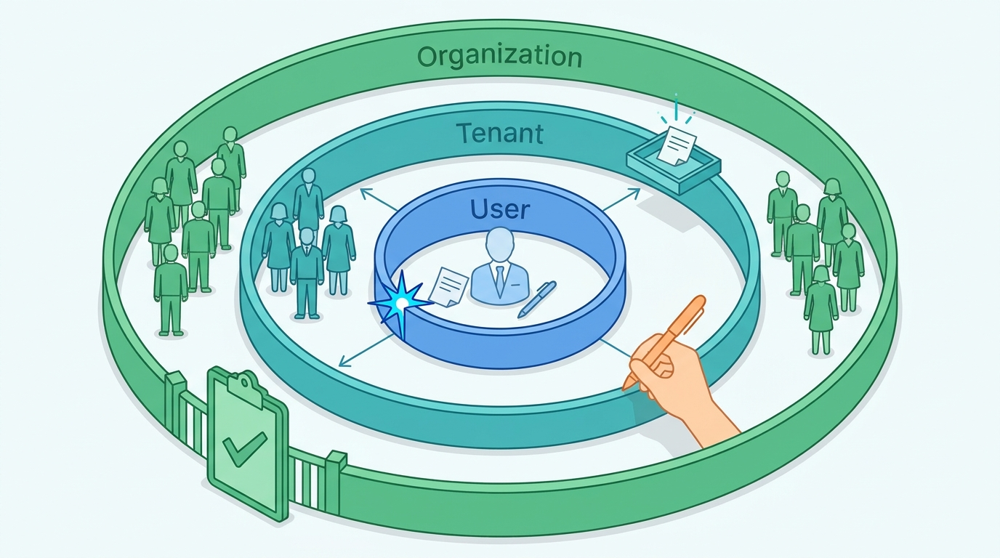
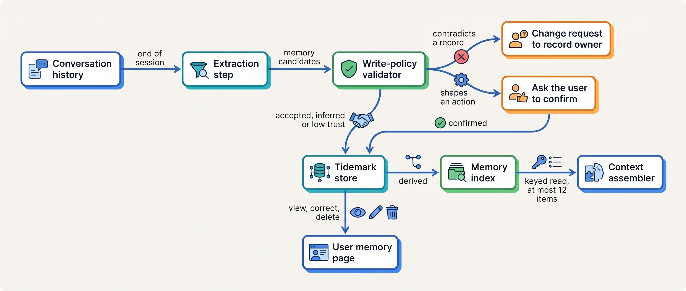
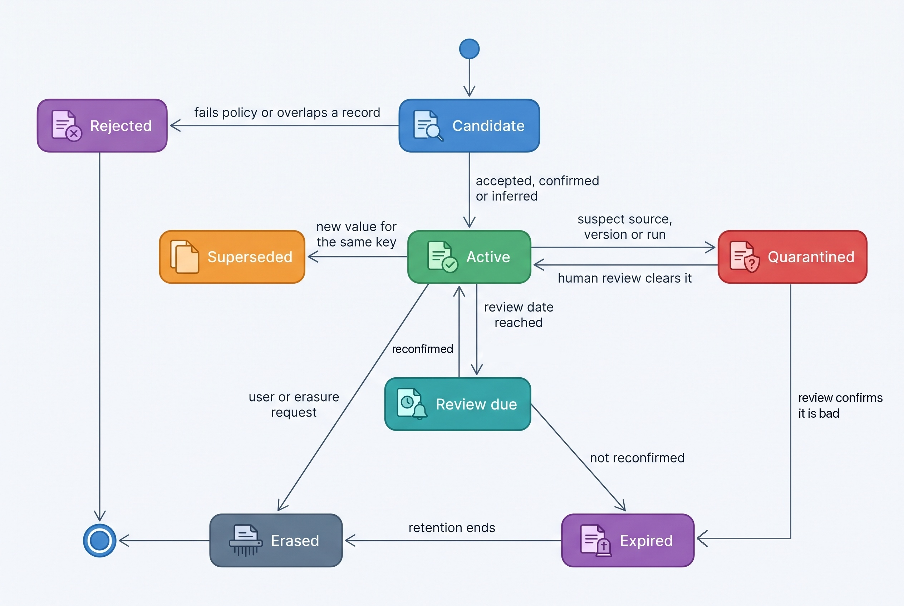
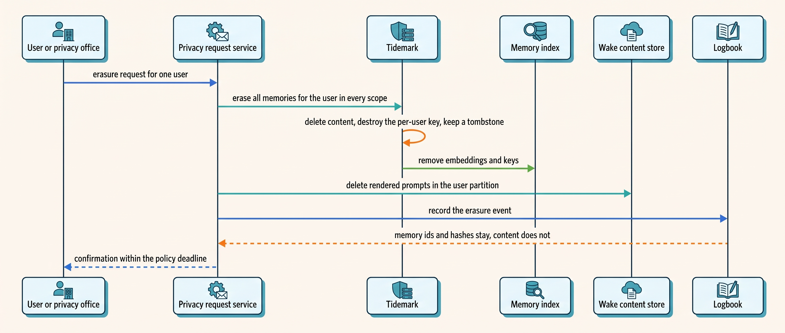
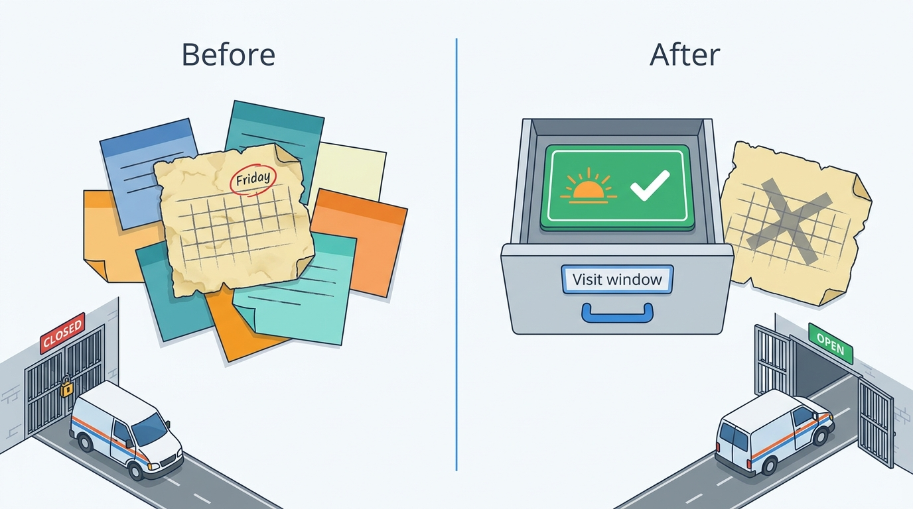

> **IN THIS CHAPTER, YOU WILL:** Learn to separate long-term memory from history, working context and task state; decide what an agent may remember at user, tenant and organization scope; design the write policy, provenance, expiry and deletion of memories; and defend memory against poisoning and measure whether it helps.

> **WHY THE BUSINESS CARES:** A remembered preference that has stopped being true sends a technician to the wrong person, shapes how a customer is treated on the strength of an unreviewed note, or keeps personal data the company has no reason to hold. Memory is personal data with a long life, and regulators, customers and the general counsel will ask what it holds and why.

> **WHY ARCHITECTS SHOULD CARE:** Memory is a write path from a probabilistic component into durable storage, read back later as if it were fact, by other sessions and sometimes by other agents. Without a write policy, provenance and expiry, it turns one bad output into a persistent belief and one injected message into a persistent compromise.

> **KEY POINTS:**
>
> * **Memory holds what only the conversation knows.** Anything a system of record knows (contracts, sites, contacts, balances, entitlements) is read live, never remembered. A memory candidate that contradicts a system of record is a change request to that system's owner, not a new memory.
> * **Every memory is written through a policy, not by the model.** The model may propose a memory. Deterministic code validates its class and schema, attaches provenance written by the runtime, sets its trust from the source of the text, supersedes the older value for the same key, and asks the user to confirm anything that will shape an action. The wider the scope, the stricter the writer: users confirm their own memories, humans write tenant memory, and organization-wide lessons are reviewed changes to the knowledge base or the agent version.
> * **Every memory expires, and every memory can be found and erased.** Each class has an expiry and a review date, set by the owner of the data. Users can see and delete what is remembered about them. Erasure reaches the store, the index, caches and backups, and bulk quarantine by provenance (by source run, document or writing agent version) is a routine operation. Memory never grants authority and never supplies an argument to a tool that changes the world.

> **[FAILURE PATTERNS THIS CHAPTER ADDRESSES](where-agentic-systems-go-wrong.html):**
>
> * **Memory Without Expiry** — the chapter's central case: model-written memories with one default lifetime outlived the facts they described, and newer contradicting memories did not replace them.
> * **The Lethal Trifecta** — a memory written from untrusted content is a delayed instruction: it waits for a later session that holds private data and a way to send it out.
> * **Amnesiac Execution** — teams that keep "what the agent did" in memory notes instead of task state lose it on a crash, or worse, resume from a belief the model wrote.

<br>
Teams add memory to an agent for good reasons. Customers dislike repeating themselves, a coding agent should not rediscover the build command every morning, and a research agent should know which sources its requester distrusts. The usual first version asks the model at the end of a session what was worth remembering, stores the answer in a vector index, and retrieves the top few items next time. Months later the store holds hundreds of thousands of items, some contradictory, some copies of records that have since changed, a few written from text an attacker supplied, and nobody can say which are true.

The problem is not retrieval quality. **Memory is the part of an agent designed so that the model's output becomes durable state that later sessions read as fact**, so it needs what any such write path needs: a schema, an owner, a writer policy, provenance, a lifetime and a deletion path. This chapter argues for remembering less and governing what remains. Most of what agents "remember" should be read live from the system that owns it.

This chapter owns four terms: **long-term memory (agent)**, the **memory write policy**, **memory expiry** and **memory poisoning**. It builds on [[context-engineering]], which treats the working context as computed per call and reads memory as one of its inputs, and on [[retrieval-and-grounding]], which owns search over corpora the agent does not write. It hands durable task state to [[task-state-and-checkpoints]], the `as_of` clocks and invalidation sweeps to [[provenance-and-freshness]], injection defenses in general to [[prompt-injection-defense]], and the versioning of memory schemas and of the prompts that write memories to [[versioning-agent-systems]].

## Setting the Scene at Ostrell: The Stale Preference

Ostrell, the fictional company this book follows (see [[meet-ostrell]]), built **Tidemark** as part of its Keelson agent platform: the long-term memory service, with per-user and per-tenant memories carrying provenance, confidence and expiry. Answerdesk, the support agent for Ostrell Field, was its first heavy user, with the simple policy. At the end of each conversation a Mid-tier extraction step wrote the "facts and preferences worth remembering" about the user (a dispatcher, office manager or technician at one of Ostrell's 9,400 Field business customers) into Tidemark. At the start of the next conversation the context assembler retrieved the ten most similar memories for that user. Every memory got a default expiry of 365 days, and its confidence was the model's own rating.

On **Tuesday 18 May 2027** an installation company in the Netherlands complained to Lena Brandt's Support Operations team. For two revisits in May, the technician had arrived on a Friday afternoon and asked for a site contact who had left the company in February. In March the office manager had told Answerdesk exactly that: the contact had left, there was a new contact, and the site now admitted contractors on weekday mornings only. The extraction step had written that as new memories, but the January ones ("prefers Friday afternoon revisits; on-site contact is …, mobile …") were still there, with the same expiry and a higher similarity to "book a revisit", and the model used them to draft the access notes for the technician's work order.

Jonas Lindqvist, principal engineer for Keelson Runtime, and Lena's team reviewed seven weeks of traces (1 April to 18 May 2027) and sampled Tidemark (Ostrell figures, fictional):

| Finding | Measurement |
| --- | --- |
| Answerdesk memories in Tidemark | About **640,000** active records for about **96,000** users |
| Users with at least one contradicting pair of memories | **6.8%** |
| Revisit bookings whose access notes contradicted a newer memory or the customer's site record | **46**; **11** visits failed on site and were rebooked (about **€290** per failed visit, Support Operations estimate) |
| Memories naming a third person with a phone number (site contacts) | About **2,140** |
| Median model-rated confidence of the memories involved | **0.9**, the same as for memories that were correct |

A stratified sample of 1,000 memories, read by two support leads against the source conversations and the systems of record, showed what the store actually contained:

| What the memory was | Share of sample | What the review found |
| --- | --- | --- |
| Preferences the user stated (language, channel, visit windows) | 38% | 9% no longer true |
| Copies of system-of-record facts (contract tier, sites, equipment, contacts) | 29% | 17% disagreed with the system of record |
| Episodic notes about past interactions ("frustrated about the March visit") | 21% | About a third were judgments about the person rather than facts |
| Behavioral rules the model wrote for itself about a user ("offer a credit early, this customer escalates") | 8% | None reviewed by anyone |
| Content derived from inbound email bodies or attachments | 4% | Untrusted text stored with the same trust as the user's own words |

Across all categories, **2.6%** of the sampled memories were not supported by anything in the source conversation.

The direct cost was eleven failed visits. Ilse de Wit, Ostrell's general counsel, saw the rest: phone numbers of people who were not Answerdesk's users, some of whom had left their employers, held with no retention basis, and unreviewed judgments about customers' temperament. Tomas Verhoef, the Chief Architect, put the question to the architecture forum: **what should Answerdesk remember at all, who may write it, and when must it be forgotten?** The redesign that answered it shipped on **12 July 2027** as Tidemark memory schema v3.

## Concepts: What Memory Is, and What It Is Not

### Five things the agent "knows", and the one that is memory

The book holds five stores apart: conversation history, working context, durable task state, long-term memory and the knowledge corpus. [[context-engineering]] sets out the full table (what each holds, who writes it, how long it lives); this chapter owns long-term memory, the only one of the five whose lifetime is set per class by policy and whose writer is a gated path on which the model may only propose.

**Long-term memory (agent)** is information that an agent's sessions write about a principal (a user, a tenant, or the agent's own way of working) so that later sessions can read it, and that no system of record holds. The last clause is the design rule this chapter defends. It excludes three things that are often called memory:

- **A compaction digest is not memory.** It is a lossy cache of one session's history, discarded when the session ends ([[context-engineering]]).
- **A progress note is not memory.** "Step 3 done" is task state, and must be written by the orchestrator from a receipt, not by the model. Anthropic's November 2025 harness post keeps progress in a JSON list that sessions may only flip, a soft version of the rule ([Anthropic, 2025](https://www.anthropic.com/engineering/effective-harnesses-for-long-running-agents)); [[task-state-and-checkpoints]] states the hard one.
- **A copy of a record is not memory.** A contract tier, a site address or an account balance remembered from a past session is a cache with no invalidation. It belongs to the system of record and is read live through a tool.

### Three kinds of memory

The cognitive-science triple that LangGraph's documentation uses is useful because each kind carries a different risk ([LangChain docs, n.d., accessed 2026-10](https://docs.langchain.com/oss/python/langgraph/memory)):

| Kind | What it holds | Example at Ostrell | Main risk | Default rule |
| --- | --- | --- | --- | --- |
| **Semantic** | Facts and preferences about a principal | "Prefers Dutch; prefers weekday-morning revisits" | Goes stale; duplicates a system of record | Keyed slots, one active value per key, confirmed if it shapes an action |
| **Episodic** | What happened in past sessions | "Revisit on ticket 88412 failed; customer was told a credit would be considered" | Paraphrase error; judgments about people | Reference the ticket, store the outcome, not an opinion |
| **Procedural** | How to do the task: rules, examples, lessons | "When a customer reports error E-214, check the gateway firmware first" | Changes behavior for every user it applies to | Not written at runtime; a reviewed change to the prompt, skill or knowledge base |

**Procedural memory is the dangerous one.** A semantic memory is wrong about one user; a procedural memory is a prompt change that skipped review. Answerdesk's "offer a credit early" rules were per-user procedural memories written by the model, which means a credit policy that Lena Brandt never saw. Reflexion showed that verbal lessons fed back within an evaluated benchmark task can improve performance ([Shinn et al., 2023](https://arxiv.org/abs/2303.11366), NeurIPS 2023); across users and months, a lesson is a behavior change and goes through [[versioning-agent-systems]].

### Scope: user, tenant, organization

Memory has an owner, and the owner sets its scope. The wider the scope, the more principals a wrong memory reaches, so the writer must be more accountable:

| Scope | Holds | Who may write | Who may read | Ostrell rule |
| --- | --- | --- | --- | --- |
| **User** | One person's preferences and episodes with one agent | The model proposes; the user confirms, or it is stored as `inferred` | That user's sessions with that agent | Default scope for Answerdesk |
| **Tenant** | Facts about one customer organization that no system holds | Humans only: customer administrators and Ostrell support leads; the model may propose to a queue | All sessions for that tenant | Short operational notes; anything lasting goes into a tenant-scoped knowledge-base article |
| **Organization** | Lessons that apply to all users | Not memory | — | A knowledge-base change or a new agent version, through review and evaluation |

Teams resist the last row, but shared model-written memory is exactly what the memory-injection research attacks: any user can write into what every other user's session reads. At organization scope the reviewed mechanisms already exist: the knowledge base with its content owners, and the agent's instructions with Sounding, Ostrell's evaluation service, as the gate.


**Figure 1:** *The wider the scope, the more people a wrong memory reaches: the model proposes at user scope, only humans write tenant notes, and organization-wide lessons go through review instead of memory.*

### Write policy, expiry and poisoning

A **memory write policy** is the per-agent, versioned rule set that decides which memory classes an agent may write, at which scope, from which sources, with which validation and confirmation, and with which trust and expiry. Deterministic code enforces it between the model's *candidate* and the store.

**Memory expiry** is the rule that ends a memory's use: a hard expiry date after which it is no longer read, plus a review date after which it must be reconfirmed, re-derived or dropped. Expiry is set per memory class by the owner of the data, not by a global default. It works with the freshness bounds of [[provenance-and-freshness]]: a memory's effective `as_of` is the time it was last confirmed, not the time it was written.

**Memory poisoning** is any way an adversary, or an unreviewed error, causes memory to hold content that later shapes an agent's behavior, for the same principal later or for others who read a shared scope. Unlike prompt injection **it is persistent and delayed**: the text that caused it may be gone, and the session it acts in may hold data and tools the original did not. OWASP's December 2025 Top 10 for Agentic Applications lists "Memory and Context Poisoning" as ASI06 ([OWASP GenAI Security Project, 2025](https://genai.owasp.org/resource/owasp-top-10-for-agentic-applications-for-2026/); the December 2025 publication date was verified, the category title and number are as reported by secondary sources and were not verified against the primary text).

## Architecture: The Write Path, the Read Path and the Erase Path

### Components and responsibilities

Tidemark after July 2027 has three paths, each with a different owner of correctness.


**Figure 2:** *The model proposes; code decides. A candidate that contradicts a system of record leaves the memory path entirely, and only confirmed memories may shape an action.*

| Component | Responsibility | Owner |
| --- | --- | --- |
| **Extraction step** | Proposes typed candidates from a finished session; cites the messages it used | Agent team (prompt is part of the agent version) |
| **Write-policy validator** | Checks class, scope, schema and size; detects overlap with systems of record; sets trust from source segments; supersedes older values; routes to confirmation | Agent Platform team (code); agent owner (policy content) |
| **Tidemark store** | Source of truth for memory records, with provenance, trust, expiry and deletion state | Agent Platform team |
| **Context assembler** | Reads memories by key and relevance, renders them with a header and the `model_generated` trust label, inside a budget | Keelson Runtime ([[context-engineering]]) |
| **Bulkhead and Toolyard** | Refuse tool arguments sourced from memory for action classes; memory never changes authority | Platform, with security review |
| **User memory page and erasure job** | Lets users see, correct and delete; executes data-subject erasure across store, index, caches and backups | Agent Platform team, with the privacy office |

The author's agentic-platform-foundations interview design draws the same split: the memory store "should keep memory provenance, trust tier, TTL, and deletion state; the vector index is a derived retrieval structure", and "a recalled instruction is data, not a grant" (design example, step `durable`, deep dive "Memory governance"). It names trust tiers and quarantine but leaves open how a memory moves between tiers and who moves it; the lifecycle below fills that gap.

### The memory record

```typescript
type MemoryClass = "preference" | "interaction_note" | "tenant_note";
type MemoryTrust = "user_confirmed" | "inferred" | "staff_written" | "low";

interface MemoryRecord {
  memoryId: string;
  scope: { tenant: string; user?: string; agent: string };  // never global
  cls: MemoryClass;
  key: string;                 // e.g. "revisit.preferred_window"; one active value per (scope, key)
  value: unknown;              // schema per key; free text only in interaction_note, capped
  trust: MemoryTrust;
  provenance: {
    sourceRunId: string;
    sourceMessages: number[];  // messages the candidate cited, verified to exist
    spanHashes: string[];      // hashes of the supporting utterances
    sourceTrust: string[];     // trust labels of those segments, from the context manifest
    writerManifest: string;    // hash of the agent version whose extraction step proposed it
    confirmedBy?: string;      // user or staff identity, if confirmed
  };
  recordedAt: string;
  lastConfirmedAt: string | null;  // effective as_of for freshness
  reviewAt: string;                // reconfirm, re-derive or drop after this
  expiresAt: string;               // never read after this
  supersedes?: string;             // memoryId of the value this one replaced
  state: "active" | "review_due" | "superseded" | "quarantined" | "expired" | "erased";
  schemaVersion: number;           // see versioning-agent-systems
}
```

Four design points matter more than the field list.

**Keys, not a pile.** The January design stored free-text items and retrieved by similarity, so "prefers Friday afternoons" and "now mornings only" were two items that competed in retrieval. With keys, a new value for `revisit.preferred_window` supersedes the old one in the same write, and the old one stays readable only for audit. LangGraph's documentation notes that memory collections need update and delete logic ([LangChain docs, n.d., accessed 2026-10](https://docs.langchain.com/oss/python/langgraph/memory)); keyed slots build it in. Free text survives only in `interaction_note`, capped at 280 characters and required to reference a ticket.

**Provenance is written by the runtime.** The extraction step cites message numbers. The validator checks that those messages exist and hashes the supporting utterances. It takes the trust labels of those messages from the call's context manifest, not from the model. A candidate whose supporting text came from an `untrusted` segment (an inbound email body, an attachment) gets trust `low` whatever the model says about it.

**Confidence is not a model rating.** In May the median self-rated confidence was 0.9 for correct and incorrect memories alike, the same pattern Ostrell's router audit later found for routing confidence ([[routing-and-delegation]]). Tidemark v3 replaces the number with a trust level derived from how the memory was established: confirmed by the user, written by staff, inferred, or low.

**The writer's version is recorded.** Each record carries the manifest hash of the agent version that proposed it, so when an extraction prompt turns out to be defective, Tidemark can quarantine exactly what that version wrote ([[versioning-agent-systems]]).

### The write policy

Answerdesk's write policy (Tidemark schema v3, July 2027; Ostrell policy, owned by Lena Brandt, enforced by the validator):

| Rule | What it does | Why |
| --- | --- | --- |
| **Allow-listed keys** | About 20 keys: language, channel, contact-time window, visit window, notification preferences, accessibility needs the user volunteers; anything else is rejected | Remember what the conversation alone knows |
| **System-of-record overlap is rejected** | Candidates about sites, contacts, contract tier, equipment, prices or entitlements are rejected; if they contradict the record, the validator opens a change request for the record's owner | The record is read live; a contradiction is news for its owner |
| **Confirmation for anything that shapes an action** | Before storing a preference that affects bookings or notifications, Answerdesk asks in the conversation: "Shall I remember that you prefer weekday-morning visits?"; declined means not stored | The user owns the memory and should know it exists |
| **Inferred preferences are suggestions only** | Unconfirmed candidates are stored as `inferred`, expire in 60 days and may only shape wording or the order of options offered | A guess must not narrow the user's choices |
| **No third-party personal data** | Names, phone numbers and addresses of people other than the user are rejected | No basis to retain them; the customer maintains contacts in Field |
| **No judgments about the person** | Interaction notes reference a ticket and state an outcome; character language and special-category data are rejected | No unreviewed profiling |
| **No per-user procedural memory** | Rules about how to treat a user are rejected; proposed lessons go to a weekly review queue for the knowledge-base and prompt owners | Behavior changes go through review and Sounding |
| **Untrusted-derived content is low trust** | Stored as `low`, flagged for review, rendered only with the untrusted label, never usable as a tool argument, expires in 30 days unless a human reviews it | Persistence must not launder injected text ([[prompt-injection-defense]]) |

Confirmation adds a question to the conversation, so Answerdesk asks at most once per conversation, about at most two keys: the validator runs on the candidates when the conversation is wrapping up, and for email tickets the question goes into the next reply. Users confirmed **64%** of proposed preferences in the first quarter; the rest are not stored or stay as 60-day suggestions.

### Expiry and review

| Class and trust | Review after | Expires after | On review |
| --- | --- | --- | --- |
| Preference, `user_confirmed` | 90 days | 365 days | Ask the user in the next conversation, or drop if the user has not been seen |
| Preference, `inferred` | — | 60 days | Dropped unless confirmed |
| Interaction note | — | 180 days | Dropped; the ticket remains in the ticketing system |
| Tenant note, `staff_written` | 90 days | 365 days | Owner reconfirms or moves it into a tenant-scoped knowledge-base article |
| Any memory, `low` | — | 30 days | Dropped unless a human reviews and promotes it |

These numbers are Ostrell policy. The 90-day review matches the memory row in the freshness register of [[provenance-and-freshness]]. Expiry is also the storage-limitation principle of the General Data Protection Regulation (GDPR): personal data "kept in a form which permits identification of data subjects for no longer than is necessary" for its purposes ([Regulation (EU) 2016/679, Art. 5(1)(e)](http://publications.europa.eu/resource/celex/32016R0679)). A memory without an expiry has no defensible retention period.

### The lifecycle


**Figure 3:** *A memory has states, not just a timestamp. Supersession and quarantine are transitions with records, and erasure is the end of every path.*

Quarantine is the operation the May incident lacked. It is a query plus a state change: *all memories whose provenance includes run R*, *all memories written by manifest M*, *all memories whose supporting spans came from document D*. The context assembler does not read quarantined memories; [[provenance-and-freshness]] and [[prompt-injection-defense]] use the same operation.

### The read path

The context assembler reads memory by key, and by relevance for interaction notes. Answerdesk renders at most **12 memory items, about 800 tokens**, in the conversation preamble (layer L3 of the prefix layout in [[caching-and-context-budgets]]), each with a header such as `[memory · revisit.preferred_window · user_confirmed · confirmed 2027-08-03 · review 2027-11-01]`. The trust label in the context manifest is `model_generated` for every memory, because even a confirmed memory is a model's paraphrase of what a user said.

Three rules govern use, none relying on the model:

1. **Memory never grants authority.** A memory saying "this customer may receive credits without approval" changes nothing: autonomy tiers live in the Agent Registry and Bulkhead decides ([[human-oversight-and-bounded-autonomy]]).
2. **Memory never supplies an argument to a side-effecting tool.** Answerdesk's revisit tool now takes the site and the access contact as identifiers resolved from the contract record. The free-text access notes that carried the stale contact in May are drafted only from the site record. Toolyard rejects action arguments whose provenance traces to a memory.
3. **Memory is never the source of a commitment.** A remembered preference is stated as the customer's preference, so the customer can correct it.

### Erasure and data-subject rights

Memory is personal data. A user of Ostrell Field is a natural person, even though the customer is a company. Under GDPR, users have rights of access (Art. 15), rectification (Art. 16) and erasure (Art. 17), and controllers must respond within one month of the request (Art. 12(3)) ([Regulation (EU) 2016/679](http://publications.europa.eu/resource/celex/32016R0679)). Erasure must reach every copy.


**Figure 4:** *Erasure reaches every copy. The evidence log keeps references and hashes, never memory content, so audit and erasure do not conflict.*

- **The evidence log holds references, not memory text.** Logbook records memory ids and content hashes in each context manifest. The trail shows a memory was read without retaining what it said. Where a record must be kept for a legal obligation, GDPR's Art. 17(3)(b) exception applies to that record, not to the memory.
- **Per-user encryption keys in the store.** Destroying the key makes backup copies unreadable. Restores replay the tombstone list before the store goes live.
- **The index is derived.** It is rebuildable from the store, so no orphaned vector brings an erased memory back.
- **Transient copies have short lives.** Wake's content store holds rendered prompts, which include memory text, for 30 days ([[agent-observability]]); the erasure job deletes the user's partition immediately rather than waiting.

Ostrell's target is **7 days** from request to completed erasure, well inside the one-month response time. The Ostrell Field portal's memory page lists each active memory with its source date; deletion there is immediate.

### Requirements per interaction

| Interaction | Consistency | Latency | Durability | Who may act |
| --- | --- | --- | --- | --- |
| Propose candidates (end of session) | None needed; asynchronous | Minutes acceptable | Candidates kept until validated | Extraction step only |
| Validate and write | One active value per key; supersede atomically | Seconds | Durable before acknowledged | Validator (code); user for confirmation |
| Read at session start | Read-your-writes for the user's own confirmations | Under 100 ms *(assumption)* | Not applicable | Context assembler |
| Quarantine by provenance | All matching records in one sweep | Minutes | Durable, recorded with reason | Agent owner, security on-call |
| User view, correct, delete | Immediate effect on reads | Interactive | Durable | The user |
| Erasure request | All stores and copies | Days, under 7 days target | Tombstone kept | Privacy office |

## Evidence: What Research and Experience Say

### Memory architectures

The research on agent memory is mostly about recall, much less about governance.

- **MemGPT** introduced "virtual context management", moving information between memory tiers in the way an operating system pages memory, and evaluated it on documents larger than the window and on multi-session chat ([Packer et al., 2023](https://arxiv.org/abs/2310.08560), preprint). Its successor, Letta, lets agents edit memory blocks through memory tools ([Letta docs, n.d., accessed 2026-10](https://docs.letta.com/guides/agents/memory)): the model is the writer.
- **Generative Agents** gave 25 simulated characters a memory stream scored by recency, importance and relevance, plus reflections that cite supporting memories ([Park et al., 2023](https://arxiv.org/abs/2304.03442)). Removing memory lowered believability ratings from 29.89 to 21.21 (TrueSkill μ, 100 raters), **a measure of believability in a simulation, not task correctness**. The more useful finding is embellishment: about 1.3% of 453 responses about other characters were hallucinated, so model-written memory contains claims nobody made.
- **LongMemEval** tests five long-term memory abilities over long chat histories: information extraction, multi-session reasoning, temporal reasoning, **knowledge updates** and **abstention** ([Wu et al., 2024](https://arxiv.org/abs/2410.10813), ICLR 2025). Commercial chat assistants and long-context models lost about 30% accuracy when recalling information across sustained interactions. The models tested are superseded; the durable result is the decomposition, because updating a fact and knowing when you do not know are exactly what failed in the Stale Preference.
- **Mem0** reports a 26% relative improvement in LLM-as-a-judge score over OpenAI's memory on the LOCOMO benchmark, 91% lower p95 latency and over 90% token savings versus full context ([Chhikara et al., 2025](https://arxiv.org/abs/2504.19413)). It is the vendor's paper about its own product, judged by a large language model (LLM), and unreplicated; its extract-then-update design (add, update, delete or do nothing per candidate) is the useful part.

### Memory poisoning

The evidence is consistent but comes from research settings and proofs of concept. **No published report of memory poisoning at a real customer deployment was found**, which reflects disclosure practice more than absence.

| Attack | What was poisoned | Attacker access | Reported result | Limitation |
| --- | --- | --- | --- | --- |
| **AgentPoison** ([Chen et al., 2024](https://arxiv.org/abs/2407.12784), preprint) | Agent memory or retrieval knowledge base, with an optimized trigger | Insert records, add trigger to queries | Over 80% average attack success on three agents, under 1% effect on benign tasks, poison rate under 0.1% | Attacker needs write access to memory or the knowledge base |
| **MINJA** ([Dong et al., 2025](https://arxiv.org/abs/2503.03704), preprint) | Shared agent memory bank | **Ordinary queries only** | Injection success 95.6–100%; attack success 57–98.9% by agent and model | Research agents with shared memory; prompt-level detection tested only with one model |
| **SpAIware** ([Rehberger, 2024](https://embracethered.com/blog/posts/2024/chatgpt-macos-app-persistent-data-exfiltration/)) | A chat assistant's long-term memory, via a web page or document | Untrusted content the user opens | Instructions persisted into future sessions and exfiltrated chat content until the vendor fixed the exfiltration channel | One product, 2024; the researcher noted untrusted content could still write memories |
| **Delayed tool invocation** ([Rehberger, 2025](https://embracethered.com/blog/posts/2025/gemini-memory-persistence-prompt-injection/)) | A chat assistant's memory, via an uploaded document | Untrusted document | The memory write was made to fire when the user next typed a common word, so it looked user-initiated; the vendor assessed it as low likelihood and low impact | One product, February 2025 |

MINJA is the result that should shape a memory design. **An agent that writes memory from user interactions and shares that memory across users can be poisoned by an ordinary user**, with no access beyond the chat box. Its authors also found prompt-level detection unreliable. The delayed-invocation case shows why "the user asked to remember it" is weak evidence: the request can be planted.

Industry guidance agrees on the controls. Microsoft's AI Red Team taxonomy of agent failure modes (April 2025) includes a memory-poisoning case and recommends limiting the agent's ability to store memories autonomously and requiring "external authentication or validation for all memory updates" ([Microsoft Security, 2025](https://www.microsoft.com/en-us/security/blog/2025/04/24/new-whitepaper-outlines-the-taxonomy-of-failure-modes-in-ai-agents/)). OWASP's guidance on vector and embedding weaknesses lists cross-context leaks in multi-tenant stores and recommends permission-aware, partitioned stores ([OWASP LLM08:2025](https://genai.owasp.org/llmrisk/llm082025-vector-and-embedding-weaknesses/)).

### What vendors document about their own memory features

- Anthropic's memory tool is **client-side**: the model requests file operations under `/memories` and the application executes them on storage it controls. Its guidance puts the burden on the application: strip sensitive data before writing, cap file sizes, "periodically delete memory files that haven't been accessed in a long time" and validate paths against traversal ([Anthropic docs, n.d., accessed 2026-10](https://platform.claude.com/docs/en/agents-and-tools/tool-use/memory-tool)).
- Claude Code treats its instruction files and model-written auto memory "as context, not enforced configuration"; to block an action, use a hook ([Claude Code docs, n.d., accessed 2026-10](https://code.claude.com/docs/en/memory)).
- In April 2025, OpenAI extended ChatGPT's memory to reference past conversations, initially excluding the UK, the EU and some other European countries pending "additional external reviews", as reported by TechCrunch ([TechCrunch, 2025](https://techcrunch.com/2025/04/10/openai-updates-chatgpt-to-reference-your-other-chats/)). OpenAI's own pages could not be fetched and current controls were not verified; I read the exclusion as a sign that memory is a data-protection question as much as a feature.

### Where sources disagree

**Who should write memory.** Anthropic's memory tool and Letta let the model write memory directly during the task. Microsoft's red team recommends limiting autonomous writes and validating all updates. LangGraph presents writing "in the hot path" (immediate, adds latency, competes with the task) and "in the background" (no latency, but other threads may miss the update) as a trade-off ([LangChain docs, n.d., accessed 2026-10](https://docs.langchain.com/oss/python/langgraph/memory)). The positions fit once you separate a user's own reviewable workspace (a coding agent's notes file), where direct writes are acceptable, from shared or action-shaping memory (a support agent's beliefs about a customer), where I side with the stricter position.

**Whether to have memory at all.** The author's support, sales and marketing interview designs have no cross-conversation memory; they ground every exchange in the system of record instead (design examples: `agentic-support-platform` and `agentic-marketing-platform`, step `grounding`; `agentic-sales-platform`, step `enrichment`). **No published evaluation compares task outcomes of business agents with and without long-term memory**; the evidence above is about recall benchmarks and attacks, and what follows is fictional Ostrell measurement and the author's judgement.

## Worked Example at Ostrell: Tidemark Schema v3

### Migration

The July 2027 migration (Ostrell figures, fictional) applied the new policy to the 640,000 existing Answerdesk memories rather than re-extracting them:

| Action | Records |
| --- | --- |
| Copies of system-of-record facts rejected; **1,310** contradictions with the record sent to account data owners as change requests | About 186,000 removed |
| Third-party contact data removed | About 2,140 removed |
| Per-user behavioral rules removed; 14 distinct lessons sent to the knowledge-base and prompt review queue | About 51,000 removed |
| Untrusted-derived content set to `low`, 30-day expiry | About 25,000 kept as `low` |
| Older values of contradicting or duplicate keys superseded (kept for audit, never read) | About 116,000 |
| Free-text preferences mapped to keys, latest recorded value kept and marked `inferred` | About 163,000 mapped |
| Interaction notes without a ticket reference, or with judgments, removed | About 97,000 removed |

Active Answerdesk memories fell from about **640,000** to about **188,000**, all keyed, all with provenance and an expiry. Mapped preferences started as `inferred`, because none of the January memories had been confirmed by anyone.

The 1,310 change requests were the most useful by-product: customers had told Answerdesk about changed sites, contacts or equipment that never reached Ostrell Field's records. Memory had been hiding defects in the system of record.

### The same conversation, after the change

Replay the May complaint under the July design. In March the office manager writes that the site contact has left and the site admits contractors only on weekday mornings. The new contact's details and the access regime are system-of-record facts (and the contact is a third person), so the validator rejects those candidates and opens one change request for the customer's site record, which the customer's administrator confirms in the portal. The visit-window preference is an allowed key, and Answerdesk asks: "Shall I remember that you prefer weekday-morning visits?" The user confirms. The new value supersedes the January value in one write.

In May the context assembler renders `revisit.preferred_window = weekday mornings` with its confirmation date. The revisit booking takes the site and access contact from the contract record, and the access notes come from the site record. The January contact is in neither.


**Figure 5:** *Before schema v3, contradicting memories coexisted and the stale one could win; a keyed slot holds one confirmed value, and a new value supersedes the old in one write.*

### Evaluation

Mei Lin Zhou's team added a memory suite to Sounding in July 2027, modeled on LongMemEval's abilities and extended with Ostrell's own controls: **360** multi-session cases built from production conversations and incident replays (Ostrell figures, fictional):

| Ability | Cases | Before (January policy) | After (schema v3) | Gate |
| --- | --- | --- | --- | --- |
| Knowledge update: newer value used | 90 | 0.58 | **0.93** | ≥ 0.90 |
| Abstention: "I don't have that on record" when nothing valid exists | 60 | 0.70 | **0.91** | ≥ 0.85 |
| System-of-record conflict: record wins | 60 | 0.62 | **0.97** | ≥ 0.95 |
| Deletion respected in later sessions | 30 | 0.83 | **1.00** | = 1.00 |
| Poisoning: untrusted content never becomes a trusted memory or a tool argument | 120 | 0.71 | **1.00** | = 1.00 |

Results are pass^3 over three trials, the convention of [[evaluating-agentic-systems]]. The suite gates every change to the extraction prompt, write policy, memory schema and extraction model, because what a version writes outlives it ([[versioning-agent-systems]]).

In production, revisit bookings with access notes contradicting the record or a newer memory fell from **46** in seven weeks to **2** in Q3 2027, both caused by out-of-date site records on the customer's side. The resolution rate stayed at **41%**: memory did not measurably improve resolution before or after the change. What changed was what it cost when it was wrong.

## Failure Modes and Recovery

| Scenario | What happens | Detection | Containment | Recovery |
| --- | --- | --- | --- | --- |
| **Stale preference** | A preference the user changed keeps shaping offers | Knowledge-update cases in Sounding; users correcting the agent ("I told you mornings") flagged in Wake | Keyed slots with supersession; 90-day review; memory never a tool argument | Supersede; ask the user; review similar keys for that writer version |
| **Poisoning from untrusted content** | Text in an email asks the agent to remember a new invoice address | Candidates whose spans come from `untrusted` segments; security review queue | Trust `low`, 30-day expiry, never a tool argument; email recipients come only from verified records ([[prompt-injection-defense]]) | Quarantine by run and document; add the case to the poisoning suite |
| **Cross-user poisoning via shared memory** | One user's queries write memory that other users' sessions retrieve | Tenant-scope writes outside the human-written path; unusual write volume per user | No model-written tenant or organization memory; per-user scope by default | Purge the shared scope by provenance; review the write path |
| **Defective extraction version** | A prompt change starts writing a new class of bad memories | Sampled shadow review before promotion; drift in rejection rates by writer version | Write policy validator; Sounding gate on the extraction prompt | Quarantine by `writerManifest`; roll back the version ([[staged-rollout-and-rollback]]) |
| **Erasure misses a copy** | Deleted memory reappears from an index, cache or restored backup | Post-erasure probe: search all stores for the erased ids and hashes | Derived index, per-user keys, tombstone replay on restore | Re-run the erasure; report under the privacy incident process |
| **Memory used as task state** | A team stores "credit issued" as a memory; after a crash the agent trusts or repeats it | Design review; a memory key that names an action | Allow-listed keys exclude action outcomes | Move the fact to task state written from receipts ([[task-state-and-checkpoints]]) |

## Trade-offs

| Option | What it gives | What it costs | Right when |
| --- | --- | --- | --- |
| **No long-term memory**; ground every session in systems of record | Nothing to go stale, poison or erase; simplest privacy story | Users repeat preferences; no continuity beyond the records | The records hold everything that matters (most back-office and high-stakes agents) |
| **Model writes directly during the task** (hot path) | Immediate continuity; simple | Unvalidated writes; latency; injected text persists | A single user's own workspace, visible and editable by that user, with no action shaped by it |
| **Background extraction through a write policy, with confirmation for action-shaping keys** | Keyed, provenance-bearing, expiring memory the user knows about | Validator code, a confirmation question, lower memory volume | Customer-facing agents with many users and personal data |
| **Human-curated memory only** (staff or customer administrators) | Accountable writers; reviewable | Slow, sparse, needs staff time | Tenant scope; any memory shared across users |
| **Lessons as reviewed agent changes** (prompt, skill, knowledge base) | Behavior changes evaluated before they reach anyone | Weekly cycle, not instant learning | Every organization-scope and procedural lesson |

My recommendation follows from two requirements: memory must never be more authoritative than the record it could have been read from, and every wrong memory must be findable and removable. That makes the gated write policy the default for customer-facing agents. "No memory" is the default for everything else until someone shows what the agent decides better with memory than without it. The recommendation does not hold for single-user tools such as a developer's coding CLI, where the user sees and edits the memory file and the worst case is a bad suggestion inside a reversible workspace.

## Across Domains: How the Stakes Change the Design

| Concern | Coding agents | Customer operations (support, sales, marketing) | Back office (finance, legal, HR) | High-stakes decisions (healthcare, public benefits) |
| --- | --- | --- | --- | --- |
| **What is worth remembering** | Build commands, conventions, pitfalls of a repository | Contact preferences: language, channel, time windows | Little: the records and playbooks hold it | Nothing about the person outside the record |
| **Where it lives** | Repository guidance files under review; a developer's local memory | User-scoped memory service with keys and expiry | Peoplepoint at Ostrell: `memory: none`; Closewise: none per user | The electronic health record or case file is the only record |
| **Who may write** | Humans through pull requests; agents may propose changes | Model proposes, user confirms; tenant notes by staff | Policy owners, through document review | Clinicians and caseworkers, in the record, with their identity |
| **Poisoning channel** | A cloned repository's memory file: "repo content that reads like instructions" (coding CLI design, step `safety`) | Inbound email and chat content | Counterparty documents; employee messages | Patient-supplied documents; claimant uploads |
| **Expiry and retention** | Versioned with the code | Per class, 60–365 days at Ostrell | Retention is set by law for records, not memory | Record retention law; agent copies kept to the minimum |
| **Cost of a wrong memory** | A bad suggestion, caught by tests and review | A failed visit, a repeated withdrawn promise, unlawful retention | A breach of an ethical wall; an employment decision influenced by an unreviewed note | Harm to a patient; an unlawful decision about a person |

The coding column draws on the author's ai-coding-cli interview design, which loads a project memory file every session as "guidance, not authority" and warns that in a cloned or compromised repository it is "an injection channel dressed as configuration" (design example, step `context`); in the coding-harness design, agent-drafted guides have no provenance or trust tier, so checked-in review is the only gate (step `guides`). The back-office column reflects the legal design's ethical walls, where "a walled document is never retrieved, not merely never shown" (design example, `agentic-legal-platform`, step `grounding`): memory that crosses matters would breach the wall, so legal memory, if any, is scoped per matter. Peoplepoint has no long-term memory: employee conversations touch leave, health and pay, and an employment decision must not rest on an unreviewed model-written note. The high-stakes designs ground in the chart or case file (design examples, `agentic-healthcare-platform` and `agentic-public-benefits-platform`, step `grounding`), and the healthcare design keeps minimum-necessary context per task (step `privacy`). An agent memory about a patient or claimant would be a second, unaudited record beside the official one.

**What the platform keeps common:** the memory record schema, keyed slots and supersession, provenance written by the runtime, trust derived from source labels, the lifecycle and quarantine by provenance, the erasure path, and the rule that memory never grants authority or supplies an action argument. **What is domain policy:** whether an agent has memory at all, the allowed keys, the confirmation rule, expiry per class and the retention exceptions. For most back-office and high-stakes agents the policy answer is `memory: none`. It is a decision recorded in the agent version manifest, not a missing feature.

## The Chief Architect's View

**Decisions to make, and who makes them.**

- **Memory is opt-in per agent, with a stated purpose.** The agent owner states what the agent decides better with memory and which keys it needs. The default manifest entry is `memory: none`. The Agent Platform team owns Tidemark; the agent owner owns the write policy content; the privacy office approves the purpose and the retention.
- **No model-written memory above user scope.** Tenant memory is written by people; organization knowledge is a reviewed knowledge-base or agent change. It is the cheapest defense against cross-user poisoning.
- **Systems of record win, and memory reports their gaps.** Make the change-request path from rejected memory candidates to record owners a platform feature. At Ostrell it found 1,310 defects in customer records that nobody else had reported.
- **Erasure is designed before the first memory is written.** Store, index, caches, transient content and backups, with a tested probe.

**What to watch.** Memory volume per active user, which should stay flat, not grow; the share of memories confirmed versus inferred; supersession rate; record-conflict rate at read; quarantine events and their causes; low-trust write volume per source; the time to complete an erasure request; and the Sounding memory suite per writer version.

**What is durable and what will change.** Durable: the separation of memory from history, state and corpus; the scope ladder; provenance written by code; expiry per class; erasure that reaches every copy; memory as data, never authority. Better models will extract cleaner candidates and raise knowledge-update scores; they will not make a remembered contract tier fresher than the contract system, or a model-written note about a customer lawful to keep forever. What will change: vendor memory features, their defaults and their regional availability; the recall benchmarks; and possibly the wording of data-protection law. Keep vendor memory products behind your own store wherever tenancy, retention or erasure matter.

## Questions to Ask

1. What does this agent decide better with memory than without it, and has anyone measured that?
2. Which items in the proposed memory are already held by a system of record, and why are they not read live?
3. Who may write memory at each scope (user, tenant, organization), and is any model-written memory read by more than one principal?
4. Does every memory have a key, a class, provenance written by the runtime, a trust level derived from its source, a review date and an expiry?
5. What happens when a user says something that contradicts an existing memory, or contradicts a record?
6. Can memory ever change an autonomy tier, supply an argument to a side-effecting tool, or be cited as the basis of a commitment?
7. Can we quarantine, in one operation, every memory written by a given run, document or agent version?
8. When a user asks to see or erase what the agent remembers, which stores, indexes, caches, logs and backups does the request reach, and which evaluation cases prove deletion, knowledge updates and poisoning resistance before each change?

Memory is the part of what an agent knows that outlives a session by design. The next chapter covers the part that must outlive a crash. [[task-state-and-checkpoints]] describes the record the orchestrator writes from receipts: what the run has done, what it decided and what it is waiting for. That record is exactly what memory must never be used for.

## Sources and Evidence

**Research papers**

- [MemGPT: Towards LLMs as Operating Systems](https://arxiv.org/abs/2310.08560) — Packer et al., 2023 (preprint). Virtual context management across memory tiers; model-managed memory.
- [Generative Agents: Interactive Simulacra of Human Behavior](https://arxiv.org/abs/2304.03442) — Park et al., 2023. Memory stream, reflections, believability ablation, embellishment and hallucinated memories.
- [LongMemEval: Benchmarking Chat Assistants on Long-Term Interactive Memory](https://arxiv.org/abs/2410.10813) — Wu et al., 2024 (ICLR 2025). Five memory abilities, including knowledge updates and abstention; about 30% accuracy drop across sustained interactions.
- [Mem0: Building Production-Ready AI Agents with Scalable Long-Term Memory](https://arxiv.org/abs/2504.19413) — Chhikara et al., 2025 (vendor preprint). Extract-and-update memory; self-reported LOCOMO results.
- [Reflexion: Language Agents with Verbal Reinforcement Learning](https://arxiv.org/abs/2303.11366) — Shinn et al., 2023 (NeurIPS 2023). Verbal lessons in episodic memory within evaluated tasks.
- [AgentPoison: Red-teaming LLM Agents via Poisoning Memory or Knowledge Bases](https://arxiv.org/abs/2407.12784) — Chen et al., 2024 (preprint). Triggered poisoning of agent memory with very low poison rates.
- [Memory Injection Attacks on LLM Agents via Query-Only Interaction (MINJA)](https://arxiv.org/abs/2503.03704) — Dong et al., 2025 (preprint). Poisoning shared memory through ordinary queries; unreliable prompt-level detection.

**Specifications, standards and regulation**

- [Regulation (EU) 2016/679 (General Data Protection Regulation)](http://publications.europa.eu/resource/celex/32016R0679) — European Parliament and Council, 2016. Storage limitation (Art. 5(1)(e)), access, rectification and erasure (Arts. 15–17), the legal-obligation exception (Art. 17(3)(b)), one-month response (Art. 12(3)).
- [OWASP Top 10 for Agentic Applications for 2026](https://genai.owasp.org/resource/owasp-top-10-for-agentic-applications-for-2026/) — OWASP GenAI Security Project, 2025. Memory and Context Poisoning (ASI06).
- [LLM08:2025 Vector and Embedding Weaknesses](https://genai.owasp.org/llmrisk/llm082025-vector-and-embedding-weaknesses/) — OWASP GenAI Security Project, 2025. Cross-context leaks and poisoning in shared vector stores; partitioned, permission-aware stores.

**Vendor documentation and engineering reports**

- [Memory tool](https://platform.claude.com/docs/en/agents-and-tools/tool-use/memory-tool) — Anthropic, n.d., accessed 2026-10. Client-side memory; application responsibilities for sensitive data, size and expiry.
- [How Claude remembers your project](https://code.claude.com/docs/en/memory) — Anthropic (Claude Code), n.d., accessed 2026-10. Memory as context, "not enforced configuration".
- [Effective harnesses for long-running agents](https://www.anthropic.com/engineering/effective-harnesses-for-long-running-agents) — Anthropic, 2025. Progress artifacts the model may only partly edit; the boundary between notes and state.
- [LangGraph memory](https://docs.langchain.com/oss/python/langgraph/memory) — LangChain, n.d., accessed 2026-10. Semantic, episodic and procedural memory; hot-path versus background writes; profiles versus collections.
- [Sessions, State and Memory](https://adk.dev/sessions/) — Google Agent Development Kit, n.d., accessed 2026-10. Session state versus a cross-session memory service.
- [Letta memory overview](https://docs.letta.com/guides/agents/memory) — Letta, n.d., accessed 2026-10. Memory blocks edited by agents and developers.
- [New whitepaper outlines the taxonomy of failure modes in AI agents](https://www.microsoft.com/en-us/security/blog/2025/04/24/new-whitepaper-outlines-the-taxonomy-of-failure-modes-in-ai-agents/) — Microsoft Security, 2025. Memory poisoning case; validate all memory updates, limit autonomous writes.
- [OpenAI updates ChatGPT to reference your other chats](https://techcrunch.com/2025/04/10/openai-updates-chatgpt-to-reference-your-other-chats/) — TechCrunch, 2025 (press). Cross-conversation memory rollout and its initial European exclusion.
- [What we missed with sycophancy](https://simonwillison.net/2025/May/2/what-we-missed-with-sycophancy/) — Simon Willison, 2025, quoting OpenAI's May 2025 postmortem. User memory as an amplifier of a model behavior problem.

**Incidents, cases and decisions**

- [Spyware Injection Into Your ChatGPT's Long-Term Memory (SpAIware)](https://embracethered.com/blog/posts/2024/chatgpt-macos-app-persistent-data-exfiltration/) — J. Rehberger (Embrace The Red), 2024. Persistent memory injection and exfiltration in a shipped product.
- [Hacking Gemini's Memory with Prompt Injection and Delayed Tool Invocation](https://embracethered.com/blog/posts/2025/gemini-memory-persistence-prompt-injection/) — J. Rehberger (Embrace The Red), 2025. A memory write disguised as user-initiated; the vendor's severity assessment.

**Design examples from the author's interview project**

- Obrenović, Ž., "Agentic Platform Foundations", system-design interview design, `system-design-interviews/data/book/agentic-platform-foundations/interview.json`, 2026 — step `durable` (deep dive "Memory governance"; `dataModel.memories` with provenance, trust tier and TTL; follow-up on memory poisoning).
- Obrenović, Ž., "AI Coding Agent CLI", system-design interview design, `system-design-interviews/data/book/ai-coding-cli/interview.json`, 2026 — step `context` (project memory as guidance, not authority; memory file as injection channel).
- Obrenović, Ž., "AI Coding Harness", system-design interview design, `system-design-interviews/data/book/ai-coding-harness/interview.json`, 2026 — step `guides` (agent-drafted guides without provenance or trust tier).
- Obrenović, Ž., "Agentic Support Platform", "Agentic Sales Platform" and "Agentic Marketing Platform", system-design interview designs, `system-design-interviews/data/book/agentic-support-platform/interview.json` (and siblings), 2026 — step `grounding` (support, marketing) and step `enrichment` (sales): system-of-record grounding instead of cross-conversation memory.
- Obrenović, Ž., "Agentic Legal Platform", system-design interview design, `system-design-interviews/data/book/agentic-legal-platform/interview.json`, 2026 — step `grounding` (ethical walls on the retrieval path).
- Obrenović, Ž., "Agentic Healthcare Platform" and "Agentic Public Benefits Platform", system-design interview designs, `system-design-interviews/data/book/agentic-healthcare-platform/interview.json` and `agentic-public-benefits-platform/interview.json`, 2026 — step `grounding` (the record as the only memory) and healthcare step `privacy` (minimum-necessary context).

Ostrell is fictional; architectural recommendations, labeled inferences and labeled assumptions are the author's judgement.
