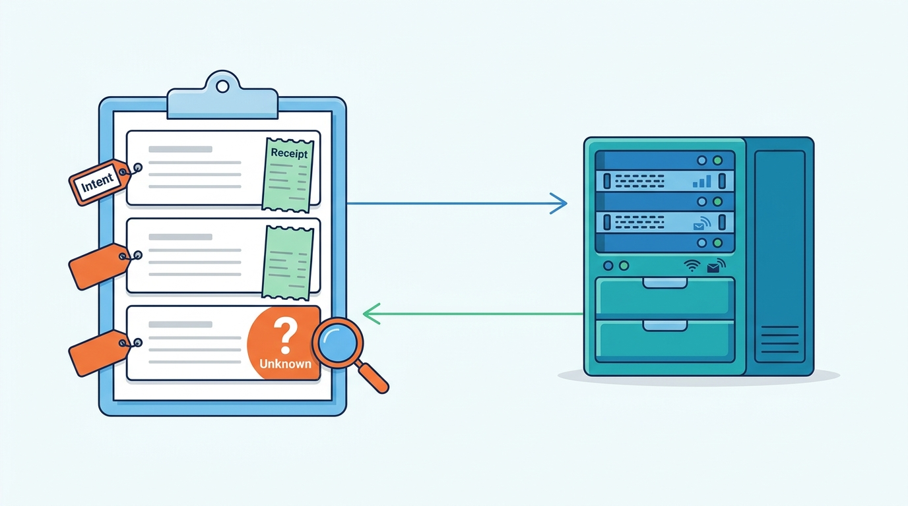
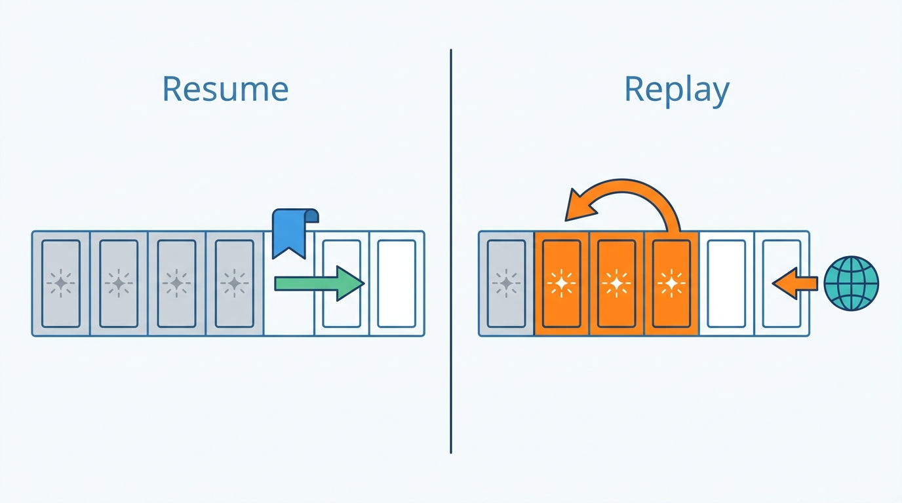
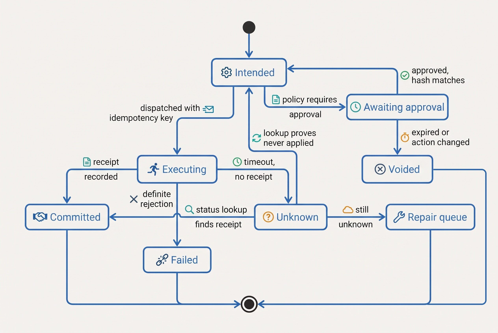
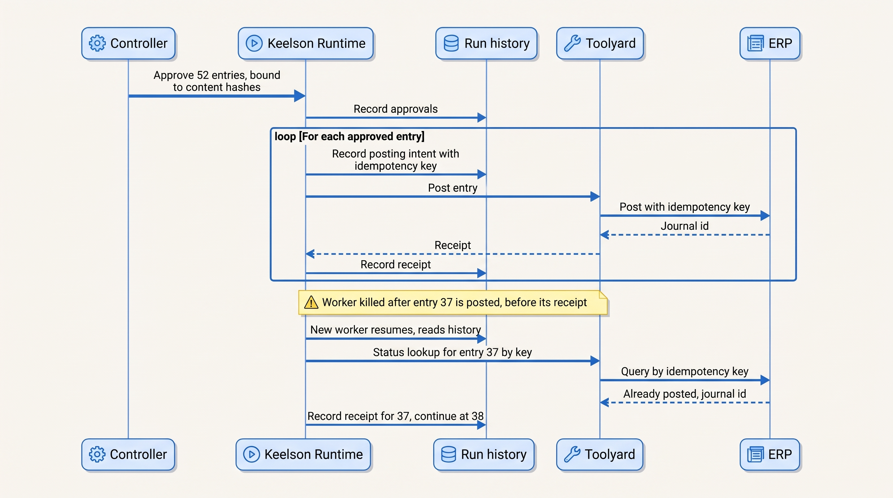

> **IN THIS CHAPTER, YOU WILL:** Learn what durable task state an agent run needs, how to choose checkpoint granularity, why resuming from a recorded history is different from replaying a run, and how to evolve, share and retain task state over the months a long-running agent lives.

> **WHY THE BUSINESS CARES:** When an agent crashes halfway through posting journal entries, issuing credits or editing a repository, the business needs to know what was done and what was not. Without that record, an operator restarts the job and the work, including its payments and postings, happens twice. Ostrell paid €2.84 million in overstated accruals and two days of manual reversal to learn this.

> **WHY ARCHITECTS SHOULD CARE:** Task state is the part of an agentic system that makes a variable component restartable. Its shape decides whether a crash is a non-event or an incident, whether a deploy can happen during the month-end close, and whether an auditor can reconstruct a decision a year later. Bolting it on after the fact means rebuilding the runtime.

> **KEY POINTS:**
>
> * **Task state is what the orchestrator recorded, not what the model remembers.** The working context is recomputed for every model call, and memory holds beliefs. Task state holds facts: which steps finished, which model decisions were taken, which side effects have intents and receipts, which approvals are valid. Only deterministic code writes it, from actual tool results.
> * **A checkpoint restores the agent, not the world.** *Resume* continues from recorded results and never re-asks the model for a decision it already made. *Replay* re-executes, and re-samples the model and re-issues tool calls unless they are recorded or idempotent. Frameworks use these words differently, so check which one yours does after a crash. Checkpoint after every model decision and around every side effect.
> * **Task state is a long-lived schema with an owner, a version and a retention rule.** Runs outlive deploys, model upgrades and policy changes. Every task record pins the agent version it started with, carries a schema version, and is kept apart from long-term memory and the evidence log, because each of the three has its own readers, mutability and legal lifetime.

> **[FAILURE PATTERNS THIS CHAPTER ADDRESSES](where-agentic-systems-go-wrong.html):**
>
> * **Amnesiac Execution** — the run's progress lives in a process or a conversation, so a crash or deploy restarts it from scratch and repeats its side effects.
> * **The Different Second Answer** — recovery re-runs the step that contains the model call, so the model proposes a different action after part of the first one has already executed.
> * **The Fire-and-Forget Action** — without an intent recorded before the call and a receipt after it, nobody can tell whether a posting or credit happened once, twice or not at all.

<br>
An agent run is a program whose next step is chosen while it runs. When it fails partway through, the system has to answer three questions before doing anything else: **what has the run already done in the world, what had it decided to do next, and on whose authority?** If the answers live only in the model's context window or in the memory of a worker process, the answers are lost with the process. The usual reaction, rerunning the job, is the most dangerous recovery an agent can have, because the model will not necessarily choose the same path a second time.

Workflow engines, event sourcing and transactional outboxes solved "survive a crash without doing things twice" long ago. Agents add a component whose output varies between calls, so **the model's decisions themselves become recorded inputs**, and runs that wait days for a human, so state must outlive deploys and version changes.

This chapter owns four terms: **task state**, **checkpoint**, **run history**, and the distinction between **resume and replay**. It builds on [[agent-runtime]], which defines the run lifecycle; on [[context-engineering]], which treats the working context as something computed per call; and on [[agent-memory]], which keeps long-term memory separate from task state. It hands the execution engine and its timers and heartbeats to [[durable-agent-execution]], idempotency keys and leases to [[retries-idempotency-and-concurrency]], recovery from half-finished work to [[partial-failure-and-compensation]], and the evidence log to [[policy-enforcement-and-audit]].

## Setting the Scene at Ostrell: The Script That Remembered Nothing

Ostrell, the fictional field-service software group this book follows (see [[meet-ostrell]]), closes the books of **23 legal entities** every month. Its Closewise agent proposes about **1,900 accrual journal entries a month**; the group controller, Joost Vermeer, or a delegated controller approves them; and only approved entries are posted to the ERP by deterministic code, never by the model (segregation of duties).

In **January 2027**, before Closewise moved onto the Keelson agent platform, posting was a script. For Ostrell Field Deutschland GmbH it took a batch of **52** approved entries and posted them one by one. After **37** postings the script crashed. An accountant saw the failure and re-ran it. The script had no record of what it had posted and the ERP calls carried no idempotency keys, so it posted all **52** again: **37 duplicates**, **€2.84 million** of overstated accruals. The controller's balance review found the error the next day; reversing it by hand took **2 days** and delayed that entity's close by one day.

The script was not an agent, and that is the point. The model's part, proposing and classifying entries, worked. The failure was in the part that should have been the most boring: **nothing durable recorded what had happened**. When Closewise moved onto Keelson Runtime in **April 2027**, Tomas Verhoef, Ostrell's Chief Architect, put one requirement to Jonas Lindqvist, the principal engineer for Keelson Runtime: *any Keelson run must be killable at any instruction, at any time, and restartable by anyone, without a human reconstructing what it did.* The design that came out of that requirement is the **Keelson task record**, the subject of this chapter.

Closewise is a good test because its runs are long: a close task opens on working day 1, can wait days for controller approval (escalating to the entity's deputy controller after 48 working hours; see [[durable-agent-execution]]), posts, and must finish by working day 5, crossing deploys, ERP maintenance windows and worker replacements on the way.

## Concepts: What the System Knows, and Which of It Is True

### Four stores, four owners

The words "context", "memory", "history" and "state" are used loosely across frameworks. This book holds them apart, following the distinctions that LangGraph (checkpointers vs stores), Google's Agent Development Kit (Session, Events, State, Memory) and Anthropic's context-editing documentation (full client-side history vs per-call edited context) draw under different names ([LangGraph persistence docs, n.d.](https://docs.langchain.com/oss/python/langgraph/persistence); [Google ADK sessions docs, n.d.](https://adk.dev/sessions/); [Anthropic context editing docs, n.d.](https://platform.claude.com/docs/en/build-with-claude/context-editing)).

| Store | What it holds | Who writes it | Lifetime | If it is wrong |
| --- | --- | --- | --- | --- |
| **Working context** ([[context-engineering]]) | The tokens sent to the model on this call | Context assembly, recomputed per call | One model call | Distraction, missing facts |
| **Conversation history** | Messages, tool calls and results in order | Runtime appends | Session plus audit retention | Unreproducible behavior |
| **Task state** (this chapter) | Goal, plan, step and action records, approvals, budgets, artifacts, waits | **Deterministic orchestrator only** | Task duration plus retention | Duplicate side effects; no resume |
| **Long-term memory** ([[agent-memory]]) | Facts and preferences across tasks | Gated write path; the model may only propose | Per memory class, always finite | Stale or poisoned beliefs |
| **Evidence log** ([[policy-enforcement-and-audit]]) | Curated decision record for audit | Runtime, append-only | Regulatory retention | Unprovable decisions |

**Task state** is the structured, durable record of a task's progress that the system, not the model, treats as authoritative: what the task is for, which plan version is in force, which steps and actions have happened with which results, which approvals are valid, how much budget is left, and what the task is waiting for. The defining rule is about who writes it. A model's note that says "step 3 done" is a belief; whether a credit was issued is recorded by the orchestrator from the tool's actual result, in a store the model cannot overwrite.

Anthropic's November 2025 engineering post on long-running coding agents shows the soft version of this rule. Its harness keeps a JSON feature list that coding sessions may change only by flipping a `passes` field, chosen because models are "less likely to inappropriately alter" JSON than Markdown, plus a progress file and git commits that later sessions read and can revert to ([Anthropic, "Effective harnesses for long-running agents", 2025](https://www.anthropic.com/engineering/effective-harnesses-for-long-running-agents)). That works when the worst outcome is a bad commit. For postings, payments and filings the rule must be hard: the model has no write path to task state at all.

### Invariants of task state

Five invariants make task state useful for recovery. They are the author's synthesis of the durable-execution literature cited in the Evidence section, stated as rules a design review can check.

1. **Single writer.** Only the orchestrator writes task state, and only from recorded results: model responses, tool results, approval decisions, timer firings.
2. **Decision before action.** A model response is recorded, with model id and prompt version, *before* any action based on it executes.
3. **Intent before effect, receipt after.** Every external side effect has an intent record (with its idempotency key) written before the call, and a receipt or an explicit `unknown` written after. No record can share a transaction with a payment or an ERP posting at another system, so the pattern is intent, execute, receipt, with reconciliation for the gap between the last two.
4. **Forward-only transitions with full history.** States advance; corrections are new records (a reversal, a superseding plan), not edits.
5. **Pinned versions.** The task records the agent version manifest it runs under (model id, prompts, tool schemas, policies; see [[versioning-agent-systems]]) and the schema version of the record itself.


**Figure 1:** *Every side effect is bracketed: an intent with its idempotency key before the call, and a receipt or an explicit unknown after it, which a status lookup resolves.*

### Checkpoint, run history, resume and replay

A **checkpoint** is a durable point in a run from which execution can continue without redoing anything before it. It can be a snapshot of the whole state (LangGraph saves "a snapshot of the graph state" at each super-step) or a position in an append-only history from which state is rebuilt (Temporal, Azure Durable Functions, DBOS, Restate) ([LangGraph checkpointers docs, n.d.](https://docs.langchain.com/oss/python/langgraph/checkpointers); [Temporal workflows docs, n.d.](https://docs.temporal.io/workflows)).

The **run history** is the ordered, append-only sequence of events of one run: task created, plan recorded, model decision recorded, action intended, action receipt, approval granted, timer fired, task completed. It is event sourcing in Martin Fowler's 2005 sense, "capture all changes to an application state as a sequence of events" ([Fowler, "Event Sourcing", 2005](https://martinfowler.com/eaaDev/EventSourcing.html)). Current task state is a projection of the history. The history is for the runtime; the evidence log is a separately curated record for auditors (see the table below).

**Resume** means continuing a run from its latest checkpoint, using the recorded results of everything before it. A resumed run does not call the model for decisions already recorded and does not repeat side effects whose receipts exist. **Replay** means re-executing a run, or part of it, from an earlier point, so later steps run again. Replay is a debugging, evaluation or what-if tool; it calls the model again and, unless tools are stubbed, the world again. The words collide in practice: Temporal's "replay" is the mechanism by which it *resumes* (it re-runs deterministic workflow code against recorded history), while LangGraph's replay from a prior checkpoint re-executes later nodes, "including any LLM calls, API requests, or interrupts" ([LangGraph checkpointers docs, n.d.](https://docs.langchain.com/oss/python/langgraph/checkpointers)). In this book "resume" is the recovery path and "replay" is deliberate re-execution, and the distinction is whether the model is asked again.


**Figure 2:** *Resume continues from the latest checkpoint and reuses recorded decisions; replay re-executes later steps, asks the model again and, unless tools are stubbed, the world again.*

## Architecture: The Task Record and Where It Lives

### What a task record contains

The table shows the entities of the Keelson task record. The field lists are abridged; the point is what each entity is for and what happens if it is missing.

| Entity | Key fields | Written when | Why it exists |
| --- | --- | --- | --- |
| **Task** | `task_id`, goal, inputs by reference, principal and on-behalf-of identity, `manifest_id`, `schema_version`, deadline, status | Created by the triggering event | One identity for everything the run does; pins versions |
| **Plan** | `plan_version`, steps (typed), source (code or model), approval ref if required | Recorded before the first step runs; new version on replanning | Resume follows the recorded plan, not a regenerated one ([[planning-and-decomposition]]) |
| **Step** | `step_id`, `plan_version`, status, attempt count, inputs and outputs by reference | Each transition | The resume cursor |
| **Model decision** | `decision_id`, `step_id`, model id, prompt version, context reference, response (or reference), tokens, cost | Immediately after the model call returns | Recovery reuses the decision instead of re-sampling |
| **Action** | `action_id`, `decision_id`, tool, arguments hash, `idempotency_key`, status, receipt | Intent before call; receipt or `unknown` after | Exactly-once *effect* on retry; answers "did it happen?" |
| **Approval** | `approval_id`, `action_id`, action content hash, approver, policy version, evidence shown, `expires_at` | On approval decision | Binds a human decision to an exact action version ([[human-oversight-and-bounded-autonomy]]) |
| **Wait** | kind (timer, signal, approval, external event), deadline, wake condition | On suspension | A run waiting three days holds no worker |
| **Budget** | tokens, cost, wall-clock, delegation depth, sub-agent count: limit and consumed | Each model call and spawn | A restart must not reset the meter |
| **Artifact** | `artifact_id`, type, location, content hash, producing step | When a step produces output | Large outputs live by reference, not in state |

**Budget consumed** belongs in task state, not in the worker's memory: in Ostrell's Weekend Fan-out (February 2027), a Scout research run made **1,900 sub-agent runs** over **41 hours** and spent **€8,700** before a quota alert stopped it. The fix set a maximum delegation depth of 2 and at most 8 parallel sub-agents, and those limits only hold across restarts if the counters are durable (see [[agent-cost-and-model-routing]]). The **context reference** on a model decision lets an investigator rebuild exactly what the model saw (see [[agent-observability]]) without storing the full prompt in the hot state.

The action lifecycle is where most recovery bugs live, so it has an explicit state machine. The `unknown` state is the book's standard rule: after a timeout with no receipt, the outcome is unknown until a status lookup by idempotency key resolves it.


**Figure 3:** *The action lifecycle in a task record. The only path back to execution after a timeout runs through a status lookup; no transition re-asks the model.*

### Checkpoint granularity

Checkpoint granularity decides what a crash costs. The coarser the checkpoint, the more work is redone and the more of that work is model calls and side effects.

| Granularity | What re-runs after a crash | Write cost | Use when |
| --- | --- | --- | --- |
| End of run only | Everything | Lowest | Never for runs with side effects; LangGraph's `exit` mode, which "cannot recover from system failures … mid-execution" |
| Per step, where a step mixes model call and tool call | The interrupted step, including its model call | Low | Read-only steps whose model calls are cheap to repeat |
| **Per model decision and per side effect (split)** | Only the unrecorded call | Moderate | **Default for any agent that acts** |
| Per item within a batch | The unrecorded item | Proportional to batch size | Batches of postings, emails, records |
| Every token or sub-call | Nothing | High | Almost never; streaming resume uses event ids instead |

The rule I use is **one recorded step for "decide" and one for "act"**. The reliability brief's synthesis of engine documentation puts it plainly: if one step both asks the model and executes the chosen tool, a crash between the two re-samples the model. LangGraph documents the mechanism: after an interrupt "the runtime restarts the entire node from the beginning", so "side effects called before `interrupt` must be idempotent" ([LangGraph interrupts docs, n.d.](https://docs.langchain.com/oss/python/langgraph/interrupts)). Put the model call in one recorded step, the tool call in another, and each side effect in its own step after any wait.

Durability of the write matters as much as its frequency. LangGraph's `async` mode persists "while the next step runs", with "a small risk" of losing the last checkpoint if the process crashes, while `sync` persists before the next step starts ([LangGraph checkpointers docs, n.d.](https://docs.langchain.com/oss/python/langgraph/checkpointers)). Any checkpoint that precedes an irreversible action needs the synchronous form.

The loop below shows the split. It is language-neutral pseudocode in Python syntax, not a framework API; `record` is a durable, synchronous append to the run history that returns the stored value if the event already exists.

```python
def run_step(task: Task, step: Step) -> None:
    # 1. Decide: reuse a recorded decision if one exists.
    decision = task.history.find_decision(step.step_id)
    if decision is None:
        ctx = assemble_context(task, step)             # computed, not stored
        response = gateway.call(task.manifest.model_id, ctx)
        decision = record(task, ModelDecision(step.step_id, response, ctx.ref))

    action = parse_action(decision)                    # deterministic
    policy.check(task, action)                         # outside the model

    # 2. Intend: idempotency key derived from the action, not from a new sample.
    intent = task.history.find_intent(decision.decision_id) or record(
        task, ActionIntent(decision.decision_id, action, key=derive_key(task, action)))

    if intent.requires_approval and not valid_approval(task, intent):
        record(task, Wait(kind="approval", action_id=intent.action_id))
        return                                         # suspend; no worker held

    # 3. Act, then record the receipt or the unknown.
    if task.history.find_receipt(intent.action_id) is None:
        result = toolyard.execute(intent)              # broker injects credentials
        record(task, receipt_or_unknown(intent, result))
```

On resume the function runs again from the top; every `find_*` returns what was recorded, so the model is not called and the action is not repeated. What remains is the gap between `execute` and `record`, which only an idempotency key at the receiving system and a status lookup can close ([[retries-idempotency-and-concurrency]]).

### Where task state lives

There are four common homes for task state. They differ in what they give you for free and what they leave to you.

| Option | What you get | What you still build | Fits |
| --- | --- | --- | --- |
| **Durable workflow engine history** (Temporal, Azure Durable Functions, DBOS, Restate) | Event-sourced history; deterministic resume; timers and signals for waits | Idempotent tools; versioning of in-flight workflows; a queryable task view | Long runs, human waits, many side effects |
| **Framework checkpointer** (LangGraph with Postgres) | Per-step snapshots; forks; pending writes | Decide/act split per node; idempotent tools; retention and pruning | Graph-shaped agents, moderate durations |
| **Own task tables plus outbox** | Full control; relational queries for operations and audit | Resume logic, timers, leases, all of it | Simple workflows with few step types; strong existing data team |
| **Files plus version control** (coding agents) | Inspectable progress; git as recovery points | Nothing outside the workspace is covered | Coding agents in sandboxes |

The author's agentic-finance-platform interview design (step `idempotency`) puts the trade-off in one line: a durable workflow engine "removes much of the custom checkpoint table and retry-orchestration code, but not the idempotent posting boundary" (design example). The agentic-platform-foundations design (step `durable`) adds the warning that queues "should carry work references rather than becoming the authoritative session ledger", and that "exactly-once across systems you don't control is achieved by convention, not magic" (design example).

Keelson chose the first option. Keelson Runtime runs on a self-hosted, open-source durable workflow engine; every model call and every tool call is a recorded activity, and Keelson keeps a **task view**, a relational projection of each run's history, for the agent workbench, for operations dashboards and for Logbook export. The engine's history is the source of truth; the task view is derived and can be rebuilt. [[durable-agent-execution]] covers the engine model itself.

### Run history, evidence log and traces are three readers of one run

One store cannot serve as recovery state, audit record and debugging trace; the three have different readers and rules. The agentic-platform-foundations design (`finalDesign`) separates "the append-only execution stream" from "an immutable, separately-retained evidence record", calling them "distinct readers of one source of truth" (design example).

| Property | Run history (Keelson Runtime) | Evidence log (Logbook) | Traces (Wake) |
| --- | --- | --- | --- |
| Reader | The runtime, on resume; operators | Auditors, risk owners, regulators | Engineers investigating behavior |
| Content | Every event needed to resume | Curated decision record: inputs by reference, actions, receipts, approvals, versions | Spans with timing, tokens, errors; sampled |
| Mutability | Append-only; pruned after retention | Append-only, tamper-evident for back-office agents | Sampled and expirable |
| Raw model reasoning | Not needed | Excluded, or held separately with tighter access | May contain it, under access control |
| Retention | Short: task end plus an operational window | Long: the domain's record-keeping period | Shortest |
| Owner chapter | This chapter | [[policy-enforcement-and-audit]] | [[agent-observability]] |

### Shared state across agents

When several agents or humans work on one task, the task record has one owner: the orchestrator of the parent task. Sub-agents receive a typed delegation, write their outputs as artifacts and return references, and their own runs have their own records linked by parent id. Anthropic's June 2025 account of its multi-agent research system describes the same move: "Subagents call tools to store their work in external systems" and pass lightweight references back, to avoid a "game of telephone"; the lead agent also saves its plan to memory because a context window over 200,000 tokens "will be truncated" ([Anthropic, "How we built our multi-agent research system", 2025](https://www.anthropic.com/engineering/multi-agent-research-system)). Handoff payloads between agents are [[coordination-and-handoffs]]'s subject.

Two runs that act on the same business entity, such as two Answerdesk conversations on one contract or two Closewise tasks on one entity's accruals, need concurrency control on the entity, not on the task. The agentic-healthcare-platform design (step `gate`) uses a `case_version` optimistic-concurrency check that rejects a stale sign-off with a 409, and an append-only `case_transition` history whose keys "distinguish a double-click from a retried request from a lost EHR response" (design example). Leases and optimistic locking are treated in depth in [[retries-idempotency-and-concurrency]].

### Requirements per interaction

| Interaction | Consistency | Latency budget | Durability | Who may write |
| --- | --- | --- | --- | --- |
| Record a model decision | Strong, per task | Tens of ms *(assumption)*, on the critical path | Synchronous before acting | Runtime only |
| Record an action intent | Strong, before dispatch | Tens of ms *(assumption)* | Synchronous | Runtime only |
| Record a receipt or `unknown` | Strong | Not user-facing | Synchronous before the next step | Runtime, from the tool broker's result |
| Record an approval | Strong; bound to action hash | Human-paced | Synchronous | Approval service, for an authenticated approver |
| Update the task view | Eventual (seconds) | Not critical | Rebuildable from history | Projection only |
| Read state for resume | Read-your-writes on the history | Seconds acceptable | — | Runtime |
| Delete for retention | Per policy | Batch | Audited | Retention job; never the model |

## Evidence: What the Engines, the Research and the Writeups Say

### The engines agree on the model and differ on the details

Every durable execution engine reviewed for this book uses one design: orchestration code is re-run after a failure, and anything nondeterministic is recorded the first time and returned from the record afterwards. Temporal describes the event history as "the source of truth for everything that happens in the Workflow", requires that workflow code "make the same decisions when given the same history", and lists LLM invocations among the external interactions that belong in activities ([Temporal workflows docs, n.d.](https://docs.temporal.io/workflows)). Microsoft's Durable Functions documentation (October 2026 revision) says orchestrators "use event sourcing" and "must be deterministic", and forbids direct I/O in orchestrators because they "can replay multiple times, causing nondeterministic and duplicate I/O" ([Microsoft Learn, 2026](https://learn.microsoft.com/en-us/azure/azure-functions/durable/durable-functions-code-constraints)). DBOS checkpoints workflow steps to Postgres and replays checkpointed outputs up to the first step without one ([DBOS architecture docs, n.d.](https://docs.dbos.dev/architecture)). Fowler's 2005 article already warned that external gateways must be disabled during replay ([Fowler, 2005](https://martinfowler.com/eaaDev/EventSourcing.html)).

The engines differ on what is recorded by default. Temporal's November 2025 engineering post recommends exactly the shape this chapter uses: the workflow as deterministic coordinator, LLM calls and tool calls as activities, and recovery that returns recorded LLM decisions instead of asking the model again ([Temporal, 2025](https://temporal.io/blog/of-course-you-can-build-dynamic-ai-agents-with-temporal)). Temporal's integration with OpenAI's Agents SDK routes model invocations through activities automatically, but ordinary function tools "execute in the workflow unless explicitly backed by a Temporal activity" ([Temporal ai-integrations README, n.d., accessed 2026-10](https://github.com/temporalio/ai-integrations/tree/main/python/openai_agents)). That is a vendor default worth knowing as of October 2026: safe for model calls, unsafe for a tool that sends an email unless the developer opts in.

No engine makes an external effect happen exactly once. Temporal states that an activity "may be executed multiple times" yet be "observed as completed exactly once" ([Temporal activity definition, n.d.](https://docs.temporal.io/activity-definition)). The engine guarantees that it records one completion; the ERP or the billing system must do the deduplication.

### The model does not give the same answer twice

Resume-not-replay matters because re-asking the model is not a repeat. Anthropic's glossary states that "even with temperature set to 0 … identical inputs might produce different outputs across API calls" ([Anthropic glossary, n.d., accessed 2026-10](https://platform.claude.com/docs/en/about-claude/glossary)). Thinking Machines Lab measured one open-weight model served with vLLM at temperature 0: 1,000 completions of one prompt gave **80 distinct completions**, attributed mainly to batch-size variation on the server; batch-invariant kernels made all 1,000 identical at a throughput cost ([He, Thinking Machines Lab, 2025](https://thinkingmachines.ai/blog/defeating-nondeterminism-in-llm-inference/)). That is a vendor research blog on one serving stack, not a measurement of any commercial API. At the trajectory level, τ-bench's pass^k metric (all k trials of a task succeed) fell below 25% at k = 8 for the best 2024 agent in its retail domain ([Yao et al., 2024](https://arxiv.org/abs/2406.12045)), a simulated-user preprint benchmark on a superseded model, useful as the definition of the metric and as evidence that trajectories diverge. A recovery that re-samples the model runs a different program.

### Long-running coding agents externalize state into artifacts

Anthropic's November 2025 harness post found that compaction alone "isn't sufficient" for multi-session builds, and fixed it with an initializer session that writes a setup script, a progress file, a JSON feature list and an initial git commit, followed by sessions that read them, work on one feature and commit ([Anthropic, 2025](https://www.anthropic.com/engineering/effective-harnesses-for-long-running-agents)). Its observed failures (premature completion, features marked done without end-to-end tests) are failures of trusting the model's account of progress. Claude Code's checkpoint documentation is candid about the limit of workspace checkpoints: files changed only by shell commands are not tracked, external changes are not captured, and checkpoints are "not a replacement for version control" ([Claude Code checkpointing docs, n.d., accessed 2026-10](https://code.claude.com/docs/en/checkpointing)). Workspace reversibility is not world reversibility.

### History has limits, and code changes break it

Event-sourced histories grow. As of October 2026, Temporal limits one workflow execution's history to 51,200 events or 50 MB and warns at 10,240 events or 10 MB ([Temporal limits docs, n.d., accessed 2026-10](https://docs.temporal.io/workflow-execution/limits)); its Continue-As-New feature starts a fresh history under the same workflow id, carrying "the latest relevant state" forward, and is recommended both for long histories and to "prevent long-running Workflows from running on stale versions of code" ([Temporal Continue-As-New docs, n.d.](https://docs.temporal.io/workflow-execution/continue-as-new)). Code changes are the second limit. Microsoft warns that "code changes that affect running orchestrations can break replay behavior", and that its framework's detection "won't catch all violations" ([Microsoft Learn, 2026](https://learn.microsoft.com/en-us/azure/azure-functions/durable/durable-functions-code-constraints)). Temporal's patching mechanism branches workflow code so in-flight executions keep the old path; a wrong patch throws a non-deterministic exception "because the replay and original event histories don't match" ([Temporal patching docs, n.d.](https://docs.temporal.io/patching)).

### Where the evidence stops

No published study or vendor report gives a production rate of duplicated or divergent side effects on resume. Engine documentation describes guarantees, not outcomes. The design rules here are the author's judgement, built from those guarantees and the documented nondeterminism.

## Worked Example at Ostrell: The Close Task That Was Killed on Purpose

### The Keelson task record for a Closewise close

After Closewise moved onto Keelson in April 2027, each entity's month-end close runs as one Keelson task. For the May 2027 close of Ostrell Field Deutschland GmbH, the task record looked like this (field values abridged; figures other than ledger facts are illustrative):

| Part | Content |
| --- | --- |
| Task | `close-OFD-2027-05`; principal: Closewise agent identity, on behalf of Group Finance; manifest pinned at task creation; schema v3; deadline: working day 5 |
| Plan | Fixed in code (Closewise is mostly a workflow): reconcile → propose → await approval → post → verify balances. Plan version 1 for the whole run |
| Model decisions | Classification and drafting calls for each proposed entry, each recorded with model id and prompt version |
| Actions | **52** posting intents, one per approved entry, each with an idempotency key derived from task id, entry id and entry version |
| Approval | One record per entry, bound to the entry's content hash, approved by a controller (not the agent; segregation of duties), expiring at the end of working day 5 |
| Waits | Approval wait from working day 2 to working day 4 |
| Budgets | Token and cost limits per task; consumed counters updated per model call |

The flow from approval to posting is the part the January script got wrong. The sequence below shows it with a crash in the middle.


**Figure 4:** *Resume after a crash between an ERP posting and its receipt. The new worker learns the outcome from the ERP by idempotency key; it neither re-asks the model nor re-posts.*

### The game day

Jonas Lindqvist's team tested the requirement on the real close. On **4 June 2027**, working day 4 of the May close, with the controller's agreement, they killed the Keelson worker running the posting phase of `close-OFD-2027-05` after the ERP had accepted entry **37** of **52** but before its receipt was recorded, the worst possible moment. Another worker picked up the task within the engine's activity timeout. The run history showed **36** receipts, one intent without a receipt (entry 37) and **15** entries with no intent. The runtime marked entry 37 `unknown`, looked it up through Toolyard by its idempotency key, found the ERP journal id, recorded the receipt and continued with entry 38. The posting phase ended with **52** postings and **zero** duplicates. Nobody touched the run.

No model call was repeated, because every classification was recorded; no approval was requested again, because the entry hashes had not changed. Compared with January, recovery cost one status lookup instead of 37 duplicate postings, two days of reversals and a delayed close.

### What the game day also exposed

Two findings changed the design. First, the engine had resumed the run in under a minute, but the agent workbench's task view, a projection updated asynchronously, showed the task as "failed" for four minutes. A controller might have restarted the close by hand. The workbench now reads active tasks' state from the run history, and its manual "re-run batch" button is gone.

Second, the posting idempotency key had originally been derived from entry id alone. During the review, Joost Vermeer pointed out that a controller can reject an entry, the agent can propose a corrected version, and the corrected entry keeps its id. Under the original key the ERP would have rejected the corrected posting as a duplicate. The key now includes the entry version, which the approval's content hash also covers. [[retries-idempotency-and-concurrency]] develops the rule: the key is bound to the action object, not to the model output or the business id alone.

### A deploy in the middle of the close

The June 2027 close, run in early July, crossed a Keelson Runtime release that changed the posting step: it added a balance pre-check before each posting. Twenty-three close tasks were in flight, eleven of them waiting for approval. The release used the engine's patching mechanism, so tasks created before the release kept the old code path and tasks created after took the new one; the task record's schema went from v3 to v4 with an upcaster that filled the new `balance_check` field as `not_applicable` for older tasks. The rule Keelson adopted, recorded in the Agent Registry, is that **an in-flight task finishes on the manifest and code path it started with**, unless the change is a security or correctness fix, in which case the task is held, migrated explicitly and its pending approvals are voided and requested again.

The Alias Drift two months later (August 2027) showed why pinning matters for model versions too. Closewise's classification step called a provider alias that moved to a newer model; accuracy on the Sounding suite fell from **96.1%** to **89.4%** and controllers' rejection rate rose from **4%** to **11%** over **4 days**. A task pinned to an exact model id at creation would not have changed behavior mid-close. Since September 2027, Keelson forbids aliases in production manifests ([[versioning-agent-systems]]).

## Failure Modes and Recovery

| Scenario | What happens | Detection | Containment | Recovery |
| --- | --- | --- | --- | --- |
| **Crash after side effect, before receipt** | Action executed; history shows intent only | Intent without receipt older than the step timeout | No retry without lookup; action marked `unknown` | Status lookup by idempotency key; repair queue if still unknown |
| **Crash between model call and recorded decision** | Response lost; nothing acted on | Step started, no decision recorded | Nothing to contain: no action exists yet | New model call is a new decision; acceptable because no effect depended on the lost one |
| **Step mixes decide and act** | Resume re-samples the model after part of the action ran | Two decisions for one step with different arguments; trajectory diff | Split steps; idempotency key derived before execution | Compensate the orphaned effect ([[partial-failure-and-compensation]]); fix step boundaries |
| **Deploy changes loop code under in-flight runs** | Resume fails or silently takes a different path | Engine non-determinism error; drop in resume success rate after a release | Patching or versioned workers; in-flight runs keep old path | Roll back the release, or hold and migrate the affected tasks explicitly |
| **Model or prompt changes mid-run** | Later steps decided by a different model than earlier ones | Manifest id on decisions differs within one task | Manifest pinned at task creation; alias ban | Re-run affected tasks from the plan step under one manifest, if no effects were taken |
| **Budget counters held in memory** | Restart resets spend; a looping run continues indefinitely | Cost per task exceeds its limit in billing data, not in the runtime | Budgets in task state; checks before each model call and spawn | Kill switch holds the task, never drops it; review before resuming |
| **Approval granted, then evidence changed during the wait** | Execution on a stale basis | Content hash or policy version mismatch at execution | Approval void on mismatch; re-check immediately before executing | New approval request with the changed evidence ([[human-oversight-and-bounded-autonomy]]) |
| **Task store unavailable** | Runtime cannot record intents | Write failures; health check | **Fail closed**: no new side effects without a recorded intent | Resume when the store returns; read-only steps may continue if they record nothing |
| **History exceeds engine limits** | Long Scout runs or large batches slow down or fail | Engine warnings at the soft limit | Artifacts by reference; per-batch child workflows | Continue-As-New carrying the compact state |
| **Model-written progress contradicts the record** | A coding session claims tests pass | Verifier result missing or failing in task state | Completion only from verifier records, never from model text | Reopen the step; the Fixture Purge rule on test deletion ([[domain-coding-agents]]) |
| **Checkpoint store tampered with** | Forged state resumes an action the agent never proposed | Hash mismatch between history and evidence log | Runtime-only write access; no unsafe deserialization formats | Quarantine the task; reconcile against Logbook |

On the last row: LangGraph's documentation notes its default serializer can fall back to pickle when enabled ([LangGraph checkpointers docs, n.d.](https://docs.langchain.com/oss/python/langgraph/checkpointers)). A checkpoint store others can write is a code-execution and authority path; protect it like a credential store.

## Trade-offs

| Decision | Option A | Option B | Choose A when | Choose B when |
| --- | --- | --- | --- | --- |
| State representation | Event-sourced history plus projections | Snapshot per checkpoint | Long runs, audit needs, many side effects, need to know *how* state was reached | Short graph-shaped runs, forks for debugging, simple operations |
| Checkpoint granularity | Split decide/act, per item | Per step | Any step with external effects | Read-only steps with cheap model calls |
| Write durability | Synchronous before next step | Asynchronous alongside next step | Before any irreversible or costly action | Low-consequence reads where losing one step is acceptable |
| In-flight runs on deploy | Finish on old version (patching, versioned workers) | Migrate state to new version | Default; most changes | Security or correctness fixes; very long runs; then void approvals |
| Payload storage | References to artifacts | Inline values | Large outputs, sensitive content with its own access control | Small typed values needed for resume |
| Engine | Durable workflow engine | Own task tables | Waits for humans, timers, many step types | A few fixed steps and a team that already runs an outbox |

Event sourcing costs determinism constraints on orchestrator code and history limits on long runs. It is worth it for any agent that acts on external systems; for a read-only research agent whose worst failure is wasted tokens, a snapshot checkpointer with a durable budget is enough. The benefits-casework interview design (step `audit-appeal`) chose a materialized appeal packet over event-log replay for the reviewer, because "a frozen, self-contained record the reviewer can open immediately is worth paying write cost", and named replay's risk: "Replay logic must be versioned so an old case reconstructs under the rules it actually used" (design example). That is the right split: event history for the runtime, a materialized record for the human reader.

## Across Domains: How the Stakes Change the Design

| Concern | Coding agents | Customer operations (support, sales, marketing) | Back office (finance, legal, HR) | High-stakes decisions (healthcare, public benefits) |
| --- | --- | --- | --- | --- |
| What must survive a crash | Branch, progress file, verifier results; outside effects are few (PR, comment) | Conversation state, pending action proposals, credit and refund receipts | Proposals, approvals, posting intents and receipts, period and master-data versions | Case state, evidence items, rule-package version, safety-check results, clinician or caseworker decision |
| Typical wait | Minutes to hours (CI, review) | Seconds within an exchange; hours for an approval, resumed asynchronously | Days (approval during the close) | Days to weeks (evidence requests, appeal windows) |
| Checkpoint granularity | Per tool call in the sandbox; git commits as coarse checkpoints | Per exchange and per action | Per item in every batch | Per state transition, with actor and case version |
| Re-validation on resume | Rebase and re-run tests | Re-read account and price from the system of record | Re-check period lock, approval hash and policy version; the finance design re-validates when a period locks between proposal and post | Re-check snapshot freshness at sign-off; stale data is a reason to abstain |
| Who may restart a stuck task | Any engineer; the sandbox is disposable | Support operations, via repair queue | Controller or delegate only; never a manual re-run outside the runtime | Accountable human; restarts are logged as case events |
| Retention of task state | Short; the PR and git history are the durable record | Weeks; transcripts by privacy policy | Working state short; evidence for the statutory record period | Long; reviewer must be able to re-decide from the record |

The ai-coding-cli design (step `cloud`) models the coding case with tasks that move "queued → leased/running → pr_open | failed | canceled", where retries are "new attempts onto the same task branch" and a dead sandbox's lease expires and is re-leased (design example). The support design keeps a session store "so an action resumes without duplicating a committed side effect" (agentic-support-platform, final architecture, design example). The healthcare and benefits designs make every state transition an append-only row with its actor (agentic-healthcare-platform step `gate`; agentic-public-benefits-platform step `audit-appeal`; design examples).

**What the platform keeps common:** the task record schema, the decide/act split, intent and receipt records, the `unknown` state and status lookup, pinned manifests, durable budgets, fail-closed behavior when the store is down, and the separation of run history from the evidence log. **What is domain policy:** how long state is kept, who may restart or migrate a stuck task, what must be re-validated after a long wait, and whether the evidence record must be tamper-evident (for back-office and high-stakes agents it must be). Retention is the place domains differ most and where law, not engineering, sets the number: GDPR's storage-limitation principle requires personal data be kept no longer than necessary ([GDPR Art. 5(1)(e), 2016](https://eur-lex.europa.eu/eli/reg/2016/679/oj)), while the EU AI Act requires providers of high-risk systems to keep automatically generated logs for a period appropriate to the purpose and "of at least six months" ([AI Act Art. 19(1), 2024](https://artificialintelligenceact.eu/article/19/)). Keeping a short-lived working task state and a curated long-lived evidence record lets both rules hold at once.

## The Chief Architect's View

The decisions I would make at platform level, and defend:

- **The runtime owns task state.** Keelson made the task record a platform schema; agent teams add typed fields through a registered extension, never a side table.
- **Decide and act are separate recorded steps, everywhere.** One extra write per action removes the most common class of duplicate effect.
- **Fail closed on the task store.** If intents cannot be recorded, no side effect starts. Read-only work may continue. The task store is therefore operated like the payments database, not like a cache.
- **In-flight tasks finish on the version they started with.** Migrations are exceptions with a named owner, a voiding of pending approvals and a record in the Agent Registry.
- **Run history is not the audit record.** It is pruned; the evidence log is curated and kept. Mixing them either keeps operational detail too long (a privacy cost) or loses audit evidence too early (a regulatory cost).

Who decides: the platform team (Amara Okafor's Agent Platform team at Ostrell) owns the schema, the engine and the resume semantics; each agent's risk owner (Joost Vermeer for Closewise) owns retention and restart authority for that agent's tasks; security (Farah Haddad) owns write access to the state store and its encryption.

What to watch: the rate of `unknown` actions per tool (a rising rate means a tool's timeout or idempotency is wrong); resumes per thousand runs and their success rate; the share of tasks waiting past their approval expiry; history size against engine limits for the longest agents; and any task whose recorded decisions carry more than one manifest id.

What is durable and what will change: the split between recorded decisions and recorded effects, intent and receipt, and run history versus evidence will hold whatever models do. What will change is the size of the state. As models sustain longer runs, tasks will last days rather than minutes, and history growth, version skew across a run and the cost of waiting will dominate. Even guaranteed deterministic sampling would not change the rule: a recorded decision is cheaper and auditable.

## Questions to Ask

1. If I kill the worker running this agent at an arbitrary instruction, what happens, and has anyone tried it on a real run?
2. Which store is the authority for "this side effect happened"? Can the model write to it?
3. Is every model decision recorded before the action based on it executes? Show me a step where decide and act are separate.
4. After a timeout with no receipt, what does the runtime do? Is `unknown` a state, and who drains the repair queue?
5. Does our framework's recovery return recorded model outputs, or re-run the node that contains the model call?
6. Which agent version manifest does a task run under, and what happens to in-flight tasks when we deploy a new runtime, prompt or model?
7. Where do budget counters live, and do they survive a restart?
8. What must be re-validated when a task resumes after waiting three days for approval?
9. How long do we keep task state, how long the evidence record, and who decided each period?
10. Who can write to the checkpoint store, and what format does it deserialize?

The task record makes an agent's own progress durable. It does not make the agent's view of the world correct: a resumed task can faithfully continue from a price, a period status or a customer preference that went stale while it waited. [[provenance-and-freshness]] takes up that problem: how facts carry their source and age through context, memory and state, and when an agent must re-read the system of record before it acts.

## Sources and Evidence

### Research papers

- [τ-bench: A Benchmark for Tool-Agent-User Interaction in Real-World Domains](https://arxiv.org/abs/2406.12045) — Yao, Shinn, Razavi, Narasimhan; preprint, **2024**. Defines pass^k; evidence that agent trajectories diverge across trials.

### Specifications, standards and regulation

- [Regulation (EU) 2016/679 (GDPR), Art. 5(1)(e)](https://eur-lex.europa.eu/eli/reg/2016/679/oj) — European Union, **2016**. Storage limitation for personal data in task state.
- [EU AI Act, Article 19: Automatically generated logs](https://artificialintelligenceact.eu/article/19/) — European Union (Regulation (EU) 2024/1689), **2024**. Minimum six-month log retention for providers of high-risk systems.

### Vendor documentation and engineering reports

- [Effective harnesses for long-running agents](https://www.anthropic.com/engineering/effective-harnesses-for-long-running-agents) — Anthropic, **2025**. Progress files, JSON feature list, git as recovery points; failure modes of trusting the model's progress.
- [How we built our multi-agent research system](https://www.anthropic.com/engineering/multi-agent-research-system) — Anthropic, **2025**. Plans saved outside the context; sub-agent outputs by reference; resumable runs.
- [Context editing](https://platform.claude.com/docs/en/build-with-claude/context-editing) — Anthropic, **n.d., accessed 2026-10**. Full history kept client-side, per-call context edited.
- [Glossary (temperature and nondeterminism)](https://platform.claude.com/docs/en/about-claude/glossary) — Anthropic, **n.d., accessed 2026-10**. Identical inputs may produce different outputs at temperature 0.
- [Checkpointing](https://code.claude.com/docs/en/checkpointing) — Anthropic (Claude Code), **n.d., accessed 2026-10**. Limits of workspace checkpoints.
- [Defeating Nondeterminism in LLM Inference](https://thinkingmachines.ai/blog/defeating-nondeterminism-in-llm-inference/) — H. He, Thinking Machines Lab, **2025**. 80 distinct completions of 1,000 at temperature 0 on one serving stack.
- [Persistence](https://docs.langchain.com/oss/python/langgraph/persistence), [Checkpointers](https://docs.langchain.com/oss/python/langgraph/checkpointers) and [Interrupts](https://docs.langchain.com/oss/python/langgraph/interrupts) — LangChain (LangGraph), **n.d., accessed 2026-10**. Snapshots, durability modes, replay re-executes LLM calls, node-restart rule, serializer options.
- [Sessions, State and Memory](https://adk.dev/sessions/) — Google Agent Development Kit, **n.d., accessed 2026-10**. Session, events, state and memory as distinct concepts.
- [Workflows](https://docs.temporal.io/workflows), [Activity definition](https://docs.temporal.io/activity-definition), [Workflow execution limits](https://docs.temporal.io/workflow-execution/limits), [Continue-As-New](https://docs.temporal.io/workflow-execution/continue-as-new) and [Patching](https://docs.temporal.io/patching) — Temporal, **n.d., accessed 2026-10**. Event history as source of truth; LLM calls as activities; history limits; versioning in-flight workflows.
- [Of course you can build dynamic AI agents with Temporal](https://temporal.io/blog/of-course-you-can-build-dynamic-ai-agents-with-temporal) — M. Egger, S. Androulakis, Temporal, **2025**. Recorded LLM decisions on recovery.
- [temporalio-openai-agents README](https://github.com/temporalio/ai-integrations/tree/main/python/openai_agents) — Temporal, **n.d., accessed 2026-10**. Model calls recorded by default; function tools not.
- [Durable orchestrator code constraints](https://learn.microsoft.com/en-us/azure/azure-functions/durable/durable-functions-code-constraints) — Microsoft Learn, **2026**. Event sourcing, determinism, code changes breaking replay.
- [DBOS architecture](https://docs.dbos.dev/architecture) — DBOS, **n.d., accessed 2026-10**. Step checkpoints in Postgres and recovery.
- [Event Sourcing](https://martinfowler.com/eaaDev/EventSourcing.html) — M. Fowler, **2005**. Definition; gateways disabled during replay.

### Incidents, cases and decisions

- No public incident report on duplicate side effects caused by agent resume was found as of October 2026; the chapter's incidents are Ostrell's and fictional.

### Design examples from the author's interview project

- Obrenović, Ž., "Agentic Platform Foundations", system-design interview design, `system-design-interviews/data/book/agentic-platform-foundations/interview.json`, **2026**. Step `durable` (intent/result ledger, "convention, not magic"), `finalDesign` (execution stream vs evidence record).
- Obrenović, Ž., "Agentic Finance Platform", system-design interview design, `system-design-interviews/data/book/agentic-finance-platform/interview.json`, **2026**. Steps `ledger` and `idempotency` (workflow engine vs posting boundary; period-lock re-validation).
- Obrenović, Ž., "AI Coding Agent CLI", system-design interview design, `system-design-interviews/data/book/ai-coding-cli/interview.json`, **2026**. Step `cloud` (task lifecycle, leases, attempts on one branch); `SessionStore`.
- Obrenović, Ž., "Agentic Support Platform", system-design interview design, `system-design-interviews/data/book/agentic-support-platform/interview.json`, **2026**. Final architecture (`SessionStore` resume without duplicate effects).
- Obrenović, Ž., "Agentic Healthcare Platform", system-design interview design, `system-design-interviews/data/book/agentic-healthcare-platform/interview.json`, **2026**. Step `gate` (`case_version`, append-only `case_transition`).
- Obrenović, Ž., "Agentic Public Benefits Platform", system-design interview design, `system-design-interviews/data/book/agentic-public-benefits-platform/interview.json`, **2026**. Step `audit-appeal` (materialized packet vs event-log replay).

Ostrell is fictional; architectural recommendations, labeled inferences and labeled assumptions are the author's judgement.
