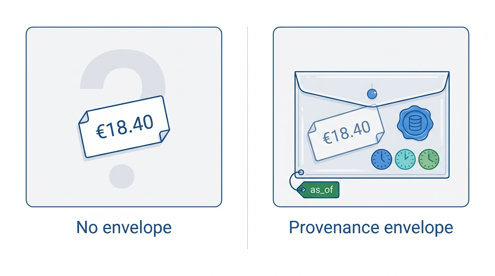
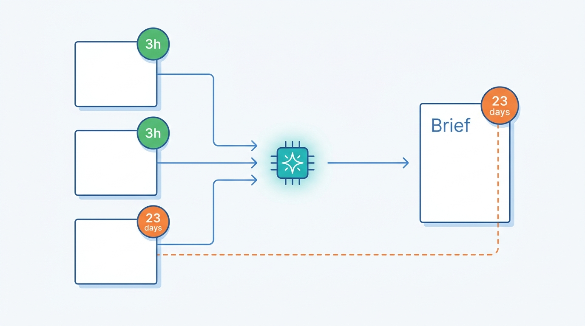
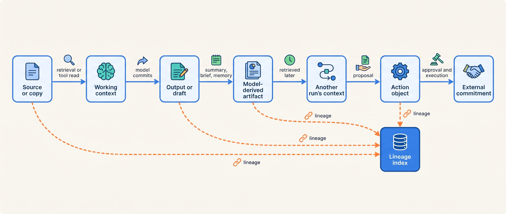
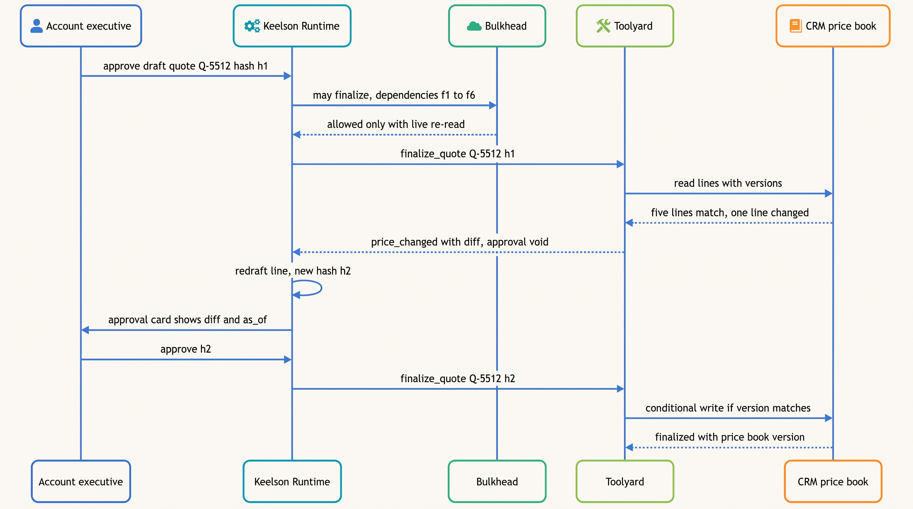
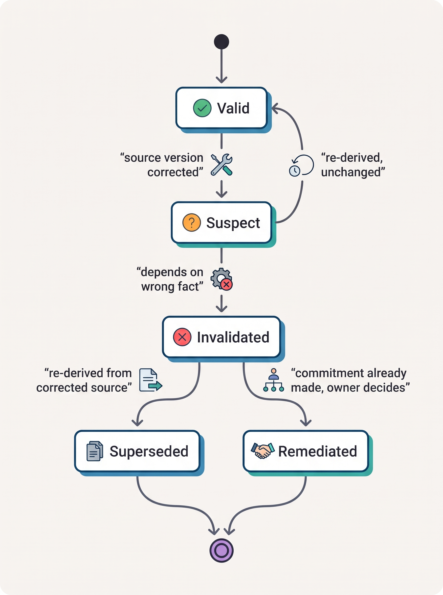

> **IN THIS CHAPTER, YOU WILL:** Learn to attach a provenance envelope to every fact an agent sees, set freshness service-level objectives (SLOs) per data class and measure them where the fact is used, close the gap between the agent's view and the system of record with re-read before write, and trace and invalidate a wrong fact along its propagation path.

> **WHY THE BUSINESS CARES:** A stale price, entitlement or rule becomes a commitment to a customer, an approved entry or a decision about a person. Courts and customers hold the company to it, and the cost of a silent stale index shows up as honored discounts, reversals and complaints, not as an error rate.

> **WHY ARCHITECTS SHOULD CARE:** Models adopt what the context tells them, cite it fluently and write it into notes that other runs and agents read as truth. Freshness and provenance therefore cannot be the model's job. They are data contracts that the context assembler, the tool layer and the evidence log must carry and enforce.

> **KEY POINTS:**
>
> * **A fact without an envelope is an unverifiable rumor.** Every fact that enters working context needs a provenance envelope: source, source version, valid time, the time the copy was last confirmed (`as_of`), how it was read and what it was derived from. Without it, neither the model, nor the approver, nor the auditor can tell a current price from a month-old one.
> * **Freshness is measured where the fact is used, and enforced before the action, not in the prompt.** A freshness SLO per data class bounds the age of a fact at the moment it is used and says what happens on breach. The model sees the age, but deterministic code decides. Any write that depends on a volatile fact re-reads it from the system of record and checks its version first.
> * **Wrong facts travel; design every hop of the path, including the way back.** A stale fact moves from source to context, to an output, to a note or memory, and into another run. Each hop needs a control. Lineage recorded when artifacts are written is what lets you find, void and repair everything the fact touched once it is corrected.

> **[FAILURE PATTERNS THIS CHAPTER ADDRESSES](where-agentic-systems-go-wrong.html):**
>
> * **Context Soup** — retrieved chunks arrive with no age, version or trust label, so a 23-day-old price looks exactly like a current one.
> * **Memory Without Expiry** — model-written briefs and notes keep a wrong fact alive after the source is fixed, and later runs retrieve it as if it were fact.
> * **The Compounding Error** — a stale fact is accepted at one step, cited at the next and approved at the third, with no check in between that goes back to the source.

<br>
An agent acts on what it has been told. Its working context is assembled from instructions, retrieved documents, tool results, memories and the run's own history. Some of that is current, some is old, some was never true, and some was written by an earlier model step that got it wrong. The model has no reliable way to tell these apart. The research in this chapter shows that models **adopt wrong retrieved content over their own correct knowledge most of the time**, and that a model which commits to an early mistake tends to build on it. Grounding moves trust from the model to the sources. That makes the quality, age and integrity of the sources the limiting factor.

Data engineering already knows the remedies: provenance models, pipeline freshness objectives, bitemporal records, optimistic concurrency, lineage. What is new is the propagation. In an agentic system, **a wrong fact does not stay where it landed**: it is paraphrased into a draft, summarized into a note, stored as a memory, handed to another agent and approved by a human who sees only the fluent result.

This chapter owns four terms: the **provenance envelope** (as applied to facts in an agent's context), the **freshness SLO** (as applied to agent sources and memories), **re-read before write**, and the **error propagation path**. It builds on [[context-engineering]] (how working context is assembled), [[retrieval-and-grounding]] (how evidence is found and cited), [[agent-memory]] (what persists across sessions) and [[task-state-and-checkpoints]] (what the run records). It hands the action object and receipts to [[side-effects-and-external-actions]], and version checks under concurrency to [[retries-idempotency-and-concurrency]].

## Setting the Scene at Ostrell: The Stale Price Book

Ostrell, the fictional company this book follows (see [[meet-ostrell]]), runs **Dealroom**, a sales copilot in the customer relationship management (CRM) system. Dealroom writes account briefs for account executives (internal, autonomy tier A3 at the time) and drafts quotes from the price book. Quote drafting is tier A1: the account executive reviews the draft and sends it, and **the agent never sends to customers**. Dealroom drafts about **4,000 quotes a month**. Priya Natarajan, VP Sales Operations, owns it.

Dealroom did not read the price book from the CRM. In 2026 the team had built a retrieval index over price-book exports, product sheets and discount guidelines, because one search tool returning prices, product text and discount rules was simpler for the model than three tools. A nightly job exported the price book and reloaded the index. In late May 2027 the export started failing on an expired credential. The loader saw an empty change set, treated it as "no changes" and reported success. **For 23 days the index served the price book as it stood before the 2027-06-01 price increase.**

Nothing in Dealroom's working context showed this. The retrieved chunks carried a product code, a price and a currency, but no date. Account executives reviewed the drafts, as A1 required, but the approval screen showed a price with no source or age, and they checked the deal, not the price list. **Fourteen draft quotes went to prospects at old prices.** They were worth **€46,000** in total discount, which the sales team chose to honor. A deal-desk analyst caught the problem by comparing a quote with the CRM price book by hand. The incident review found one more detail that this chapter builds on. In the three days after the index was repaired, Dealroom drafted three more quotes at old prices. The index was correct by then. The old prices came from Dealroom's own **account briefs**, written during the stale period and stored as CRM account notes, which the quote runs retrieved as context. The account executives, by then warned, caught all three before sending.

Tomas Verhoef, Ostrell's Chief Architect, framed the review as three questions. **How does a fact in context carry its age and origin? How old may a fact be when an agent uses it, and who decides? Once a fact is known to be wrong, how do we find everything it touched?** The fixes answer them: a freshness SLO for the price book (at most 24 hours), a provenance envelope with `as_of` in context, and a re-read from the system of record before a quote is finalized. In October 2027 the account-brief action was demoted from A3 to A2 (sampled review).

## Concepts: What the Agent Knows and How Old It Is

### Four places a fact can come from

A fact in working context arrives from one of four places, and each has a different owner and a different way of going wrong:

| Origin | Example at Ostrell | Owner | Typical failure |
| --- | --- | --- | --- |
| **System of record (SoR)**, read live by a tool | Price from the CRM price book; contract from the field-service contract store | The business system's owner | Read times out; read hits a lagging replica |
| **Derived copy**: index, cache, warehouse view | Dealroom's price index; Answerdesk's knowledge-base (KB) index | A pipeline owner | Refresh fails silently; copy is consistent but old |
| **Model-derived artifact**: summary, brief, note, memory | Dealroom account briefs; Tidemark memories; compaction summaries | Often nobody; the model wrote it | Paraphrase error; outlives the source; written from untrusted input |
| **The model's parametric knowledge** | A model "knowing" a list price or a regulation | The model provider | No date, no source; never authoritative for volatile facts |

The fourth row arrives without any tool and without any envelope. The rule I use: **parametric knowledge may shape a question but may never be the source of a volatile fact in an output.** [[retrieval-and-grounding]] owns the grounding checks that enforce it.

### Three clocks on every fact

Martin Fowler's description of bitemporal history separates **actual (valid) time**, when a fact was true in the world, from **record time**, when the system learned it, so that a system can answer both "what was true on 25 February" and "what did we believe on 25 February" ([Fowler, 2021](https://martinfowler.com/articles/bitemporal-history.html)). Agents need a third clock, because they act on copies:

- **Valid time** (`valid_from`, `valid_to`): when the fact holds in the world. The 2027 price for a premium module is valid from 1 June.
- **Record time** (`recorded_at`): when the system of record stored that version. The June prices were entered on 20 May, ahead of their effective date (an Ostrell detail added in this chapter).
- **Confirmation time** (`as_of`): the last moment at which this copy was known to match the system of record. For an index chunk it is the refresh watermark; for a live tool read it is the read time.

The **age** of a fact is *now − as_of*, not *now − recorded_at*: a price entered in 2025 is fresh if the index confirmed it last night. The Stale Price Book was a failure of confirmation time, since the index had no `as_of` and nothing could compute an age. It also exposed a valid-time defect. The index stored only "the current price", so a quote drafted on 28 May for a contract starting on 15 June could not get the June price the price book already held. **A copy that flattens valid time into "current" is wrong around every effective date**, even when its refresh works.

### The provenance envelope

W3C's PROV data model, a 2013 W3C Recommendation, describes provenance in terms of entities, activities and agents. In its terms, *generation* is "the completion of production of a new entity by an activity", *attribution* is "the ascribing of an entity to an agent", and *invalidation* is "the start of the destruction, cessation, or expiry of an existing entity by an activity" ([W3C PROV-DM, 2013](https://www.w3.org/TR/prov-dm/)). An agent's context needs a small, practical subset of that model attached to each fact.

A **provenance envelope** is the metadata record that travels with a fact from the moment a tool or retriever produces it until the fact is used in an output or an action. It names the source and source version, the three clocks, how the fact was read, the data class that decides its freshness rule, a trust level, and what it was derived from:


**Figure 1:** *A bare price looks the same whether it is 3 hours or 23 days old; the provenance envelope carries its source, version and three clocks, so code can compute its age.*

```typescript
type Trust = "system_of_record" | "governed_copy" | "model_derived" | "untrusted_external";

interface ProvenanceEnvelope {
  factId: string;                 // stable id of this fact instance, referenced from outputs
  dataClass: string;              // key into the freshness register, e.g. "price", "entitlement"
  value: unknown;                 // what the model may see
  source: { system: string; recordId: string; version: string }; // version: row version or ETag
  validFrom: string; validTo: string | null;  // valid time
  recordedAt: string;             // record time at the source
  asOf: string;                   // last confirmed equal to the source
  readAt: string;                 // when this run obtained it
  via: { runId: string; tool: string; indexSnapshot?: string };
  trust: Trust;
  derivedFrom: string[];          // factIds or artifact ids, for model-derived facts
}
```

Three design points matter more than the field list.

**The envelope is produced by deterministic code, never by the model.** Toolyard, Ostrell's tool broker, wraps every read-only tool result; the retriever adds one to every chunk from the index's metadata. A model-written artifact gets `trust: "model_derived"` and a `derivedFrom` list that the runtime fills from the facts in context when it was written, not from the model's account of its sources.

**The model sees a compact rendering, not the full record.** The context assembler of [[context-engineering]] renders a short header per fact, for example `[price · CRM price book v8812 · valid 2027-06-01→ · as_of 2027-06-19 06:10 · age 3h · fresh]`, and keeps the full envelope in the run record by reference. The header lets the model say "this price is unverified" or call a live tool. **Showing the age to the model is useful, but it is not a control**; the check described below runs whatever the model makes of the header.

**The envelope survives transformation.** The runtime cannot know which sentence of a brief came from which fact, but it can record which facts were in context and require structured outputs to cite `factId`s for volatile fields. Every price line in a Dealroom quote draft carries the `factId` it used, which turns "which price did the agent use?" into a lookup.

### The freshness SLO

The Google SRE workbook treats data freshness as a first-class service-level objective (SLO) for pipelines, typically in the form "X% of data processed in Y" or "the oldest data is no older than Y" ([Google, *The Site Reliability Workbook*, ch. 13, 2018](https://sre.google/workbook/data-processing/)). That is the right starting point, but it measures the pipeline, and an agent's risk sits at the point of use.

A **freshness SLO (agent)** is an objective, set per data class, that bounds the age of a fact (*use time − as_of*) at the moment an agent uses it, states what kind of use the bound covers, and names the action on breach. It has four parts:

1. **Data class and owner**: price, entitlement, KB article, policy, period status, memory preference. The data owner sets the number, not the agent team.
2. **Bound per use**: one bound for *informing* (answering, briefing, drafting) and a much tighter one, often "live read", for *committing* (finalizing, approving, executing).
3. **Measurement point**: the context assembler and the tool gate compute age at use and emit it to tracing. Index-refresh lag is a supporting indicator, not the SLO.
4. **Breach behavior**: mark stale and continue with a visible caveat, re-read live, abstain, or block the action. The breach behavior is policy, evaluated by the policy engine, not a hint to the model.

Ostrell's register after the Stale Price Book (bounds are Ostrell policy; cache bounds from [[caching-and-context-budgets]]):

| Data class | Owner | Bound to inform | Bound to commit | On breach |
| --- | --- | --- | --- | --- |
| Price book line | Sales Operations (deal desk) | Index ≤ 24 h; tool cache ≤ 1 h | Live read at finalize, version-checked | Draft marked "price unverified"; finalize blocked |
| Customer contract and entitlement | Support Operations | Live read | Live read before acting | No action; honest fallback reply |
| KB article | Support content team | Article version ≤ 7 days behind publish *(assumption)* | Not used to commit | Answer with caveat; flag article |
| Discount and approval policy | Sales Operations, Finance | Policy version current | Version pinned in action object; approval void on change | Re-route for approval |
| Accounting period status | Group Finance | Live read | Live read before posting | Hold entry; next-period proposal |
| Memory: user preference | Owner of the memory (user) | Review after 90 days ([[agent-memory]]) | Never a source for a commitment | Ask the user to confirm |
| Model-derived brief or note | Agent owner | ≤ 7 days, and never newer than its oldest input *(assumption)* | Never a source for a commitment | Re-derive from sources |

Most designs miss the last row. **A model-derived artifact is never fresher than the oldest fact it was derived from**: its effective `as_of` is the minimum over its inputs. By that rule, a Dealroom brief written on 10 June carried the `as_of` of the last good refresh in May and would have been stale on arrival.


**Figure 2:** *A model-derived brief is never fresher than the oldest fact it was derived from: two inputs 3 hours old and one 23 days old make a brief that is 23 days old.*

### Consistency between the agent's view and the system of record

The agent's view of the world is a set of reads taken at different times through different paths. Distributed-systems vocabulary describes what can go wrong. Werner Vogels' 2008 summary of client-side consistency defines **read-your-writes** consistency (after a process updates an item, it "always accesses the updated value and will never see an older value") and **monotonic reads** (once a process has seen a value, later accesses "will never return any previous values") ([Vogels, 2008](https://www.allthingsdistributed.com/2008/12/eventually_consistent.html)). Agents break both in recognizable ways:

- **Read-your-writes across tools.** Answerdesk updates a ticket through the ticketing API, then searches an index that lags by a minute, misses its own update and repeats the step. Reads after the run's own writes should go to the primary or to the run's write log in [[task-state-and-checkpoints]].
- **Monotonic reads across steps.** A later step reads an older contract version from a replica, and the model invents an explanation for the contract "changing back". Carrying the source version in the envelope and rejecting older versions prevents it.
- **Time of check versus time of use.** MITRE's CWE-367 names the flaw: a product "checks the state of a resource before using that resource", and the state changes in between ([MITRE CWE-367](https://cwe.mitre.org/data/definitions/367.html)). An agent's gap is unusually long: a model call, an approval that takes hours, a durable wait that takes days.

**Re-read before write** is the rule that closes that gap. Immediately before executing a side effect that depends on a volatile fact, the deterministic tool layer re-reads the fact from the system of record. It compares the result with the value and version recorded in the action object, and then proceeds, returns the action for re-drafting with the difference, or blocks. Where the system of record supports it, the write is also conditional on that version (an HTTP `If-Match` precondition that fails with `412 Precondition Failed`, as defined in [RFC 9110, 2022](https://www.rfc-editor.org/rfc/rfc9110#name-if-match), or an equivalent row-version check), so the gap between re-read and write is closed too. Three properties make it work:

- **Code does it at the tool boundary.** "Always check the latest price" in a prompt is a suggestion; a finalize tool that refuses without a fresh, version-matched read is a control.
- **It re-reads the action's dependencies, not everything.** The action object lists them by `factId`, source and version.
- **A mismatch is a normal outcome, not an error.** "Price changed from €18.40 to €19.90 per unit" goes back to the drafting step and, if the action was approved, voids the approval. That is the book's approval rule: an approval is bound to the action object's content hash and is void if the action, the policy version or the relevant source facts change ([[human-oversight-and-bounded-autonomy]]).

### The error propagation path

The **error propagation path** is the sequence of hops by which a wrong or stale fact moves from its origin to an action, and from one run or agent to another: it enters working context, the model commits to it, the commitment is written into a summary, note or memory, a later run reads that note as ground truth, and an action follows. Each hop strips some provenance and adds some authority.


**Figure 3:** *A stale fact gains authority at every hop: it is paraphrased, stored, retrieved again and approved. The dotted lineage edges are what make the way back possible.*

The controls per hop:

| Hop | What goes wrong | Control | Owner chapter |
| --- | --- | --- | --- |
| Source → copy | Refresh fails; valid time flattened | Freshness service-level indicator (SLI) on the copy; bitemporal copy; loader that fails on empty-when-unexpected | This chapter |
| Copy → context | Age and trust invisible; untrusted text mixed with records | Provenance envelope rendered per fact; untrusted-content marking | This chapter; [[prompt-injection-defense]] |
| Context → output | Model adopts the wrong fact and builds on it | `factId` citations on volatile fields; grounding and entailment checks | [[retrieval-and-grounding]] |
| Output → artifact or memory | Error becomes durable; provenance lost | Effective `as_of` = oldest input; `derivedFrom` written by the runtime; memory write policy | This chapter; [[agent-memory]] |
| Artifact → another run | Note read as ground truth | Model-derived trust level; never a source for commitments | This chapter; [[coordination-and-handoffs]] |
| Proposal → action | Stale fact committed | Re-read before write; conditional write; approval bound to fact versions | This chapter; [[side-effects-and-external-actions]] |
| Action → world | Commitment made on a wrong fact | Lineage query; invalidation sweep; compensation | This chapter; [[partial-failure-and-compensation]] |

## Architecture: Where Provenance and Freshness Live in Keelson

### Components and responsibilities

Provenance and freshness are not one component. They are a contract that several Keelson components honor. The split below is how Ostrell assigned them after June 2027:

| Responsibility | Component | What it does |
| --- | --- | --- |
| Freshness register | Agent Registry (control plane) | Data classes, owners, bounds per use, breach behavior; versioned like policy |
| Envelope on tool results | Toolyard | Wraps every read-only result; caches only by source version and class TTL |
| Envelope on retrieved chunks | Retrieval service | Carries index snapshot, `as_of`, source version and valid time from the index metadata |
| Rendering and age computation | Keelson Runtime context assembler | Computes age at use, renders headers, emits age per fact class to Wake |
| Freshness and dependency checks | Bulkhead | Policy before tool calls and side effects: are the action's dependencies fresh enough for *committing*? |
| Re-read before write | Toolyard, inside commit tools | Re-reads dependencies from the SoR, compares versions, uses conditional writes where supported |
| Lineage | Logbook | Records context references (`factId`s) per model call, artifacts and their `derivedFrom`, action objects and their dependencies |
| Freshness telemetry | Wake | Index lag, age-at-use distribution, stale-at-use rate, re-read mismatch rate |
| Memory provenance | Tidemark | Provenance, trust level and expiry per memory (owned by [[agent-memory]]) |

Two boundaries matter. **The policy engine decides and the broker executes**: Bulkhead decides whether a fact is fresh enough to commit, and Toolyard performs the re-read and the conditional write, so freshness rules live in one reviewable policy set. And **the evidence log stores references**: Logbook records `factId`s and source versions per model call, so a year later an auditor can see which price version the agent was shown and when it was confirmed.

### Requirements per interaction

Dealroom's interactions after the redesign (latency figures are Ostrell targets, labeled as such):

| Interaction | Consistency required | Latency target | Durability | Who may act |
| --- | --- | --- | --- | --- |
| Account brief (inform) | Copy within freshness SLO; age shown | Seconds to minutes | Brief stored with `derivedFrom` and effective `as_of` | Dealroom, A2 (sampled review) |
| Draft quote | Index ≤ 24 h, tool cache ≤ 1 h; valid time matched to quote start date | ≤ 20 s per draft *(Ostrell target)* | Draft action object with `factId` per line | Dealroom, A1 (draft only) |
| Finalize quote | Live read of every price line, version matched | ≤ 2 s added *(Ostrell target)* | Finalized object hash includes price-book versions | Toolyard commit tool, after account executive approval |
| Send quote | CRM rejects a quote whose price-book version was superseded | Interactive | CRM record | Account executive only |
| Invalidation sweep | Lineage complete for the affected source versions | Hours | Sweep record in Logbook | Agent Platform on request of the data owner |

### Re-read before write at quote finalization


**Figure 4:** *The finalize tool, not the model, re-reads every price the quote depends on. A mismatch voids the approval and returns a difference to redraft, and the final write is conditional on the version that was read.*

The commit tool's core logic is short:

```typescript
async function finalizeQuote(q: QuoteAction, approval: Approval): Promise<FinalizeResult> {
  if (approval.actionHash !== hash(q)) return { status: "approval_void", reason: "action changed" };
  const live = await priceBook.readLines(q.lines.map(l => l.productCode), { validAt: q.startDate });
  const diffs = q.lines.filter(l => {
    const cur = live[l.productCode];
    return !cur || cur.version !== l.fact.source.version || cur.unitPrice !== l.unitPrice;
  });
  if (diffs.length > 0) return { status: "price_changed", diffs, approval: "void" };
  return priceBook.finalize(q, { ifMatch: live.versions }); // 412 -> "price_changed" on a race
}
```

The model does not decide whether the price is current and cannot finalize; on a mismatch it redrafts the line and explains the change in the approval card. The re-read is cheap: at an assumed 6 lines per quote, 4,000 quotes a month need about 24,000 live lookups *(assumption)*.

### Correction and invalidation

When a source fact is found wrong or stale, the question is what it touched. Lineage recorded at write time answers it. The author's agentic-research-platform interview design (step `reproducibility`) chooses "lineage captured at write time" over post-hoc extraction, because post-hoc lineage is "lossy" and "the gaps surface exactly when you need to reproduce a result". Its `claim_provenance` record pins each claim to a citation span, a corpus snapshot and a `retracted` flag ([Obrenović, research platform design](#sources-and-evidence)). The same idea in Keelson is a query over Logbook: *every model call, artifact, memory and action object whose context or dependencies include facts from source S between versions v1 and v2*.

An **invalidation sweep** then moves each derived item through a small lifecycle:


**Figure 5:** *Derived items are marked suspect, not deleted. Each one is either re-derived or invalidated, and anything that already became a commitment goes to a human owner, because the correction cannot reach the world by itself.*

Drafts and briefs are superseded and re-derived. Memories derived from the bad fact are quarantined in Tidemark, with bulk purge by provenance. Pending approvals that depend on it are voided. Sent quotes, posted entries and customer messages cannot be recalled by invalidation; they go to their business owner, as [[partial-failure-and-compensation]] describes. In PROV's terms, invalidation is a recorded activity, not a deletion, so the audit trail still shows what the agent believed and when.

## Evidence: What Research and Experience Say

The evidence on freshness and propagation in agents is thin and mostly indirect. No published production study measures stale-fact incident rates in deployed agents; the research brief for this part found none. What exists is research on how models treat context, a few engineering reports, and one tribunal decision.

**Models adopt what the context says.** ClashEval perturbed the answers in retrieved documents, from subtle to blatant changes, across more than 1,200 questions in six domains and six leading models. The models adopted the incorrect retrieved content, overriding their own correct prior answer, more than 60% of the time. Adoption fell as the perturbation grew more blatant and rose as the model's own confidence fell ([Wu, Wu and Zou, 2024, preprint](https://arxiv.org/abs/2404.10198)). For freshness, this is the uncomfortable case: **a stale price is a subtle deviation, the kind models adopt most readily.** The study used 2024 models and synthetic perturbations; treat the rate as an indicator of direction, not a property of current models.

**Fast-changing facts are a distinct failure.** FreshQA, with more than 50,000 human judgments, found that models of every size struggled with fast-changing and false-premise questions, and that adding current search results to the prompt helped substantially ([Vu et al., 2023, preprint](https://arxiv.org/abs/2310.03214)). The lesson that outlives those models: freshness comes from the retrieval path, which then becomes its single point of failure.

**Errors snowball, and a fresh context catches more of them.** Zhang et al. found that a model "over-commits to early mistakes, leading to more mistakes that it otherwise would not make". When the same models were asked separately about their own claims, ChatGPT recognized 67% and GPT-4 87% of the mistakes ([Zhang et al., 2023, preprint](https://arxiv.org/abs/2305.13534)). These are 2023 models and question-answering tasks. The design consequence is still sound: verification belongs in a separate step with a fresh context, and better still against the system of record, not in the context that made the commitment.

**Citations point; they do not verify.** Citation support rates and the limits of vendor citation features are covered in [[retrieval-and-grounding]]: a citation feature can guarantee that a quoted span exists, not that it supports the claim or that the document is current. **A perfectly cited stale price is still stale.**

**Persistence turns a one-off error into a durable belief.** The Generative Agents study reported embellishments that became memories later retrieval treated as fact ([Park et al., 2023](https://arxiv.org/abs/2304.03442)), and the memory-injection and corpus-poisoning results reviewed in [[agent-memory]] and [[retrieval-and-grounding]] (MINJA, PoisonedRAG) show adversaries using the same path deliberately. It belongs here because **the same propagation path carries stale facts and poisoned ones**, and the same controls (provenance, trust level, write gates, purge by provenance) contain both.

**Summaries and handoffs lose information.** Anthropic's 2025 engineering posts on long-running and multi-agent systems, discussed in [[context-engineering]], report that compaction drops instructions and that agents passing paraphrases play a "game of telephone", mitigated by storing outputs externally and passing references ([Anthropic, 2025](https://www.anthropic.com/engineering/multi-agent-research-system)). References, unlike paraphrases, let provenance survive a handoff.

**Provenance can be enforced structurally.** CaMeL, a 2025 preprint from Google DeepMind and ETH Zurich, attaches capabilities (provenance and allowed readers) to every value in a data-flow graph and checks security policies at each tool call. On the AgentDojo benchmark it solved 77% of tasks with provable security, against 84% undefended ([Debenedetti et al., 2025, preprint](https://arxiv.org/abs/2503.18813)). It targets prompt injection, not freshness, and is a research prototype; the transferable mechanism is **metadata attached by code and checked by code at the tool boundary**.

**Courts hold the operator to what its agent said.** *Moffatt v. Air Canada* (British Columbia Civil Resolution Tribunal, February 2024), discussed in [[retrieval-and-grounding]], held the airline liable for a chatbot's inaccurate statement about bereavement fares ([Civil Resolution Tribunal, 2024](https://decisions.civilresolutionbc.ca/crt/crtd/en/item/525448/index.do)). It concerned an inaccurate statement rather than a stale one, but **a fact the agent states to a customer is the company's statement**, at whatever age it was.

**Where the evidence stops.** No published evaluation measures whether showing `as_of` to a model reduces its use of stale facts. I would expect a small effect and would not rely on it; the recommendations here rest on deterministic enforcement.

## Worked Example at Ostrell: The Price Book After the Fix

The redesign went live in Dealroom in July 2027. Walk one quote through it.

**Setup.** An account executive asks Dealroom for a three-year quote for a regional installer starting 1 September 2027: Field technician seats, the premium scheduling module and an Assure warranty tier, six price lines in all.

**Retrieval with envelopes.** The retrieval service returns price chunks from the index with `as_of 2027-08-14 02:10` (last night's refresh), the source price-book version, and `valid_from`/`valid_to` for each line, filtered to the quote's start date. Since the redesign, the index loader is bitemporal: it loads every price-book version with its valid time, not only today's price. The context assembler computes age (8 hours), compares it with the register (≤ 24 hours to inform) and renders each line as `fresh`. Dealroom's account brief for the customer, written nine days earlier, also comes back from retrieval. Its effective `as_of` is its oldest input, 2027-08-04, older than the 7-day bound for briefs. It is rendered as `stale · model_derived · not a price source`, and Bulkhead removes its price mentions from the quote-drafting context entirely. The brief's text about the customer's priorities is still used.

**Draft.** The model drafts the quote as a structured action object. Each line cites the `factId` of the price chunk it used; a line without one fails schema validation. The draft goes to the account executive at tier A1, and the approval card shows, for each line, the price, the price-book version, the `as_of` and whether it was read live or from the index.

**Finalize.** On approval, Toolyard's `finalize_quote` re-reads the six lines from the CRM price book (Figure 4). In this case, the deal desk had corrected a warranty-tier price at 09:40 that morning. One line differs by €1.50 per unit per year. The tool returns `price_changed`, the approval is void, Dealroom redrafts the line, and the account executive approves the new version after seeing the difference. The final write is conditional on the six price versions that were read.

**Send.** The account executive sends from the CRM. Since the redesign, the CRM refuses to send a quote whose price-book version has been superseded. This is the last line of defense, and it sits in the system of record, where a fault in the agent cannot reach it.

**Monitoring.** Wake tracks four freshness indicators for Dealroom:

| Indicator | Definition | Alert *(Ostrell thresholds)* |
| --- | --- | --- |
| Index lag | Now − index `as_of` | > 24 h, page the price-index owner |
| Stale-at-use rate | Share of price facts used to draft that breached the inform bound | > 0.5% of drafts in a day |
| Re-read mismatch rate | Share of finalizations with `price_changed` | > 3% of finalizations, or any step change |
| Empty-change refresh | Refresh run with zero changed rows on a business day | Warn; two in a row, page |

The re-read mismatch rate is the most useful. Healthy, it is low and stable, reflecting same-day price edits. **A rising mismatch rate is the earliest signal of a stale copy**: it would have fired in the first days of June 2027, when every quote touching the changed lines would have mismatched.

**The sweep, replayed.** After the redesign, the Agent Platform team ran the invalidation sweep retroactively over the June records as a drill. The Logbook query for "artifacts and action objects whose context included price facts from index snapshots taken before the 2027-06-19 repair, for product codes changed on 2027-06-01" returned the 14 sent quotes, the 3 later drafts and every account brief written in the stale window. In June that list had been reconstructed by hand, because the Logbook records of the time held chunk ids but not source versions. In the drill, the sent quotes went to the deal desk (they had already been honored) and the briefs were superseded. The comparison justified the lineage work: **without source versions in the run record, the "what did this touch?" question took the sales team a week of spreadsheet work in June.**

## Failure Modes and Recovery

| Scenario | What happens | Detection | Containment | Recovery |
| --- | --- | --- | --- | --- |
| **Silent refresh failure** (the Stale Price Book) | The copy stops updating; the loader reports success | Index lag SLI; empty-change check; rising re-read mismatch rate | Freshness breach marks facts stale; finalize blocked without live read | Repair the loader; invalidation sweep over the stale window |
| **Effective-date flattening** | A copy holds only "current" values; quotes and decisions around an effective date use the wrong version | Mismatches cluster around effective dates | Bitemporal copy; tool reads `validAt` the decision's date | Re-derive affected drafts; fix the loader |
| **Stale derived artifact** | A brief, summary or memory keeps an old fact alive after the source is fixed | Effective `as_of` = oldest input; stale-at-use rate for `model_derived` | Model-derived facts never source a commitment | Supersede by lineage; re-derive from sources |
| **Read-your-writes miss** | Agent does not see its own update through a lagging index and repeats a step | Duplicate-detection on entities; trace shows read after write via copy | Reads after own writes go to the primary or the run's write log | Compensate the duplicate; see [[retries-idempotency-and-concurrency]] |
| **Fact changes during approval** | A price, policy or entitlement changes while an approval waits | Re-read mismatch at execution | Approval bound to fact versions; void on change | Redraft with diff; re-approve |
| **Retracted or superseded source** | Scout cites a report later withdrawn or corrected | Source-side retraction or supersession flag in the envelope | Retracted sources excluded from new runs | Sweep reports that cite it; notify readers |
| **Untrusted fact laundered as trusted** | Text from an inbound email is summarized into a note, then read back as `model_derived` with no trace of its origin | Lineage shows an untrusted ancestor | Trust level inherits the lowest input; [[prompt-injection-defense]] | Quarantine descendants; purge by provenance |

Two rules from the consistency rulings apply across the table. **An unknown is a state, not a guess**: when a live re-read fails or times out, the action does not proceed on the cached value. It waits, escalates or abstains, as the support and healthcare designs both require. And **corrections are new records**: a sweep never edits the original run record. It appends the invalidation, so the record still shows what the agent was told at the time.

## Trade-offs

The main design choice is where an agent reads volatile facts from. The options are not exclusive; most production designs combine them per data class.

| Option | Strength | Cost and risk | Right when |
| --- | --- | --- | --- |
| **Live read through a tool, every time** | Always current; provenance is simple | Latency and load on the SoR; SoR outages stop the agent; more tool calls for the model to get right | Facts used to commit: prices at finalize, entitlements, balances, period status |
| **Governed copy with a freshness SLO** (index, cache, view) | Fast, searchable, cheap; decouples from SoR load | A second truth that can drift; needs envelopes, SLI and loader checks | Facts used to inform: search, briefs, drafting |
| **Pinned snapshot per run** | Consistent and reproducible within a run; good for audit | Can hide newer evidence; runs over hours or days see the world as it was at the start | Research, reproducibility, decisions that must be reconstructed under the rules that applied |
| **Frozen curated corpus** | Reviewed and stable | Goes stale fast; refresh is a release | Slow-changing reference material with a review cycle |
| **Parametric model knowledge** | No infrastructure | No date, no source, no correction path | Never for volatile facts; acceptable for general language and reasoning |

The research-platform interview design states the snapshot trade-off sharply: retrieval over a live index is "not reproducible — the index moves under you", a frozen corpus is "stale fast", and pinned snapshots carry the accepted cost that "pinning can hide newer evidence unless freshness is surfaced". The sales design makes the opposite trade for enrichment: an asynchronous enrichment queue, "because absorbing provider latency and staying under per-provider QPS [queries per second] caps matters more than perfectly fresh fields at draft time", paired with a re-check at send time. Both are right for their data. **The register, not a platform-wide default, should make the choice per data class.**

The second choice is how strictly to check before writing:

| Check | Protects against | Costs | Use for |
| --- | --- | --- | --- |
| Trust the context | Nothing | None | Reversible, internal, low-value actions only |
| Re-read and compare | Stale copy; change during approval | One read per dependency; redraft loop | Any commitment that depends on a volatile fact |
| Re-read plus conditional write | Also the race between re-read and write | SoR must support versions or `If-Match` | Money, contracts, records of people, regulated entries |
| SoR-side validation of the dependency version | Also faults in the agent platform itself | Change to the business system | The highest-consequence commitments; the CRM send check at Ostrell |

My recommendation: require re-read and compare for every action that changes an external system or makes a commitment and depends on a volatile data class, whatever its tier, and conditional writes wherever the system of record offers them. Where the system of record cannot bear the load or has no versions, use a governed copy with a short time-to-live (TTL) whose bound for committing is written down and owned by the data owner.

## Across Domains: How the Stakes Change the Design

The mechanism is the same in every domain: envelopes, freshness bounds, re-read before write, lineage. What changes is what goes stale, how fast, and what a stale fact costs.

| Concern | Coding agents | Customer operations (support, sales, marketing) | Back office (finance, legal, HR) | High-stakes decisions (healthcare, public benefits) |
| --- | --- | --- | --- | --- |
| **What goes stale** | File contents after compaction; base commit; dependency versions; project memory files | Prices, entitlements, KB articles, consent and suppression, claim libraries | Period status, master-data versions, playbooks, good-law status of citations | Patient chart snapshot, formulary and guideline versions, effective-dated rule packages |
| **Typical freshness bound** | Re-read the file before editing; continuous integration (CI) runs against the merge base | Live for entitlements and consent; hours for indexes; version-pinned for policy | Live for period locks; publisher-versioned corpora refreshed on a freshness SLA | Snapshot timestamp per case; rule version pinned per decision |
| **Re-read before write** | Edit tools re-read files; merge re-runs CI on the current base | Support design: account state "re-reads the live record before acting"; sales: suppression "re-checked at send" | Finance: re-validate period lock before posting; legal: currency re-check before finalization | Healthcare: revalidate against the current snapshot before writing to the electronic health record (EHR), `case_version` check returns 409 on stale |
| **Cost of a stale fact** | Broken build or bad merge, mostly caught by CI and review | Honored commitments (€46,000 at Ostrell; *Moffatt v. Air Canada*) | Misstated accounts; a brief citing overruled law ("stale good-law status is a correctness bug, not just a latency issue") | Harm to a patient; an unlawful decision about a person |
| **Breach behavior** | Re-read and continue | Caveat, live read, or no action with an honest reply | Block or escalate; "the degraded mode is to block or escalate the draft, not to skip verification" | Abstain: "a stale or incomplete snapshot … is itself a reason to abstain" |
| **Lineage must answer** | Which commit and context produced this change | Which price or policy version this offer used | Which master data, playbook and source version produced this entry or redline, a year later | Which rule package and evidence decided this case, reconstructable for an appeal |

The quotations are from the author's interview designs (cited by step in Sources); they are design examples, not deployed systems. The coding column is the mildest because the workspace is reversible and CI re-checks on merge, yet the coding CLI design's "re-read before editing" after compaction is Dealroom's finalize check applied to files.

**What the platform keeps common:** the envelope schema, age computation, the register mechanism, the Bulkhead check, re-read support in commit tools, lineage and the sweep. **What is domain policy:** the data classes, their bounds and owners, the breach behavior, whether a snapshot or a live read is the reference for a decision, and lineage retention. Public benefits shows the last point most clearly: the design pins an effective-dated rule package to each determination because an appeal must reconstruct the decision under the rules that applied then. There, the bitemporal record is a due-process requirement.

## The Chief Architect's View

**Decisions to make, and who makes them.**

- **Adopt the provenance envelope as a platform contract.** Every read-only tool and retriever returns envelopes, and the context assembler refuses facts without one in production manifests. The Agent Platform team owns the schema; Farah Haddad's security review owns the trust levels, because trust inheritance is also an injection control.
- **Create the freshness register and give each row a business owner.** Sales Operations owns the price bound, Group Finance the period-status rule, Support Operations the entitlement rule. The platform enforces; it does not choose the numbers. The register is versioned like policy, and changes to it pass through Sounding like any other change to agent behavior ([[versioning-agent-systems]]).
- **Make re-read before write a registration gate for commit tools.** A tool that commits on a volatile fact without a re-read or a conditional write does not enter Toolyard.
- **Fund lineage before you need it.** It costs storage every day and pays only on the bad day; in June 2027 its absence cost Ostrell a week of manual reconstruction. It belongs in the platform budget, not each agent team's.

**What to watch.** Index lag and age-at-use per data class; stale-at-use rate; re-read mismatch rate per commit tool (the leading indicator); time from source correction to completed sweep; the share of model-derived facts in context, which rises quietly as agents write more notes and briefs. Pipeline lineage for the copies can follow an existing standard such as OpenLineage's run, job and dataset model ([OpenLineage, n.d., accessed 2026-10](https://openlineage.io/docs/spec/object-model)); agent-run lineage lives in Logbook and should be joinable with it by dataset and version.

**What is durable and what will change.** Durable: the three clocks, one writer per fact, re-reading before a dependent write, lineage recorded at write time, enforcement at the tool boundary. Better models do not retire these; **a model that reasons perfectly about a stale price still quotes the stale price.** What will change: how well models use provenance headers, the cost of live reads, and vendor features for citations and memory timestamps. Do not move a check from code into the prompt because a model started passing the test.

## Questions to Ask

1. For each volatile fact this agent uses, which system is the system of record, is the agent reading it or a copy, and does every fact carry source, version, valid time and `as_of` written by code?
2. What is the freshness bound for each data class, separately for informing and for committing, and who owns each number?
3. Is freshness measured at the point of use, or only as pipeline lag? What happens, mechanically, when the bound is breached?
4. Which actions depend on a volatile fact, and does the commit tool re-read it and check the version before writing? Does the system of record itself reject a superseded version?
5. Is an approval void when a fact it depended on changes, and is the reviewer shown the age and source of each critical fact?
6. What is the effective `as_of` of a model-written brief, note or memory, and can such an artifact ever be the source of a commitment?
7. If we learn today that a source was wrong for the last three weeks, how long does it take to list every draft, memory, approval and commitment it touched?
8. Could a refresh job fail without anyone noticing, as Ostrell's loader did? Which indicator would fire first?

The next part moves from what the agent knows to what it can do. [[part-5]] opens with [[tool-contracts]], where the commit tools of this chapter get their schemas, their side-effect annotations and their error messages, and where re-read before write becomes part of the contract a tool publishes.

## Sources and Evidence

**Research papers**

- [ClashEval: Quantifying the tug-of-war between an LLM's internal prior and external evidence](https://arxiv.org/abs/2404.10198) — Wu, Wu and Zou, 2024 (preprint). Models adopt incorrect retrieved content over a correct prior more than 60% of the time.
- [FreshLLMs: Refreshing Large Language Models with Search Engine Augmentation](https://arxiv.org/abs/2310.03214) — Vu et al., 2023 (preprint). FreshQA; fast-changing facts as a distinct failure; FreshPrompt.
- [How Language Model Hallucinations Can Snowball](https://arxiv.org/abs/2305.13534) — Zhang et al., 2023 (preprint). Over-commitment to early mistakes; 67% / 87% self-recognition when asked separately.
- [Generative Agents: Interactive Simulacra of Human Behavior](https://arxiv.org/abs/2304.03442) — Park et al., 2023. Memory stream and reflections; embellishment persisting as memory.
- [Defeating Prompt Injections by Design (CaMeL)](https://arxiv.org/abs/2503.18813) — Debenedetti et al., 2025 (preprint). Provenance capabilities on values, checked at tool calls; 77% vs 84% task success on AgentDojo.

**Specifications, standards and regulation**

- [PROV-DM: The PROV Data Model](https://www.w3.org/TR/prov-dm/) — W3C, 2013 (Recommendation). Generation, derivation, attribution and invalidation.
- [RFC 9110: HTTP Semantics, If-Match](https://www.rfc-editor.org/rfc/rfc9110#name-if-match) — IETF, 2022. Conditional requests and 412 Precondition Failed.
- [CWE-367: Time-of-check Time-of-use (TOCTOU) Race Condition](https://cwe.mitre.org/data/definitions/367.html) — MITRE, n.d., accessed 2026-10. The check-to-use gap.
- [OpenLineage object model](https://openlineage.io/docs/spec/object-model) — OpenLineage project, n.d., accessed 2026-10. Run, job and dataset lineage for pipelines feeding agent copies.

**Vendor documentation and engineering reports**

- [Bitemporal History](https://martinfowler.com/articles/bitemporal-history.html) — Martin Fowler, 2021. Valid time versus record time.
- [Eventually Consistent, Revisited](https://www.allthingsdistributed.com/2008/12/eventually_consistent.html) — Werner Vogels, 2008. Read-your-writes and monotonic-read definitions.
- [Data Processing Pipelines](https://sre.google/workbook/data-processing/) — Google, *The Site Reliability Workbook*, 2018. Freshness SLO formats for pipelines.
- [How we built our multi-agent research system](https://www.anthropic.com/engineering/multi-agent-research-system) — Anthropic, 2025. "Game of telephone"; outputs stored externally and passed by reference.

**Incidents, cases and decisions**

- [Moffatt v. Air Canada](https://decisions.civilresolutionbc.ca/crt/crtd/en/item/525448/index.do) — Civil Resolution Tribunal of British Columbia, 2024. The operator is responsible for what its chatbot tells customers.

**Design examples from the author's interview project**

- Obrenović, Ž., "Agentic Sales Platform", system-design interview design, `system-design-interviews/data/book/agentic-sales-platform/interview.json`, 2026 — steps `enrichment` (per-field provenance with `fetched_at`; freshness versus pipeline resilience) and `send-gate` (re-check at send time).
- Obrenović, Ž., "Agentic Research Platform", system-design interview design, `system-design-interviews/data/book/agentic-research-platform/interview.json`, 2026 — steps `grounding` (versioned corpus snapshots, retraction flags) and `reproducibility` (write-time lineage, `claim_provenance`).
- Obrenović, Ž., "Agentic Support Platform", system-design interview design, `system-design-interviews/data/book/agentic-support-platform/interview.json`, 2026 — step `grounding` (freshness by data class; live re-read before acting).
- Obrenović, Ž., "Agentic Legal Platform", system-design interview design, `system-design-interviews/data/book/agentic-legal-platform/interview.json`, 2026 — steps `grounding` and `citation-gate` (freshness SLA; stale good-law status as a correctness bug).
- Obrenović, Ž., "Agentic Healthcare Platform", system-design interview design, `system-design-interviews/data/book/agentic-healthcare-platform/interview.json`, 2026 — steps `grounding` and `gate` (snapshot timestamp, stale snapshot as abstention trigger, revalidate before write, `case_version` check).
- Obrenović, Ž., "Agentic Public Benefits Platform", system-design interview design, `system-design-interviews/data/book/agentic-public-benefits-platform/interview.json`, 2026 — step `grounding` (effective-dated, jurisdiction-tagged rule packages pinned per decision).
- Obrenović, Ž., "AI Coding CLI", system-design interview design, `system-design-interviews/data/book/ai-coding-cli/interview.json`, 2026 — step `compaction` (re-read files before editing after compaction).

Ostrell is fictional; architectural recommendations, labeled inferences and labeled assumptions are the author's judgement.
