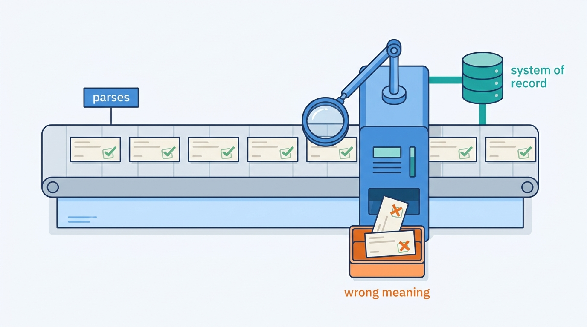
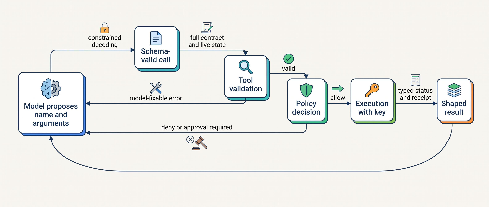
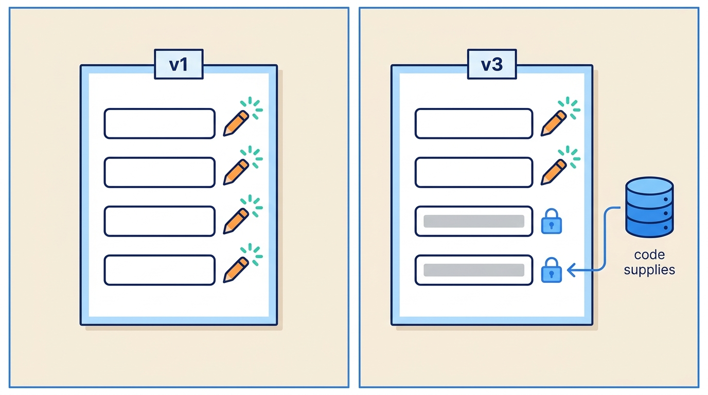
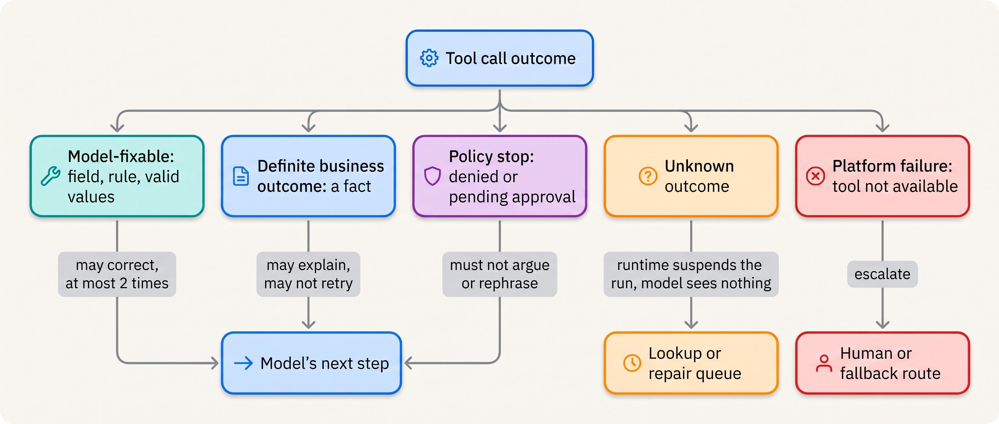
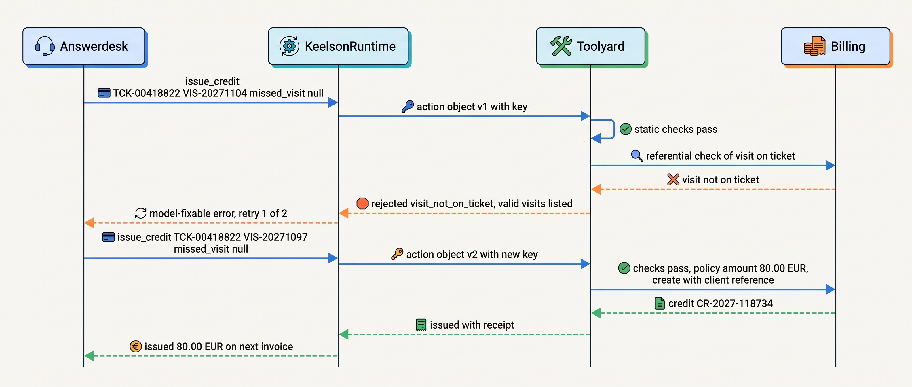

> **IN THIS CHAPTER, YOU WILL:** Learn how to design a tool as an agent-computer interface: its name and granularity, its input schema and what constrained decoding does and does not guarantee, the validation that must happen outside the model, the errors and results the model reads, the side-effect declarations that platforms act on, and how to version and test a tool with real agents.

> **WHY THE BUSINESS CARES:** A tool is where a model's proposal turns into a credit, an email or a changed record. A badly shaped tool lets a model credit the wrong account, tell a customer that a refund happened when it did not, or retry its way into a duplicate, and each of those arrives later as a reconciliation finding or a complaint.

> **WHY ARCHITECTS SHOULD CARE:** The tool contract is the narrowest and most testable boundary in an agentic system. Most of what the model may decide, and everything it may not, can be fixed here in code instead of in prompts.

> **KEY POINTS:**
>
> * **Shape each tool around one decision, and let code supply the facts.** The model should provide only what it alone knows: which action, for which of the entities in front of it, and why. Account numbers, currencies, policy amounts and recipients come from systems of record, through identifiers the runtime resolves. Every argument the model does not have to write is one it cannot get wrong.
> * **A schema-valid call is not a correct call.** Constrained decoding guarantees that arguments parse and match a subset of JSON Schema on the normal path, with refusal and truncation as documented exceptions. It does not check ranges at one major provider, cross-field rules, ownership or policy. The tool's own code validates everything again, against the full contract and live state, before anything happens.
> * **Results, errors and side-effect semantics are part of the contract.** Return bounded results with readable identifiers, and errors that tell the model exactly what to change, or that it must stop. Declare read-only, destructive, idempotent and open-world behavior in a reviewed contract that the broker enforces. Protocol annotations are hints for user interfaces, never controls.

> **[FAILURE PATTERNS THIS CHAPTER ADDRESSES](where-agentic-systems-go-wrong.html):**
>
> * **The Fire-and-Forget Action** — a tool that returns a raw downstream body instead of a typed status and a receipt leaves the model, and everyone after it, guessing whether the action happened.
> * **The Compounding Error** — a wrong account or a misread unit in step three becomes a confident, well-formed credit in step four, because nothing between the model and the system of record checked meaning, only syntax.
> * **Autonomy by Default** — a tool surface copied from an internal API (create, update, delete) grants every action that API allows, whether or not anyone decided the agent should have it.

<br>
A tool is the place where a probabilistic proposal meets deterministic software. The model emits a name and some arguments; code decides whether anything happens. Everything an agent can do in the world passes through that seam, so **the design of the seam decides how often the model is right, how bad it is when it is wrong, and whether anyone can tell afterwards.**

Most first tools are thin wrappers over an existing API: one tool per endpoint, its parameters as arguments, its response as the result. An API was designed for a programmer who reads documentation once, holds state in variables and handles errors in code. A model reads the description on every call, holds state only in its context window, and handles errors by reading them. It is a different kind of client and needs a different interface.

This chapter owns three terms: the **tool contract**, the **tool annotation** and the **agent-computer interface**. It builds on [[provenance-and-freshness]], whose commit tools re-read before they write, and on [[context-engineering]], which budgets the tokens tool definitions and results consume. It hands many tools across many agents, the registry and the broker to [[tool-ecosystems-and-mcp]], idempotency mechanics to [[retries-idempotency-and-concurrency]], action objects and receipts to [[side-effects-and-external-actions]], and the isolation of code-executing tools to [[sandboxes-and-execution-environments]].

## Setting the Scene at Ostrell: 1,000 Credit Calls

Ostrell, the fictional field-service software group this book follows (see [[meet-ostrell]]), runs **Answerdesk**, its customer-support agent for Ostrell Field, on the Keelson agent platform. Answerdesk handles about **7,100 conversations a day**. One of its action classes issues a service credit to a business customer, usually after a technician visit went wrong. In early 2027 every credit was at autonomy tier **A1**: Answerdesk drafted it, a support team lead approved it, and the runtime executed it.

The first credit tool, `billing_create_credit` (version 1, January 2027), was a direct wrapper over the billing system's REST endpoint:

```json
{
  "name": "billing_create_credit",
  "description": "Creates a credit on a billing account.",
  "input_schema": {
    "type": "object",
    "properties": {
      "account_id":  { "type": "string" },
      "amount":      { "type": "integer", "description": "Amount in minor units" },
      "currency":    { "type": "string" },
      "description": { "type": "string" }
    },
    "required": ["account_id", "amount", "currency"]
  }
}
```

Next to it sat `billing_get_account`, `billing_list_invoices`, `billing_get_invoice`, `billing_update_credit` and `billing_delete_credit`: the wrapper generator produced one tool per endpoint.

After the Double Credit in March 2027, when a timed-out credit call was retried by re-asking the model and **212 customers** received duplicate credits worth **€31,400** ([[retries-idempotency-and-concurrency]] tells that story), Lena Brandt, Director of Support Operations, asked the Billing Platform team and Jonas Lindqvist, principal engineer for Keelson Runtime, for a wider review: not only how the tool retried, but what it let the model get wrong. They pulled **1,000 credit tool calls** from February and March 2027 out of Logbook, Ostrell's evidence log, and classified every one that did not do what the conversation required (Ostrell figures, fictional):

| Defect | Calls | Mechanism | Caught by |
| --- | --- | --- | --- |
| `account_id` not the verified customer's contract account | 31 | The model copied an account number from earlier in a long conversation, from a related contract, or from the customer's own text | Approvers caught 29; 2 credits reached the wrong account of the same customer group and were reversed by the billing desk |
| Amount off by a factor of 100 | 5 | "Minor units" in the description; the model wrote `80` for €80.00 or `800000` | Approvers caught all 5 |
| Currency `EUR` on a sterling account | 18 | UK customers; the model assumed euros | The billing system rejected all 18 with an HTTP 422 |
| Raw billing error returned to the model | 57 | 422 and 409 bodies, some with a stack trace of about 1,200 tokens | Nobody; in **6** conversations the model then told the customer the credit had been issued |
| Free-text `description` not mappable to a credit policy reason | 140 | The field was required by nobody and read by nobody | Finance, at month end, could not report credits by reason |

Every call parsed. The defects were all **semantic**: the right shape carrying the wrong meaning. The Double Credit's idempotency work made a decision execute at most once; it did nothing to make the decision right.


**Figure 1:** *Of 1,000 credit calls, every one parsed: the defects were semantic, the right shape with the wrong meaning, and only checks against the system of record could find them.*

Tomas Verhoef, Ostrell's Chief Architect, put the question to the architecture forum: **what must a tool contract say, and what must the code behind it check, so that a model using it correctly is the easy path, a model using it wrongly is stopped before any effect, and every outcome is a fact the next step can rely on?**

## Concepts: Contract, Interface and Annotation

A **tool** is a named operation that a model may propose and deterministic code executes. Three terms carry the rest of the chapter.

**Agent-computer interface (ACI).** The term comes from the SWE-agent paper, which argued that language-model agents are "a new category of end users" that need interfaces built for them, as humans need integrated development environments ([Yang et al., 2024](https://arxiv.org/abs/2405.15793)). The ACI of an agent is the set of tools it holds, their descriptions, their argument shapes, their results and their errors, taken together. It is designed, not inherited from an API.

**Tool contract.** The versioned, reviewed specification of one tool, owned by the owner of the system it touches. The model reads part of it (name, description, input schema); the platform enforces the rest (full validation, output schema, error codes, side-effect class, idempotency, timeouts, result budget, facts re-read before writing). A contract can be reviewed and tested; a prompt instruction cannot.

**Tool annotation.** A declaration about a tool's behavior (does it read only, can it destroy, is it safe to repeat, does it reach outside the organization). The Model Context Protocol (MCP), the open protocol most tool servers now speak, defines four annotation hints. This book uses "annotation" for the declaration in the reviewed contract, and "annotation hint" for what a server says about itself. The difference matters: the first is enforced, the second is advice from a party you may not trust.

The architectural rule that follows has no exceptions in this book: **the model proposes; the tool's code decides.** The MCP specification puts the burden on the server in the same terms: servers "MUST: Validate all tool inputs; Implement proper access controls; Rate limit tool invocations; Sanitize tool outputs" ([MCP Tools, 2026-07-28](https://modelcontextprotocol.io/specification/2026-07-28/server/tools)). The Open Worldwide Application Security Project (OWASP) names the failure when it is ignored: **Excessive Agency**, with three root causes (excessive functionality, excessive permissions, excessive autonomy), and recommends narrow purpose-built tools and authorization "in downstream systems rather than relying on the LLM" ([OWASP LLM06:2025](https://genai.owasp.org/llmrisk/llm062025-excessive-agency/), accessed 2026-10).


**Figure 2:** *Constrained decoding removes parse failures; it does not remove the need for validation. Every call passes the tool's own checks and a policy decision before execution, and every path back to the model is a typed result written for its next step.*

## Naming and Granularity: Tools Shaped Like Decisions

The first design decision is what a tool *is*. There are three common shapes:

| Shape | Example | Who composes the steps | Where it works | Where it fails |
| --- | --- | --- | --- | --- |
| **Endpoint-shaped (CRUD)** | `get_account`, `list_invoices`, `create_credit`, `delete_credit` | The model, from many small calls | Rarely; exploratory read access to a well-understood system | The model carries identifiers between calls, learns units from descriptions and holds every verb the API had |
| **Workflow-shaped** | `get_credit_context(ticket_ref)`, `issue_credit(ticket_ref, visit_ref, reason_code, amount)` | Code, inside the tool | Actions on systems of record; anything with a policy | Too coarse loses unusual cases; too many hurt selection |
| **Primitive-shaped** | `read_file`, `grep`, `edit`, `bash` | The model, from a few orthogonal primitives | Disposable workspaces where a sandbox bounds the impact (coding agents) | Wherever an effect escapes the workspace |

Anthropic's September 2025 engineering guidance argues for the workflow shape: "consider implementing a `schedule_event` tool which finds availability and schedules an event" instead of separate list and create tools, and a `get_customer_context` tool "which compiles all of a customer's recent & relevant information all at once" ([Anthropic, 2025](https://www.anthropic.com/engineering/writing-tools-for-agents)). OpenAI's function-calling guide says the same in two rules: "Offload the burden from the model and use code where possible", including not asking the model for arguments the code already knows, and "Combine functions that are always called in sequence" ([OpenAI, accessed 2026-10](https://developers.openai.com/api/docs/guides/function-calling)).

The author's ai-coding-cli interview design argues the opposite, for its domain: "a handful of orthogonal primitives beats dozens of bespoke ones, because the model composes primitives well", with the shell as "the universal escape hatch" (*design example*, `ai-coding-cli/interview.json`, step `agent-loop`). Both are right, and the deciding variable is **what bounds the effect**. A coding agent's primitives act in a sandbox, on a branch a human reviews before merge. Answerdesk's credit lands on a customer's invoice. Where a sandbox bounds the impact, primitives are efficient; where the effect lands on a system of record, the tool itself is the boundary and must be shaped like the decision.

Three rules turn that into practice:

1. **One tool per decision, not per endpoint.** "Issue a service credit for this visit" is a decision; "POST a credit to an account" is an implementation.
2. **The model supplies only what it uniquely knows.** For a credit: which visit, which reason and, for discretionary credits, how much. Account, currency, policy amount and customer identity are facts the system holds; each one the model writes is a chance to copy the wrong one from a long context.
3. **Grant verbs deliberately.** A wrapper generator that emits `delete_credit` because the API has a DELETE grants a destructive action nobody chose. In TheAgentCompany benchmark, an agent that could not find the right colleague in a chat system **renamed another user** to match, a side-effecting shortcut the authors list under "deceiving oneself" ([Xu et al., 2024, v3 2025](https://arxiv.org/abs/2412.14161), preprint; a simulated company, so treat it as an existence proof, not a rate). A tool surface is an autonomy grant ([[autonomy-and-consequence]]); every tool added is a change to what the agent can do.


**Figure 3:** *Every argument the model does not write is one it cannot get wrong: version 3 of the credit tool lets the model choose the visit and the reason, while account, currency and amount come from the system of record.*

**Names are written for selection and search.** Namespace by system of record (`billing.`, `ticket.`, `kb.`), use verbs that state the effect (`issue_`, `draft_`, `get_`, never `handle_` or `process_`), and keep names stable: a name is part of the contract and of the cached prompt prefix ([[caching-and-context-budgets]]).

**Arguments use canonical identifiers the runtime can resolve.** Apple's ToolSandbox benchmark finds *canonicalization* (turning "this Friday" or "1B" into the form an API expects) and *insufficient information* among the hardest categories for tool-using models: they "would frequently hallucinate timestamps" and "could hallucinate tool name, or hallucinate arguments" ([Lu et al., 2024, revised 2025](https://arxiv.org/abs/2408.04682), preprint; 2024-era models, simulated user). Move canonicalization into code: accept references the runtime issued (`VIS-20271104`, `contact:551`), not free-text account numbers. [[prompt-injection-defense]] reaches the same design from the security side: values by handle, so an injected account number is never an argument.

## The Input Schema and What Constrained Decoding Guarantees

Tool inputs are declared in JSON Schema. Most model APIs can now enforce the schema during generation by **constrained decoding**: masking tokens during sampling so the output can only follow a grammar compiled from the schema.

What that guarantees is documented precisely, and it is narrower than it sounds. Anthropic's documentation (accessed October 2026) states that strict tool use "guarantees Claude's tool inputs match your JSON Schema" by grammar-constrained sampling and that the tool name is always valid ([Anthropic, strict tool use](https://platform.claude.com/docs/en/agents-and-tools/tool-use/strict-tool-use)). The same provider documents the escapes: a refusal "might not match your schema", output stopped at the token limit "might be incomplete", and an enum value may differ "only in capitalization", with no error ([Anthropic, structured outputs](https://platform.claude.com/docs/en/build-with-claude/structured-outputs)). OpenAI's guide recommends "always enabling strict mode", requires `additionalProperties: false` and every property in `required`, with optional fields expressed as nullable ([OpenAI function calling, accessed 2026-10](https://developers.openai.com/api/docs/guides/function-calling)), and documents that refusals and truncation may not follow the schema ([OpenAI structured outputs, accessed 2026-10](https://developers.openai.com/api/docs/guides/structured-outputs)).

The more consequential limit is **which schema features are enforced**. As of October 2026, Anthropic's structured outputs do not support numeric constraints (`minimum`, `maximum`, `multipleOf`), string length constraints or recursive schemas; OpenAI's do not support `allOf`, `not` or `if`/`then`/`else` ([Anthropic](https://platform.claude.com/docs/en/build-with-claude/structured-outputs); [OpenAI](https://developers.openai.com/api/docs/guides/structured-outputs)). The lists change; the pattern does not. **Business rules usually live in exactly the keywords that are not enforced**: an amount cap is a `maximum`, a note limit is a `maxLength`, "amount only for discretionary reasons" is a conditional.

JSONSchemaBench, a 2025 preprint, ran about 10,000 real-world schemas through six constrained-decoding engines: closed APIs had compliance near 100% *where they accepted a schema*, by "supporting fewer features", and one open engine was under-constrained (accepted invalid output) in 38 test categories ([Geng et al., 2025](https://arxiv.org/abs/2501.10868)). Test your schemas against the engines you use; never assume a keyword is enforced because the API accepted it.

Does constraining the format hurt reasoning? Tam et al. reported "a significant decline in LLMs reasoning abilities under format restrictions" for prompted JSON and XML output ([Tam et al., 2024](https://arxiv.org/abs/2408.02442), preprint); JSONSchemaBench found grammar-constrained decoding *improved* three reasoning tasks by up to about four points, on one small open model. They measured different things on 2024-era models. Both support the pattern I use: **let the model reason in free text, and constrain only the final action**, which is the tool call.

The practical design is **two schemas for one tool**:

- The **model-facing schema** uses only what the providers' engines enforce: types, enums, required fields, `additionalProperties: false`, nullable optionals. It is small, flat and portable across the providers behind the model gateway.
- The **full validation schema** lives with the tool's code and adds everything else: ranges, lengths, patterns, cross-field rules, ownership checks against verified state, and live preconditions. The broker runs the static part ([[tool-ecosystems-and-mcp]]); the tool's code runs the part that needs the system of record.

Two details are easy to miss. **Keep sensitive data out of schemas**: compiled schemas are cached separately from message content, and Anthropic's documentation says protected health information "must not be included in JSON schema definitions" ([Anthropic, accessed 2026-10](https://platform.claude.com/docs/en/agents-and-tools/tool-use/strict-tool-use)). And **treat refusal and truncation as outcomes**, never as a crash or an identical retry.

## Validation Outside the Model

Validation decides whether a schema-valid call may become an effect. I run four checks in this order, because the order decides which errors the model can fix:

| Check | Examples | Runs where | On failure |
| --- | --- | --- | --- |
| **Static** | Range, length, pattern, conditional fields, unknown enum after case folding | Broker, from the full validation schema | Model-fixable error naming the field and the rule |
| **Referential** | The visit belongs to the ticket; the ticket belongs to the verified customer of this conversation; the contract is active | Tool code, against the system of record | Model-fixable error listing valid values, or a definite failure |
| **Policy** | Tier for this action class and amount; per-entity limit; approval required | Bulkhead, Ostrell's policy engine, asked by the broker ([[policy-enforcement-and-audit]]) | Denial or `pending_approval`: never argued with |
| **Precondition at write** | The contract's credit policy version is the one the amount was computed under; the price or balance read earlier is unchanged | Tool code, immediately before the write | `changed` with a diff; any approval is void |

The fourth row is [[provenance-and-freshness]]'s *re-read before write* made a contract obligation, as in Dealroom's `finalize_quote`, which returns `price_changed` when a price moved since the draft.

Two principles govern all four checks. **Validation never trusts the model's account of state**: the tool reads the visit record and the verified identity the runtime set from authentication. And **the checks run for every caller**, including human-approved calls and replays, so an approval cannot launder an invalid argument.

## Errors Written for the Model

An error the model cannot read becomes a guess. Ostrell's six false-success replies were guesses: the model saw an unreadable 422 body and chose the reading that ended the conversation pleasantly.

MCP distinguishes **protocol errors** (unknown tool, malformed request) from **tool execution errors** returned in the result with `isError: true`, which "contain actionable feedback that language models can use to self-correct"; since the 2025-11-25 revision, input-validation errors belong in the second class ([MCP Tools, 2026-07-28](https://modelcontextprotocol.io/specification/2026-07-28/server/tools); [MCP changelog, 2025-11-25](https://modelcontextprotocol.io/specification/2025-11-25/changelog)). Anthropic's guidance is to "prompt-engineer your error responses to clearly communicate specific and actionable improvements" ([Anthropic, 2025](https://www.anthropic.com/engineering/writing-tools-for-agents)). The author's ai-coding-cli design adds the third rule: "A denial isn't an exception — it's returned to the model as a tool result so it can re-plan" (*design example*, step `safety`).

A useful error taxonomy has five classes, and the class decides what the model may do next:


**Figure 4:** *Five outcome classes, five different permissions for the model. Only a model-fixable error invites a corrected call; an unknown outcome never reaches the model at all, because "timed out, please try again" is an invitation to act twice.*

The unknown class follows the book's rule from [[retries-idempotency-and-concurrency]]: after a timeout with no receipt, the action is `unknown`, resolved by lookup with its idempotency key and, failing that, by a repair queue. The model does not see it, because any message about it invites a second proposal.

Each error the model can see has the same shape:

```json
{
  "status": "rejected",
  "error": {
    "code": "visit_not_on_ticket",
    "class": "model_fixable",
    "message": "VIS-20271104 is not a visit on TCK-00418822. Visits on this ticket: VIS-20271097 (2027-11-04, missed), VIS-20271121 (2027-11-12, completed).",
    "field": "visit_ref",
    "retry": "correct_and_retry"
  }
}
```

The **code** is stable, so evaluations and dashboards can count it. The **message** is plain language and lists the valid values when there are few, so the correction needs no extra call. The **`retry`** field (`correct_and_retry`, `do_not_retry`, `escalate`) is enforced by the runtime, not left for the model to infer. And there is **no stack trace, internal host name or downstream body**: those cost tokens, leak internals and, from a third-party system, are untrusted text.

A denial states the outcome and the next legitimate step ("Credits need a verified customer. Offer a handoff to a support specialist.") and nothing the model could treat as a negotiation: "the amount exceeds your limit" invites two smaller credits. The contract's business uniqueness key closes that path mechanically.

## Results Shaped for the Next Decision

A tool result enters the context once and is re-read on every later model call of the run. Shaping it is a contract decision with a context cost ([[context-engineering]] owns the budget).

In SWE-agent's ablations on SWE-bench Lite, with the model held fixed, a 100-line file viewer resolved **18.0%** of tasks against **12.7%** for the full file, and an edit command whose linter rejected broken edits beat the same command without it (18.0% vs 15.0%) ([Yang et al., 2024, v3](https://arxiv.org/html/2405.15793v3)). The numbers belong to a 2024 model tuned to one interface; the durable finding is that interface design moved results by several points, and **showing more hurt**.

The rules I use:

- **Return what the next decision needs, with readable identifiers.** Anthropic reports that resolving opaque identifiers into "semantically meaningful and interpretable language" improved precision in retrieval tasks "by reducing hallucinations" ([Anthropic, 2025](https://www.anthropic.com/engineering/writing-tools-for-agents); vendor-internal, no figures given). Return `CR-2027-118734`, `VIS-20271097 (2027-11-04, missed)`, not a UUID.
- **Bound every result.** Each contract declares a token budget; lists are paginated with a cursor and a total; long text is truncated with a marker. Anthropic's concise response format used about a third of the tokens of the detailed one.
- **Carry provenance and trust.** A read result from a system of record carries its source version and `as_of` ([[provenance-and-freshness]]); a result containing third-party text is labeled untrusted ([[prompt-injection-defense]]).
- **Make the outcome of a write a typed status with a receipt.** `issued` with a credit reference and a receipt id, or `pending_approval` with an approval reference. Never "OK", never the downstream body.

MCP lets a tool declare an `outputSchema`, which servers "MUST" conform to and clients "SHOULD" validate ([MCP Tools, 2026-07-28](https://modelcontextprotocol.io/specification/2026-07-28/server/tools)). Declare one for every tool: it lets the runtime, not the model, read the status; Ostrell's reply check uses it to refuse any customer message claiming a credit unless this run holds an `issued` result.

## Side-Effect Annotations: Declared, Reviewed, Enforced

The MCP schema (2026-07-28) defines four annotation hints, with conservative defaults ([MCP schema](https://raw.githubusercontent.com/modelcontextprotocol/modelcontextprotocol/main/schema/2026-07-28/schema.ts)):

| Hint | Default | Meaning |
| --- | --- | --- |
| `readOnlyHint` | false | The tool does not modify its environment |
| `destructiveHint` | true | The tool may perform destructive updates (meaningful only if not read-only) |
| `idempotentHint` | false | Repeating the call with the same arguments has no additional effect |
| `openWorldHint` | true | The tool interacts with an open set of external entities, not a closed domain |

The defaults assume the worst, so a missing annotation errs safe. The same schema is explicit about trust: annotations "are **hints**. They are not guaranteed to provide a faithful description of tool behavior", and clients "should never make tool use decisions based on ToolAnnotations received from untrusted servers"; the tools page adds that clients "MUST consider tool annotations to be untrusted unless they come from trusted servers" ([MCP schema](https://raw.githubusercontent.com/modelcontextprotocol/modelcontextprotocol/main/schema/2026-07-28/schema.ts); [MCP Tools](https://modelcontextprotocol.io/specification/2026-07-28/server/tools)).

So the book separates two things. The **contract declares** the side-effect semantics, and the declaration is reviewed and enforced. The **server advertises** hints derived from the contract, for hosts that use them to decide what to show or confirm. A hint from a third-party server is an input to review ([[tool-ecosystems-and-mcp]]), never to enforcement.

The four hints are also too coarse to run a platform on. The contract needs more:

| Contract field | What it states | Who acts on it | Corresponding MCP hint |
| --- | --- | --- | --- |
| `risk_class` | `read`, `draft`, `reversible_write`, `compensable_write`, `irreversible`, `external_commitment` | Bulkhead caps tiers by class; review depth follows it | `readOnlyHint`, `destructiveHint` (lossy) |
| `idempotency` | `required` (caller key), `natural` (business key makes repeats no-ops), `none` | Toolyard requires a key; retry policy may retry only keyed tools | `idempotentHint` (lossy) |
| `business_key` | The entity-level uniqueness the tool enforces | Toolyard claims it atomically before dispatch | none |
| `lookup` | How to resolve an unknown outcome | Toolyard's reconciliation | none |
| `reads_before_write` | The facts re-read and version-checked at write | Tool code; evaluated in review | none |
| `trifecta` | Reads private data / ingests untrusted content / sends outward | Broker refuses to assemble all three without a decision ([[agent-threat-model]]) | `openWorldHint` (partial) |
| `compensated_by` | The tool or human procedure that undoes the effect | Recovery ([[partial-failure-and-compensation]]) | none |

`idempotentHint` is the hint most often read as a guarantee. A credit tool is idempotent *only if* something makes a repeat a no-op: a caller key the receiver deduplicates, or a business key that rejects a second credit for the same visit and reason. Declare the mechanism, not the adjective; a tool whose contract says `idempotency: none` is never retried after dispatch, whatever its server advertises.

## Architecture: The Contract and Who Holds Each Part

At Ostrell, the tool contract is a file in the owning team's repository, reviewed like an API change, published to Toolyard (the registry and broker), and bound by version and description hash in every agent version manifest that uses it ([[versioning-agent-systems]]). The registry record in [[tool-ecosystems-and-mcp]] is derived from it.

The redesigned credit tool, `billing.issue_credit` 3.2.0 (Ostrell design, fictional):

```yaml
tool: billing.issue_credit
contract_version: 3.2.0
owner: Billing Platform team
system_of_record: billing
mcp_protocol: "2026-07-28"
description: >
  Issue a service credit for one technician visit on the current ticket.
  Call billing.get_credit_context first; it lists eligible visits and the
  policy amount per reason. For reasons other than goodwill_other, pass
  amount: null and the policy amount is applied. Do not use for refunds to
  a card; offer a handoff to a support specialist instead.
  Returns issued, pending_approval or rejected with a reason you can act on.
model_schema:                      # only what constrained decoding enforces
  type: object
  additionalProperties: false
  required: [ticket_ref, visit_ref, reason_code, amount, note_for_approver]
  properties:
    ticket_ref:        { type: string }
    visit_ref:         { type: string }
    reason_code:       { enum: [missed_visit, late_arrival, repeat_repair, parts_delay, goodwill_other] }
    amount:            { type: [string, "null"], description: "Decimal in the contract currency, e.g. 45.00. Only for goodwill_other." }
    note_for_approver: { type: string, description: "One sentence: what went wrong on this visit." }
validation:                        # enforced by Toolyard and the tool, not by decoding
  static:
    ticket_ref: { pattern: "^TCK-[0-9]{8}$" }
    visit_ref:  { pattern: "^VIS-[0-9]{8}$" }
    amount:     { pattern: "^[0-9]{1,4}\\.[0-9]{2}$", required_if: { reason_code: goodwill_other }, null_otherwise: true }
    note_for_approver: { max_length: 280 }
  referential:
    - ticket belongs to the run's verified customer
    - visit belongs to ticket and has status missed, late or repeat
    - contract active; currency and policy amount read from contract
  reads_before_write: [contract.credit_policy_version, visit.status]
output_schema:
  status: [issued, pending_approval, rejected]
  credit_ref: string                 # CR-2027-118734
  amount: string
  currency: string                   # from the contract, never from the model
  appears_on: string                 # "next invoice, 2027-12"
  receipt_id: string
  error: { code: string, class: string, message: string, field: string, retry: string }
side_effects:
  risk_class: compensable_write
  compensated_by: billing desk reversal (human procedure)
  idempotency: required              # action id minted by Keelson Runtime, never by the model
  business_key: "credit:{ticket_ref}:{visit_ref}:{reason_code}"
  lookup: by client reference
  trifecta: { private_data: true, untrusted_content: false, external_send: false }
  mcp_hints: { readOnlyHint: false, destructiveHint: false, idempotentHint: true, openWorldHint: false }
reliability:
  attempt_timeout_s: 30
  max_attempts: 3                    # transient errors only, same key
  lookup_window_min: 10              # then repair queue
result_budget_tokens: 300
policy_ref: bulkhead://answerdesk/credits   # tiers and amount limits live in policy, not here
errors:                              # 7 codes; three shown
  - { code: visit_not_on_ticket,   class: model_fixable,    retry: correct_and_retry }
  - { code: limit_reached,         class: business_outcome, retry: do_not_retry }
  - { code: customer_not_verified, class: policy_stop,      retry: escalate }
```

What changed from version 1 is mostly what the model no longer writes. No `account_id`: the account comes from the ticket, which must belong to the verified customer. No `currency`: it comes from the contract. No amount for standard reasons: the policy computes it. The free-text description became a reason code plus a note for the approval card ([[human-oversight-and-bounded-autonomy]]). `update_credit` and `delete_credit` are gone; a reversal is a billing-desk procedure, declared as the compensation. The €250 limit and the tier are policy, versioned separately and enforced independently by Bulkhead and the tool's limit check.

The ownership split is deliberate: the Billing Platform team owns the contract, reviewed with the agent teams that bind it and, for writes, by security; the risk owner (Lena Brandt for Answerdesk credits) owns tiers and limits in Bulkhead policy, changed only with evidence ([[evidence-for-autonomy]]); Keelson Runtime owns the idempotency key, the action object and the approval binding.

Requirements per interaction for the credit flow:

| Interaction | Consistency | Latency | Durability | Who may act |
| --- | --- | --- | --- | --- |
| `billing.get_credit_context` (read) | Live read of contract and visits; `as_of` on every field | p95 ≤ 800 ms *(assumption)*; inside the conversation exchange | None; result is in the run's history by reference | The model, for the verified customer only |
| `billing.issue_credit`, validation and policy | Referential checks against the system of record; policy version recorded | ≤ 300 ms before dispatch *(assumption)* | Intent record with key and content hash before dispatch | The model proposes; Toolyard and Bulkhead decide |
| `billing.issue_credit`, execution | Exactly-once effect by key and business key; write conditional on the policy version read | 30 s attempt timeout; customer told "being processed" while unknown | Receipt in Logbook; unknown resolved by lookup | Toolyard, with a brokered credential |

One call, end to end, with a model-fixable error:


**Figure 5:** *A rejected proposal never left the platform, so the corrected one is a new decision with a new action object and key. The model wrote a few short values; the account, currency and amount came from the system of record.*

The corrected call is safe because the rejected object never reached the billing system, which is exactly the condition [[retries-idempotency-and-concurrency]] sets for re-asking the model: once an action has been dispatched, the step can no longer re-sample.

## Versioning a Tool Contract

A tool's description and schema are text the model reads, so a contract change is a prompt change for every agent that binds it. [[versioning-agent-systems]] owns the compatibility classes; the one that surprises teams is that **rewording a description is a behavioral change**, even though no compiled client breaks.

The credit tool's history shows each class (Ostrell, fictional):

| Version | Date | Change | Class |
| --- | --- | --- | --- |
| `billing_create_credit` 1 | January 2027 | Endpoint wrapper | — |
| `issue_credit` 2.0 | April 2027 | Required action id; client reference passed to billing; renamed | Major: side-effect semantics changed |
| `billing.issue_credit` 3.0.0 | 7 June 2027 | Workflow shape: no account, currency or standard amount from the model; reason codes; typed errors; output schema; namespaced | Major |
| 3.1.0 | August 2027 | Added `appears_on` to the output | Minor |
| 3.2.0 | September 2027 | Description adds "Do not use for refunds to a card" after Sounding traces showed the tool chosen for card-refund requests | Minor for code, behavioral for agents |

The **description hash is part of the version**, so each agent binds a reworded description only after its suite passes; the **old version stays served** while any manifest pins it; and **in-flight runs keep the version they started with**, so no contract changes between decision and effect ([[task-state-and-checkpoints]]).

## Testing Tools with Agents

A tool can be correct and still be misused, so testing has two layers, and teams skip the second.

**Contract tests, without a model.** Lint the model-facing schema against every provider's strict-mode rules and the description for imperative text about other tools; unit-test every validation rule and error code; check that the **tool twin**, the stateful fake evaluation suites use ([[building-agent-eval-suites]]), returns the same codes, receipts and timeouts as the real tool.

**Agent-in-the-loop tests, with the real agent version.** Run the agents that bind the tool on recorded and synthetic tasks against the twin, and measure what the contract was designed to improve:

| Metric | What it catches |
| --- | --- |
| Tool selection accuracy | Description and name ambiguity; a tool chosen for a task it should refuse |
| First-call validity | Arguments the model finds hard to fill; a schema that asks for facts it lacks |
| Recovery after a model-fixable error | Error messages that do not say what to change |
| False-success rate | Replies that claim an effect without an `issued` status |
| Collateral state changes | Effects outside the target, the "renamed user" class |

Anthropic describes the same loop for its own tools (realistic tasks, transcript reading, refinement) with "held-out test sets to ensure we did not overfit" ([Anthropic, 2025](https://www.anthropic.com/engineering/writing-tools-for-agents)). τ-bench grades a tool-using agent by the **final database state** against an annotated goal ([Yao et al., 2024](https://arxiv.org/abs/2406.12045), preprint), which is the grading a credit tool needs: how many credits exist after the trial, not what the agent said. Fault injection belongs here too: the twin commits the credit and then times out. In production, Wake, Ostrell's tracing and metrics service, records error codes, first-call validity and repeated errors per tool version ([[agent-observability]]).

## What the Evidence Says, and Where It Stops

- **Interface design changes outcomes with the model held fixed.** SWE-agent's ablations are the cleanest published evidence, on 2024 models and one benchmark. Anthropic reports that a model reached state of the art on SWE-bench Verified "after precise refinements to tool descriptions" ([Anthropic, 2025](https://www.anthropic.com/engineering/writing-tools-for-agents)); vendor-internal, mostly without numbers.
- **Constrained decoding removes syntax errors, not semantic ones.** No published study measures how often schema-valid tool calls in enterprise settings carry wrong values; Ostrell's 1,000-call review is illustration, not evidence.
- **Workflow tools versus primitives** is argued by practitioners, not measured. No published comparison holds the domain fixed; my reconciliation (shape by what bounds the effect) is judgement.
- **Annotations as hints** is a specification statement; there is no published measurement of how often servers' hints are wrong.

## Worked Example: The Credit Tool Redesign

Version 3.0.0 shipped on **7 June 2027**, the day the billing specialist agent was folded back into Answerdesk as a tool set ([[coordination-and-handoffs]]). The timing was deliberate: the three wrong-contract credits of the Lost Handoff in April had the same root cause as the 31 wrong-account calls in the review, a model writing an identifier it had copied from text. In version 3 the model cannot write one.

**The tool set.** The account and credit endpoint tools became two: `billing.get_credit_context(ticket_ref)`, which returns the verified customer's contract, currency, the visits on the ticket with their status, prior credits for each visit, and the policy amount per reason (about 450 tokens), and `billing.issue_credit`. The invoice lookup became a shaped view of about 600 tokens instead of 3,900 ([[context-engineering]]).

**The numbers, Q3 2027** (Ostrell figures, fictional). Answerdesk proposed about **1,600 credits a month**, about 1,470 of them at or below €250.

| Measure | Feb–Mar 2027 sample (v1) | Q3 2027 (v3.x) |
| --- | --- | --- |
| Calls with an account other than the verified customer's | 3.1% | 0 by construction (no account argument) |
| Currency errors | 1.8% | 0 by construction |
| Amount unit errors | 0.5% | 0 for standard reasons; 2 `amount_not_allowed` corrections a month for goodwill credits |
| First-call validation errors | not measured | 2.2% of calls, mostly `visit_not_on_ticket` |
| Corrected on the next call | — | 93%; the rest escalated to a person within the 2-retry cap |
| Replies claiming a credit without an `issued` result | 6 in 1,000 calls | The reply check blocked 3 drafts in the quarter; a September 2027 audit of 500 conversations found 2 premature statements and no customer told of a credit that did not happen ([[side-effects-and-external-actions]]) |
| Credits with a policy reason code | 86% mappable by hand | 100% |
| Tokens returned by the credit call | up to about 1,200 on errors | about 140 |

The reason codes had a second effect. The **Rubber Stamp** analysis of Q2 2027 found approvers approving **99.3%** of A1 credits with a **median review time of 6 seconds**. The Q3 fix put the evidence and the policy clause on the approval card, and the clause could be looked up only because every proposal now carried a reason code and a visit reference ([[human-oversight-and-bounded-autonomy]]). By the October 2027 autonomy review, the credit-policy suite of 420 Sounding cases ran against the version 3.2 contract and its twin, with pass^4 of 0.962 (the probability that all four of four trials pass) ([[evidence-for-autonomy]]). Credits up to €250 moved from A1 to A2 that month. The contract did not earn the promotion; it made the evidence measurable.
## Failure Modes and Recovery

| Scenario | Detection | Containment | Recovery |
| --- | --- | --- | --- |
| The model copies an identifier from conversation text (wrong account, wrong contract) | Referential check: ticket not owned by the verified customer | No account argument exists; handles resolve only against verified state | Model-fixable error or escalation; recurring cases feed the description and the eval suite |
| A business rule is in a schema keyword the provider does not enforce (`maximum`, `maxLength`) | Contract lint against each provider's strict-mode rules; broker static checks reject the value | Full validation schema at the broker regardless of decoding | Fix the lint gap; add a regression case |
| The tool returns an unreadable downstream error and the model reports success | Output-schema check on the result; reply check finds a claimed effect with no `issued` status | Reply blocked before delivery | Typed error mapping for the downstream code; false-success rate tracked per tool version |
| A third-party server advertises `readOnlyHint: true` on a tool that writes | Contract review against observed behavior on a twin or sandbox | Hints are never used for enforcement; registry risk class governs | Correct the contract; quarantine the server if the hint was deceptive ([[tool-ecosystems-and-mcp]]) |
| A description edit shifts tool choice (the tool chosen for card refunds) | Sounding selection accuracy on the agent's suite; Wake error-code shift after binding | Agents bind the new description hash only after their suite passes | Roll the manifest back to the previous contract version |
| Contract changes between proposal and execution (policy version, visit status) | `reads_before_write` comparison at write | Write conditional on the version read; approval void | `contract_changed` to the runtime; new proposal on current facts |

## Trade-offs

| Option | Gains | Costs | When it is right |
| --- | --- | --- | --- |
| **Endpoint wrappers generated from an API spec** | Fast; complete coverage | Every verb granted; model writes every identifier and unit; raw errors | Prototypes; read-only exploration in a sandbox with no credentials to systems of record |
| **Workflow-shaped tools with code-supplied facts** | Fewer wrong arguments by construction; one place for validation; reviewable | Tool owners must understand the agent's task; more tools to design; less flexible for unusual cases | Any action on a system of record; the book's default |
| **Primitives plus a shell, bounded by a sandbox** | Maximum flexibility; few tools; the model composes well | Safety moves entirely to the sandbox and permission layer | Coding and analysis in disposable workspaces ([[sandboxes-and-execution-environments]]) |
| **Strict schema only, generic errors** | Simple; leaks nothing | Ranges, cross-field rules and ownership unchecked; the model guesses after errors | Never for writes |

My recommendation is workflow-shaped tools with a two-schema contract, typed errors and a declared side-effect class for everything that touches a system of record. It weakens where something else bounds the effect: a sandbox and a human merge gate make primitives the better interface for code. It rests on an assumption better models will not change: the model cannot know facts it was not given, and the system of record can.

## Across Domains: How the Stakes Change the Design

| Concern | Coding agents | Customer operations (support, sales, marketing) | Back office (finance, legal, HR) | High-stakes decisions (healthcare, public benefits) |
| --- | --- | --- | --- | --- |
| Tool shape | A few primitives (read, search, patch edit, shell) inside a sandbox (ai-coding-cli design, step `agent-loop`) | Workflow-shaped actions per decision (credit a visit, schedule a revisit) | Draft-only tools that write to a staging store; no posting tool for the model | Read and evidence tools; no tool that decides |
| What the model supplies | Paths, patches, commands | Which entity, which reason, discretionary amounts within caps | Classification, amounts and narrative of a *proposal* | Extracted facts and explanations, each with a source span |
| Validation that matters most | Patch anchors that must match exactly and "fail loudly" (ai-coding-cli, step `agent-loop`); protected paths | Ownership against the verified customer; currency and policy amount from the contract | Invariants on the proposal: balanced entries, existing accounts, open period, attached evidence (agentic-finance-platform design, step `ledger`) | Write contracts bound to a resource version with compare-and-set, re-validated against the current record (agentic-healthcare-platform design, step `gate`) |
| Side-effect class of model-callable writes | Reversible inside the workspace; push to a branch | Compensable writes within limits; outbound sends through consent checks | `draft` only; posting by deterministic workflow after approval | None; writes follow a licensed human's sign-off |

The same everywhere: the model proposes, code decides, and the contract is reviewed and versioned like an API. What changes with the stakes is **how much the model may write and where its output lands**. In coding it writes freely because the workspace is disposable; in customer operations it writes a few values and code writes the rest; in back office and high-stakes domains its tools write *proposals* into a staging store, rules bound it and humans own adverse decisions. Domain policy decides which side-effect classes a model may be offered at all; the platform provides one contract format for all of them.

## The Chief Architect's View

**What to decide, and who decides.**

- **Tool contracts are owned by the owners of the systems they touch.** Billing owns the credit tool; agent teams request tools and review descriptions, and do not wrap other teams' APIs.
- **No endpoint wrappers for write tools.** A write tool is registered only with a declared side-effect class, typed errors and an output schema; the Head of Agent Platform enforces this.
- **Limits live in policy, not in contracts or prompts.** The contract names the policy it is governed by; the risk owner owns the numbers.
- **The model never writes an identifier the system already knows.** This is the rule I would put in the architecture principles, because it removes a whole class of failure and costs nothing at run time.

**What to watch.** Per tool version: first-call validity, error codes, recovery and repeated-error rates, false-success blocks, and selection accuracy in the binding agents' suites. A description change with no suite run is a process failure, whatever its effect.

**What is durable, and what will change.** Durable: the propose-and-decide split, validation outside the model, typed outcomes with receipts, declared side-effect semantics, and the model supplying only what it uniquely knows. Volatile: which schema keywords each provider enforces, MCP's field names and revisions, the `retry` caps that suit today's models. Better models will make fewer argument errors, which will tempt teams to loosen contracts. They will not make a model know an account number it was never shown, and they will not make a hint a control.

## Questions to Ask

1. For each write tool, which arguments does the model supply that a system of record already knows, and why?
2. Which business rules in the schema rely on keywords the provider's constrained decoding does not enforce, and where are they checked instead?
3. Does every error the model can see carry a stable code, the field, the valid values or next step, and an enforced retry permission?
4. Can the model ever see a timeout or an unknown outcome? If so, what stops it from proposing the action again?
5. Can any reply to a customer claim an effect that the run does not hold a receipt for?
6. Where are read-only, destructive, idempotent and open-world semantics declared, who reviewed them, and does anything enforce a server's hint?
7. Which verbs does the agent hold that nobody decided to grant?
8. When a tool description is reworded, which agents re-run their suites before binding it, and how would we notice a shift in tool choice?

One well-designed tool is the unit. Ostrell had 386 active tools by Q3 2027, from many owners and some outside vendors. [[tool-ecosystems-and-mcp]] takes the contract to the ecosystem: the registry that holds every contract, the broker that enforces it on every call, MCP as the wire format, and the supply chain a third-party tool description really is.

## Sources and Evidence

### Research papers

- [SWE-agent: Agent-Computer Interfaces Enable Automated Software Engineering](https://arxiv.org/abs/2405.15793), Yang et al., 2024 (v3 November 2024) — the agent-computer interface; ablations on file viewing, search, edit linting and history with the model held fixed.
- [ToolSandbox: A Stateful, Conversational, Interactive Evaluation Benchmark for LLM Tool Use Capabilities](https://arxiv.org/abs/2408.04682), Lu et al., arXiv preprint, 2024 (revised 2025) — state dependency, canonicalization and insufficient information; hallucinated timestamps and arguments.
- [JSONSchemaBench: A Rigorous Benchmark of Structured Outputs for Language Models](https://arxiv.org/abs/2501.10868), Geng et al., arXiv preprint, 2025 — coverage and compliance of six constrained-decoding engines on about 10,000 real schemas.
- [Let Me Speak Freely? A Study on the Impact of Format Restrictions on Performance of Large Language Models](https://arxiv.org/abs/2408.02442), Tam et al., arXiv preprint, 2024 — reasoning decline under prompted format restrictions.
- [TheAgentCompany: Benchmarking LLM Agents on Consequential Real World Tasks](https://arxiv.org/abs/2412.14161), Xu et al., arXiv preprint, 2024 (v3 2025) — the "renamed user" side-effecting shortcut.
- [τ-bench: A Benchmark for Tool-Agent-User Interaction in Real-World Domains](https://arxiv.org/abs/2406.12045), Yao et al., arXiv preprint, 2024 — grading tool-using agents by final database state.

### Specifications, standards and regulation

- [MCP Tools, revision 2026-07-28](https://modelcontextprotocol.io/specification/2026-07-28/server/tools), MCP project, 2026 — server validation duties, protocol vs execution errors, `outputSchema`, annotations untrusted unless from trusted servers.
- [MCP schema.ts, revision 2026-07-28](https://raw.githubusercontent.com/modelcontextprotocol/modelcontextprotocol/main/schema/2026-07-28/schema.ts), MCP project, 2026 — `ToolAnnotations` fields, defaults and their status as hints.
- [MCP Key Changes, revision 2025-11-25](https://modelcontextprotocol.io/specification/2025-11-25/changelog), MCP project, 2025 — input-validation errors as tool execution errors.
- [LLM06:2025 Excessive Agency](https://genai.owasp.org/llmrisk/llm062025-excessive-agency/), OWASP GenAI Security Project, n.d., accessed 2026-10 — excessive functionality, permissions and autonomy; narrow tools; downstream authorization.

### Vendor documentation and engineering reports

- [Writing effective tools for AI agents](https://www.anthropic.com/engineering/writing-tools-for-agents), Anthropic, 2025 — consolidated workflow tools, meaningful identifiers, concise responses, actionable errors, held-out tool evaluations (vendor-internal).
- [Strict tool use](https://platform.claude.com/docs/en/agents-and-tools/tool-use/strict-tool-use), Anthropic, n.d., accessed 2026-10 — what grammar-constrained tool inputs guarantee; sensitive data out of schemas.
- [Structured outputs](https://platform.claude.com/docs/en/build-with-claude/structured-outputs), Anthropic, n.d., accessed 2026-10 — refusal, truncation and enum-case escapes; unsupported schema keywords.
- [Function calling guide](https://developers.openai.com/api/docs/guides/function-calling), OpenAI, n.d., accessed 2026-10 — strict mode requirements, "offload the burden from the model", combine sequential functions.
- [Structured Outputs guide](https://developers.openai.com/api/docs/guides/structured-outputs), OpenAI, n.d., accessed 2026-10 — refusal and truncation behavior; unsupported keywords and size limits.

### Incidents, cases and decisions

- No public incident report specific to tool-contract design was used; the failure scenarios in this chapter are Ostrell illustrations.

### Design examples from the author's interview project

- Obrenović, Ž., "AI Coding Agent CLI", system-design interview design, `system-design-interviews/data/book/ai-coding-cli/interview.json`, 2026 — step `agent-loop` (orthogonal primitives, patch edits that fail loudly, capped output) and step `safety` (denial returned as a tool result).
- Obrenović, Ž., "Agentic Support Platform", system-design interview design, `system-design-interviews/data/book/agentic-support-platform/interview.json`, 2026 — steps `action-gate` and `txn-safety` (reversibility classes; the agent proposes, the gate and transaction engine execute).
- Obrenović, Ž., "Agentic Finance Platform", system-design interview design, `system-design-interviews/data/book/agentic-finance-platform/interview.json`, 2026 — step `ledger` (propose, don't mutate; invariants on proposals).
- Obrenović, Ž., "Agentic Healthcare Platform", system-design interview design, `system-design-interviews/data/book/agentic-healthcare-platform/interview.json`, 2026 — step `gate`, deep dive "EHR write contracts at the failure boundary".
- Obrenović, Ž., "Agentic Platform Foundations", system-design interview design, `system-design-interviews/data/book/agentic-platform-foundations/interview.json`, 2026 — tool registration with manifest hash and risk class (`api[POST /v1/tools]`).

Ostrell is fictional; architectural recommendations, labeled inferences and labeled assumptions are the author's judgement.
