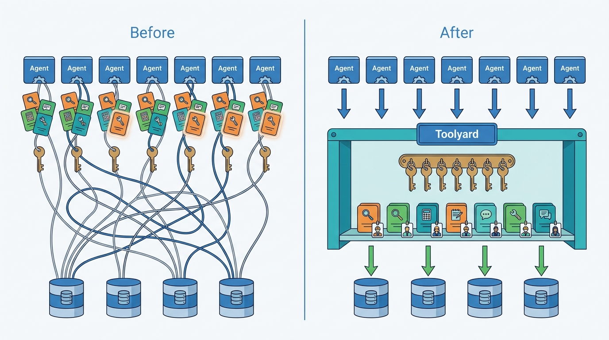
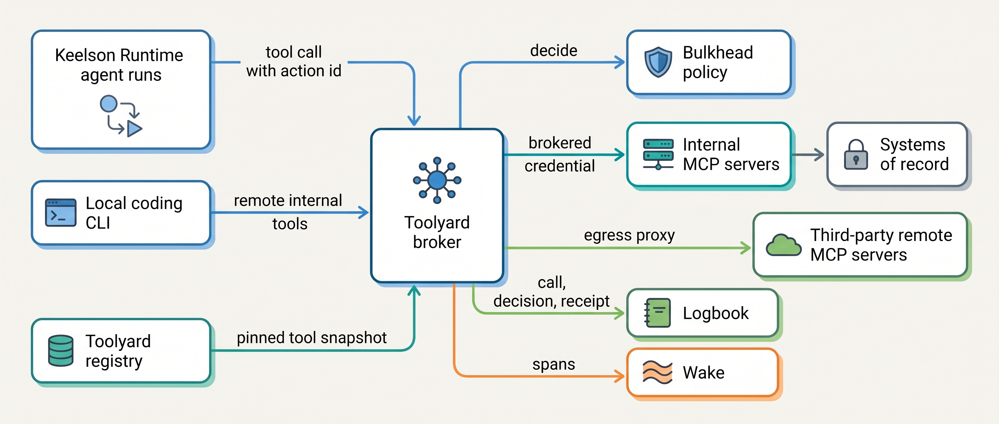
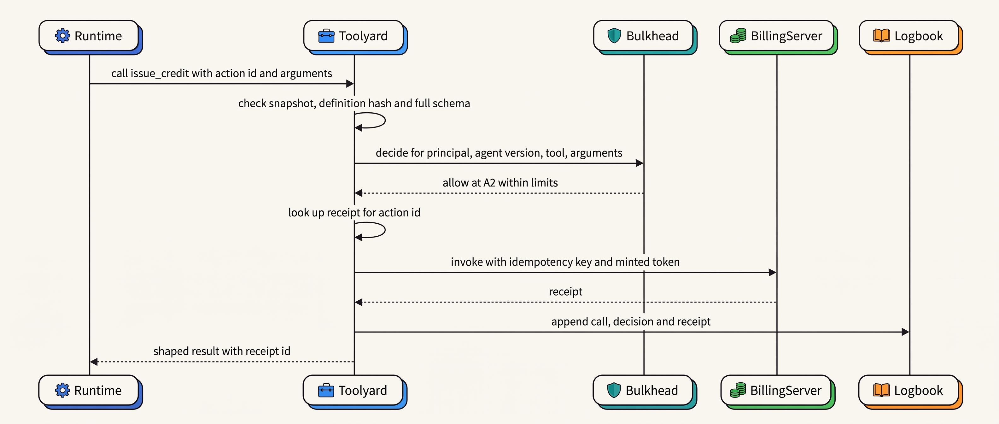
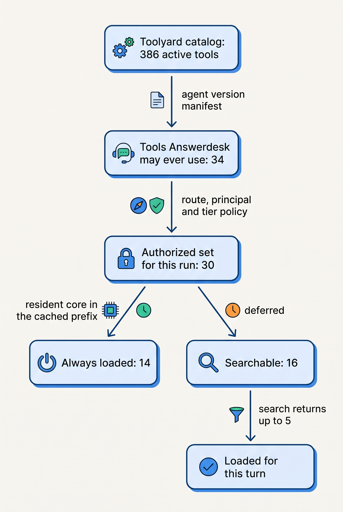
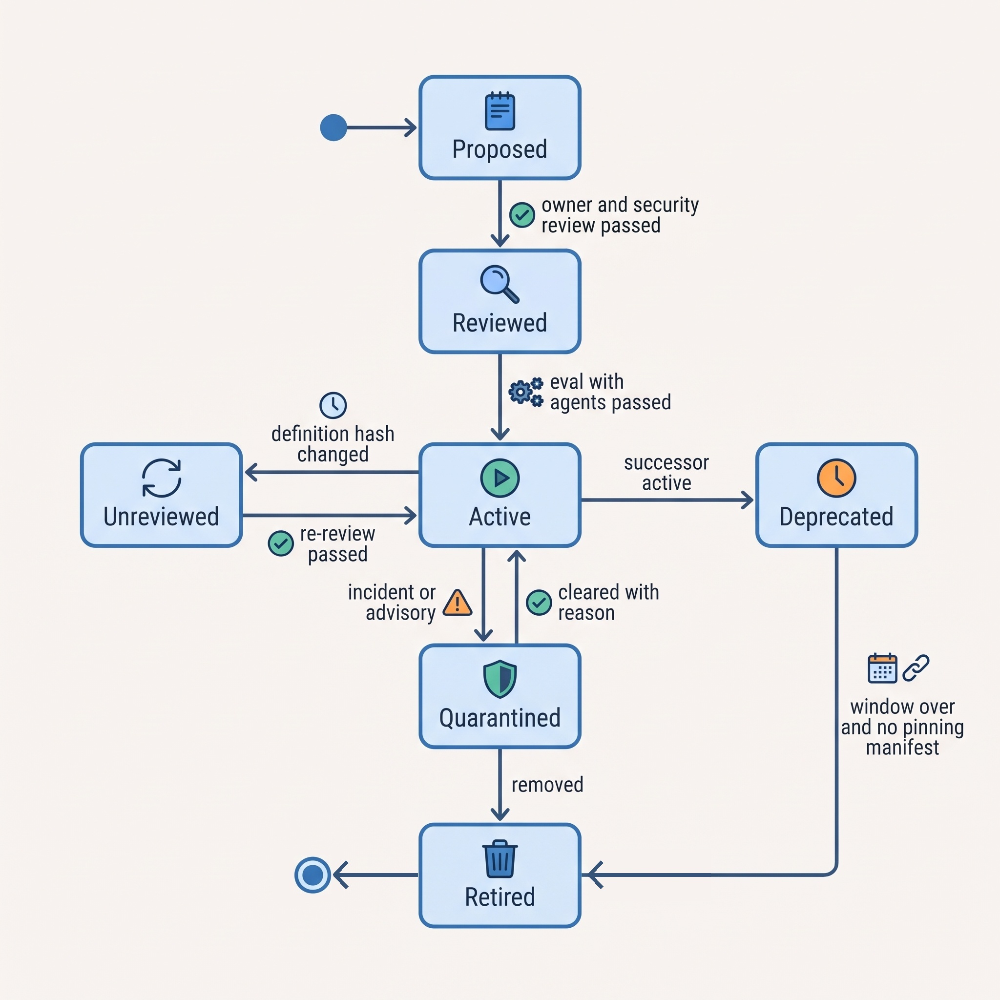
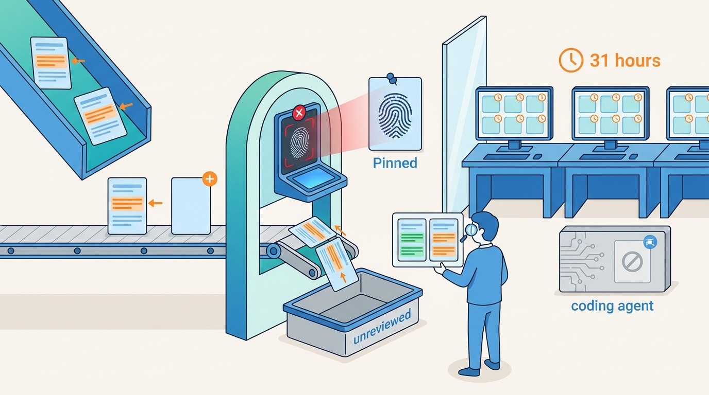

> **IN THIS CHAPTER, YOU WILL:** Learn what the Model Context Protocol (MCP) standardizes as of its 2026-07-28 revision and what it leaves to you, and how to build a tool registry and a tool broker that resolve, authorize, credential, log and revoke tools for many agents and many engineers.

> **WHY THE BUSINESS CARES:** Every tool an agent can call is a way into a system of record, a customer's inbox or a payment rail. Without one catalog and one enforcement point, nobody can say which agents can touch billing, which third-party code runs with company credentials, or how fast a compromised tool can be switched off.

> **WHY ARCHITECTS SHOULD CARE:** Tools multiply faster than agents. The design decisions here set the cost of every later agent: whether a new tool is written once or seven times, whether authority sits in a prompt or in code, and whether an update to someone else's server can change your agent's behavior overnight.

> **KEY POINTS:**
>
> * **Authority lives in the tool broker, not in the protocol.** MCP standardizes how hosts discover and call tools and how a server checks that a token was issued for it. It does not decide which agent may call which tool with which arguments, does not carry the agent's identity separately from the user's, and labels its own annotations as untrusted hints. One broker, outside the agent process, between every agent and every tool.
> * **The tool catalog is a supply chain.** A tool description is text the model follows, and a server is code that runs with credentials. Pin definitions by content hash, review every change, sandbox local servers, keep credentials in the broker, and revoke from one place. A public registry proves who published a server, not that it is safe.
> * **What the model sees is a relevance decision; what it may call is a permission decision.** Past a few dozen tools, selection accuracy falls and definitions eat the context, so tool search and deferred loading become necessary. A deferred tool is still callable once found. Compute the authorized set first, per agent version, principal and autonomy tier, and let search rank only inside it.

> **[FAILURE PATTERNS THIS CHAPTER ADDRESSES](where-agentic-systems-go-wrong.html):**
>
> * **Ambient Authority** — MCP servers configured with static service keys, and local servers running with an engineer's full privileges, give every tool call the reach of an identity nobody scoped.
> * **The Lethal Trifecta** — teams and engineers compose servers themselves, so one agent ends up holding a tool that reads private data, a tool that ingests untrusted text and a tool that sends outward, without anyone deciding it.
> * **The Silent Upgrade** — a third-party server changes a tool's description or behavior under the same name, and the agent's behavior changes with no version bump, review or evaluation.

<br>
[[tool-contracts]] designed one tool well. This chapter is about the problem that arrives with the second agent: **many tools, from many owners, used by many agents and many people.** Who may publish a tool? Which agent version sees which tools? Where do credentials live? What happens when a server someone else maintains ships a new version on a Friday night?

The industry's answer to the wiring question is the **Model Context Protocol (MCP)**, an open protocol for exposing tools, resources and prompts to model-driven applications. It is worth adopting, but a protocol answers how a call is made, not whether it should be. The architecture also needs a **tool registry** that knows every tool, its owner and its risk, and a **tool broker** that sits on every call path and enforces what the registry and the policy engine say.

This chapter owns four terms: the **tool broker**, the **tool registry**, **MCP** as this book uses it, and the **tool supply chain**. It builds on [[agentic-reference-architecture]], which places the broker in the data plane, and on [[tool-contracts]]. It hands isolation of tool and agent code to [[sandboxes-and-execution-environments]], the design of side-effecting actions to [[side-effects-and-external-actions]], delegated identity to [[agent-identity-and-least-privilege]], and policy as code to [[policy-enforcement-and-audit]].

## Setting the Scene at Ostrell: 212 Tools and No List of Owners

Ostrell, the fictional field-service software group this book follows (see [[meet-ostrell]]), made Keelson generally available internally in **January 2027**. Seven agent prototypes moved onto it over the following months. Each had brought its own tools. Farah Haddad, security architect, and Amara Okafor, head of the Agent Platform team, asked every team for its tool list in the first week of January. The inventory (Ostrell figures, fictional):

| Where the tools lived | Tools | Credentials | Reviewed by anyone outside the team |
| --- | --- | --- | --- |
| In-process functions inside the seven agent prototypes | 118 | Service-account keys in environment variables | No |
| Internal MCP servers built by product teams (11 servers) | 64 | 4 servers with OAuth; 7 with static API keys | 2 of 11 |
| Third-party remote MCP servers from SaaS vendors (5 servers) | 30 | Vendor OAuth with the end user's token | Vendor contract only |
| **Agent tools in total** | **212** | | |
| Local MCP servers in engineers' coding-CLI configurations | 140 distinct server packages across about 600 configurations | Whatever sat in the engineer's shell | No; 23 pulled from public package registries with no version pin |

Four agents had their own `get_customer` tool, with three different service accounts, one of which could also write. Two agents could send email to any recipient. Nobody could answer Farah's first question: **if one of these tools turned out to be malicious or broken, how would we switch it off everywhere, and how would we know which runs had used it?**

Tomas Verhoef, Chief Architect, put the question to the architecture forum: **how should Ostrell expose, govern and broker tools across seven agents and several hundred engineers, so that a tool is written once, reviewed once and enforced in one place?** The answer was **Toolyard**, Keelson's tool registry and tool broker.


**Figure 1:** *Before Toolyard, Ostrell's 212 agent tools were scattered across seven prototypes and servers with their own keys; afterwards each tool is written once, owned by one team and reached only through one broker.*

## Concepts: Tools, Servers, Catalogs and Brokers

A **tool** is a named operation that a model may propose and deterministic code executes, with a contract ([[tool-contracts]] owns the contract). A **tool ecosystem** is everything around many tools: their servers, owners, catalog, credentials, versions and the paths by which agents and people reach them.

| Term | What it is in this book | What it is not |
| --- | --- | --- |
| **MCP (book use)** | The wire protocol and data model by which a host discovers and calls tools, reads resources and fetches prompts from servers; Ostrell's internal standard for exposing tools. | An authorization policy, an identity system, a catalog or a guarantee about what a server does. |
| **Tool registry** | The control-plane record of every tool: owner, server, version, definition hash, risk class, data classes, scopes, lifecycle state. The single source for "which tools exist and who answers for them". | A public directory such as the official MCP Registry, which stores publisher metadata only. |
| **Tool broker** | The data-plane component on every tool-call path: resolves which tools a run may see, asks the policy engine, validates, injects credentials, enforces idempotency and limits, shapes results and writes evidence. | The policy engine itself (it asks Bulkhead and enforces the answer), or a passive proxy that forwards whatever the agent sends. |
| **Tool supply chain** | Every party and artifact whose change can alter what a tool does or what the model reads about it: server code and its dependencies, package registries, tool descriptions, vendor-operated remote servers. | Only third-party code. An internal team's server update is in the supply chain too. |
| **Authorized tool set** | The tools one run may call, computed from the agent version's manifest, the principal, the tenant and the autonomy tier of each action class. | The tools the model happens to see this turn, which is a relevance choice inside that set. |

The registry is control plane: it changes when people decide something. The broker is data plane: it runs on every call and must be fast, available and boring. And **authorization is separate from execution**: Bulkhead, the policy engine, decides; Toolyard executes with brokered credentials.

## MCP as of October 2026: What It Standardizes and What It Leaves to You

### Roles, primitives and transports

MCP has three roles. A **host** is the application that runs the model and coordinates everything; it creates one **client** per server, and "each client is created by the host and communicates with exactly one server"; a **server** exposes tools, resources and prompts ([MCP Architecture, 2026-07-28](https://modelcontextprotocol.io/specification/2026-07-28/architecture)). One design principle matters most to architects: "servers should not be able to read the whole conversation, nor 'see into' other servers"; the host enforces the boundaries. In an agent platform, the host role is the agent runtime plus the broker, which is why the broker is the natural place for policy.

Tools are "model-controlled": the model can discover and invoke them, but the specification says "there SHOULD always be a human in the loop with the ability to deny tool invocations", and places the burden on servers: they "MUST: validate all tool inputs; implement proper access controls; rate limit tool invocations; sanitize tool outputs" ([MCP Tools, 2026-07-28](https://modelcontextprotocol.io/specification/2026-07-28/server/tools)).

There are two standard transports: **stdio**, where the client launches the server as a subprocess, and **Streamable HTTP**, where each message is a POST to one endpoint ([MCP Transports, 2026-07-28](https://modelcontextprotocol.io/specification/2026-07-28/basic/transports)). The 2026-07-28 revision made the protocol **stateless**. It removed protocol sessions and the `initialize` handshake; every request carries its protocol version and capabilities; servers that need state across calls mint explicit handles passed as ordinary tool arguments; and "a broken response stream loses the in-flight request; clients MUST re-issue it as a new request with a new request ID" ([MCP 2026-07-28 changelog](https://modelcontextprotocol.io/specification/2026-07-28/changelog)).

For a broker this has two consequences. Any replica can serve any request. And **the protocol no longer redelivers**: a retried call is a new call, so a non-idempotent tool needs an idempotency key at the server, the Double Credit lesson of [[retries-idempotency-and-concurrency]]. Handles get the same treatment: "a handle is a name, not a capability", so the server checks authorization against it on every call.

### Authorization

MCP authorization is **optional**. HTTP transports should implement it; stdio servers "SHOULD NOT follow this specification, and instead retrieve credentials from the environment" ([MCP Authorization, 2026-07-28](https://modelcontextprotocol.io/specification/2026-07-28/basic/authorization)). Where it is implemented, an MCP server is an OAuth resource server built on the OAuth 2.1 Internet-Draft (still not an RFC as of October 2026): clients use PKCE and name the server as the token's audience; servers "MUST NOT accept or transit any other tokens"; scopes can be requested incrementally with step-up authorization.

That guarantees a server receives a token minted for it, with consented scopes. It does not say **which tool calls with which arguments** were approved, does not carry the agent's identity separately from the user's ([[agent-identity-and-least-privilege]]), and gives a local stdio server whatever credentials sit in its environment. For secrets a user must enter, **URL-mode elicitation** sends the user to an out-of-band page so credentials "MUST NOT transit through the MCP client" ([MCP Elicitation, 2026-07-28](https://modelcontextprotocol.io/specification/2026-07-28/client/elicitation)).

### Annotations are hints

A server may annotate a tool as read-only, destructive, idempotent or open-world, with conservative defaults, but the schema is explicit: annotations "are hints … not guaranteed to provide a faithful description of tool behavior", and clients "MUST consider tool annotations to be untrusted unless they come from trusted servers" ([MCP schema, 2026-07-28](https://raw.githubusercontent.com/modelcontextprotocol/modelcontextprotocol/main/schema/2026-07-28/schema.ts)). In Toolyard the registry, not the server, holds the risk class of each tool; a server's annotation is an input to review, never to enforcement.

### Status and churn

MCP published four revisions in the twenty months after its first (2024-11-05); the latest, 2026-07-28, removed sessions and the handshake. Since 9 December 2025 it has been a founding project of the Linux Foundation's **Agentic AI Foundation** ([Linux Foundation, 2025](https://www.linuxfoundation.org/press/linux-foundation-announces-the-formation-of-the-agentic-ai-foundation)), with technical governance left to the project's maintainers ([MCP governance, n.d.](https://modelcontextprotocol.io/community/governance)). The 2026-07-28 cycle adopted a deprecation policy with a minimum twelve-month window, and ninety days only for an active security risk ([MCP feature lifecycle, n.d.](https://modelcontextprotocol.io/community/feature-lifecycle)). Roots, Sampling and Logging are deprecated; Dynamic Client Registration is deprecated in favor of Client ID Metadata Documents. How quickly SDKs, gateways and major hosts have adopted the stateless revision is not publicly measured as of October 2026.

| MCP gives you (2026-07-28) | MCP leaves to you |
| --- | --- |
| A common format for tool definitions (JSON Schema 2020-12), results and errors, including `isError` results the model can correct from | Which agent, acting for which principal, may call which tool with which arguments |
| Discovery (`tools/list`), with deterministic ordering recommended for prompt caching and lists that may vary by the caller's authorization | Which tools exist at all in your organization, who owns them, and which version an agent is pinned to |
| Audience-bound OAuth tokens, no passthrough, step-up scopes | The agent's own identity, delegation records and separation of duties |
| Elicitation for in-call user input; URL mode for secrets | Approval records bound to an exact action version, with expiry ([[human-oversight-and-bounded-autonomy]]) |
| Trace-context propagation in request metadata | The evidence log, receipts and idempotency across retries |
| Annotations as hints | Enforced risk classes, rate and amount limits, egress control |

The rule I use: **standardize on MCP for the shape of tools, and terminate it at the broker.** Agents talk to Toolyard; Toolyard talks MCP to servers. When the next revision lands, the broker absorbs it, and seven agents do not each upgrade an SDK in the same quarter.

## Architecture: Toolyard as Registry and Broker


**Figure 2:** *Every tool call, from an agent run or from an engineer's CLI using a remote internal tool, crosses one broker that reads a pinned snapshot from the registry, asks the policy engine, holds the credential and writes the evidence.*

### The registry record

The registry is a small, boring database with strong change control. Each tool version is one record:

```yaml
tool: billing.issue_credit
version: 3.2.0
server: https://billing-tools.toolyard.internal/mcp
definition_sha256: 9f2c…e41          # name + description + input/output schema, canonicalized
owner: Billing Platform team          # owner of the system of record, not of an agent
system_of_record: billing
risk_class: compensable_write         # read | draft | reversible_write | compensable_write | irreversible | external_commitment
trifecta: {private_data: true, untrusted_content: false, external_send: false}
data_classes: [customer_contract, payment_reference]
scopes: [billing.credit.write]
idempotency: required                 # broker rejects calls without an action id
result_budget_tokens: 800
policy_ref: bulkhead://answerdesk/credits    # amounts and tiers live in policy, not here
status: active                        # proposed | reviewed | active | unreviewed | deprecated | quarantined | retired
successor_of: billing.issue_credit@2
```

Three fields carry most of the governance. **`definition_sha256`** makes a changed description a different tool. **`owner`** names the team that knows what a call can break. **`trifecta`** classifies each tool on the three axes of the lethal trifecta (reads private data, ingests untrusted content, sends outward), so the broker can refuse to assemble all three in one run without a decision ([[agent-threat-model]] owns the analysis).

### What the broker does and must never do

| Responsibility | What Toolyard does | What it must never do |
| --- | --- | --- |
| Resolve | Compute the authorized tool set at run start from the agent version manifest and the principal; freeze it as a snapshot for the run | Let the model or the prompt add tools to the set |
| Authorize | Ask Bulkhead for every call with principal, agent version, tool, arguments and action tier; enforce allow, deny or approval-required | Decide policy itself, or treat a server annotation as policy |
| Validate | Re-check arguments against the full schema (ranges, formats, cross-field rules) the model-side schema could not express | Pass a call through because constrained decoding produced it |
| Credential | Hold credentials; either perform the call with them or mint a short-lived, audience-bound token for the server | Put a credential, token or key into the model's context or tool result |
| Make effects safe | Require an action id on side-effecting tools; look up receipts before re-executing; mark timeouts as `unknown` | Retry a non-idempotent call blindly, or re-ask the model on retry |
| Shape and record | Cap result size, mark open-world results untrusted; write call, decision and receipt to Logbook, spans to Wake | Return unbounded payloads, or log secrets and restricted payloads |
| Revoke | Drop a quarantined or unreviewed tool from every snapshot within a minute | Wait for a deploy of each agent to remove a tool |

### Two credential patterns

The author's agentic-platform-foundations interview design uses two credential mechanisms without distinguishing them: in one step the broker **performs** the privileged call on the sandbox's behalf; in a later step it **mints** a delegated, audience-bound token that the orchestrator presents to the MCP server (*design example*, `agentic-platform-foundations/interview.json`, steps `runtime` and `identity`). Both are sound, for different tools.

| Pattern | How it works | When it is right | Cost |
| --- | --- | --- | --- |
| **Call proxy** | The broker holds the credential, makes the downstream call itself and returns the result | Legacy APIs with static keys; third-party APIs; any tool whose server should never see a user-derived token | The broker is on the data path for every byte and is a high-value target |
| **Token mint** | The broker exchanges the run's delegated identity for a token scoped to one server, one tenant and minutes of lifetime; the server validates audience and scope | Internal MCP servers that are OAuth resource servers and must apply their own row-level authorization | Every server must validate tokens correctly; audit needs both broker and server logs |

At Ostrell, internal servers that front systems of record use token minting, so the billing server still checks that a credit belongs to the calling tenant. Third-party remote servers and legacy APIs use the call proxy, behind the egress proxy.

### Requirements per interaction

| Interaction | Consistency | Latency target | Durability | Who may act |
| --- | --- | --- | --- | --- |
| Resolve tool set at run start | Snapshot pinned to the agent version; registry changes apply to new runs, revocations to running ones | p95 under 50 ms *(assumption)* | Snapshot id recorded in Logbook | Runtime on behalf of the run |
| Read-only tool call | Read-your-writes not required unless the next step acts on it ([[provenance-and-freshness]]) | Broker overhead p95 under 25 ms *(assumption)* | Span in Wake; Logbook entry for restricted data classes | Model proposes; Bulkhead decides; broker enforces |
| Side-effecting tool call | Exactly-once effect: action id, receipt lookup, `unknown` state on timeout | Dominated by the downstream system | Intent and receipt in Logbook before the result returns | Model proposes; Bulkhead decides tier; human approves at A1 |
| Register or change a tool | Serializable; a new hash is a new version | Hours to days (review) | Registry history kept for the life of any manifest that pins it | Tool owner proposes; reviewer approves |
| Revoke or quarantine | Propagates to all broker replicas | Under 60 s *(assumption)* | Revocation record with reason | Tool owner, security on-call, platform on-call |

### One call through the broker


**Figure 3:** *A side-effecting call: the model's proposal becomes an effect only after the broker has checked the pinned definition, obtained a policy decision, checked for a prior receipt and recorded the outcome.*

The broker's core, stripped of transport detail:

```python
def call_tool(run: RunContext, req: ToolCall) -> ToolResult:
    tool = run.tool_snapshot.get(req.name)              # frozen at run start; revocations apply live
    if tool is None or tool.status != "active":
        return ToolResult.hard_error("tool_not_available")      # not model-fixable
    if problems := tool.validate_full(req.args):         # ranges, formats, cross-field rules
        return ToolResult.model_error(problems)          # model may correct and retry
    decision = bulkhead.decide(run.principal, run.agent_version, tool.id, req.args)
    if decision.outcome == "deny":
        return ToolResult.denied(decision.reason)        # a stop the model cannot argue past
    if decision.outcome == "approval_required":
        return ToolResult.pending(decision.approval_request)
    if tool.side_effecting:
        if prior := receipts.find(req.action_id):
            return prior                                 # a retry returns the first outcome
        logbook.intent(run.id, tool.ref, req.action_id, decision.id)
    cred = credentials.for_call(tool, run.principal, decision.scopes)
    try:
        raw = transport.invoke(tool, req.args, cred, idempotency_key=req.action_id)
    except Timeout:
        logbook.unknown(run.id, req.action_id)           # reconcile by key; never re-ask the model
        return ToolResult.unknown(req.action_id)
    result = shape(raw, tool.output_schema, tool.result_budget_tokens, untrusted=tool.trifecta.untrusted_content)
    logbook.receipt(run.id, req.action_id, result.receipt)
    return result
```

The runtime creates the `action_id` when the proposal becomes an action object ([[side-effects-and-external-actions]]); the model never chooses it.

### Build or adopt

Gateways that do part of this job now ship as products. Amazon Bedrock AgentCore's Policy feature, generally available since 3 March 2026, evaluates each gateway request against Cedar policies "before allowing tool access" ([AWS, 2026](https://docs.aws.amazon.com/bedrock-agentcore/latest/devguide/policy.html)); that documents a mechanism, not its effectiveness. Adopt a product if it can hold your risk classes, enforce idempotency keys and write your evidence log. Otherwise you will build those next to it, and then you have two brokers.

## Too Many Tools: Discovery, Tool Search and the Authorized Set

Tool definitions are context, and context costs accuracy and money. The evidence is mostly vendor-measured, but it points one way:

- Anthropic's documentation states that tool selection "degrades once you exceed 30–50 available tools", and its engineering team reported that 58 tools across five common MCP servers consumed about 55,000 tokens of definitions; deferred loading cut one example from about 77,000 to 8,700 tokens. On its internal MCP evaluation with large tool libraries, accuracy rose from 49% to 74% and from 79.5% to 88.1% on two model generations when tool search was enabled ([Anthropic, 2025-11-24](https://www.anthropic.com/engineering/advanced-tool-use); [tool search docs, n.d., accessed 2026-10](https://platform.claude.com/docs/en/agents-and-tools/tool-use/tool-search-tool)). *Vendor-internal evaluations, not independently reproduced.*
- OpenAI's guidance is to "aim for fewer than 20 functions available at the start of a turn", a soft heuristic, and it offers equivalent deferred loading with namespaces ([OpenAI function calling, n.d., accessed 2026-10](https://developers.openai.com/api/docs/guides/function-calling)).
- RAG-MCP, a preprint, retrieved tools before prompting in an MCP stress test and reported prompt tokens cut by over half and tool-selection accuracy raised from 13.62% to 43.13% ([Gan and Sun, 2025](https://arxiv.org/abs/2505.03275)). *Preprint; the absolute accuracy shows how hard large menus are, not a rate to plan with.*

The thresholds differ because they are heuristics for different models, and no independent benchmark of tool search exists as of October 2026. The durable finding: selection worsens as the menu grows, and just-in-time loading helps.

The architectural trap is to treat tool search as access control. In Anthropic's implementation, deferred tools are still sent with the request and become callable as soon as a search returns them. Search ranks; it does not authorize. The MCP specification allows the right design: `tools/list` "MAY vary by the authorization on the request, for example, returning only the tools the caller's granted scopes permit" ([MCP Tools, 2026-07-28](https://modelcontextprotocol.io/specification/2026-07-28/server/tools)). Toolyard applies three filters, in this order:


**Figure 4:** *Permission narrows the catalog before relevance ranks it: the manifest and the policy decide what a run may call, and only then does search decide what the model sees this turn (Ostrell figures, Q3 2027).*

Two details matter. **Names and descriptions are written for retrieval**, namespaced by system (`billing.`, `ticket.`, `kb.`). And **the resident core is chosen from usage traces**, and sits in the cached prefix in canonical order, so a change to a deferred tool does not invalidate the cache ([[caching-and-context-budgets]]).

## Code Execution as a Tool Interface

A different answer to "too many tools" is to stop presenting tools as a menu and present them as an API the model writes code against. CodeAct, an ICML 2024 paper, found that executable Python as the action space gave up to 20% higher success than JSON or text actions across 17 models of that generation ([Wang et al., 2024](https://arxiv.org/abs/2402.01030)). In November 2025 Anthropic described presenting MCP servers to an agent as code files, so the agent loads only what it needs and filters data in the sandbox; one worked example fell from about 150,000 to 2,000 tokens, with the stated cost of "operational overhead and security considerations that direct tool calls avoid" ([Anthropic, 2025-11-04](https://www.anthropic.com/engineering/code-execution-with-mcp)). Cloudflare's Code Mode converts MCP tools into a TypeScript API run in V8 isolates with no general internet access, reaching servers only through bindings while a supervisor holds the keys ([Cloudflare, 2025-09-26](https://blog.cloudflare.com/code-mode/)). Anthropic's programmatic tool calling documentation warns not to rely on its caller restriction "as a security boundary" ([Anthropic docs, n.d., accessed 2026-10](https://platform.claude.com/docs/en/agents-and-tools/tool-use/programmatic-tool-calling)).

Code mode **moves the boundary** from the set of calls the broker allows to what the sandbox can reach. The safe shape is the same broker with a different front end: no ambient network, each binding a proxied call through the broker, credentials outside the sandbox. Without that, a code-executing agent is a remote shell holding the union of its tools' permissions. At Ostrell, Scout uses code execution for data analysis over search results; its bindings call Toolyard, and its sandbox has no other egress. The sandbox itself belongs to [[sandboxes-and-execution-environments]].

## The Tool Supply Chain

A tool reaches the model as text and reaches your systems as code. Both are supply-chain inputs, and both have documented attacks.

| Attack | Mechanism | Documented case | Toolyard control |
| --- | --- | --- | --- |
| **Tool poisoning** | Instructions hidden in a tool description the user does not see but the model reads | Invariant Labs, April 2025: a poisoned `add` tool made a coding assistant read SSH keys and an MCP config file and send them through a hidden parameter; the confirmation dialog did not show full arguments ([Invariant Labs, 2025](https://invariantlabs.ai/blog/mcp-security-notification-tool-poisoning-attacks)) | Descriptions reviewed as code; registry stores and diffs them |
| **Rug pull and shadowing** | A description changes after approval, or one server's description changes how the model uses another server's tool | Same source, described as variants | Definition hash pinned; a changed hash drops the tool to `unreviewed`; descriptions that mention other tools fail review |
| **Malicious package update** | A published server version adds hostile behavior | Snyk, September 2025: the npm package `postmark-mcp`, from version 1.0.16, added a hidden BCC to an external address on email it sent; earlier versions were benign ([Snyk, 2025](https://snyk.io/blog/malicious-mcp-server-on-npm-postmark-mcp-harvests-emails/)) | Exact version and artifact digest pinned; mirrored internally; egress allowlist per server |
| **Vulnerable MCP tooling** | Bugs in clients, proxies and developer tools | CVE-2025-49596, MCP Inspector, unauthenticated remote code execution, CVSS 4.0 9.4 ([NVD, 2025](https://nvd.nist.gov/vuln/detail/CVE-2025-49596)); CVE-2025-6514, `mcp-remote`, command injection from a malicious server's authorization URL, CVSS 3.1 9.6 ([NVD, 2025](https://nvd.nist.gov/vuln/detail/CVE-2025-6514)) | Approved client and proxy versions in the managed CLI configuration; patch SLA |
| **Toxic agent flow** | A legitimate server's results carry an injection that uses the agent's other tools | Invariant Labs, May 2025: an issue in a public repository led an agent using the official GitHub MCP server to copy private-repository data into a public pull request; the authors call it "a fundamental architectural issue", not a server bug ([Invariant Labs, 2025](https://invariantlabs.ai/blog/mcp-github-vulnerability)). GitHub added a lockdown mode and content sanitization in December 2025 ([GitHub, 2025](https://github.blog/changelog/2025-12-10-the-github-mcp-server-adds-support-for-tool-specific-configuration-and-more)) | Per-run scope (one repository, one tenant); trifecta classification; results from open-world tools marked untrusted |
| **Confused deputy, token passthrough, SSRF** | A server forwards a token issued for something else; a malicious server supplies internal URLs in its OAuth metadata | MCP security best practices forbid passthrough and recommend an egress proxy ([MCP, n.d., accessed 2026-10](https://modelcontextprotocol.io/docs/2026-07-28/tutorials/security/security_best_practices)) | Token mint per server audience; all third-party traffic through the egress proxy |

Two of these lessons generalize. **Tool metadata is code-equivalent input**: a description the model reads can direct it as effectively as a prompt, so it needs the same review and pinning as a dependency. And **the protocol cannot fix composition**: the GitHub case involved no compromised tool. Simon Willison's argument is that MCP makes the lethal trifecta easy to assemble because users mix tools from different sources, and "the only way to stay safe there is to avoid that lethal trifecta combination entirely" ([Willison, 2025](https://simonwillison.net/2025/Jun/16/the-lethal-trifecta/)). A registry that classifies tools on the trifecta axes is how an organization makes that combination a decision rather than an accident.

**A public registry is not a vetting service.** The official MCP Registry is "currently in preview", stores metadata only, verifies namespaces through GitHub, DNS or HTTP challenges, delegates security scanning to package registries and downstream aggregators, does not support private servers, and "is not intended to be directly consumed by host applications" ([MCP Registry, n.d., accessed 2026-10](https://modelcontextprotocol.io/registry/about)). Namespace verification proves who published. An enterprise needs its own registry, which can implement the published registry API, as the allowlist its broker and its managed CLI configuration enforce.

**Local servers are arbitrary code with the user's privileges.** A stdio server runs as a subprocess of the engineer's CLI, with the engineer's files, network and credentials. The author's ai-coding-cli interview design puts MCP servers behind the same permission engine as built-in tools and keeps an extensions ledger with a pinned content hash, review status, revocation and a per-server credential; a server whose hash changes drops to unreviewed and its tools leave the catalog (*design example*, `ai-coding-cli/interview.json`, step `extensibility`). Ostrell adopted that ledger for the local CLI's managed configuration. It names what remains: a local CLI acting as the engineer is **ambient authority**, mitigated by OS sandboxing and permission rules, not removed.

## Governance: Ownership, Review and Deprecation


**Figure 5:** *A tool version's lifecycle in the registry: a changed definition is a new, unreviewed tool, quarantine is reachable from active in one step, and nothing is retired while an agent manifest still pins it.*

Four rules make the lifecycle work.

**The owner of a tool is the owner of the system it touches.** Agent teams consume tools; they do not own copies. This is how Ostrell went from four `get_customer` tools to one.

**Review depth follows risk class.** A read-only tool needs the owner's approval and automated checks (schema lint, description lint, result budget). A write tool also needs a security review and a Sounding run in which real agent versions use it on recorded tasks, because a correct tool can still be misused by a model ([[building-agent-eval-suites]]). A tool whose effect is an external commitment is reviewed by the risk owner, and Bulkhead caps its tier at A1 whatever the evidence.

**Every agent version pins tool versions.** The agent version manifest names each tool by version and hash ([[versioning-agent-systems]]). A new tool version reaches an agent through a manifest change that passes its evaluation gate, not because the server shipped. This is the tool half of the Alias Drift lesson.

**Deprecation is a window, not a date.** MCP's own policy, twelve months with a ninety-day floor for security, is a reasonable reference for external servers. Internally Ostrell uses ninety days, and a tool cannot be retired while a manifest in production or in a running durable workflow still pins it, because a workflow that waits a week for an approval must resume against the tool it started with ([[durable-agent-execution]]).

## Evidence: What Is Known and What Is Not

The evidence in this chapter is uneven, and the design should be read with that in mind. The tool-count effects are **vendor-internal measurements** plus one preprint. The code-mode gains rest on 2024 models and single worked examples. The supply-chain attacks are **demonstrations and incident reports**, not incidence rates. Two questions have no public answer as of October 2026: whether a policy gateway measurably reduces harm (the argument is structural; products exist, data does not), and how widely the stateless MCP revision has been adopted.

Sources disagree in one place that matters to design. The MCP specification says a human SHOULD always be able to deny tool invocations; vendors are shipping modes that remove routine prompts, citing prompt fatigue. Anthropic reported in March 2026 that users accept 93% of manual permission prompts ([Anthropic, 2026-03-25](https://www.anthropic.com/engineering/claude-code-auto-mode)). Universal prompting is ceremony; no prompting is Autonomy by Default. The reconciliation is the book's: tiers per action class, with the broker enforcing which calls need an approval record and which do not ([[autonomy-and-consequence]]).

## Worked Example at Ostrell: Toolyard Through 2027

### Consolidation (January to April 2027)

The Agent Platform team set one rule: **no tool reaches an agent except through Toolyard.** The 118 in-process functions were rewritten as tools on servers owned by system teams or deleted as duplicates; static keys moved into the broker or were replaced by token minting. By the end of April, when Closewise moved onto Keelson Runtime, the registry held 41 servers and 296 tools.

### The Poisoned Ticket (May 2027)

The canonical incident, told in full in [[prompt-injection-defense]], is a broker story too. An inbound ticket carried white-on-white text telling Answerdesk to forward a customer's service-contract PDF and last five invoices to an external address. Answerdesk held all three legs of the trifecta: it read untrusted inbound text, could read documents, and had an email tool. The send was **blocked** because Toolyard's email tool allowed only recipients in the ticket's verified customer domain, a constraint enforced in the broker, not stated in the prompt. Nobody noticed for **6 days**, until a trace review found it.

The broker-side fixes (the full redesign is in [[prompt-injection-defense]]): the email tool's `to` and `attachments` now accept only handles resolved from the CRM and the verified account, and mail to any other address becomes a draft a human sends. The registry gained the `trifecta` field, and an agent version whose manifest holds all three legs fails its release check unless a named risk owner has signed an exception. Bulkhead denials on email and document sinks now page the security on-call within minutes instead of waiting for a trace review.

### The fold-back and the menu problem (April to June 2027)

After the Lost Handoff, the billing specialist agent was folded back into Answerdesk as a tool set on 7 June 2027 (see [[coordination-and-handoffs]]). Answerdesk's manifest grew to **34** tools, about **11,800 tokens** of definitions, half of its 24,000-token per-call working-context budget. On Mei Lin Zhou's Sounding suite for Answerdesk, the wrong-tool rate (a call to a tool the reference trajectory did not use, or a missing call) rose from 2.4% to **6.2%** (Ostrell figures, fictional).

The fix used the three filters of Figure 4. Tools were renamed into namespaces; since June 2027 a resident core of **14** tools (about 3,000 tokens), chosen from Wake usage data, stays in the cached prefix; the other **20** are deferred and searchable, returned 5 at a time. The wrong-tool rate fell to **2.9%**. The token arithmetic, assuming 5 model calls per conversation and an average of one search per conversation:

| | Flat menu, 34 tools | Resident core plus search |
| --- | --- | --- |
| Definition tokens per model call | 11,800 | about 4,600 (core 3,000 plus loaded tools, averaged) |
| Per conversation (5 calls *(assumption)*) | 59,000 | about 23,000 |
| Per day at 7,100 conversations | about 419 million | about 163 million |
| Tool selection, Sounding wrong-tool rate | 6.2% | 2.9% |

Prompt caching had already discounted most of those tokens; the real gains were selection accuracy and 7,200 tokens per call returned to evidence. The authorized set is also smaller than the manifest: the intake route selects a tool set ([[routing-and-delegation]]), and while a human owns the ticket, write tools leave the snapshot. Search cannot find a tool that is not in the snapshot.

### The Tracker Update (September 2027)

On a Friday morning in **September 2027**, the vendor of the third-party issue-tracker remote server that Forge and the local coding CLI used published a new version. Two tool descriptions changed and a new `bulk_update` tool appeared. The definition hashes no longer matched; Toolyard and the managed CLI configuration moved the server to `unreviewed`, and its tools left every catalog. Forge runs that needed the tracker failed cleanly with "tool not available", and about 870 engineers lost tracker tools in their CLI for **31 hours**, until Farah's team finished reviewing the diff on Saturday afternoon. The changes were benign; `bulk_update` was kept out of all manifests.

The control worked, and it cost a day and a half of degraded tooling. Ostrell did not weaken pinning; it set a four-working-hour review target for pinned third-party updates and added a definition diff to the review queue. The deeper lesson: most remote servers serve only their latest version, so **pinning a remote server pins your ability to detect change, not to avoid it.**


**Figure 6:** *In the Tracker Update, pinning by definition hash caught the vendor's changed tools at the gate and held them for review; the price was 31 hours of degraded tooling, not a silent change in agent behavior.*

## Failure Modes and Recovery

| Scenario | Detection | Containment | Recovery |
| --- | --- | --- | --- |
| A server's tool definition changes (rug pull or honest update) | Hash mismatch at snapshot resolution | Tool drops to `unreviewed`; leaves all snapshots | Review the diff; re-approve as a new version; manifests adopt it through their gates |
| An approved tool is later found malicious or vulnerable | Advisory, egress alert or trace review | Quarantine in one action; broker drops it from running snapshots within a minute; credentials rotated | Query Logbook for every run and receipt that used the tool version; compensate or review affected actions ([[partial-failure-and-compensation]]) |
| Broker unavailable | Health checks; Wake error rate | Agents fail closed for side-effecting tools; read tools fail too, since a bypass would be an unbrokered path | Runs wait on durable timers and resume; the broker is replicated per region and stateless apart from the receipt store |
| Response stream broken on a non-idempotent call | Timeout with no receipt | Action marked `unknown`; no blind retry | Status check by idempotency key; repair queue if still unknown |
| Registry revocation not yet applied to a long-running run | Snapshot age metric | Revocations apply to running snapshots, not only new runs | Alert on any snapshot older than the last revocation |
| A malicious local server in an engineer's CLI | Endpoint telemetry; unexpected egress from the OS sandbox | Managed configuration permits only allowlisted, pinned servers; sandbox egress denied by default | Revoke in the managed configuration; rotate the engineer's credentials |
| Tool retired while a durable workflow still pins it | Retirement check against running workflows | Retirement blocked | Migrate the workflow at a safe point or wait for it to finish |

**Fail closed is a product decision**: during a broker outage Answerdesk cannot even answer from the knowledge base, and Lena Brandt signed off on that, because an unbrokered read path is how ambient authority comes back. **The evidence log is the recovery tool**: "which runs used tool version X this week, and what did they change?" is one Logbook query ([[policy-enforcement-and-audit]]).

## Trade-offs

| Option | Strength | Cost | When it is right |
| --- | --- | --- | --- |
| **In-process functions per agent** | Fastest to build; no network hop | Duplicated tools, credentials in each agent, no central revocation or evidence | A single prototype that will not reach production |
| **Agents call MCP servers directly** | Standard protocol; servers reusable | Each agent holds tokens and enforces policy itself; revision churn hits every agent; no complete call record | A small number of agents, all low-consequence, owned by one team |
| **MCP behind a central broker (Toolyard)** | One place for authorization, credentials, idempotency, limits, evidence and revocation | The broker is critical infrastructure on every path; a platform team must run it | Several agents, side-effecting tools, regulated data; the default this book recommends |
| **Vendor-managed tool gateway** | Faster start; policy features included | May not hold your risk classes, idempotency or evidence format; provider lock-in on the most sensitive path | When it can enforce your registry and write your evidence log, or for a cloud-specific estate |
| **Code mode over brokered bindings** | Large context savings; composes tools; keeps bulk data out of the context | Sandbox to operate; harder to review a program than a call; per-binding policy still needed | Data-heavy, read-mostly work such as research and analysis |

Two narrower choices recur. Organize servers **per system of record**, not per agent use case, so authorization sits with the team that understands the data ([[agents-in-the-enterprise]]). And **pin** remote servers by definition hash for anything that writes or reads restricted data; follow the latest version only for read-only public-data tools.

The recommendation assumes more than three agents, at least one side-effecting tool and protected data. With one low-consequence agent a broker is overhead; keep the registry record anyway, because reconstructing who owned what later is hard.

## Across Domains: How the Stakes Change the Design

| Concern | Coding agents | Customer operations (support, sales, marketing) | Back office (finance, legal, HR) | High-stakes decisions (healthcare, public benefits) |
| --- | --- | --- | --- | --- |
| Where tools come from | Many: shell, code host, issue tracker, CI, plus local servers engineers add | Ticketing, CRM, knowledge base, billing, email; several third-party SaaS servers | ERP, CLM, HRIS; few third-party servers | Clinical record systems, rules engines, case systems; almost no third-party servers |
| Who may add a tool | Engineers, within an allowlist of pinned servers (ai-coding-cli design, step `extensibility`) | Platform and system owners; agent teams request | System owners with risk owner sign-off | Platform with clinical or legal safety sign-off |
| Write tools the model may call | Edits inside a sandbox; push to a branch; never merge | Bounded writes (tickets, credits within limits); outbound messages through suppression and consent checks | Mostly none: the model drafts; deterministic workflow posts approved entries (Closewise) | None that decide: the healthcare design writes to the record only after a clinician signs off (`agentic-healthcare-platform/interview.json`, step `gate`); rules engines are authoritative |
| Trifecta exposure | High: repositories and issues are untrusted, code hosts are an exfiltration path | High: inbound email and chat are untrusted, email is outbound | Medium: counterparty documents are untrusted; outbound sends are rare and approved | Medium: notes are untrusted and partitioned from write authority (healthcare design, step `privacy`) |
| Credential pattern | Short-lived, repository-scoped token in the sandbox; local CLI is ambient authority | Token mint per tenant; call proxy for SaaS vendors | Token mint; separation of duties enforced by scopes | Token mint bound to the licensed human principal for writes |
| Tool search acceptable | Yes; many tools, mostly reversible | Yes, inside the authorized set | Rarely needed; small, fixed tool sets | Avoid; fixed, reviewed tool sets per workflow |
| Failure that matters most | Supply chain: a poisoned local server or tracker update | Exfiltration through an outbound channel | A posting tool reachable by the model | A tool that turns a recommendation into an action |

The platform keeps the machinery common: registry schema, broker, pinning, credential brokering, trifecta classification, evidence and revocation. Domain policy decides **which risk classes a model may be offered at all, how deep review goes, and who signs**. Coding and customer operations differ in breadth: many tools and an open supply chain, so pinning and search matter most. Back office and high-stakes domains differ in depth: few tools, the write path kept away from the model, and the broker's job is mostly to prove that it stayed away.

## The Chief Architect's View

The decisions to make early, and who makes them:

- **One broker, no bypass.** The Head of Agent Platform owns Toolyard; the Chief Architect owns the rule that no tool reaches an agent except through it. Exceptions are recorded and expire.
- **Tool ownership by system of record.** Agreed with engineering directors, written into the registry, enforced at review.
- **MCP as the internal standard, terminated at the broker.** Server teams build to the current revision; the platform absorbs revision changes. Track the deprecated-features registry each quarter.
- **Review targets and quarantine authority.** Security owns review rubrics and can quarantine any tool without asking; the platform owns the review queue's latency.
- **Trifecta exceptions.** Only a named risk owner signs an exception, and it expires.

What to watch: MCP revisions and host adoption, the official registry leaving preview, gateway products that could replace parts of Toolyard, and, internally, the wrong-tool rate per agent version, unreviewed tools, review latency and blocked egress attempts.

What is durable: the propose-and-execute split, a registry with owners and hashes, a broker that holds credentials and records receipts, the order "authorize, then rank", and the view of tool definitions as supply-chain input. What will change: the protocol's method names and transports, the tool-count threshold at which search pays off, the token savings of code mode, and probably whether vendors' hosted tool runners make some of the broker unnecessary. As models get better at choosing among many tools, the relevance problem shrinks. The permission problem does not.

## Questions to Ask

1. Can we list every tool any agent can call, with its owner, version and definition hash, from one place, today?
2. Is there any path from an agent to a tool that does not cross the broker? Who approved it, and when does the exception expire?
3. Where are the credentials for each tool held, and could any of them appear in a model's context, a tool result or a log?
4. Which agent versions hold all three legs of the lethal trifecta, and who signed for each?
5. If a third-party server changed a tool description tonight, what would stop our agents from reading the new text tomorrow morning?
6. How long does it take to quarantine a tool everywhere, including in running workflows and engineers' CLIs, and when did we last test it?
7. Is tool search ever the only thing between a run and a tool its principal should not use, and does a tool-selection regression block release?
8. For a side-effecting tool behind MCP, what happens when the response stream breaks: who holds the idempotency key and where is the receipt?

Toolyard decides which tools a run may call and with what authority. It does not decide where the code those tools run, or the code the agent writes, executes. That is the subject of [[sandboxes-and-execution-environments]]: the isolation boundaries, egress controls and permission modes that keep agent actions contained when the broker's checks are not enough.

## Sources and Evidence

### Research papers

- [Executable Code Actions Elicit Better LLM Agents (CodeAct)](https://arxiv.org/abs/2402.01030), Wang et al., ICML, 2024 — code as an action space, up to 20% higher success across 17 models of that generation.
- [RAG-MCP: Mitigating Prompt Bloat in LLM Tool Selection via Retrieval-Augmented Generation](https://arxiv.org/abs/2505.03275), Gan and Sun, arXiv preprint, 2025 — tool retrieval before prompting; 13.62% to 43.13% selection accuracy.

### Specifications, standards and regulation

- [MCP Architecture](https://modelcontextprotocol.io/specification/2026-07-28/architecture), MCP project, 2026 — host, client and server roles; server isolation principle.
- [MCP Specification 2026-07-28: Key Changes](https://modelcontextprotocol.io/specification/2026-07-28/changelog), MCP project, 2026 — stateless redesign, lost in-flight requests, deprecations, deterministic tool ordering.
- [MCP Tools (2026-07-28)](https://modelcontextprotocol.io/specification/2026-07-28/server/tools), MCP project, 2026 — server obligations, human-in-the-loop guidance, authorization-dependent `tools/list`, handles.
- [MCP Transports (2026-07-28)](https://modelcontextprotocol.io/specification/2026-07-28/basic/transports), MCP project, 2026 — stdio and Streamable HTTP.
- [MCP Authorization (2026-07-28)](https://modelcontextprotocol.io/specification/2026-07-28/basic/authorization), MCP project, 2026 — OAuth resource server model, audience binding, no passthrough, stdio credentials from the environment.
- [MCP Elicitation (2026-07-28)](https://modelcontextprotocol.io/specification/2026-07-28/client/elicitation), MCP project, 2026 — URL mode keeps secrets out of the client.
- [MCP schema.ts (2026-07-28)](https://raw.githubusercontent.com/modelcontextprotocol/modelcontextprotocol/main/schema/2026-07-28/schema.ts), MCP project, 2026 — tool annotations and their status as untrusted hints.
- [MCP Security Best Practices](https://modelcontextprotocol.io/docs/2026-07-28/tutorials/security/security_best_practices), MCP project, n.d., accessed 2026-10 — confused deputy, token passthrough, SSRF, local server compromise.
- [MCP Governance and Stewardship](https://modelcontextprotocol.io/community/governance), MCP project, n.d., accessed 2026-10 — maintainer structure and enhancement proposals.
- [MCP Feature Lifecycle and Deprecation Policy](https://modelcontextprotocol.io/community/feature-lifecycle), MCP project, n.d., accessed 2026-10 — twelve-month deprecation window.
- [The MCP Registry](https://modelcontextprotocol.io/registry/about), MCP project, n.d., accessed 2026-10 — preview status, metadata only, delegated scanning, not for direct host consumption.

### Vendor documentation and engineering reports

- [Introducing advanced tool use](https://www.anthropic.com/engineering/advanced-tool-use), Anthropic, 2025 — tool definition token costs and internal tool-search accuracy gains.
- [Tool search tool](https://platform.claude.com/docs/en/agents-and-tools/tool-use/tool-search-tool), Anthropic, n.d., accessed 2026-10 — 30–50 tool degradation statement; deferred loading mechanics.
- [Function calling guide](https://developers.openai.com/api/docs/guides/function-calling), OpenAI, n.d., accessed 2026-10 — fewer than 20 functions heuristic; deferred loading and namespaces.
- [Code execution with MCP](https://www.anthropic.com/engineering/code-execution-with-mcp), Anthropic, 2025 — MCP servers as code APIs; token savings and stated security cost.
- [Code Mode: the better way to use MCP](https://blog.cloudflare.com/code-mode/), Cloudflare, 2025 — isolates, bindings and supervisor-held keys.
- [Programmatic tool calling](https://platform.claude.com/docs/en/agents-and-tools/tool-use/programmatic-tool-calling), Anthropic, n.d., accessed 2026-10 — caller restriction is not a security boundary.
- [Claude Code auto mode](https://www.anthropic.com/engineering/claude-code-auto-mode), Anthropic, 2026 — 93% acceptance of manual permission prompts.
- [Policy in Amazon Bedrock AgentCore](https://docs.aws.amazon.com/bedrock-agentcore/latest/devguide/policy.html), AWS, n.d., accessed 2026-10 (GA 2026-03-03) — a shipped gateway policy mechanism; no effectiveness data.
- [The GitHub MCP Server adds support for tool-specific configuration and more](https://github.blog/changelog/2025-12-10-the-github-mcp-server-adds-support-for-tool-specific-configuration-and-more), GitHub, 2025 — lockdown mode and content sanitization.
- [Linux Foundation announces the formation of the Agentic AI Foundation](https://www.linuxfoundation.org/press/linux-foundation-announces-the-formation-of-the-agentic-ai-foundation), Linux Foundation, 2025 — MCP's foundation home.
- [The lethal trifecta for AI agents](https://simonwillison.net/2025/Jun/16/the-lethal-trifecta/), Simon Willison, 2025 — why tool composition creates exfiltration risk.

### Incidents, cases and decisions

- [MCP Security Notification: Tool Poisoning Attacks](https://invariantlabs.ai/blog/mcp-security-notification-tool-poisoning-attacks), Invariant Labs, 2025 — tool poisoning, rug pull, shadowing.
- [GitHub MCP Exploited: Accessing private repositories via MCP](https://invariantlabs.ai/blog/mcp-github-vulnerability), Invariant Labs, 2025 — toxic agent flow with a legitimate server (security vendor research; note commercial interest).
- [Malicious MCP Server on npm postmark-mcp Harvests Emails](https://snyk.io/blog/malicious-mcp-server-on-npm-postmark-mcp-harvests-emails/), Liran Tal, Snyk, 2025 — a published MCP server version that added a hidden BCC.
- [CVE-2025-49596](https://nvd.nist.gov/vuln/detail/CVE-2025-49596), NVD, 2025 — MCP Inspector remote code execution.
- [CVE-2025-6514](https://nvd.nist.gov/vuln/detail/CVE-2025-6514), NVD, 2025 — `mcp-remote` command injection.

### Design examples from the author's interview project

- Obrenović, Ž., "Agentic Platform Foundations", system-design interview design, `system-design-interviews/data/book/agentic-platform-foundations/interview.json`, 2026 — steps `runtime` and `identity` (two credential patterns), tool registration with manifest hash and risk class.
- Obrenović, Ž., "AI Coding Agent CLI", system-design interview design, `system-design-interviews/data/book/ai-coding-cli/interview.json`, 2026 — step `extensibility`: extensions ledger with pinning, review status, revocation and per-server credentials.
- Obrenović, Ž., "Agentic Healthcare Platform", system-design interview design, `system-design-interviews/data/book/agentic-healthcare-platform/interview.json`, 2026 — steps `gate` and `privacy`: record writes only after clinician sign-off; notes partitioned from write authority.

Ostrell is fictional; architectural recommendations, labeled inferences and labeled assumptions are the author's judgement.
