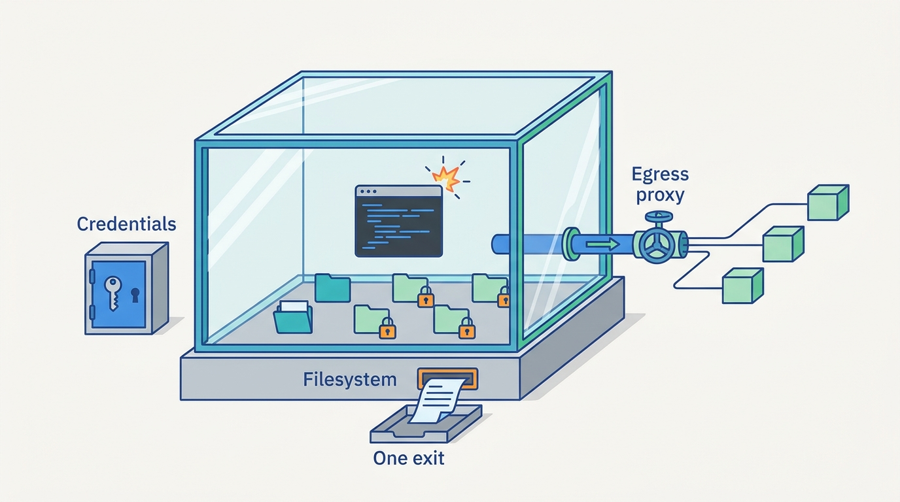
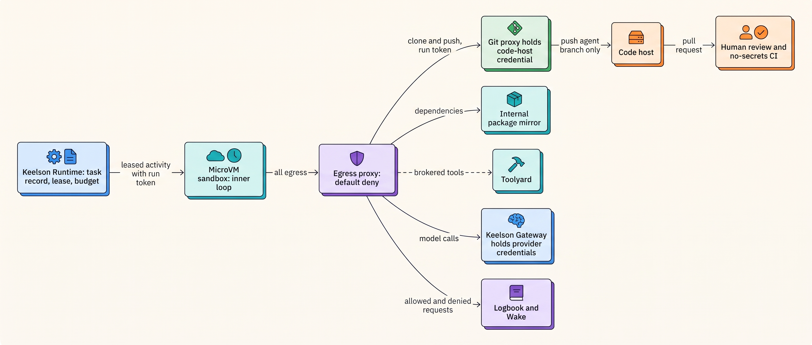
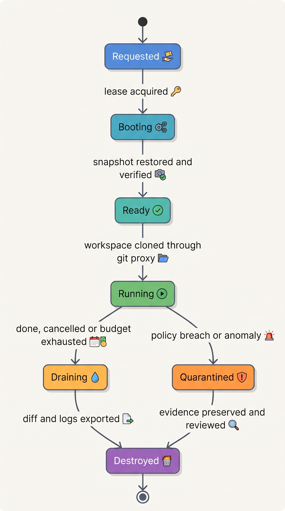
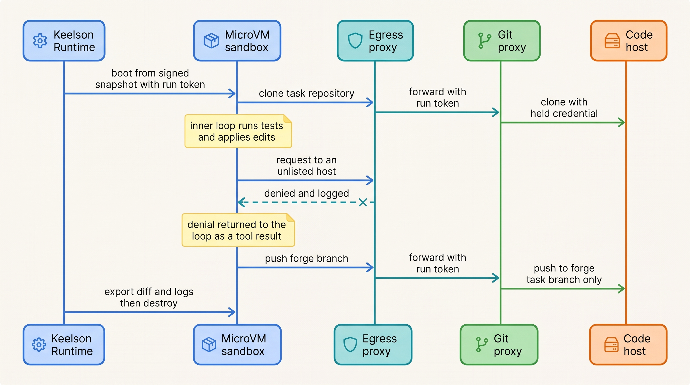
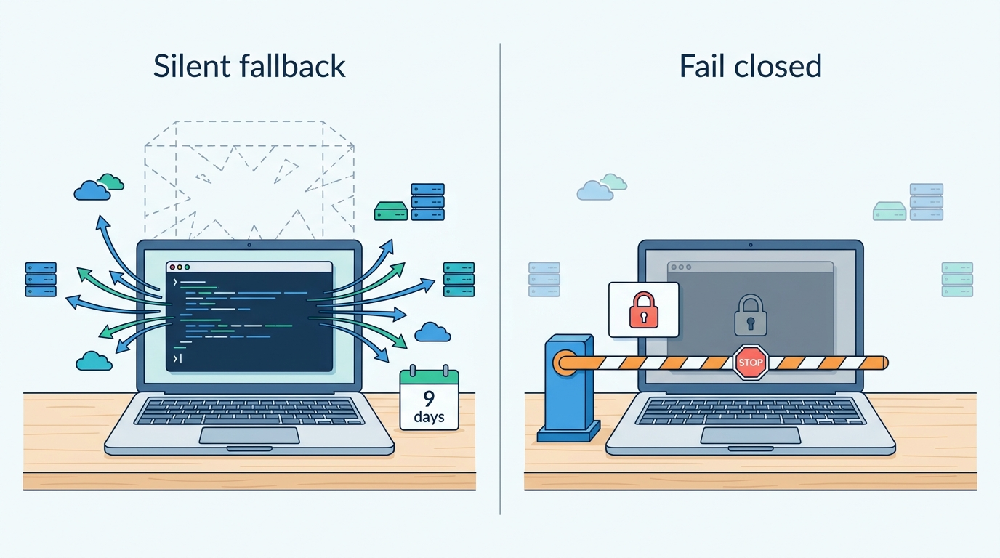

> **IN THIS CHAPTER, YOU WILL:** Learn what containers, gVisor, microVMs and OS sandboxes such as Seatbelt and bubblewrap actually guarantee, how to design filesystem, network and credential boundaries around agent-written code, how permission modes and hooks in coding CLIs fit on top, and which classes of escape every design has to plan for.

> **WHY THE BUSINESS CARES:** A coding agent that runs commands is, technically, a remote shell steered by whatever text it reads. Whether a poisoned README costs nothing or leaks an organization-wide token is decided by the environment the command ran in, not by how good the model is.

> **WHY ARCHITECTS SHOULD CARE:** Once a model writes code that executes, the action space can no longer be listed tool by tool; the execution environment becomes the security boundary. Its isolation technology, its egress rules, what credentials it can see and what leaves it are architecture decisions that are expensive to retrofit after agents have been running unattended.

> **KEY POINTS:**
>
> * **Isolation strength follows autonomy and code provenance.** Model-written code that runs unattended belongs behind a separate kernel (a microVM or a gVisor-class sandbox), not a plain container. An interactive local CLI with a person watching can use an OS sandbox plus permission rules. More autonomy requires more isolation, never less.
> * **A sandbox is three boundaries, and egress is the one that is usually missing.** Filesystem isolation without network isolation still lets the agent send out everything it can read. Deny egress by default, allow a few narrow destinations through a proxy, hold credentials in that proxy rather than in the environment, and make the exit (a branch, a pull request, a draft) the only way work leaves.
> * **Permission rules, hooks and classifiers decide intent; the sandbox bounds impact.** Rules miss scripts and subprocesses, hooks fail open on errors by default, and an independent stress test of one vendor's action classifier measured an 81% end-to-end miss rate on ambiguous tasks. Count only the boundary toward your stated risk, and plan for the known escape classes, including the one most platforms miss: the agent's output running later with more privileges.

> **[FAILURE PATTERNS THIS CHAPTER ADDRESSES](where-agentic-systems-go-wrong.html):**
>
> * **Ambient Authority** — a coding agent running on an engineer's laptop or a shared CI runner can use every credential, socket and network path that machine holds, whether or not the task needs it.
> * **The Lethal Trifecta** — a sandbox that reads private source code, ingests untrusted repository content and has open egress holds all three legs in one process.
> * **Autonomy by Default** — "full auto" modes and unattended runs are switched on to stop the prompts, without the isolation that the removed human was standing in for.

 
Up to this point in Part V, the agent's actions were calls to tools whose effects someone could reason about one at a time: [[tool-contracts]] designed each call, and [[tool-ecosystems-and-mcp]] put a broker in front of all of them. A coding agent breaks that model. **Its main tool is "run this command", and the command is code the model just wrote.** The set of possible effects is whatever the machine allows, so the machine, not the tool list, becomes the boundary.

This chapter asks **where agent-generated actions should run, and what keeps them inside**: an infrastructure half (isolation, network, credentials) and a product half (permission modes, hooks, classifiers).

This chapter owns four terms: the **sandbox**, the **execution environment**, **egress control** and the **permission mode**. It builds on [[what-makes-a-system-agentic]], which named the harness, and on [[autonomy-and-consequence]], which sized autonomy by consequence. It hands identity and token design to [[agent-identity-and-least-privilege]], the injection defenses that decide what text may steer the agent to [[prompt-injection-defense]], and the full coding-agent flow to [[domain-coding-agents]].

## Setting the Scene at Ostrell: Two Places Commands Run

Ostrell, the fictional field-service software group this book follows (see [[meet-ostrell]]), has two kinds of coding agent, and in January 2027 they ran in two very different places.

**Forge**, the headless coding-agent harness owned by Sam Kowalczyk's Developer Productivity team, was a pilot: each run was a container on the shared continuous-integration (CI) runner pool, using the human CI jobs' image and the CI application's token. Before it went live, Farah Haddad, Ostrell's security architect, ran a red-team exercise with a seeded repository whose issue and README carried instructions aimed at the agent. It caused no harm, but its findings (Ostrell figures, fictional) paused the pilot for nine days:

| Finding | What the agent's commands could reach | Why |
| --- | --- | --- |
| Organization-wide token | Push access to every repository the CI application could reach, not just the task's | The CI token was in the container's environment, as for human jobs |
| Cloud metadata endpoint | The runner node's instance credentials | No egress filtering for link-local addresses |
| Open internet | Any host, any port | Runner pool egress was open so builds could fetch dependencies |
| Shared kernel with other jobs | Other teams' CI jobs on the same node | Containers on a shared runner pool |

Each was a sensible default **for code a human wrote and reviewed before CI ran it**. Forge's code ran first, was reviewed later, and its author could be steered by any repository text.

The second place was the engineers' laptops, where about 640 engineers a week used a **commercial coding CLI** (command-line interface; vendor unnamed) under an Ostrell-managed configuration, running as the engineer, gated by permission prompts. Tomas Verhoef, the Chief Architect, asked the architecture forum: **for each place model-written commands run, what boundary contains them, who decided its strength, and what may cross it?**

## Concepts: What a Sandbox Is and Is Not

### Execution environment and sandbox

An **execution environment** is everything an agent's actions run inside: process, filesystem view, network, credentials, compute limits and lifetime. For a support agent that only calls brokered tools, it is the broker and the systems behind it; for a coding agent, it is a machine.

A **sandbox** is an execution environment designed so that the actions inside it cannot affect anything outside except through declared channels. The definition has three parts, and a design that has only one of them is not a sandbox:

1. **A filesystem boundary**: what the code can read and write.
2. **A network boundary**: what the code can connect to (egress) and what can connect to it (ingress).
3. **A process and kernel boundary**: what happens when the code attacks the layer that enforces the first two.

Anthropic's engineering post on its coding CLI's sandbox states the dependency directly: "Without network isolation, a compromised agent could exfiltrate sensitive files like SSH keys", and without filesystem isolation it could escape the sandbox and gain network access ([Anthropic, 2025-10-20](https://www.anthropic.com/engineering/claude-code-sandboxing)). The same vendor's documentation is careful to say its sandbox "is not a complete isolation boundary" ([Claude Code docs, n.d., accessed 2026-10](https://code.claude.com/docs/en/sandboxing)). The book's rule follows: **never write "sandboxed" without naming the boundary.**

### Egress control

**Egress control** is the enforcement of which destinations code in an execution environment may reach, on which ports and protocols, with which credentials, and with what logging. It is the exfiltration leg of the **lethal trifecta** (private data, untrusted content and a way to send data out in one agent; see [[agent-threat-model]]). A sandbox that reads private source code and untrusted repository content holds two legs by design, so egress is the only leg left to cut.

### Permission mode

A **permission mode** is the setting of an agent harness that decides which proposed actions run without asking, which require a human's approval, and which are refused. Permission modes govern the *agent's tools*: they act before the action. Sandboxes govern *processes*: they act during it. OpenAI's Codex documentation separates the two cleanly: "The sandbox defines technical boundaries. The approval policy decides when the agent must stop and ask before crossing them" ([OpenAI Codex docs, n.d., accessed 2026-10](https://learn.chatgpt.com/docs/sandboxing)).

The author's ai-coding-cli interview design puts the same split as a rule: **"Policy decides intent; the sandbox bounds impact"** (*design example*, `ai-coding-cli/interview.json`, step `safety`). It treats the model as "helpful but not trusted: it can be wrong, and it can be manipulated."

### The isolation ladder

The technologies differ in what they put between hostile code and the host kernel. The ladder below is ordered by strength of the boundary against a hostile workload.

| Mechanism | Boundary | What it guarantees | Known limits | Typical agent use |
| --- | --- | --- | --- | --- |
| **seccomp-bpf** | System-call filter on a process | A smaller exposed kernel surface | The kernel documentation: "System call filtering isn't a sandbox" ([kernel.org, n.d.](https://docs.kernel.org/userspace-api/seccomp_filter.html)) | A building block inside other sandboxes |
| **OS sandbox** (Seatbelt on macOS; bubblewrap and namespaces on Linux) | Per-process filesystem and network policy | File and network access limited to the policy | Shared host kernel; policy mistakes widen access | Local interactive CLIs |
| **Container** (namespaces and cgroups under a runtime such as runc) | Shared kernel, namespaced view | Process, mount and network isolation from other containers | Kernel and runtime escape bugs recur | Trusted build steps, dev containers |
| **gVisor** | User-space kernel intercepts system calls | Untrusted code does not call the host kernel directly | No protection against hardware side channels; resource exhaustion left to cgroups ([gVisor docs, n.d.](https://gvisor.dev/docs/architecture_guide/security/)) | Hosted code sandboxes |
| **MicroVM** (Firecracker on KVM) | Hardware virtualization, minimal virtual machine monitor | A separate guest kernel per workload | Hypervisor bugs; side channels need host mitigations | Unattended agent runs, serverless |
| **V8 isolate** | Language-runtime isolation | No ambient OS access; capabilities only through bindings | JavaScript and TypeScript only | Code-mode tool execution |

**A container shares the host kernel**, so a kernel or runtime bug is an escape: in January 2024, CVE-2024-21626 in runc let a container process obtain a working directory in the host's mount namespace through a leaked file descriptor ([runc advisory, 2024-01-31](https://github.com/opencontainers/runc/security/advisories/GHSA-xr7r-f8xq-vfvv)), and in November 2025 three more high-severity runc escapes were disclosed, mainly "a risk when running untrusted images" ([oss-security, 2025-11-05](https://www.openwall.com/lists/oss-security/2025/11/05/3)). **A microVM gives each workload its own kernel** at a cost that is now small: Firecracker's NSDI 2020 paper reported under 5 MB of memory overhead per microVM, boot to application code in under 125 ms and up to 150 microVMs created per second per host, on 2019-era hardware ([Agache et al., 2020](https://www.usenix.org/system/files/nsdi20-paper-agache.pdf)).

## Architecture: The Execution Boundary

### Rule 1: isolation strength follows autonomy and code provenance

The book's ruling (consistency item 2): **model-written code that runs unattended runs in a microVM or gVisor-class sandbox, not a plain container.** Containers remain acceptable for trusted build steps. Local interactive CLIs use OS sandboxes plus permission rules.

*Provenance*: code shaped by untrusted input (web pages, tickets, repository files) is hostile until proven otherwise. *Autonomy*: a person watching is a weak but real control; an unattended run has none, so the boundary must carry what the person was doing. The ai-coding-cli design says it in four words, "autonomy up, isolation up", and adds that full-auto "refuses to run (or loudly degrades) outside a sandbox/container" (*design example*, `ai-coding-cli/interview.json`, step `safety`, failure drill 2).

That design runs its cloud tasks in "ephemeral sandbox containers" (step `cloud`), a choice the book does not adopt: unattended execution of model-written code needs a kernel boundary. Everything around the container (ephemerality, deny-by-default egress, short-lived single-repository tokens, pull-request review as the gate) carries over unchanged.

Stated as a matrix rather than a slogan:

| Autonomy | No human watching, multi-tenant or shared host | No human watching, single tenant, no secrets in reach | Human present, approves risky actions | Human present, prompts mostly off |
| --- | --- | --- | --- | --- |
| **Isolation required** | MicroVM or gVisor; ephemeral; default-deny egress | gVisor or microVM preferred; hardened container acceptable for trusted code only | OS sandbox on; permission rules; protected paths | OS sandbox *required* (fail if unavailable); no unsandboxed retry; classifier or allowlist only inside it |
| **Credentials inside** | Run-scoped token valid only at the proxy | Same | The user's own, minus denied paths (ambient authority, named) | Same, with credential files denied |
| **Exit path** | Branch and pull request, or a draft in a staging store | Same | The developer's own commit | The developer's own commit |

In the right-hand columns the agent acts with the engineer's identity: "an untrusted principal acting with the user's identity" (ai-coding-cli design, step `safety`). That is **ambient authority** by design, accepted (consistency item 3) only because a person is present and an OS sandbox bounds it, and never for an unattended run.

### Rule 2: three boundaries, designed together

Each boundary has an inside default, a narrow allowance and an evidence trail.

| Boundary | Default | Narrow allowance | Evidence |
| --- | --- | --- | --- |
| **Filesystem** | Read the task's workspace; write only the workspace; nothing from the host | Protected paths inside the workspace (version-control metadata, agent configuration, CI configuration, test fixtures) read-only unless the plan is labeled | Diff of the workspace at exit |
| **Network** | Deny all egress and all ingress | A proxy allows a few named destinations, each with a port and a purpose | Proxy log of every request, allowed and denied |
| **Credentials** | None in the environment | A run-scoped token that only the boundary proxies accept, for the run's lifetime | Proxy log of every credentialed call |
| **Compute and time** | Fixed CPU, memory, disk; wall-clock limit | Raised only by policy for named repositories | Resource metrics per run |

**Filesystem.** Codex keeps `.git`, `.codex`, `.agents` and `.aws` read-only inside writable roots ([OpenAI Codex docs, n.d., accessed 2026-10](https://learn.chatgpt.com/docs/agent-approvals-security)). Claude Code's sandbox limits writes to the working directories but by default lets reads reach most of the machine, "including `~/.ssh` and `~/.aws/credentials`", unless denied ([Claude Code docs, n.d., accessed 2026-10](https://code.claude.com/docs/en/sandboxing)). In a managed configuration, that read default is the first thing to change.

**Network.** One major coding CLI now defaults to "no network access" ([OpenAI Codex docs, n.d., accessed 2026-10](https://learn.chatgpt.com/docs/agent-approvals-security)); the other ships its sandbox **off by default**, with an empty allowlist when on ([Claude Code docs, n.d., accessed 2026-10](https://code.claude.com/docs/en/sandboxing)). Defaults will change; the durable point is that **an allowlist is only as narrow as its widest entry**. The latter's documentation warns that "Allowing broad domains such as `github.com` can create paths for data exfiltration", because a write-capable destination is a sink whatever the allowlist says. For server-side agents, the Model Context Protocol (MCP) security guidance adds the server-side request forgery (SSRF) rules: block private and link-local ranges including cloud metadata, validate each redirect, pin DNS between check and use, and route through an egress proxy rather than "implementing IP validation manually" ([MCP security best practices, n.d., accessed 2026-10](https://modelcontextprotocol.io/docs/2026-07-28/tutorials/security/security_best_practices)).

**Credentials.** The book's default (consistency item 3): **credentials are brokered, never placed in context, and short-lived in sandboxes.** The strongest documented shape keeps the real credential outside the environment entirely. Anthropic describes its hosted coding agent's design: git credentials and signing keys stay outside the sandbox, and a custom git proxy authenticates a scoped credential, checks the request (for example, that a push targets the configured branch) and attaches the real token ([Anthropic, 2025-10-20](https://www.anthropic.com/engineering/claude-code-sandboxing)). Cloudflare's Code Mode follows the same pattern for tool calls: a supervisor holds the API keys, and code reaches services only through bindings ([Cloudflare, 2025-09-26](https://blog.cloudflare.com/code-mode/)). The ai-coding-cli design puts a "single-repo token" that "expires in minutes" inside the sandbox (step `cloud`, failure drill 2). That bounds the blast radius of a leak; a proxy-held credential removes the leak. Where a token must be inside, it should be valid only at the boundary proxies, for one repository and one branch, for the run.

**The exit.** Work leaves by exactly one reviewable path: a branch and pull request for code, a draft in a staging store for business artifacts (consistency item 14). It is also where the most overlooked escape happens: **the agent's code runs again, later, somewhere with more privileges.**

**Figure 1:** *A sandbox is three boundaries designed together plus one reviewable exit: a bounded filesystem, egress through one proxy, credentials held outside, and work leaving only as a branch or draft.*

### Rule 3: where the harness runs

A design choice that rarely gets discussed is which parts of the **harness** (the deterministic code that runs the loop, calls the model and records the run; consistency item 1) run inside the sandbox. The useful split is between the **inner loop** (assemble context, call the model, run the proposed command, repeat) and the **control plane** (task record, budgets, credentials, the exit).

| Option | How it works | Benefit | Cost |
| --- | --- | --- | --- |
| **Whole harness inside** | The same agent loop that runs locally runs headless inside the sandbox, including its credentials and run record; egress allows the code host and the model API | One code path for local and cloud; simple to build | Provider credentials, budgets and the only run record live where hostile code runs |
| **Split harness** | The inner loop runs inside; model calls leave through the egress proxy to a gateway that holds provider credentials and enforces the budget; the task record, the lease and the exit stay outside | Fast tool calls; the sandbox can die without losing state or authority | The gateway must authenticate the run, not trust the sandbox's claims; the transcript is inside |
| **Loop outside** | The runtime runs the loop; the sandbox only executes commands sent over a narrow channel | Nothing of value inside but the workspace | A command channel to build; latency on every tool call |

The ai-coding-cli design takes the first option: the sandbox "runs the exact same agent loop headlessly", with egress to "the git host and model API" (step `cloud`), reasonable for a vendor product that must behave identically everywhere. **For an organization's own platform I recommend at least the split**: whatever runs inside, budgets and task records stay in durable state outside ([[durable-agent-execution]]), provider credentials stay in the gateway ([[models-and-the-model-gateway]]), and nothing inside can extend its own budget, lease or exit. Moving the loop outside as well is worth its latency only when the transcript itself is too sensitive to sit next to hostile code.

### The Forge execution architecture

**Figure 2:** *Forge's execution boundary: the inner loop runs inside, but the task record, budget and every real credential stay outside; every byte of egress passes one proxy, and the only credential that reaches the code host is attached outside the sandbox.*

### Requirements per interaction

| Interaction | Latency | Durability | Who may act | Failure behavior |
| --- | --- | --- | --- | --- |
| Sandbox create from snapshot | Seconds *(assumption: boot is not on an interactive path)* | None; the sandbox is disposable | Keelson Runtime on a leased task | Retry on another host; the task lease holds |
| Command execution | Seconds to minutes, under the run's wall-clock budget | Command and exit code streamed to Logbook as they run; workspace diff exported at exit | The inner loop, inside the sandbox's limits | Timeout kills the process, not the sandbox |
| Egress request | Milliseconds of proxy overhead | Every decision logged | Policy, by destination; never the model | Deny returns an error to the command; the denial is a tool result |
| Push and open pull request | Seconds | Branch per task; idempotent push | The git proxy, for the task branch only | A rejected push ends the run as failed, not retried with other credentials |
| Teardown | Immediate | Workspace diff and logs exported first | Runtime, on completion, cancel or budget exhaustion | A sandbox that cannot be destroyed is quarantined and its host drained |

### Permission modes in coding CLIs

Coding CLIs expose permission modes under product-specific names that change between releases. The classes are stable:

| Mode class | What runs without asking | Documented examples (as of October 2026) | When it is right |
| --- | --- | --- | --- |
| **Read-only or plan** | Reads and searches; no edits, no commands with effects | Claude Code `plan`; Codex `read-only` | Exploring unfamiliar code, reviewing a plan before work starts |
| **Ask** | Read-only tools; everything else prompts | Claude Code `default` | First use in a repository; sensitive repositories |
| **Accept edits** | File edits in the workspace; commands still prompt | Claude Code `acceptEdits` | Routine edits where commands are the risk |
| **Workspace auto** | Edits and commands inside the sandbox; crossing it prompts | Codex `workspace-write` with `on-request` | Day-to-day work with the OS sandbox enforced |
| **Classifier-gated** | Actions a model-based reviewer judges aligned with the request | Claude Code `auto`; Codex `auto_review` reviewer | Long sessions inside a sandbox, to cut prompt fatigue |
| **Deny unless allowed** | Only pre-approved actions; the rest auto-denied | Claude Code `dontAsk`; Codex `never` with the sandbox | Headless runs inside a hard boundary |
| **Bypass** | Everything | Claude Code `bypassPermissions` ("Only use this mode in isolated environments like containers or VMs"); Codex `danger-full-access` | Only inside an environment that is itself the boundary |

Sources: [Claude Code permissions docs, n.d., accessed 2026-10](https://code.claude.com/docs/en/permissions); [OpenAI Codex sandboxing docs, n.d., accessed 2026-10](https://learn.chatgpt.com/docs/sandboxing).

Three properties of rule-based permissions matter more than the mode names.

**Precedence must be deny-first.** Claude Code evaluates "deny, then ask, then allow", and "An allow rule can't carve an exception out of a deny rule"; managed settings sit above user and project settings, and "If a tool is denied at any level, no other level can allow it" ([Claude Code permissions docs, n.d., accessed 2026-10](https://code.claude.com/docs/en/permissions)). The ai-coding-cli design uses "most-specific wins; deny beats allow" (`api[LOCAL permissions add]`). The difference matters: under most-specific-wins, a narrow allow can override a broad deny. **For organization policy, deny-first with managed settings on top is the safer rule**; it means a central deny cannot be undone by a project file a repository ships.

**Pattern rules see the command, not its effects.** The same documentation lists what argument patterns miss: option reordering, redirects, variables, a program invoked inside `sh -c`, and file access by "a Python or Node script that opens files itself". For enforcement over every process, it says, "enable the sandbox". Permission rules are policy, not a boundary.

**"Always allow" is a standing grant.** Each accumulated rule (`dataModel[permission_rules].source = always_allow_prompt` in the ai-coding-cli design) is an authorization decision made in seconds, with no expiry unless the harness adds one. Under the book's approval model (consistency item 6), every persisted rule carries a scope and an expiry and is visible in review.

### Hooks: organization policy at the tool boundary

**Hooks** are deterministic programs the harness runs at fixed points of the loop: before a tool call, after it, at session start, at stop. Both major CLIs document a pre-tool hook that can deny a call ([Claude Code hooks docs, n.d., accessed 2026-10](https://code.claude.com/docs/en/hooks); [Codex hooks docs, n.d., accessed 2026-10](https://learn.chatgpt.com/codex/hooks)). They are the right place for organization-specific policy that a pattern rule cannot express: "edits to test fixtures need the `fixtures-change` label", "log every permission decision centrally", "refuse to start if the sandbox is not enforced".

Hooks have three documented properties that decide how much weight they can bear. **Silence does not approve**: "Exit 0 with no output means no decision." **Errors fail open by default**: "A non-zero exit other than 2 is a non-blocking error", and a timed-out pre-tool hook does not block unless configured to. **Hooks run outside the sandbox** with the user's full access ([Claude Code sandboxing docs, n.d., accessed 2026-10](https://code.claude.com/docs/en/sandboxing)). Codex adds that a post-tool hook "cannot undo a command that already ran". The vendor's own advice is to use the permission system, not hooks, for hard allow and deny rules. A hook is a policy enforcement point with a fail-open default; configure it to fail closed and keep it out of the trusted base for containment.

The author's ai-coding-harness interview design uses hooks to fire **sensors** (linters, type checks, architecture rules) that feed failures back to the agent within a time budget (*design example*, `ai-coding-harness/interview.json`, step `sensors`). That design has no security model of its own. Paired with this chapter: sensor runs execute model-written code and belong inside the sandbox, and sensor *messages* come from repository configuration, so they are guidance, never authority.

### Browser and computer-use environments

A browser or computer-use agent reads attacker-controlled content by design and acts with whatever sessions the browser holds, so its environment has a fourth boundary: **the identity inside the browser**. Vendor guidance asks for a dedicated virtual machine or container with minimal privileges, no access to sensitive data such as logins, a domain allowlist, and human confirmation for consequential actions such as "accepting cookies, completing financial transactions, or agreeing to terms of service" ([Anthropic computer-use docs, n.d., accessed 2026-10](https://platform.claude.com/docs/en/agents-and-tools/tool-use/computer-use-tool)), and says its screenshot classifiers do not replace those precautions. Claude Code's computer-use feature "runs on your actual desktop rather than in an isolated environment" ([Claude Code docs, n.d., accessed 2026-10](https://code.claude.com/docs/en/sandboxing)): the "human present" column of the matrix, never the unattended one.

My recommendation: **prefer an API tool to computer use whenever one exists.** An API has a schema, scopes and audit logs; a screen has none. Where a browser agent is justified, run it in a disposable VM with a fresh, low-privilege profile (no saved passwords, no payment methods), a site allowlist enforced at the egress proxy, and a confirmation step for irreversible actions enforced by the harness, not requested by the model.

### Sandbox lifecycle

**Figure 3:** *A sandbox has no "reuse" transition: every run starts from a verified snapshot and ends destroyed, and a suspicious run is preserved for review before it is destroyed.*

**Ephemerality is a security property.** A reused sandbox carries files, caches, processes and credentials into the next run. The author's agentic-platform-foundations design forbids a shared kernel or "dirty warm-pool slot across tenants" (*design example*, `agentic-platform-foundations/interview.json`, step `runtime`). Warm pools are fine; reused, unreset sandboxes are not. Some hosted code-execution containers live for days ([Anthropic code-execution docs, n.d., accessed 2026-10](https://platform.claude.com/docs/en/agents-and-tools/tool-use/code-execution-tool)); a long-lived container is a session store, and its contents need the same design as any other.

## Escapes and Limits: The Classes Every Design Must Plan For

No sandbox is complete. The useful question is which **escape classes** a design addresses and which it accepts. This section describes classes and documented instances, not working techniques.

| Escape class | What goes wrong | Documented instance | What contains it | How you would notice |
| --- | --- | --- | --- | --- |
| **Kernel or runtime bug** | Code inside attacks the layer that enforces the boundary | runc CVE-2024-21626; three runc CVEs in November 2025 | A separate kernel (microVM, gVisor); patching as a standing task; non-root, user namespaces | Runtime advisories; host integrity monitoring |
| **Misconfiguration** | The policy itself grants a path out | Claude Code's documented limits: a mounted container-runtime socket "effectively grants access to the host system"; writable `$PATH` or shell startup files; a weaker nested-sandbox mode inside containers that "considerably weakens security" | Policy reviewed as code; configuration linting; no host sockets in agent environments | Configuration drift checks against the managed baseline |
| **Boundary computed from untrusted input** | The enforcer derives its limits from something the model or repository controls | CVE-2025-54794 (Claude Code path check by prefix, not canonical path); CVE-2025-59532 (Codex sandbox treated a model-generated working directory as the writable root); CVE-2025-54795 (command-parsing flaw bypassed confirmation) ([NVD, 2025](https://nvd.nist.gov/vuln/detail/CVE-2025-59532)) | Compute boundaries from trusted inputs only: canonical paths, the session's start directory, the task record | Fuzzing and red-team suites against the harness; vendor advisories |
| **Surface outside the sandbox** | Something the agent drives is not inside the boundary | "The sandbox covers shell commands only. Claude's file tools, MCP servers, and hooks run outside it"; computer use on the actual desktop | Put tool servers in their own sandboxes or behind the broker; deny rules for file tools | An inventory of every process the harness starts, with its boundary |
| **Allowlisted destination** | Egress goes where policy allows, but carries what it should not | Hostname-only proxies can be bypassed by "domain fronting or similar techniques"; broad domains such as a public code host are write-capable sinks | Narrow destinations by path and method; credential injection that enforces the target; TLS-terminating proxy where content inspection matters | Proxy logs: volume and destinations per run |
| **Built-in escape hatch** | The product lets the agent or user step outside | A sandboxed command may be retried with `dangerouslyDisableSandbox`, approved according to the mode; if the sandbox cannot start, Claude Code by default runs unsandboxed unless `failIfUnavailable` is set | Managed settings: disable unsandboxed retry, fail if unavailable, disable bypass modes | Session metadata recording sandbox state on every command |
| **Escape through the exit** | The agent's output runs later somewhere with more privileges | (Author's judgement; no published incident analysis found.) A pull request's code runs in CI with deployment secrets, or on a reviewer's laptop | CI for agent branches without secrets until a human approves; review before anything privileged executes | CI audit of secret access per branch type |
| **Side channels and exhaustion** | Hardware side channels; denial of service on the host | gVisor's documentation: no protection against hardware side channels; resource exhaustion relies on cgroups | Host mitigations; per-sandbox limits; no co-location of high-sensitivity tenants | Host resource alerts |

Sources for the table, unless linked inline: [Claude Code sandboxing docs, n.d., accessed 2026-10](https://code.claude.com/docs/en/sandboxing); NVD records for [CVE-2025-54794](https://nvd.nist.gov/vuln/detail/CVE-2025-54794) and [CVE-2025-54795](https://nvd.nist.gov/vuln/detail/CVE-2025-54795) (2025-08-05).

Two lessons cut across the rows. **The three CLI CVEs share one cause**: the enforcer trusted an input the model could shape, so ask of any harness whether every boundary is computed from trusted inputs. And **escape through the exit is the row most platforms miss**: a perfectly contained agent still hands its output to a CI pipeline that may hold deployment credentials. Code hosts already have the concept: GitHub's documentation states that "secrets are not passed to the runner when a workflow is triggered from a forked repository" ([GitHub docs, n.d., accessed 2026-10](https://docs.github.com/en/actions/security-for-github-actions/security-guides/using-secrets-in-github-actions)). Agent branches deserve the same treatment.

## Evidence: What Is Known and What Is Vendor Telemetry

**Isolation technology** has the strongest evidence, none of it agent-specific: Firecracker is peer-reviewed and runs AWS Lambda and Fargate ([Agache et al., 2020](https://www.usenix.org/system/files/nsdi20-paper-agache.pdf); 2019-era performance figures, durable security argument), and container escapes are public advisories. What the public record lacks is the isolation technology behind several hosted agent sandboxes: the pages fetched for this book's research did not name it for Anthropic's hosted code execution or for Daytona, and E2B's microVM claim rests on its open-source runtime README ([E2B infra, n.d., accessed 2026-10](https://github.com/e2b-dev/infra)) rather than product documentation. **Ask a sandbox vendor which kernel your code shares, and get the answer in the contract.**

**Prompts and fatigue** are vendor telemetry. Anthropic reported in October 2025 that sandboxing "safely reduces permission prompts by 84%" in internal usage, without describing the method ([Anthropic, 2025-10-20](https://www.anthropic.com/engineering/claude-code-sandboxing)), and in March 2026 that users accept 93% of manual permission prompts ([Anthropic, 2026-03-25](https://www.anthropic.com/engineering/claude-code-auto-mode)). The second figure agrees with the human-factors evidence on automation bias ([[human-oversight-and-bounded-autonomy]]): a manual prompt is weak evidence that anyone decided anything.

**Classifier-gated autonomy** is where the sources disagree, and the disagreement is instructive.

| Source | Setting | False-negative rate (dangerous action allowed) | False-positive rate | Limits |
| --- | --- | --- | --- | --- |
| Anthropic, March 2026 (vendor engineering post) | 10,000 real internal tool calls; 52 real "overeager" actions; 1,000 synthetic exfiltration attempts | 17% on the 52 real overeager actions ("the honest number"); 5.7% on synthetic exfiltration | 0.4% on real traffic | Small n for the key figure; vendor-run; in-project file edits skip the classifier |
| Ji et al., arXiv preprint (April 2026, revised October 2026) | AmPermBench: 128 deliberately ambiguous DevOps prompts, 253 state-changing actions against oracle ground truth | 81.0% end-to-end (95% CI 73.8–87.4%); 70.3% on the 160 actions the classifier saw | 31.9% on in-scope actions | A stress test, not a production error rate; the authors frame it as a "coverage boundary" |

Sources: [Anthropic, 2026-03-25](https://www.anthropic.com/engineering/claude-code-auto-mode); [Ji et al., 2026](https://arxiv.org/abs/2604.04978).

The gap is not a contradiction. In the stress test, **36.8% of state-changing actions were in-project file edits, outside the classifier's scope**: dangerous effects were reachable through edits the classifier never reviewed. The vendor itself says the mode "is not a drop-in replacement for careful human review on high-stakes infrastructure". The architectural reading: a classifier reduces prompts on routine work and catches some overeager actions; it is a policy layer whose miss rate depends on your task mix and on what is in scope at all. **Measure it on your workload, and never let it stand where the sandbox should be.**

**Browser agents** carry a measured residual risk. In August 2025 Anthropic reported, for its browser extension in autonomous mode, prompt-injection attack success of 23.6% without mitigations and 11.2% with them, over 123 test cases ([Anthropic, 2025-08-25](https://claude.com/blog/claude-for-chrome)). A non-zero rate times sessions holding real logins is why the environment matters more than the model's resistance.

**Two vendors converged on the same layering** (OS sandbox, rule-based permissions, pre-tool hooks that can deny, a model-based reviewer, an explicit escape hatch), each documenting the model-based layer as not the boundary. Convergence is not proof, but it is the best evidence available.

## Worked Example at Ostrell: Forge's Sandbox and the Local CLI

### Forge, February to September 2027

After the January red-team findings, Sam Kowalczyk and Farah Haddad rebuilt Forge's execution environment before Forge went live in February 2027. Every figure below is Ostrell's (fictional).

- **One microVM per run**, restored from a signed snapshot per repository toolchain (rebuilt nightly), with 4 vCPU, 8 GiB of memory, 40 GiB of disk and a 60-minute wall-clock limit taken from the run budget. No inbound network. Forge runs on its own host pool, not the human CI runners.
- **A split harness.** Forge's inner loop runs inside the sandbox, which Keelson Runtime treats as one leased, heartbeating activity ([[agent-runtime]]). Model calls leave through the egress proxy to Keelson Gateway, which holds the provider credentials and enforces the run budget; the task record, the lease and the pull request stay with the Runtime.
- **Egress through one proxy to four destinations**: Keelson Gateway, the git proxy, the internal package mirror and Toolyard (for the brokered issue-tracker tools; see [[tool-ecosystems-and-mcp]]). Link-local and private ranges are blocked; there is no general internet. Every request is logged to Logbook and Wake.
- **No code-host credential inside.** The sandbox holds a run token, valid for the task's lease (at most 90 minutes), accepted only by the Gateway, the git proxy and Toolyard. The git proxy holds the code-host credential and allows clone of the task's repository and push to `forge/<task-id>` only.
- **Protected paths read-only.** Since August 2027 (after the Fixture Purge), each run's typed change plan lists intended paths; test fixtures and CI configuration are mounted read-only unless the plan carries the label ([[planning-and-decomposition]]).
- **No-secrets CI for agent branches.** CI on `forge/*` branches runs without deployment or publishing secrets; those exist only for merged code. Merge is A0: humans only.

**Figure 4:** *A Forge run: every external effect passes the egress proxy, a denied request becomes information for the model rather than a crash, and the only push the code host accepts is to the task's own branch.*

In Q3 2027, Forge ran about **5,600** sandboxed runs a month, which produced about **3,400** pull requests (61% merged); the rest ended without a pull request (no viable change, budget exhausted or abstained). Peak concurrency was **85** sandboxes; median sandbox lifetime was **19 minutes**, and the snapshot restore to a ready workspace took about **4 seconds** at the median. About **2.1%** of runs hit at least one egress denial. Almost all were tests that tried to reach public endpoints, and the fix was test configuration. Trace review classified **3** denials in the quarter as injection-shaped: repository text instructing the agent to fetch a script or post a value to an outside address. Each was contained by the proxy; each run was quarantined, its token revoked and its repository's maintainers told.

The cost is real: a separate microVM host pool, snapshot rebuilds when toolchains change, and allowlist requests reviewed by Farah's team within one working day (23 in Q3 2027). That friction is the boundary working.

### The local CLI and the Silent Fallback (April 2027)

On engineers' machines the boundary is weaker by design: the CLI acts as the engineer. Ostrell's managed configuration in early 2027 enabled the OS sandbox, denied reads of credential directories (`~/.ssh`, cloud CLI credential files, `.env` files), limited network to the package mirror and the internal code host, disabled the bypass mode on workstations, and used a pre-tool hook to ship permission decisions (metadata only, no content) to Wake.

In April 2027, an operating-system hardening update on **118** Linux workstations restricted the unprivileged user namespaces the CLI's Linux sandbox relied on. The sandbox could no longer start. The CLI's default in that case was to **run commands unsandboxed** and continue. For **9 days**, about 640 weekly users were split between enforced and unenforced sandboxes without knowing it. Farah's team found it when a weekly report on the shipped session metadata showed `sandbox=unavailable` on every command from those machines.

The session metadata showed which commands ran, but not their network traffic: the sandbox's proxy log was the missing record. Endpoint telemetry found no connection to an unapproved destination. No harm was found, but none could be fully excluded.

**Figure 5:** *The Silent Fallback: when the sandbox could not start on 118 workstations, the CLI ran commands without it for 9 days; failing closed turns a missing boundary into a stopped session instead of an invisible gap.*

| Fix (May 2027) | What it closes |
| --- | --- |
| Managed setting: fail if the sandbox is unavailable | The silent fallback |
| Managed setting: unsandboxed retry disabled | The model-requested escape hatch |
| Session-start hook checks sandbox health and refuses to start, failing closed | A future fallback the setting does not cover |
| Wake alert on any session reporting an unenforced sandbox | Detection within minutes instead of a weekly report |
| Classifier-gated mode allowed only with the sandbox enforced | Reliance on the classifier as the boundary |
| OS update rings for workstations include a CLI sandbox smoke test | The same break on the next update |

The classifier rule follows an Ostrell architecture principle from June 2027: "No control that depends on the model recognizing an attack counts toward an agent's stated risk" (see [[prompt-injection-defense]]). By Q3 2027 about 870 engineers used the CLI weekly under this configuration.

## Failure Modes and Recovery

| Scenario | What happens | Detection | Containment | Recovery |
| --- | --- | --- | --- | --- |
| **Injected instruction in repository content** | A README or issue tells the agent to fetch a script or post a token | Egress denial alert; trace review | Default-deny egress; no credential in the sandbox; run token valid only at the proxies | Quarantine the run; revoke the token; destroy the sandbox; add the case to the injection suite ([[prompt-injection-defense]]) |
| **Sandbox fails to start, harness falls back** | Commands run unsandboxed (the Silent Fallback) | Sandbox state recorded on every command; alert on unenforced sessions | Fail-closed setting and session-start check | Identify affected sessions from metadata; review egress from endpoint telemetry; rotate credentials if any doubt remains |
| **Runtime escape advisory** | A disclosed container or VMM bug affects the fleet | Vendor advisory; patch-level inventory | Separate-kernel isolation limits the blast radius; drain affected hosts | Patch, rebuild snapshots, review runs during the exposure window |
| **Over-broad allowlist entry** | A destination added for one repository is a write-capable sink for all | Allowlist review; per-run egress volume by destination | Allowlist entries per repository and per method, with an owner and an expiry | Remove the entry; review runs that used it |
| **Agent output runs with secrets** | CI on an agent branch has deployment credentials | CI audit of secret access by branch type | No-secrets pipeline for agent branches | Rotate exposed secrets; review the pipeline definitions |
| **Sandbox dies mid-task** | Preemption or out-of-memory | Lease heartbeat expires | Branch-per-task; nothing outside the workspace changed | Re-lease and redo onto the same branch; safe only because every effect is in a disposable workspace ([[retries-idempotency-and-concurrency]]) |

The last row has a condition worth stating. The ai-coding-cli design makes cloud retries safe by redoing the task onto the same branch (step `cloud`, failure drill 1). That is idempotent for git output only. **If a sandboxed run can call an external tool with effects (an issue tracker, a ticket, a message), whole-task redo is no longer safe**, and those calls need the intent, idempotency key and receipt pattern of [[side-effects-and-external-actions]] (consistency item 4). Forge routes its tracker calls through Toolyard for that reason.

## Trade-offs

| Choice | Option A | Option B | When A is right | When B is right |
| --- | --- | --- | --- | --- |
| **Isolation for unattended runs** | Hardened container | MicroVM or gVisor | Trusted build steps on code humans reviewed; single tenant; no secrets reachable | Model-written code, untrusted inputs, shared hosts (the book's default) |
| **Harness placement** | Whole harness inside the sandbox | Split: inner loop inside, control plane and credentials outside | A bought harness that cannot be split; one code path for local and cloud | An organization's own platform; budgets, task state and model credentials kept out of hostile reach |
| **Credential in the sandbox** | Scoped, short-lived token inside | Proxy-held credential, run token valid only at the proxy | Tools that cannot be proxied; low-value, single-resource access | Any code-host or system-of-record credential |
| **Egress policy** | Hostname allowlist | Path- and method-aware proxy with credential injection | Read-only destinations (package mirrors) | Write-capable destinations (code hosts, trackers) |
| **Local permission posture** | Ask by default, allowlists accumulate | Sandbox enforced, prompts mostly removed | Sensitive repositories; first use; machines where the sandbox is unavailable | Routine work; the sandbox carries the risk and the remaining prompts mean something |
| **Browser actions** | Computer use in a disposable VM | API tool through the broker | No API exists, and the task is read-mostly | Whenever an API exists |

The ai-coding-cli design chooses the first local posture: it "leads with ask-by-default permission rules and allowlists because it ships on day one with an audit trail", with the sandbox as "the complementary layer" (step `safety`, trade-off "Human approval vs. hard boundary"). That is defensible for a product that must work on any machine on day one. **For an organization that manages its engineers' machines, I recommend the second**: enforce the sandbox, deny credential paths, and spend prompts only where the sandbox cannot help (pushing, publishing, installing tools); the 93% acceptance figure is the argument. Where the OS sandbox is unavailable, run the session in a VM or dev container that is itself the boundary.

## Across Domains: How the Stakes Change the Design

| Dimension | Coding agents | Customer operations (support, sales, marketing) | Back office (finance, legal, HR) | High-stakes decisions (healthcare, public benefits) |
| --- | --- | --- | --- | --- |
| **Does model-written code execute?** | Yes, constantly; it is the main action | Rarely; actions are brokered tool calls (Answerdesk has no code execution) | Sometimes, for analysis over extracts (a design option, not Closewise's current shape) | Should not, against case or patient data, in the designs reviewed |
| **The execution environment** | A microVM per unattended run; OS sandbox locally | The tool broker and the systems behind it | An analysis sandbox with no network and no system-of-record credentials; postings by deterministic workflow | The application harness; "Tool isolation and prompt-injection defenses still live in the application harness, regardless of where the model runs" (agentic-healthcare-platform design, technology choices) |
| **What egress control protects** | Source code, tokens, the supply chain | Customer data; recipients fixed by policy (the Poisoned Ticket) | Financial and privileged data; ethical walls | Protected health and personal data; residency boundary |
| **Credentials in reach** | Run token at the proxy; local CLI is ambient authority, named | None; the broker mints per-tenant tokens | None; separation of duties enforced by scopes | None; tokens bound to the licensed human for writes |
| **Exit path** | Branch and pull request; no-secrets CI | Brokered action with receipt | Draft in a staging store; approved action object | Draft or evidence package for a human decision |
| **Browser or computer use** | Testing web apps against staging, in disposable VMs | Avoid: logged-in customer sessions are the worst browser to automate | Avoid where an API exists; legacy portals only with confirmation | Avoid |

The healthcare quotation is from the author's interview design, a design example, not a deployed system; it also partitions untrusted record text from write authority (step `privacy`).

**Judgement.** The sandbox matters most where the agent writes code, and that is mostly the coding domain; elsewhere, the execution environment is the tool broker, and its boundaries are the ones [[tool-ecosystems-and-mcp]] and [[agent-identity-and-least-privilege]] design. **What the platform keeps common:** the isolation ladder and the rule that unattended model-written code gets a separate kernel, default-deny egress through one proxy, credentials held outside, ephemeral environments, sandbox state recorded on every action, and one reviewed exit. **What must be domain policy:** whether code execution is allowed at all over a given data class, which destinations a domain's sandboxes may reach, and how the exit is reviewed. A back-office analysis sandbox and a Forge runner can share infrastructure with different allowlists; a casework agent should not get code execution over case data merely because the platform offers it.

## The Chief Architect's View

**Decide the matrix, not the product setting.** The decision that lasts is the autonomy-by-isolation matrix: which combinations of "who is watching" and "what boundary" are allowed, for which code provenance. Product modes and setting names change every few months; the matrix should not. At Ostrell, Tomas Verhoef owns the matrix, Farah Haddad owns the isolation and egress standards, Amara Okafor's Agent Platform team operates the boundary for Keelson agents, and Sam Kowalczyk's team operates Forge's host pool and the managed CLI configuration.

**Fund the boundary as infrastructure.** Host pools, snapshot pipelines, the egress proxy and a no-secrets CI path are platform components with owners, not per-agent features. A team that must build its own sandbox will ship in a container.

**Govern the escape hatches explicitly.** Bypass modes, unsandboxed retries and fallbacks are managed settings with recorded decisions; enabling one for a population of engineers is as visible as granting production access.

**Watch these signals.** Sessions or runs with an unenforced sandbox (target zero); egress denials per run and their classification; allowlist entries without an owner or expiry; credential reads denied inside sandboxes; snapshot age against runtime advisories; CI secret access on agent branches; prompt acceptance rates in local sessions.

**What is durable and what will change.** Durable: code from a persuadable author is hostile until reviewed; a sandbox is three boundaries; egress is the exfiltration channel; boundaries must be computed from trusted inputs; outputs re-execute somewhere. Volatile: which CLI defaults to which mode, classifier miss rates, hosted sandbox products and their limits, and the cost of separate-kernel isolation, which keeps falling. Better models will make fewer overeager mistakes and resist more injections. They will not make an open egress path safe, because the boundary has to hold on the day the model is wrong.

## Questions to Ask

1. For each place model-written code runs in your organization, which boundary contains it, by name (OS sandbox, container, gVisor, microVM), and who chose that strength?
2. Which of your agents run unattended in a shared-kernel container, and what untrusted content can reach them?
3. What can a sandbox reach on the network, on which ports, and which of those destinations can accept a write?
4. Where does the credential that pushes code or calls a system of record live: in the environment, in a token valid only at a proxy, or in the broker?
5. What happens when the sandbox cannot start: does the harness refuse, or run without it? How would you know?
6. Which surfaces the agent drives run outside the sandbox (file tools, MCP servers, hooks, browser), and do your hooks fail open or closed?
7. Where does an agent's output execute next, and does that place hold secrets before a human has reviewed it?
8. If you use a classifier-gated mode, what was its miss rate on your own workload, and what is in its scope?
9. Can any sandbox be reused across runs or tenants without being reset from a verified snapshot?

A sandbox contains what happens inside it, and its exit decides what leaves. Most agents in an enterprise, though, do not write code; they call tools that change customer accounts, ledgers and inboxes, and those effects leave the moment the call succeeds. The next page, [[side-effects-and-external-actions]], designs those actions so they are safe to propose, approve, execute and verify.

## Sources and Evidence

### Research papers

- [Firecracker: Lightweight Virtualization for Serverless Applications](https://www.usenix.org/system/files/nsdi20-paper-agache.pdf) — Agache et al. (AWS), NSDI, 2020; microVM overhead, boot time and density; production use at AWS Lambda and Fargate.
- [Measuring the Permission Gate: A Stress-Test Evaluation of Claude Code's Auto Mode](https://arxiv.org/abs/2604.04978) — Ji, Li, Ma, Jiang, Gao and Wang, arXiv preprint, 2026 (v1 2026-04-04, v3 2026-10-22); independent stress test of a classifier-gated permission mode: 81.0% end-to-end false-negative rate on ambiguous DevOps tasks, 36.8% of state-changing actions outside the classifier's scope.

### Specifications, standards and regulation

- [Seccomp BPF (SECure COMPuting with filters)](https://docs.kernel.org/userspace-api/seccomp_filter.html) — Linux kernel documentation, n.d., accessed 2026-10; "System call filtering isn't a sandbox."
- [gVisor security model](https://gvisor.dev/docs/architecture_guide/security/) — gVisor project, n.d., accessed 2026-10; user-space kernel; non-goals including hardware side channels.
- [MCP security best practices (2026-07-28)](https://modelcontextprotocol.io/docs/2026-07-28/tutorials/security/security_best_practices) — Model Context Protocol project, n.d., accessed 2026-10; SSRF-safe egress and proxy guidance.

### Vendor documentation and engineering reports

- [Beyond permission prompts: making Claude Code more secure and autonomous](https://www.anthropic.com/engineering/claude-code-sandboxing) — Anthropic, 2025; filesystem plus network isolation, git proxy with credentials outside the sandbox, 84% prompt reduction (method not described).
- [Claude Code sandboxing](https://code.claude.com/docs/en/sandboxing) — Anthropic, n.d., accessed 2026-10; Seatbelt and bubblewrap, scope (shell commands only), off by default, fallback behavior, escape hatches, documented security limitations.
- [Claude Code permissions](https://code.claude.com/docs/en/permissions) — Anthropic, n.d., accessed 2026-10; permission modes, deny-first precedence, managed settings, limits of pattern rules.
- [Claude Code hooks](https://code.claude.com/docs/en/hooks) — Anthropic, n.d., accessed 2026-10; pre-tool hooks, exit-code semantics, fail-open defaults.
- [Claude Code auto mode](https://www.anthropic.com/engineering/claude-code-auto-mode) — Anthropic, 2026; classifier design and measured rates (0.4%, 17%, 5.7%); 93% prompt acceptance.
- [Codex sandboxing](https://learn.chatgpt.com/docs/sandboxing) and [Codex approvals and security](https://learn.chatgpt.com/docs/agent-approvals-security) — OpenAI, n.d., accessed 2026-10; sandbox modes, approval policies, network-off default, protected paths, OS mechanisms.
- [Codex hooks](https://learn.chatgpt.com/codex/hooks) — OpenAI, n.d., accessed 2026-10; pre-tool deny; post-tool hooks cannot undo.
- [Computer use tool](https://platform.claude.com/docs/en/agents-and-tools/tool-use/computer-use-tool) — Anthropic, n.d., accessed 2026-10; dedicated VM, no logins, allowlists, human confirmation; classifiers do not replace precautions.
- [Code execution tool](https://platform.claude.com/docs/en/agents-and-tools/tool-use/code-execution-tool) — Anthropic, n.d., accessed 2026-10; hosted container limits, no internet, multi-day container lifetime.
- [Claude for Chrome](https://claude.com/blog/claude-for-chrome) — Anthropic, 2025; browser-agent injection success 23.6% → 11.2% with mitigations (vendor-run).
- [Using secrets in GitHub Actions](https://docs.github.com/en/actions/security-for-github-actions/security-guides/using-secrets-in-github-actions) — GitHub, n.d., accessed 2026-10; secrets withheld from workflows triggered from forks (the model for no-secrets CI on agent branches).
- [Code Mode](https://blog.cloudflare.com/code-mode/) — Cloudflare, 2025; V8 isolates, bindings, supervisor-held keys.
- [E2B infrastructure](https://github.com/e2b-dev/infra) — E2B, n.d., accessed 2026-10; Firecracker microVMs resumed from snapshots.

### Incidents, cases and decisions

- [runc CVE-2024-21626 advisory](https://github.com/opencontainers/runc/security/advisories/GHSA-xr7r-f8xq-vfvv) — Open Container Initiative, 2024; container escape via leaked file descriptor.
- [runc CVE-2025-31133, CVE-2025-52565, CVE-2025-52881](https://www.openwall.com/lists/oss-security/2025/11/05/3) — oss-security, 2025; three container escapes; mitigations and their limits.
- NVD records for [CVE-2025-54794](https://nvd.nist.gov/vuln/detail/CVE-2025-54794), [CVE-2025-54795](https://nvd.nist.gov/vuln/detail/CVE-2025-54795) and [CVE-2025-59532](https://nvd.nist.gov/vuln/detail/CVE-2025-59532) — NIST, 2025; permission-layer and sandbox-boundary flaws in coding CLIs.

### Design examples from the author's interview project

- Obrenović, Ž., "AI Coding CLI", system-design interview design, `system-design-interviews/data/book/ai-coding-cli/interview.json`, 2026. Steps `safety` (policy for intent, sandbox for impact; free reads; failure drills; ask-by-default trade-off), `cloud` (ephemeral containers, single-repository tokens, branch-per-task retries, pull request as the gate), `extensibility`; `dataModel[permission_rules]`, `api[LOCAL permissions add]`.
- Obrenović, Ž., "AI Coding Harness", system-design interview design, `system-design-interviews/data/book/ai-coding-harness/interview.json`, 2026. Step `sensors`: hooks firing sensors under a time budget.
- Obrenović, Ž., "Agentic Platform Foundations", system-design interview design, `system-design-interviews/data/book/agentic-platform-foundations/interview.json`, 2026. Step `runtime`: per-session microVM, credential broker, no dirty warm-pool slots across tenants.
- Obrenović, Ž., "Agentic Healthcare Platform", system-design interview design, `system-design-interviews/data/book/agentic-healthcare-platform/interview.json`, 2026. Technology choices (isolation lives in the application harness); step `privacy`.
- Obrenović, Ž., "Agentic Support Platform" and "Agentic Finance Platform", system-design interview designs, `system-design-interviews/data/book/agentic-support-platform/interview.json` and `agentic-finance-platform/interview.json`, 2026; domain contrasts in the Across Domains table.

Ostrell is fictional; architectural recommendations, labeled inferences and labeled assumptions are the author's judgement.
