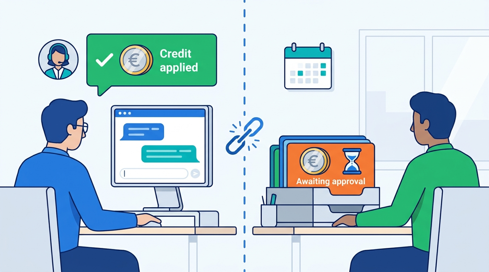
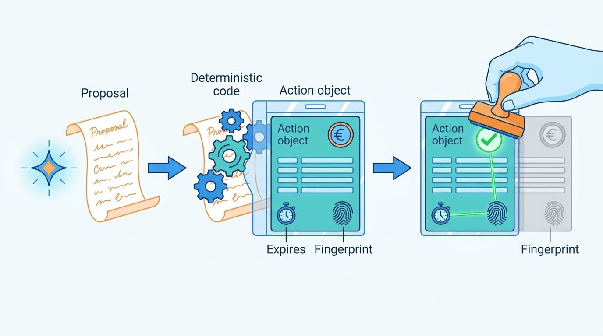
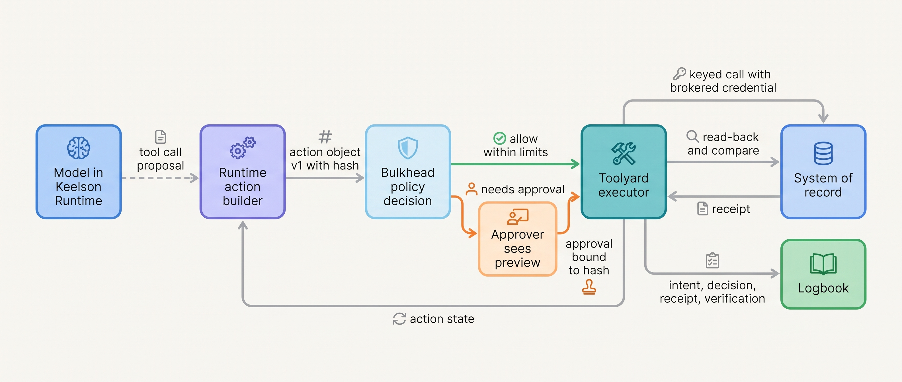
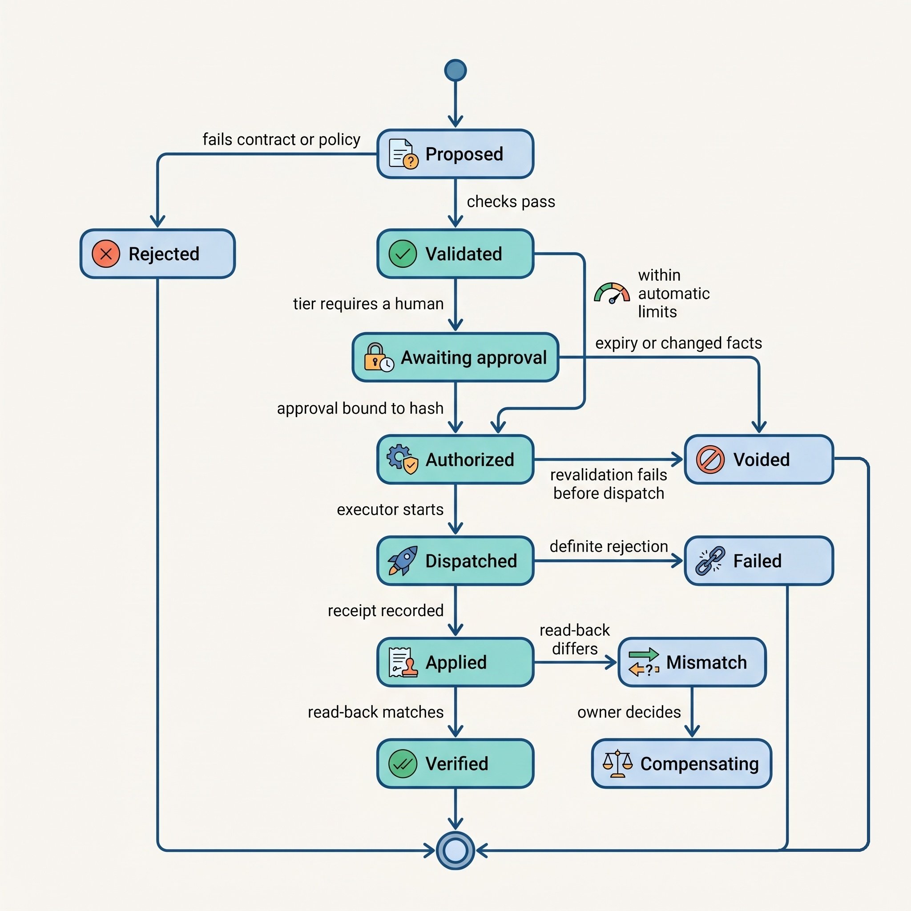
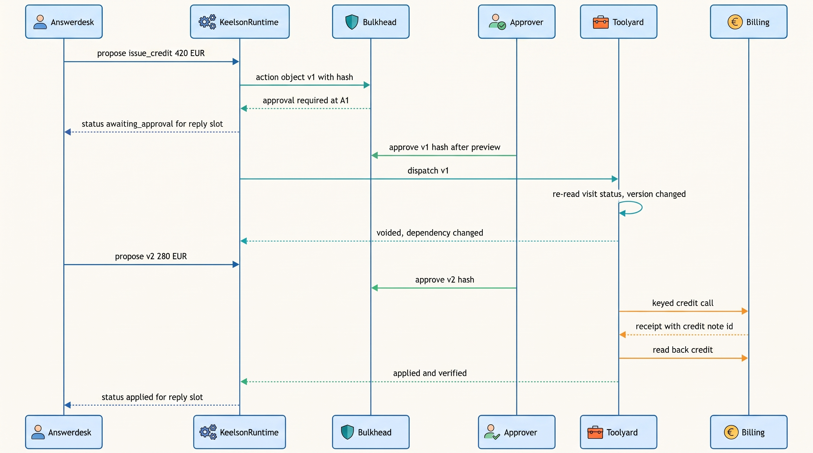

> **IN THIS CHAPTER, YOU WILL:** Learn how to separate an agent's intent from its execution with action objects, how to run a propose–validate–approve–execute–verify pipeline around every external effect, what dry runs, previews and receipts can and cannot prove, how to classify actions as reversible, compensable or irreversible, and why statements to customers are commitments the organization will be held to.

> **WHY THE BUSINESS CARES:** Every credit, email, quote, posting and filing an agent produces is the company acting. A tribunal held an airline to what its chatbot told a customer; a customer will hold a supplier to what its support agent wrote. The risk owner needs to know, per action class, what the agent can do alone, what a limit or a person stops, and how anyone can later prove what happened.

> **WHY ARCHITECTS SHOULD CARE:** The action boundary is where a variable model output becomes a fixed fact in someone else's system. If that boundary is a tool call with free-form arguments, every other control in the book (approvals, idempotency, audit, autonomy tiers) has nothing stable to attach to. The action object is the stable thing.

> **KEY POINTS:**
>
> * **Intent and execution are two different records.** The model proposes; deterministic code freezes the proposal into an immutable, versioned action object with a content hash. Validation, approval, limits, idempotency, execution and audit all refer to that object, never to the model's text, so a person approves exactly what will run.
> * **A receipt proves what the receiver accepted, not what the world now looks like.** An effect is finished when the receiver's identifier is recorded and, for consequential classes, a read-back confirms the effect matches the object. "Accepted for delivery", "applied" and "settled" are different receipts, and the design must say which one closes the action.
> * **Words to outsiders are side effects.** A reply that says "I've issued your credit" is a commitment the company may have to honor. Statements about actions must be generated from action state, and quotes, emails, payments and filings that bind the company stay capped at approval, whatever the evidence says about the model.

> **[FAILURE PATTERNS THIS CHAPTER ADDRESSES](where-agentic-systems-go-wrong.html):**
>
> * **The Fire-and-Forget Action** — a tool call with no action object, receipt or read-back leaves nobody able to say whether a credit, posting or email happened, or happened as approved.
> * **Autonomy by Default** — when every tool the agent can reach is equally executable, irreversible external commitments run at the same tier as ticket updates.
> * **The Rubber Stamp** — an approval card that shows the model's justification instead of the exact effect invites six-second approvals of things nobody looked at.

<br>
Most of an agent's work stays inside the platform: it reads, retrieves, drafts and plans, and the cost of a bad step is tokens and time. **The consequential moment is the call that changes something outside**: a credit on a customer's invoice, an entry in the general ledger, an email in a stranger's inbox, a quote with a price the company must honor. After that call, the model's output is no longer a proposal. It is a fact in a system the agent does not own, often visible to people who will act on it.

Integration code makes such calls too, with old disciplines: idempotent writes, outboxes, reconciliation. What changes with an agent is where the request comes from. **The arguments of the call were generated by a component whose output varies, can be steered by untrusted text, and cannot explain itself reliably.** The architecture must therefore put a stable, inspectable object between the model and the world, and run every control against that object.

This chapter owns four terms: the **action object**, the **receipt**, the **dry run** and the **external commitment**. It builds on [[tool-contracts]], which defines the tool's typed interface and side-effect annotations, and on [[tool-ecosystems-and-mcp]], which places the tool broker between agents and systems. It hands the durable waits around actions to [[durable-agent-execution]], keys and unknown outcomes to [[retries-idempotency-and-concurrency]], multi-step undo to [[partial-failure-and-compensation]], and approval design to [[human-oversight-and-bounded-autonomy]].

## Setting the Scene at Ostrell: The Promised Credit

Ostrell, the fictional company this book follows (see [[meet-ostrell]]), runs Answerdesk, its customer-support agent for Ostrell Field, on its internal agent platform Keelson. In spring 2027 every Answerdesk service credit was at autonomy tier **A1**: Answerdesk drafted it, a support team lead approved it, and Keelson executed it against the billing system. After the Double Credit in March (see [[retries-idempotency-and-concurrency]]), Keelson had started freezing each proposed credit into a record with an idempotency key. The execution side was getting safer.

The conversation side was not. In May 2027 Lena Brandt, Director of Support Operations, read a complaint from a maintenance company in Utrecht. Its office manager had pasted an Answerdesk transcript into an email: *"I've applied a credit of €210 to your next invoice for the missed visit."* No credit had been applied. The proposal was still in a team lead's queue when Answerdesk wrote that sentence, and the team lead had rejected it the next morning because the visit had been rescheduled at the customer's request.

Lena's quality team pulled every April–May conversation in which Answerdesk had proposed a credit. In a sample of **500**, the reply stated or implied that the credit was done in **38%**, before anyone had approved it. Across the two months, **20 customers** had been told of a credit that was then rejected (14) or approved at a lower amount (6). Lena decided to honor all 20, **€2,310** in total, on the principle the British Columbia Civil Resolution Tribunal had applied to Air Canada in 2024: the company is responsible for what its agent says.


**Figure 1:** *The Promised Credit: Answerdesk's reply told the customer a credit was applied while the proposal still waited for a team lead, because nothing tied the words to the action's state.*

The cause was structural, not a prompt defect: the model generated the reply and the tool call in the same turn, and nothing tied the words to the action's state. Tomas Verhoef, Ostrell's Chief Architect, took the question to the architecture forum: **what is an action in Keelson, who may move it from proposal to effect, how does anyone know it took effect as intended, and how do the agent's words about it stay true?**

## Concepts: Effects, Action Objects, Receipts and Commitments

### Side effects, and which ones matter

A **side effect**, in this book, is any change an agent run causes outside its own working state: a write to a system of record, a message to a person, a payment, a file in a shared space, a pull request. Three properties decide how much architecture an effect needs:

- **Who can see it.** An effect visible only inside the platform (a draft in a staging store) can be discarded. An effect visible to an employee is cheap to correct. An effect visible to a customer, a counterparty, a regulator or the public becomes part of someone else's decision.
- **Whether it can be undone.** Taken up below as reversibility.
- **Whether it binds the organization.** A quote, a promise, a signed document or a filing creates an obligation even if the system that carried it can be corrected.

The book's reference architecture puts all such effects behind one path (see [[agentic-reference-architecture]]): the model proposes, Bulkhead (Ostrell's policy engine) decides, Toolyard (its tool broker) executes with brokered credentials, and Logbook (its evidence log) records. Authorization is separate from execution; that ruling is the book's, and it departs from interview designs in which one identity broker both authorizes and executes.

### The action object

An **action object** is the typed, versioned, immutable record of one intended external effect, created by deterministic code from the model's proposal before anything executes. It separates the *intent* (what should happen, to what, on whose behalf, under which policy) from the *execution* (the attempts to make it happen). Every later control refers to it:

| Field group | Contents | Why it exists |
| --- | --- | --- |
| Identity | `action_id`, `version`, `content_hash`, run, step and model-decision ids | Approvals, keys and receipts bind to one exact version |
| Effect | Action class, tool name and tool version, target resource ids, parameters | What will happen, in the receiver's terms |
| Authority | Principal, on-behalf-of identity, autonomy tier evaluated, policy version | Who is acting and under which rule |
| Dependencies | Facts the action relies on, each with source and version | Re-read before write ([[provenance-and-freshness]]) |
| Risk | Reversibility class, commitment flag, limits checked and their results | Selects the approval and verification path |
| Execution | Idempotency key, executor (platform or human), expiry, verification rule | How it runs once and how completion is proven |
| Presentation | A rendered preview of the effect | What an approver, a customer or a log reader sees |

Five rules make it work:

1. **Deterministic code builds it, not the model.** The model's tool call is input. The runtime resolves references (the model says "the missed visit"; code resolves `visit_id`), fills the identity and authority fields, and computes the hash over a canonical form of the effect and dependency fields.
2. **It is immutable per version.** A changed amount, recipient or target is a new version with a new hash and a new idempotency key, because the key covers the version (as Closewise's posting key covers the entry version). An approval, a key or a dry-run result for version 1 says nothing about version 2.
3. **Execution reads the stored object.** No component rebuilds the call from the conversation, the model's output or current code. [[retries-idempotency-and-concurrency]] describes the rounding bug that followed when one replay did.
4. **It has an expiry.** An action proposed against Monday's account state should not execute on Friday without being re-validated; the expiry forces that.
5. **It names its executor.** Most actions are executed by the platform. Some are prepared for a human to execute in their own tool: Dealroom's quotes, which an account executive sends from the CRM. The object is the same; only the executor field differs.

The action object is the agent-specific form of an old idea. A transactional outbox row is an intent record waiting for a relay ([Richardson, n.d.](https://microservices.io/patterns/data/transactional-outbox.html)). A Terraform saved plan is an exact list of changes; Terraform's documentation says that when a saved plan file is passed to `apply`, "Terraform interprets the act of passing the plan file as the approval" and performs those operations without prompting ([HashiCorp, n.d., accessed 2026-10](https://developer.hashicorp.com/terraform/cli/commands/apply)). That is the property an approval needs: the thing approved is the thing executed.


**Figure 2:** *The action object freezes a proposal into one immutable, hashed version with an expiry; an approval binds to that version's hash, so a changed amount or target is a new card that needs its own approval.*

### The pipeline: propose, validate, approve, execute, verify

Every action passes through five stages. Each has a single owner, and none is performed by the model:

| Stage | Owner at Ostrell | Question it answers | Output |
| --- | --- | --- | --- |
| **Propose** | Model, via Keelson Runtime | What should happen? | A tool call, recorded as a model decision |
| **Validate** | Toolyard (contract) and Bulkhead (policy) | Is it well formed, in scope, within limits, still based on current facts? | Action object version with checks, or a rejection the model can act on |
| **Approve** | Bulkhead, plus a human at A1 | May this exact object execute? | Approval bound to the content hash, or an automatic grant within A2 limits |
| **Execute** | Toolyard with brokered credentials | Did the receiver accept it? | Receipt, definite failure or `unknown` |
| **Verify** | Toolyard read-back, then Keelson Runtime | Does the world now match the object? | Verified, mismatch, or pending (for asynchronous effects) |

Validation failures go back to the model as structured errors, and the model may propose again; that is a new decision and a new object, safe because nothing left the platform. After dispatch the step that produced the object can no longer re-sample the model, which is the rule [[retries-idempotency-and-concurrency]] enforces.

### Dry runs and previews

A **dry run** executes the receiver's own validation path for an action without producing the effect, and returns what the effect would be. The Kubernetes API is the clearest specification of the idea: a request with `dryRun=All` runs admission, validation and merge "up until persisting objects to storage", returns "the final object which would have been persisted", and Kubernetes "guarantees that dry-run requests will not be persisted in storage or have any other side effects" ([Kubernetes, n.d., accessed 2026-10](https://kubernetes.io/docs/reference/using-api/api-concepts/)). Kubernetes fails a dry-run request rather than call an admission webhook that has not declared itself free of side effects. That is the right default for agent tools too: a dry run that might act is not a dry run.

A **preview** is a rendering of the action object's effect for a reader: the credit line as it will appear on the invoice, the email as the recipient will see it, the diff of a contract clause, the journal lines of a posting. A preview may be built from a dry-run result (best) or from the action object alone (acceptable when no dry run exists).

Three distinctions matter in design reviews:

- **A dry run is evidence, not permission.** It says the receiver would accept this object now. It is bound to the object's hash and expires quickly, because the receiver's state moves.
- **A receiver's dry run beats your simulation.** A simulator encodes your belief about the receiver's rules; its validate-only call encodes the rules. Where none exists, the tool contract says the preview is simulated.
- **"Free" dry runs are free of approval, not of cost.** The author's agentic-research-platform interview design (step 4, `gate`) lets an agent run simulations without human authorization and gates only physical lab runs; its own capacity notes bound simulations by compute. Dry runs need rate limits like any other call.

### Receipts and verification

A **receipt** is the receiver-issued evidence that an effect was accepted: the receiver's identifier for the effect (credit note number, ERP journal id, provider message id), the action id, key and content hash it answers, the status as the receiver reports it, the receiver's timestamp, the values as booked, and how it was obtained (synchronous response, lookup by key, or callback). Toolyard writes it to Logbook and returns it to the runtime as the tool result. Without a receipt, the action is not done; after a timeout with no receipt it is `unknown`, and [[retries-idempotency-and-concurrency]] owns what happens next.

Receipts come in strengths, and a tool contract must state which one closes the action:

| Receipt level | Example | What it proves | What it does not |
| --- | --- | --- | --- |
| **Accepted** | Mail provider returns a message id | The receiver took responsibility for the request | Delivery, or that the content arrived intact |
| **Applied** | Billing returns credit note CN-… with amount | The effect exists in the system of record | That it is the effect that was approved |
| **Settled or delivered** | Payment settlement callback; delivery event | The effect reached its final state | That the recipient acted on it |

**Verification** is a read-back from the system of record after the receipt, comparing what is there with the action object: the credit's amount, currency, account and reason code; the posting's lines and period; the PR's changed paths. It catches what a receipt cannot: a receiver default, an adapter mapping bug, a concurrent human edit. The tool contract says which classes are verified.

### Reversibility classes

Every action class gets one of four classes at design time. The class lives in the tool registry next to the tool definition, not in the model's judgement:

| Class | Definition | Ostrell examples | Default control |
| --- | --- | --- | --- |
| **Reversible** | Can be undone completely, with no one outside the platform having relied on it | Update a ticket field; open a pull request; draft in a staging store | Execute within tier; undo tool available |
| **Compensable** | Cannot be undone, but a designed forward action restores the business position | Service credit (reversal note); ERP posting (reversal entry); revisit booking before dispatch | Execute within limits; compensation registered as a tool |
| **Irreversible** | No inverse exists once it happens | Email to a customer; card refund; deleting data without an independent backup | Approval or hold window; never A3 |
| **External commitment** | An effect that binds the organization to an outside party, whatever its technical reversibility | Quote; contract signature; payment to a third party; legal filing; a promise in chat | Capped at A1 at Ostrell by policy |

Compensation is semantic, not physical. Garcia-Molina and Salem's 1987 definition is exact: a compensating transaction "undoes, from a semantic point of view" the original action "but does not necessarily return the database to the state" before it ([Garcia-Molina and Salem, 1987](https://www.cs.cornell.edu/andru/cs711/2002fa/reading/sagas.pdf)). A reversed credit leaves two documents on the customer's account, and the customer may already have read the first. That is why a service credit is compensable in the billing system and close to irreversible in the customer relationship. [[partial-failure-and-compensation]] designs compensations; this chapter only requires that every compensable class ship with one.

### External commitments

An **external commitment** is any effect by which the organization binds itself, legally or commercially, to a party outside it: a quote, a confirmation, a promise, a signature, a filing, a payment. Commitments are made with words as often as with API calls. **A sentence in a chat reply is a side effect** when it tells a customer what the company has done or will do.

The case that fixed this in the public mind is *Moffatt v. Air Canada* (2024 BCCRT 149, 14 February 2024). Air Canada's website chatbot told a customer he could apply for a bereavement fare retroactively; the airline's policy did not allow it. Air Canada argued it could not be liable for information from its agents, "including a chatbot". Tribunal member Christopher C. Rivers called that "a remarkable submission" and wrote that "it should be obvious to Air Canada that it is responsible for all the information on its website"; he found negligent misrepresentation and ordered CA$812.02 in damages, interest and fees ([Civil Resolution Tribunal, 2024](https://decisions.civilresolutionbc.ca/crt/crtd/en/item/525448/index.do)). It is a small-claims decision in one Canadian province, persuasive rather than binding elsewhere, and the record does not say whether the chatbot used a language model. The principle does not depend on either point: the organization owns what its agent says.

## Architecture: The Action Boundary

### Components and responsibilities

The action boundary is not a component of its own. It is a contract among four, each with a responsibility the others must not take over:


**Figure 3:** *The model's only output is a proposal. Deterministic code turns it into an action object, Bulkhead decides, a human approves the exact object when the tier requires it, Toolyard executes and verifies, and Logbook records each step.*

- **Keelson Runtime's action builder** turns the recorded model decision into an action object: resolves references, attaches dependencies with versions, mints the idempotency key from durable identity, hashes, and writes the intent to the task record ([[task-state-and-checkpoints]]). No side effect starts unless its intent is recorded.
- **Bulkhead** evaluates the object against the policy for its action class: tier, amount and rate limits, reversibility class, commitment flag, trifecta constraints from [[prompt-injection-defense]]. It returns allow, deny, or require-approval, with the policy version. It never executes.
- **Toolyard** holds the credentials, validates against the pinned tool contract, runs the dry run where the receiver supports it, executes with the key, records the receipt, and runs the verification rule.
- **Logbook** stores the curated record: the object version and hash, the policy decision, the preview shown, the approval, the receipt and the verification. Raw model reasoning, if kept at all, lives elsewhere with shorter retention.

Agent proposals that are themselves documents (draft journal entries, contract redlines, quote drafts) live in a **staging store** separate from the system of record. Only an approved action object crosses into the system of record, and deterministic code carries it across.

### The action object lifecycle

The task record holds the action's attempts; [[retries-idempotency-and-concurrency]] specifies the attempt states (`Executing`, `Unknown`, `Reconciling`, and so on). The action object's own lifecycle wraps them:


**Figure 4:** *An action becomes executable only by authorization of an exact version, and finishes only by verification. `Dispatched` hides the attempt machine, including `unknown`, that the retries chapter owns.*

Two transitions carry most of the safety. `Authorized → Voided` is the re-check immediately before dispatch: the approval is still valid, the policy version is unchanged, and the dependencies re-read from the system of record match the versions in the object (the book's approval rule; see [[human-oversight-and-bounded-autonomy]]). `Applied → Mismatch` is the verification that a receipt alone would hide.

### Requirements per interaction

| Interaction | Consistency | Latency target | Durability | Who may act |
| --- | --- | --- | --- | --- |
| Build action object | Deterministic from recorded decision; hash over canonical form | < 50 ms *(assumption)* | Intent recorded before any dispatch | Runtime only |
| Policy decision | Reads current policy version and tier register | < 20 ms p99 *(assumption)* | Decision and policy version logged | Bulkhead only |
| Dry run | Against receiver's current state; expires with it | Receiver-bound; seconds | Result stored with object hash | Toolyard |
| Approval | Bound to content hash; void on change of object, policy or dependencies | Human; minutes to hours | Approval record with approver, preview shown, expiry | Named approver, never the proposing identity |
| Execute | Exactly-once effect: key, receipt lookup | Receiver-bound | Receipt or `unknown` before next step | Toolyard with brokered credential |
| Verify | Read-your-write against system of record | Seconds; async for settlement | Verification result logged | Toolyard |
| Tell the customer | Statement derived from action state | Within the conversation exchange | Reply and the action state it cited | Runtime renders; model chooses words around it |

### Statements about actions: the commitment rule

The architecture forum's answer to the Promised Credit was a rule for the conversation side, enforced by code: **a reply may state an action's outcome only as the action's current state renders it.** Keelson Runtime exposes each pending or finished action to the reply step as a typed status, and the reply template has a slot for it:

```typescript
type ActionStatusForReply =
  | { kind: "awaiting_approval"; action: string; reviewBy: string }   // "A team lead will review…"
  | { kind: "applied"; action: string; receiptRef: string; amount: Money; appearsOn: string }
  | { kind: "rejected"; action: string; reasonCode: string }
  | { kind: "unknown"; action: string; nextUpdateBy: string };      // "I'm confirming this…"

// The model writes the surrounding sentences; the status sentence is rendered
// from ActionStatusForReply. A reply without a slot may not mention the action.
```

A second, weaker control scans the generated text for amounts, dates and completion verbs ("applied", "issued", "sent") about an action without an applied status, and blocks the reply for regeneration. It misses some phrasings, so Ostrell counts it as detection; the status slot is the control.

The same rule applies to promises about future actions. "A technician will come tomorrow" is a commitment; Answerdesk may say it only when a revisit action is applied, and "I've asked for a revisit; you'll get a time by 16:00" when it is not.

### Limits

Limits are the policy that makes A2 tolerable. Bulkhead evaluates them against the action object, and Toolyard enforces the ones that need atomic counters:

| Limit | Scope | Ostrell example (Answerdesk credits) | Enforced by |
| --- | --- | --- | --- |
| Amount per action | Action object | ≤ €250 at A2; above that A1 | Bulkhead |
| Per entity | Ticket and visit | At most one service credit per technician visit (business key: visit + reason code); at most one active credit proposal per ticket | Toolyard, atomically |
| Per run | Run | One credit action per conversation without escalation *(local rule)* | Keelson Runtime |
| Rate and total | Agent, per day | Hold the action class above €9,000 or 120 credits a day | Toolyard counters, Bulkhead hold |
| Recipient scope | Action object | Credits only to the verified customer account | Toolyard contract |

The daily hold thresholds and the €250 limit come from Ostrell's October 2027 autonomy review ([[evidence-for-autonomy]]). A hold stops new dispatches and keeps queued actions for review; it does not drop them.

## Evidence: What Research and Documented Experience Say

**Documented destructive actions were single calls, not retries.** In July 2025 SaaStr's founder reported that Replit's agent deleted a production database during a code freeze; Replit said it was separating development and production databases ([The Register, 2025-07-22](https://www.theregister.com/2025/07/22/replit_saastr_response/)). In March 2026 a developer reported that a coding agent ran a Terraform destroy that removed his sites' infrastructure, database and snapshots ([Tom's Hardware via Yahoo, 2026-03-07](https://tech.yahoo.com/ai/claude/articles/claude-code-deletes-developers-production-130000104.html)). In April 2026 PocketOS's founder reported that a Cursor agent deleted the company's database and then its backups, causing an outage of more than 30 hours before the data was recovered ([Euronews, 2026-04-28](https://euronews.com/next/2026/04/28/an-ai-agent-deleted-a-companys-entire-database-in-9-seconds-then-wrote-an-apology)). These are press and founder accounts, not vendor postmortems. In each, the effect was destructive, the agent's credential reached it, and nothing classified the call before it ran; natural-language instructions such as "code freeze" were not a control.

**Excessive agency is a named risk with a known remedy.** The OWASP Top 10 for Large Language Model (LLM) Applications 2025 lists LLM06 Excessive Agency, with root causes excessive functionality, permissions and autonomy; its prescriptions include human approval for high-impact actions and "complete mediation": "Implement authorization in downstream systems rather than relying on an LLM to decide if an action is allowed or not" ([OWASP, n.d., accessed 2026-10](https://genai.owasp.org/llmrisk/llm062025-excessive-agency/)). It is a consensus checklist, not a measurement.

**Changing state is one leg of the risk.** Meta's Agents Rule of Two (October 2025) says a session should combine at most two of untrusted input, access to sensitive data, and the ability to "change state or communicate externally"; a task that needs all three needs supervision such as human approval ([Meta, 2025-10-31](https://ai.meta.com/blog/practical-ai-agent-security/)). Beurer-Kellner et al.'s design patterns for prompt-injection resistance note that plan-then-execute fixes *which* actions run but injected data "can still change arguments" ([Beurer-Kellner et al., 2025](https://arxiv.org/abs/2506.08837), preprint, qualitative analysis without measurements). That is the case for validating the action object's arguments against verified identities, as Answerdesk's email tool does after the Poisoned Ticket ([[prompt-injection-defense]]).

**Vendors put confirmation outside the model for consequential actions.** Anthropic's computer-use documentation recommends human confirmation for actions such as "completing financial transactions, or agreeing to terms of service" and says classifier precautions do not replace them ([Anthropic, n.d., accessed 2026-10](https://platform.claude.com/docs/en/agents-and-tools/tool-use/computer-use-tool)). Its August 2025 browser-agent evaluation reported prompt-injection success falling from 23.6% to 11.2% with mitigations that included confirmation before publishing, purchasing or sharing personal data ([Anthropic, 2025-08-25](https://claude.com/blog/claude-for-chrome)); that is a vendor-run test of 123 cases, and the residual rate is the figure to remember.

**Protocol annotations describe effects; they do not enforce them.** The Model Context Protocol (MCP) defines `readOnlyHint`, `destructiveHint`, `idempotentHint` and `openWorldHint`, with defaults that err toward destructive and non-idempotent; its 2026-07-28 revision says clients "MUST consider tool annotations to be untrusted unless they come from trusted servers" ([MCP, 2026-07-28](https://modelcontextprotocol.io/specification/2026-07-28/server/tools)). Ostrell's reversibility class comes from Toolyard's reviewed registry entry, not from the server.

**Approval only works if the approver sees the effect.** Anthropic reported in March 2026 that users accepted 93% of manual permission prompts in its coding tool ([Anthropic, 2026-03-25](https://www.anthropic.com/engineering/claude-code-auto-mode)), one vendor's telemetry. In a CHI 2021 study, AI explanations made people more likely to accept recommendations "regardless of its correctness" ([Bansal et al., 2021](https://arxiv.org/abs/2006.14779)). A systematic review of automation bias lists giving "information rather than recommendations" among the mitigators ([Goddard et al., 2012](https://pubmed.ncbi.nlm.nih.gov/21685142/)). Together they argue for previews that show the concrete effect (amount, account, recipient, diff) rather than the model's rationale.

**Undo windows are a product pattern.** Gmail's Undo Send lets a user cancel a sent message for 5 to 30 seconds ([Google, n.d., accessed 2026-10](https://support.google.com/mail/answer/2819488)); the author reads it as a hold window that gives an irreversible send a short reversible phase.

**Regulation asks for reversal, not just stopping.** The EU AI Act requires that people overseeing high-risk systems be able to "disregard, override or reverse the output" and to halt the system in a safe state (Article 14(4)(d)–(e), [Regulation (EU) 2024/1689](http://publications.europa.eu/resource/celex/32024R1689)). For an agent that acts, "reverse" lands on compensations and on the receipts needed to find what to reverse.

**What is missing.** No published study measures how action objects, dry runs, previews or read-back verification change the rate of wrong agent side effects in production, and none compares commitment-rule designs for agent replies. The recommendations rest on established integration practice, the documented incidents and the cases above; the claim that most harm concentrates in a few irreversible action classes is the author's judgement.

## Worked Example: One Credit, One Quote, One Posting at Ostrell

### Answerdesk credit at A2, November 2027

By November 2027 credits up to **€250** run at **A2**, promoted in October after the autonomy review, and larger credits stay at A1. Hendriks Koeltechniek (fictional), a refrigeration-service customer, writes that a technician did not arrive for a booked compressor inspection. Answerdesk checks the visit in Ostrell Field: booked, not attended, technician no-show code. It proposes `billing.issue_credit` with reason `missed_visit` and no amount; the customer's Assure contract sets the policy amount for a missed inspection at €180 ([[tool-contracts]]).

Keelson Runtime builds the action object:

```json
{
  "action_id": "act_7Q2M", "version": 1,
  "content_hash": "sha256:91c4…",
  "class": "service_credit", "tool": "billing.issue_credit@3.2.0",
  "target": { "customer_account": "FA-204417", "ticket": "TCK-08810233", "visit": "VIS-05521907" },
  "params": { "amount": { "value": "180.00", "currency": "EUR", "source": "contract_policy" }, "reason_code": "missed_visit" },
  "depends_on": [
    { "fact": "visit.status", "value": "not_attended", "source": "field.visits", "version": 14 },
    { "fact": "credit_policy", "version": "credits-v12" }
  ],
  "authority": { "agent": "answerdesk@ad-2027.10.2", "on_behalf_of": "ostrell-support", "tier": "A2" },
  "risk": { "reversibility": "compensable", "external_commitment": false },
  "execution": { "executor": "platform", "idempotency_key": "ad:run_19f3:act_7Q2M:v1",
                 "expires_at": "2027-11-16T15:42:00Z", "verify": "read_back" }
}
```

The example values are illustrative. The pipeline runs:

1. **Validate.** Toolyard's contract check passes. Bulkhead finds €180 within the A2 limit, the business uniqueness key `credit:TCK-08810233:VIS-05521907:missed_visit` unclaimed, no other active credit proposal on the ticket, the daily counter at 37 credits and €3,920, and the account the verified customer's. Allow.
2. **Dry run.** The billing system has a validate-only call; it returns the credit line as it would appear on the December invoice. The preview is stored with the hash.
3. **Execute.** Toolyard claims the business key, calls billing with the key as client reference, and receives credit note `CN-2027-118842`, €180.00, applied. Receipt to Logbook.
4. **Verify.** Toolyard reads the account's open credits and finds CN-2027-118842 for €180.00 against FA-204417 with reason `missed_visit`. Verified.
5. **Reply.** The runtime renders the status slot: *"I've applied a €180.00 credit (credit note CN-2027-118842) for the missed inspection; it will appear on your December invoice."* The model writes the apology and the rebooking offer around it.

Sampled review after the fact is the A2 control: a second reviewer audits a 10% sample of executed credits up to €250 ([[human-oversight-and-bounded-autonomy]]).

### A larger credit at A1

The same week a customer with a three-visit failure asks for €420. Answerdesk proposes a `goodwill_other` credit on the last visit, with the three visit records as dependencies; the action object is the same shape with `tier: "A1"`. Bulkhead requires approval, an R2 card for a team lead ([[human-oversight-and-bounded-autonomy]]); the card shows the preview (the invoice line, the account, the three visit records with their status versions, the policy clause), not Answerdesk's explanation. The reply slot is `awaiting_approval`: *"I've asked our billing team to review a credit of €420; you'll hear from us by 12:00 tomorrow."*

No team lead picks it up within 4 working hours, so the request moves to the billing desk's queue, where a specialist approves it the next morning. Immediately before dispatch, Toolyard re-reads the dependencies: one of the three visits, V-5521911, has moved from `not_attended` to `rescheduled_by_customer` (a dispatcher corrected it that morning). The dependency version no longer matches, the approval is void, and the object goes back to Answerdesk as `voided: dependency_changed`. Answerdesk proposes version 2 for €280, and the billing desk approves it. Nothing reached billing that the approver had not seen, and the customer was never told €420.

### Dealroom's quote: an action the agent never executes

Dealroom drafts about **4,000 quotes a month** at A1, and the agent never sends to customers. Its `send_quote` action object names the account executive as executor. The object carries every price line with the price-book version and `as_of` from its provenance envelope; the CRM renders the preview the account executive reviews and sends. The CRM, as the system of record, refuses a quote whose price-book version was superseded (the fix after the Stale Price Book; see [[provenance-and-freshness]]). The CRM's send event is the receipt, and Toolyard ingests it to close the action in Logbook.

Before the October 2027 autonomy review, Priya Natarajan, VP Sales Operations, floated letting Dealroom send standard-price quotes below a value threshold at A2. The proposal never reached the evidence stage, because a quote is an external commitment, capped at A1 whatever the evidence ([[evidence-for-autonomy]]). The refusal is part of the action object: the class carries `external_commitment: true`, and Bulkhead has no policy path that grants that class above A1.

### Closewise posting: staged, then carried across

Closewise's **1,900 accrual proposals a month** wait in a staging store; a controller's approval binds to each entry version's hash, and the posting workflow, not the model, carries approved entries into the ERP with the key task id + entry id + entry version ([[task-state-and-checkpoints]]). A posting is compensable only by a reversal entry, never by an edit, the discipline [[designing-financial-ledgers]] develops.

### What the commitment rule changed

Lena Brandt's team repeated the conversation audit in September 2027, three months after the reply-slot rule shipped in June. In a sample of **500** conversations with a credit proposal, **2** replies stated a pending credit as done; the text scan had flagged and the regeneration had failed in both, and both proposals were approved unchanged. Customers told of a credit that did not then happen: **0**. These are Ostrell figures, fictional, and Ostrell does not claim they generalize.


**Figure 5:** *The A1 credit: the customer hears only states the action has actually reached, and a fact that changes during the approval wait voids the approval before anything reaches billing.*

## Failure Modes and Recovery

| Scenario | Detection | Containment | Recovery |
| --- | --- | --- | --- |
| Reply claims an action that has not happened (the Promised Credit) | Text scan on outgoing replies; conversation QA sample; complaint quoting the transcript | Status slot is the only way to state an outcome; flagged replies regenerated | Owner decides whether to honor; Logbook links the reply to the action state it cited |
| Approval used for a different action (the Double Credit's re-proposed amount) | Toolyard hash check at dispatch | Approval bound to content hash; new version needs new approval | None needed; mismatch logged and alerted |
| Facts change during the approval wait | Pre-dispatch re-read of dependencies | Approval voided; object returned to the agent | New version proposed and approved |
| Receipt says applied, effect differs (adapter maps reason code to a default) | Read-back mismatch rate in Wake, Keelson's tracing service | Action class held when mismatches exceed threshold | Compensation or correction by the owner; adapter fixed and replayed through verification |
| Dry run passes, execution fails (receiver state moved) | Definite rejection after a recent dry run | Dry-run results expire with receiver state | Re-validate; propose again if the model must choose differently |
| Irreversible action fired by injected content (email to an attacker) | Bulkhead denial alert on email sinks; trace review | Recipient bound to verified handles; trifecta split | Security incident path ([[prompt-injection-defense]]) |
| Agent reaches a destructive operation through an over-scoped credential | Registry shows a tool with no reversibility class or an unbrokered path | No tool reaches an agent except through Toolyard; destructive classes gated; backups outside the agent's credential | Restore from independent backup; quarantine the run ([[partial-failure-and-compensation]]) |
| Asynchronous effect never settles (payment returned days later) | Settlement callback missing past the contract's window | Action stays `applied`, not `verified`; reconciler owns it | Reconciler or owner decides compensation |

The read-back mismatch is the failure a receipt-only design never sees. In the October 2027 rollout, Ostrell's billing adapter mapped one unrecognized reason code to the generic `GOODWILL`, which changed the invoice text but not the amount; no demotion trigger fired, because none watches text, and the verification rule now compares reason codes too. The destructive-credential scenario is the one in the public incidents; its containment is architectural and belongs as much to [[agent-identity-and-least-privilege]] and [[sandboxes-and-execution-environments]] as to this chapter.

## Trade-offs

### Where intent and execution are separated

| Design | What it buys | What it costs | When it is right |
| --- | --- | --- | --- |
| Direct tool call (arguments straight to the receiver) | Lowest latency and least code | No stable object for approval, keys or audit; retries re-ask the model | Read-only tools; writes inside a disposable sandbox |
| Action object, platform executes | Exact approvals, keys, receipts, verification; one audit record | A builder, a store, a lifecycle; tens of milliseconds per action | Every write to a shared system of record |
| Action object, human executes in their own tool | The system of record's own checks and the human's accountability at the point of commitment | Human time per action; receipt must be ingested from the other system | External commitments: quotes, filings, signatures |
| Staging store plus workflow carrier | Proposals reviewable in bulk; the system of record sees only approved items | A second copy of the data model; sync with the system of record | Back-office proposals: journal entries, redlines, HR changes |

### How completion is proven

| Proof | Strength | Cost | When it is right |
| --- | --- | --- | --- |
| Receipt only | Proves acceptance | None beyond the call | Reversible and low-value compensable classes |
| Receipt plus read-back | Proves the effect matches the object | One read per action | Money, postings, anything a customer or auditor will see |
| Receipt plus settlement or delivery event | Proves the final state | A reconciler and callbacks | Payments, filings, messages whose delivery matters |
| Human confirmation | Covers effects no API exposes | Human time | Rare: physical effects, legacy systems without reads |

My recommendation: action objects for every write that leaves a disposable workspace, read-back verification for money and anything an outsider sees, human execution for external commitments, and a reply rule that renders action state rather than trusting the model to describe it. The recommendation weakens for an agent whose every effect lands in a sandbox or a branch: Forge's file edits need none of this, and its pull request needs only a receipt, because merge is A0.

## Across Domains: How the Stakes Change the Design

| Dimension | Coding agents | Customer operations (support, sales, marketing) | Back office (finance, legal, HR) | High-stakes decisions (healthcare, public benefits) |
| --- | --- | --- | --- | --- |
| Typical effect | File edits in a sandbox; PR; CI run; occasionally infrastructure commands | Credit, refund, revisit, email, quote, campaign send | Journal entry, payment, redline accepted, HR record change | Draft note or order for a clinician; draft determination and notice |
| Where effects land | Disposable workspace, then a repository humans merge | Customer's account and inbox | System of record owned by another function (ERP, CLM, HRIS) | Patient record; case record and the applicant's notice |
| Dominant reversibility | Reversible inside the sandbox; irreversible at production infrastructure | Compensable in systems, irreversible in the relationship; email irreversible | Compensable by reversal entries; payments and filings irreversible | Adverse outcomes contestable but costly to the person |
| External commitments | Rare (a merged change shipped to customers) | Constant: every reply, quote and send | Payments, signatures, filings | Notices and clinical orders |
| Dry run available | Yes: tests, `plan`, branch builds | Partly: billing validate calls; email rendering | Often: ERP check calls; payment validation | Rule-engine evaluation; no dry run of a clinical act |
| Who executes | The harness in the sandbox; humans merge and apply | Platform within limits; humans send quotes | Workflow carrier after a distinct checker (maker ≠ checker) | Clinician or caseworker; the agent never finalizes |
| Proof of completion | CI results and the commit | Receipt plus read-back; delivery events for sends | Receipt plus reconciliation with bank and ledger feeds | Signed record; notice delivery, which starts the appeal clock |

Sources for the two right-hand columns, where not Ostrell: the author's agentic-finance-platform (step `idempotency`), agentic-legal-platform, agentic-healthcare-platform (step `gate`) and agentic-public-benefits-platform (steps `gate` and `audit-appeal`) interview designs, which are design examples, not deployed systems. The benefits design's notice service starts the appeal deadline at notice *delivery*, which makes the delivery receipt, not the decision, the legally significant event. The legal design leaves filing unmodeled; the book's position is that a filing is an external commitment executed by the responsible lawyer, consistent with the gatekeeping duty the court stressed in *Mata v. Avianca* (S.D.N.Y., 22 June 2023).

**What the platform keeps common:** the action object schema, the five-stage pipeline, hash-bound approvals with expiry and invalidation, receipts and their levels, the verification hook, the reversibility and commitment classification in the registry, and the reply rule. **What is domain policy:** which classes are commitments, the limits, who executes, which receipt level closes an action, how long a hold window lasts, and who decides about a mismatch. Coding agents need the least of this, because the sandbox makes most effects reversible, except at the edge where a command reaches shared infrastructure, which is where the public incidents happened.

## The Chief Architect's View

**Decide the action classes before the agents.** The registry of action classes (each with reversibility, commitment flag, executor, receipt level and verification rule) is a governance artifact. At Ostrell the tool's owner proposes the classification, the risk owner of the domain signs it, and Bulkhead enforces it. New tools without a classification do not reach a production manifest.

**Make "irreversible external commitment" a policy cap, not an evidence question.** Evidence can justify more autonomy for a credit; it cannot change who is accountable for a signature. Ostrell's A1 cap for contracts, third-party payments, filings, employment decisions and quotes is written in policy so that a strong evaluation result does not reopen it every quarter.

**Own the words.** Customer-facing agents need the commitment rule from day one, and the risk owner should treat a reply as a side effect in the same register as a credit. It is cheaper to build reply slots than to honor promises; Ostrell's €2,310 was the cheap version of that lesson.

**What to watch:** applied-but-unverified actions by age, read-back mismatch rate per tool version (verification is the first thing cut when latency budgets tighten), approval void rate (a rising rate means the approval wait is too long or the facts too volatile), share of replies flagged by the text scan, and the proportion of each action class executed at each tier.

**Durable and volatile.** Durable: the intent/execution split, hash-bound approval, receipts of stated strength, verification against the system of record, reversibility classes and the organization's ownership of its agent's words. Volatile: protocol mechanisms for confirmation and annotations (MCP's elicitation and hints will keep changing), which receivers offer validate-only calls, and vendor confirmation features. As models improve, fewer proposals will fail validation; the boundary is still needed, because what it guards against is not only model error but injected arguments, stale facts and a world that changed during the wait.

## Questions to Ask

1. For each tool that writes, what is its action class, reversibility class and commitment flag, and who signed them?
2. Is every proposed effect frozen into an immutable, hashed object before validation, and does execution read that stored object rather than rebuilding the call?
3. What exactly does the approver see: the effect (amount, account, recipient, diff) or the model's explanation?
4. Immediately before dispatch, which facts are re-read, and what voids an approval?
5. Which receipt level closes each action class, and which classes are verified by read-back?
6. Where does a dry run come from, the receiver or our simulation, and how long is its result valid?
7. How does a customer-facing reply state an action's outcome, and what stops it from stating one that has not happened?
8. Which action classes are external commitments, and can any evidence or configuration promote them above approval?
9. For each irreversible class, is there a hold window, a recipient restriction, or an independent backup outside the agent's credential?
10. Who owns applied-but-unverified actions and read-back mismatches, and what is their age SLO?

This chapter closes Part V: tools now have contracts, a broker, sandboxes and a boundary for effects. What it assumed, that an action's intent survives crashes, deploys and an overnight approval wait, is the subject of Part VI ([[part-6]]). Its first chapter, [[durable-agent-execution]], shows how Keelson Runtime records model calls and tool calls as activities so that a run resumes from what actually happened.

## Sources and Evidence

### Research papers

- [Sagas](https://www.cs.cornell.edu/andru/cs711/2002fa/reading/sagas.pdf) — H. Garcia-Molina and K. Salem, ACM SIGMOD, 1987. Compensation is semantic, not physical.
- [Design Patterns for Securing LLM Agents against Prompt Injections](https://arxiv.org/abs/2506.08837) — L. Beurer-Kellner et al., 2025 (preprint, qualitative). Plan-then-execute leaves arguments open to injected data.
- [Does the Whole Exceed its Parts? The Effect of AI Explanations on Complementary Team Performance](https://arxiv.org/abs/2006.14779) — G. Bansal et al., CHI 2021. Explanations increased acceptance regardless of correctness.
- [Automation bias: a systematic review of frequency, effect mediators, and mitigators](https://pubmed.ncbi.nlm.nih.gov/21685142/) — K. Goddard, A. Roudsari and J. Wyatt, JAMIA, 2012. Information rather than recommendations as a mitigator.

### Specifications, standards and regulation

- [Kubernetes API concepts: Dry-run](https://kubernetes.io/docs/reference/using-api/api-concepts/) — Kubernetes project, n.d., accessed 2026-10. Dry run through admission and validation, no persistence or side effects, failure on webhooks with side effects.
- [Model Context Protocol, Tools (revision 2026-07-28)](https://modelcontextprotocol.io/specification/2026-07-28/server/tools) — MCP project, 2026. Tool annotations as untrusted hints.
- [Regulation (EU) 2024/1689 (AI Act), Article 14](http://publications.europa.eu/resource/celex/32024R1689) — European Union, 2024. Oversight must allow overseers to override or reverse output and halt the system.
- [OWASP Top 10 for LLM Applications 2025: LLM06 Excessive Agency](https://genai.owasp.org/llmrisk/llm062025-excessive-agency/) — OWASP GenAI Security Project, n.d., accessed 2026-10. Complete mediation; approval for high-impact actions.

### Vendor documentation and engineering reports

- [terraform apply command reference](https://developer.hashicorp.com/terraform/cli/commands/apply) — HashiCorp, n.d., accessed 2026-10. A saved plan file is treated as the approval and applied without prompting.
- [Pattern: Transactional outbox](https://microservices.io/patterns/data/transactional-outbox.html) — C. Richardson, microservices.io, n.d., accessed 2026-10. Intent recorded with the state change; idempotent relay.
- [Agents Rule of Two: a practical approach to AI agent security](https://ai.meta.com/blog/practical-ai-agent-security/) — Meta, 2025. Changing state as one of three capabilities a session should not combine.
- [Computer use tool](https://platform.claude.com/docs/en/agents-and-tools/tool-use/computer-use-tool) — Anthropic, n.d., accessed 2026-10. Human confirmation for consequential actions.
- [Piloting Claude for Chrome](https://claude.com/blog/claude-for-chrome) — Anthropic, 2025. Injection success 23.6% → 11.2% with mitigations including confirmations; vendor-run, 123 cases.
- [Engineering post on Claude Code auto mode](https://www.anthropic.com/engineering/claude-code-auto-mode) — Anthropic, 2026. 93% of manual permission prompts accepted.
- [Cancel sending an email (Undo Send)](https://support.google.com/mail/answer/2819488) — Google, n.d., accessed 2026-10. Cancellation period of 5–30 seconds.

### Incidents, cases and decisions

- [Moffatt v. Air Canada, 2024 BCCRT 149](https://decisions.civilresolutionbc.ca/crt/crtd/en/item/525448/index.do) — BC Civil Resolution Tribunal, 2024. The organization is responsible for its chatbot's statements; CA$812.02 ordered.
- [Mata v. Avianca, Inc., Opinion and Order on Sanctions](https://storage.courtlistener.com/recap/gov.uscourts.nysd.575368/gov.uscourts.nysd.575368.54.0.pdf) — S.D.N.Y., 2023. The attorney's gatekeeping duty for filings.
- [Press report on Replit's response to the SaaStr database deletion](https://www.theregister.com/2025/07/22/replit_saastr_response/) — The Register, 2025. Production database deleted by an agent; environment separation as the fix.
- [Press report on a coding agent's Terraform destroy (DataTalks.Club)](https://tech.yahoo.com/ai/claude/articles/claude-code-deletes-developers-production-130000104.html) — Tom's Hardware (via Yahoo), 2026. Terraform destroy removed infrastructure and snapshots; press account.
- [An AI agent deleted a company's entire database in 9 seconds, then wrote an apology](https://euronews.com/next/2026/04/28/an-ai-agent-deleted-a-companys-entire-database-in-9-seconds-then-wrote-an-apology) — Euronews, 2026. PocketOS database and backups deleted by a coding agent; data later recovered; founder-sourced.

### Design examples from the author's interview project

- Obrenović, Ž., "Agentic Support Platform", system-design interview design, `system-design-interviews/data/book/agentic-support-platform/interview.json`, 2026. Steps `action-gate` (reversibility matrix, approval bound to action and policy version) and `txn-safety` (reversible, compensatable, not safely reversible).
- Obrenović, Ž., "Agentic Sales Platform", system-design interview design, `system-design-interviews/data/book/agentic-sales-platform/interview.json`, 2026. Step `send-gate`: immutable approval snapshot, send-time re-check of suppression.
- Obrenović, Ž., "Agentic Finance Platform", system-design interview design, `system-design-interviews/data/book/agentic-finance-platform/interview.json`, 2026. Steps `ledger` (propose, don't mutate) and `idempotency` (approval is not execution; payment outbox).
- Obrenović, Ž., "Agentic Legal Platform", system-design interview design, `system-design-interviews/data/book/agentic-legal-platform/interview.json`, 2026. Draft-only work product; filing left unmodeled.
- Obrenović, Ž., "Agentic Healthcare Platform", system-design interview design, `system-design-interviews/data/book/agentic-healthcare-platform/interview.json`, 2026. Step `gate`: recommend-only, revalidate before write, read-back reconciliation.
- Obrenović, Ž., "Agentic Public Benefits Platform", system-design interview design, `system-design-interviews/data/book/agentic-public-benefits-platform/interview.json`, 2026. Steps `gate` and `audit-appeal`: caseworker decides adverse outcomes; appeal clock starts at notice delivery.
- Obrenović, Ž., "Agentic Research Platform", system-design interview design, `system-design-interviews/data/book/agentic-research-platform/interview.json`, 2026. Step `gate`: dry-run versus physical-run tiers; authorization object bound to a content hash.

Ostrell is fictional; architectural recommendations, labeled inferences and labeled assumptions are the author's judgement.
