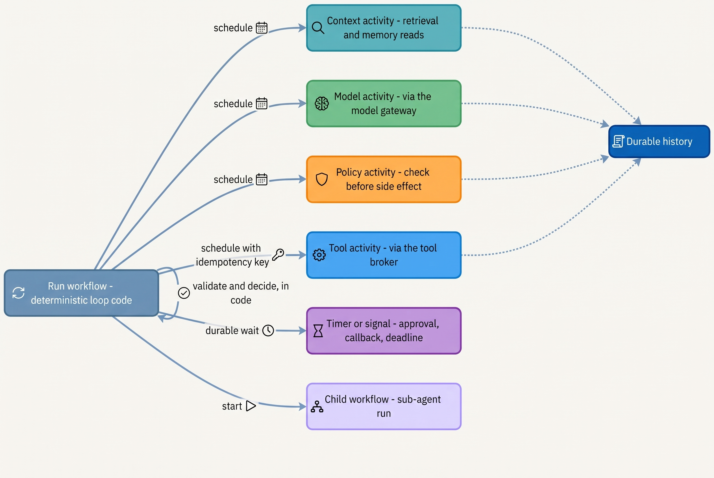
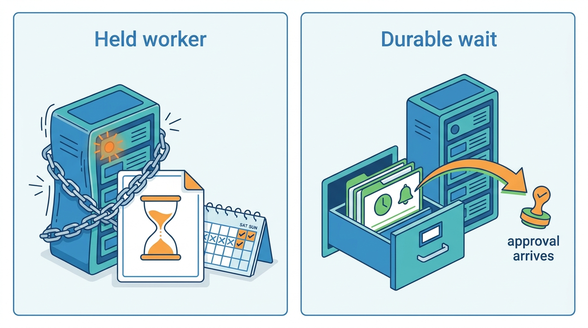
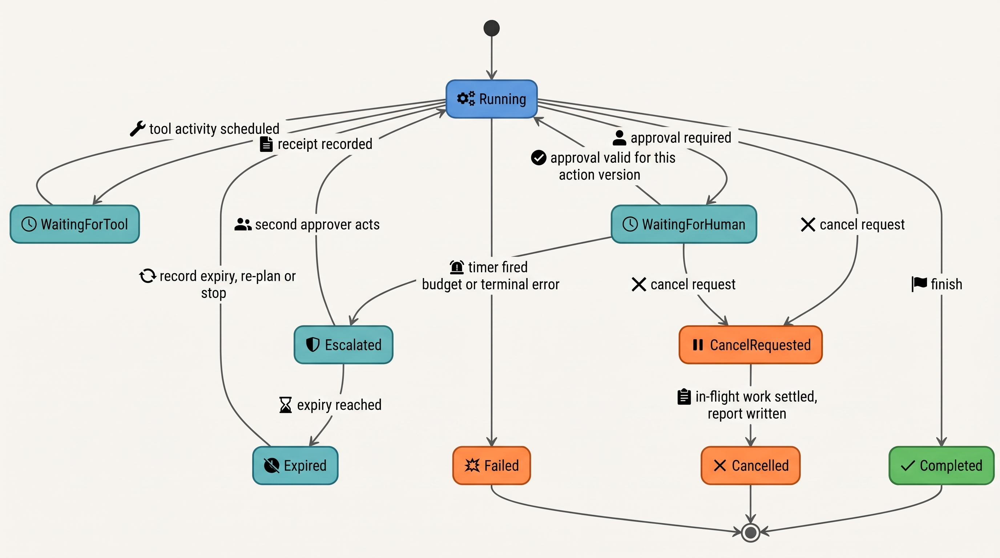
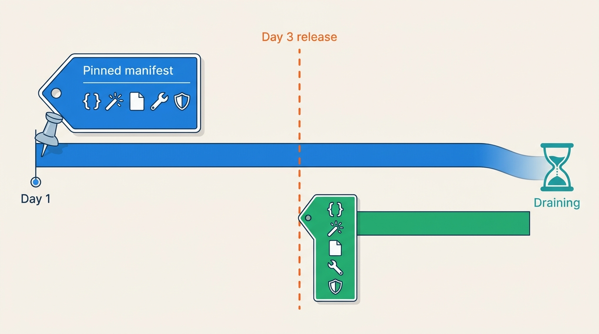
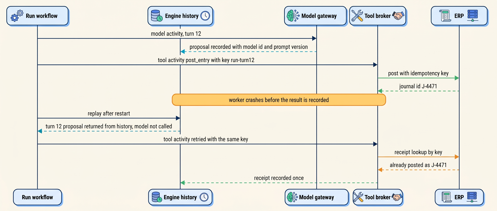

> **IN THIS CHAPTER, YOU WILL:** Learn how durable execution engines keep long-running work alive through crashes, deploys and multi-day waits, how to map an agent loop onto them (the loop as workflow code, model and tool calls as activities), and how to set timeouts, heartbeats, cancellation and versioning for runs that outlive the code that started them.

> **WHY THE BUSINESS CARES:** A month-end close, a contract negotiation or a benefits case runs for days and waits on people. If a deploy or a crashed worker restarts that work from the beginning, the business pays twice: once in duplicated postings, credits or emails, and again in the days spent finding and reversing them.

> **WHY ARCHITECTS SHOULD CARE:** The agent loop is the one place where a crash can do more than lose work. Restarting a step that contains a model call asks a variable component the same question again, and it may answer differently after half of its first answer has already been executed. Where you record the model's output, and what you replay, decides whether recovery is safe.

> **KEY POINTS:**
>
> * **Record the decision, replay the record.** Run the agent loop as deterministic workflow code. Make each model call and each tool call a separate activity whose result is written to durable history before anything acts on it. After a crash the engine returns the recorded model output instead of asking the model again.
> * **Durable execution moves the problem to the tool boundary; it does not remove it.** Every engine runs a side-effecting step at least once, so a crash between a successful tool call and its recorded result still repeats the call. Idempotency keys minted by the workflow, and receipt lookup on retry, are what turn at-least-once execution into an exactly-once effect.
> * **A run that lasts a week outlives your code, your model and your approvers.** Pin each run to the code, model and prompt versions it started on, and drain old versions instead of upgrading runs in place. Give every wait a timer, an escalation and an expiry, and make cancellation a request that reports what already happened, not a rollback.

> **[FAILURE PATTERNS THIS CHAPTER ADDRESSES](where-agentic-systems-go-wrong.html):**
>
> * **Amnesiac Execution** — a crash, deploy or timeout restarts a multi-day run from scratch and repeats the side effects it already caused.
> * **The Different Second Answer** — a recovered step that contains a model call re-samples the model after part of the first answer has been executed.
> * **The Silent Upgrade** — a deploy changes the loop code, prompt or model under runs that are already in flight, so recorded history no longer matches the code replaying it.

<br>
Most agent runs finish in seconds; if one fails, the user asks again. The architecture changes when a run must **outlive the process that started it**: a research task that takes forty minutes, a coding task that waits for CI, an accrual proposal that waits two days for a controller, a casework file that waits three weeks for a document from the applicant. Somewhere in that time a worker will crash, a cluster will be upgraded, the runtime will be deployed, and a person will go on leave.

The ordinary distributed-systems answer is **durable execution**: a programming model in which the progress of a long-running function is recorded step by step, so that after any failure the function continues from its last recorded step on any machine. The answer fits agents well, with one twist. In an agent loop, the most important thing to record is not the tool result but **the model's decision**, because the model is the one component that will not give the same answer twice.

This chapter owns four terms: **durable execution**, **activity**, **heartbeat** and **cancellation** of an agent run. It builds on [[agent-runtime]], which defines the agent run and its lifecycle, and on [[task-state-and-checkpoints]], which decides what task state must survive and defines resume versus replay. It hands the retry and idempotency rules to [[retries-idempotency-and-concurrency]], and compensation, the kill switch and quarantine to [[partial-failure-and-compensation]].

## Setting the Scene at Ostrell: Five Days, Twenty-Three Entities, One Weekend

Ostrell, the fictional field-service software group this book follows (see [[meet-ostrell]]), closes its books for **23 legal entities** every month. Closewise, the finance agent owned by group controller Joost Vermeer, drafts reconciliations and proposes about **1,900 accrual journal entries a month**. A controller approves each proposed entry; only then does a deterministic workflow post it to the ERP. The 2027 target is to close by **working day 5**, down from day 7 in 2026.

In January 2027, before Closewise moved onto the Keelson platform, the close ran as a set of scripts and a cron schedule. That month produced the **Half-Posted Accrual**: a script posting **52** approved entries for Ostrell Field Deutschland GmbH crashed after **37**, an accountant re-ran it, and the ERP received all 52 again. The **37 duplicates** overstated accruals by **€2.84 million**. The controller's balance review caught them the next day; reversing them took **2 days** and delayed that entity's close by one day. The full analysis is in [[task-state-and-checkpoints]]. The cause was not the crash. It was that nothing remembered which entries had been posted.

In March 2027 Jonas Lindqvist, principal engineer for Keelson Runtime, brought the migration plan for Closewise to Tomas Verhoef's architecture review. Keelson Runtime already ran agent loops on a self-hosted, open-source durable workflow engine, but Answerdesk's runs last seconds and Scout's a median of 14 minutes. A close run lasts five working days, spans a weekend, waits on controllers, subledger cut-offs, ERP posting windows and the period lock, and would see at least one Keelson Runtime release. Tomas put four questions to the review:

1. When a worker dies in the middle of a turn, what runs again, and does the model get asked again?
2. When an approval takes two days, what holds the run's place, and what happens if it never comes?
3. When we deploy new loop code on day 3, what happens to the 23 runs that started on day 1?
4. When a controller says "stop this entity", what stops, and what has already happened?

The rest of this chapter answers them. Closewise moved onto Keelson Runtime in April 2027.

## Concepts: Durable Execution in Agent Terms

### Durable execution

**Durable execution** is an execution model in which a long-running function (a *workflow*) records every step it completes in a durable, append-only **history**, and recovers from any failure by **re-running its code against that history**: completed steps return their recorded results, and execution continues live from the first step that has no record. The engines that implement it differ in packaging but share the design. Temporal restarts workflow code from the beginning and replays recorded history, which it calls "the source of truth for everything that happens in the Workflow" ([Temporal, n.d.](https://docs.temporal.io/workflows)). Azure Durable Functions orchestrators "use event sourcing" and "must be *deterministic*: an orchestrator function replays multiple times, and it must produce the same result each time" ([Microsoft, 2026-10-12](https://learn.microsoft.com/en-us/azure/azure-functions/durable/durable-functions-code-constraints)). DBOS ([n.d.](https://docs.dbos.dev/architecture)) and Restate ([n.d.](https://docs.restate.dev/concepts/durable_execution)) checkpoint or journal each step and skip completed steps on recovery.

Replay imposes one rule: **workflow code must be deterministic**. Given the same history it must make the same decisions in the same order. Anything that could differ between the first execution and a replay (the clock, random numbers, network calls, database reads and, above all, model calls) must happen inside a recorded step. Temporal's documentation lists "LLM invocations" among the interactions that belong outside workflow code ([Temporal, n.d.](https://docs.temporal.io/workflows)).

### Activity

An **activity** is a recorded step of a workflow that may do nondeterministic or side-effecting work: call a model, call a tool, query a database, send a message. The engine schedules it, runs it on a worker, retries it under a policy, and writes its result to history. On replay the recorded result is returned without running the activity again. Engines use different names for the same idea (Temporal *activity*, DBOS *step*, Restate `ctx.run`, Inngest `step.run`); this book uses **activity**.

The guarantee that matters is the one engines give for activities themselves, and it is **at least once**. Temporal states that an activity "may be executed multiple times and may even partially complete more than once", because a worker can finish the work and crash before reporting completion ([Temporal, n.d.](https://docs.temporal.io/activity-definition)). Inngest tells developers to make a refund step idempotent for the same reason ([Inngest, n.d.](https://www.inngest.com/docs/learn/how-functions-are-executed)). This is why [[retries-idempotency-and-concurrency]] exists.

### Heartbeat

A **heartbeat** is a periodic signal from a running activity to the engine saying "I am alive", optionally carrying **progress details** that a retry can read. It lets the engine detect a dead worker in seconds instead of waiting for the activity's full timeout, lets a retried activity resume from saved progress, and delivers cancellation: in Temporal, an activity "cannot receive a cancellation request" unless it heartbeats ([Temporal, n.d.](https://docs.temporal.io/develop/python/cancellation)). AWS Step Functions applies the same idea to callback tasks waiting for an external system: `HeartbeatSeconds` fails the task with `States.Timeout` if no heartbeat or result arrives in time ([AWS, n.d.](https://docs.aws.amazon.com/step-functions/latest/dg/connect-to-resource.html)).

### Cancellation of an agent run

**Cancellation** of an agent run is a recorded request to stop a run gracefully: the workflow receives the request, stops starting new model calls and side effects, asks its running activities and child runs to stop, finishes or abandons in-flight work according to each activity's declared cancellation behavior, and ends in a terminal `cancelled` state with a report of what it did. It is distinct from **termination**, which kills the run without giving its code a chance to clean up. Temporal draws exactly this line: cancel lets workflow code "handle the cancelation and execute any cleanup logic"; terminate is "like killing a process", and canceling is "preferable" in most cases ([Temporal, n.d.](https://docs.temporal.io/develop/python/cancellation)). Cancellation is **not compensation**: it stops what has not happened; it does not undo what has. Undoing is [[partial-failure-and-compensation]].

### Neighbouring terms, briefly

| Term | Meaning here | Owned by |
| --- | --- | --- |
| Agent run | One execution of an agent on one task, with a lifecycle | [[agent-runtime]] |
| Task state, checkpoint | The goal, plan, steps, receipts and approvals that must survive; a saved point of it | [[task-state-and-checkpoints]] |
| Resume vs replay | Continue from saved state vs re-run code against a recorded history | [[task-state-and-checkpoints]] |
| Idempotency key, retry budget, lease | The tool-boundary mechanisms that make at-least-once safe | [[retries-idempotency-and-concurrency]] |
| Approval record | A record bound to the exact action object version, with expiry | [[human-oversight-and-bounded-autonomy]] |
| Timer, signal, update | A durable wait; an asynchronous message into a running workflow; a validated, acknowledged message | This chapter (engine vocabulary) |

## The Architecture: Mapping an Agent Run onto a Durable Workflow

### One run, one workflow; one decision, one activity

The mapping I recommend has four rules.

1. **One agent run is one workflow execution**, identified by the run id. Sub-agents are **child workflows** with their own budgets ([[routing-and-delegation]]).
2. **The loop is workflow code.** Turn counting, budget arithmetic, schema validation of the model's proposed action, routing on the result and the decision to stop are deterministic and run in the workflow.
3. **Every model call is its own activity.** Its recorded result includes the model's raw output, the exact model id, the prompt version and token counts.
4. **Every tool call is a separate activity from the model call that proposed it.** It runs through the tool broker with an idempotency key the workflow derived deterministically from the run id and the step number, never from the model's text.

Rule 4 is the one teams break. If one activity both asks the model and executes the tool it chose, a crash between the two re-runs the whole activity: the model is sampled again, may propose a different action, and the first action may already have happened. That is the Different Second Answer, produced by recovery rather than by a retry policy: replay protects the decision only if the decision and the action are separate recorded steps.


**Figure 1:** *The loop is deterministic workflow code; everything that can differ on a second execution (context reads, model calls, policy checks, tool calls) is an activity whose result lands in durable history before the loop acts on it.*

In Ostrell's Keelson platform the activities call the platform's own components: context assembly reads Tidemark (memory) and the retrieval indexes; model activities go through Keelson Gateway; policy activities call Bulkhead; tool activities go through Toolyard, which holds credentials and enforces idempotency keys. Logbook, the evidence log, receives the curated decision record. The engine's history is **not** the evidence log: it is the engine's private recovery record, retained for as long as the engine needs it, while Logbook holds what auditors and risk owners need for years ([[policy-enforcement-and-audit]]).

### The loop in code

The sketch below shows the shape in Python-style pseudocode. `wf.*` stands for the engine's replay-safe API; the names are illustrative, not any SDK's.

```python
@workflow
def agent_run(task: Task, manifest: VersionManifest) -> RunResult:
    budget = Budget.from_manifest(manifest)          # tokens, cost, wall clock, turns
    state = TaskState.start(task)
    for turn in range(budget.max_turns):
        if wf.cancel_requested():
            return wf.finish_cancelled(state)        # report effects, do not undo
        ctx = wf.activity(assemble_context, state, manifest.context_version,
                          timeout=s(30))
        decision = wf.activity(call_model, ctx, manifest.model_id,
                               manifest.prompt_version,
                               start_to_close=min(10), heartbeat=s(45),
                               retry=Retry(max_attempts=2))   # one retrying layer
        budget.charge(decision.usage)                 # deterministic arithmetic
        action = validate(decision.proposed_action)   # schema check, in code
        if action.kind == "finish":
            return wf.finish(state, decision)
        verdict = wf.activity(check_policy, action, manifest.policy_version)
        if verdict.requires_approval:
            approval = wf.wait_for(signal="approval", key=action.content_hash,
                                   timeout=verdict.approval_ttl)
            if approval is None or not approval.matches(action):
                state = state.record_expired(action); continue
        key = f"{wf.run_id}:{turn}:{action.tool}"     # minted by the workflow
        receipt = wf.activity(call_tool, action, idempotency_key=key,
                              start_to_close=action.tool_timeout,
                              retry=Retry(non_retryable=["business", "unknown"]))
        state = state.record(action, receipt)
        if budget.exhausted():
            return wf.finish_budget_exceeded(state)
    return wf.finish_turn_limit(state)
```

Three details carry weight. The idempotency key depends on the run id, the turn and the tool, so a replay or an activity retry reproduces the same key; [[retries-idempotency-and-concurrency]] refines it by binding it to the action object's content. Model calls retry at **one** layer: an SDK retry inside a framework retry inside an engine retry with unlimited attempts (Temporal's activity default) multiplies paid model calls, the agent form of the retry amplification Google's SRE book warns about ([Google, 2016](https://sre.google/sre-book/addressing-cascading-failures/)). And the approval wait is keyed by the action's content hash, so an approval for a different version of the action does not release the run, as the book's approval rule requires.

### Requirements per interaction

| Interaction | Consistency | Latency budget | Durability | Who may act |
| --- | --- | --- | --- | --- |
| Model call | Result recorded before any use; never re-sampled on replay | Seconds to minutes; long tail | Response in history (or by hash in a payload store) | Workflow, through the gateway |
| Tool call with side effect | Exactly-once effect: at-least-once execution, idempotency key, receipt | Per tool contract | Intent before, receipt after, both recorded | Workflow, through the broker; never the model directly |
| Approval wait | Bound to action content hash and policy version; void on change | Hours to days | Durable timer and signal | Named approver; never the maker |
| External event (ERP callback, CI result) | Deduplicated by event id; out-of-order events rejected | Minutes to days | Signal recorded in history | Authenticated external system |
| Cancellation | Recorded request; stops new effects first | Seconds for new effects; in-flight work per activity | Request and outcome in history | Run owner, risk owner, platform on-call |
| Deploy of new loop code | Running runs keep their version | None for runs; minutes for rollout | Version recorded per run | Platform team through the release pipeline |

## Timeouts, Heartbeats and the Long Tail of Model Calls

A durable engine gives every activity several clocks, and each catches a different failure. Temporal's set is the clearest: **schedule-to-start** (time waiting in the queue), **start-to-close** (one attempt; "should always be set"), **schedule-to-close** (all attempts together) and the **heartbeat timeout**, the maximum gap between heartbeats ([Temporal, n.d.](https://docs.temporal.io/encyclopedia/detecting-activity-failures)). Above them sits a deadline the engine does not know about: the **run deadline**, the wall-clock and cost budget of the whole run. Google's SRE guidance asks servers to propagate deadlines so downstream calls inherit the remaining time of the original one ([Google, 2016](https://sre.google/sre-book/addressing-cascading-failures/)); in an agent, the run budget is that deadline, and child runs inherit what remains of it.

Model calls make timeout setting harder than for ordinary services. Their latency has a long tail: a reasoning-heavy call with a long output can take minutes, and Anthropic's API documentation suggests streaming for long requests that would otherwise hit a `504 timeout_error` ([Anthropic, n.d.](https://platform.claude.com/docs/en/api/errors)). Anthropic's February 2026 usage study found that the 99.9th-percentile Claude Code turn (many calls, not one) "nearly doubled, from under 25 minutes to over 45 minutes" between October 2025 and January 2026 ([Anthropic, 2026](https://www.anthropic.com/research/measuring-agent-autonomy)). AWS's rule of picking a timeout at the latency percentile that matches an acceptable false-timeout rate ([Brooker, 2019](https://builder.aws.com/content/3EumjoZascWd1oZiEgL8ORlv3qE/timeouts-retries-and-backoff-with-jitter)) then yields a start-to-close of many minutes, which detects a dead call far too late.

The fix is to **stream and heartbeat**. A model activity that streams the response heartbeats on every chunk (or every few seconds), so a short heartbeat timeout (Ostrell uses 45 seconds) catches a hung connection or a dead worker quickly while a generous start-to-close (10 minutes) tolerates a legitimately long answer. The same applies to long tool activities: a Forge test run in a sandbox, a batch ERP posting, a large export.

Heartbeat **progress details** deserve one warning. Closewise's posting activity heartbeats the index of the last entry it posted, so a retry can skip ahead. But a heartbeat is not atomic with the post: the worker can post entry 45 and die before heartbeating "45". Progress details are an optimization for speed, never the guard against duplicates. The guard is the idempotency key on every entry and a receipt lookup before re-posting, which is precisely what the January script lacked.

| Clock | Catches | Agent-specific setting | Ostrell default *(Keelson design)* |
| --- | --- | --- | --- |
| Schedule-to-start | No worker available; queue backlog | Alert, do not fail: a backlog is a capacity problem | Alert at 5 min |
| Start-to-close (model) | A single call that will never finish | Set from the tier's tail latency, not p50 | 10 min Large tier, 2 min Small |
| Heartbeat (model, streaming) | Hung connection, dead worker | Seconds; one heartbeat per chunk batch | 45 s |
| Start-to-close (tool) | A tool attempt that hangs | From the tool contract ([[tool-contracts]]) | Per tool, 30 s default |
| Schedule-to-close | A step that keeps failing | Caps total attempts and spend | 3 attempts or 15 min |
| Run deadline | A run that never converges | Wall clock plus token and cost budget | Per agent manifest |

## Waiting: Humans, Events and Deadlines

The strongest reason to put an agent on a durable engine is not crash recovery. It is **waiting**. An agent run that needs a controller's approval, a customer's reply, a CI result or a document from an applicant should not hold a thread, a container or a context window for two days. Durable engines turn a wait into a record.

- **Durable timers.** Temporal's timers "are persisted", so a workflow resumes after a timer fires even if workers were down at that moment, and "Workers consume no additional resources while waiting for a Timer"; timers can run for years ([Temporal, n.d.](https://docs.temporal.io/workflow-execution/timers-delays)).
- **Signals and updates.** A *signal* is an asynchronous message into a running workflow; an *update* is a "synchronous, tracked write request" that can be validated before it is accepted into history, so the sender learns whether it was accepted ([Temporal, n.d.](https://docs.temporal.io/encyclopedia/workflow-message-passing)). Approvals should be updates (or signals with a validated acknowledgment): the approver's client must learn that the approval was rejected because the action changed.
- **Callback tokens.** Step Functions Standard pauses a task until an external party returns its task token with `SendTaskSuccess` or `SendTaskFailure`, for up to the one-year execution quota, and recommends a heartbeat timeout "to avoid stuck executions" ([AWS, n.d.](https://docs.aws.amazon.com/step-functions/latest/dg/connect-to-resource.html)).

Every wait needs three things the engine will not decide for you. **A timer**: no wait without a timeout, because an approval that never arrives otherwise holds a run open forever. **An escalation**: what happens when the timer fires (a reminder, a second approver, a different queue). **A revalidation**: when the wait ends, re-check that the world the approval was given for still exists. The book's approval rule (an approval binds to the action object's content hash and policy version, has an expiry, and is void if the action, the policy or the evidence changed) is enforced exactly here, in the workflow code that runs after the wait returns ([[human-oversight-and-bounded-autonomy]]).


**Figure 2:** *A durable wait is a record with a timer, an escalation and an expiry, not a held worker: over the close weekend no worker, container or context window was held for the 23 entity runs.*

The author's agentic-finance-platform design records that batch schedulers "are weaker for human approval pauses, callback reconciliation, and exactly-once side effects", and that a proposal whose accounting period locked before posting must re-validate and route "as a next-period entry or a controlled reopen" (step `idempotency`). The agentic-public-benefits-platform design uses a durable workflow engine to make "evidence waits, retries, appeal-clock deadlines, and escalation timers explicit" (technology choices, steps `gate` and `audit-appeal`). Both are design examples, not deployed systems.


**Figure 3:** *Every wait in a durable run has a timer, an escalation and an expiry; cancellation is a state the run passes through while in-flight work settles, not an instant stop.*

## Cancellation: Stop New Effects, Report Old Ones

When someone cancels an agent run, three things are in different states: work the run has not started, work in flight, and work already done. A sound cancellation design treats them differently.

1. **Not started: never start it.** The workflow checks for a cancel request before every model call and every side effect. Child runs receive the cancellation; DBOS documents that a workflow timeout cancels "the workflow and all its children" at the next step ([DBOS, n.d.](https://docs.dbos.dev/python/tutorials/workflow-tutorial)).
2. **In flight: follow each activity's declared behavior.** A model call can simply be abandoned: its output has not been acted on. A sandboxed test run should be killed. An ERP batch post or a payment instruction should usually be **allowed to finish** and record its receipt, because cancelling halfway leaves an unknown state that someone must reconcile. Declare per tool, in its contract, whether an attempt is abandonable, interruptible or must complete; and remember that an activity that does not heartbeat cannot hear the request at all ([Temporal, n.d.](https://docs.temporal.io/develop/python/cancellation)). Step Functions likewise makes only a "best-effort attempt" to cancel an external job when a `.sync` task is aborted ([AWS, n.d.](https://docs.aws.amazon.com/step-functions/latest/dg/connect-to-resource.html)).
3. **Done: report it, do not pretend it did not happen.** The run ends `cancelled` with a list of effects completed, effects in an unknown state, and approvals left open (which are then voided). Whether to compensate those effects is a separate, explicit decision ([[partial-failure-and-compensation]]).

Termination, the hard kill, is for a run whose cancellation logic is broken; its report must then be rebuilt from history and the evidence log. The platform kill switch is not mass cancellation: it stops new side effects across every run in its scope and **holds** queued actions for review rather than discarding them ([[partial-failure-and-compensation]]).

## Versioning Runs That Outlive Their Code

A run that lasts five days will see a deploy. Replay engines make this a correctness problem: if the new workflow code takes a different path through the same history, replay fails or, worse, silently diverges. Microsoft states that "code changes that affect running orchestrations can break replay behavior", and that the framework's nondeterminism detection "won't catch all violations" ([Microsoft, 2026-10-12](https://learn.microsoft.com/en-us/azure/azure-functions/durable/durable-functions-code-constraints)). DBOS raises `DBOSStepNondeterminismError` when replay does not match recorded steps ([DBOS, n.d.](https://docs.dbos.dev/python/tutorials/workflow-tutorial)).

Engines offer two remedies, and Temporal documents both explicitly ([Temporal, n.d.](https://docs.temporal.io/worker-versioning); [Temporal, n.d.](https://docs.temporal.io/patching)):

- **Pinning.** "A Pinned Workflow is guaranteed to complete on a single Worker Deployment Version." Old versions keep polling until their pinned workflows close: the version is *draining*, then *drained*.
- **Patching.** A patch "defines a logical branch in a Workflow for a specific change, similar to a feature flag": new executions take the new branch and record a marker, replaying executions take the old branch. A misplaced patch throws "a non-deterministic exception".

For agents, **the code is only one of the versions a run depends on**. The run's history records decisions made by a specific model with a specific prompt, against specific tool schemas and a specific policy. Swapping any of them mid-run does not break replay (the engine replays recorded results), but it makes the rest of the run a different agent from the one whose first half is in the record: the plan was made by one model and is being executed by another. Anthropic described the operational form of this in its June 2025 engineering post on its multi-agent research system: it used "rainbow deployments to avoid disrupting running agents", shifting traffic gradually while old and new versions run side by side ([Anthropic, 2025](https://www.anthropic.com/engineering/multi-agent-research-system)).

My rule: **a run is pinned to its whole version manifest** (loop code, model id, prompt, tool schemas, policy bundle), recorded at run start. Loop-code changes reach in-flight runs only through patch branches that keep their recorded path; model, prompt and tool changes reach them not at all, because workers for every manifest with live runs stay deployed until those runs finish ([[versioning-agent-systems]]). The exception is a change that must reach running runs, typically a security or correctness fix: deliver it as an explicit, recorded **update** into the run, so history shows when its rules changed, and void its pending approvals, as [[task-state-and-checkpoints]] requires. Very long runs (casework, multi-week research) should reach natural **continue-as-new** points at which they hand their task state to a fresh execution that starts on the current versions. Temporal describes continue-as-new as a way to "checkpoint your Workflow's state and start a fresh Workflow" with the same workflow id and a new history, and notes it also helps avoid running long-lived workflows on stale code ([Temporal, n.d.](https://docs.temporal.io/workflow-execution/continue-as-new)). How manifests are versioned and promoted is [[versioning-agent-systems]]; how they are rolled out is [[staged-rollout-and-rollback]].


**Figure 4:** *A run is pinned to its whole version manifest: a release on working day 3 reaches new runs, while workers for the old manifest stay deployed until its runs finish.*

### History size: the limit agent loops hit first

Durable histories are not unbounded. Temporal warns at **10,240 events or 10 MB** and enforces a hard limit of **51,200 events or 50 MB** per workflow execution ([Temporal, n.d.](https://docs.temporal.io/workflow-execution/limits)). Agent loops approach it faster than business workflows, because every turn records several activities and each model result carries output that can be tens of kilobytes. Assume 40 KB of recorded payload per turn: a 1,000-turn coding or research run reaches the 50 MB limit while still far below the event limit. The remedies: store large payloads in a content-addressed store and record only the hash; continue-as-new at turn or size thresholds; record references to what context assembly read rather than the assembled context.

## What the Evidence Says

**The engines agree on the model; vendor tables disagree on the words.** Every replay engine reviewed (Temporal, Azure Durable Functions, DBOS, Restate, Inngest) returns recorded step results on recovery and runs side-effecting steps at least once. AWS Step Functions is a declarative state machine rather than a replay engine; its Standard workflows advertise "exactly-once workflow execution" and fitness for "non-idempotent actions, such as … processing payments" ([AWS, n.d.](https://docs.aws.amazon.com/step-functions/latest/dg/concepts-standard-vs-express.html)), while its Express workflows are at-least-once or at-most-once and limited to five minutes. These are different scopes, not a contradiction: "exactly once" in an engine's documentation means the engine will not *schedule* a step twice. Whether the bank charges twice still depends on the called service's idempotency, which AWS's own Builders' Library article on idempotent APIs makes the caller's concern ([Featonby, n.d.](https://aws.amazon.com/builders-library/making-retries-safe-with-idempotent-APIs/)).

**Checkpointing frameworks are not replay engines.** LangGraph checkpoints graph state at every super-step and also persists the writes of nodes that succeeded, so they are not re-run ([LangChain, n.d.](https://docs.langchain.com/oss/python/langgraph/checkpointers)). But its resume granularity is the node: after an interrupt "the runtime restarts the entire node from the beginning", so "side effects called before `interrupt` must be idempotent" ([LangChain, n.d.](https://docs.langchain.com/oss/python/langgraph/interrupts)). Its time-travel replay from an earlier checkpoint re-executes later nodes, "including any LLM calls". Its `"exit"` durability mode cannot recover from a mid-run crash. Both models are coherent; the point is that "checkpointing" is not one thing. A node that both calls the model and executes a tool will re-sample the model on resume.

**"Durable agent" integrations often record model calls and leave tools to you.** As of October 2026, Temporal's integration with the OpenAI Agents SDK routes model invocations through activities automatically, but ordinary `@function_tool` tools "execute in the workflow unless explicitly backed by a Temporal activity" ([Temporal, n.d.](https://github.com/temporalio/ai-integrations/tree/main/python/openai_agents)). A developer who writes an email-sending tool the obvious way has put I/O inside deterministic workflow code, where replay can repeat it. Restate's agent documentation says "every LLM call and tool execution is durably persisted" when wrapped in its step API ([Restate, n.d.](https://docs.restate.dev/ai)). The lesson is to check, per framework and version, which calls are recorded by default.

**Model output does vary on identical input, so re-sampling is a real risk.** Anthropic's documentation states that even at temperature 0, "identical inputs might produce different outputs across API calls" ([Anthropic, n.d.](https://platform.claude.com/docs/en/about-claude/glossary)). In a September 2025 research post, Thinking Machines Lab sampled one prompt 1,000 times at temperature 0 on an open-weight model served by vLLM and got 80 distinct completions, attributing the variance mainly to batch-size effects on server kernels; batch-invariant kernels made all 1,000 identical at a throughput cost ([He, 2025](https://thinkingmachines.ai/blog/defeating-nondeterminism-in-llm-inference/)). That measures one open-weight setup, not commercial APIs, and it measures token-level variance, not different tool choices. τ-bench's pass^k metric shows the trajectory-level consequence: on its retail tasks the best 2024 agent's pass^8 fell below 25% ([Yao et al., 2024](https://arxiv.org/abs/2406.12045)), a simulated-user benchmark on a superseded model, so treat it as evidence that repeated runs diverge, not as a current rate.

**Long-running coding agents externalize progress into artifacts.** Anthropic's November 2025 engineering post on harnesses for long-running agents describes runs that span many context windows: an initializer session writes a progress file, a JSON feature list and an initial git commit; each later session reads them, works on one feature, tests it end to end and commits, so a bad change can be reverted ([Young, 2025](https://www.anthropic.com/engineering/effective-harnesses-for-long-running-agents)). This is durable execution by other means: the history is git plus a progress file. The failure modes it reports (declaring the project done too early, marking features complete without end-to-end tests) are ones no execution engine would prevent.

**What the evidence does not show.** No published study measures how often production agents duplicate or diverge side effects on crash recovery or deploy, and no published evaluation compares durable-engine-based agent runtimes with checkpointing frameworks on recovery correctness. The vendor material is documentation of semantics, not evidence of outcomes. The recommendations in this chapter rest on those documented semantics and on the author's judgement.


**Figure 5:** *After a crash, replay returns the recorded model proposal instead of asking the model again; the tool retry reuses the workflow-minted key, and the receipt lookup turns a second execution into one effect.*

## Worked Example at Ostrell: The September 2027 Close

Keelson Runtime ran its first five-day Closewise close in May 2027. The close of September 2027 is a useful one to walk through because it hit every question in Tomas's list.

**The shape.** Closewise starts one parent close workflow per month and **23 child workflows**, one per legal entity. Each child is mostly a workflow with agentic steps, the point [[what-makes-a-system-agentic]] makes about Closewise: deterministic stages (subledger cut-off, extraction, invariant checks, posting) with bounded model steps for reconciliation drafting and accrual proposals. Each model step is an activity on the Mid tier, with a fallback only where the manifest names and gates one ([[models-and-the-model-gateway]]); each posting is a tool activity through Toolyard keyed by task id, entry id and entry version. Every run's manifest pins exact model ids, as Keelson has required since September 2027 after the Alias Drift.

**Working day 1, Friday 1 October.** All 23 entity runs start, each pinned to its manifest. The close produced **1,912 proposed entries** that month, of which **164** for Ostrell Field Deutschland GmbH.

**The weekend.** The runs do nothing on Saturday and Sunday. They hold durable timers for the subledger cut-off on Monday 06:00 and waits for approvals already requested on Friday. No worker, container or context window is held for them.

**Working day 2, Monday 4 October, 02:10.** A routine node-pool upgrade replaces the worker hosts serving six entity runs mid-turn. The 45-second heartbeat timeout fires on the in-flight model activities; they are retried on other workers. Two model calls are sent again, a fresh sample, but neither had been acted on, so this is a cost (about €0.40 *(assumption)*), not a divergence. Completed turns are returned from history; no proposal is regenerated. That morning, Ostrell Field Deutschland's posting activity is posting **61** approved entries when its worker is evicted after **44**. The retry reads the heartbeat (last confirmed index 43), looks up receipts by idempotency key for entries 44 to 61, finds entry 44 already posted, and posts 45 to 61. The ERP holds **61 entries, once each**. In January the same entity, the same kind of crash and a manual re-run produced 37 duplicates.

**Working day 3, Tuesday 5 October.** The Agent Platform team ships a Keelson Runtime release that adds a Bulkhead check before every staging-store write. As with the June release described in [[task-state-and-checkpoints]], the change ships as a patch branch: the 23 entity runs replay and continue on their recorded path, and an intercompany reconciliation child workflow started that afternoon takes the new branch. No run hits a nondeterminism error. The patch's old branch is deleted only after the last run that recorded it has closed, on working day 6.

**Approvals.** Controllers' teams approve most proposals within hours. Keelson's approval timer is **48 working hours**, after which the request escalates to the entity's deputy controller *(Keelson design)*. Nine proposals for Ostrell Assure's UK entity hit the timer while the controller was on leave and were approved by the deputy the next morning. Three approved proposals for another entity never posted: between approval and posting, a late supplier invoice changed the subledger balance the accrual was based on. The workflow's post-wait revalidation found that the evidence hash no longer matched, voided the approvals, and Closewise drafted new proposals, which were approved within the day.

**Cancellation.** On working day 4 a controller cancels the Ostrell Parts Benelux entity run: the subledger had been reopened for a correction and she wanted a clean restart rather than a run that had already proposed against old balances. The run stops starting model calls at once. Its one in-flight activity, a posting of 12 approved entries, is declared *must complete* and finishes; the run ends `cancelled` with a report: 31 entries posted with receipts, 0 in unknown state, 17 open proposals voided, 4 drafted reconciliations kept as drafts. A new run starts against the corrected subledger.

**Working day 5, Thursday 7 October.** The ERP's period lock arrives as a signal at 17:00. Two proposals still awaiting approval are re-routed as next-period entries, as the finance design in the interview project recommends. All 23 entities close on working day 5.

## Failure Modes and Recovery

| Scenario | What happens | Detection | Containment | Recovery |
| --- | --- | --- | --- | --- |
| Worker dies mid model call | Call lost before its result is recorded | Heartbeat timeout (seconds) | Output never acted on | Retry on another worker; fresh sample is acceptable because nothing used the first |
| Worker dies after a tool succeeds, before the result is recorded | Activity retried; side effect could repeat | Activity retry counter; duplicate-key hits at the broker | Workflow-minted idempotency key; broker dedups | Receipt lookup returns the first result ([[retries-idempotency-and-concurrency]]) |
| Model call and tool call in one activity | Crash between them re-samples the model and may execute a different action | Two different actions under one step in the evidence log; reviewer finds a mismatch | None at runtime: this is a design fault | Split into two activities; reconcile effects of affected runs ([[partial-failure-and-compensation]]) |
| Deploy breaks replay | Nondeterminism error on replay; runs stuck | Engine error metric; stuck-run alert | Pinned versions keep old code serving old runs | Roll back the release or add a patch branch; never edit history |
| History limit approached | Run slows; at the hard limit the engine fails it | Engine warning at 10,240 events or 10 MB | Payloads by hash; continue-as-new thresholds | Continue-as-new from task state; split very long runs |
| Approval never arrives | Run waits forever, close slips | Timer fires; approval-age dashboard | Escalation to a second approver | Expire the approval, record it, re-plan or stop |
| Approval valid but world changed | Approved action executes against stale facts | Post-wait revalidation (content, policy, evidence hashes) | Approval void on mismatch | New proposal and approval |
| Activity ignores cancellation | Cancelled run keeps doing work | Run in `cancelling` longer than its budget | Heartbeat requirement for long activities | Terminate, then rebuild the outcome report from history and the evidence log |
| Replay faithfully repeats a bad decision | A recorded bad proposal is re-executed on every recovery | Same failure on every retry; grader or reviewer flags it | Business-terminal errors are non-retryable | Reset the run to the step before the decision and make a **new** decision with a new idempotency scope |

The second-to-last row is easy to miss. Durable execution guarantees that a decision, once made, is never made again. That is the property you want for recovery and the property you do not want when the decision was wrong. Recovery from a bad model output is therefore never a retry: it is an explicit reset that discards the recorded decision, asks again, and treats the answer as a new action with its own key, after confirming that the old action's effects did not happen or are compensated.

## Trade-offs: Which Execution Substrate

| Option | What it gives | What it costs | Right when |
| --- | --- | --- | --- |
| **Request-scoped run, no durability** | Simplest; no extra infrastructure | A crash loses the run; user retries | Runs finish in seconds to a minute, have no side effects or one idempotent one, and a fresh start is cheap |
| **Job queue + state table** | Familiar; retries, visibility timeouts, dead-letter queues | You hand-build checkpoints, waits, timers, cancellation and versioning; the queue tempts teams to make it the ledger | Short, single-effect jobs; read-only research runs like Scout's (report written at the end) |
| **Checkpointing agent framework** (LangGraph-style) | Graph state persisted per step; interrupts for humans; time travel for debugging | Node-level resume re-runs model calls inside a node; durability depends on mode and store; side effects need care | Loops where nodes are small and side-effecting nodes are isolated and idempotent; teams already on the framework |
| **Replay-based durable workflow engine** | Recorded history; model output never re-sampled; durable timers, signals, child runs, versioning | Determinism discipline; a new engine to operate; history size limits; developer learning curve | Runs of minutes to weeks with side effects, human waits and deploys during runs: Closewise, Answerdesk's actions, casework |
| **Declarative state-machine service** (Step Functions-style) | Managed; no replay hazard; callbacks with tokens; long executions | Loop logic in a state language; awkward for dynamic tool choice; provider lock-in | Fixed workflows with a few model steps and long waits, in one cloud |

Two judgements follow. First, **a simple job queue is enough more often than platform teams admit.** If a run is short, read-only or has one idempotent effect at its end, a queue with a run budget is the right tool; Scout's read-only research runs would be well served by one (assume a failed run costs a few euros to start again *(assumption)*), and the Weekend Fan-out was fixed with budgets, not durability. The test is: *what does a restart cost, in money, in time and in repeated side effects?* Second, **the engine is a means, not the design.** The author's agentic-platform-foundations design says it well: a durable workflow engine "gives replay, timers, retries, and child workflow structure, but the side-effect idempotency contract is still application-owned", and queues "should carry work references rather than becoming the authoritative session ledger" (technology choices, step `durable`). Whatever substrate you choose, the four mapping rules above still apply.

## Across Domains: How the Stakes Change the Design

| Dimension | Coding agents | Customer operations (support, sales, marketing) | Back office (finance, legal, HR) | High-stakes decisions (healthcare, public benefits) |
| --- | --- | --- | --- | --- |
| Typical run length | Minutes to an hour; CI waits | Seconds per turn; days when waiting for customer or approval | Hours to days; close cycles, negotiation rounds | Days to months; evidence requests, statutory clocks |
| Where resume state lives | Git branch, progress file, test results; the authoritative CI pipeline is the durable outer loop (harness design, step `lifecycle`) | Workflow history plus ticket or CRM record | Workflow history plus staging store of proposals | Workflow history plus case record built for appeal |
| What a restart costs | Tokens and time; sandbox is disposable | Duplicate credits or messages (the Double Credit) | Duplicate postings (the Half-Posted Accrual) | Missed deadlines, inconsistent determinations |
| Waits and their timers | CI result, reviewer; hours | Customer reply, A1 approval; time-boxed | Approver with escalation; period lock, posting window | Applicant evidence; appeal clock that starts on notice delivery (benefits design, step `audit-appeal`) |
| Cancellation | Kill the sandbox; branch remains | Stop outbound actions; hand conversation to a human | Let in-flight postings finish; void open approvals | Hold, never drop: a case cannot vanish; a human disposes of it |
| Versioning running work | Usually restart on new version (cheap) | Pin per conversation | Pin per close or per contract | Pin rules and models per case; replay must reconstruct "under the rules it actually used" (benefits design, step `audit-appeal`) |
| Durable engine needed? | For the outer PR lifecycle, rarely for the inner loop | For actions and approvals, not for chat turns | Yes, the strongest case | Yes, with timers treated as legal deadlines |

What the platform keeps common: the mapping rules (loop in code, model and tool calls as separate activities, workflow-minted keys), the clocks and heartbeats, the cancellation states, version pinning and the history-size discipline. What stays domain policy: **how long a wait may last and who escalates**, **which in-flight activities must complete when cancelled**, **whether a running case may switch to new rules**, and **what restarting costs**. For coding agents the honest answer is often that durable execution belongs to the PR workflow around the agent, while the inner loop's resume state is the repository itself. In public benefits and healthcare the timers are not engineering defaults but legal or clinical deadlines, so they belong in versioned, effective-dated policy, not in workflow code constants.

## The Chief Architect's View

The decisions I would take, and who takes them:

- **One execution substrate per class of run, chosen by the platform team, with a written rule for when a job queue is enough.** Teams that hand-build checkpoint tables and retry loops for multi-day work re-implement a durable engine badly. Teams that put a one-minute read-only run on a durable engine pay complexity for nothing.
- **The four mapping rules are platform policy, enforced in review and in the runtime SDK.** The rule most worth automating is the split between model activities and tool activities: a lint or SDK check that refuses a tool call inside the model activity is cheap and prevents the costliest recovery bug.
- **Version pinning of the whole manifest per run, owned by the platform team; exceptions (security fixes into running runs) decided by the security architect and recorded as updates.**
- **Wait timers and escalations are owned by the risk owner of each agent**, not by engineers: Joost Vermeer, not Jonas Lindqvist, decides that a Closewise approval escalates after 48 working hours.
- **Cancellation behavior per tool is part of the tool contract**, reviewed when the tool is registered.

What to watch: stuck runs (runs waiting longer than their longest timer), history size per agent, nondeterminism errors after releases, the age of the oldest draining deployment, duplicate-key hits at the tool broker (each one is a recovery that worked), and the count of runs ending with effects in an unknown state.

What is durable and what will change: replay-based recovery, recorded decisions, at-least-once activities and idempotent tools are old distributed-systems ideas and will outlast every agent framework. Engine APIs, framework integrations and their defaults will change within a year. Better models will run longer, which makes durable waits and versioning more important, not less; nothing in the evidence suggests that re-sampling on recovery will become safe.

## Questions to Ask

1. For each agent, what does restarting a run from scratch cost in tokens, time and repeated side effects? Is the execution substrate sized to that answer?
2. After a crash in the middle of a turn, is the model asked again? Show where its output is recorded before anything acts on it.
3. Is any model call in the same recorded step as the tool call it proposed?
4. Who mints the idempotency key for each tool call: workflow code, or something derived from the model's output?
5. How many layers retry a model call, and what is the total attempt count and cost in the worst case?
6. For every wait, what is the timer, who is escalated to, and what is revalidated when the wait ends?
7. When a run is cancelled, which in-flight tools must complete, which can be abandoned, and where is the report of completed effects?
8. Which versions (code, model, prompt, tools, policy) is a running run pinned to, and how does a security fix reach it?
9. How large does the history of your longest runs get, and what happens at the engine's limit?
10. How would you recover a run whose recorded decision was wrong, without replaying that decision again?

Durable execution guarantees that a recorded step is not executed twice by the engine. It cannot stop a tool call from reaching an external system twice, or two runs from acting on the same customer at once. That is the job of idempotency keys, receipts, retry budgets and leases, the subject of [[retries-idempotency-and-concurrency]].

## Sources and Evidence

### Research papers

- [τ-bench: A Benchmark for Tool-Agent-User Interaction in Real-World Domains](https://arxiv.org/abs/2406.12045) — S. Yao et al., 2024 (preprint). Definition of pass^k; evidence that repeated runs of the same task diverge.

### Specifications, standards and regulation

- [Workflows (determinism and replay)](https://docs.temporal.io/workflows) — Temporal, n.d., accessed 2026-10. Replay of recorded history; LLM invocations belong in activities.
- [Activity definition](https://docs.temporal.io/activity-definition) — Temporal, n.d., accessed 2026-10. Activities may run more than once.
- [Detecting activity failures](https://docs.temporal.io/encyclopedia/detecting-activity-failures) — Temporal, n.d., accessed 2026-10. The four activity timeouts and heartbeats.
- [Cancellation (Python SDK)](https://docs.temporal.io/develop/python/cancellation) — Temporal, n.d., accessed 2026-10. Cancel versus terminate; activities must heartbeat to receive cancellation.
- [Timers](https://docs.temporal.io/workflow-execution/timers-delays) — Temporal, n.d., accessed 2026-10. Durable timers that hold no worker resources.
- [Workflow message passing](https://docs.temporal.io/encyclopedia/workflow-message-passing) — Temporal, n.d., accessed 2026-10. Signals, queries and validated updates.
- [Worker versioning](https://docs.temporal.io/worker-versioning) and [Patching](https://docs.temporal.io/patching) — Temporal, n.d., accessed 2026-10. Pinned versions, draining, patch branches and nondeterminism errors.
- [Continue-As-New](https://docs.temporal.io/workflow-execution/continue-as-new) and [Workflow execution limits](https://docs.temporal.io/workflow-execution/limits) — Temporal, n.d., accessed 2026-10. Fresh histories; the 10,240-event warning and 51,200-event or 50 MB limit.
- [Durable orchestrator code constraints](https://learn.microsoft.com/en-us/azure/azure-functions/durable/durable-functions-code-constraints) — Microsoft, 2026. Determinism requirement; code changes break replay; detection is incomplete.
- [Choosing workflow type in Step Functions](https://docs.aws.amazon.com/step-functions/latest/dg/concepts-standard-vs-express.html) and [Service integration patterns](https://docs.aws.amazon.com/step-functions/latest/dg/connect-to-resource.html) — AWS, n.d., accessed 2026-10. Scoped exactly-once; callback tokens; heartbeat timeouts; best-effort cancellation.
- [DBOS architecture](https://docs.dbos.dev/architecture) and [workflow tutorial](https://docs.dbos.dev/python/tutorials/workflow-tutorial) — DBOS, n.d., accessed 2026-10. Step checkpointing; nondeterminism errors; timeouts cancel children.
- [Durable execution](https://docs.restate.dev/concepts/durable_execution) and [Restate for AI agents](https://docs.restate.dev/ai) — Restate, n.d., accessed 2026-10. Journal replay; persisted model and tool steps.
- [How functions are executed](https://www.inngest.com/docs/learn/how-functions-are-executed) — Inngest, n.d., accessed 2026-10. Replay with saved step results; idempotent side effects.
- [Checkpointers](https://docs.langchain.com/oss/python/langgraph/checkpointers) and [Interrupts](https://docs.langchain.com/oss/python/langgraph/interrupts) — LangChain, n.d., accessed 2026-10. Durability modes; node restart; replay re-executes model calls.
- [Errors](https://platform.claude.com/docs/en/api/errors) and [Glossary](https://platform.claude.com/docs/en/about-claude/glossary) — Anthropic, n.d., accessed 2026-10. Streaming for long requests; nondeterminism at temperature 0.

### Vendor documentation and engineering reports

- [OpenAI Agents SDK integration README](https://github.com/temporalio/ai-integrations/tree/main/python/openai_agents) — Temporal, n.d., accessed 2026-10. Model calls recorded automatically, tools not.
- [Defeating Nondeterminism in LLM Inference](https://thinkingmachines.ai/blog/defeating-nondeterminism-in-llm-inference/) — H. He, Thinking Machines Lab, 2025. 80 distinct completions of 1,000 at temperature 0 on one open-weight setup.
- [How we built our multi-agent research system](https://www.anthropic.com/engineering/multi-agent-research-system) — Anthropic, 2025. Rainbow deployments for long-running agents.
- [Effective harnesses for long-running agents](https://www.anthropic.com/engineering/effective-harnesses-for-long-running-agents) — J. Young, Anthropic, 2025. Progress files and git as resume state; observed failure modes.
- [Measuring AI agent autonomy in practice](https://www.anthropic.com/research/measuring-agent-autonomy) — Anthropic, 2026. Growth of the 99.9th-percentile turn duration.
- [Timeouts, retries, and backoff with jitter](https://builder.aws.com/content/3EumjoZascWd1oZiEgL8ORlv3qE/timeouts-retries-and-backoff-with-jitter) — M. Brooker, AWS Builders' Library, 2019. Timeouts from latency percentiles.
- [Making retries safe with idempotent APIs](https://aws.amazon.com/builders-library/making-retries-safe-with-idempotent-APIs/) — M. Featonby, AWS Builders' Library, n.d., accessed 2026-10. Idempotency as the caller-visible guarantee.
- [Addressing Cascading Failures](https://sre.google/sre-book/addressing-cascading-failures/) — Google, *Site Reliability Engineering*, 2016. Deadline and cancellation propagation.

### Incidents, cases and decisions

- The research for this chapter found no public incident report, as of October 2026, that attributes a duplicated side effect to an agent's crash recovery or replay; the documented agent incidents discussed in [[partial-failure-and-compensation]] concern destructive actions. Ostrell's Half-Posted Accrual is fictional.

### Design examples from the author's interview project

- Obrenović, Ž., "Agentic Platform Foundations", system-design interview design, `system-design-interviews/data/book/agentic-platform-foundations/interview.json`, 2026. Step `durable`: intent/result event log with idempotency keys; durable-engine and queue trade-offs.
- Obrenović, Ž., "Agentic Finance Platform", system-design interview design, `system-design-interviews/data/book/agentic-finance-platform/interview.json`, 2026. Steps `pipeline` and `idempotency`: harness in workflow mode; batch schedulers versus durable engines for approval pauses; period-lock revalidation.
- Obrenović, Ž., "Agentic Public Benefits Platform", system-design interview design, `system-design-interviews/data/book/agentic-public-benefits-platform/interview.json`, 2026. Steps `gate` and `audit-appeal`: evidence waits, appeal clocks and escalation timers; versioned replay of old cases.
- Obrenović, Ž., "Coding Agent Harness", system-design interview design, `system-design-interviews/data/book/ai-coding-harness/interview.json`, 2026. Steps `lifecycle` and `scale`: the authoritative pipeline around a coding agent as the durable outer loop.

Ostrell is fictional; architectural recommendations, labeled inferences and labeled assumptions are the author's judgement.
