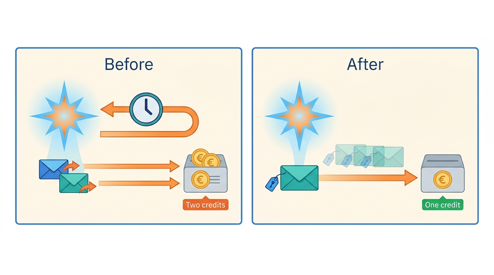
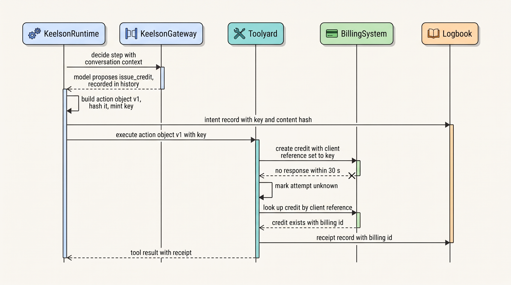
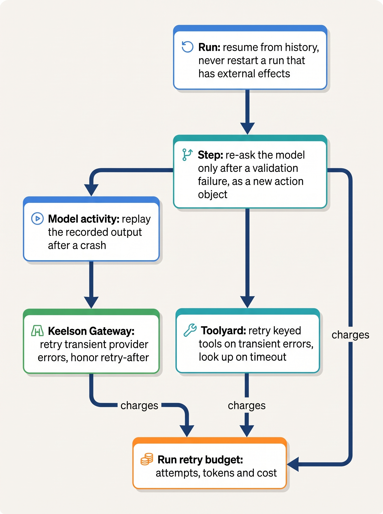
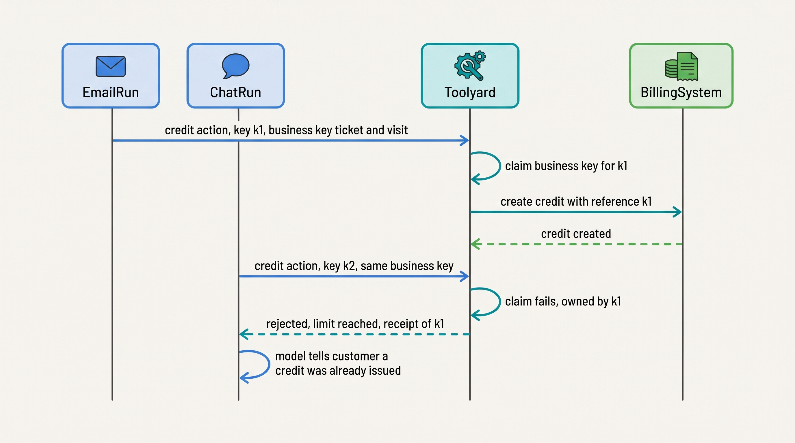
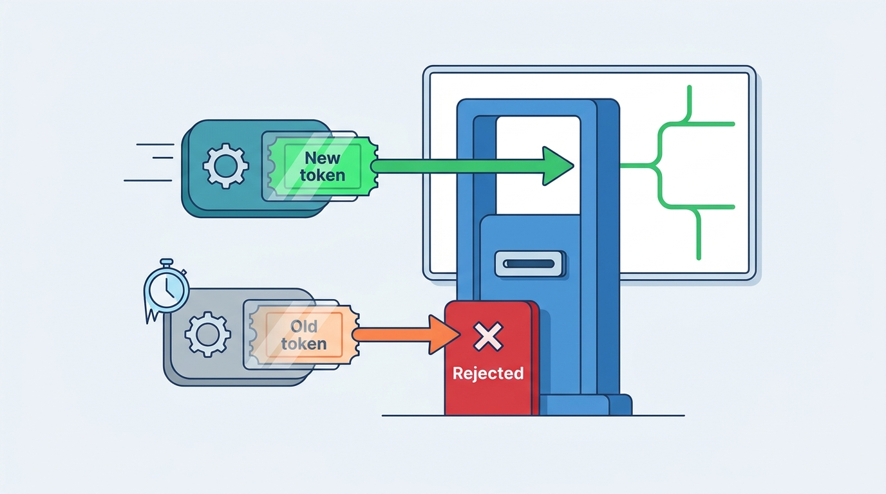

> **IN THIS CHAPTER, YOU WILL:** Learn where retries happen in an agentic system and which layer should own each one, how to bind idempotency keys to action objects so a retry repeats a decision instead of making a new one, how to treat an unknown outcome as a state, and how leases, version checks and business uniqueness keys stop two agent runs from acting on the same entity.

> **WHY THE BUSINESS CARES:** A duplicated credit, payment, posting or email costs money, trust and audit findings, and it happens on bad days, when a slow downstream system makes many actions time out at once. Ostrell's Double Credit cost €31,400 in one afternoon; the controls cost far less than the cleanup.

> **WHY ARCHITECTS SHOULD CARE:** Classic retry practice assumes the caller repeats the same request. A runtime that re-asks the model on retry makes a new decision instead. The idempotency boundary, the retry owners and the concurrency guards are architecture decisions that frameworks leave to whoever writes the tool.

> **KEY POINTS:**
>
> * **Retry the recorded action, never the model.** Once the model's proposal has become an action object, every retry, replay or resume re-sends that object with the same idempotency key. Re-asking the model produces the *different second answer*: a new decision that a key minted from the model's output cannot recognize as a duplicate.
> * **A timeout is an unknown outcome, not a failure.** After a timeout with no receipt, look the action up by its key before doing anything else. Retry only when the lookup proves the action did not happen and the tool is keyed; otherwise escalate to a repair queue. Exactly-once *delivery* does not exist across systems you do not control; exactly-once *effect* is at-least-once execution plus an idempotent receiver plus receipt lookup.
> * **Idempotency keys stop duplicate retries, not duplicate decisions.** Two runs that each decide to credit the same ticket produce two valid keys. Per-entity guards (business uniqueness keys, version checks in the system of record, or leases with fencing tokens) are a separate control, and every action class with a per-entity limit needs one.

> **[FAILURE PATTERNS THIS CHAPTER ADDRESSES](where-agentic-systems-go-wrong.html):**
>
> * **The Different Second Answer** — a step retry that re-samples the model proposes a new action after the first one already took effect, and the system executes both.
> * **The Fire-and-Forget Action** — a tool call that times out leaves nobody knowing whether the credit, posting or email happened once, twice or not at all.
> * **The Token Bonfire** — retries stacked at four layers multiply model calls during a provider outage, and every retry is billed.

<br>
Every distributed system retries, and the hard lessons are old: retry at one layer, back off with jitter, cap attempts, never retry a non-idempotent call without a key. An agentic system inherits all of them and adds one complication. **The component that chooses the next action is a model whose output varies from one call to the next.** Recovery code that re-runs the step that called the model does not repeat a request; it asks a fresh question and may get another tool, another amount or another recipient. The downstream system cannot tell the second request is a duplicate, because it is not.

The fix is to separate *deciding* from *doing*. The model's proposal is recorded once and frozen into an **action object**, the typed, versioned record of one intended external action that [[side-effects-and-external-actions]] defines. Everything that retries, replays or resumes works on that object, never on the model. The **idempotency key** travels with the object, and a lookup by key resolves the timeouts that would otherwise lead someone to guess.

Retries are half the topic. Agent platforms run many runs in parallel on the same customers, tickets, ledger periods and repositories. **Two correct runs can make two correct decisions about one entity**, and no idempotency key will notice. That needs concurrency control that belongs to the entity, not to the run.

This chapter owns four terms: the **idempotency key** (for agent actions), the **retry budget**, the **different second answer** and the **lease**. It builds on [[durable-agent-execution]], which records model calls and tool calls as activities in a durable history, and on [[side-effects-and-external-actions]], which defines action objects and receipts. It hands what happens when a multi-step job fails halfway, compensation and the kill switch, to [[partial-failure-and-compensation]].

## Setting the Scene at Ostrell: The Afternoon of the Double Credit

Ostrell, the fictional company this book follows (see [[meet-ostrell]]), runs **Answerdesk**, its customer-support agent for Ostrell Field, on the Keelson platform. Answerdesk handles about **7,100 conversations a day**. One of its action classes is `issue_credit`: a service credit to a business customer, usually after a technician visit went wrong. In early 2027 every credit was at autonomy tier **A1**: Answerdesk drafted it, a support team lead approved it, and the runtime executed it against the billing system.

In March 2027 the billing system slowed down during a database maintenance window, and many credit calls took longer than the **30 seconds** Answerdesk's tool allowed. Each timeout surfaced in Keelson Runtime as a failed step, and the step retry policy re-ran the step. That step was one unit, "ask the model for the next action and execute it", so the retry re-sent the conversation to the model, the model proposed the credit again, and the runtime executed the new proposal under the team lead's existing approval, once with a different amount. The billing system had processed the first calls, just slowly.

**212 customers** received duplicate credits, **€31,400** in total. Lena Brandt, Director of Support Operations, learned of it from the billing team's reconciliation, not from Keelson. Jonas Lindqvist, principal engineer for Keelson Runtime, led the review. His timeline showed four mechanisms that each looked reasonable alone:

| Mechanism | What it did | Why it was wrong for this action |
| --- | --- | --- |
| Tool timeout of 30 s | Declared the call failed | A timeout says nothing about whether the credit was created |
| Step retry (3 attempts) | Re-ran "decide and act" | Re-running the decide half re-sampled the model |
| Approval attached to the step | Let the retried step execute | The approver had approved one specific credit, not "whatever the step does next" |
| Billing call without a client reference | Created a new credit per request | The billing system supported a unique client reference, but Answerdesk did not send one |

A Logbook query during the review found a second, smaller problem: tickets where a customer had written by email and by chat about the same missed visit, two Answerdesk runs had each drafted a credit, and two team leads had approved them. No retry was involved; each run had behaved correctly.

Tomas Verhoef, Ostrell's Chief Architect, put the question to the architecture forum: **what must be true of every retry and every concurrent run in Keelson so that one decision produces at most one effect, and one entity gets at most the actions its policy allows, whatever times out and whatever runs in parallel?**

## Concepts: Retries, Keys, Unknown Outcomes and Leases

### Where retries happen

A **retry** is a repeated attempt after an earlier attempt failed or did not report. An agent platform retries at five layers, often all at once: the **transport** (same bytes), the **model call** (a new sample unless the recorded result is replayed), the **tool call** (same arguments, if recorded), the **step** of the agent loop (a new sample if the step calls the model) and the **run** (a new trajectory). The deeper the layer, the less a retry regenerates. The architectural question is not "should we retry?" but **which layer may retry which operation, and what it may regenerate**.

### The different second answer

The **different second answer** is the failure in which recovery code re-asks the model after a partial or unknown side effect, and the model proposes a different action from the one already started. A small variation (the same credit, €5 higher) is often worse than a large one, because it looks like a legitimate new request to every downstream check.

It is a property of the recovery design, not of the model. A runtime that records the model's output before acting and replays it never sees a second answer; one that retries "ask and act" as one unit sees one at every downstream timeout.


**Figure 1:** *Before the fix a step retry re-asked the model and produced a second credit; after it, the model decides once and every retry repeats the same keyed action object.*

### The idempotency key for an agent action

An **idempotency key** is a client-supplied identifier that lets a receiver recognize a repeated request and return the original result instead of acting again. Stripe set out the pattern in 2017; its API saves the first result for a key, returns it on retries and rejects a reuse with different parameters ([Stripe, 2017](https://stripe.com/blog/idempotency); [Stripe API reference, n.d., accessed 2026-10](https://docs.stripe.com/api/idempotent_requests)).

For an agent action, the definition needs three additions:

1. **The key identifies the action object, not the request or the model's output.** Deterministic code mints it once, when the object is created, and records it in durable history before the first attempt; every attempt, replay and resume reads it from there.
2. **The key is bound to the object's content.** The receiver, or the broker in front of it, stores a parameter fingerprint with the key and rejects a reuse whose parameters differ, turning a silently different second action into a loud error.
3. **The model never chooses the key.** A key the model writes into tool arguments changes when the model is re-asked, and a key generated fresh per call is no key at all. The orchestrator derives it from durable identity (agent, run, action object).

### Exactly-once effect and the unknown outcome

No engine gives exactly-once *delivery* to a system it does not control. What is achievable is an **exactly-once effect**: at-least-once execution, plus an idempotency key the receiver deduplicates on, plus a receipt lookup for attempts whose result was lost. Temporal states the scope precisely: an activity "may be executed multiple times and may even partially complete more than once", while being "observed as completed exactly once" ([Temporal, n.d., accessed 2026-10](https://docs.temporal.io/activity-definition)). Confluent limits Kafka's exactly-once guarantee to Kafka's own processing and excludes calls that update remote stores ([Confluent, 2017, updated 2025](https://www.confluent.io/blog/exactly-once-semantics-are-possible-heres-how-apache-kafka-does-it/)).

An **unknown outcome** is the state of an attempt that received neither a success nor a definite failure: a timeout, a dropped connection, a crashed worker. It is a state, not a kind of failure. The book's rule: *after a timeout with no receipt, the action is `unknown`; check its status with the idempotency key; if it is still unknown, escalate to a repair queue. Never re-ask the model and never blind-retry a non-idempotent call.*

### Concurrency: leases, version checks and business uniqueness keys

Three mechanisms stop two runs from acting on one entity at once. They are often confused:

- A **lease** is a time-limited, renewable, exclusive claim on a task or entity. The holder renews it with heartbeats; if renewal stops, the lease expires and another worker may take over. A lease is safe for correctness only when every write under it carries a **fencing token**, a number that increases with each grant, and the resource rejects tokens lower than one it has seen. Martin Kleppmann's 2016 analysis gives the reason: a holder pauses (for example in garbage collection), the lease expires, another client takes it, and the first wakes up and writes as if it still held it ([Kleppmann, 2016](https://martin.kleppmann.com/2016/02/08/how-to-do-distributed-locking.html)).
- A **version check** (optimistic concurrency) lets any run read and propose but makes the write conditional on the entity still being at the version read. HTTP's `If-Match`, specified in Request for Comments (RFC) 9110, exists "to prevent accidental overwrites when multiple user agents might be acting in parallel on the same resource" ([RFC 9110, June 2022](https://www.rfc-editor.org/rfc/rfc9110.html#section-13.1.1)).
- A **business uniqueness key** encodes a policy limit as a uniqueness constraint: "at most one service credit per technician visit". An idempotency key identifies one decision; a business uniqueness key identifies *what the decision is about*, so it catches two independent decisions that together break the limit.

| Mechanism | Stops | Does not stop | Where it must be enforced |
| --- | --- | --- | --- |
| Idempotency key | The same decision executing twice | Two different decisions about one entity | Receiver, or broker wrapping the receiver |
| Business uniqueness key | Two decisions that together break a per-entity limit | Two different but individually allowed actions racing | The tool broker or the system of record, atomically |
| Version check | A write based on stale state | Two runs that both read, then one wins and the other retries correctly | The system of record |
| Lease with fencing token | Two workers doing the same exclusive work at once | Anything if the resource does not check the token | The resource that accepts the writes |

## Architecture: The Reliability Envelope Around One Action

### The rule set

Keelson's design after the Double Credit came down to seven rules:

1. **Decide once.** The model call is a recorded activity in Keelson Runtime's durable history (see [[durable-agent-execution]]), stored with model and prompt versions before anything acts on it.
2. **Freeze the decision.** Deterministic code turns the tool call into an action object, hashes its content and mints the key from agent id, run id and action object id. Logbook, the evidence log, gets an intent record with key and hash.
3. **Approve the object, not the step.** An approval is bound to the object's content hash, expires, and is re-checked by Bulkhead immediately before dispatch (see [[human-oversight-and-bounded-autonomy]]). A different amount is a different object.
4. **Execute through the broker with the key.** Toolyard stores the key with a parameter fingerprint and passes it downstream: as an `Idempotency-Key` header, as the receiver's client-reference field, or, where the receiver has neither, into Toolyard's own deduplication table.
5. **Resolve unknown outcomes by lookup.** On a timeout Toolyard marks the attempt `unknown` and queries the receiver; it retries only when the lookup says "not applied" and the tool is keyed.
6. **Guard the entity.** Tools with a per-entity limit declare a business uniqueness key in their contract (see [[tool-contracts]]); Toolyard claims it atomically before dispatch.
7. **Record the receipt.** The receiver's identifier for the effect goes to Logbook and back to the runtime as the tool result.

The model never sees "timeout, please try again", because that message invites it to try again.


**Figure 2:** *The reliability envelope around one credit: the model decides once, deterministic code freezes the decision into an action object with a key, and a timeout is resolved by lookup, not by asking the model again.*

### The action attempt as a state machine

Toolyard keeps one record per action object with explicit attempt states, the broker's view of the action lifecycle that [[task-state-and-checkpoints]] records in the task:


**Figure 3:** *An attempt that times out goes to `Unknown`, not to `Failed`; only a lookup, or a human at the repair queue, may move it on.*

`Failed` is reserved for a definite rejection, such as "the contract is closed", which the model may see and reason about. An unknown outcome is not shown to the model. While an action is `Unknown` or `RepairQueue`, the run is suspended on it and the customer is told the credit is being processed, which is true.

### The execution path in code

What matters in the broker's execution path is the order of operations and what it refuses to do:

```python
def execute(action: ActionObject, tool: ToolSpec) -> Receipt:
    rec = idem_store.claim(action.key, fingerprint=action.content_hash)
    if rec.fingerprint != action.content_hash:
        raise ParameterMismatch(action.key)            # loud: a different decision reused a key
    if rec.state == "succeeded":
        return rec.receipt                              # replay or retry: return the original
    if rec.state in ("executing", "unknown"):
        return rec.await_outcome()                      # a duplicate never dispatches alongside
    if tool.business_key and not uniq_store.claim(tool.business_key(action), action.key):
        return Rejected("limit_reached", existing=uniq_store.owner(tool.business_key(action)))

    for attempt in range(tool.retry.max_attempts):      # 1 for unkeyed tools
        try:
            receipt = tool.call(action.params, idempotency_key=action.key,
                                timeout=tool.attempt_timeout)
            return idem_store.succeed(action.key, receipt)
        except DefiniteFailure as e:
            return idem_store.fail(action.key, e)       # visible to the model as a fact
        except (Timeout, ConnectionLost):
            idem_store.mark(action.key, "unknown")
            found = tool.lookup(action.key, retries=tool.lookup_policy)
            if found.exists:
                return idem_store.succeed(action.key, found.receipt)
            if found.absent and tool.keyed:
                backoff_with_jitter(attempt, tool.retry)
                continue
            if found.absent:
                return idem_store.fail(action.key, NotApplied())
            return repair_queue.park(action)            # still unknown: run suspends, a human resolves
    return repair_queue.park(action)
```

The idempotency record is claimed **before** the first call, so a concurrent duplicate (a replayed activity alongside a slow original) finds the claim instead of dispatching; the Internet Engineering Task Force (IETF) draft's `409 Conflict` for a retry "while the original is still processing" is the same case ([IETF draft-08, 2026-10-22](https://datatracker.ietf.org/doc/draft-ietf-httpapi-idempotency-key-header/)). And the business uniqueness claim records the action's key, so a retry of the *same* action passes while a *different* action on the same entity is rejected.

### Retry layers and their owners

The Double Credit stacked three retrying layers: the provider's software development kit (SDK), the runtime's step retry and, inside each step, a fresh model call and tool call. Google's Site Reliability Engineering (SRE) book shows the arithmetic in any system: four attempts at each of three layers make 64 attempts at the bottom ([Google SRE book, "Addressing Cascading Failures", 2016](https://sre.google/sre-book/addressing-cascading-failures/)), so retry only "at the layer immediately above the layer that is rejecting them" ([Google SRE book, "Handling Overload", 2016](https://sre.google/sre-book/handling-overload/)). In an agent platform the multiplication is billed per token, and the middle layers regenerate decisions.

Keelson's rule is **one retrying owner per hop, and nothing above the act step may re-sample the model**:


**Figure 4:** *Each hop has one retrying owner. Retries that regenerate nothing sit at the bottom; the step and run layers resume from recorded history, and every retry draws on the run's budget.*

| Layer | Keelson owner | Retries on | Never retries on | Ostrell setting (post-fix) |
| --- | --- | --- | --- | --- |
| Transport to model providers | Keelson Gateway | Connection errors, 5xx, 429 with `retry-after` | Spend-cap 429; other 4xx | 2 retries, backoff with jitter; retries ≤ 10% of requests per provider |
| Model activity | Keelson Runtime | Worker lost before the result was recorded | A recorded result (replayed instead) | 2 attempts; provider SDK retries disabled |
| Tool call | Toolyard | Transient errors on keyed tools; "not applied" after lookup | Unkeyed tools; definite rejections | 3 attempts; lookup for 10 minutes, then repair queue |
| Step | Keelson Runtime | A proposal failing schema or policy validation, by re-asking the model | Anything after dispatch | 2 re-asks, each a new action object |
| Run | Keelson Runtime | Read-only or workspace-only runs (Scout, Forge) | Runs with dispatched actions | Resume from history; a human "retry" opens a linked new run |

The step row is the subtle one. Re-asking is sometimes right: the proposed credit fails the schema, or the revisit date is outside the technician calendar. That re-ask is a **new decision** with a new action object and key, safe only because the rejected object never left the platform. The rule is mechanical: *once an action object has been dispatched, the step that produced it can no longer re-sample.*

### The retry budget

A **retry budget** caps how much retrying a layer or a run may do: in attempts, in retries as a ratio of first attempts and, for agent runs, in tokens and cost. Google's SRE book describes a per-client budget that allows retries only while they stay below 10% of requests, bounding extra load at about 1.1× instead of about 3× ([Google SRE book, "Handling Overload", 2016](https://sre.google/sre-book/handling-overload/)); Amazon Web Services (AWS) SDKs use a local token bucket for the same purpose ([Brooker, AWS Builders' Library, 2019](https://builder.aws.com/content/3EumjoZascWd1oZiEgL8ORlv3qE/timeouts-retries-and-backoff-with-jitter)).

An agent needs the budget at two scopes. **Per dependency**, so a provider outage does not turn every run's retries into a load spike against a recovering service. **Per run**, so retries draw on the same token, cost and wall-clock budget that stops a runaway loop (Ostrell's controls after the Weekend Fan-out; see [[agent-cost-and-model-routing]]). A run that spends its budget stops in a defined state and escalates.

### Rate limits, backpressure and ordering

HTTP's `429 Too Many Requests` means the client "has sent too many requests in a given amount of time" and "MAY include a Retry-After header" ([RFC 6585, April 2012](https://www.rfc-editor.org/rfc/rfc6585#section-4)). Not every 429 is transient: Anthropic's API documentation notes that a 429 caused by reaching a usage tier's monthly spend cap has no `retry-after` header and keeps failing until access resumes ([Anthropic API errors, n.d., accessed 2026-10](https://platform.claude.com/docs/en/api/errors)). And an agent generates its own pressure: a loop calling a slow tool, or sub-agents that all hit one internal system.

**Backpressure** pushes that pressure back to where work enters instead of absorbing it in retries. Toolyard enforces rate limits per tool, tenant and agent, and when a downstream circuit opens it returns a definite "deferred" result, not a timeout. Keelson Runtime turns "deferred" into a durable timer, so the run sleeps without holding a worker, and Answerdesk tells the customer the action is queued. The run *waits durably*; it does not spin.

Ordering matters in two places. **Callbacks** from external systems arrive late, twice or out of order; the author's agentic-finance-platform interview design (step `idempotency`) dedupes them on the provider's event id and keeps a monotonic `status_seq` so a stale "pending" cannot overwrite "settled" (the vehicle book's [[events-webhooks-and-sync]] covers this in depth). **Actions on one entity** sometimes need order, such as a reversal after the posting it reverses; Toolyard serializes dispatch per entity key rather than trusting the model to sequence calls.

## Concurrency: Two Runs, One Entity

### Where Ostrell's runs collide

In the review's second finding, a customer whose technician did not show up wrote an email and opened a chat, each channel started its own Answerdesk run, and both drafted a credit. The policy, "one service credit per technician visit", existed only in the prompt and the approvers' heads. Every Ostrell agent has an equivalent entity:

| Agent | Entity two runs can collide on | Limit that must hold | Guard Keelson uses |
| --- | --- | --- | --- |
| Answerdesk | Ticket and visit | At most one service credit per technician visit; at most one pending credit proposal per ticket; at most 1 technician revisit per ticket | Business uniqueness key in Toolyard; version check on the ticket |
| Closewise | Legal entity, account and accounting period | One accrual proposal per entity, account, period and reason | One open workflow per entity and period; unique key on the enterprise resource planning (ERP) posting |
| Dealroom | Opportunity and quote | One live draft quote per opportunity | Version check on the quote in the customer relationship management (CRM) system |
| Forge | Repository branch and issue | One agent task per issue; one writer per branch | Idempotent task submission; lease on the task with fencing at the branch |
| Peoplepoint | Employee leave request | One submission per confirmed request | Idempotency key on submission |

### Choosing the guard

The choice follows from where the entity's truth lives and how long the run holds it.

**Business uniqueness keys** fit per-entity limits on actions, most of what agents need. They are cheap, enforced where every action passes, and fail with a result the model can relay: "a credit was already issued for this visit". Their weakness is scope: a credit a human issues directly in the billing system never claims the key. Limits that must also cover human actions belong in the system of record.

**Version checks** fit the agent's natural rhythm of read, reason, write. The run reads the ticket at version 14 and the write is conditional on version 14; if anyone changed the ticket meanwhile, the write fails, the runtime re-reads and the model decides again on current facts. That re-decision is safe because the conflicting write never happened. The author's agentic-healthcare-platform interview design (step `gate`) does the same for clinician sign-off: a `case_version` check returns `409 stale_version` when two clinicians race.

**Leases** fit exclusive *work*: a runner that owns a Forge task, a worker that owns one Closewise close run, a team lead who claims an approval card. A lock without expiry would turn every crashed worker into a stuck entity. But long model calls make it likely that a holder outlives its lease: a Forge runner that stalls for six minutes, loses its lease and then pushes to the branch the new runner is using is Kleppmann's paused client. The defense is the fencing token, which helps only where something checks it.


**Figure 5:** *Two runs, two valid keys, one business uniqueness key: the second decision is rejected with the first one's receipt, and the model relays a fact instead of issuing a second credit.*

### Fencing where the broker is the resource

Most Ostrell agent writes pass through Toolyard, so Toolyard can check fencing tokens: a run holding a lease sends its token with each action, and Toolyard rejects tokens older than the newest it has seen for that entity. A window remains between Toolyard's check and the downstream write, and Kleppmann's point stands: the only complete fence is one the system of record checks. Keelson uses broker-side fencing where the worst case is a duplicate that reconciliation will catch, and requires a system-of-record check (version check, unique constraint, branch protection) where it is not.


**Figure 6:** *A lease alone does not protect a branch: a runner that stalls and loses its lease is stopped only by a fencing token that the resource itself checks.*

### One run per entity, from the workflow engine

For agents that run as workflows, the cheapest guard is the workflow id. Temporal, for example, documents that "there can be at most one Workflow Execution with a given ID running at any point in time" ([Temporal, n.d., accessed 2026-10](https://docs.temporal.io/workflow-execution/workflowid-runid)). Keelson's engine (unnamed) offers the same property, and Closewise's workflow id is the entity and period, so a second "run the close for Ostrell Field Deutschland, October" attaches to the open run instead of starting a parallel one. That would have made the Half-Posted Accrual's re-run (see [[task-state-and-checkpoints]]) resume, not repeat.

## What the Evidence Says

The mechanisms in this chapter are old and well documented. What is new is the variable component in the middle, and the evidence on it is thinner.

**Model outputs vary on identical input.** Anthropic's documentation states that "even with temperature set to 0, the results will not be fully deterministic" ([Anthropic glossary, n.d., accessed 2026-10](https://platform.claude.com/docs/en/about-claude/glossary)). Thinking Machines Lab's September 2025 engineering post measured an open-weight large language model (LLM) served with vLLM: 1,000 completions of one prompt at temperature 0 gave **80 distinct completions**, traced mainly to batch-size-dependent kernels; batch-invariant kernels made all 1,000 identical, at a throughput cost ([He, Thinking Machines Lab, 2025](https://thinkingmachines.ai/blog/defeating-nondeterminism-in-llm-inference/)). One model on one serving stack, not commercial APIs, but a retry that re-asks the model should expect a different answer sometimes.

**Trajectories vary more than single outputs.** τ-bench's pass^k measures whether an agent succeeds on all of k repeated trials of a task; the best 2024 agent tested fell below 25% pass^8 on retail tasks ([Yao et al., 2024](https://arxiv.org/abs/2406.12045), preprint). It is a simulated-user benchmark with superseded models, so read it as evidence of the phenomenon, not as a rate. Restarting a run from the beginning is running a new trial.

**Agents repeat themselves without retry logic.** In the MAST taxonomy, built from more than 1,600 annotated traces across seven open-source multi-agent frameworks, step repetition was the most frequent failure mode at **15.7%** ([Cemri et al., 2025](https://arxiv.org/abs/2503.13657), preprint). These are benchmark tasks, not production side effects, but the model can generate a duplicate tool call by itself, and a fresh duplicate is a new action object: only a business uniqueness key or a per-run call cap catches it.

**Durable engines differ in what they re-run.** Temporal, Azure Durable Functions, DBOS, Restate and Inngest replay recorded step results on recovery ([Temporal, n.d.](https://docs.temporal.io/workflows); [Microsoft Learn, 2026-10-12](https://learn.microsoft.com/en-us/azure/azure-functions/durable/durable-functions-code-constraints)). LangGraph documents the opposite at node level: after an interrupt "the runtime restarts the entire node from the beginning", side effects before it "must be idempotent", and replay from a checkpoint re-executes "any LLM calls" ([LangGraph interrupts](https://docs.langchain.com/oss/python/langgraph/interrupts) and [checkpointers](https://docs.langchain.com/oss/python/langgraph/checkpointers), n.d., accessed 2026-10). "We use checkpointing" says nothing about the different second answer until you know the granularity: if one node both calls the model and executes the tool, a crash between them re-samples the model.

**Framework retry defaults stack.** As of October 2026, Temporal's default activity retry has unlimited attempts ([Temporal, n.d.](https://docs.temporal.io/encyclopedia/retry-policies)), LangGraph's node retry defaults to three attempts ([LangGraph, n.d.](https://docs.langchain.com/oss/python/langgraph/fault-tolerance)) and Anthropic's SDKs retry twice by default ([Anthropic, n.d.](https://platform.claude.com/docs/en/api/errors)). Composed without configuration, that is nine model calls per activity attempt with no upper bound on attempts (the author's arithmetic, not a measurement).

**Idempotency semantics are not standardized.** Stripe's v1 API returns the saved result for a key, including a saved `500`, and may prune keys after 24 hours; its v2 API retries failed work to completion ([Stripe, n.d., accessed 2026-10](https://docs.stripe.com/api/idempotent_requests)). AWS returns a semantically equivalent response for a repeated client token and an error when parameters differ ([Featonby, AWS Builders' Library, n.d.](https://aws.amazon.com/builders-library/making-retries-safe-with-idempotent-APIs/)). The IETF `Idempotency-Key` header has been a draft since 2021; revision -08 (October 2026) specifies 400 for a missing key, 422 for a reused key with a different payload and 409 for a retry while the original runs, but it is not a standard ([IETF, 2026-10-22](https://datatracker.ietf.org/doc/draft-ietf-httpapi-idempotency-key-header/)). Each tool contract must state its receiver's semantics, including key lifetime.

**Tool annotations are hints.** The Model Context Protocol (MCP) defines `idempotentHint`, but its 2025-11-25 schema says annotations are "not guaranteed to provide a faithful description of tool behavior" and that clients "should never make tool use decisions based on ToolAnnotations received from untrusted servers" ([MCP schema, 2025-11-25](https://modelcontextprotocol.io/specification/2025-11-25/schema)). Retry policy comes from the registry's reviewed contract (see [[tool-ecosystems-and-mcp]]).

**What is missing.** No published source found for this chapter measures how often production agents duplicate or diverge side effects on retry or resume, or compares the guards above in agent workloads. The recommendations rest on established distributed-systems practice and documented component behavior; that the different second answer is a leading cause of duplicate agent side effects is the author's judgement.

## Worked Example: Answerdesk Credits After the Fix

By November 2027 Answerdesk's credits up to **€250** were at tier **A2** (promoted in October 2027), executed within limits and sampled after the fact; larger credits stayed at A1. The counts below are illustrative, not ledger figures.

**The tool contract.** Toolyard's `issue_credit` contract declares: keyed (the billing system accepts a client reference unique per customer account and returns the existing credit on a repeat); lookup by client reference; attempt timeout 30 s, well above the billing system's normal p99.9 latency; up to 3 attempts on transient errors; lookup for up to 10 minutes before the repair queue; business uniqueness key `credit:{ticket_id}:{visit_id}:{reason_code}`; A2 limit €250 and at most one service credit per technician visit.

**A slow afternoon.** In November the billing system slowed down again, for about three hours on a busy Monday. Answerdesk dispatched **14** credit actions in the window; **11** hit the timeout.

| Step | Count | What happened |
| --- | --- | --- |
| Timed out, marked `unknown` | 11 | No retry, no model call; each run suspended on its action |
| Lookup found the credit | 8 | Receipt recorded; runs resumed and confirmed to the customer |
| Lookup found nothing | 2 | Retried with the same key; one succeeded on the first retry, one on the second |
| Still unknown after 10 minutes | 1 | Parked in the repair queue; the billing desk confirmed the next morning that the credit existed |
| Duplicates created | 0 | |

The two retried credits used one and two extra tool calls and **no** extra model calls. In March the same afternoon would have produced one extra model call and, usually, one extra credit per timeout.

**Two channels, one visit.** In the same week **14** tickets had concurrent email and chat runs, and in 9 of them both runs proposed a goodwill credit. Toolyard rejected each second proposal with the first credit's receipt, and Answerdesk told the customer "a credit of €80 was issued for this visit on 12 November", which was true and specific.

**The parameter-mismatch alarm.** One alert fired that month: Toolyard rejected a key reused with a different fingerprint. A deploy had changed how amounts were rounded while runs were in flight, and a replayed activity rebuilt one action object as €79.99 instead of the original €80.00. Nothing was credited twice. The fix made replay read the recorded action object instead of rebuilding it (see [[versioning-agent-systems]] on code changes and in-flight runs).

## Failure Modes and Recovery

| Scenario | Detection | Containment | Recovery |
| --- | --- | --- | --- |
| Tool call times out after the effect happened (the Double Credit) | Attempt state `unknown`; unknown outcomes per tool in Wake, Keelson's tracing and metrics service | Run suspended on the action; no model call; no blind retry | Lookup by key returns the receipt; run resumes |
| Recovery re-asks the model after dispatch (the different second answer) | Toolyard sees a second action object for an entity with an open or succeeded action; business key rejects it | Rule that a dispatched action freezes its step; business uniqueness key | The run resumes from the recorded action; the second object is discarded and logged |
| Same key, different parameters | Toolyard fingerprint mismatch; alert to the agent owner | Request rejected before dispatch | Find why the object changed (deploy, nondeterministic code in replay); fix and resume |
| Two runs act on one entity (email and chat) | Business key claim fails; Logbook query for entities with two actions per limit window | Second action rejected with the first receipt | Model relays the fact to the customer; no human work |
| Lease holder stalls and resumes after expiry (Forge runner in a long model call) | Fencing token older than the newest seen for the branch | Push rejected by branch protection keyed to the current task attempt | The stale runner stops; the task continues on the new attempt |
| Downstream key retention shorter than the retry horizon | Contract review: receiver's key lifetime versus the longest durable wait | Toolyard keeps its idempotency records longer than the receiver keeps keys (400 days for credits *(assumption)*) | Lookup by client reference instead of key replay |
| Provider outage, retries stacked across layers (Token Bonfire risk) | Gateway retry ratio above budget; per-run budget exhausted | Gateway stops retrying above 10%; runs park on a durable timer | Runs resume when the circuit closes; no regenerated decisions |

The **key-retention** row is easy to miss: a run that waits for approval over a weekend and then retries a "lost" call can outlive a receiver that prunes keys after 24 hours. And the **repair queue** needs a named owner, or unknown becomes permanent. At Ostrell the billing desk owns credits and Group Finance's ERP team owns postings; [[partial-failure-and-compensation]] covers what they do when a lookup finds an effect that should not have happened.

## Trade-offs

| Option | How it works | Right when | Costs and limits |
| --- | --- | --- | --- |
| Receiver-side idempotency key | Receiver stores key, fingerprint and result atomically with the effect | The receiver supports it (payment providers, many cloud APIs, well-built internal services) | Semantics vary per receiver; key retention may be short |
| Broker-side deduplication table | Toolyard records key and outcome; lookup by a receiver field resolves unknowns | The receiver has a client-reference field and a lookup but no key semantics | Needs a reliable lookup; a window remains if the receiver has neither |
| Outbox with a single executor | The decision is written to an outbox in the same transaction as local state; one executor dispatches ([Richardson, n.d.](https://microservices.io/patterns/data/transactional-outbox.html)) | The action must be tied to a local state change, or must wait for approval | The relay may publish twice, so the executor still needs a key |
| No retry; unknown goes to humans | Single attempt; any unknown goes to the repair queue | Irreversible actions to receivers with no idempotency and no lookup (some filings, some legacy systems) | Human workload; such tools should usually stay at A1 or below |

My recommendation: use receiver-side keys wherever the receiver supports them and a broker-side table with lookup otherwise, with two non-negotiables: the orchestrator mints the key and binds it to the action object, and every action class with a per-entity limit has a business uniqueness key or a system-of-record constraint. The recommendation weakens for agents whose effects all land in disposable workspaces (a Forge branch, a Scout document), where whole-task redo is cheaper than per-effect keys.

## Across Domains: How the Stakes Change the Design

The mechanisms are the same in every domain. What changes is the cost of an unknown outcome, how long a run holds an entity, and who resolves the repair queue.

| Concern | Coding agents | Customer operations (support, sales, marketing) | Back office (finance, legal, HR) | High-stakes decisions (healthcare, public benefits) |
| --- | --- | --- | --- | --- |
| Typical effect | Commit, push, pull request (PR), continuous integration (CI) run; occasionally an issue comment or ticket | Credit, refund, reschedule, outbound email | ERP posting, payment instruction, contract-lifecycle-management (CLM) redline acceptance, HR information system (HRIS) change | Signed clinical note or order, eligibility decision, notice to an applicant |
| Idempotency mechanism | Branch per task makes code output idempotent; external effects (issue comments, tickets) need per-effect keys | Receiver keys or client references; send attempts keyed so a provider timeout does not double-send | Unique key on the posting returns the same journal id; payment outbox with callback dedupe | Idempotent sign-off and determination requests; read-back after a lost write |
| Cost of an unknown outcome | Low: inspect the branch | Medium: customer waits; tell them it is in progress | High: a duplicate posting or payment is an audit finding; never blindly resubmit | High: a duplicate notice or order can start conflicting clocks or treatments |
| Concurrency guard | One task per issue (idempotent submission), lease per task, worktree per writer | Business uniqueness key per ticket or contact; suppression re-checked at send time | One run per entity and period; period lock as the outer boundary | Version check on the case; soft claim on review work |
| Repair queue owner | The engineer who owns the task | Support or sales operations desk | Controller's team; maker-checker applies to repairs | Clinician or caseworker; repairs are recorded decisions |

The domain specifics are design examples from the author's interview project, not deployed systems. The coding column follows the ai-coding-cli design (step `cloud`), which retries a cloud task by force-pushing the same task branch; that is idempotent only for git output, so a task that also created a ticket would repeat it. The book's rule: *whole-task redo is acceptable only when every effect lands in a disposable workspace.* The customer-operations column follows the agentic-support-platform design (step `txn-safety`: provider-scoped idempotency, reconcile by lookup, `unknown_external_state` to manual repair) and the agentic-sales-platform design (step `send-gate`), where "a provider timeout after it accepted the message is resolved by the idempotency key on retry, not by re-sending blindly". Live conversation adds a constraint the others lack: the customer cannot wait out a ten-minute lookup, so the unknown state must be visible in the conversation.

The back-office column follows the agentic-finance-platform design (step `idempotency`): the ledger post and the payment are "two different side effects with different failure modes", and "a retry with K is a no-op returning the same journalId". The period lock is the back office's outer concurrency boundary: an accrual approved after its period closed is revalidated, not posted (RECONCILED's [[designing-financial-ledgers]] covers posting design). The high-stakes column follows the agentic-healthcare-platform design (step `gate`: sign-off `idempotencyKey`, `case_version` check, read-back after a lost electronic health record (EHR) write) and the agentic-public-benefits-platform design, which keys determination requests and starts the appeal clock at notice delivery, so a duplicate notice is a due-process problem, not a nuisance.

**Judgement.** The platform can own the whole mechanism: key minting, the idempotency store, the attempt state machine, lookups, retry budgets, business uniqueness keys and broker-side fencing. Domain policy owns three settings: which action classes may retry at all, how long an outcome may stay unknown before a human must act, and who works the repair queue. A platform that lets each domain team build its own retry logic gets five interpretations of "timeout".

## The Chief Architect's View

**Decide where the idempotency boundary sits, once, for the platform.** At Ostrell it is Toolyard: every external action passes through it with an orchestrator-minted key and a fingerprint. Agent teams declare tool contracts; they do not write retry logic for side effects. Check the boundary in every review of a new agent, because frameworks make it easy to put a side-effecting call where the boundary cannot see it, such as a framework tool running inside workflow code.

**Make "never re-ask the model after dispatch" an enforced invariant.** The runtime enforces it (a dispatched action freezes its step) and fault injection tests it: kill workers between dispatch and receipt, time out tools, replay activities, and check that no run produces a second action object for an entity. Sounding, Ostrell's evaluation service, runs these drills on every Keelson Runtime release (see [[building-agent-eval-suites]]).

**Own the retry budgets centrally.** The Gateway team owns per-provider retry ratios, the Toolyard team per-tool caps and timeouts, agent owners per-run budgets within platform maximums. Watch unknown outcomes per tool per day, repair-queue age and retry spend as a share of model spend; a rising unknown rate usually flags a degrading receiver before its owners declare an incident (see [[agent-observability]]).

**Require every per-entity limit to have a per-entity guard.** A limit that lives only in the prompt or in approvers' attention is a limit the system does not have. It is the cheapest control in this chapter and the one most often missing.

**Know what is durable.** Durable: at-least-once execution plus idempotent receivers, one retrying owner per hop, unknown outcome as a state, fencing for leases, constraints for limits. Volatile: framework defaults, the IETF draft's status, each receiver's key semantics and retention. Better models may vary less, but no vendor guarantees determinism, and a deterministic model would not fix a timeout. Nothing here depends on model capability, which is why it belongs in the platform.

## Questions to Ask

1. When a tool call times out, what state is the action in, who looks it up, and what happens if the lookup also fails?
2. Who mints the idempotency key, from which identifiers, and is it recorded in durable history before the first attempt?
3. Does any recovery path (step retry, node restart, replay from checkpoint, a human "try again" button) re-send the conversation to the model after an action was dispatched?
4. Is approval bound to the action object's content, so that a different amount or recipient requires a new approval?
5. Which layers retry model calls and tool calls today, with what attempt limits, and what is the worst-case number of model calls per user action when they stack?
6. How long does each receiver keep idempotency keys, and is that longer than the longest durable wait before a retry?
7. For each per-entity limit in the agent's policy, which component enforces it, and does it see actions taken by humans and other agents?
8. Where leases are used, what checks the fencing token, and how long can a lease holder pause in a model call?
9. Who owns the repair queue for each action class, and what is its age SLO?
10. Which fault-injection drills prove that the invariants above hold on the current release?

## Next

Retries and concurrency guards keep one action from happening twice. They do not help when an agent has finished three steps of a five-step job and the fourth cannot be done, or when a lookup shows that an action happened that should not have. That is the subject of [[partial-failure-and-compensation]]: sagas, compensating actions designed as tools, the kill switch, and the Half-Posted Accrual revisited.

## Sources and Evidence

### Research papers

- [τ-bench: A Benchmark for Tool-Agent-User Interaction in Real-World Domains](https://arxiv.org/abs/2406.12045) — S. Yao et al., 2024 (preprint). Defines pass^k; repeated trials of the same task diverge.
- [Why Do Multi-Agent LLM Systems Fail?](https://arxiv.org/abs/2503.13657) — M. Cemri et al., 2025 (preprint). MAST taxonomy; step repetition as the most frequent annotated failure mode (15.7%).
- [How to do distributed locking](https://martin.kleppmann.com/2016/02/08/how-to-do-distributed-locking.html) — M. Kleppmann, 2016. Leases, the paused-client failure and fencing tokens.

### Specifications, standards and regulation

- [RFC 9110: HTTP Semantics, Section 13.1.1 If-Match](https://www.rfc-editor.org/rfc/rfc9110.html#section-13.1.1) — IETF, 2022. Conditional writes against the lost-update problem.
- [RFC 6585: Additional HTTP Status Codes, Section 4 (429)](https://www.rfc-editor.org/rfc/rfc6585#section-4) — IETF, 2012. Rate limiting and `Retry-After`.
- [The Idempotency-Key HTTP Header Field, draft-ietf-httpapi-idempotency-key-header-08](https://datatracker.ietf.org/doc/draft-ietf-httpapi-idempotency-key-header/) — IETF HTTPAPI working group, 2026 (Internet-Draft, not an RFC). 400/409/422 semantics and payload fingerprints.
- [Model Context Protocol schema, revision 2025-11-25 (ToolAnnotations)](https://modelcontextprotocol.io/specification/2025-11-25/schema) — MCP project, 2025. `idempotentHint` and the rule that annotations are untrusted hints.

### Vendor documentation and engineering reports

- [Designing robust and predictable APIs with idempotency](https://stripe.com/blog/idempotency) — B. Leach, Stripe, 2017. The three network failure points and client-supplied keys.
- [Idempotent requests](https://docs.stripe.com/api/idempotent_requests) — Stripe, n.d., accessed 2026-10. Saved results, parameter comparison, 24-hour pruning, v1 versus v2.
- [Making retries safe with idempotent APIs](https://aws.amazon.com/builders-library/making-retries-safe-with-idempotent-APIs/) — M. Featonby, AWS Builders' Library, n.d., accessed 2026-10. Client tokens, semantic equivalence, parameter-mismatch errors.
- [Timeouts, retries and backoff with jitter](https://builder.aws.com/content/3EumjoZascWd1oZiEgL8ORlv3qE/timeouts-retries-and-backoff-with-jitter) — M. Brooker, AWS Builders' Library, 2019. Retry at one layer, jitter, token-bucket retry limits.
- [Handling Overload](https://sre.google/sre-book/handling-overload/) and [Addressing Cascading Failures](https://sre.google/sre-book/addressing-cascading-failures/) — Google SRE book, 2016. Retry budgets (10%), retry multiplication (64×), deadline propagation.
- [Exactly-once Semantics Are Possible](https://www.confluent.io/blog/exactly-once-semantics-are-possible-heres-how-apache-kafka-does-it/) — N. Narkhede et al., Confluent, 2017 (updated 2025). Exactly-once is scoped to Kafka's own processing.
- [Pattern: Transactional outbox](https://microservices.io/patterns/data/transactional-outbox.html) — C. Richardson, microservices.io, n.d., accessed 2026-10. Outbox relays may publish twice; consumers must be idempotent.
- [Activity definition](https://docs.temporal.io/activity-definition), [Workflows](https://docs.temporal.io/workflows), [Retry policies](https://docs.temporal.io/encyclopedia/retry-policies) and [Workflow Id and Run Id](https://docs.temporal.io/workflow-execution/workflowid-runid) — Temporal, n.d., accessed 2026-10. Activities observed as completed exactly once; replay of recorded results; unlimited default retries; one open execution per workflow id.
- [Durable orchestrator code constraints](https://learn.microsoft.com/en-us/azure/azure-functions/durable/durable-functions-code-constraints) — Microsoft Learn, 2026. Deterministic replay; I/O only in activities.
- [Interrupts](https://docs.langchain.com/oss/python/langgraph/interrupts), [Checkpointers](https://docs.langchain.com/oss/python/langgraph/checkpointers) and [Fault tolerance](https://docs.langchain.com/oss/python/langgraph/fault-tolerance) — LangChain (LangGraph), n.d., accessed 2026-10. Node restart, replay that re-executes model calls, default retry policy.
- [Errors](https://platform.claude.com/docs/en/api/errors) and [Glossary](https://platform.claude.com/docs/en/about-claude/glossary) — Anthropic, n.d., accessed 2026-10. SDK default retries; non-transient spend-limit 429; non-determinism at temperature 0.
- [Defeating Nondeterminism in LLM Inference](https://thinkingmachines.ai/blog/defeating-nondeterminism-in-llm-inference/) — H. He, Thinking Machines Lab, 2025. 80 distinct completions out of 1,000 at temperature 0; batch invariance as the cause.

### Incidents, cases and decisions

- No public incident report found for this chapter documents a duplicate agent side effect caused by a retry. The Double Credit is fictional.

### Design examples from the author's interview project

- Obrenović, Ž., "Agentic Platform Foundations", system-design interview design, `system-design-interviews/data/book/agentic-platform-foundations/interview.json`, 2026. Step `durable`: intent/result records with per-effect idempotency keys.
- Obrenović, Ž., "AI Coding Agent CLI", system-design interview design, `system-design-interviews/data/book/ai-coding-cli/interview.json`, 2026. Steps `agent-loop` (tool-call ids) and `cloud` (leases, heartbeats, attempt caps, branch-per-task, idempotent task submission).
- Obrenović, Ž., "Agentic Support Platform", system-design interview design, `system-design-interviews/data/book/agentic-support-platform/interview.json`, 2026. Step `txn-safety`: provider-scoped idempotency, reconcile before retry, manual repair.
- Obrenović, Ž., "Agentic Sales Platform", system-design interview design, `system-design-interviews/data/book/agentic-sales-platform/interview.json`, 2026. Step `send-gate`: idempotent send attempts and callback dedupe.
- Obrenović, Ž., "Agentic Finance Platform", system-design interview design, `system-design-interviews/data/book/agentic-finance-platform/interview.json`, 2026. Step `idempotency`: idempotent GL posting, payment outbox, monotonic callback sequence, query-before-retry.
- Obrenović, Ž., "Agentic Healthcare Platform", system-design interview design, `system-design-interviews/data/book/agentic-healthcare-platform/interview.json`, 2026. Step `gate`: sign-off idempotency, `case_version` optimistic concurrency, read-back reconciliation.
- Obrenović, Ž., "Agentic Public Benefits Platform", system-design interview design, `system-design-interviews/data/book/agentic-public-benefits-platform/interview.json`, 2026. Idempotency keys on determinations and evidence; appeal clock starting at notice delivery.

Ostrell is fictional; architectural recommendations, labeled inferences and labeled assumptions are the author's judgement.
