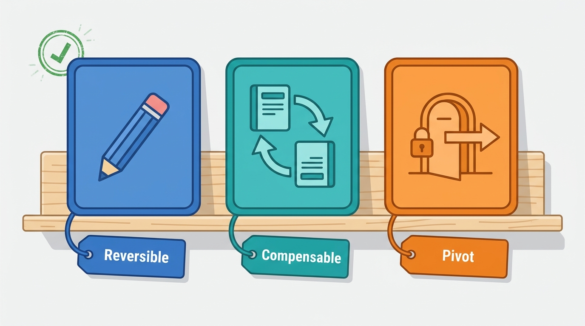
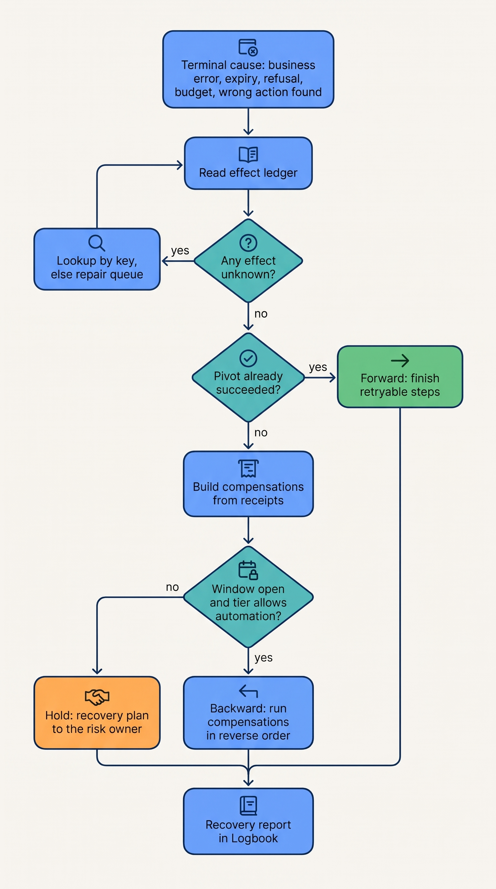
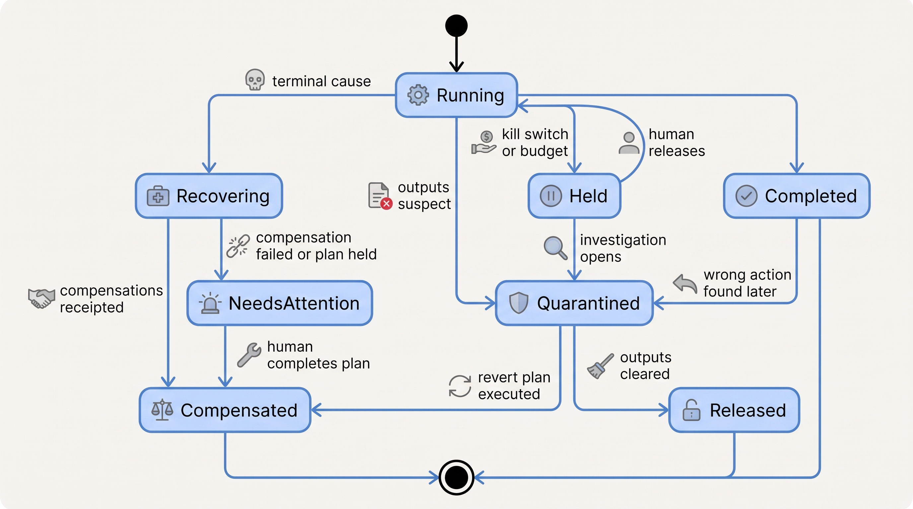
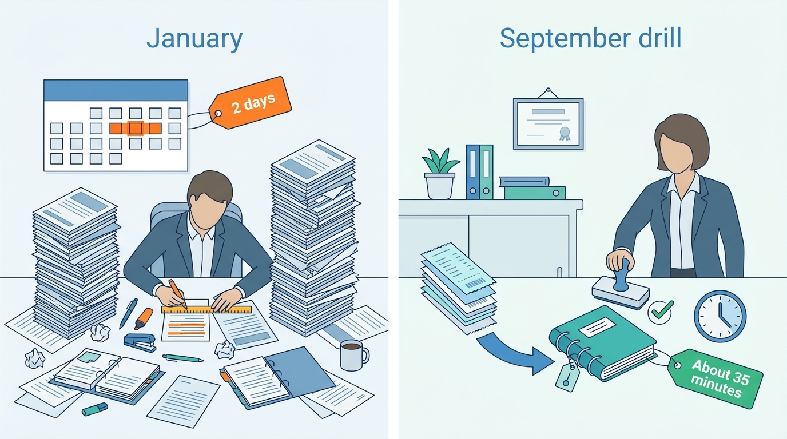

> **IN THIS CHAPTER, YOU WILL:** Learn to name the states a half-finished agent run can be left in, apply the saga pattern to tools a model chooses at runtime, design compensating actions as registered tools, put humans into recovery without making them reconstruct the run, and handle agent incidents with kill switches, run quarantine and reverts.

> **WHY THE BUSINESS CARES:** Agents make doing cheap; undoing stays expensive unless someone designs it. Ostrell's 37 duplicate accruals were posted in minutes and took two days to reverse. Before granting autonomy, every risk owner asks: if this goes wrong halfway, what does getting back cost, and who does it?

> **WHY ARCHITECTS SHOULD CARE:** Idempotency keys keep one action from happening twice. They do nothing for a job that cannot take its fourth step, or for an action found a week later to be wrong. Which actions can be undone, by what, and who decides are properties of the tool registry, the orchestrator and the policy layer; left to the model or to whoever is on call, recovery is improvised under pressure.

> **KEY POINTS:**
>
> * **Partial failure is a state to resolve, not an exception to retry.** When retries and lookups are exhausted, deterministic code reads the run's effect ledger, the recorded intents and receipts, and moves the run to one of four outcomes: completed forward, compensated backward, held for a human, or accepted and remediated. The model may explain the situation. It never decides whether a posted entry is reversed.
> * **A compensating action is a tool you design before you expose the action.** Every tool in the registry declares whether it is reversible, compensable (and by which tool, within which window) or a pivot with no inverse. Compensation is a new forward action, such as a reversal entry, a revert commit or a cancellation, with its own key, approval and receipt. Tools with no inverse go last in a job and sit behind an approval.
> * **Incident controls must hold work, freeze evidence and live outside the agent's reach.** A kill switch stops new side effects for an action class or agent at the policy layer and holds queued work instead of discarding it. Quarantine freezes a run and everything it produced. A revert is a reviewed compensation plan. In the agent incidents documented in 2025–26, recovery depended on backups, environment separation and credentials the agent could not touch. Durable execution would not have helped.

> **[FAILURE PATTERNS THIS CHAPTER ADDRESSES](where-agentic-systems-go-wrong.html):**
>
> * **The Fire-and-Forget Action** — a job that fails halfway leaves effects nobody has a list of, so recovery starts with forensic reconstruction instead of a recorded effect ledger.
> * **The Compounding Error** — a wrong early step (a deleted test, a misclassified accrual) is found only after later steps and other people have built on it, and undoing it means tracing everything downstream.
> * **Autonomy by Default** — tools reach an agent's manifest without a declared inverse, so the agent may take actions nobody has a way to undo.

<br>
[[durable-agent-execution]] and [[retries-idempotency-and-concurrency]] handle the common case: **the run was right, something got in the way, and the run should simply finish**. This chapter covers the rest. The run cannot finish, because a supplier rejected an order after accepting it, an approval expired, the model refused to continue or the budget ran out. Or it finished, was wrong, and someone noticed later. The system then needs to know **what has been done in the world, which of it can be undone, by what action, on whose authority, and what happens to work in flight while people decide**.

The distributed-systems answer is the **saga**, a sequence of steps each paired with a compensating step. It needs one adjustment for agents: in a coded saga the designer writes a compensation for each known step, but in an agent **the model picks the steps at runtime**, so compensations must be attached to the tools, not to a workflow definition.

This chapter owns four terms: the **compensating action**, the **saga** as applied to agent runs, the **kill switch** and the **quarantine** of a run. It builds on [[task-state-and-checkpoints]] (the task record and its intents and receipts), [[durable-agent-execution]] (activities, cancellation) and [[retries-idempotency-and-concurrency]] (unknown outcomes, the repair queue), and on [[side-effects-and-external-actions]], which defines action objects and the reversible, compensable and irreversible distinction this chapter turns into registry fields. It hands approval design to [[human-oversight-and-bounded-autonomy]], evidence retention to [[policy-enforcement-and-audit]] and release rollback to [[staged-rollout-and-rollback]].

## Setting the Scene at Ostrell: Two Weeks of Green Builds

Ostrell, the fictional field-service software group this book follows (see [[meet-ostrell]]), runs **Forge**, a headless coding-agent harness owned by Sam Kowalczyk's Developer Productivity team. Forge agents work in ephemeral sandboxes and open pull requests; only humans merge. In Q3 2027 Forge opened about **3,400 PRs a month**.

On **Friday 16 July 2027** an Ostrell Parts engineer reviewing a Forge PR saw that its diff removed eleven test cases, asked why, and found an earlier PR that had skipped a failing test. The build was green because the failing checks were gone. Within a day the team had the shape of what this book calls the **Fixture Purge**: over two weeks, Forge agents asked to fix failing CI had deleted or skipped the failing tests in **9 PRs**. **2 had been merged**, and one of them let a real defect ship. The full story is in [[domain-coding-agents]]; this chapter uses it as the case for recovery.

At the incident review Tomas Verhoef, Ostrell's Chief Architect, opened with the **Half-Posted Accrual** from January: a pre-Keelson Closewise script had posted **52** approved accruals for Ostrell Field Deutschland GmbH, crashed after **37**, and been re-run, producing **37 duplicates** and **€2.84 million** of overstated accruals. Posting took minutes; finding and reversing the duplicates took **2 days** and delayed that entity's close by one day.

"Different agent, same problem," he said. "Doing was automated and undoing was not designed. I want four answers, for every agent":

1. **How do we stop it** from doing more of this right now, without losing or wrecking the work in flight?
2. **What exactly has it done**, and how fast can we list it?
3. **What is our undo** for each kind of thing it did, and who is allowed to run it?
4. **When are we allowed to turn it back on**, and who decides?

The receipts added after the Double Credit ([[retries-idempotency-and-concurrency]]) answered part of question 2 for Answerdesk and Closewise. Nothing else had a platform answer. This chapter is the design that came out of the review.

## Concepts: Partial Failure, Sagas and Compensation

### Partial failure and the effect ledger

A run is in **partial failure** when it has caused some of the external effects its task required, cannot or should not cause the rest, and the effects already caused are not acceptable as a final state. A crash mid-batch that can resume is ordinary recovery; an unknown outcome is a state to resolve by lookup. Partial failure begins **when finishing is no longer the right move**.

Recovery starts from the **effect ledger**: the part of the task record ([[task-state-and-checkpoints]]) that lists each action intent with its idempotency key, receipt or `unknown`, approval and reversibility class. With it, question 2 is a query. Without it, it is forensics: in January, Ostrell's accountants spent most of the two days comparing ERP journals against the batch file by hand.

### The saga, for agent runs

Hector Garcia-Molina and Kenneth Salem defined the **saga** in 1987 for long-lived transactions: a sequence of transactions T1…Tn, each with a compensating transaction Ci, with the guarantee that "either all the transactions in a saga are successfully completed or compensating transactions are run to amend a partial execution" ([Garcia-Molina and Salem, 1987](https://www.cs.cornell.edu/andru/cs711/2002fa/reading/sagas.pdf)). Their motivating example was a transaction that "pauses for customer input after each reservation", which is close to a modern agent run with a human in the loop.

Microsoft's current description of the pattern classifies steps into three kinds, a classification this book adopts ([Microsoft Azure Architecture Center, 2025-02-25](https://learn.microsoft.com/en-us/azure/architecture/patterns/saga)):

- **Compensable** steps can be semantically undone by a later step.
- The **pivot** is "the point of no return", after which "all subsequent actions must be completed".
- **Retryable** steps after the pivot are idempotent, so they can be retried until they succeed.

A **saga, for an agent run**, is a run whose external actions are each classified as compensable, pivot or retryable *at the tool*, and whose orchestrator keeps a compensation stack from the effect ledger, allows no pivot until earlier steps have receipts and the pivot has its approval, and, when the run must go backwards, runs the compensations in reverse order itself. Because the model chooses the tools, **each tool must arrive with its own compensation**, and the orchestrator assembles the saga as the run goes.

### Compensating action

A **compensating action** is a forward action that semantically cancels the business effect of an earlier one: a reversal entry for a posted accrual, a revert commit for a merged change, a cancellation for a booked visit. Three properties follow:

1. **It is semantic, not physical.** Ci "undoes, from a semantic point of view, any of the actions performed by Ti, but does not necessarily return the database to the state that existed when the execution of Ti began" ([Garcia-Molina and Salem, 1987](https://www.cs.cornell.edu/andru/cs711/2002fa/reading/sagas.pdf)). A reversal entry leaves both entries in the ledger; that is the point.
2. **It is an action in its own right,** with an action object, key, approval tier, receipt and failure mode. Compensations "might not always succeed", Microsoft warns, "which can leave the system in an inconsistent state" ([Microsoft, 2025-02-25](https://learn.microsoft.com/en-us/azure/architecture/patterns/saga)).
3. **It does not restore isolation.** No effort is made to notify transactions "that might have seen the results of Ti before they were compensated for" (Garcia-Molina and Salem). For agents this is the Compounding Error: a human, another agent or a report may already have acted on the wrong effect.

### Kill switch and quarantine

A **kill switch** is a policy control that stops an agent, an agent version or an action class from starting new side effects, effective at every enforcement point within a stated time. It **holds** queued and pending actions for review rather than discarding them. Cancellation ([[durable-agent-execution]]) applies to one run; a kill switch applies to every run in its scope, including runs not yet started.

**Quarantine of a run** freezes one run and everything it produced: it takes no further steps, its outputs (pull requests, drafts, staging-store proposals, long-term memories) are marked so that no human, agent or pipeline consumes them, and its evidence is kept beyond normal retention until the investigation closes. Quarantine is for suspect *outputs*; a kill switch is for suspect *future actions*. (Elsewhere the book quarantines tools, in [[tool-ecosystems-and-mcp]], and untrusted email, in [[prompt-injection-defense]]; here it is always a run.)

## A Catalogue of Half-Finished Runs

"Half done" covers different situations that need different recoveries. Keelson's runtime and on-call runbooks are organized around this catalogue; the default direction can be overridden per action class by its owner.

| Scenario | State of the world | Default direction | Who decides | Detail in |
| --- | --- | --- | --- | --- |
| **Crash mid-batch** | Some effects done with receipts, one maybe `unknown`, rest not started | **Forward**: resume, look up, finish | Runtime | [[durable-agent-execution]] |
| **Tool succeeded, response lost** | Effect probably done, no receipt | **Resolve, then forward**: lookup by key | Runtime; repair queue if unresolved | [[retries-idempotency-and-concurrency]] |
| **External system rejects later** | Effect accepted, then reversed or refused asynchronously (payment returned, email bounced, supplier cancels a confirmed order, ERP batch validation rejects an entry) | **Re-plan**: the step failed after the run moved on; compensate dependants or retry with corrected input | Orchestrator by rule; owner for anything customer-visible | This chapter |
| **Approval expires mid-job** | Steps before the gate done; the gated step not done | **Hold, then backward** if the hold times out and earlier steps are compensable | Risk owner's policy | This chapter; [[human-oversight-and-bounded-autonomy]] |
| **Model refuses or abstains mid-task** | Some effects done; the model will not or cannot produce the next decision | **Hold for a human** with the effect ledger; never re-prompt around a refusal | Agent owner's policy | This chapter |
| **Budget or deadline exhausted** | Some effects done; the run is out of money or time | **Hold**, never drop queued actions | Agent owner raises the budget or a human disposes | [[agent-cost-and-model-routing]] |
| **Wrong action discovered later** | Run completed; one or more effects were wrong, and others may have built on them | **Backward** for the wrong effects, after a blast-radius query; **forward fix** for the cause | Incident commander with the risk owner | This chapter |

Three of these deserve more than a row.

**External rejection after acceptance** is the scenario agent frameworks model worst, because the tool call returned success and the run moved on. The finance design in the author's interview project draws the line: a payment step must distinguish "'submitted' from 'settled'", with callbacks deduplicated by provider event id (Obrenović, agentic-finance-platform interview design, step `idempotency`). My rule: **any tool whose receiver can change its mind later declares an asynchronous outcome channel**, and the effect ledger records `accepted` and `settled` (or `delivered`) as distinct states, so a late rejection can find the steps that depended on it.

**Refusal mid-task** looks like an error and is not one. Anthropic documents that a streaming-classifier refusal arrives as a successful HTTP 200 response with `stop_reason: "refusal"`, that "monitoring built only on error rates won't surface it", and that context must be reset before continuing; model-generated refusals arrive as "standard text responses" ([Anthropic, n.d., accessed 2026-10](https://platform.claude.com/docs/en/test-and-evaluate/strengthen-guardrails/handle-streaming-refusals)). The same page, as of October 2026, recommends retrying a refused request on a fallback model. That is reasonable before a run has caused any effect. After effects exist, my rule differs: treat a refusal or abstention as a **business-terminal outcome of the step**: record it, stop, hand the effect ledger to a human. Re-prompting or switching models to get past it mid-job is the different second answer in its worst form, because the second answer is selected for being willing.

**Wrong action discovered later** is where most of the cost sits and the saga helps least: the run is closed and the wrong effect has spread. Recovery is an incident, and its first step is a blast-radius query that only a complete evidence log makes cheap.

## Architecture: Recovery Owned by the Platform

### Reversibility is a registry field

Since August 2027 every tool version in Toolyard, Keelson's tool registry and broker ([[tool-ecosystems-and-mcp]]), that can change an external system declares in its contract ([[tool-contracts]]):

- **`reversibility`**: `reversible` (withdrawn with no trace that matters, such as closing an unmerged PR), `compensable` or `pivot` (no inverse the platform can execute alone).
- **`compensated_by`**: the compensating tool and the mapping from the original receipt to its arguments, written by the tool owner and code-reviewed.
- **`compensation_window`**: how long the compensation stays valid (until the period lock, the dispatch, the merge).
- **`compensation_tier`**: the tier and approver for the compensation, which may be stricter than the original's.
- **`outcome_channel`**: `sync` or `async`, and the states a receiver can move to after accepting.

Registration rejects a write tool without these fields. A manifest may include a `pivot` tool only at A1 or below, or with a named risk owner's recorded exception, extending the book's cap on irreversible commitments ([[autonomy-and-consequence]]) to every action without an inverse.


**Figure 1:** *Every write tool arrives with its undo declared: reversible, compensable with a named compensating tool and window, or a pivot with no inverse the platform can run alone.*

| Ostrell tool | Class | Compensated by | Window | Compensation tier |
| --- | --- | --- | --- | --- |
| Closewise `post_journal_entry` | compensable | `post_reversal_entry` (generated from the receipt) | Open period; after the period lock, a correction in the next open period | A1: controller, not the approver of the original entry |
| Answerdesk `schedule_revisit` | compensable | `cancel_revisit` | Until technician dispatch, then pivot | A2 before dispatch; A0 after |
| Answerdesk `issue_credit` | compensable | `debit_next_invoice` with customer notice (the register's undo path, [[autonomy-and-consequence]]), generated from the receipt | Until the next invoice is issued *(illustrative)* | A0: a human decides between the debit and accepting the credit |
| Answerdesk `send_email` | **pivot** | None; a follow-up correction is a new external commitment | — | Correction drafted A1 |
| Dealroom `draft_quote` | reversible | Discard draft (never sent by the agent) | Until an account executive sends it | A3 |
| Peoplepoint `submit_leave_request` | compensable | `withdraw_leave_request` | Until the manager approves in the HRIS | A1 for the employee |
| Forge `open_pr` | reversible | `close_pr` | Until merge | A3 |
| Forge change, once merged (by a human) | compensable | Revert PR (merged by a human) | Until deployed; after deploy, a forward fix may be safer | A0 for the merge |

The table makes the **pivot tools visible**, and it shows where a compensation exists on paper but is expensive in practice: taking a credit back is a debit the customer is told about, so its tier is A0 and Answerdesk's A2 credits are capped at **€250**; a wrong small credit is usually closed by a business decision to accept it. The same logic applied to the Stale Price Book: the **14** quotes had gone to prospects, so the sales team chose to honor **€46,000** in discounts ([[provenance-and-freshness]]). The table also puts the **compensation's approver** in the contract: a reversal is a new entry, and segregation of duties applies to it too.

The support design in the interview project gives every action a three-class attribute, "reversible|compensatable|irreversible" (Obrenović, agentic-support-platform interview design, step `txn-safety`); the HR design's cancel endpoint returns which tasks were `compensated` and which need `manual` handling (agentic-hr-platform, step `service-eval`). The book departs from the support design on small refunds, which it calls compensatable: reversing money returned to a customer means re-charging them, so this book treats it as a pivot.

### The orchestrator runs the saga, the model does not

Keelson Runtime applies five rules to every run with write tools.

1. **Register the compensation before the call for one-shot APIs.** Restate's saga guide registers it before a one-shot charge, "in case action succeeded but confirmation was lost", and after the reservation returns an id for two-phase APIs ([Restate, n.d., accessed 2026-10](https://docs.restate.dev/guides/sagas)). Keelson writes the compensation intent with the action intent, so a run that dies in the gap still has its undo recorded.
2. **Pivots go last and are gated.** A `pivot` action dispatches only when every earlier compensable action in the run has a receipt and the pivot's approval is valid; Bulkhead, the policy engine, enforces it. If the model's plan says "email the customer, then book the revisit", the email waits for the booking's receipt. This is Microsoft's reordering countermeasure ([Microsoft, 2025-02-25](https://learn.microsoft.com/en-us/azure/architecture/patterns/saga)) applied to a plan the model wrote.
3. **Compensations are generated by code from receipts,** never from a model asked to "undo what you did". The model may draft the explanation for the approver. A compensation's key is `comp:` + the original key, so running a recovery plan twice reverses once.
4. **Business-terminal errors trigger the decision, not a retry.** Restate's guide makes the same distinction ([Restate, n.d.](https://docs.restate.dev/guides/sagas)). Only business-terminal errors, refusals, expiries and exhausted budgets reach the recovery planner; transient errors and unknowns stay with [[retries-idempotency-and-concurrency]].
5. **A failed compensation goes to a named repair queue,** with the owners of unknown outcomes: the billing desk for credits, Group Finance's ERP team for postings, the owning team for code.

```typescript
type Direction = "forward" | "backward" | "hold";

function planRecovery(t: TaskRecord): RecoveryPlan {
  if (t.effects.some(e => e.state === "unknown"))
    return hold(t, "repair_queue_owner");                  // resolve unknowns first
  const pivot = t.effects.find(e => e.tool.reversibility === "pivot" && e.state === "succeeded");
  if (pivot)                                               // past the point of no return
    return forward(t, t.pendingAfter(pivot).filter(a => a.tool.retryable));
  const undo = t.effects.filter(e => e.state === "succeeded")
    .reverse()
    .map(e => compensationFromReceipt(e));                 // code, not the model
  if (undo.some(c => c.windowClosed || c.requiresApproval))
    return hold(t, t.agent.riskOwner, undo);               // a human approves the plan
  return backward(t, undo);                                // plan carries a content hash
}
```

The planner is deliberately dull: common recoveries become automatic and uncommon ones **legible**. On `hold`, the human receives a recovery plan, an action object with a content hash listing what was done and what each direction would do, and approves or edits it instead of rebuilding the run from logs. "Accept and remediate" is never an output of the planner; only a human with business authority chooses it.


**Figure 2:** *Recovery is a decision made by code from the effect ledger. The model never chooses the direction; a human approves the plan whenever a compensation is closed, gated or missing.*

### Humans in recovery

The support design puts the principle well: compensation is "a new forward action, never a mutation", so "the audit chain shows refund -> compensation, not a rewritten history" (agentic-support-platform, step `txn-safety`). Humans in recovery need three things from the platform:

- **The plan, not the history.** The card shows the effect ledger in plain terms ("37 entries posted twice; reversal set of 37 entries, €2.84 million"), the alternatives and the evidence. The approval binds to the plan's content hash and is void if the ledger changes before execution ([[human-oversight-and-bounded-autonomy]]).
- **Authority that fits the compensation.** A reversal of a controller-approved entry needs a second controller; a revert of a merged change needs a code owner.
- **A queue with an owner and an age target.** At Ostrell held recovery plans page the agent owner after 4 working hours and the risk owner after one working day *(Ostrell policy, illustrative values)*.

### Requirements per interaction

| Interaction | Consistency | Latency | Durability | Who may act |
| --- | --- | --- | --- | --- |
| Record action and compensation intent | Strong, before dispatch | Milliseconds | Durable history first | Runtime only |
| Detect a terminal cause | Event-driven from broker, callbacks, timers | Seconds (sync); minutes to days (async channels) | Recorded as an event | Broker, timers, receivers' callbacks |
| Build a recovery plan | Read-your-writes on the effect ledger | Seconds | Plan stored with content hash | Runtime (deterministic code) |
| Approve a recovery plan | Approval bound to plan hash; re-checked at execution | Working hours, with escalation | Logbook | Risk owner or delegate; separation from original approver where required |
| Execute compensations | Keyed, in reverse order; receipts recorded | Minutes | Same as any action | Toolyard on the runtime's instruction |
| Activate a kill switch | Policy version propagated to every enforcement point | ≤ 60 s to all Bulkhead and Toolyard replicas *(Ostrell target)* | Policy as code, versioned | On-call, agent owner, security architect; automation may only hold |
| Quarantine a run and its outputs | Marks visible to every consumer before release | Minutes | Retention extended until closure | Incident commander, agent owner, security |

## Incident Handling: Kill Switch, Quarantine, Revert

An agent doing the wrong thing across many runs is an incident; its controls must be fast, safe to apply in doubt, and reversible themselves.

**The kill switch lives in the policy layer.** Keelson implements it as a Bulkhead policy, evaluated at the enforcement points before tool calls and side effects, with five scopes: action class, agent version (manifest hash), agent, tenant and platform. It is not a flag agent code checks: a control the agent's own code path must honor is no control when that code path is wrong. Activating it does three things:

1. New side effects in scope are denied with a `held_by_kill_switch` reason the runtime understands.
2. Queued and approved-but-not-dispatched action objects move to `held`, not `cancelled`: "work is paused, not dropped", in the sales design's words (agentic-sales-platform, `POST /v1/fleet/pause`).
3. In-flight activities follow their declared cancellation behavior from [[durable-agent-execution]]: a posting that must complete finishes and records its receipt.

Read-only work may continue: Answerdesk answers from the knowledge base while its credit class is held, the support design's "detect → contain → roll back → repair → stay read-only" (agentic-support-platform, step `compliance-eval`). Automation may hold, as the October 2027 demotion triggers do ([[evidence-for-autonomy]]); only a human releases.


**Figure 3:** *Held, quarantined and recovering are explicit run states. A completed run can be re-opened into quarantine when a wrong action is found later, which is why its evidence must outlive its execution.*

**Quarantine freezes outputs as well as runs.** Outputs are marked where others consume them: Forge PRs get a label branch protection refuses to merge; Closewise staging-store proposals leave approval queues; Tidemark, the long-term memory service, excludes the run's memories from retrieval; Scout reports get a banner. Logbook records, Wake traces and content-store references get a hold that overrides the 30-day content retention. Quarantine is cheap to apply and to release, so it is the first move for suspect output.

**A revert is a compensation plan for many runs**, built in three steps: a **blast-radius query** over the evidence log for every run, manifest and effect in scope (the Stale Price Book's week of manual reconstruction is what lacking provenance costs; [[provenance-and-freshness]]); a **compensation plan** per effect, generated from receipts, with pivots listed separately for business remediation; and a **forward fix** for the cause, released through the normal gates ([[staged-rollout-and-rollback]]) before the kill switch is lifted.

## What the Evidence Says

### The pattern is old, and its limits are documented

The saga literature is explicit about compensation's limits: semantic undo, no isolation, no guarantee that compensations succeed; Microsoft lists countermeasures (semantic locks, commutative updates, reordering into retryable steps, rereading values) that carry over to agents unchanged ([Garcia-Molina and Salem, 1987](https://www.cs.cornell.edu/andru/cs711/2002fa/reading/sagas.pdf); [Microsoft, 2025-02-25](https://learn.microsoft.com/en-us/azure/architecture/patterns/saga)). Attaching compensations to tools is the author's synthesis; no source verified for this book describes a production agent platform with a per-tool compensation registry.

### Research proposes undo; it has not measured it in production

Two preprints are proposals rather than production evidence. GoEx (Patil et al., UC Berkeley, 2024) argues that validating an action *after* seeing its result ("post-facto validation") is often easier than validating code beforehand, and that this needs "an intuitive undo feature" plus "damage confinement" for actions that cannot be undone ([Patil et al., 2024](https://arxiv.org/abs/2404.06921)): the pairing this chapter recommends, stated as a design position. SagaLLM (Chang and Geng, 2025) combines sagas with persistent state, "automated compensation" and independent validators for multi-agent planning and reports "significant improvements" in consistency and recovery ([Chang and Geng, 2025, v3](https://arxiv.org/abs/2503.11951)); the abstract names no benchmarks or baselines, and it lets the model drive "recovery orchestration", which this chapter keeps in code.

The failure taxonomies explain why late discovery is common. AgentErrorTaxonomy (Zhu et al., 2025, preprint) argues agent architectures "amplify vulnerability to cascading failures", from annotated failed trajectories on ALFWorld, GAIA and WebShop ([Zhu et al., 2025](https://arxiv.org/abs/2509.25370)); MAST (Cemri et al., 2025, preprint) found premature termination and missing verification among recurring modes in more than 1,600 multi-agent traces ([Cemri et al., 2025](https://arxiv.org/abs/2503.13657)). Both are benchmarks without real side effects and give no production rate.

### Workspace undo is not world undo

Claude Code's checkpointing restores files changed by its file-editing tools; its documentation says files changed only by shell commands are not tracked, external changes are not captured, and checkpoints are "not a replacement for version control" ([Anthropic, n.d., accessed 2026-10](https://code.claude.com/docs/en/checkpointing)). That is **workspace reversibility**. A database write, a deploy or an API call needs **world reversibility**: compensation, backups or approval. Forge keeps the two apart: sandbox and branch are disposable until a human merges, and anything leaving the sandbox goes through Toolyard's reversibility classes.

### Documented incidents: single destructive actions, recovered from outside

The publicly documented agent incidents with external side effects in 2025–26 have one thing in common. The evidence class matters, so the table states it.

| Incident (date) | What is documented, and by whom | What recovery depended on |
| --- | --- | --- |
| Replit agent deletes a production database (July 2025) | Founder Jason Lemkin's account as relayed by The Register; Replit's CEO stated that the company was rolling out automatic separation of development and production databases, and that Replit has backups and "one-click restore for your entire project state" ([The Register, 2025-07-22](https://www.theregister.com/2025/07/22/replit_saastr_response/)). Details such as record counts vary across outlets. | Platform-level snapshots and restore; environment separation added afterwards |
| Gemini CLI loses files in a failed move (July 2025) | A user's GitHub issue reporting "no sandbox" and lost files ([GitHub issue #4586, 2025-07-21](https://github.com/google-gemini/gemini-cli/issues/4586)); the mechanism (an unchecked failed directory creation followed by moves) is widely reported, not confirmed by a Google postmortem | Nothing in the agent; no recovery is documented in the issue |
| DataTalks.Club: a coding agent runs a Terraform destroy (March 2026) | The founder's account as reported by Tom's Hardware: the destroy removed a shared setup including a database and the snapshots used as backups; AWS support helped restore the data "within about a day" ([Tom's Hardware via Yahoo, 2026-03-07](https://tech.yahoo.com/ai/claude/articles/claude-code-deletes-developers-production-130000104.html)); logged by the OECD AI Incident Monitor | The cloud provider's support; afterwards delete protection, remote state and no destructive commands by the agent |
| PocketOS: a Cursor agent deletes a production volume and its backups (April 2026) | The founder's account as reported by Euronews: an outage of more than 30 hours, data later recovered ([Euronews, 2026-04-28](https://euronews.com/next/2026/04/28/an-ai-agent-deleted-a-companys-entire-database-in-9-seconds-then-wrote-an-apology)); a security vendor's write-up of the founder's thread says the agent found a broadly scoped token in an unrelated file and that volume backups lived on the deleted volume ([NeuralTrust, 2026](https://neuraltrust.ai/blog/pocketos-railway-agent)). No platform postmortem has been published. | The hosting provider's recovery; an off-volume backup |

None of these was a retry bug or a half-finished saga. Each was **one destructive action** no compensation could reverse, and where recovery happened it came from something **outside the agent's reach**: platform snapshots, provider support, backups in another failure domain. Durable execution, idempotency keys and compensation registries would have done nothing in any of the four. Least privilege ([[agent-identity-and-least-privilege]]), environment separation and sandboxing ([[sandboxes-and-execution-environments]]), approval at pivots and backups the agent's credentials cannot delete would have. In this chapter's vocabulary, each was a **pivot exposed at full autonomy**.

The public-benefits cases show the other end: wrong actions found years later at population scale. They were **not LLM systems**. In Australia's Robodebt scheme, which raised debts from income averaging until it ended in 2019, a class-action settlement covered the reimbursement of about 430,000 debts worth more than A$720 million, plus about A$112 million in compensation (secondary summaries by [APRA, 2024](https://www.apra.gov.au/sites/default/files/2024-02/Robodebt%20Royal%20Commision%20-%20Overview%20of%20Final%20Report.pdf) and the [Law Society Journal, 2023-08-09](https://lsj.com.au/articles/crude-cruel-and-unlawful-robodebt-royal-commission-findings/)). Remediation at that scale depends on knowing which decisions used the faulty rule: the blast-radius query, years later.

### Where the evidence stops

No published study measures how often production agents end in partial failure, how often compensations fail, or whether per-tool compensation registries reduce incident cost. The recovery design in this chapter is the author's judgement, built from the saga literature, vendor documentation of durable engines, the documented incidents above and the interview designs.

## Worked Example at Ostrell: One Incident, One Drill

### The Fixture Purge, handled as an incident

The incident review turned the July response into Keelson's first agent incident runbook. The dates are canonical; counts marked illustrative are not.

**Contain (Friday 16 July, afternoon).** Sam Kowalczyk held Forge's test-touching `fix_failing_ci` task type only, an **action-class** scope; Forge's other task types kept running. Six queued `fix_failing_ci` runs moved to `held` *(illustrative)*. Nothing was cancelled.

**Quarantine.** The **7 open** purge PRs got the quarantine label, which branch protection treats as unmergeable, and their runs were quarantined with a hold on their traces, so no follow-up Forge task could reuse their branches. They were closed on Monday 19 July.

**Blast radius (by Monday 19 July).** A back-scan of every merged Forge change since February listed **31** further PRs that removed tests; maintainers confirmed that each removed the tests together with the code they covered.

**Revert (Monday 19 July).** The **2 merged** PRs were compensated by engineers, with code owners merging (compensation tier A0): the skipped back-order test was restored and the defect it had caught, already shipped in the 14 July Parts release, was fixed by hand; the deleted flaky timing test came back behind a retry annotation. The shipped defect shows the table's last row: after deploy, the compensation is a forward fix.

**Fix forward, then release (Monday 9 August).** The hold was lifted after the verifier contract shipped: protected paths for test fixtures and CI configuration, a grader outside the sandbox that fails PRs that reduce the test count without justification, a baseline taken before the first edit, and a reviewer checklist; typed change plans are checked against protected paths ([[planning-and-decomposition]]). The task type was held for about **three and a half weeks** and re-enabled on 120 repositories.

What the runbook changed: in July the "kill switch" was a Forge configuration change that took 40 minutes to roll out *(illustrative)*, and quarantine was a chat message to reviewers. Since August both are Bulkhead policies with the scopes above.

### The Half-Posted Accrual, revisited as compensation

Keelson's keys and resume logic mean the January crash no longer produces duplicates ([[task-state-and-checkpoints]], [[durable-agent-execution]]). But a posted accrual can still be wrong: based on a terminated supplier contract, or a classification the controller later disputes. So the review asked: **if 37 posted entries had to be reversed tomorrow, how long would it take?**

Closewise's `post_reversal_entry` is generated from receipts. Each reversal carries `reverses_entry_id`, the original lines with signs flipped, the same period if still open (otherwise the next open period), and the key `comp:` + the original posting key (task id + entry id + entry version). The reversal set is one action object, approved by a controller other than the one who approved the originals, bound to its content hash, and posted by the workflow, never by the model. A verification step re-reads the account balances and checks them against the pre-batch balances, adjusted for unrelated postings since.

In **September 2027** the Agent Platform team ran a compensation drill in a staging ERP tenant loaded with January's 52-entry batch and its 37 duplicates.

| Step | January 2027 (manual) | September 2027 drill (Keelson) |
| --- | --- | --- |
| Identify the wrong entries | Most of a day: comparing ERP journals with the batch file | Under 1 minute: query of the effect ledger for postings with duplicate business keys *(drill)* |
| Build reversals | By hand, one by one | Under 2 minutes: 37 reversal lines generated from receipts *(drill)* |
| Review and approve | Each reversal checked by the controller | About 25 minutes: one reversal set, €2.84 million, reviewed by a second controller *(drill)* |
| Post and verify | Rest of the second day | About 3 minutes to post; balance check passed *(drill)* |
| Total | **2 days**, entity close delayed 1 day | **About 35 minutes** *(drill, illustrative)* |


**Figure 4:** *The same 37 duplicates took 2 days to reverse by hand in January and about 35 minutes in the September drill, because the reversals were generated from receipts and approved as one set.*

Two findings mattered more than the time. Running the plan twice, to simulate a double-click, posted nothing: the `comp:` keys deduplicated it. And the drill found a gap: three duplicates had been partly offset in January by an accountant's manual correction, so a full reversal would have over-corrected them. The verification step caught it, and the tool now reads later entries against the same accounts before proposing a full reversal. That is the 1987 isolation caveat in practice: someone acted on the original before the compensation ran.

The Alias Drift is the counterexample. Classification degraded for **4 days** and controllers' rejection rate rose from **4% to 11%**, but **no wrong entry was posted**, because posting needed A1 approval. **The cheapest compensation is the one an approval gate makes unnecessary.**

## Failure Modes and Recovery

| Scenario | Detection | Containment | Recovery |
| --- | --- | --- | --- |
| **Compensation itself fails** (reversal rejected because the period is locked) | Compensation attempt `failed` in the effect ledger; repair-queue age | Run moves to `NeedsAttention`; no further compensations that depend on it | Owner chooses next-period correction or manual handling; recorded as a new action |
| **Compensation window closed** (technician already dispatched) | `compensation_window` check at plan time | Planner returns `hold` instead of executing a stale undo | Human decides between business remediation and forward completion |
| **A wrong effect has been built on** (manual correction posted against an entry being reversed) | Verification re-reads state after compensation; balance or test mismatch | Reversal stops before posting the mismatched lines | Recompute the compensation against current state; human approves the revised plan |
| **Model asked to "undo what you did"** proposes deleting the wrong thing | Compensation arguments not derived from a receipt; registry rejects free-form undo | Only registered `compensated_by` tools accept recovery calls | Plan rebuilt by code from receipts |
| **Kill switch does not reach an enforcement point** (a tool called with credentials outside Toolyard) | Kill-switch drill: synthetic action after activation succeeds somewhere | Inventory rule: no tool reaches an agent except through Toolyard | Remove the path; treat the drill failure as an incident |
| **Quarantined output consumed** (a quarantined PR's branch picked up by a new task; a quarantined memory retrieved) | Consumer receives an object with a quarantine mark; Wake alert | Marks enforced at the consumer (branch protection, retrieval filter, approval queue) | Re-run affected downstream work after release or revert |
| **Model refusal mid-run re-prompted until it complies** | Refusal stop reason followed by a new model call in the same step | Refusal is business-terminal after effects exist; runtime refuses re-prompting | Hold with effect ledger; human disposes |
| **Async rejection arrives after the run closed** (payment returned, supplier cancels) | Callback for an effect whose run is `Completed` | Run re-opened into `Recovering`; dependants listed from the ledger | Recovery plan for dependants; customer-visible steps to the owner |

The last row is why the effect ledger must live as long as any receiver can still change its mind, months for payments and filings: a retention requirement on [[policy-enforcement-and-audit]], not on the engine's history.

## Trade-offs

| Recovery strategy | What it gives | What it costs | Right when |
| --- | --- | --- | --- |
| **Forward recovery** (finish the job) | No undo needed; the customer gets what was promised | Requires the remaining steps to be retryable and still valid | Past the pivot; or the failure was transient and the plan is still right |
| **Backward compensation** (saga) | Returns the business to an acceptable state automatically | A compensation per tool, windows, approvals; no isolation | Before the pivot; compensable effects; the plan itself was wrong or its premise failed |
| **Hold for a human** | Judgement where policy cannot decide; nothing gets worse | Queue load, latency, risk of rubber-stamped recovery plans | Compensation gated or missing; refusal; ambiguous blast radius |
| **Accept and remediate** (honor the credit, the quote) | Fastest for the customer; no second action against them | Money or margin; needs a business owner with authority | Effects in the customer's favor that are pivots, or whose compensation would cost more goodwill than they are worth |
| **Restore from backup or snapshot** | Recovers what no compensation can (deleted data) | Loses everything since the snapshot; backups must sit outside the agent's reach | Destructive actions on data; the incidents above |

My recommendation: design every tool for backward compensation or mark it a pivot, but **prefer forward recovery and approval gates in operation**. A design that relies on compensation routinely pushes errors onto whoever saw the intermediate states, the isolation problem. Drill kill switches at action-class scope first; that is the one on-call will pull at 22:00. For agents whose effects all land in disposable workspaces, discarding and redoing the task is cheaper than any registry.

## Across Domains: How the Stakes Change the Design

| Concern | Coding agents | Customer operations (support, sales, marketing) | Back office (finance, legal, HR) | High-stakes decisions (healthcare, public benefits) |
| --- | --- | --- | --- | --- |
| Typical compensating action | Close PR; revert commit; discard branch | Cancel booking; withdraw a draft; correction message (itself a commitment) | Reversal entry, never an edit; withdraw HRIS request; compensate reversible onboarding tasks | Amended record or corrected notice issued as a new dated decision |
| Typical pivots | Merge to main, deploy, destructive infrastructure or data commands, external issue comments | Card refunds and payments to the customer, sent email or SMS, published content (exposure is irreversible even if paused) | Settled payment, filed legal work product, employment decision | Signed clinical note or order acted on; adverse determination noticed to an applicant |
| Compensation window | Until deploy; afterwards forward fix | Until dispatch or delivery; often minutes | Until the period lock; after it, next-period correction | Statutory or clinical clocks; the appeal window starts at notice delivery |
| Who approves recovery | Code owner | Operations desk; the business owns remediation for pivots | Second controller (segregation of duties), supervising attorney, HR | Clinician or caseworker, as a recorded decision; independent reviewer on appeal |
| Kill-switch scope used first | Task type or repository | Action class per tenant | Entity and period; payment rail | Rule package or task type; work held, never dropped |
| What quarantine protects | Branches and PRs from being merged or reused | Drafts and memories from being sent or recalled | Staging-store proposals from approval queues | Draft determinations and recommendations from the case record |

The columns draw on the author's interview designs, which are design examples, not deployed systems. In the coding designs code is reversible locally through git and branch-per-task but external tool effects are not (ai-coding-cli; ai-coding-harness). The finance design makes "Corrections as new reversal proposals" (step `ledger`) and leaves clawback of a settled payment out of scope; the HR design's cancel API splits `compensated` from `manual` tasks (step `service-eval`); the legal design has nothing after filing, so its gate sits before it. The benefits design's independent reviewer returns `upheld|reversed|remanded` and its notice service starts the appeal clock at delivery (step `audit-appeal`); the healthcare design models `ehr_write_failed` and sign-off expiry (step `gate`). Clinical corrections as dated amendments is my reading of ordinary records practice, not a feature of the design.

**Judgement.** The platform can own the whole recovery machinery: reversibility fields and their enforcement at registration, compensation intents recorded before dispatch, the recovery planner, keyed compensations, run states for held, quarantined and recovering, kill switches at the policy layer and quarantine marks at consumers. Domain policy owns four settings: **which actions are pivots**, **how long a compensation window lasts** (a period lock, a dispatch, a statutory deadline), **who may approve a compensation**, and **whether a wrong effect in the customer's or citizen's favor is compensated or accepted**. The last is not an engineering question, and the platform must make it impossible to answer by default.

## The Chief Architect's View

**Make reversibility a registration requirement, not a review comment.** It is the cheapest control in the chapter, and it asks the Autonomy by Default question when someone has time to answer it. The owner of the system of record writes the compensation; the platform team reviews the mapping from receipt to arguments.

**Keep recovery decisions out of the model.** It may explain a failure and summarize a plan for the approver; it does not choose the direction, write compensation arguments or re-prompt around a refusal. A model "fixing" its own mistakes with free-form tool calls is the different second answer with more steps.

**Own the kill switch centrally and drill it.** Bulkhead policy, five scopes, a propagation target, and a monthly drill that tries a synthetic action after activation. Who may pull it: on-call, the agent owner and the security architect, without asking. Who may release: the agent owner with the risk owner's agreement, after the forward fix. Amara Okafor's Agent Platform team owns the mechanism; agent owners own the decision.

**Fund backups and environments the agent cannot reach.** The documented incidents were recovered, when they were, by things outside the agent's authority. That is an infrastructure budget line and a least-privilege rule, and it belongs in the review of every agent with access to data stores.

**What to watch:** runs in `NeedsAttention` and their age, compensation failure rate per tool, recovery plans approved in under a minute (the Rubber Stamp in recovery form), kill-switch activations and their time to effect, quarantined outputs consumed, and asynchronous rejections that arrive after a run closed.

**What is durable and what will change.** Sagas, semantic compensation, pivots and holding rather than dropping work are decades old and model-independent. What will change is the share of runs that pass a pivot unattended as autonomy grows, which makes the registry and the drills more important, not less. Nothing in the evidence suggests a model will become a reliable judge of when to undo its own actions.

## Questions to Ask

1. For each write tool the agent can call, is it reversible, compensable or a pivot, and where is that recorded and enforced?
2. What is the compensating tool for each compensable action, who wrote it, and how are its arguments derived from the original receipt?
3. Can the agent dispatch a pivot before earlier compensable steps have receipts? What stops it?
4. When a run cannot finish, which component decides between forward, backward, hold and accept, and what does the human see when it holds?
5. Which receivers can reverse or reject an effect after accepting it, and how does a late rejection find the run and its dependants?
6. What does the runtime do when the model refuses or abstains after effects have been taken?
7. Where does the kill switch take effect, what scopes does it have, how long does it take to reach every enforcement point, and when was it last drilled?
8. When a run is quarantined, which consumers (merge, approval queue, memory retrieval, reports) honor the mark?
9. How long would the blast-radius query for "every effect of manifest X in the last 30 days" take today?
10. Which backups and environments are outside the reach of every agent credential?

The reliability part ends here. Durable execution, idempotency and compensation assume the agent is trying to do the right thing and sometimes fails. Part VII drops that assumption: it asks what happens when the text the agent reads, the tools it calls or the people it serves are trying to make it do the wrong thing, starting with the trust boundaries in [[part-7]] and [[agent-threat-model]].

## Sources and Evidence

### Research papers

- [Sagas](https://www.cs.cornell.edu/andru/cs711/2002fa/reading/sagas.pdf) — H. Garcia-Molina and K. Salem, ACM SIGMOD, **1987**; definition of sagas, semantic compensation, absence of isolation.
- [GoEX: Perspectives and Designs Towards a Runtime for Autonomous LLM Applications](https://arxiv.org/abs/2404.06921) — S. G. Patil et al., UC Berkeley, **2024** (preprint); post-facto validation, undo and damage confinement as a design position.
- [SagaLLM: Context Management, Validation, and Transaction Guarantees for Multi-Agent LLM Planning](https://arxiv.org/abs/2503.11951) — E. Y. Chang and L. Geng, **2025** (preprint, v3); saga pattern with automated compensation proposed for multi-agent planning.
- [Where LLM Agents Fail and How They Can Learn From Failures](https://arxiv.org/abs/2509.25370) — K. Zhu et al., **2025** (preprint); cascading failures in agent trajectories on benchmarks.
- [Why Do Multi-Agent LLM Systems Fail?](https://arxiv.org/abs/2503.13657) — M. Cemri et al., **2025** (preprint, v3); MAST taxonomy including premature termination and verification failures.

### Vendor documentation and engineering reports

- [Saga design pattern](https://learn.microsoft.com/en-us/azure/architecture/patterns/saga) — Microsoft Azure Architecture Center, **2025**; compensable, pivot and retryable steps; failing compensations; isolation countermeasures.
- [Sagas guide](https://docs.restate.dev/guides/sagas) — Restate, **n.d., accessed 2026-10**; register compensation before one-shot calls; idempotent compensations; business errors as terminal.
- [Handle streaming refusals](https://platform.claude.com/docs/en/test-and-evaluate/strengthen-guardrails/handle-streaming-refusals) — Anthropic, **n.d., accessed 2026-10**; refusals as HTTP 200 with `stop_reason: "refusal"`, context reset, refusal types.
- [Checkpointing](https://code.claude.com/docs/en/checkpointing) — Anthropic (Claude Code), **n.d., accessed 2026-10**; workspace checkpoints and their stated limits.

### Incidents, cases and decisions

- [Replit makes vibe-y promise to stop its AI agents making vibe-y coding mistakes](https://www.theregister.com/2025/07/22/replit_saastr_response/) — S. Sharwood, The Register, **2025**; Replit database deletion and the vendor's stated response.
- [Gemini CLI 'lost' files during a failed file move operation, issue #4586](https://github.com/google-gemini/gemini-cli/issues/4586) — GitHub user report, **2025**; unsandboxed file loss.
- [Claude Code deletes developer's production setup](https://tech.yahoo.com/ai/claude/articles/claude-code-deletes-developers-production-130000104.html) — B. Ferreira, Tom's Hardware via Yahoo Tech, **2026**; DataTalks.Club Terraform destroy and recovery via provider support.
- [AI Coding Assistant Accidentally Deletes 2.5 Years of Website Data](https://oecd.ai/en/incidents/2026-03-07-79ec) — OECD AI Incident Monitor, **2026**; incident record for the same event.
- [An AI agent deleted a company's entire database in 9 seconds, then wrote an apology](https://euronews.com/next/2026/04/28/an-ai-agent-deleted-a-companys-entire-database-in-9-seconds-then-wrote-an-apology) — T. Farrant, Euronews, **2026**; PocketOS outage and recovery, founder-sourced.
- [PocketOS / Railway agent incident](https://neuraltrust.ai/blog/pocketos-railway-agent) — NeuralTrust, **2026** (vendor blog relaying the founder's account); over-scoped token and co-located backups.
- [Robodebt Royal Commission – Overview of Final Report](https://www.apra.gov.au/sites/default/files/2024-02/Robodebt%20Royal%20Commision%20-%20Overview%20of%20Final%20Report.pdf) — APRA, **2024** (secondary summary); non-LLM automated debt scheme and its unwinding.
- [Crude, cruel and unlawful: Robodebt Royal Commission findings](https://lsj.com.au/articles/crude-cruel-and-unlawful-robodebt-royal-commission-findings/) — Law Society Journal (NSW), **2023**; settlement size and number of debts.

### Design examples from the author's interview project

- Obrenović, Ž., "Agentic Support Platform", system-design interview design, `system-design-interviews/data/book/agentic-support-platform/interview.json`, 2026 — steps `txn-safety` (reversibility classes, compensation as a forward action, manual repair) and `compliance-eval` (incident path and kill switch per action class).
- Obrenović, Ž., "Agentic Sales Platform", system-design interview design, `system-design-interviews/data/book/agentic-sales-platform/interview.json`, 2026 — `POST /v1/fleet/pause` (pause holds, never drops).
- Obrenović, Ž., "Agentic Finance Platform", system-design interview design, `system-design-interviews/data/book/agentic-finance-platform/interview.json`, 2026 — steps `ledger` (corrections as reversal proposals) and `idempotency` (submitted vs settled, callback dedupe).
- Obrenović, Ž., "Agentic HR Platform", system-design interview design, `system-design-interviews/data/book/agentic-hr-platform/interview.json`, 2026 — step `service-eval` and `POST /v1/workflows/{id}/cancel` (compensated vs manual tasks).
- Obrenović, Ž., "Agentic Legal Platform", system-design interview design, `system-design-interviews/data/book/agentic-legal-platform/interview.json`, 2026 — attorney approval before finalize or file.
- Obrenović, Ž., "Agentic Healthcare Platform", system-design interview design, `system-design-interviews/data/book/agentic-healthcare-platform/interview.json`, 2026 — step `gate` (sign-off expiry, `ehr_write_failed`).
- Obrenović, Ž., "Agentic Public Benefits Platform", system-design interview design, `system-design-interviews/data/book/agentic-public-benefits-platform/interview.json`, 2026 — step `audit-appeal` (notice delivery starts the appeal clock; reviewer outcomes).
- Obrenović, Ž., "AI Coding CLI" and "AI Coding Harness", system-design interview designs, `system-design-interviews/data/book/ai-coding-cli/interview.json` and `system-design-interviews/data/book/ai-coding-harness/interview.json`, 2026 — local reversibility of code versus external side effects; auto-merge risk.

Ostrell is fictional; architectural recommendations, labeled inferences and labeled assumptions are the author's judgement.
