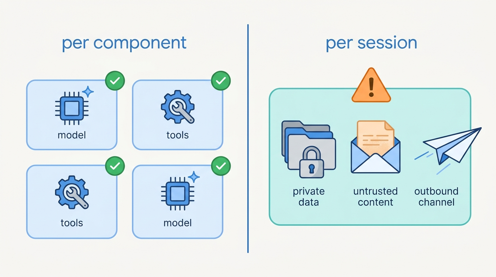
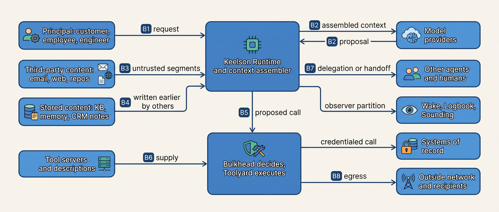
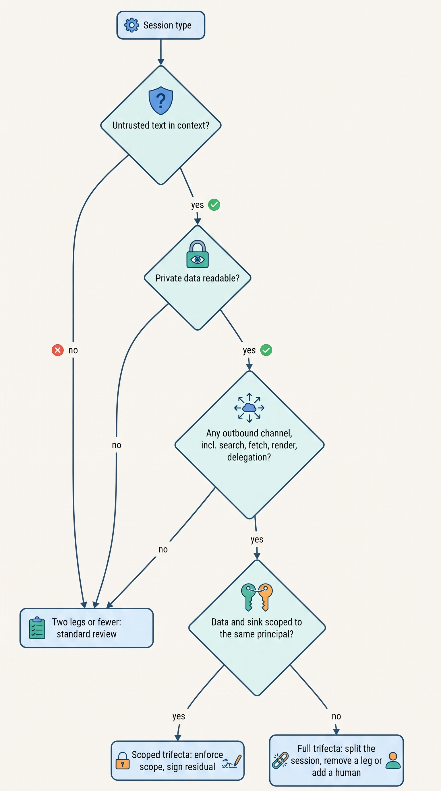
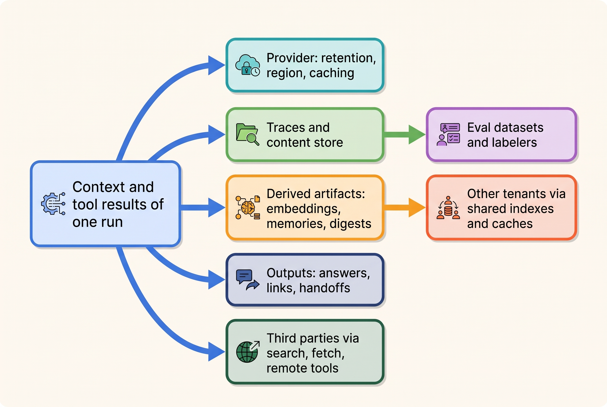
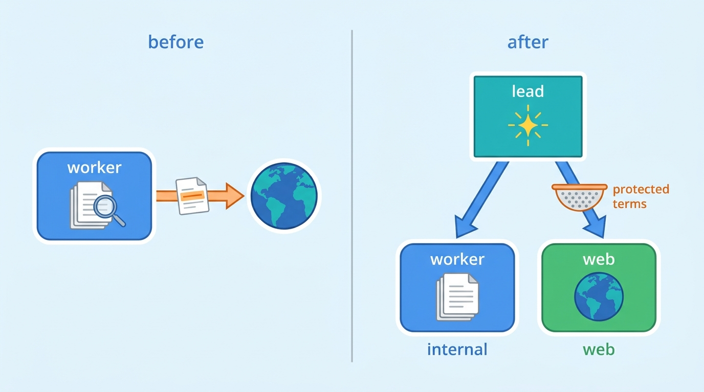

> **IN THIS CHAPTER, YOU WILL:** Learn to draw the trust boundaries of an agentic system, analyze each session type for the lethal trifecta, inventory the data exposure paths (to the provider, to logs, to other tenants, through outputs), and keep the result as a living, versioned threat model tied to each agent version.

> **WHY THE BUSINESS CARES:** The questions a regulator, a customer's security team or a data-protection officer will ask are concrete: where does our data go, who can see it, how long is it kept, and could another customer see it? A threat model that answers them before an incident is cheaper than a breach notification that answers them after.

> **WHY ARCHITECTS SHOULD CARE:** Classic threat models put the model call inside the application and stop at the network edge. In an agent the most important boundary runs through the context window, and the dangerous combinations are per session, not per component. The boundaries you draw decide how agents are split, where enforcement sits and which data may reach which model.

> **KEY POINTS:**
>
> * **Draw boundaries by who can write the text and who can read the result, not by network topology.** An agentic system has eight trust boundaries, and the one classic models miss is inside the model call: operator instructions, a customer's message and an attacker's email sit side by side in one context. Model output is a proposal from a component that has read all of it.
> * **Analyze the lethal trifecta per session type, scoped by principal.** Private data, untrusted content and an outbound channel in one session make exfiltration a matter of one followed instruction. The legs must be counted from tools *and* context sources, an outbound channel includes search queries, rendered links and delegation messages, and a trifecta whose data and sink belong to the same principal is a different risk from one that crosses principals.
> * **Inventory data exposure paths as carefully as attack paths.** Most agent data incidents need no attacker: a stateful provider endpoint outside the retention terms, a trace store everyone can read, a cache or index without a tenant key, an eval dataset copied from production. Each path gets an owner, a control and a retention rule, and the inventory is re-run when a tool, data class, provider or session type changes.

> **[FAILURE PATTERNS THIS CHAPTER ADDRESSES](where-agentic-systems-go-wrong.html):**
>
> * **The Lethal Trifecta** — the threat model is where the three legs are counted per session and either removed, scoped to one principal or signed off as residual risk.
> * **Ambient Authority** — a boundary map that shows every tool call crossing on one service account makes the blast radius of any followed instruction visible before it is exploited.
> * **Context Soup** — when the context window is not drawn as a boundary, untrusted text, other tenants' content and secrets mix with instructions and nobody owns what may enter.

<br>
Every security review of an ordinary service starts with the same picture: a box for the service, arrows for its callers and dependencies, and dotted lines where trust changes. Agentic systems break the picture in two places. **The model is not a component you trust or distrust; it is a component that does whatever the most persuasive text in its context suggests, some of the time.** And the context it reads is assembled at run time from sources with very different authors: your engineers, your customer, a stranger who sent an email, a vendor who changed a tool description last week.

The threat model's job is to say, for each kind of session the agent runs, **what that component could reach if it followed the wrong text, and where data could go that it was never authorized to go**, whether or not anyone attacks.

The chapter owns three terms: **trust boundary** (as applied to agents), the **lethal trifecta** and the **data exposure path**. It builds on [[agentic-reference-architecture]], which names the platform components; on [[context-engineering]], which labels every context segment by trust; and on [[tool-ecosystems-and-mcp]], which records each tool's trifecta axes in the registry. It hands the defenses against injected instructions to [[prompt-injection-defense]], the identity and scope of each call to [[agent-identity-and-least-privilege]], and enforcement and evidence to [[policy-enforcement-and-audit]].

## Setting the Scene at Ostrell: The Threat Model That Missed Both Incidents

Ostrell, the fictional company this book follows (see [[meet-ostrell]]), made its Keelson agent platform generally available internally in **January 2027**. Farah Haddad, its security architect, wrote the platform's first threat model for the launch review. It was a competent document of a familiar kind: a component diagram of Keelson Gateway, Keelson Runtime, Toolyard, Bulkhead, Tidemark, Logbook, Wake, Sounding and the Agent Registry, and **38 threats** classified per component with STRIDE (spoofing, tampering, repudiation, information disclosure, denial of service, elevation of privilege). The model provider appeared as an external dependency reached over TLS. The model call itself was an internal function call.

By June 2027 two incidents had crossed boundaries that document did not draw (Ostrell facts, fictional):

| Incident | What crossed | Boundary missing from v1 |
| --- | --- | --- |
| **February 2027 grounding audit**: **2** Answerdesk conversations quoted another customer's tenant-scoped service level ([[retrieval-and-grounding]]) | Another tenant's knowledge-base article into a customer's answer | The tenant partition inside retrieval; the prototype enforced it only by an instruction in the prompt |
| **The Poisoned Ticket**, May 2027: hidden text in an inbound email asked Answerdesk to forward a contract PDF and five invoices to an outside address; Toolyard's recipient rule blocked it; found **6 days** later ([[prompt-injection-defense]]) | Third-party instructions into the context of an agent that held private documents and an email tool | The context window as a boundary; the per-session combination of private data, untrusted content and an outbound channel |

Neither incident involved a vulnerability in any Keelson component. Every component did what its threat-model row said it should. **What failed was the unit of analysis**: the dangerous property belonged to a session (this agent, reading this content, holding these tools, for this principal), not to any one box.


**Figure 1:** *Every Keelson component passed its own threat-model row; the danger lived in a session that held private data, untrusted content and an outbound channel at once.*


Tomas Verhoef, the Chief Architect, put the question to the architecture forum: **where exactly are the trust boundaries in Keelson, what can go wrong at each one, and how do we keep that answer true as agents, tools and providers change every month?** Farah's second threat model, approved by the forum on **23 June 2027**, is this chapter's worked example. The July injection redesign that followed is told in [[prompt-injection-defense]].

## What a Threat Model Must Cover for an Agent

### The four questions, applied

The Threat Modeling Manifesto (2020) reduces the practice to four questions: "What are we working on? What can go wrong? What are we going to do about it? Did we do a good enough job?" ([Threat Modeling Manifesto](https://www.threatmodelingmanifesto.org/)). They hold for agents unchanged. What changes is the content of the first answer. "What are we working on" for an agent is not a deployment diagram; it is **the set of sessions the agent runs**, each with a principal, a context assembled from labeled sources, a tool set and a set of sinks.

A **session type** is a class of runs with the same principal kind, context sources and tool set: Answerdesk handling an inbound email ticket is one session type, Answerdesk in chat with a logged-in customer is another, even though the agent version is the same. Most of the analysis in this chapter happens per session type, because that is the unit at which the dangerous combinations exist.

### Assets

Agents add two asset classes that ordinary services rarely list: **authority** and **instructions**.

| Asset class | Examples at Ostrell | What harm looks like |
| --- | --- | --- |
| **Data** | Customer contracts and invoices, technician and customer personal data, the ledger, HR records, source code, the price book, tenant-scoped knowledge-base articles | Disclosure to the wrong party, the provider beyond agreed terms, another tenant or an engineer without need |
| **Authority** | Tool scopes, brokered credentials, approval rights, autonomy tiers, delegation rights | An action taken that no principal was entitled to; an approval applied to a different action |
| **Integrity of records** | Systems of record, Tidemark memories, the knowledge-base corpus, Logbook | A wrong posting, a poisoned memory, a tampered audit trail |
| **Instructions and configuration** | Prompts, agent version manifests, tool descriptions, Bulkhead policies, eval suites | A changed tool description or prompt that alters behavior without review; a weakened eval gate |
| **Budget and availability** | Token budgets, provider quotas, approver attention | Runaway spend; an approval queue flooded until reviewers rubber-stamp |

The fourth row is the agent-specific one: a tool description is read as instruction, so it is code-equivalent and part of the supply chain ([[tool-ecosystems-and-mcp]]).

### Actors

| Actor | Access they need | Characteristic goal |
| --- | --- | --- |
| **Content author** (anyone who can write text the agent will read) | None to Ostrell's systems: an email, a web page, a repository issue, a supplier invoice | Steer the agent: exfiltrate, trigger an action, mislead a human |
| **Adversarial principal** (a customer, applicant or employee the agent serves) | A legitimate session | Obtain more than policy allows: a larger credit, another person's record |
| **Supplier** (a tool vendor, a package author, an MCP server operator) | A position in the tool supply chain | Change what tools do or what the model reads about them, by malice or by mistake |
| **Insider** (an engineer, an approver, an operator) | Access to traces, prompts, approval queues, configuration | Read data without need; weaken a policy; approve without looking |
| **Model provider** (a data processor, not an adversary) | Every prompt and output sent to it | None hostile; its retention, residency, sub-processors, caching and bugs are exposure paths |
| **The model itself** | The run's context and tool set | No goal; a fallible component whose proposal reflects whatever its context contained |

Treating the provider as an attacker makes the threat model useless; ignoring it misses the largest data flow in the system. The model has no intent, and the author's interview designs take three stances on it: the agentic-platform-foundations design assumes the model is compromised, the coding CLI design calls it "helpful but not trusted", and the coding harness design treats it as fallible but not adversarial (*design examples*, `agentic-platform-foundations/interview.json`, `ai-coding-cli/interview.json`, `ai-coding-harness/interview.json`). This book adopts a rule that reconciles them: **treat model output as fallible always, and as attacker-influenced whenever the run's context contained text from anyone other than the operator and the system of record.** The second condition is true for nearly every useful session, so in practice the platform-foundations stance wins wherever authority is at stake.

## The Trust-Boundary Map

### Eight boundaries

A **trust boundary** (agent) is a point in an agentic system where text, data or authority passes between parties with different rights to write it, read it or act on it. Four of the eight below exist in any distributed system; four are specific to agents or change character in them.

| # | Boundary | What crosses | Why it matters in an agent |
| --- | --- | --- | --- |
| **B1** | **Principal** | The request and the principal's own text; their identity | The principal may be adversarial (a fraudulent customer); their text is a request, never authority |
| **B2** | **Provider** | The whole assembled context goes out; a proposal comes back | Data leaves your control under someone else's retention, residency and caching; what returns has read everything |
| **B3** | **Context window** | Segments from different authors are concatenated into one input | The model has no internal boundary between instructions and data; this is where classic models stop looking |
| **B4** | **Stored content** | Knowledge-base articles, memories, CRM notes written earlier, by someone else | A temporal boundary: text written last month by another user or tenant re-enters as context today |
| **B5** | **Action** | A proposed tool call becomes an effect with credentials | The only point where deterministic code can still refuse; Bulkhead decides, Toolyard executes |
| **B6** | **Tool supply** | Tool servers, their descriptions, packages, third-party remote servers | Descriptions are instructions; a vendor change is a code change you did not review |
| **B7** | **Agent-to-agent** | Delegated tasks, handoff payloads, sub-agent results | Text from a run that read untrusted content enters a context with more authority |
| **B8** | **Egress** | Network requests, outbound messages, rendered links and images | The exit for exfiltration; a fetched image is as much an outbound request as a sent email |

Two partitions cut across all eight: the **tenant partition** between Ostrell's 9,400 Field customers in every index, cache, memory and trace, and the **observer partition** between the people who run the system (engineers, approvers, eval labelers) and the data they can see. One run may touch a dozen stores, each of which needs the tenant key.


**Figure 2:** *Keelson's trust-boundary map: three boundaries bring text into the run, one sends the whole context to the provider, and every effect leaves through the action and egress boundaries, which are the only places deterministic code can still say no.*

### What may cross each boundary

The map is useful only if each boundary has a rule. The rule names who may write what crosses, who decides, and what must be recorded. These are the requirements Keelson enforces since the June 2027 revision:

| Boundary | Who may write what crosses | Who decides | Latency and consistency | Must be recorded |
| --- | --- | --- | --- | --- |
| B1 Principal | The authenticated principal | Identity service; Runtime binds the principal to the run once | Synchronous at run start; never re-derived from text | Principal, on-behalf-of identity, session type |
| B2 Provider | Only the context assembler | Gateway, by data class of each segment | Synchronous per call; fail closed on an unclassified segment | Provider, region, endpoint, retention terms id, served model |
| B3 Context | Each source, labeled by the runtime | Assembler assigns trust labels by source, never the model | At ingestion | Context manifest with labels and hashes |
| B4 Stored content | Writers allowed by the store's write policy | Tidemark and the index, with tenant key from the run identity | In the query, not after it | Source version, tenant, writer manifest |
| B5 Action | The model proposes; policy disposes | Bulkhead on principal, argument provenance and tier | Synchronous before execution; fail closed | Decision, rule, argument provenance |
| B6 Supply | Registered owners only | Toolyard review; hash pinning | At registration and on every change | Definition hash, reviewer |
| B7 Agent-to-agent | The delegating run, through a typed contract | Runtime: child scopes are a subset of the parent's | Persisted before the child starts | Root and parent run ids, scopes, labels carried |
| B8 Egress | Toolyard and the sandbox proxy | Allowlist by session type | Synchronous; default deny | Destination, bytes, denial |

The B2 row is where most teams have no rule at all; the exposure-path section returns to it.

## The Threat Catalogues, Mapped to Boundaries

Three public catalogues are worth using as vocabulary and checklist, not as a design method. The **OWASP Top 10 for LLM Applications 2025** (LLM01–LLM10, from prompt injection to unbounded consumption) carries the most useful sentence for this chapter in its excessive-agency entry: "Implement authorization in downstream systems rather than relying on an LLM to decide if an action is allowed or not" ([OWASP, 2025](https://genai.owasp.org/llm-top-10/); [LLM06](https://genai.owasp.org/llmrisk/llm062025-excessive-agency/)). The **OWASP Top 10 for Agentic Applications for 2026**, published on 9 December 2025, runs from agent goal hijack (ASI01) to rogue agents (ASI10) ([OWASP GenAI Security Project, 2025](https://genai.owasp.org/resource/owasp-top-10-for-agentic-applications-for-2026/); category names as listed by [Promptfoo](https://www.promptfoo.dev/docs/red-team/owasp-agentic-ai/), since secondary sources differ slightly on titles). **NIST AI 600-1** (July 2024) lists twelve generative-AI risks, of which information security, data privacy, human-AI configuration and value-chain integration bear directly on agents ([NIST, 2024](https://nvlpubs.nist.gov/nistpubs/ai/NIST.AI.600-1.pdf)).

The catalogues are organized by threat, not by where a control can sit. Mapped onto the boundaries, they become design questions:

| Boundary | Threats (catalogue references) | Primary control | Owning chapter |
| --- | --- | --- | --- |
| B1 Principal | Adversarial principal seeks excess authority; social engineering of the agent (ASI03, ASI09) | Authority from identity and policy, never from the request | [[agent-identity-and-least-privilege]] |
| B2 Provider | Disclosure beyond retention terms, residency breach, cross-user cache leakage (LLM02) | Data-class routing in the gateway; contract terms recorded per endpoint | This chapter; [[models-and-the-model-gateway]] |
| B3 Context | Direct and indirect injection, goal hijack, system prompt leakage (LLM01, LLM07, ASI01) | Trust labels; quarantined reading; no secrets in context | [[context-engineering]], [[prompt-injection-defense]] |
| B4 Stored content | Memory and corpus poisoning; cross-tenant retrieval; embedding inversion (LLM04, LLM08, ASI06) | Tenant-keyed queries; write policies; provenance on recall | [[retrieval-and-grounding]], [[agent-memory]] |
| B5 Action | Tool misuse, excessive agency, unexpected code execution (LLM06, ASI02, ASI05) | Policy enforcement point outside the model; tiers; sandboxes | [[policy-enforcement-and-audit]], [[sandboxes-and-execution-environments]] |
| B6 Supply | Tool poisoning, rug pulls, malicious packages (LLM03, ASI04) | Registry, hash pinning, review on change | [[tool-ecosystems-and-mcp]] |
| B7 Agent-to-agent | Injected worker output; insecure inter-agent messages; cascading failure (ASI07, ASI08, ASI10) | Typed contracts; scopes as subsets; labels carried across | [[coordination-and-handoffs]], [[single-and-multi-agent-designs]] |
| B8 Egress | Exfiltration through sends, fetches, rendered links and images (LLM05, LLM02) | Default-deny egress; recipients from policy; no auto-rendering | [[prompt-injection-defense]] |
| Tenant and observer partitions | Cross-tenant leakage; insider access to traces; misinformation to the wrong reader (LLM02, LLM09) | Tenant keys everywhere; purpose-logged access; retention | This chapter; [[agent-observability]] |

The lists are revised every year or two, so cite the version you used. None of them says which threats combine in one session; that is the job of the trifecta analysis.

## The Lethal Trifecta, Analyzed Per Session

### The definition and its sibling

Simon Willison named the **lethal trifecta** in June 2025: an agent is exploitable for data theft if it combines access to **private data**, exposure to **untrusted content**, and the ability to **communicate externally** in a way that can carry data out ([Willison, 2025](https://simonwillison.net/2025/Jun/16/the-lethal-trifecta/)). With all three in one context, a single instruction the model follows is enough. His post catalogues disclosed exfiltration bugs in assistants from most large vendors, most since fixed; it is a list of disclosures, not a measured rate.

Meta's **Agents Rule of Two** (October 2025) generalizes the third leg: within one session an agent should have no more than two of processing untrustworthy input, accessing sensitive systems or private data, and **changing state or communicating externally**; a task needing all three should not run autonomously and needs supervision such as human approval ([Meta, 2025](https://ai.meta.com/blog/practical-ai-agent-security/)). Meta is explicit that the rule does not cover agent mistakes, excessive privilege or misleading answers, and that a compliant design still fails if a user confirms a warning blindly.

This book uses both. The **trifecta** is the exfiltration check; the **Rule of Two** is the stricter check for agents that act, because an injected state change (a credit, a merge, a posting) is harm without any data leaving. In this chapter, the **lethal trifecta** means: one session whose context can contain untrusted content, that can read private data, and that has at least one channel by which output can reach a party not entitled to that data.

### Counting the legs correctly

Most trifecta reviews go wrong in counting, not in principle. Four rules came out of Farah Haddad's June 2027 review.

**1. Count legs from context sources, not only from tools.** A tool registry can record that `email.send` sends outward and `kb.search` reads private data. It cannot know that a ticket body in the context came from an outside sender. The untrusted leg is a property of the session's sources, which the context assembler's trust labels record ([[context-engineering]]). A session that reads only the operator's prompt, the system of record and Ostrell-authored articles has no untrusted leg even if the same agent elsewhere reads email.

**2. An outbound channel is anything a party outside the data's scope can observe.** Besides sending email: a **search query** to a public engine, a **URL fetched** by a tool, a **link or image rendered** by the client (EchoLeak used an automatically fetched image; [NVD, CVE-2025-32711](https://nvd.nist.gov/vuln/detail/CVE-2025-32711)), a **pull request on a public repository** (the GitHub MCP case; [Invariant Labs, 2025](https://invariantlabs.ai/blog/mcp-github-vulnerability)), a **write to a store another tenant reads**, and a **delegation message** to a sub-agent with its own outbound channel.

**3. Private data is relative to the principal.** Sending a customer's own invoice to that customer's verified contact is not exfiltration. I call a session whose private data and outbound channels are all **scoped to the same principal** a **scoped trifecta**: all three legs are present, but whoever can observe the sinks is entitled to everything the session can read. Its residual risks are a wrong scope (the cross-tenant SLA of February 2027) and misleading output, not data reaching a stranger.

**4. Delegation does not remove a leg; it moves it.** A sub-question written by a lead that holds private data, for a worker that can search the web, is an outbound channel; the worker's result is untrusted content for the lead. A split works only if the message between the parts is constrained.

The Keelson release check implements rules 1 to 3 mechanically. A simplified sketch, not Keelson's code:

```python
from dataclasses import dataclass

@dataclass(frozen=True)
class SessionType:
    name: str
    sources: set[str]          # trust labels the assembler may admit: "untrusted", "corpus", ...
    tools: list["ToolEntry"]   # from the Toolyard registry, with trifecta axes
    data_scope: str            # "principal", "tenant", "org"
    sink_scope: str            # who can observe outbound channels: "principal", "tenant", "internal", "public"

def legs(s: SessionType) -> dict[str, bool]:
    return {
        "private": any(t.trifecta.private_data for t in s.tools) or "system_of_record" in s.sources,
        "untrusted": "untrusted" in s.sources or any(t.trifecta.untrusted_content for t in s.tools),
        "outbound": any(t.trifecta.external_send for t in s.tools),   # includes fetch, search, render
    }

def classify(s: SessionType) -> str:
    l = legs(s)
    if not all(l.values()):
        return "two-or-fewer"
    if s.sink_scope == "principal" and s.data_scope == "principal":
        return "scoped-trifecta"          # risk owner signs residual; scope enforced at B4/B5
    return "full-trifecta"                # fails release without a named risk owner's exception
```

The check is coarse by design: it cannot prove scopes are enforced, but it forces a recorded decision and reruns on every manifest change, so a new tool cannot quietly add the third leg.


**Figure 3:** *The trifecta check is asked per session type and counts every outbound channel, not only send tools; only a session whose data and sinks belong to one principal may keep all three legs without a split or a human.*

### Ways to resolve a full trifecta

| Resolution | How | What it costs | Example |
| --- | --- | --- | --- |
| **Remove the untrusted leg** | Untrusted content is read by a separate, tool-less component that returns typed values | An extra model call; content that only makes sense as prose is lost | Answerdesk's quarantined email reader ([[prompt-injection-defense]]) |
| **Remove the private leg** | The session that reads the outside world sees no internal data | Answers that need both must be joined later by a component that has no outbound channel | Scout's web workers since July 2027 (below) |
| **Remove or narrow the outbound leg** | Default-deny egress; recipients only from the system of record; no rendering | Some legitimate sends need a human path | Forge sandboxes; Clausewise never sends to counterparties |
| **Scope to one principal** | Data, recipients and caches all keyed to the run's verified principal | Scoping bugs become the risk | Answerdesk chat |
| **Add a human at the third leg** | The outbound or state-changing action becomes A1 or A0 | Staff time; approval fatigue ([[human-oversight-and-bounded-autonomy]]) | Mail to non-verified addresses is an A0 draft |

Removing the outbound leg is usually cheapest, because egress is enforced by infrastructure that already exists. The author's agentic-platform-foundations design makes "at most two" legs a platform rule and prefers deterministic allowlists over classifier verdicts for exactly this reason (*design example*, `agentic-platform-foundations/interview.json`, step `security`). Its coding CLI design runs read-only tools without a policy check, yet records that "filesystem isolation without egress control still allows exfiltration" (*design example*, `ai-coding-cli/interview.json`, step `safety`). This book reconciles the two with one rule for read-only tools: **reads are free only while the session has no open egress**.

## Data Exposure Paths

### Most data incidents need no attacker

A **data exposure path** is a route by which data in an agent's context, tool results or derived artifacts can reach a party, store or jurisdiction outside the scope for which it was authorized. The trifecta covers the paths an attacker opens. The more common ones are opened by the architecture itself.

| Class | Path | Documented evidence | Typical control |
| --- | --- | --- | --- |
| **To the provider** | Prompts, outputs and files retained beyond agreed terms; stateful endpoints; abuse-monitoring logs; processing outside the agreed region | Provider documentation (below) | Data-class routing; endpoint allowlist; terms recorded per endpoint |
| **To other tenants or users** | Retrieval without a tenant filter; shared caches; memory keyed too broadly; a shared prompt cache at the provider; bugs in tool servers | Asana MCP server (2025); prompt-cache audit (Gu et al., 2025) | Tenant key in every query and cache key; per-tenant cache salts; cross-tenant canaries |
| **To logs and traces** | Prompts and tool results in trace stores; secrets in logs; raw reasoning text | Vendor tracing defaults differ ([[agent-observability]]) | Content by reference; redaction before logging; purpose-logged access |
| **To evaluation data** | Production conversations copied into suites and labeling tools | — | Redaction at ingestion; retention on every case ([[building-agent-eval-suites]]) |
| **Through outputs** | An answer to the wrong person; a rendered link carrying data; a handoff summary to a team without need | Slack AI (2024); EchoLeak (2025) | Output scoping; rendering rules; typed handoffs |
| **To third parties through tools** | Search queries, fetched URLs and arguments sent to third-party servers | GitHub MCP (2025) | Egress allowlist; query checks; per-server data-class limits |
| **Through derived artifacts** | Embeddings, memories, digests, fine-tuning data that carry the source data in another form | Embedding inversion (Morris et al., 2023); training-data extraction (Carlini et al., 2021) | Treat derived artifacts at the data class of their inputs |


**Figure 4:** *Data in one run's context has at least six ways out besides an attacker's exfiltration; each needs an owner, a control and a retention rule, and derived artifacts inherit the data class of their inputs.*

### The evidence on each path

**Agent infrastructure is ordinary multi-tenant software.** In June 2025 Asana took its newly launched MCP server offline after finding, on 4 June, a bug that "could have potentially exposed certain information from your Asana domain to other Asana MCP users"; the server had launched on 1 May, and Asana reported no evidence of exploitation ([The Register, 2025-06-18](https://www.theregister.com/2025/06/18/asana_mcp_server_bug/)). No injection was involved: a new surface built quickly for agents failed the way such software fails.

**Caches can be shared across principals.** Gu and colleagues audited LLM APIs by response timing and detected **global cache sharing across users** at seven providers, a side channel that could reveal something about other users' cached prompts ([Gu et al., 2025](https://arxiv.org/abs/2502.07776), ICML 2025). Providers may have changed their caching since; the durable point is that you must ask, and must design cross-tenant cache reuse out of your own serving ([[caching-and-context-budgets]]).

**Derived artifacts carry their sources.** An iterative inversion method recovered **92%** of 32-token inputs exactly from their text embeddings, and recovered full names from clinical notes ([Morris et al., 2023](https://arxiv.org/abs/2310.06816), EMNLP 2023), measured on short texts and two 2023 embedding models. That is enough to reject the assumption that a vector index is anonymized. Carlini and colleagues extracted verbatim training sequences, including personal contact details, from a public language model, even sequences that appeared in a single training document ([Carlini et al., 2021](https://arxiv.org/abs/2012.07805), USENIX Security 2021), which is why "does the provider train on our prompts?" is a threat-model question, not a procurement detail.

**Provider terms are per endpoint, dated and conditional.** As of October 2026, OpenAI's API documentation states that API data is not used for training unless the customer opts in, that abuse-monitoring logs are "retained for up to 30 days" by default, that zero data retention needs prior approval and does not cover some stateful endpoints (assistants, threads, files, fine-tuning), and that some residency regions offer **storage and processing** while others offer **storage only** ([OpenAI, accessed 2026-10](https://developers.openai.com/api/docs/guides/your-data)). Anthropic's privacy documentation (dated 1 July 2026) states a 30-day default deletion for API inputs and outputs unless otherwise agreed ([Anthropic, 2026](https://privacy.claude.com/en/articles/7996866-how-long-do-you-store-my-organization-s-data)). So the gateway must know which endpoint each call uses, and the threat model must say whether a data class needs residency of storage, of processing or both.

**The legal frame is not agent-specific; the place it is enforced is.** The General Data Protection Regulation (GDPR) requires data minimization and storage limitation (Art. 5), data protection by design (Art. 25), processor contracts (Art. 28), breach notification within 72 hours where feasible (Art. 33), a data protection impact assessment (DPIA) for high-risk processing (Art. 35) and safeguards for transfers outside the EEA (Chapter V) ([Regulation (EU) 2016/679](http://publications.europa.eu/resource/celex/32016R0679)). HIPAA's minimum-necessary standard says the same for US health data ([45 CFR 164.502(b)](https://www.law.cornell.edu/cfr/text/45/164.502)). In an agent, minimization happens or fails in the context assembler, on every call.

**Where the evidence stops.** No published study compares threat-modeling methods for agents or measures how many agent data incidents come from attackers rather than architecture. The evidence is a catalogue of disclosures, mostly reported by the vendor involved or by security vendors. The structure of this chapter is the author's judgement built on it.

### Privacy by architecture

Three decisions turn privacy principles into platform behavior. **Minimization happens in the context assembler**: each session type declares the data classes it may admit, and the assembler drops and records anything else ([[context-engineering]]); "give the agent the whole record in case it helps" is the anti-pattern. **Residency and retention are routing decisions**: the gateway is the only component that sends data to a provider, so it can refuse a call that would send a data class to an endpoint whose terms do not allow it, which is stronger than a contract clause nobody checks at run time. **Every derived store has a retention rule and a deletion path**: traces, content stores, eval datasets, memories, embeddings and caches all hold copies, and a deletion request must reach each. The author's coding CLI design shows why: a coherent zero-retention mode must disable transcripts and persisted prompt-cache state together (*design example*, `ai-coding-cli/interview.json`, `dataModel.tenant_policies`).

## Worked Example at Ostrell: The Keelson Threat Model v2

Farah Haddad rebuilt the threat model in June 2027 around session types instead of components. Joost Vermeer, Lena Brandt, Sam Kowalczyk, Ilse de Wit and Priya Natarajan each sat with her for one session on their own agents; Amara Okafor's Agent Platform team supplied the registry data. The document the forum approved on 23 June 2027 had four parts: the eight-boundary map (Figure 2), a trifecta register for **9 session types**, an inventory of **61 data exposure paths**, and a template every new agent version must fill in.

### The trifecta register

| Session type | Private data | Untrusted content | Outbound or state change | Legs, June 2027 | Resolution and owner |
| --- | --- | --- | --- | --- | --- |
| **Answerdesk email** | Customer's contracts and invoices | Inbound email from anyone, attachments, quoted threads | Email replies, credits, revisits | **Full trifecta** | Quarantined reader; recipients only from CRM; mail to non-verified addresses an A0 draft (July 2027). Becomes scoped. Lena Brandt |
| **Answerdesk chat** | The logged-in customer's account | The customer's own text (adversarial principal) | Replies, credits ≤ €250 at A2 since October 2027 | Scoped trifecta | Tenant key in every query (April 2027); credit limits in Bulkhead. Residual signed by Lena Brandt |
| **Closewise close** | Ledger, subledgers, bank data | Supplier invoices and statements in evidence packs | Postings only by the workflow after controller approval; no outbound channel | Two legs | Accepted; postings are A1 with segregation of duties. Joost Vermeer |
| **Dealroom brief and quote** | CRM, price book | Public web pages about the prospect | Web search queries; drafts to account executives, never to customers | **Full trifecta** (queries were the outbound leg) | Web research moved to a worker that receives only the prospect's public name and domain. Priya Natarajan |
| **Peoplepoint** | The asking employee's HR record | The employee's own text | Leave requests after confirmation | Scoped trifecta | Same-principal scope; no long-term memory (`memory: none`). People team |
| **Clausewise review** | Contracts, playbook, other matters' precedents | Counterparty drafts | Redlines to the lawyer in the CLM tool; no send | Two legs, plus rendering | No external links or images rendered in the plugin; matter-permission filter on precedent search. Ilse de Wit |
| **Scout research** | Internal documents and data | Web pages | Web search queries and fetches | **Full trifecta** | Worker types split: internal or web, never both; lead's sub-questions to web workers pass a protected-terms check. Strategy & Insights lead |
| **Forge headless run** | Ostrell source code | Issues, dependencies, docs in the repository | Package fetches, pushes to the internal code host | **Full trifecta** | microVM sandbox; default-deny egress through one proxy to Keelson Gateway, the git proxy, the package mirror and Toolyard; only a run-scoped token in the sandbox, the code-host credential held by the git proxy. Exception signed by Sam Kowalczyk |
| **Local coding CLI** | The engineer's files and credentials | Repositories, web docs, local MCP servers | Shell, network, pushes | **Full trifecta**, ambient authority | Managed configuration: permission rules, OS sandbox, approved MCP servers only. Exception signed by Sam Kowalczyk; identity redesign in [[agent-identity-and-least-privilege]] |

Four of nine session types held a full trifecta in June 2027, and only one of the four (Answerdesk email) had been on anyone's list before the Poisoned Ticket. **Dealroom and Scout were "read-only" agents.** Neither could send anything to anyone. Both sent search queries composed by a model that had read internal data to a public search engine, and both read web pages that anyone could write. A sample of **400** Scout web queries from May 2027 contained **9** that named an Ostrell customer and **3** that contained an internal project codename (Ostrell figures, fictional). No attack was involved; the planner was simply being specific.

Scout's fix shows rule 4 at work. Since July 2027 Scout's workers are either **internal** (internal search, no web tools) or **web** (web search and fetch, no internal content in context). The lead holds no fetch or search tool, and every sub-question it writes for a web worker is checked in Toolyard against a deterministic list of protected terms (customer names from the CRM, project codenames) before the worker starts. That check is a probability reducer, since a paraphrase gets through; the boundary is that web workers never see internal content, so a leaked query reveals at most what the lead put in one sub-question. The Strategy & Insights lead signed that residual.


**Figure 5:** *Scout's "read-only" planner put customer names in 9 of 400 sampled web queries; since July 2027 internal and web workers never share a context, and the lead's sub-questions pass a protected-terms check.*


### The data exposure inventory

Of the 61 paths, **14 had no control** in June 2027. Seven of them, with what was done:

| Path | What was found | Control after the review | Done |
| --- | --- | --- | --- |
| Clausewise prototype used a provider's **file-storage endpoint** to parse PDFs | About **1,100** contract PDFs stored at the provider, an endpoint outside Ostrell's zero-retention terms | Files deleted through the provider's deletion API, deletion confirmed in writing; Gateway now refuses stateful provider endpoints in production manifests; PDFs parsed inside Ostrell | July 2027 |
| Wake content store readable by every Keelson engineer | Prompts and tool results with customer data open to about **40** people by role | Tenant-partitioned content store, purpose-logged access, 30-day retention ([[agent-observability]]) | August 2027 |
| Sounding copied production conversations into suites unredacted | Customer names and contract numbers in eval cases with no expiry | Redaction at ingestion; `retainUntil` on every case; deletion events joined to case provenance ([[building-agent-eval-suites]]) | August 2027 |
| Self-hosted Small-tier model's prefix cache shared across tenants | A timing side channel of the kind Gu et al. measured, inside Ostrell's own serving | Per-tenant cache salt ([[caching-and-context-budgets]]) | July 2027 |
| Answerdesk replies rendered markdown images from model output | An EchoLeak-class zero-click egress | No auto-rendered images; links only to Ostrell domains ([[prompt-injection-defense]]) | July 2027 |
| Scout and Dealroom web queries | Customer names and codenames sent to a public search engine | Worker split; protected-terms check | July 2027 |
| Approval cards showed whole invoice PDFs | Approvers saw personal data unrelated to the decision | Cards show the fields the decision needs and links to the source by permission | September 2027 |

By the end of September 2027, 12 of the 14 had controls. The remaining two were signed as residual risk: the Scout query paraphrase residual above, and the commercial coding CLI's transcripts at its vendor under the vendor's enterprise retention terms, owned by Sam Kowalczyk.

### Data classes and model routes

The review also produced a routing rule in Keelson Gateway that did not exist before. Every context segment carries a data class from the context assembler; the gateway refuses a call whose segments exceed what the chosen endpoint is cleared for:

| Data class | Examples | May go to | Never |
| --- | --- | --- | --- |
| **D0 Public** | Published product documentation, public web pages | Any tier, any approved endpoint | — |
| **D1 Internal** | Runbooks, internal research, source code | Approved endpoints under zero-retention terms | Stateful provider endpoints |
| **D2 Customer confidential** | Contracts, invoices, tenant-scoped articles | Endpoints under zero-retention terms with regional processing in the tenant's region (EU and UK tenants: EU processing) | Endpoints with regional storage only |
| **D3 Personal** | Customer contacts, technician names, employee identity | As D2, and only in session types that declare it | Memories without expiry |
| **D4 Sensitive personal** | Health details in a leave request, HR case notes | Not sent to commercial providers: replaced with typed fields (a leave type enum, dates) by deterministic code before any call; free text handled by the open-weight model in Ostrell's cloud account where needed | Tidemark, eval suites, commercial providers |
| **DS Secrets** | Credentials, tokens, keys | Nowhere; redacted and the call refused | Every context, log and trace |

The D4 row is minimization made concrete: Peoplepoint's leave flow ([[when-agents-are-justified]]) never needed an employee's reason for sick leave, but sent it to a provider because the employee typed it.

### The template

Every agent version registered in the Agent Registry since July 2027 carries a threat-model record. Its skeleton, as reproduced in the [[toolkit]]:

```yaml
threat_model:
  agent: answerdesk
  manifest_hash: sha256:…            # the agent version this record covers
  owner: Support Operations          # fills it in
  reviewer: Security Architecture    # approves it
  session_types:
    - name: email_ticket
      principal: verified_customer_contact
      sources: [platform, operator, system_of_record, corpus, untrusted]   # trust labels admitted
      data_classes: [D0, D1, D2, D3]
      tools: [ticket.update, kb.search, email.send, billing.issue_credit, …]
      outbound_channels: [email.send(to: crm_handles_only), reply_render(no_images)]
      trifecta: scoped               # two-or-fewer | scoped | full
      residual: "Injected text can change what the verified contact is told; it cannot add a recipient."
      residual_signed_by: Lena Brandt
  boundaries: {B2: {endpoints: [a-large-eu-zdr, a-mid-eu-zdr]}, B8: {egress: deny}}   # B1–B8: rule, enforcer, test
  exposure_paths:                    # every copy of run data, who can read it, for how long
    - {path: wake_content_store, retention: 30d, access: purpose_logged, tenant_key: true}
  rerun_when: [new_tool, new_session_type, new_data_class, provider_or_endpoint_change, tier_promotion]
```

The **rerun triggers** keep the document alive. Toolyard and the Agent Registry already see all five events, so a manifest that triggers one cannot be promoted until the record is updated and re-signed.

## Failure Modes and Recovery

| Scenario | What happens | Detection | Containment | Recovery |
| --- | --- | --- | --- | --- |
| **Cross-tenant retrieval** | A filter regression lets an Answerdesk query return another tenant's scoped article, as in February 2027 | Nightly cross-tenant canaries in Sounding; a canary article's marker in any answer pages security | Tenant key applied in the index query from the run identity, not by the model | Treat as a personal-data breach assessment: scope affected conversations from Logbook, notify under GDPR Art. 33 within 72 hours where required, inform the customer |
| **A new tool adds the third leg** | Dealroom gains a `send_brochure` tool that emails prospects directly | Release check classifies the session as full trifecta | Manifest cannot be promoted without a signed exception | Redesign: brochure sends become A1 drafts the account executive sends |
| **Provider endpoint outside terms** | A team's manifest calls a provider's hosted-thread endpoint, which stores state | Gateway endpoint allowlist refuses; conformance check at onboarding | No data sent | If data was sent before the rule: delete through the provider's API, obtain confirmation, record in the DPIA |
| **Derived artifact outlives its source** | A customer leaves; their conversations survive as embeddings in a memory index and as eval cases | Retention scan joining deletion events to Tidemark and Sounding provenance | Derived records carry the source's data class and tenant | Delete or re-derive; prove completion to the data-protection officer |
| **Threat model goes stale** | A new session type (Answerdesk on a messaging channel) launches on an existing manifest without a record | Registry refuses traffic for an undeclared session type | Runtime routes unknown session types to human handling | Owner files the record; security reviews before re-enabling |

Every detection here works **whether or not the model was fooled**.

## Trade-offs

| Choice | Option A | Option B | When A is right | When B is right |
| --- | --- | --- | --- | --- |
| **Unit of analysis** | Per component (classic STRIDE) | Per session type | Platform infrastructure: gateway, broker, stores | Every agent; the dangerous combinations exist only here. Use both. |
| **Trifecta resolution** | Split the session into agents | Keep one agent, scope or add a human at the third leg | The legs serve different steps that can exchange typed values | The product needs all three for one principal (support chat) |
| **Provider data handling** | Commercial endpoints under zero-retention terms with regional processing | Self-hosted open-weight model | Most data classes; better quality per euro | Sensitive classes, strict residency, or terms you cannot get; accept lower capability and operating cost |
| **Threat-model form** | A document reviewed at launch | A structured record per agent version with rerun triggers | A one-off prototype with no production data | Anything in production; the agent's tools change monthly |
| **Who fills it in** | The security team | The agent's owning team, reviewed by security | Early, while patterns form | At scale; security cannot know every agent's sources |

Sending the whole record and instructing the model to ignore what it does not need is not in the table because it is never a privacy control: an instruction is not a boundary.

My recommendation for a platform with many agent teams: **keep the component threat model for the platform, and make the per-session record a registration requirement for every agent version**, with the trifecta classification computed rather than declared. Computation turns the document into a control. For a small team with one agent and one tool set, a one-page analysis per session type, revisited on each tool change, is enough.

## Across Domains: How the Stakes Change the Design

| Dimension | Coding agents | Customer operations (support, sales, marketing) | Back office (finance, legal, HR) | High-stakes decisions (healthcare, public benefits) |
| --- | --- | --- | --- | --- |
| Most valuable asset | Source code, secrets on the machine, repository tokens | Customer personal and account data; the outbound channel itself (brand, deliverability) | Ledger integrity, privileged legal material, employee data | Health records and benefits files; the integrity of a determination |
| Typical trifecta position | Full trifecta inside a sandbox; egress is the leg removed | Scoped trifecta with an adversarial principal | Two legs: inbound documents and private data, no outbound channel | Two legs by design: untrusted notes and applications partitioned from write authority |
| Exposure path that dominates | Transcripts and code at the tool vendor; package and web fetches | Cross-tenant retrieval and caches; outbound messages | Provider retention for privileged documents; cross-matter or cross-employee access | Provider terms for health data; access audit separate from decision audit |
| Provider handling | Vendor enterprise terms; zero-retention modes | Zero retention, regional processing per tenant | Contractual no-train and zero retention; ethical walls per matter | Health data only under a signed agreement with no-train and no-retention controls |
| Who signs the residual | Developer productivity lead | Product risk owner | Controller, general counsel, HR lead | Clinical safety officer or program authority |

The author's interview designs (design examples, not deployed systems) show domain forms of the same boundaries. The legal design partitions matter documents "from other tenants and from tool authority" under zero retention and no training (`agentic-legal-platform/interview.json`, step `confidentiality`). The HR design prefers a token-scoped service boundary, where "the token simply can't fetch another record", over retrieval filters, because "a filter bug is a silent cross-record leak" (`agentic-hr-platform/interview.json`, step `privacy`). The healthcare design accepts managed inference for health data only "under a signed BAA with no-train and no-retention controls that the safety case can cite" (`agentic-healthcare-platform/interview.json`, step `privacy`).

**Platform-common:** the boundary map, the computed trifecta check, data-class routing in the gateway, tenant keys in every store, the exposure-path inventory, canaries and rerun triggers. **Domain policy:** which data classes exist and where they may go, whether the principal is expected to be adversarial, who signs a residual, and which regulation sets retention and notification duties. In every domain, the boundary that holds is the one enforced below the prompt.

## The Chief Architect's View

**Make the session type the unit of security review.** Session types change whenever a tool, source or channel does. At Ostrell the Agent Registry refuses traffic for a session type with no threat-model record, the only way I know to keep the document from going stale.

**Compute the trifecta, do not ask for it.** Teams under delivery pressure classify their own agent as two-legged. The registry knows the tools' axes and the assembler knows the sources; let the platform count, and make the exception a signed record.

**Put the provider in the threat model as a processor, with terms recorded per endpoint.** The gateway is the only place they can be enforced on every call. Ilse de Wit's legal team owns the terms register; the Agent Platform team owns the routing.

**Decide who signs.** Security reviews the threat model; the risk owner owns the residual: Lena Brandt for Answerdesk, Joost Vermeer for Closewise, Sam Kowalczyk for Forge and the coding CLI. The residual statement says in one sentence what an injected or misconfigured session could still do, and how fast it would be detected.

**What is durable and what will change.** Durable: boundaries drawn by authorship and readership, the trifecta and Rule-of-Two reasoning, minimization at assembly, and the fact that derived artifacts carry their sources. Volatile: the catalogue names and rankings, provider retention terms and residency options, and per-model injection rates. Better models will make a followed instruction rarer; they will not make a session that holds all three legs safe to leave unbounded, and they do nothing for the exposure paths that need no attacker.

## Questions to Ask

1. Which session types does this agent run, and for each, which trust labels can its context contain?
2. Counting search queries, fetches, rendered output and delegation messages as outbound channels, which session types hold all three trifecta legs?
3. For each scoped trifecta, what enforces that the data and every sink belong to the same principal, and what happens if that scope is wrong?
4. Which provider endpoints does the agent call, under which retention, training and residency terms, and does "residency" there mean storage, processing or both?
5. List every place a copy of this agent's run data lives (traces, content store, eval suites, memories, embeddings, caches, provider logs). Who can read each, for how long, and does a deletion request reach it?
6. Is the tenant key applied in every query and cache key from the run identity, and what canary would tell you if it were not?
7. What events force this threat model to be redone, and what stops a manifest from being promoted before it is?
8. Who has signed the residual risk, in what words, and when was it last re-signed?

The threat model says where text crosses into the run and where effects and data leave it. The most dangerous crossing, text from a stranger that the model may follow, has no general fix, and the next chapter is about designing for that: [[prompt-injection-defense]].

## Sources and Evidence

### Research papers

- [Auditing Prompt Caching in Language Model APIs](https://arxiv.org/abs/2502.07776) — Gu, Li, Kuditipudi, Liang, Hashimoto, 2025, ICML 2025. Timing audit detecting prompt caching and global cache sharing across users at seven API providers.
- [Text Embeddings Reveal (Almost) As Much As Text](https://arxiv.org/abs/2310.06816) — Morris, Kuleshov, Shmatikov, Rush, 2023, EMNLP 2023. 92% exact recovery of 32-token inputs from embeddings; names recovered from clinical notes.
- [Extracting Training Data from Large Language Models](https://arxiv.org/abs/2012.07805) — Carlini et al., 2021, USENIX Security 2021. Verbatim training-data extraction, including personal contact details, from a public language model.
- [Not what you've signed up for: Compromising Real-World LLM-Integrated Applications with Indirect Prompt Injection](https://arxiv.org/abs/2302.12173) — Greshake et al., 2023, preprint. Retrieved content as a control channel; background for boundary B3.

### Specifications, standards and regulation

- [OWASP Top 10 for LLM Applications 2025](https://genai.owasp.org/llm-top-10/) and [LLM06:2025 Excessive Agency](https://genai.owasp.org/llmrisk/llm062025-excessive-agency/) — OWASP GenAI Security Project, 2025 (n.d. on page, accessed 2026-10). Ten LLM risk categories; authorization in downstream systems.
- [OWASP Top 10 for Agentic Applications for 2026](https://genai.owasp.org/resource/owasp-top-10-for-agentic-applications-for-2026/) — OWASP GenAI Security Project, 2025. ASI01–ASI10; category names via [Promptfoo's mapping](https://www.promptfoo.dev/docs/red-team/owasp-agentic-ai/) (2026, secondary).
- [NIST AI 600-1, Generative AI Profile](https://nvlpubs.nist.gov/nistpubs/ai/NIST.AI.600-1.pdf) — NIST, 2024. Information security, data privacy, human-AI configuration and value-chain risks.
- [Threat Modeling Manifesto](https://www.threatmodelingmanifesto.org/) — Threat Modeling Manifesto working group, 2020. The four questions.
- [Regulation (EU) 2016/679 (GDPR)](http://publications.europa.eu/resource/celex/32016R0679) — European Parliament and Council, 2016. Articles 5, 25, 28, 32, 33, 35 and Chapter V.
- [45 CFR 164.502(b), minimum necessary](https://www.law.cornell.edu/cfr/text/45/164.502) — US HHS via Cornell LII, n.d., accessed 2026-10. Minimum-necessary standard for protected health information.
- [MCP security best practices](https://modelcontextprotocol.io/docs/tutorials/security/security_best_practices) — Model Context Protocol, n.d., accessed 2026-10 (protocol version 2026-07-28). Confused deputy and token passthrough at the tool boundary.

### Vendor documentation and engineering reports

- [The lethal trifecta for AI agents](https://simonwillison.net/2025/Jun/16/the-lethal-trifecta/) — Simon Willison, 2025. Definition of the trifecta; catalogue of disclosed exfiltration bugs.
- [Agents Rule of Two: A Practical Approach to AI Agent Security](https://ai.meta.com/blog/practical-ai-agent-security/) — Meta, 2025. At most two of untrusted input, private data, state change or external communication per session; stated limits.
- [Your data (API data controls)](https://developers.openai.com/api/docs/guides/your-data) — OpenAI, n.d., accessed 2026-10. No training on API data by default; 30-day abuse-monitoring retention; zero-retention eligibility by endpoint; storage-only vs storage-and-processing residency.
- [How long do you store my organization's data?](https://privacy.claude.com/en/articles/7996866-how-long-do-you-store-my-organization-s-data) — Anthropic, 2026 (dated 1 July 2026). 30-day default deletion for API inputs and outputs; exceptions.

### Incidents, cases and decisions

- [Asana MCP server bug](https://www.theregister.com/2025/06/18/asana_mcp_server_bug/) — The Register, 2025. Cross-organization exposure risk in a newly launched MCP server; dates; no evidence of exploitation.
- [CVE-2025-32711 (EchoLeak)](https://nvd.nist.gov/vuln/detail/CVE-2025-32711) — NIST NVD, 2025. Rendering as an egress channel.
- [GitHub MCP Exploited: Accessing private repositories via MCP](https://invariantlabs.ai/blog/mcp-github-vulnerability) — Invariant Labs, 2025. Public-repository pull request as the outbound leg; security-vendor source.

### Design examples from the author's interview project

- Obrenović, Ž., "Agentic Platform Foundations", system-design interview design, `system-design-interviews/data/book/agentic-platform-foundations/interview.json`, 2026 — step `security`: at-most-two trifecta rule, deterministic allowlists; model assumed compromised.
- Obrenović, Ž., "AI Coding CLI", `system-design-interviews/data/book/ai-coding-cli/interview.json`, 2026 — step `safety` and `dataModel`: "helpful but not trusted"; reads free only without egress; coherent zero-retention mode.
- Obrenović, Ž., "AI Coding Harness", `system-design-interviews/data/book/ai-coding-harness/interview.json`, 2026 — model fallible but not adversarial; the missing security model as a gap.
- Obrenović, Ž., "Agentic Legal Platform", `system-design-interviews/data/book/agentic-legal-platform/interview.json`, 2026 — step `confidentiality`: zero retention, no training, tenant segregation, ethical walls.
- Obrenović, Ž., "Agentic HR Platform", `system-design-interviews/data/book/agentic-hr-platform/interview.json`, 2026 — step `privacy`: token-scoped PII boundary over filters and prompts.
- Obrenović, Ž., "Agentic Healthcare Platform", `system-design-interviews/data/book/agentic-healthcare-platform/interview.json`, 2026 — step `privacy`: managed inference under BAA with no-train and no-retention; two-layer audit.

Ostrell is fictional; architectural recommendations, labeled inferences and labeled assumptions are the author's judgement.
