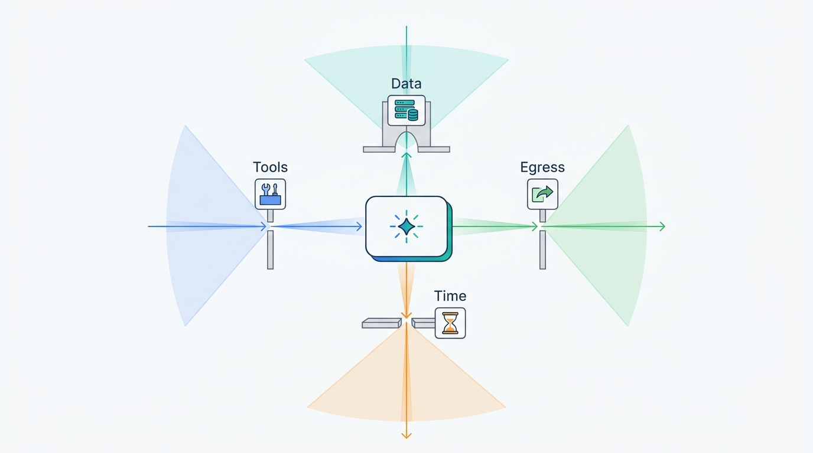
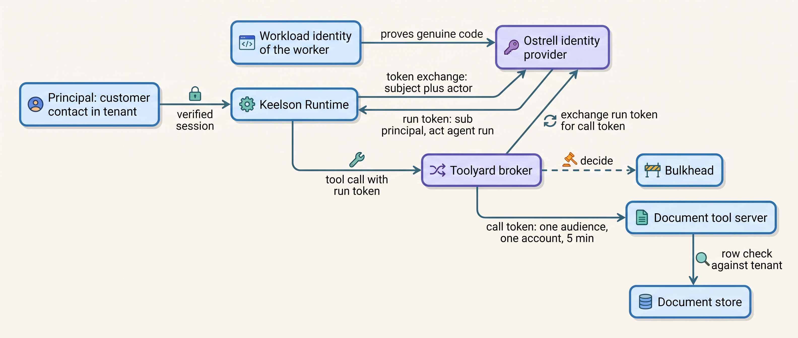
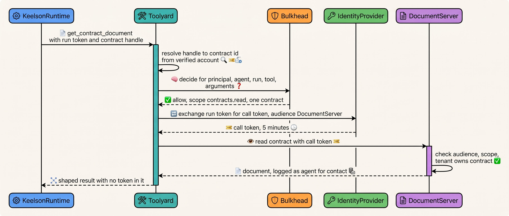
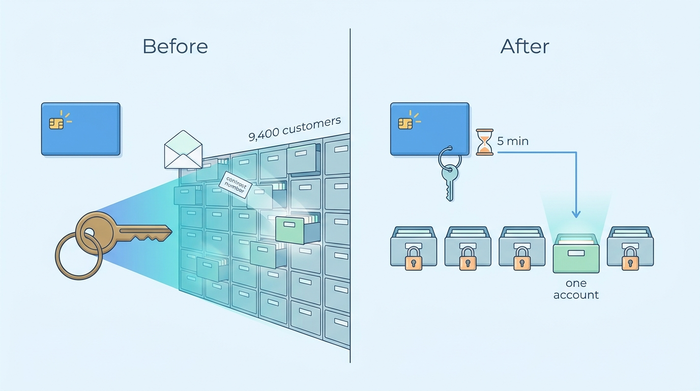

> **IN THIS CHAPTER, YOU WILL:** Learn to separate the identities involved in an agent's action (the workload, the agent, the run and the human or tenant it serves), carry them downstream as delegation through token exchange, scope each credential to one audience, one account and minutes of lifetime, and enforce separation of duties and tenant isolation outside the model.

> **WHY THE BUSINESS CARES:** When an agent is fooled, buggy or compromised, the damage is bounded by what its credentials can reach. A support agent holding a read grant over every customer's contracts turns one bad ticket into a reportable breach; the same agent holding only the current customer's documents turns it into a denied call.

> **WHY ARCHITECTS SHOULD CARE:** Identity is the one control a model cannot talk its way around, but only if it is designed for agents: who the principal is, how the agent is named next to it, where tokens are minted, how long they live, and which system re-checks them. Retrofitting it later means touching every tool server and every system of record.

> **KEY POINTS:**
>
> * **Every agent action carries two names: the principal it serves and the agent that acts.** Use delegation, not impersonation: the token says "agent run R, acting for user U, in tenant T" (the RFC 8693 `act` claim), so downstream systems, audit and revocation can tell the agent from the person. When no human is involved, the agent acts under its own grant, never a borrowed one.
> * **Brokering hides secrets; scoping limits authority. You need both.** A credential the model never sees but that can read every customer's records is still ambient authority. Derive each downstream token from the run's verified principal, never from text, and bind it to one audience, one account, the action's scope and a lifetime of minutes.
> * **Authority is decided outside the agent and checked twice.** The policy engine decides, the tool broker executes with a minted token, and the system of record re-checks tenant and scope. Separation of duties (the maker is never the checker, and the person who launched or edited a proposal does not approve it) is enforced in that path, not in a screen.

> **[FAILURE PATTERNS THIS CHAPTER ADDRESSES](where-agentic-systems-go-wrong.html):**
>
> * **Ambient Authority** — agents that run under a service account, a static key or an engineer's full credentials give every tool call, including an injected one, the reach of an identity nobody sized to the task.
> * **The Lethal Trifecta** — the private-data leg is defined by what the agent's credentials can read; narrowing the read scope to the current principal is what makes a trifecta that cannot be removed survivable.
> * **Autonomy by Default** — an agent that may call every operation its credential allows has been granted autonomy by the identity team's defaults, not by a decision about consequence.

<br>
Every tool call an agent makes is executed by some identity. In most first deployments that identity is an accident: a prototype's service account, a pasted API key or the developer's own login, and a call succeeds whenever that identity is allowed to make it. **Whatever the agent can be talked into, it can do with all of that identity's authority.**

The prompt-injection chapter showed that a model cannot be made to reliably refuse instructions hidden in content ([[prompt-injection-defense]]). This chapter is about the other half of that design: making the authority behind each call **small, explicit and attributable**, so that a fooled model reaches little and every effect can be traced to an agent, a run and the person it served. The tools are old (token exchange, workload identity, audience-bound tokens, policy engines, separation of duties). What is new is the principal: an agent is neither a user nor an ordinary service, often acts for someone, runs for seconds or weeks, and reads text that tries to steer it.

This chapter owns four terms: **agent identity**, **on-behalf-of delegation**, **ambient authority** and **scoped credential**. It builds on [[agent-threat-model]], which places the trust boundaries; on [[tool-ecosystems-and-mcp]], which makes Toolyard, the tool broker, the holder of credentials; and on [[prompt-injection-defense]], whose Answerdesk redesign left one question open: what Answerdesk's document tool is allowed to read. It hands approval design to [[human-oversight-and-bounded-autonomy]] and the policy language and evidence log to [[policy-enforcement-and-audit]].

## Setting the Scene at Ostrell: One Credential for 9,400 Customers

Ostrell, the fictional company this book follows (see [[meet-ostrell]]), runs seven agents on Keelson, its internal agent platform. In May 2027 the Poisoned Ticket arrived: a free-mail email quoting a real service-contract number, with hidden text asking Answerdesk, the support agent, to forward that contract and the last five invoices to an outside address. The send was blocked by the email tool's recipient rule. The July 2027 redesign in [[prompt-injection-defense]] moved raw email text out of the planner's context and made recipients and attachments handles resolved from the verified account.

Farah Haddad, Ostrell's security architect, wrote a second finding that the injection redesign did not close. The document tool that read the contract PDF ran, inside Toolyard, under one credential: a token minted for the `answerdesk` service principal with `contracts.read invoices.read` and no tenant restriction. It could read the service contracts and invoices of **all 9,400 Ostrell Field customers**. Toolyard had kept that credential out of the model's context since the January–April 2027 consolidation ([[tool-ecosystems-and-mcp]]), so no prompt could leak it. But what Answerdesk could *read* was decided by whichever contract number reached the tool call, and in May the contract number came from an attacker's email.

Her June 2027 identity inventory of Keelson found the same pattern elsewhere (Ostrell figures, fictional):

| Finding | Count or scope | Consequence |
| --- | --- | --- |
| Downstream credentials held by Toolyard for agent tools | **27** | Secrets out of context, as designed |
| Of those, bound to no tenant, account or user (service-wide) | **16** | A wrong argument reaches any customer's data |
| Credentials whose scope exceeded every tool bound to them | **11** | Authority nobody had asked for, granted at setup |
| Closewise approvals in the workbench | Approver eligibility from workbench configuration; no check against the proposal's editors | An accountant could approve an entry they had edited |
| Agent runs whose downstream calls recorded the human they served | **0** in downstream system logs | "answerdesk read contract X", with no customer, run or agent version |

Tomas Verhoef, the Chief Architect, put one question to the architecture forum: **for every tool call, whose authority is it, who decided it, and could it be smaller?** The rest of the chapter is the identity model Ostrell adopted between August and November 2027, and the reasoning behind it.

## Concepts: Principals, Actors and Authority

### The identities involved in one agent action

When Answerdesk reads a customer's contract, at least four identities are involved. Collapsing any two of them loses information that a downstream system, an auditor or an incident responder needs.

| Identity | What it names | Lifetime | Who issues it | What it proves |
| --- | --- | --- | --- | --- |
| **Principal** | The human, customer contact or tenant on whose behalf the work is done, or the agent itself for autonomous work | Years (employee), months (customer contact) | The identity provider (IdP) or the customer-identity service | Who the authority comes from |
| **Agent identity** | One registered agent (Answerdesk, Closewise), with an owner, a sponsor and a set of grants | Months to years; versions come and go beneath it | The Agent Registry, mirrored in the IdP | Which agent acted, independently of its version |
| **Run identity** | One execution of one agent version for one principal, with a budget and a deadline | Seconds to weeks | Keelson Runtime, via token exchange at the IdP | This run, of this manifest, for this principal |
| **Workload identity** | The process that holds keys: a Runtime worker, a Toolyard replica, a tool server | Hours (certificate rotation) | A workload-identity system such as SPIFFE (Secure Production Identity Framework for Everyone) | The code calling is genuine platform code |

**Agent identity** is the identity a downstream system, a policy engine and an audit log use to recognize an agent as an actor distinct from the user it serves and from the infrastructure that runs it. It is a registered principal with an accountable owner, not a label in a prompt. Microsoft's Entra Agent ID documentation (updated June 2026) ships the same split: an identity type separate from service principals and user accounts, a human **sponsor** for each agent, and two modes, **autonomous access** and **delegated access** for a user ([Microsoft, 2026](https://learn.microsoft.com/en-us/entra/agent-id/identity-platform/what-is-agent-id)). That documents one vendor's model, not its effectiveness.

**Workload identity** is not agent identity. SPIFFE issues short-lived cryptographic identity documents (SPIFFE Verifiable Identity Documents, SVIDs, as X.509 certificates or JSON Web Tokens) to workloads after attesting where they run ([SPIFFE, n.d.](https://spiffe.io/docs/latest/spiffe-about/overview/)). It answers "is this a real Keelson worker?", not "which agent, for whom": one worker executes hundreds of runs of different agents an hour.

### Delegation, impersonation and ambient authority

RFC 8693, OAuth 2.0 Token Exchange (January 2020), separates two ways one party can act for another ([IETF, 2020](https://www.rfc-editor.org/rfc/rfc8693.html)):

- **Impersonation**: A "is given all the rights that B has" and is indistinguishable from B downstream.
- **Delegation**: A "still has its own identity separate from B". The issued token names B as the subject and carries an `act` (actor) claim naming A. Nested `act` claims record a chain; "the outermost act claim represents the current actor", and only the top-level claims and the current actor should drive access decisions.

**On-behalf-of delegation** is this book's term for the second form applied to agents: the agent run obtains, for each downstream call, a token whose subject is the principal and whose actor is the run, so that the downstream system enforces the principal's rights *intersected with* the agent's grant and records both.

**Ambient authority** is authority a component holds by virtue of where it runs or what it was configured with, rather than authority attached to the specific request. The term comes from capability security; Norman Hardy's 1988 paper on the **confused deputy** described a compiler that wrote a billing file with its own privileges because a user named that file as an output ([Hardy, 1988](https://dl.acm.org/doi/10.1145/54289.871709)). An agent with a service account is that compiler with a language model choosing the file names. Three forms recur:

1. **The service account**: one identity for the agent, sized for everything it might ever do, used for every run.
2. **The borrowed login**: the agent holds the user's own token or session and is indistinguishable from the user. Every local coding command-line interface (CLI) works this way by default.
3. **The found credential**: a key the agent can read from its environment, filesystem or repository, which it was never meant to use.

A **scoped credential** is the opposite: a credential bound to one audience (one tool server or resource), one subject and tenant, the operations the current action needs, and a lifetime measured in minutes, derived from the run's verified principal by deterministic code.

### Least privilege has four axes for agents

Least privilege for agents is usually discussed on three axes: which tools are reachable, which data a token reaches, and which egress destinations exist. In my judgement agents need a fourth, **time**, because their runs range from seconds to weeks.

| Axis | Question | Where it is enforced at Ostrell | Owning chapter |
| --- | --- | --- | --- |
| Tools | Which operations can this run call at all? | Toolyard's authorized tool set per agent version and principal | [[tool-ecosystems-and-mcp]] |
| Data | Which records can each call reach? | Token subject, tenant and scope; row-level checks in the tool server | This chapter |
| Egress | Where can output go? | Bulkhead sink policy; sandbox egress proxy | [[prompt-injection-defense]], [[sandboxes-and-execution-environments]] |
| Time | For how long does authority exist? | Token lifetimes; run deadlines; re-derivation after waits | This chapter, [[durable-agent-execution]] |


**Figure 1:** *Least privilege for agents narrows authority on four axes: which tools a run can call, which records each call reaches, where output can go, and how long authority exists.*

The Open Worldwide Application Security Project's (OWASP) Top 10 for LLM (large language model) Applications 2025 names excessive permissions as a root cause of **LLM06 Excessive Agency** and prescribes complete mediation: "Implement authorization in downstream systems rather than relying on an LLM to decide if an action is allowed or not" ([OWASP, n.d.](https://genai.owasp.org/llmrisk/llm062025-excessive-agency/)). The OWASP Top 10 for Agentic Applications (published December 2025) gives identity its own category, generally reported as **ASI03 Identity and Privilege Abuse** ([OWASP, 2025](https://genai.owasp.org/resource/owasp-top-10-for-agentic-applications-for-2026/)).

## Architecture: From Principal to Per-Call Token

### Who the principal is

The first design decision is not a token format. It is a table that says, for each agent and channel, who the principal is and how it is verified. Every later check depends on it.

| Agent and channel | Principal | Verified by | If unverified |
| --- | --- | --- | --- |
| Answerdesk chat in the Field portal | Customer contact, within a Field customer account (tenant) | Portal login session | Not possible |
| Answerdesk email | Customer contact, if the sender matches a verified contact of the account | Sender address match plus mail authentication results | **Anonymous**: public knowledge-base answers only; account actions routed to staff |
| Dealroom in the CRM | The account executive | Corporate single sign-on (SSO) | Not possible |
| Peoplepoint | The employee | SSO | Not possible |
| Scout | The employee who delegated the run | SSO at submission | Not possible |
| Closewise | The agent itself (autonomous grant), with the controller who opened the close recorded as initiator | Agent Registry grant; SSO for the initiator | Not applicable |
| Forge | The agent itself, scoped to one repository per run; the engineer who requested the task recorded | Agent Registry grant | Not applicable |
| Local coding CLI | The engineer, by impersonation | SSO on the laptop | Not applicable |

Two rows carry most of the security. **The anonymous principal is a real principal with small rights**: no number of quoted contract numbers changes what an unattributed email gets. And **autonomous agents act under their own grant, never a borrowed human one**: Closewise posts as a principal that exists only to post approved entries, not as Joost Vermeer.

### Four layers of identity in Keelson


**Figure 2:** *The principal's authority enters once, at run start, and is narrowed at every hop: the run token names the principal and the agent run; each call token adds one audience, one account and minutes of lifetime; the tool server re-checks the tenant against its own data.*

The **run token** is obtained by Keelson Runtime when a run starts. The worker authenticates to Ostrell's identity provider with its workload identity and asks for a token exchange: the subject token is the principal's verified session (or, for an autonomous agent, the agent's own grant), the actor is the agent run. It lives in Runtime's memory, never in a context window, tool result or log, and no tool server accepts it: its audience is Toolyard.

The **call token** is minted by Toolyard for each downstream call, after Bulkhead has decided. Toolyard exchanges the run token for a token whose audience is exactly one tool server, whose scope is what Bulkhead's decision granted, and whose lifetime is five minutes. The tool server, an OAuth resource server, validates audience, scope and tenant, then applies its own row-level rules. The shape:

```json
{
  "iss": "https://idp.ostrell.internal",
  "sub": "field-contact:c-58213",
  "tenant": "field-account:a-10442",
  "act": {
    "sub": "keelson-agent:answerdesk",
    "run_id": "run_01J9Z…",
    "manifest": "sha256:4be1…",
    "act": { "sub": "spiffe://keelson.ostrell.internal/toolyard" }
  },
  "aud": "https://documents-tools.toolyard.internal/mcp",
  "scope": "contracts.read",
  "authorization_details": [{ "type": "contract", "contract_ids": ["SC-2291-0457"] }],
  "policy_version": "bulkhead/answerdesk@2027.08.3",
  "decision_id": "dec_7fa2…",
  "exp": 1820000300
}
```

The **subject is the principal and the actor is the agent**, as RFC 8693 defines the claims. The author's agentic-platform-foundations interview design writes the same token as "sub=agent (the agent principal), act=user (delegated subject), aud=tool" (*design example*, `agentic-platform-foundations/interview.json`, step `identity`, deep dive "The delegated token shape"). That inverts the standard's semantics, and a resource server reading `sub` as "whose data" would apply the agent's rights where it should apply the user's. This book follows RFC 8693, which also matches the IETF WIMSE working group's September 2026 draft for AI agents: the token's client identifies the agent and its `sub` identifies "the user or system on whose behalf it acts" ([draft-ietf-wimse-aims-00, 2026](https://datatracker.ietf.org/doc/draft-ietf-wimse-aims/)). The design's other fields (audience binding, scope, tenant, policy version, expiry) carry over unchanged.

The extra claims are deliberate: `manifest` ties an effect to an exact agent version ([[versioning-agent-systems]]), and `decision_id` and `policy_version` tie the token, the evidence record and the policy to one Bulkhead decision ([[policy-enforcement-and-audit]]). `authorization_details`, the structure RFC 9396 (OAuth 2.0 Rich Authorization Requests, May 2023) defines for fine-grained authorization, narrows the token from "contracts of this account" to "this contract" when the action names one.

### One call, decided and narrowed


**Figure 3:** *Bulkhead decides and Toolyard executes, as the book's architecture rules require; the identity provider mints only what the decision granted, and the document server repeats the tenant check against its own data, so a bug in any one step returns a denial instead of another customer's contract.*

Three components check different things. **Bulkhead** decides whether this agent, for this principal, at this autonomy tier, may make this call with these arguments, using session state such as whether the run has read untrusted content. **The identity provider** enforces exchange policy: call tokens only for the tool's registered audiences, only for the run's own subject and tenant, never wider than the run token. **The tool server** enforces the data boundary with its own records. Authorization stays separate from execution: Bulkhead and the identity provider decide, Toolyard performs the call, and no identity component posts, sends or writes.

The broker-side logic, reduced to the identity steps (the full call path is in [[tool-ecosystems-and-mcp]]):

```python
def credential_for_call(run: RunContext, tool: Tool, decision: Decision) -> CallToken:
    # The subject and tenant come from the run, never from model-supplied arguments.
    assert decision.subject == run.principal and decision.tenant == run.tenant
    if tool.credential_pattern == "call_proxy":
        return broker_key_for(tool, agent=run.agent_id)        # per-agent key, narrowest API scope
    cached = token_cache.get((run.id, tool.audience, decision.scope_hash))
    if cached and cached.expires_in() > 60:
        return cached
    token = idp.exchange(
        subject_token=run.run_token,                           # principal + agent run
        actor_token=toolyard_workload_svid(),                  # Toolyard as current hop
        audience=tool.audience,                                # exactly one server
        scope=decision.scopes,                                 # what Bulkhead granted, no more
        authorization_details=decision.resource_constraints,   # e.g. one contract id
        lifetime_seconds=300,
    )
    token_cache.put((run.id, tool.audience, decision.scope_hash), token)
    return token                                               # never placed in a tool result
```

### Requirements per interaction

| Interaction | Consistency | Latency target | Durability | Who may act |
| --- | --- | --- | --- | --- |
| Verify principal at run start | Principal resolved from a verified session, never from message text | p95 under 50 ms *(assumption)* | Principal and verification method in the task record | Runtime on the channel's verified session |
| Obtain run token | Subject, tenant and agent version fixed for the run | p95 under 40 ms *(assumption)* | Token id (not the token) in Logbook | Runtime worker with workload identity |
| Mint call token | Scope ⊆ run token scope ∩ Bulkhead decision; one audience | p95 under 20 ms with cache *(assumption; Ostrell measured 14 ms, below)* | Token id, decision id in Logbook | Toolyard only, per registered audience |
| Tool server check | Tenant ownership checked against the server's own records | Part of the call | Server log names subject and actor | The server, independent of the broker |
| Resume after a wait | Principal re-validated; tokens re-derived, never reused | Seconds | New run token id per segment | Runtime, from the task record |
| Revoke an agent or run | All new mints refused; outstanding call tokens expire in ≤ 5 min | Mint refusal under 60 s | Revocation record with reason | Agent owner, security on-call, platform on-call |

### Long-running runs and the time axis

A Closewise approval can wait 48 working hours ([[durable-agent-execution]]). A token held across that wait is a long-lived credential under another name, and the principal behind it may have changed: the employee left, the contact was removed, the delegation ended. Keelson therefore treats identity as part of resumption. **The task record holds the principal reference and the agent grant, never a token**; when a run resumes after a wait, Runtime re-verifies the principal against the IdP and obtains a new run token for the new segment. If the principal is no longer valid, the run does not continue under the agent's own authority: it is suspended ([[agent-runtime]]), approvals that depended on that principal are voided, and the task goes to the agent's owning team.

### Separation of duties for agents

**Separation of duties (SoD)** is the control that no single principal can both initiate and authorize a consequential action. Agents add two complications. The agent is a principal that can be a maker and must never be a checker. And the human closest to the agent, the person who launched the task or edited the proposal, is the natural approver and often the wrong one.

The author's agentic-finance-platform interview design enforces maker ≠ checker "architecturally by the identity broker, not by policy hope", because "agents and retries route around UI rules" (*design example*, `agentic-finance-platform/interview.json`, step `maker-checker`). It leaves open whether the analyst who initiated the task may approve, and lets the identity broker also post to the ledger. This book adopts the rule and departs from both details: **the initiator and every editor of a proposal count as makers**, and the decision sits in the policy engine while a separate, narrowly scoped executor performs the posting.

| Rule | Closewise implementation (since September 2027) |
| --- | --- |
| The agent can propose, never approve | The `closewise` agent principal can write only to the staging store; it holds no approval permission anywhere |
| Makers include humans who touched the proposal | Bulkhead refuses an approval when the approver opened the close task for that entity or edited the proposal |
| Approvers are qualified for the entity | Approval requires the controller or deputy-controller role for that legal entity, read from the HR information system (HRIS) role feed, not from the workbench |
| The executor cannot act without an approval | Toolyard posts as the enterprise resource planning (ERP) user `agent-closewise-post` only with an approval record bound to the entry's content hash (unchanged since April 2027) |
| The system of record agrees | `agent-closewise-post` cannot create vendors, change periods or approve; approver id and run id are written to the entry ([[agents-in-the-enterprise]]) |

The legal design in the same project requires only that a licensed attorney principal approves, without separating requester from approver (*design example*, `agentic-legal-platform/interview.json`, step `attorney`). That is defensible on professional-responsibility grounds: SoD is domain policy, and the platform's job is to make it enforceable where the domain requires it.

### Cross-tenant isolation

For a multi-tenant product, the tenant is part of the principal: it comes only from the verified principal, every call token carries it, every tool server checks it against its own data, and every store that caches or remembers is partitioned by it (Tidemark, Wake's content store, Toolyard's read cache, per [[caching-and-context-budgets]]). A prompt instruction is not isolation: Ostrell's February 2027 prototype, with one service account and tenant scoping by instruction, quoted another customer's service level in two conversations ([[retrieval-and-grounding]]).

### Secrets never in context

The rule from the consistency rulings is short: credentials are brokered, never placed in context, and short-lived in sandboxes. It reaches further than the prompt:

- **The model never receives a token, key or cookie.** Toolyard strips authorization headers and token-shaped strings from results; the context assembler refuses segments labeled as credential material ([[context-engineering]]).
- **The agent's readable environment holds no standing secrets.** A coding agent that can read `~/.aws/credentials` holds those credentials. Claude Code's sandbox documentation states that its reads are broad by default, including `~/.ssh` and `~/.aws/credentials`, unless explicitly denied ([Anthropic, n.d.](https://code.claude.com/docs/en/sandboxing)).
- **Logs are part of the context's blast radius.** Tokens are logged by id, never by value, in Wake and Logbook.

The IETF WIMSE (Workload Identity in Multi-System Environments) draft for agents makes the same point a requirement: the model must not have access to the agent's or the tools' credentials ([draft-ietf-wimse-aims-00, 2026](https://datatracker.ietf.org/doc/draft-ietf-wimse-aims/)).

## Evidence: What Standards Say and What Incidents Show

### The standards are stable at the core and in motion at the edges

| Source | Status as of October 2026 | What it settles | What it does not |
| --- | --- | --- | --- |
| RFC 8693 Token Exchange | RFC, January 2020 | Delegation vs impersonation; `act` and `may_act` claims; chained actors | How agents are registered or attested |
| OAuth 2.1 | Internet-Draft, draft-16, 3 September 2026 ([IETF](https://datatracker.ietf.org/doc/draft-ietf-oauth-v2-1/)) | PKCE (Proof Key for Code Exchange) required, implicit and password grants removed | It is still not an RFC |
| Model Context Protocol (MCP) authorization | Revision 2026-07-28 ([MCP](https://modelcontextprotocol.io/specification/2026-07-28/basic/authorization)) | MCP servers as OAuth resource servers; resource indicators (RFC 8707); servers "MUST NOT accept or transit any other tokens"; step-up scopes on `insufficient_scope` | Authorization is optional, and stdio servers take credentials from the environment; nothing about the agent as a separate actor |
| OAuth Transaction Tokens | draft-ietf-oauth-transaction-tokens-11, 30 July 2026, WG consensus, waiting for write-up ([IETF](https://datatracker.ietf.org/doc/draft-ietf-oauth-transaction-tokens/)) | Propagating "user identity, workload identity and authorization context" through a call chain inside one trust domain | Not yet an RFC |
| WIMSE AI Identity Management System | draft-ietf-wimse-aims-00, 15 September 2026, Informational ([IETF](https://datatracker.ietf.org/doc/draft-ietf-wimse-aims/)) | Agents as workloads with one identifier and short-lived bound credentials; OAuth for delegation; no token forwarding by tools; UI confirmation is "not authorization" | A -00 working-group draft; will change |
| NIST AI Agent Standards Initiative | Announced February 2026; as of the page's 14 August 2026 update it lists a request for information and a National Cybersecurity Center of Excellence (NCCoE) draft concept paper on agent identity and authorization ([NIST](https://www.nist.gov/artificial-intelligence/ai-agent-standards-initiative)) | That US standards work on agent identity has started | Any final guidance yet |

The durable core is decades old: delegation with attribution, audience-bound short-lived tokens, no passthrough, decisions outside the requester. The packaging for agents is volatile, so treat a draft's claim names as a mapping, not a foundation.

Two statements deserve emphasis. MCP bans token passthrough partly because it destroys attribution: the server cannot tell clients apart and downstream logs show the wrong identity ([MCP, n.d.](https://modelcontextprotocol.io/docs/tutorials/security/security_best_practices)). And the WIMSE draft's line that human confirmation in the agent's interface is not authorization, and that sensitive actions should rest on an authorization-server decision, is the identity-layer version of this book's rule that approvals are records bound to an action, checked by deterministic code ([[human-oversight-and-bounded-autonomy]]).

### Documented incidents: authority, not intelligence, set the damage

- **GitHub MCP "toxic agent flow"** (Invariant Labs, 26 May 2025). An injected issue in a public repository led an agent reviewing issues to copy data from the user's private repositories into a public pull request, using the official GitHub MCP server. The researchers called it "a fundamental architectural issue" rather than a server bug, and their primary mitigation was per-session least privilege, such as restricting a session to one repository ([Invariant Labs, 2025](https://invariantlabs.ai/blog/mcp-github-vulnerability)). The token reached every repository the user could; the injection only chose which. (Invariant sells guardrail products; the mechanism is not disputed.)
- **PocketOS and Railway** (April 2026, widely reported). The founder reported that a coding agent deleted a production volume and its backups during a routine task. As relayed by a security vendor from the founder's account, the agent used an API token found in an unrelated repository file, created for domain operations but carrying broad permissions ([NeuralTrust, 2026](https://neuraltrust.ai/blog/pocketos-railway-agent); [Euronews, 2026](https://euronews.com/next/2026/04/28/an-ai-agent-deleted-a-companys-entire-database-in-9-seconds-then-wrote-an-apology)). The details are founder-sourced, not from a vendor postmortem; read it as an illustration of the found credential, not as a verified root cause.
- **Replit** (July 2025). A user reported that the agent deleted a production database during a declared code freeze; Replit named development/production database separation as the fix, because apps had "used a single database for both development and live customer data" ([The Register, 2025](https://www.theregister.com/2025/07/22/replit_saastr_response/)). The natural-language freeze was not a control.
- **Amazon Q Developer extension 1.84.0** (July 2025). AWS's bulletin states that an actor used an over-broad GitHub token in the build configuration to commit code that shipped in a release and failed to execute ([AWS, 2025](https://aws.amazon.com/security/security-bulletins/AWS-2025-015/)). Not an agent failure, but the pipeline that builds an agent is part of its attack surface.

In each case the model's output was the trigger, and the identity's reach decided the damage.

### What is not known

No published study measures whether delegated, short-lived, scoped identity reduces the rate or severity of agent incidents in production, and no independent evaluation of agent-identity products exists as of October 2026. The case rests on the structural argument (a call cannot reach what its token cannot reach), on decades of experience with least privilege in ordinary systems, and on incidents whose damage tracked credential scope. That is a strong argument, not a measurement. The costs (exchange latency, load on the IdP, systems that cannot validate delegated tokens) are equally undocumented; Ostrell's numbers below are fictional illustrations.

## Worked Example at Ostrell: The Identity Redesign

### Answerdesk: from one service credential to one account per run (August 2027)

The redesign shipped for Answerdesk's document and billing tools in **August 2027**, a month after the injection redesign. For each conversation:

1. The channel resolves the principal. Portal chats arrive with a session for a customer contact; emails go through sender verification, and an email that matches no verified contact of any account runs as **anonymous**.
2. Keelson Runtime exchanges that session for a run token: subject the contact, tenant the Field customer account, actor the Answerdesk run with its manifest hash, audience Toolyard, lifetime bounded by the conversation's deadline (30 minutes for chat, renewed per segment).
3. Every call to the document, billing, ticket and scheduling servers gets a call token for that tenant only, five minutes long. Contract and invoice reads carry the specific contract ids resolved from the verified account.
4. The document server checks that the contract belongs to the token's tenant before it reads the file.

Replaying the Poisoned Ticket shows the layers. The free-mail sender is not a verified contact, so the run is anonymous and its token carries no tenant; Bulkhead grants no `contracts.read` to an anonymous principal; and past a bug there, the identity provider would mint no call token without a tenant and the document server would accept none. In May 2027, only the agent's choice of arguments stood between the quoted contract number and the PDF.


**Figure 4:** *Before the redesign, one credential reached all 9,400 customers' contracts and the contract number chose the drawer; after it, each call carries a five-minute token for one account, so a wrong contract number meets a locked drawer.*

The first four weeks produced the most useful evidence. The document server rejected **38** calls whose contract did not belong to the token's tenant. None was an attack: all came from one defect in contract resolution for customers with several Field accounts (a parent and subsidiaries), where the step picked the first account's contracts. Under the old credential those reads would have **succeeded silently**, putting a sibling company's documents into the conversation. Wake's tenant-mismatch alert surfaced them; the fix took two days.

Costs, as Ostrell measured them: token minting added a p95 of **14 ms** per tool call with a per-run cache that reuses a call token for the same audience and scope until 60 seconds before expiry; about 40,000 call tokens a day are minted for Answerdesk *(assumption: about six token-requiring calls per conversation over ~7,100 conversations a day)*. The identity provider became a dependency of every account-touching call, discussed in the failure table below.

### Closewise: the poster principal (September 2027 close)

Closewise's September 2027 close, with **1,912** proposed entries across 23 entities, was the first under the SoD rules in the table above. The Closewise agent wrote proposals to the staging store as `closewise`; controllers approved in the workbench; the workflow posted through Toolyard as `agent-closewise-post`, with an approval bound to each entry's content hash. Bulkhead refused **6** approvals in which the approving accountant had also edited the proposal, and routed them to another controller of the same entity; under the previous design, the workbench had allowed it. The other events of that close (the worker eviction after 44 of 61 entries, the 9 escalations to deputies, the 3 voided approvals) are told in [[durable-agent-execution]]; none of them needed a change to identity, which is the point of keeping identity out of the workflow's retry paths.

### Forge, Scout and the local CLI

The other agents needed less change, and the reasons are instructive.

- **Forge** already had no production credentials and, since February 2027, no code-host credential in the sandbox: the sandbox holds a run token (at most 90 minutes) valid only at Keelson Gateway, the git proxy and Toolyard, and the git proxy pushes only to `forge/<task-id>` ([[sandboxes-and-execution-environments]]). The redesign narrowed what the git proxy itself holds: instead of one app credential for all repositories, it mints a per-run installation token for the task's repository, the shape GitHub documents as expiring "after 1 hour" and restrictable to named repositories and permissions ([GitHub, n.d.](https://docs.github.com/en/apps/creating-github-apps/authenticating-with-a-github-app/generating-an-installation-access-token-for-a-github-app)), and records the requesting engineer.
- **Scout** acts for the employee who delegated the run. The redesign carried that identity into tokens, so each internal document store applies the employee's own permissions, and sub-agents get a nested actor chain and a scope no wider than the lead's ([[routing-and-delegation]]).
- **The local coding CLI** is impersonation by design: about 870 engineers run it weekly as themselves. Ostrell names this ambient authority and bounds it. Managed settings have denied reads of credential paths since early 2027, and the OS sandbox has failed closed since the May 2027 Silent Fallback fixes ([[sandboxes-and-execution-environments]]). The redesign added two things: laptop cloud and code-host credentials became SSO sessions of at most 8 hours, and internal tools reach the CLI only through Toolyard, with the engineer as subject and the CLI recorded as actor. An injected CLI can still do what the engineer can, but not more, and not through a found key.

### Where Ostrell ended up (November 2027)

| Measure | June 2027 | November 2027 |
| --- | --- | --- |
| Service-wide downstream credentials in Toolyard | 16 | **3**, all for third-party APIs without delegation support, each a per-agent key at the narrowest API scope, behind the call proxy |
| Credentials wider than every tool bound to them | 11 | **0** |
| Downstream logs naming principal, agent and run | 0 systems | All internal tool servers |
| Answerdesk document read reach per run | 9,400 customer accounts | **1** account (and named contracts) |
| Time to cut off a compromised agent | Rotate the agent's service credential (hours) | Mint refusal under 60 s; outstanding call tokens expire within 5 min |

## Failure Modes and Recovery

| Scenario | What happens | Detection | Containment | Recovery |
| --- | --- | --- | --- | --- |
| **Token appears in context or logs** | A tool server echoes an authorization header in an error body | Toolyard's token-pattern scan on results; Wake secret scanner on spans | Token is audience-bound and five minutes long; result stripped before the model sees it | Revoke the token id; fix the server; add a regression test |
| **Identity provider unavailable** | No run or call tokens can be minted | Mint error rate in Wake; IdP health probe | Fail closed for account access and all writes; Answerdesk falls back to public knowledge-base answers and human handoff | Resume minting; runs waiting on tokens retry with backoff in the Gateway, not inside a chat turn |
| **Compromised or misbehaving agent version** | An agent version makes unexpected calls within its grant | Bulkhead denial spikes; outcome-shift alerts ([[agent-observability]]) | Disable the agent identity or one manifest in the Agent Registry; mints refused in under 60 s | Hold queued actions for review (kill switches hold, not drop); re-enable after review |
| **Principal changes during a wait** | An approver leaves, or a customer contact is removed, while a run waits | Re-verification at resume fails | Run stops; approvals bound to that principal are void | Owning team reassigns the task; a new principal starts a new run |
| **Cross-tenant bug in resolution** | The agent picks a contract of a sibling account | Tenant-mismatch denials at the tool server alert in Wake | The server refuses; nothing is read | Fix the resolver; replay affected conversations |
| **Delegated sub-agent asks for more** | A worker requests a scope its parent lacks | IdP refuses a scope wider than the subject token's | Attenuation by token exchange policy | The parent replans or escalates ([[routing-and-delegation]]) |
| **Found credential in a sandbox or repository** | A coding agent finds a key in a file and uses it | Secret scanning of repositories; egress denials | No standing secrets in sandboxes; egress allowlist | Rotate the key; remove it from history; review why it existed |
| **Self-approval in a back-office flow** | An accountant edits a proposal and then approves it | Bulkhead SoD check at approval | Approval refused and routed | None needed; the refusal is the evidence |

## Trade-offs

| Option | What downstream sees | Blast radius of one bad call | Cost | Right when |
| --- | --- | --- | --- | --- |
| **Service account for the agent** | "svc-agent did X" | Everything the account can reach, for every principal | Lowest | Prototypes with synthetic data; never with customer data |
| **Brokered service credential** (model never sees it) | "svc-agent did X" | Same reach; no leakage through context | Low | A step toward delegation; acceptable only for read-only, non-personal data |
| **Impersonation** (agent holds the user's token) | "user did X" | Everything the user can do, unattributable to the agent | Low; everything already accepts the user's token | Interactive local tools with the user present, bounded by a sandbox |
| **Delegated, per-call tokens** (this chapter's default) | "agent run R did X for user U in tenant T" | One audience, one tenant, the decided scope, minutes | Token exchange on the IdP; servers must validate; ~10–20 ms per call | Any agent touching systems of record or personal data |
| **Action-bound grants** (one token per approved action) | As above, plus the action id | Exactly one approved action | Highest; one mint per action | Money movement, irreversible actions, A1 executions |

The last row comes from the author's agentic-support-platform interview design, which mints a "scoped, action-bound on-behalf-of token" only after the action gate and approval pass, one that "can't be reused for a different action", and refuses to mint any write token while a handoff to a human is open (*design example*, `agentic-support-platform/interview.json`, steps `action-gate` and `escalation`; `dataModel.delegated_token_grants`). Ostrell adopted the second rule ([[routing-and-delegation]]) and uses action-bound grants for credits above €250 and Closewise postings, where each action already has an approval record. For reads and small, limited writes, per-call tokens give most of the protection at a fraction of the minting volume.

My recommendation, assuming an enterprise platform with several agents and systems of record that can be upgraded to validate tokens: **delegated per-call tokens as the platform default, action-bound grants for A1 and irreversible actions, impersonation only for interactive local tools inside a sandbox, and service credentials only behind the call proxy for third-party APIs that cannot do better.** Where systems of record cannot validate delegated tokens, the broker must enforce tenant and subject through the call proxy, and the risk owner should know that one broker bug then has the service account's reach.

## Across Domains: How the Stakes Change the Design

| Dimension | Coding agents | Customer operations (support, sales, marketing) | Back office (finance, legal, HR) | High-stakes decisions (healthcare, public benefits) |
| --- | --- | --- | --- | --- |
| Usual principal | The engineer (local), or the agent's own grant scoped to one repository (headless) | The customer contact (untrusted), or the employee using a copilot | The agent's own grant for workflows; the employee for helpdesks | The clinician or caseworker; the agent itself only for drafting |
| Typical ambient-authority risk | Laptop credentials; tokens in repositories and CI | One service credential over all customers | ERP or HRIS technical users with broad roles | Broad record access "for the care team" |
| Credential shape | Short-lived repository-scoped token; no production credentials | Per-call tokens bound to account; action-bound grants for money | Executor principals that act only on approval records | Tokens bound to patient or case and to fresh care-team or case assignment |
| Separation of duties | Merge by a human other than the requester where protected paths change | Rarely formal; approval of large credits by a team lead | **Required**: maker ≠ checker, including initiators and editors | Adverse decisions bound to an accountable, qualified human |
| Human binding | Requesting engineer recorded | Approving staff member recorded | Approver role from HRIS; licensed attorney for legal sign-off | Licensed clinician or accountable caseworker |
| Emergency access | Not needed | Not needed | Not needed | **Break-glass** as a named, alerting workflow |

The mechanisms are the same in all four columns. What changes is **who may be a principal and who must be bound to the decision**. The author's healthcare design binds the decision to "a licensed clinician principal", checks care-team membership fresh, and makes break-glass a named, alertable workflow; the benefits design "binds an adverse decision to an accountable caseworker"; the legal design requires a licensed attorney principal to finalize (*design examples*, `agentic-healthcare-platform/interview.json` step `privacy`; `agentic-public-benefits-platform/interview.json` step `audit-appeal`; `agentic-legal-platform/interview.json` step `attorney`). The HR design's preferred retrieval boundary is a token-scoped service where "the token simply can't fetch another record", over a retrieval filter whose bug "is a silent cross-record leak" (*design example*, `agentic-hr-platform/interview.json`, step `privacy`). That is the Answerdesk multi-account defect in one sentence.

**Platform-common:** the principal table per agent and channel, agent registration with owner and sponsor, run tokens and per-call token exchange, token hygiene (never in context or logs), re-derivation after waits, revocation in the Agent Registry, tenant claims and server-side checks, and an SoD check in the policy engine that any domain can switch on. **Domain policy:** who qualifies as a principal or an approver (licensed, assigned, in the right role), whether initiators may approve, what counts as an action that needs an action-bound grant, and whether break-glass exists.

## The Chief Architect's View

**Make identity a platform service with one owner, and refuse per-agent credentials.** At Ostrell, Farah Haddad's group owns the identity model, the IdP team owns token exchange, the Agent Platform team owns run identity in Runtime and Toolyard, and each system-of-record owner owns its scopes and server-side checks. A credential outside Toolyard needs an architecture-forum case.

**Put the principal table in the Agent Registry and review it like an autonomy change.** Ostrell's decision-point map already treats a new identity as a change to an agent's action space ([[what-makes-a-system-agentic]]). The principal table (who the principal is per channel, how verified, what the anonymous case gets) belongs next to it, and a change to it reopens the autonomy review ([[evidence-for-autonomy]]).

**Ask the risk owner to sign the reach, not the controls.** "Answerdesk uses scoped tokens" is not a risk statement. "An Answerdesk run can read the contracts and invoices of one verified customer account and issue credits up to €250 on it" is. Lena Brandt signs the second.

**Expect the systems of record to be the slow part.** Upgrading servers to validate delegated tokens is ordinary work spread over many teams. Sequence it by reach, personal and financial data first; accept broker-side enforcement for the rest, on a short, visible list.

**Watch what will change.** Durable: delegation over impersonation, attenuation along chains, audience-bound short-lived tokens, no passthrough, decisions outside the model, server-side checks, SoD in the authorization path. Volatile: OAuth 2.1 is still a draft, MCP's authorization section changes with each revision, Transaction Tokens and the WIMSE agent draft are not RFCs, product agent-identity types are new, and NIST has published no final agent-specific guidance yet. Map Keelson's claims onto a standard profile when one settles; do not wait for it to scope credentials. Harder-to-inject models do not weaken the case: scoped identity also contains bugs, as the 38 tenant-mismatch denials showed.

## Questions to Ask

1. For each agent and channel, who is the principal, how is it verified, and what can the unverified case do?
2. Which downstream credentials in your platform are not bound to a tenant, account or user, and what can each reach?
3. Does the downstream system's log say "agent A for user U in run R", or only a service account's name?
4. Where is the subject of a call determined? Can any model-supplied argument change whose data a token reaches?
5. How long does the longest-lived credential an agent run can use remain valid, and what happens to it during a two-day wait?
6. How do you disable one agent, or one agent version, without rotating a key other agents share? How long does it take?
7. Where is separation of duties enforced, and does it count the person who launched or edited a proposal as a maker?
8. If your token-exchange service is down, which agent capabilities fail closed and which keep working?
9. Which credentials can a coding agent read from its sandbox, laptop or repository today?

Identity bounds what an agent can reach; it does not decide when a human must look before the agent acts. Where approvals, interventions and reviews belong, and how to keep them from becoming the Rubber Stamp, is the subject of [[human-oversight-and-bounded-autonomy]].

## Sources and Evidence

### Research papers

- [The Confused Deputy (or why capabilities might have been invented)](https://dl.acm.org/doi/10.1145/54289.871709), Norman Hardy, *ACM SIGOPS Operating Systems Review* 22(4), **1988** — origin of the confused-deputy problem behind ambient authority.

### Specifications, standards and regulation

- [RFC 8693: OAuth 2.0 Token Exchange](https://www.rfc-editor.org/rfc/rfc8693.html), IETF, **2020** — delegation vs impersonation; `act` and `may_act` claims; actor chains.
- [RFC 9396: OAuth 2.0 Rich Authorization Requests](https://www.rfc-editor.org/rfc/rfc9396.html), IETF, **2023** — `authorization_details` for resource-level constraints in tokens.
- [The OAuth 2.1 Authorization Framework, draft-ietf-oauth-v2-1-16](https://datatracker.ietf.org/doc/draft-ietf-oauth-v2-1/), IETF, **2026** — OAuth 2.1 remains an Internet-Draft.
- [OAuth Transaction Tokens, draft-ietf-oauth-transaction-tokens-11](https://datatracker.ietf.org/doc/draft-ietf-oauth-transaction-tokens/), IETF OAuth WG, **2026** — propagating user and workload identity through call chains; status.
- [AI Identity Management System, draft-ietf-wimse-aims-00](https://datatracker.ietf.org/doc/draft-ietf-wimse-aims/), IETF WIMSE WG, **2026** — agents as workloads; `sub` as the represented user; credentials kept from the model; no token forwarding; UI confirmation is not authorization.
- [Model Context Protocol: Authorization, revision 2026-07-28](https://modelcontextprotocol.io/specification/2026-07-28/basic/authorization), MCP project, **2026** — resource-server model, audience validation, no passthrough, step-up scopes.
- [MCP Security Best Practices](https://modelcontextprotocol.io/docs/tutorials/security/security_best_practices), MCP project, **n.d., accessed 2026-10** — token passthrough and audit damage; scope inflation.
- [SPIFFE overview](https://spiffe.io/docs/latest/spiffe-about/overview/), SPIFFE project, **n.d., accessed 2026-10** — short-lived workload identity documents.
- [LLM06:2025 Excessive Agency](https://genai.owasp.org/llmrisk/llm062025-excessive-agency/), OWASP GenAI Security Project, **n.d., accessed 2026-10** — excessive permissions; complete mediation in downstream systems.
- [OWASP Top 10 for Agentic Applications for 2026](https://genai.owasp.org/resource/owasp-top-10-for-agentic-applications-for-2026/), OWASP GenAI Security Project, **2025** — identity and privilege abuse as a category (titles from secondary sources).
- [AI Agent Standards Initiative](https://www.nist.gov/artificial-intelligence/ai-agent-standards-initiative), NIST, **2026** — scope; a request for information and an NCCoE draft concept paper, no final guidance as of August 2026.

### Vendor documentation and engineering reports

- [What is Microsoft Entra Agent ID](https://learn.microsoft.com/en-us/entra/agent-id/identity-platform/what-is-agent-id), Microsoft, **2026** (updated 2026-06-15) — agent identity type, sponsor, autonomous vs delegated access.
- [Generating an installation access token for a GitHub App](https://docs.github.com/en/apps/creating-github-apps/authenticating-with-a-github-app/generating-an-installation-access-token-for-a-github-app), GitHub, **n.d., accessed 2026-10** — one-hour, repository- and permission-restricted tokens.
- [Claude Code sandboxing](https://code.claude.com/docs/en/sandboxing), Anthropic, **n.d., accessed 2026-10** — default read scope includes credential paths unless denied.

### Incidents, cases and decisions

- [GitHub MCP exploited: accessing private repositories via MCP](https://invariantlabs.ai/blog/mcp-github-vulnerability), Invariant Labs, **2025** — broad token plus public input; per-session least privilege as mitigation.
- [PocketOS and Railway: an agent, a token and a deleted volume](https://neuraltrust.ai/blog/pocketos-railway-agent), NeuralTrust, **2026**, and [Euronews report](https://euronews.com/next/2026/04/28/an-ai-agent-deleted-a-companys-entire-database-in-9-seconds-then-wrote-an-apology), **2026** — founder-sourced account of an over-scoped found token (widely reported, unverified root cause).
- [Replit's response to the SaaStr database deletion](https://www.theregister.com/2025/07/22/replit_saastr_response/), The Register, **2025** — shared development and production database; separation as the fix.
- [Security bulletin AWS-2025-015](https://aws.amazon.com/security/security-bulletins/AWS-2025-015/), AWS, **2025** — over-broad token in a build configuration used to ship tampered code.

### Design examples from the author's interview project

- Obrenović, Ž., "Agentic Platform Foundations", system-design interview design, `system-design-interviews/data/book/agentic-platform-foundations/interview.json`, **2026** — step `identity` (delegated, audience-bound token; passthrough refusal); steps `runtime` and `identity` (call proxy vs token mint). The token's `sub`/`act` assignment is not adopted.
- Obrenović, Ž., "Agentic Finance Platform", system-design interview design, `system-design-interviews/data/book/agentic-finance-platform/interview.json`, **2026** — step `maker-checker` (SoD in the authorization path).
- Obrenović, Ž., "Agentic Support Platform", system-design interview design, `system-design-interviews/data/book/agentic-support-platform/interview.json`, **2026** — steps `action-gate` and `escalation`, `dataModel.delegated_token_grants` (action-bound grants; no write tokens during handoff).
- Obrenović, Ž., "Agentic Legal Platform", system-design interview design, `system-design-interviews/data/book/agentic-legal-platform/interview.json`, **2026** — step `attorney` (licensed attorney principal binds the approval; no requester–approver separation).
- Obrenović, Ž., "Agentic HR Platform", system-design interview design, `system-design-interviews/data/book/agentic-hr-platform/interview.json`, **2026** — step `privacy` (token-scoped service boundary over retrieval filters).
- Obrenović, Ž., "Agentic Healthcare Platform", system-design interview design, `system-design-interviews/data/book/agentic-healthcare-platform/interview.json`, **2026** — step `privacy` (clinician-bound writes, fresh care-team checks, break-glass).
- Obrenović, Ž., "Agentic Public Benefits Platform", system-design interview design, `system-design-interviews/data/book/agentic-public-benefits-platform/interview.json`, **2026** — step `audit-appeal` (adverse decisions bound to an accountable caseworker).

Ostrell is fictional; architectural recommendations, labeled inferences and labeled assumptions are the author's judgement.
