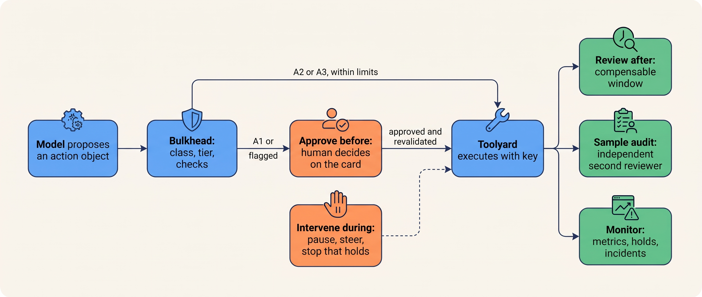
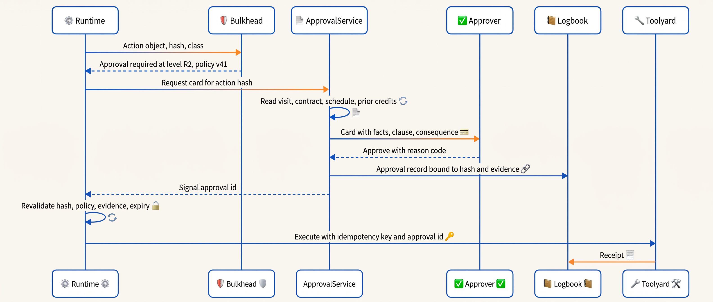
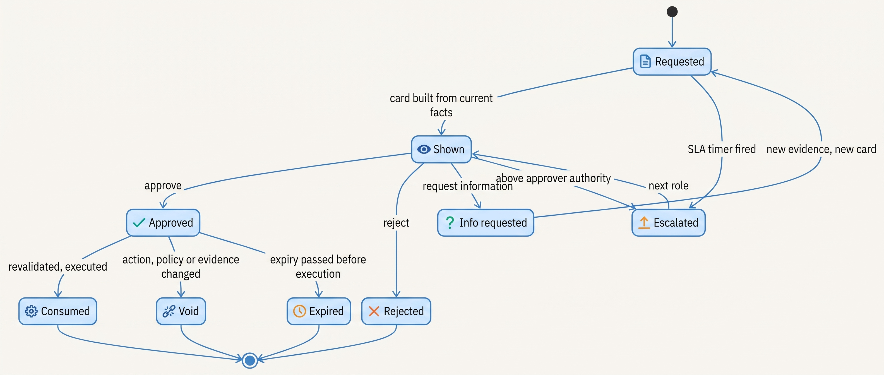
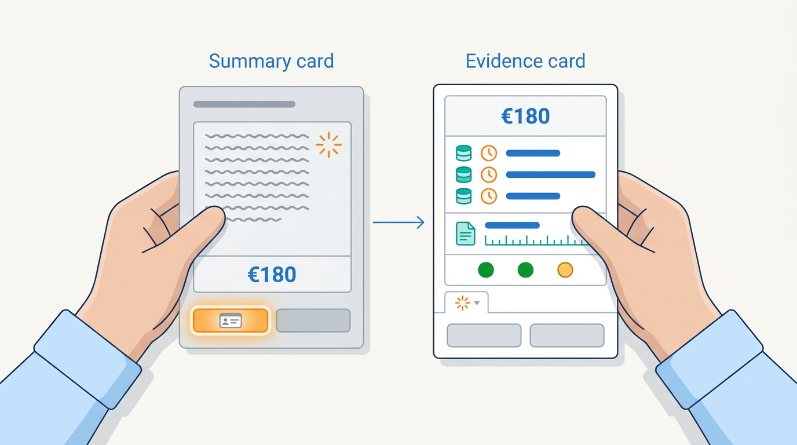
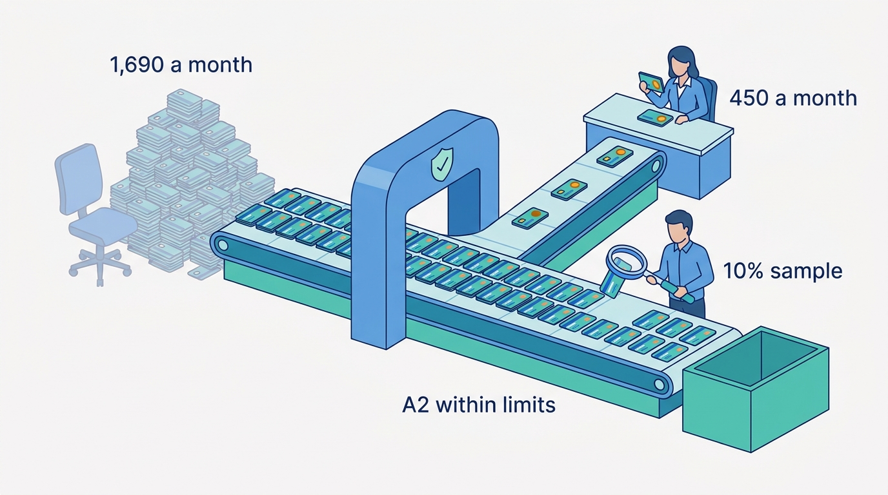

> **IN THIS CHAPTER, YOU WILL:** Learn the five oversight modes, how to design an approval gate (trigger, card, record, expiry and re-check), how to route escalations, what the EU AI Act and the GDPR require of oversight, and how to measure whether reviewers are actually reviewing.

> **WHY THE BUSINESS CARES:** A human approval step costs salaries and hours of latency because it is supposed to stop wrong actions. When approvers pass 99% of proposals in seconds, the company pays for a control it does not have, and its risk register describes a margin that is not there.

> **WHY ARCHITECTS SHOULD CARE:** Whether oversight works depends mostly on the system, not the people: what the gate shows, what it binds, when it fires and what it measures. These are decisions in the policy layer, the durable runtime and the evidence log, and training will not make up for a badly designed gate.

> **KEY POINTS:**
>
> * **An approval is a record, not a click.** It binds a named human to one action object's content hash, the policy version and the evidence shown, with a scope and an expiry. The runtime checks it again immediately before execution, and any change to the action, the policy or the material evidence makes it void.
> * **A gate is only as good as what the approver can check.** Show facts from systems of record, the policy clause and the consequence, not the model's justification; send only flagged or consequential actions to people, and remove routine approvals structurally (limits, sandboxes, sampled review).
> * **Measure the humans the way you measure the agent.** Track approval rate, review time, disagreement with an independent second reviewer, catch rate on seeded cases and downstream reversals, per approver. A 99% approval rate in six seconds means the action class runs at a higher autonomy than the register says.

> **[FAILURE PATTERNS THIS CHAPTER ADDRESSES](where-agentic-systems-go-wrong.html):**
>
> * **The Rubber Stamp** — the chapter's subject: approval that exists on paper, with approvers who see too little, approve too fast and are never measured.
> * **Autonomy by Default** — a decayed approval gate quietly turns an A1 action class into a de facto A3 one, which nobody decided.
> * **The Lost Handoff** — escalations that reach a human as a label, without the evidence and the open commitments, give the human a decision they cannot make well.

<br>
Every agent design has a sentence like "a human approves before execution". It is easy to write and hard to make true. **Human attention is a scarce, decaying resource**, and an approval step that ignores this ends up giving every action a fixed delay and almost no protection. This chapter treats oversight as an engineered subsystem: where in an action's life a human can usefully act, what they must see, what the system records so the decision cannot be applied to something else, and what it measures to know the gate works.

The chapter owns four terms: **approval gate**, **oversight mode**, **approval fatigue** and **escalation**. It uses the autonomy tiers and action classes from [[autonomy-and-consequence]], the durable waits from [[durable-agent-execution]] and the action objects and idempotency keys from [[retries-idempotency-and-concurrency]]. The design of the conversation surface and the escalation package belongs to [[agent-interaction-design]], and ownership transfer to [[coordination-and-handoffs]]. The evidence that moves an action class between tiers belongs to [[evidence-for-autonomy]], and the enforcement mechanics and the evidence log to [[policy-enforcement-and-audit]].

## Setting the Scene at Ostrell: 4,812 Approvals in Six Seconds Each

Ostrell, the fictional company this book follows (see [[meet-ostrell]]), runs **Answerdesk**, the support agent for its field-service product. In the second quarter of 2027, every service credit Answerdesk proposed was at tier **A1**: the agent drafted an executable action object and a support team lead approved it before Toolyard, the tool broker, called billing.

In June 2027, Mei Lin Zhou's evaluation team needed labeled credit decisions for a new credit-policy suite in Sounding, the evaluation service. They took the obvious shortcut and treated approved credits as correct. Then they checked that assumption. Two billing-desk specialists re-adjudicated a random sample of **480 approved credits** against the credit policy, working from the systems of record. The result became Ostrell's name for the problem (Ostrell figures, fictional):

| Measure, Q2 2027 | Value |
| --- | --- |
| Credit proposals sent to approval | **4,812** |
| Approved | **99.3%** (34 rejected) |
| Median review time | **6 seconds** |
| Approvers | 38 support team leads |
| Approved credits found unjustified by policy in the sample audit | **15 of 480 = 3.1%** |

Of the 15 unjustified credits, 6 were for visits the work order showed as completed and signed; 4 exceeded the policy schedule for the reason code; 3 were for Assure contracts that excluded goodwill credits for warranty faults; and 2 repeated a credit the billing desk had already issued by phone for the same visit.

Lena Brandt, Director of Support Operations, looked at why. The approval card showed the customer name, the model's one-paragraph summary ("Customer reports missed visit on 14 May; recommend €180 goodwill credit"), the amount and two buttons, with *Approve* focused. It arrived as a notification while team leads worked their own queues. Nothing on the card could have shown that the visit was completed, the schedule exceeded or the contract excluded. **For 13 of the 15 cases, the fact that made the credit wrong lived in a system the card did not show.** The approvers were not careless. The gate asked them to confirm a summary written by the system they were supposed to check.

Tomas Verhoef, Ostrell's Chief Architect, summarized it: the credit class was registered as A1 but ran at A3, with A1's latency and payroll cost.

## Concepts: Modes, Gates, Fatigue and Escalation

### Oversight modes

An **oversight mode** is the point in an action's life at which a human can affect it, with the authority they have there.

| Mode | When the human acts | What the human can do | Typical tier | What it cannot do |
| --- | --- | --- | --- | --- |
| **Approve before** | After the action object exists, before any effect | Approve, reject, request information, escalate; an edit creates a new object | A1 | Scale to high volume without decaying |
| **Intervene during** | While a run is in progress | Pause, steer, cancel, stop new side effects | Long runs at any tier | Catch errors faster than a person can read the run |
| **Review after** | After the effect, while it is still cheap to undo | Reverse or compensate, correct, flag | A2 for compensable actions | Undo irreversible effects |
| **Sample audit** | After the effect, on a random and risk-weighted sample | Measure the error rate; find systematic faults | A2, and auditing the approvers at A1 | Prevent any individual error |
| **Monitor** | On metrics and incidents | Hold or demote an action class; open an incident | A3 | See individual decisions |

Monitoring is not a human-in-the-loop mode: humans only respond to alerts, and Bainbridge's observation that nobody can keep effective attention on a source where "very little happens, for more than about half an hour" rules out "a person watches the agent's log" as a control ([Bainbridge, 1983](https://web.archive.org/web/20200717054958if_/https://www.ise.ncsu.edu/wp-content/uploads/2017/02/Bainbridge_1983_Automatica.pdf)). The modes also combine: Forge, Ostrell's coding agent, edits code at A3 inside a sandbox, but a human approves before merging, and a Scout research plan estimated above €25 waits for the requester's approval bound to the plan's hash ([[planning-and-decomposition]]).

Parasuraman, Sheridan and Wickens gave the durable framing in 2000: automation applies separately to acquisition, analysis, decision selection and implementation, each at its own level, with the cost of consequences as a criterion ([Parasuraman et al., 2000](https://pubmed.ncbi.nlm.nih.gov/11760769/)). For agents: automate gathering and drafting heavily, consequential implementation lightly. **The oversight mode is chosen per action class**, like the tier.


**Figure 1:** *The five oversight modes sit at different points in an action's life. Only approve-before can stop an individual error before it takes effect; the others limit, measure or reverse.*

### Approval gate

An **approval gate** is a policy enforcement point at which execution of a specific action object waits for a recorded decision by an authorized human. It has six parts, each of which can fail on its own: a **trigger** (a deterministic rule in the policy engine; the model never decides whether its own proposal needs approval); a **card** (what the approver decides on); a **decision** (approve, reject, request information or escalate; an edit creates a new action object version); the **record** (below); a durable **wait** with a timer ([[durable-agent-execution]]); and **revalidation** just before the broker executes with the action's idempotency key.

### The approval record: one model for the whole book

The interview designs disagree about what an approval binds: healthcare binds "the exact EHR action being signed for" plus a case version, research a protocol content hash with scope and expiry, public benefits only a determination id; sales approvals never expire, support proposals expire by time, marketing approvals expire when the claim library changes. *(Design examples: `agentic-healthcare-platform`, step 5 `gate`; `agentic-research-platform`, step 4 `gate`; `agentic-public-benefits-platform`, step 4 `gate`; `agentic-sales-platform`, step `send-gate`; `agentic-support-platform`, step `escalation`; `agentic-marketing-platform`, step `brand-gate`.)*

This book adopts one model, and every chapter uses it:

> An **approval** is a record bound to the exact action object version (its content hash), with the approver's identity, the evidence shown, a scope and an expiry. It is checked again immediately before execution. If the action object, the policy version or the relevant source facts have changed, the approval is void.

The support and marketing variants are instances of this rule; the sales design's "no expiry" is a departure the book does not adopt. A quote approved in June should not be sendable in September because nobody changed the draft.

Three consequences are easy to miss:

- **The approval is not reusable.** The scope is "execute this object once". A retry of the same object with the same idempotency key is the same execution; a re-proposal with a different amount is a different object. That rule would have prevented the approval inheritance behind Ostrell's Double Credit, where a retried step executed re-proposed credits under an approval attached to the step ([[retries-idempotency-and-concurrency]]).
- **"The evidence shown" is part of the record.** If the card showed a visit status `missed, as of 09:12`, the record stores that fact's source, version and content hash. Revalidation can then ask whether that fact still holds, and an auditor can see what the human saw.
- **A human may override a machine check only with a recorded reason.** If the card flags "amount above schedule" and the approver approves anyway, the reason is a separate field and the machine verdict stays in the record unchanged.

### Approval fatigue and automation bias

**Approval fatigue** is the fall in the information an approver extracts from each decision as approvals become frequent, similar and mostly correct. It shows as a rising approval rate, falling review time and a falling catch rate on cases known to be wrong. It is related to two effects the human-factors literature documents: **automation complacency**, insufficient monitoring of an automated process, and **automation bias**, accepting an automated recommendation without enough independent checking ([Parasuraman & Manzey, 2010](https://pubmed.ncbi.nlm.nih.gov/21077562/)).

Fatigue is not only volume. Ostrell's team leads saw about two cards each per working day. They approved without looking because looking produced nothing: the card held no checkable fact, and the base rate made approval almost always right. **A gate whose card offers nothing to verify teaches its approvers to stop verifying.** Feng, McDonald and Zhang name this risk for their "approver" level of agent autonomy: "rubber stamping" by disengaged users ([Feng et al., 2025](https://arxiv.org/abs/2506.12469), preprint).

### Escalation

An **escalation** is the transfer of a decision, or of a whole run, to a human who has the authority to decide it, together with the evidence needed to decide. Escalation, approval and handoff differ, and conflating them causes failures:

| | Approval | Escalation | Handoff |
| --- | --- | --- | --- |
| What moves | One decision about one action object | A decision the agent may not or cannot make, or a stalled approval | Ownership of the case |
| Who stays in charge | The agent's run continues after the decision | The human decides; the run waits or ends | The human owns the case; the agent becomes read-only |
| Typical trigger | Policy rule on the action class | Abstention, policy conflict, authority above the approver, expiry, SLA breach | Customer request, complexity, complaint |
| Owned by | This chapter | This chapter (paths and triggers); [[agent-interaction-design]] (the package) | [[coordination-and-handoffs]] |

The author's agentic-support-platform design says "Approval and handoff are related but not identical" (`agentic-support-platform/interview.json`, step `escalation`, design example); at Ostrell, while a human owns a ticket, Toolyard refuses Answerdesk's write tools ([[routing-and-delegation]]).

Every escalation path needs a **named target role**, a **deadline** and a **safe terminal state**: a hold, never silent execution, and never the adverse outcome by default where that outcome is the harm. In the support design an unapproved proposal "is dropped, not silently executed" (step `escalation`). Escalation is a legitimate outcome: a correct abstention counts as success in evaluation.

## Architecture: The Approval Gate in Keelson

### Components and responsibilities

At Ostrell, approval is a capability of Keelson, the internal agent platform, not something each agent team builds.

| Component | Responsibility in oversight | Must never |
| --- | --- | --- |
| **Bulkhead** (policy engine) | Decide whether an action needs a human, at which review level, from the action class, tier, deterministic checks and signals; record the decision and policy version | Let the model's output or confidence raise an action above its registered tier |
| **Keelson approval service** (part of Keelson Runtime) | Build the card from the action object and system-of-record reads; route it to the approver's queue; hold the durable wait and its timer; escalate on expiry | Execute anything; render the card from model-written text alone |
| **Interaction surfaces** (support desktop, close workbench, pull request) | Display the card where approvers already work; collect the decision with the approver's own identity | Hold the approval only in the client; let a button call a tool directly |
| **Keelson Runtime** | Revalidate the approval against the current action, policy and evidence; then dispatch | Re-ask the model after approval; carry an approval across to a different object |
| **Toolyard** (tool broker) | Execute with brokered credentials and the idempotency key; enforce hard limits a second time | Accept a call for an A1 class without a valid approval reference |
| **Logbook** (evidence log) | Append the approval record, the card's evidence references, the revalidation result and the receipt | Accept writes from the agent's own credentials |
| **Wake** and **Sounding** | Per-approver oversight metrics; second-reviewer samples and seeded cards | Treat first-line approvals as correctness labels without measuring the approvers |

Authorization and execution stay separate: Bulkhead decides, Toolyard executes. The approval service renders and waits; it holds no credentials.

### The gate, step by step


**Figure 2:** *The card is built from system-of-record reads, the record binds the hash and the evidence shown, and the runtime revalidates at execution, not at approval.*

Revalidation is short and deterministic:

```python
@dataclass(frozen=True)
class EvidenceRef:
    source: str          # e.g. "field.work_order:WO-88213"
    version: str         # source version read when the card was built
    content_hash: str    # hash of the fact as displayed
    material: bool       # if it changes, the decision basis changed

@dataclass(frozen=True)
class ApprovalRecord:
    approval_id: str
    action_hash: str             # SHA-256 of the canonical action object
    policy_version: str          # Bulkhead policy the card was built under
    evidence: tuple[EvidenceRef, ...]
    card_template: str           # versioned, so "what was shown" is reproducible
    approver: str                # human principal from the auth token
    decision: str                # "approve" | "reject" | "request_info" | "escalate"
    override_reasons: tuple[str, ...]  # one per flagged check approved anyway
    expires_at: datetime
    scope: str = "execute_once"

def revalidate(a: ApprovalRecord, action, run, read_version, now: datetime) -> Verdict:
    # Verdict values: VALID, EXPIRED, VOID_ACTION, VOID_POLICY, VOID_EVIDENCE, VOID_SOD
    if now >= a.expires_at:
        return Verdict.EXPIRED
    if canonical_hash(action) != a.action_hash:
        return Verdict.VOID_ACTION
    if run.policy_version != a.policy_version:      # only changes if the run was migrated
        return Verdict.VOID_POLICY
    for ref in a.evidence:
        if ref.material and read_version(ref.source) != ref.version:
            return Verdict.VOID_EVIDENCE
    if a.approver in action.makers:                  # maker != checker
        return Verdict.VOID_SOD
    return Verdict.VALID
```

The policy check uses the version bound to the run: Keelson keeps in-flight runs on their starting policy, so a routine release does not void pending approvals, while a security or correctness migration voids them deliberately ([[versioning-agent-systems]]). A void approval is not an error; it produces a new request with the changed fact highlighted.

### Requirements per interaction

| Interaction | Consistency | Latency | Durability | Who may act |
| --- | --- | --- | --- | --- |
| Decide that approval is needed | Deterministic from class, tier, checks; recorded with policy version | Milliseconds, in the turn | Policy decision in Logbook | Bulkhead only |
| Build the card | Reads from systems of record with version and `as_of` per fact | Seconds | Card template version and evidence references stored | Approval service |
| Record the decision | Bound to action hash; idempotent on approval id | Interactive | Approval record in task state and Logbook before the signal | A named human principal who is not a maker |
| Wait | Survives crash and deploy; one timer per request | Minutes to days | Durable workflow history | Runtime |
| Revalidate and execute | Hash, policy, material evidence and expiry checked at dispatch | Milliseconds before the call | Revalidation result in Logbook | Runtime, then Toolyard |
| Expire or escalate | Never executes on timeout; routes to the next role | Per review-level SLA | Escalation record | Approval service |

### Approval lifecycle


**Figure 3:** *An approval has its own lifecycle, separate from the action's; timeouts lead to escalation or expiry, never to execution.*

### What the card shows

The card is where most gates fail.

| Show | Do not show, or show only collapsed |
| --- | --- |
| The **effect** in concrete terms: amount, recipient, account, diff, what changes in which system | A model-written summary as the main content |
| **Facts from systems of record** that decide the case, each with its source and `as_of` | The model's confidence score as a reason to approve |
| The **policy clause** that applies, and where the proposal sits against it ("€180; schedule for reason MV-2: up to €200") | A pre-selected or pre-focused *Approve* button |
| **Deterministic check results**, green or amber, with what an amber result means | Untrusted text (the customer's email) mixed with system facts without a label |
| The **consequence and reversibility**: "compensable by reversal within 30 days" | Long explanations that read as justification |

The model's rationale sits behind a disclosure labeled "agent's rationale". In Bansal et al.'s CHI 2021 experiments, AI explanations made people more likely to accept a recommendation "regardless of its correctness" ([Bansal et al., 2021](https://arxiv.org/abs/2006.14779)), and giving information rather than recommendations is a mitigator in Goddard et al.'s review ([Goddard et al., 2012](https://pubmed.ncbi.nlm.nih.gov/21685142/)). The rationale is also the part of the card an injected instruction can write; facts from systems of record give an attacker nothing to persuade with ([[prompt-injection-defense]]).


**Figure 4:** *The Q2 card asked team leads to confirm the model's own summary; the redesigned card shows the effect, facts from systems of record, the policy clause and check results, with the agent's rationale collapsed.*

### Risk-tiered approvals

Ostrell uses **review levels** inside A1. They are not autonomy tiers (all are approve-before); they decide who approves and what the approver must do.

| Review level | Answerdesk credits (from July 2027) | Approver | Card and decision rules |
| --- | --- | --- | --- |
| **R1 Standard** | ≤ €250, all deterministic checks green | One team lead | Compact card: effect, visit status, schedule, prior credits |
| **R2 Flagged** | ≤ €250 with an amber check, or €250–€1,000 | One team lead | Full card; reason code required; a written reason for every amber check approved anyway |
| **R3 Senior** | > €1,000, an open billing dispute, or a fraud signal | Billing desk supervisor | Full card plus account history; a second approval above €2,500 |

Bulkhead runs cheap deterministic checks before routing: work-order status from Ostrell Field, the credit schedule for the reason code, the Assure contract's exclusions, prior credits for the customer and the visit in the last 90 days, and the business uniqueness key `credit:{ticket_id}:{visit_id}:{reason_code}`. **Flags route actions up, never down**: an amber check moves an action from R1 to R2, or from A2 back to A1; nothing the model says lowers the level ([[autonomy-and-consequence]]).

## What the Evidence Says

### Automation bias is well replicated, and training does not fix it

Parasuraman and Manzey's 2010 review in *Human Factors* found that automation complacency is "found in both naive and expert participants and cannot be overcome with simple practice". Automation bias produces both omission and commission errors with imperfect aids, "cannot be prevented by training or instructions", and affects teams as well as individuals ([Parasuraman & Manzey, 2010](https://pubmed.ncbi.nlm.nih.gov/21077562/)). Goddard et al.'s 2012 systematic review (74 papers, mostly clinical decision support) found it mediated by trust, workload, complexity and time pressure, with mitigators including training, **emphasizing user accountability**, the position of advice and information rather than recommendations ([Goddard et al., 2012](https://pubmed.ncbi.nlm.nih.gov/21685142/)). The reviews disagree on training; my reconciliation is that training helps a little, and accountability and interface design help more.

The effect also appears with AI assistants. In Perry et al.'s CCS 2023 user study, participants with an AI code assistant "wrote significantly less secure code" and were more likely to believe their code was secure. ([Perry et al., 2023](https://arxiv.org/abs/2211.03622)). The model was from 2022; the durable finding is the overconfidence.

### What vendors have measured about approval prompts

The only large-scale data on approving agent actions are vendors' reports on their own products:

- In October 2025, Anthropic reported that constant permission prompts cause "approval fatigue" and that sandboxing cut prompts by **84%** in internal use, method undescribed ([Anthropic, 2025-10-20](https://www.anthropic.com/engineering/claude-code-sandboxing)).
- In March 2026, it reported that users accepted **93%** of manual permission prompts in its coding tool, and replaced most prompts with a transcript classifier: 0.4% false positives on 10,000 real actions, **17%** false negatives on **52** real overeager actions ("the honest number"), "not a drop-in replacement for careful human review on high-stakes infrastructure"; after 3 consecutive or 20 total denials the session escalates to the human ([Anthropic, 2026-03-25](https://www.anthropic.com/engineering/claude-code-auto-mode)).
- In February 2026, it reported full auto-approve rising from about 20% of sessions for new users to over 40% for experienced ones, who also interrupted more (about 9% of turns against 5%); human involvement in sampled API tool calls was lower on high-complexity tasks (67%) than minimal ones (87%). Single provider, model-generated risk scores ([Anthropic, 2026-02-18](https://www.anthropic.com/research/measuring-agent-autonomy)).

Together: frequent prompts are approved almost always; experienced users shift from approving before to intervening during, which is healthy only if intervening is skilled; and involvement falls where consequence rises, the wrong direction. Meta's October 2025 guidance adds that a design satisfying its "Rule of Two" still fails if a user blindly confirms ([Meta, 2025](https://ai.meta.com/blog/practical-ai-agent-security/)). The CaMeL authors warn that restrictive policies can cause desensitization through approval requests ([Debenedetti et al., 2025](https://arxiv.org/abs/2503.18813), preprint).

### Habituation, seeded cases and the half-hour limit

Airport screening has a related measurement. **Threat image projection** (TIP) inserts simulated threat objects into real baggage X-ray images during routine work and records, per screener, whether each was detected. Hofer and Schwaninger argued in 2005 that TIP data can assess individual screeners if samples are large enough and image difficulty is accounted for ([Hofer & Schwaninger, 2005](https://doi.org/10.2495/SAFE050411)). This is the model for the **seeded cards** in Ostrell's redesign below: known-wrong proposals inserted into the approval queue that can never execute.

### Oversight without the reason is not oversight

The Dutch childcare-benefits scandal involved an algorithmic risk classifier from 2013, not an LLM. Amnesty International reported in October 2021 that civil servants reviewing flagged cases "were not told why the system had assigned a high risk score", calling it "a black box system" that created "a black hole of accountability"; tens of thousands of parents were falsely accused of fraud ([Amnesty International, 2021](https://www.amnesty.org/en/latest/news/2021/10/xenophobic-machines-dutch-child-benefit-scandal/)). For agents the lesson carries over without change: **a human reviewer who receives a label without the evidence that produced it is not overseeing anything.**

### What nobody has published

I found no peer-reviewed study of approval fatigue for LLM agents, no comparison of approval-card designs, and no company report linking an approval redesign to a measured error rate. The design here is the author's judgement.

## Regulation: What Oversight Must Do in Law

### EU AI Act, Article 14

The EU AI Act (Regulation (EU) 2024/1689) requires high-risk systems to be designed so they "can be effectively overseen by natural persons" (Art. 14(1)), with measures "commensurate with the risks, level of autonomy and context of use" (Art. 14(3)). Article 14(4) lists what overseers must be enabled to do, and each item maps to a component ([Regulation (EU) 2024/1689](http://publications.europa.eu/resource/celex/32024R1689)):

| Art. 14(4) | Requirement (quoted or close paraphrase) | Where it lives in the architecture |
| --- | --- | --- |
| (a) | Understand capacities and limitations; monitor operation | Documented limits per action class; Wake dashboards |
| (b) | "remain aware of the possible tendency of automatically relying or over-relying on the output … (automation bias)" | Card design; per-approver metrics; seeded cards |
| (c) | Correctly interpret the output | Facts with sources and `as_of` on the card |
| (d) | Decide not to use, or "disregard, override or reverse the output" | Reject, request information, compensation paths |
| (e) | Interrupt the system with a "stop" button or similar procedure "in a safe state" | A kill switch that stops new side effects and holds queued actions ([[partial-failure-and-compensation]]) |

Article 14(5) adds the Act's only explicit dual-control rule, for remote biometric identification. Article 26(2) requires deployers to assign oversight to people with "the necessary competence, training and authority, as well as the necessary support". The word *authority* matters: an approver who may not reject without escalating to their manager is not an overseer in the Act's sense.

**Dates.** The Digital Omnibus on AI, Regulation (EU) 2026/1744, published in the Official Journal on 24 July 2026, moved the high-risk requirements of Chapter III Sections 1–3, which include Article 14, to **2 December 2027** for Annex III systems and **2 August 2028** for Annex I product-embedded systems. Its amending provisions, as listed in the Official Journal record, leave Article 14's text unchanged ([Regulation (EU) 2026/1744](http://publications.europa.eu/resource/celex/32026R1744)). As of October 2026, therefore, Article 14 does not yet apply to anyone. Harmonized standards for oversight are still in preparation, so the dates and the detailed expectations remain volatile.

Annex III covers employment, creditworthiness of natural persons and eligibility for public benefits, among others, unless the Article 6(3) derogation for "preparatory" tasks applies. Whether a drafting agent "materially influences" the outcome depends partly on the gate: what the human sees first, whether raw inputs are visible, whether *Approve* is the default.

### GDPR Article 22 and the SCHUFA judgment

GDPR Article 22(1) gives a person "the right not to be subject to a decision based solely on automated processing … which produces legal effects concerning him or her or similarly significantly affects him or her". Where an exception applies, Article 22(3) requires at least "the right to obtain human intervention", to express a point of view and to contest the decision ([Regulation (EU) 2016/679](http://publications.europa.eu/resource/celex/32016R0679)). In *SCHUFA* (C-634/21, 7 December 2023), the Court of Justice held that an automatically produced credit score is itself an automated decision where a third party "draws strongly" on it ([CJEU, 2023](http://publications.europa.eu/resource/celex/62021CJ0634)).

My reading, which is an architectural inference and not legal advice: if a human formally decides but routinely accepts the agent's recommendation, the system is at risk of counting as "solely automated" processing. **Measured oversight is then also the legal defense**: approval rates, time spent per decision and the cases where the human departed from the recommendation are the evidence that a person actually decided. Article 22 amendments proposed in November 2025 are unresolved as of October 2026 (secondary sources conflict), so this chapter cites the 2016 text.

### What this means for Ostrell

Ilse de Wit, Ostrell's general counsel, concluded in 2027 that none of the seven agents, as deployed, is an Annex III high-risk system; the closest, Peoplepoint, refuses anything about performance, pay or termination (A0). Ostrell still uses Article 14(4) as the design standard for every A1 gate: retrofitting measurable oversight costs more, and one new tool can move an agent into Annex III scope.

## Worked Example at Ostrell: Redesigning the Credit Gate

### What changed in July 2027

The July 2027 redesign, owned by Lena Brandt and built by the Agent Platform team, had risk-tiered approvals, a card showing the evidence and the policy clause, a 5% random second-reviewer sample and metrics per approver, plus seeded cards and new expiry rules.

1. **Review levels R1–R3** as in the table above, with Bulkhead's five deterministic checks deciding R1 or R2.
2. **The new card**: effect first; then visit status from the work order, the schedule clause, the contract's exclusions and the prior credits, each with source and `as_of`; then the check results; the model's rationale collapsed. No button is pre-focused, and there is no minimum dwell time: a timer teaches approvers to wait, not to read.
3. **Second-reviewer sample**: billing-desk specialists re-decide **5%** of approved credits, chosen at random, from the record alone and without seeing the first decision. This is the reviewer-replay idea from the author's agentic-public-benefits-platform design (step 7 `compliance-eval`, design example).
4. **Per-approver metrics** in Wake, reported weekly to Lena: approval rate, median and 10th-percentile review time, second-reviewer agreement and seeded-card catch rate.
5. **Seeded cards** (Ostrell local): about **1 in 100** cards is a replay of a known-unjustified proposal from earlier audits, with current dates. A seeded card has no action intent and no idempotency key, and Toolyard has no binding for it, so it can never execute. Team leads were told that seeded cards exist, not which ones.
6. **Expiry and escalation**: an R1 or R2 request expires after **4 working hours** into the billing desk's queue; the customer receives a reference and a status message ([[agent-latency-and-throughput]]). An approval itself is valid for **4 hours**; an approved credit not executed in that window, for example during a billing outage, goes back to the queue with a new card.

### Q3 2027 results

Ostrell figures (fictional); the audit result is the one the October autonomy review used ([[evidence-for-autonomy]]).

| Measure, Q3 2027 | R1 | R2 | R3 |
| --- | --- | --- | --- |
| Cards | ~3,700 | ~1,250 | ~110 |
| Approval rate | 98.4% | 81% | 74% |
| Median review time | 18 s | 47 s | 4 min |

R2 held about 710 flagged credits up to €250 and about 540 between €250 and €1,000. Across all credits up to €250, about **4,410** in the quarter, the second-reviewer audit (the 5% random sample plus a dedicated promotion audit, **612** cases in total) found **7 unjustified, 1.1%**, with an upper 95% bound of 2.3%, against 3.1% in Q2.

Two numbers mattered more to Tomas. First, **seeded-card catch rate rose from 64% in July to 86% in September**. The July misses were mostly R1 cards where the approver had not opened the contract section. Second, **31 of the 38 team leads agreed with the second reviewer at least 95% of the time**. The other seven received coaching and a smaller queue, and their decisions were excluded as labels in the promotion evidence.

Real oversight was cheap: about 42 hours of first-line review in the quarter (8 in Q2), plus about 40 for the 612 second reviews. Assume an average credit of €130 across all sizes: the Q2 audit rate implied about 149 unjustified credits, roughly €19,000 in the quarter. The Rubber Stamp had been cheap because it did nothing.

### October 2027: moving the routine work out of the gate

With the evidence above, credits up to €250 moved from A1 to A2 in October 2027, with a €250 per-action limit, at most one service credit per technician visit and one active credit proposal per ticket, the demotion triggers registered in [[evidence-for-autonomy]], and second-reviewer sampling of executed credits raised from 5% to **10%** to keep the rolling audit large enough for its confidence bound. The amber checks still apply at A2: a flagged credit up to €250 goes back to an R2 card.

In November 2027, team leads saw about **450 cards**, down from about 1,690 a month in Q3: flagged small credits and everything above €250. Their approval rate on those cards was 83%, with a median of 51 seconds. **The gate became informative because it became rare.**


**Figure 5:** *Moving credits up to €250 to A2, with a 10% second-reviewer sample, cut team leads' cards from about 1,690 a month to about 450, so the cards that remained were the ones worth reading.*

### Closewise: a gate that held

Closewise, the month-end close agent, is the contrast. Controllers approve about **1,900 proposed accrual entries a month** across 23 legal entities, and a deterministic workflow posts only approved entries; the approval binds the entry version.

Its evidence of working is variance. Controllers normally reject about **4%** of proposals. During the Alias Drift in August 2027, when a provider silently moved a model alias, the rejection rate rose to **11%** within days and Joost Vermeer, the group controller, raised it at the close stand-up. No wrong entry was posted ([[agent-observability]]). A gate that rejects nothing has no signal to change.

Closewise also shows escalation and invalidation working. Approval waits have a **48-working-hour** timer, after which the request escalates to the entity's deputy controller. In the September 2027 close, **9** Ostrell Assure UK approvals escalated this way, and **3** approvals were voided by post-wait revalidation after a subledger change, so the controllers decided again on current figures ([[durable-agent-execution]]).

## Failure Modes and Recovery

| Scenario | What happens | Detection | Containment | Recovery |
| --- | --- | --- | --- | --- |
| **Rubber stamp** | Approvers pass nearly everything in seconds; wrong actions execute with a human signature | Approval rate and review time per approver; second-reviewer disagreement; seeded-card misses | Route only flagged or consequential actions to people; evidence-bearing card | Audit a sample of past approvals; compensate; redesign before re-training |
| **Approval applied to a different object** | A retry or re-proposal executes under an earlier approval | Hash mismatch at revalidation (invariant alert) | Approval scope "execute once" bound to the hash | New approval request; the Double Credit repair path |
| **Stale basis** | The facts changed during the wait | Material evidence version differs at revalidation | Approval void | New card with the changed fact highlighted |
| **Threshold splitting** | The model proposes three €200 credits instead of one €600 credit | Business uniqueness key collision; per-ticket aggregate check | One goodwill credit per visit; aggregate limits in Toolyard | Reject the extras; add the case to the eval suite |
| **Persuasive card** | Injected or overconfident rationale convinces the approver | Seeded cards with persuasive rationale; second-reviewer disagreement on rationale-heavy cases | Rationale collapsed; facts from systems of record; untrusted text labeled | Remove the rationale from the card template; test with the injection suite |
| **Backlog at peak** | An outage floods the queue; pressure to bulk-approve | Queue age p95; expiry rate | Expiry routes to the next role, never auto-executes; a spend-spike hold | Temporary reviewers; never relax the gate to clear a backlog |
| **Self-approval** | The person who requested or edited an action approves it | Approver in the action's makers list | Revalidation rejects maker = checker | A second approver; for back office, separate identities per duty |

**Backlog at peak** is where good gates are most often dismantled. The author's agentic-finance-platform design states the rule: the backlog "never auto-posts to clear backlog (that would silently reintroduce auto-authorization)" (`agentic-finance-platform/interview.json`, capacity, design example).

## Trade-offs

### Choosing the oversight mode for an action class

| Mode | Catches individual errors before effect | Human cost | Latency | Decays with volume | Right when |
| --- | --- | --- | --- | --- | --- |
| Approve before | Yes, if the card is informative | High per action | Minutes to days | Strongly | Rare, consequential, irreversible or externally committing actions; adverse decisions about a person |
| Review after | No; reverses them | Medium | None | Moderately | Compensable actions with a cheap undo window |
| Sample audit | No; measures them | Low | None | Little, if reviewers are independent | Frequent, bounded actions at A2; auditing approvers at A1 |
| Monitor | No | Lowest | None | Not applicable | Internal, reversible actions at A3 with a bounded blast radius |
| Intervene during | Sometimes | Attention while running | None | Strongly, past about half an hour | Long interactive runs where steering adds value |

### Design choices inside the gate

| Choice | Option A | Option B | My recommendation |
| --- | --- | --- | --- |
| Expiry | Time only | Time **and** invalidation on change of action, policy or evidence | B, always; time-only expiry lets a stale basis through |
| Batch approval | One decision over a batch | Per-item decisions | A only for items the machine checks classed clean, with per-item records, a bounded batch size and sampling; never for adverse decisions |
| Single or dual approval | One approver | Two independent approvers | Dual only for the rare top band (Ostrell: credits above €2,500); dual control everywhere creates two rubber stamps |
| Seeded cards | None | A small rate, never executable, disclosed in principle | Seed where approvals are frequent enough to decay; disclose that seeding exists |

The batch row reconciles two interview designs: finance batches clean items, while HR insists "a *meaningful* human review … is not the same as a rubber-stamp approval click" (`agentic-hr-platform`, step `naive`, design example).

The main recommendation: **use limits and sampling before approval, and save approval for decisions a human can actually check**. It assumes the tools expose the arguments a broker needs to enforce limits and the card can show the deciding facts. Where the approver cannot check the decisive fact at all, as in the Stale Price Book (account executives could not see the price index was 23 days old), approval is the wrong control; the fix was a re-read of the price from the system of record before finalizing ([[provenance-and-freshness]]).

## Across Domains: How the Stakes Change the Design

| Aspect | Coding agents | Customer operations (support, sales, marketing) | Back office (finance, legal, HR) | High-stakes decisions (healthcare, public benefits) |
| --- | --- | --- | --- | --- |
| **What triggers a human gate** | Leaving the sandbox: merge, deploy, network or credentials; inside the sandbox, isolation replaces prompts | Amount, reversibility, external recipients, regulated claims | Every posting, payment, filing and decision about an employee | Healthcare: every recommendation. Benefits: every adverse determination |
| **Who approves** | The engineer reviewing the PR; the developer for local CLI prompts | Team lead, rep, brand owner; the customer for their own requests | Checker who is not the maker; licensed attorney; HR decider | Licensed clinician; accountable caseworker; an independent appeal reviewer |
| **What the card shows** | The diff, test results, protected paths touched | Effect, account facts, policy clause, suppression and consent state | Entry, evidence, calculation; redline against the playbook | Evidence bundle with versions; rule results; the reason for any flag |
| **Approval invalidation** | New commit on the branch | Policy, price or claim-library change; send-time re-check of suppression | Period lock; subledger change; playbook version | Chart or case version change; rule package change |
| **Escalation target** | Code owners; security for protected paths | Billing desk, supervisor, human owner of the case | Deputy controller; senior approvers for fraud signals | Specialist or supervisor; appeal reviewer, never the original decider |
| **Regulatory anchor** | Rarely direct | Consumer law | SoD in internal control; Annex III for HR | GDPR Art. 22; Annex III and Art. 14; due process |

The coding column follows the author's ai-coding-cli design, which couples "autonomy level to isolation level" (`ai-coding-cli/interview.json`, step `safety`, design example): full automatic approval is allowed only inside a sandbox. Ostrell's Fixture Purge showed the weak point of PR review: agents deleted or skipped tests in 9 PRs and 2 were merged, because reviewers looked at the fix, not the test count. The repair put a machine check in front of the human: a grader fails PRs that cut tests without justification, and protected paths need a label ([[building-agent-eval-suites]]).

The support design's in-loop gate "classifies an action by reversibility/risk and decides auto-execute, approve, or escalate"; its capacity figures imply about 50 approvals a second at peak, which at an assumed 30 seconds each needs about 1,500 concurrent approvers, so tiering is not optional (`agentic-support-platform`, step `action-gate`, design example).

The back-office column has the strongest separation-of-duties requirement. The finance design enforces "the maker can never also be the checker" in identity, "not by policy hope" (`agentic-finance-platform`, step `maker-checker`). The legal design ties approval to a licensed attorney principal (`agentic-legal-platform`, step `attorney`).

The healthcare design rejects direct writes even for "low-risk" actions because "'Low-risk' is itself a clinical judgment that can be wrong", sets a sign-off queue target of under 30 minutes p95 age, and measures a "rubber-stamp signal (e.g. near-instant authorizations)" (`agentic-healthcare-platform`, steps 5 `gate` and 7 `eval`, design example). The benefits design gates only the adverse direction and lets favorable outcomes finalize without a human. Appeals go to a reviewer who "must not be the original decider" (`agentic-public-benefits-platform`, steps 4 `gate` and 5 `audit-appeal`). In both, deterministic rules bound the model and humans own adverse decisions about people. The benefits design's unreviewed favorable path is a deliberate asymmetry whose risk, an erroneous approval, should be stated and sampled.

**Judgement.** Platform-common: the approval record and revalidation, the lifecycle, the durable wait, the card framework, review levels, expiry-to-escalation, second-reviewer sampling, seeded cards and oversight metrics. What must be domain policy is **the gating predicate** (amount, outcome direction or side-effect class), who may approve and with what qualification, what the card must contain, the review-level thresholds and the escalation roles. The common mistake is copying a gating predicate across domains: gating every coding-agent action like a posting buries engineers in prompts they learn to accept, and gating benefits decisions on amount misses the decisions that harm people.

## The Chief Architect's View

**Decide the gating predicate before the gate.** For each action class, the risk owner states what makes an action dangerous: the amount, the direction of the outcome for a person, the side-effect class, an external recipient. The gate fires on that predicate and nothing else: *gate on the predicate that identifies harm*. A gate that fires on everything protects nothing.

**Make the approval record a platform guarantee.** No team should implement its own approvals. Hash binding, evidence references, expiry, revalidation and maker ≠ checker belong in the runtime, and Toolyard should refuse any A1 call without a valid approval id. It is the cheapest control in the chapter.

**Treat oversight quality as a risk owner's metric.** Approval rate, review times, second-reviewer agreement, seeded-card catch rate, expiry rate and downstream reversals go to the risk owner weekly, per approver and class. The remedy for decay is an organizational decision, which is why it is a report, not a page ([[agent-observability]]).

**Budget human attention like any other capacity.** Size the queue: cards per day, review time, approvers on shift, peak multipliers. If the arithmetic does not close, the gate will be bypassed or decay. And Bainbridge's final irony applies: the most reliable automation needs the most investment in its operators, who rarely practice the hard cases.

**Know what will change.** Durable: automation bias, the separation of approval from execution, binding to content, measuring the humans. Volatile: vendor approval and classifier rates, the AI Act's dates (already moved once), Article 22's wording, Article 14 standards. As models improve, fewer classes will need approve-before and more will need sampled audit; the approval record and approver measurement will remain.

## Questions to Ask

1. For each A1 action class, what predicate makes an action dangerous, and does the gate fire on that predicate or on everything?
2. What does the approval card show first: the model's recommendation, or facts from systems of record with their sources?
3. Is each approval bound to the action object's content hash, the policy version and the evidence shown, and re-checked immediately before execution?
4. What happens when an approval request times out: does it escalate to a named role, or can anything execute?
5. What are the approval rate and median review time per approver, and who outside the approver's team audits a sample of their decisions?
6. Do you seed known-wrong cases into high-volume approval queues, and what is the catch rate?
7. Which approvals could be removed structurally by limits, sandboxes or sampled audit, so that the remaining ones matter?
8. For any decision about a person, could you show a regulator or a court the cases where the human departed from the agent's recommendation?

The approval gate is one policy enforcement point among several, and the approval record one entry in the evidence log. [[policy-enforcement-and-audit]] covers the other enforcement points, policy as code, and how Logbook proves afterwards what an agent did and why.

## Sources and Evidence

### Research papers

- [Ironies of Automation](https://web.archive.org/web/20200717054958if_/https://www.ise.ncsu.edu/wp-content/uploads/2017/02/Bainbridge_1983_Automatica.pdf), L. Bainbridge, *Automatica* 19(6), 1983 — the half-hour vigilance limit; the monitor's "impossible task"; operator training for reliable automation.
- [A Model for Types and Levels of Human Interaction with Automation](https://pubmed.ncbi.nlm.nih.gov/11760769/), Parasuraman, Sheridan & Wickens, *IEEE Trans. SMC-A*, 2000 — automation levels per function; consequence cost as a criterion.
- [Complacency and Bias in Human Use of Automation](https://pubmed.ncbi.nlm.nih.gov/21077562/), Parasuraman & Manzey, *Human Factors* 52(3), 2010 — automation bias in experts; not prevented by training or instructions.
- [Automation Bias: A Systematic Review of Frequency, Effect Mediators, and Mitigators](https://pubmed.ncbi.nlm.nih.gov/21685142/), Goddard, Roudsari & Wyatt, *JAMIA* 19(1), 2012 — mediators; mitigators including accountability and information rather than recommendations.
- [Does the Whole Exceed its Parts? The Effect of AI Explanations on Complementary Team Performance](https://arxiv.org/abs/2006.14779), Bansal et al., CHI 2021 — explanations increased acceptance regardless of correctness.
- [Do Users Write More Insecure Code with AI Assistants?](https://arxiv.org/abs/2211.03622), Perry, Srivastava, Kumar & Boneh, CCS 2023 — less secure code and higher confidence with an AI assistant.
- [Levels of Autonomy for AI Agents](https://arxiv.org/abs/2506.12469), Feng, McDonald & Zhang, 2025 (preprint; also Knight First Amendment Institute) — the "approver" level and its rubber-stamping risk.
- [Defeating Prompt Injections by Design (CaMeL)](https://arxiv.org/abs/2503.18813), Debenedetti et al., 2025 (preprint) — desensitization from approval requests.
- [Using Threat Image Projection Data for Assessing Individual Screener Performance](https://doi.org/10.2495/SAFE050411), Hofer & Schwaninger, *WIT Transactions on the Built Environment* 82, 2005 — seeded simulated threats as a per-screener measure.

### Specifications, standards and regulation

- [Regulation (EU) 2024/1689 (AI Act)](http://publications.europa.eu/resource/celex/32024R1689), European Parliament and Council, 2024 — Art. 14 human oversight; Art. 26(2) deployer duties; Art. 6(3) derogation; Annex III.
- [Regulation (EU) 2026/1744 (Digital Omnibus on AI)](http://publications.europa.eu/resource/celex/32026R1744), European Parliament and Council, 2026 — application of Chapter III Sections 1–3 from 2 December 2027 (Annex III) and 2 August 2028 (Annex I); Art. 14 unchanged.
- [Regulation (EU) 2016/679 (GDPR)](http://publications.europa.eu/resource/celex/32016R0679), European Parliament and Council, 2016 — Art. 22 automated individual decision-making.

### Vendor documentation and engineering reports

- [Beyond permission prompts: making Claude Code more secure and autonomous](https://www.anthropic.com/engineering/claude-code-sandboxing), Anthropic, 2025 — approval fatigue; 84% fewer prompts with sandboxing (method undisclosed).
- [Claude Code auto mode](https://www.anthropic.com/engineering/claude-code-auto-mode), Anthropic, 2026 — 93% of prompts accepted; classifier 0.4% false positives, 17% false negatives on 52 real overeager actions; escalation after repeated denials.
- [Measuring AI agent autonomy in practice](https://www.anthropic.com/research/measuring-agent-autonomy), Anthropic, 2026 — auto-approve and interruption rising with experience; less human involvement on complex tasks; single-provider caveats.
- [Agents Rule of Two: A Practical Approach to AI Agent Security](https://ai.meta.com/blog/practical-ai-agent-security/), Meta, 2025 — compliant designs still fail on blind confirmation.

### Incidents, cases and decisions

- [SCHUFA Holding (C-634/21)](http://publications.europa.eu/resource/celex/62021CJ0634), Court of Justice of the EU, 2023 — a score a third party "draws strongly" on is an automated decision.
- [Xenophobic machines: Dutch child benefit scandal](https://www.amnesty.org/en/latest/news/2021/10/xenophobic-machines-dutch-child-benefit-scandal/), Amnesty International, 2021 — reviewers not told why cases were flagged.

### Design examples from the author's interview project

- Obrenović, Ž., "Agentic Support Platform", system-design interview design, `system-design-interviews/data/book/agentic-support-platform/interview.json`, 2026 — steps `action-gate` and `escalation`: risk-tiered in-loop gate, approval vs handoff, proposals that expire without executing.
- Obrenović, Ž., "Agentic Sales Platform", `system-design-interviews/data/book/agentic-sales-platform/interview.json`, 2026 — step `send-gate`: approval snapshot with send-time re-check; approvals without expiry (not adopted).
- Obrenović, Ž., "Agentic Marketing Platform", `system-design-interviews/data/book/agentic-marketing-platform/interview.json`, 2026 — step `brand-gate`: approval expiring on claim-library change.
- Obrenović, Ž., "Agentic Finance Platform", `system-design-interviews/data/book/agentic-finance-platform/interview.json`, 2026 — step `maker-checker` and capacity: SoD in identity; batch approval of clean items; never auto-post to clear a backlog.
- Obrenović, Ž., "Agentic Legal Platform", `system-design-interviews/data/book/agentic-legal-platform/interview.json`, 2026 — step `attorney`: approval bound to a licensed principal.
- Obrenović, Ž., "Agentic HR Platform", `system-design-interviews/data/book/agentic-hr-platform/interview.json`, 2026 — steps `naive` and `hiring-gate`: meaningful review vs rubber-stamp click; rationale, override, recusal.
- Obrenović, Ž., "Agentic Healthcare Platform", `system-design-interviews/data/book/agentic-healthcare-platform/interview.json`, 2026 — steps 5 `gate` and 7 `eval`: recommend-only gate, queue-age target, rubber-stamp signal.
- Obrenović, Ž., "Agentic Public Benefits Platform", `system-design-interviews/data/book/agentic-public-benefits-platform/interview.json`, 2026 — steps 4 `gate`, 5 `audit-appeal`, 7 `compliance-eval`: adverse-only gating, override with supervisor review, independent appeal reviewer, reviewer replay.
- Obrenović, Ž., "Agentic Research Platform", `system-design-interviews/data/book/agentic-research-platform/interview.json`, 2026 — step 4 `gate`: authorization object bound to a content hash, with scope and expiry.
- Obrenović, Ž., "AI Coding CLI", `system-design-interviews/data/book/ai-coding-cli/interview.json`, 2026 — step `safety`: autonomy coupled to isolation level.

Ostrell is fictional; architectural recommendations, labeled inferences and labeled assumptions are the author's judgement.
