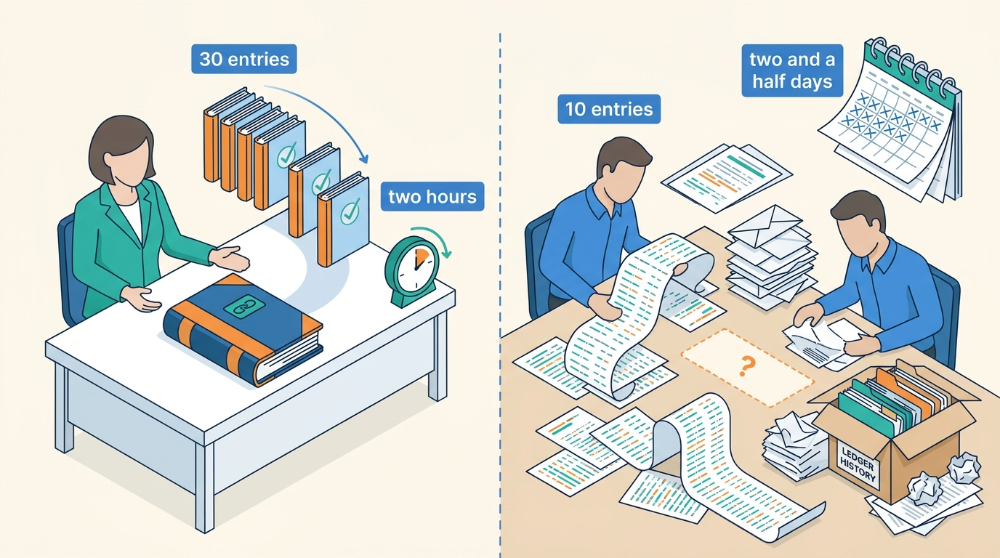
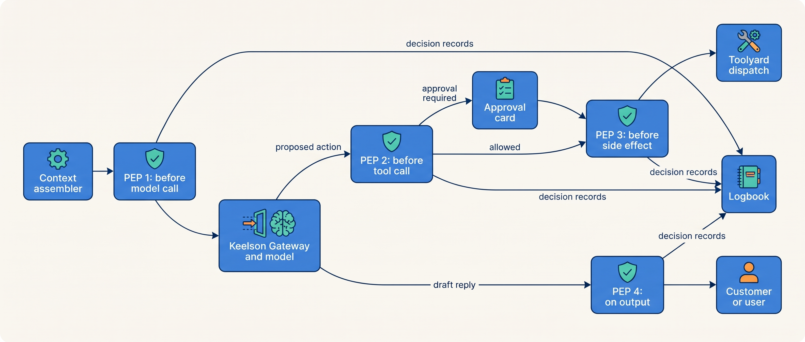
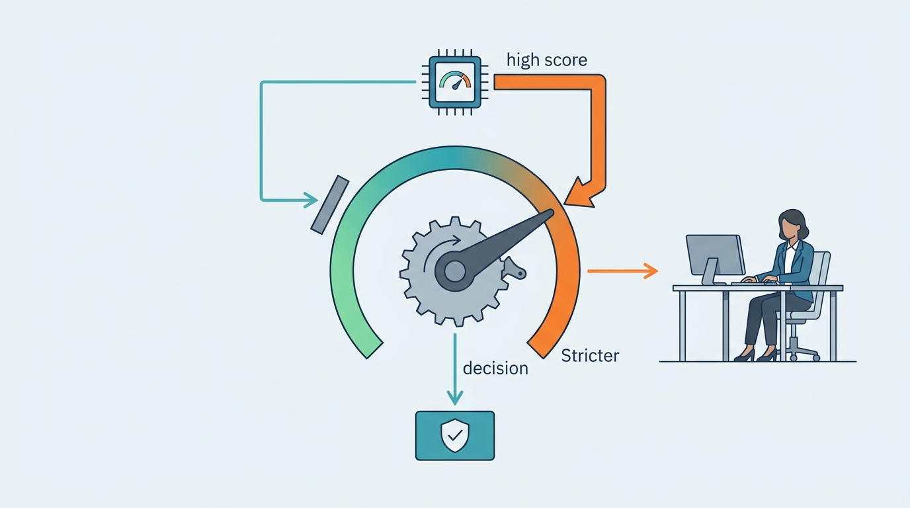
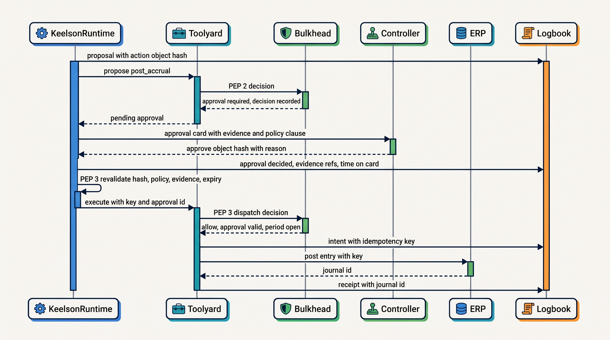
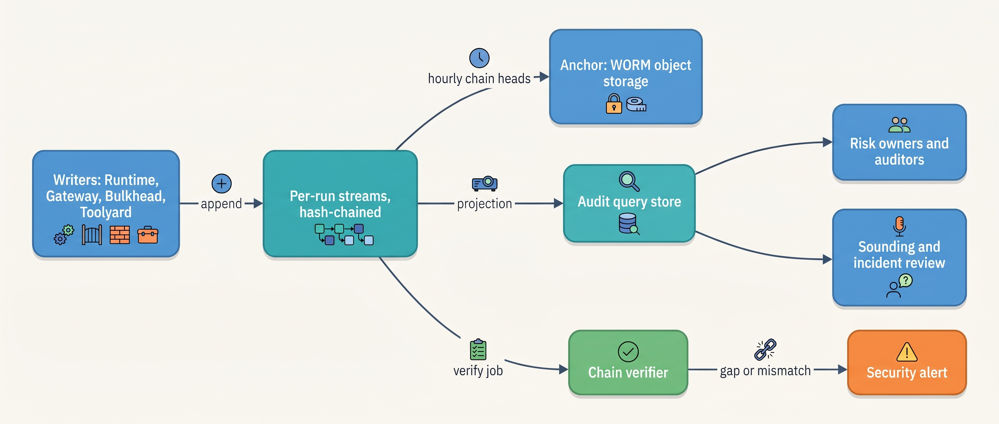

> **IN THIS CHAPTER, YOU WILL:** Learn where policy enforcement points belong in an agentic system, how to write, test and release agent policy as code, what guardrail models can and cannot carry, and how to design an evidence log that records every consequential decision so that it can be queried, verified and retained without becoming a privacy liability.

> **WHY THE BUSINESS CARES:** The risk owner signs for what the agent does, and the auditor, the regulator or a court will later ask for proof. "The model decided" is not an answer anyone accepts. An evidence log turns a month of forensic reconstruction into a query, and enforcement outside the model means a manipulated or mistaken model cannot spend money, send data or sign anything the policy forbids.

> **WHY ARCHITECTS SHOULD CARE:** Every other control in this book (scoped credentials, approval gates, autonomy tiers, idempotency keys) is only as real as the point that enforces it and the record that proves it ran. Policy that lives in a prompt is a suggestion. Evidence that lives in a sampled trace store is a hope. These two components decide whether the architecture's promises can be checked.

> **KEY POINTS:**
>
> * **Enforce at four points the action cannot route around, and re-check at the last one.** Before the model call (what data may go to which model), before the tool call (may this principal do this, here, at this tier), immediately before the side effect (is the approval still bound to this exact object, policy and evidence), and on the output (what the reply may promise or link). Decisions are deterministic, versioned and recorded.
> * **Guardrail models are signals, not boundaries.** Classifiers and model judges catch a share of bad inputs and outputs, and adaptive attackers beat most of them. Let their verdicts tighten policy (route to a human, block a sink), never loosen it, and never count a control that depends on a model recognizing an attack toward an agent's stated risk.
> * **The evidence log is a curated decision record, not a transcript.** Intent before every side effect and a receipt after it, the policy decision and version, the approval with what the approver saw, the agent version manifest and the context by reference. It is never sampled, it is tamper-evident where the consequence requires it, and its retention is set per record class. Its test is simple: can it answer the auditor's question a year later by query?

> **[FAILURE PATTERNS THIS CHAPTER ADDRESSES](where-agentic-systems-go-wrong.html):**
>
> * **Ambient Authority** — without an enforcement point on the only path to each tool, every call can reach whatever the calling identity can reach, and nothing records that it did.
> * **The Rubber Stamp** — an approval is a control only if its record shows who approved which exact object after seeing what, and how long they looked; without that record, nobody can measure the gate.
> * **The Silent Upgrade** — a policy or guardrail version that changes without versioning makes it impossible to say under which rules an action ran, and a policy refactor can widen permissions without anyone noticing.

<br>
An agentic system's model proposes actions; something else must decide whether they happen, and leave a record. A rule enforced but not recorded cannot be proved, and a record of decisions nothing enforced is a diary.

The parts are old: access control, maker–checker, audit trails, tamper-evident logs. The actor is new: a component that can be talked into proposing anything its tools allow, proposes differently on each run, and whose stated reasons are not a reliable account of why it acted. So **the policy decision sits outside the model, on a path the model cannot skip**, and the audit record describes inputs, decisions and effects, which can be checked, not the model's account of itself, which cannot.

This chapter owns four terms: the **policy enforcement point**, **policy as code** in its agent sense, the **evidence log** and the **guardrail**. It builds on [[agent-threat-model]] and [[prompt-injection-defense]] for what policy must stop, on [[agent-identity-and-least-privilege]] for whose authority a decision evaluates, on [[human-oversight-and-bounded-autonomy]] for the approval records it binds, and on [[retries-idempotency-and-concurrency]] for the intent-and-receipt protocol. It hands traces to [[agent-observability]], manifests to [[versioning-agent-systems]] and the use of evidence for autonomy decisions to [[evidence-for-autonomy]].

## Setting the Scene at Ostrell: Forty Entries and a Weekend

Ostrell, the fictional company this book follows (see [[meet-ostrell]]), runs its agents on the Keelson platform. Two components carry this chapter: **Bulkhead**, the policy engine, and **Logbook**, the append-only evidence log.

In the week of **18 October 2027**, Ostrell's external auditors held their interim audit for fiscal 2027. One test concerned Closewise, the month-end close agent that proposes about **1,900 accrual entries a month** across **23 legal entities**; a controller approves each one before a deterministic workflow posts it to the enterprise resource planning (ERP) system. The auditors drew **40 posted entries**: 30 from the April to September closes, after Closewise moved onto Keelson Runtime, and 10 from the first quarter, when a script still posted. For each they asked what the proposal was based on, which rules applied, who approved it, whether the approver was independent of the preparer, and whether the posted amount was the approved amount.

The 30 Keelson-era entries took **about two hours**: one Logbook query per entry produced a dossier, and the auditors walked three through the source systems. The 10 first-quarter entries took two accountants **two and a half days** of script logs, ERP history and approval emails. For 2 of them, the approval email referred to a spreadsheet version that no longer existed. The auditors recorded a first-quarter control deficiency, already remediated by the move to Keelson.


**Figure 1:** *Of the auditors' 40 entries, one Logbook query per entry answered the 30 Keelson-era entries in about two hours, while the 10 first-quarter entries took two accountants two and a half days.*

Then they asked a sixth question. They had read the incident report on the **Alias Drift**: over the weekend before Monday 2 August 2027, a provider moved the model alias behind Closewise's classification step to a newer version, and accuracy on the Sounding suite fell from **96.1% to 89.4%** until the team pinned the previous version on Thursday 5 August. **Which posted entries had been proposed by a model version that had never passed Ostrell's evaluation gate?** Logbook could answer, but only by inference. In August it recorded the model name Keelson had requested, the alias, not the version the provider served. The answer had to be bounded by time.

For Tomas Verhoef, Ostrell's Chief Architect, the two-hour answer showed what Bulkhead and Logbook were for. The inferred one showed how an evidence log fails: not by losing records, but by **never having recorded the field the question needs**.

## Concepts: Enforcement Points, Policy, Guardrails and Evidence

| Term | Definition in this book | What it is not |
| --- | --- | --- |
| **Policy enforcement point (PEP)** | A position on the only path an action, a model call or an output can take, where deterministic code obtains a policy decision and enforces it before anything continues. | A check the model is asked to perform, or a check on a path that has a bypass. |
| **Policy decision point** | The component that evaluates policy and returns a decision with its rules and version; at Ostrell, Bulkhead's decision service embedded in each PEP. | The enforcement itself. |
| **Policy as code (agent)** | Rules about what agents may do (actions, limits, data flows, routes, output constraints), written in a policy language or typed code, reviewed, tested against recorded decisions, versioned and pinned in the agent version manifest. | A policy document, a system-prompt instruction, or rules scattered through agent code. |
| **Guardrail** | A check on text or data entering or leaving a model whose verdict is statistical: a content classifier, an injection detector, a PII detector, a groundedness check, a model judge. | A boundary. Its verdict is evidence for a policy decision, not the decision. |
| **Evidence log** | An append-only, never-sampled record of the curated facts behind every consequential decision: inputs by reference, context manifests, proposals, policy decisions, approvals, intents, receipts, outputs and versions. Tamper-evident where the consequence requires it. | A trace store, a transcript, or a dump of model reasoning. |

The book's consistency rule keeps **authorization separate from execution**: Bulkhead decides; Toolyard, the tool broker, executes with brokered credentials ([[tool-ecosystems-and-mcp]]). Some of the author's interview designs let an identity broker both mint authority and perform the side effect; this book does not adopt that, because a component that both decides and acts can be argued into doing both wrong at once.

Three invariants follow, and the rest of the chapter is their mechanics:

1. **Complete mediation.** Every consequential action passes a PEP, and the PEP sits in a component the model cannot address directly. The Open Worldwide Application Security Project (OWASP) states it for "excessive agency": "Implement authorization in downstream systems rather than relying on an LLM to decide if an action is allowed or not" ([OWASP LLM06:2025, accessed 2026-10](https://genai.owasp.org/llmrisk/llm062025-excessive-agency/)).
2. **Deterministic decisions.** The same request, under the same policy version and the same recorded facts, gets the same decision. Statistical signals enter as recorded inputs, never as the evaluator.
3. **No consequential effect without a record.** If the evidence log cannot accept the intent record, the side effect does not start.

## Architecture: Bulkhead's Four Enforcement Points

### Where the points sit


**Figure 2:** *Four enforcement points on the run's only paths: what may be sent to a model, what a proposed action may do, whether it may still happen at dispatch time, and what the output may say. Every decision goes to Logbook.*

Each point answers a different question and lives in a different component:

| PEP | Lives in | Question | Typical Ostrell rules | On decision-service failure |
| --- | --- | --- | --- | --- |
| **1. Before model call** | Keelson Gateway, after the context assembler | May this context, with these data classes, go to this model route? | Tenant-scoped knowledge-base segments only for the verified run tenant; special-category fields masked before any call to the two commercial providers, and sent only to the open-weight model in Ostrell's cloud account where Peoplepoint needs them; no secrets in any segment | Fail closed: the call does not leave |
| **2. Before tool call** | Toolyard, on receipt of a proposal | May this principal, acting for this user, invoke this tool with these arguments, and at which tier? | Answerdesk `issue_credit` only for the verified account, ≤ €250 at A2, above that A1; email sinks closed to non-verified recipients after untrusted reads; delegated scopes a subset of the parent's | Fail closed; tier lookups fail to the lowest configured tier |
| **3. Before side effect** | Keelson Runtime (approval revalidation) and Toolyard (dispatch decision), immediately before the call | Is everything the decision relied on still true? | Approval bound to this action-object hash, unexpired, under the current policy version; source facts unchanged (price-book version, open period); no hold or kill switch on the class; Logbook intent written | Fail closed: the action waits or voids |
| **4. On output** | Keelson Runtime, before release | May this reply be shown or sent as written? | Links only to Ostrell domains; no auto-rendered images; no commitment without a backing receipt; no other tenant's identifiers | Fail closed: the reply is held and the conversation goes to a person |

PEP 3 is the one teams leave out, and it closes the gap between deciding and doing. A Closewise proposal can wait up to 48 working hours for a controller, while the subledger changes, the period locks or the policy is revised. In the September 2027 close, the re-check voided **3 approvals** after a subledger change, and an entity close cancelled on day 4 ended with **17 proposals voided** rather than posted on stale approvals ([[durable-agent-execution]]).

The retrieval grant (agent × purpose × corpus) is evaluated at PEP 2, because retrieval is a Toolyard tool ([[retrieval-and-grounding]]). Each agent version's decision-point map lists every model-held decision and the PEP that bounds it ([[what-makes-a-system-agentic]]); a span showing a tool call without a PEP 2 decision fails the release check.

### Authorization, then routing

Bulkhead's decision is two steps. First, **authorization**: is this action permitted for this principal at all, within its hard limits? Second, **routing**: given the action class and the tier register for this agent version, does the action execute, wait for approval, or become a suggestion ([[autonomy-and-consequence]])? Keeping them apart lets a promotion from A1 to A2 change routing without touching who may do what.

Ostrell writes authorization policy in **Cedar**, which has default deny, forbid-overrides-permit semantics and skips erroring policies ([Cedar documentation, accessed 2026-10](https://docs.cedarpolicy.com/auth/authorization.html)). Its authors report a sound and complete logical encoding for analysis, with properties proved in the Lean prover ([Cutler et al., 2024, preprint](https://arxiv.org/abs/2403.04651)). An abridged excerpt of Answerdesk's policy set after October 2027:

```cedar
// bulkhead/answerdesk@2027.10.1 (excerpt)
permit (
  principal is Keelson::AgentRun,
  action == Action::"issue_credit",
  resource is Billing::CustomerAccount
)
when {
  principal.agent == "answerdesk" &&
  principal.customer_verified &&
  resource == principal.verified_account &&
  context.has_service_failure_record            // missed visit or outage on the ticket
};                                               // amount bands are routing, not permission

forbid (principal, action == Action::"send_email", resource)
when { context.run_read_untrusted && !context.all_recipients_verified };
```

The `context` attributes are computed by deterministic code, never by the model: `run_read_untrusted` from the context manifest's trust labels ([[context-engineering]]), `all_recipients_verified` from handles resolved against the customer relationship management (CRM) system ([[prompt-injection-defense]]), `has_service_failure_record` from a Toolyard lookup. Session state (counts, budgets, approvals seen) enters the same way. That is what separates agent policy from API authorization: **the decision depends on what this run has already read and done**.

Cedar answers only allow or deny. **Obligations** ("re-read the price before commit", "route to approval", "redact this field") come from the routing step, typed Python keyed by action class. Open Policy Agent (OPA), the graduated Cloud Native Computing Foundation (CNCF) engine, returns structured decisions from Rego ([OPA documentation, accessed 2026-10](https://www.openpolicyagent.org/docs/latest/)) and would fold both steps into one. Ostrell chose Cedar because Farah Haddad, the security architect, wanted a machine check that a refactor widens no permission; the price is the separate routing layer.

### The decision record

Every evaluation produces one record, whatever the outcome:

```python
@dataclass(frozen=True)
class PolicyDecision:
    decision_id: str
    pep: Literal["pre_model", "pre_tool", "pre_effect", "output"]
    run_id: str
    action_id: str | None            # minted by the runtime, never by the model
    principal: PrincipalRef          # agent + on-behalf-of user + tenant
    manifest_sha256: str
    policy_version: str              # e.g. "bulkhead/answerdesk@2027.10.1"
    request_fingerprint: str         # hash of tool, arguments, context attributes
    signals: tuple[SignalRef, ...]   # guardrail verdicts, with model and version
    outcome: Literal["allow", "deny", "approval_required", "suggest_only", "hold"]
    rule_ids: tuple[str, ...]
    obligations: tuple[str, ...]     # e.g. "reread:price_book"
    evaluated_at: datetime
```

Denials return to the model as tool results ("not permitted: recipient not verified"): a model given an exception tends to try another route; a model given a fact can tell the user. Denials are also **signals**. The Poisoned Ticket in May 2027 was blocked at the email tool and nobody knew for **6 days**; since July 2027, Bulkhead denials on email and document sinks page the security on-call through Wake within minutes.

### Requirements per interaction

| Interaction | Consistency | Latency budget | Durability | Who may act |
| --- | --- | --- | --- | --- |
| Decision at PEP 1, 2 or 4 | Policy bundle pinned to the run's manifest; tier register within 60 s of change | p99 ≤ 5 ms, in-process from a cached bundle *(assumption)* | Decision record in Logbook before the effect it permits; asynchronous for read-only steps | Bulkhead only |
| Re-check at PEP 3 | Current policy version, approval and source facts, read at dispatch | ≤ 50 ms plus any freshness re-read *(assumption)* | Intent record written synchronously before dispatch | Bulkhead decides; Toolyard dispatches |
| Policy release | One version per agent set; bundles signed | Propagation to all decision nodes ≤ 60 s; a node with a bundle older than 5 minutes fails closed | Policy repository plus Agent Registry | Agent owner with risk-owner sign-off; platform set by security |
| Human override of a machine check | New record referencing the original verdict | Human time | Logbook, append-only | Named role with a recorded reason; never overwrites the machine verdict |

## Policy as Code: Writing, Testing and Releasing Rules

Bulkhead holds one shared **platform policy set** (tenant isolation, data classes and model routes, egress, the trifecta split, the A1 cap on irreversible external commitments) owned by Farah Haddad and the Agent Platform team, and one **agent policy set** per agent, owned by the agent's owner with the risk owner's sign-off. A forbid in the platform set overrides any permit in an agent set, so an agent team cannot loosen a platform rule by writing a broader permit.

A policy change goes through four checks before it can be bound to a manifest:

1. **Unit cases.** Each rule ships with allow and deny cases, including the incident cases that caused it (the Poisoned Ticket recipient, the second revisit, a credit for an unverified account).
2. **Static analysis.** Cedar's analysis compares the new set against the old one and lists every request shape whose decision changes. A change described as "refactor" must list none.
3. **Decision replay.** Bulkhead re-evaluates the last 90 days of recorded decision requests from Logbook under the candidate policy and reports a **decision diff**: how many past decisions would change, in which direction, for which action classes.
4. **Release as a manifest change.** A policy version is a field of the agent version manifest ([[versioning-agent-systems]]), so a new version goes through Sounding's gate and a staged rollout like a new prompt ([[staged-rollout-and-rollback]]).

The decision replay earns its keep. For the October 2027 promotion of Answerdesk credits of €250 or less from A1 to A2, the replay over the third quarter showed one class of change: the **4,410** credit proposals of €250 or less moved from `approval_required` to `allow`, and no other decision changed. Lena Brandt, who owns Answerdesk, signed a diff she could read. Had it also shown credits for unverified accounts moving to `allow`, the release would have stopped, whatever the change's description said.

Policies in flight follow the manifest rule: runs keep the policy version they started with, so approvals pending under it stay valid. Only a security or correctness fix migrates runs in flight, and that voids their pending approvals ([[task-state-and-checkpoints]]).

**What not to put in Bulkhead.** Rules that the system of record owns stay there: the billing system's one-credit-per-visit uniqueness key, the ERP's period lock, the CRM's refusal to send a superseded quote. Toolyard also enforces each tool's hard limits **independently of Bulkhead** ([[autonomy-and-consequence]]), so a policy bug cannot widen the blast radius on its own. Bulkhead holds rules about agents; it is not a second ERP.

## Guardrails: What Statistical Checks Can Carry

The evidence on guardrail models says plainly what they are for.

- **Classifiers catch known harms on the benchmarks they were built for.** Llama Guard, a 7-billion-parameter model tuned to classify prompts and responses against a safety taxonomy, was reported to match or exceed the moderation tools of its time on two public datasets ([Inan et al., 2023, preprint](https://arxiv.org/abs/2312.06674)). That is content classification, not resistance to an attacker targeting the classifier.
- **They can be made hard to break, at a price.** Anthropic's Constitutional Classifiers withstood "over 3,000 estimated hours of red teaming" without a universal jailbreak on most target queries, at a 0.38-point increase in production refusals and 23.7% inference overhead ([Sharma et al., 2025, preprint](https://arxiv.org/abs/2501.18837)). The threat was jailbreaks for dangerous information, not an injected instruction in a ticket.
- **Detectors trade utility for attack reduction.** On AgentDojo (97 tool-use tasks, 629 injection cases), a detector cut GPT-4o's targeted attack success to 8.0% while benign utility fell from 69.0% to 41.5%; fixing the tool set before reading untrusted data reached 6.8% with utility intact (Table 5, v3; [Debenedetti et al., 2024, preprint](https://arxiv.org/abs/2406.13352)). The models are retired; structural beating statistical is the durable part.
- **Adaptive attackers beat most published defenses.** Against 12 recent jailbreak and injection defenses, adaptive attacks reached attack success "above 90% for most", although most had reported near-zero rates ([Nasr et al., 2025, preprint](https://arxiv.org/abs/2510.09023)).
- **Classifiers that replace approvals miss real cases.** Anthropic reports that its coding tool's auto-mode classifier had a 0.4% false-positive rate on 10,000 internal actions and a **17% false-negative rate on 52 real overeager actions**, "the honest number" ([Anthropic, 2026-03-25](https://www.anthropic.com/engineering/claude-code-auto-mode)): a vendor measurement on a small sample.

No published evaluation measures how much a policy gateway at the tool boundary reduces successful attacks in production. The case for one is structural: a deterministic decision on the only path to a sink holds whatever the model was persuaded of. Guardrails lower the rate at which bad proposals reach that decision. Keelson uses both, under one rule:

**A guardrail verdict may tighten a decision, never loosen it.** A high injection score routes the ticket to a person; a low score changes nothing. A groundedness check marking a money claim "uncertain" drops and routes it; "supported" raises no limit. A missing or failed guardrail counts as its most cautious verdict. That is Ostrell's June 2027 principle in practice: "No control that depends on the model recognizing an attack counts toward an agent's stated risk."


**Figure 3:** *A guardrail verdict may tighten a decision, never loosen it: a high score routes the case to a person, a low score changes nothing, and a missing verdict counts as the most cautious one.*

Ostrell's guardrails, all recorded as `signals` in the decision record with their model and version:

| Guardrail | Where | What its verdict can do | What it cannot do |
| --- | --- | --- | --- |
| Quarantined reader (tool-less Small-tier call emitting typed `TicketFacts`) | Before Answerdesk's planner reads inbound email | Supply candidate facts; contract numbers stay candidates until resolved against the verified identity | Grant any authority; its output is data |
| Injection classifier on inbound attachments | Intake | Route to human staff; raise PEP 2 strictness for the run | Clear a run as safe |
| Claim-level groundedness check (Small tier) | PEP 4 for knowledge answers | Drop unsupported or uncertain money claims; trigger abstention | Approve a claim the policy forbids |
| Commitment detector | PEP 4 | Flag "we will credit / we will send a technician" phrases; a deterministic rule then blocks any flagged commitment with no matching receipt in the run | Decide that a commitment is backed; only the receipt does |

Each guardrail's model identifier and threshold sit in the agent version manifest; a silently changed guardrail changes the agent like a prompt edit.

## Architecture: Logbook, the Evidence Log

### What it records

Logbook holds typed records, appended in order per run:

| Record | Written by | When | Key fields |
| --- | --- | --- | --- |
| `run.start` | Keelson Runtime | Run start | Principal and on-behalf-of identity, tenant, agent version manifest hash, task id |
| `context.manifest` | Context assembler | Before every model call | Ordered segments: source ref and version, content hash, token count, trust label; dropped segments with reasons |
| `model.call` | Keelson Gateway | After every model call | Requested and **served** model version, settings, response hash, content reference |
| `proposal` | Keelson Runtime | When a model output becomes an action object | Action id, action-object hash, action class, the model-call record that produced it |
| `policy.decision` | Bulkhead | Every PEP evaluation | The decision record above |
| `approval.requested` / `approval.decided` | Keelson approval service | Around each human decision | Action-object hash, approver, **card template version and evidence references with versions and hashes** (so what was shown is reproducible), policy version, time on card, decision, reasons, expiry ([[human-oversight-and-bounded-autonomy]]) |
| `intent` | Toolyard | Before dispatch, synchronously | Action id, idempotency key, action-object hash, decision id |
| `receipt` / `unknown` / `reconciled` | Toolyard | After dispatch, lookup or repair | Receiver's identifier, status, amounts and ids |
| `output.released` | Runtime | Before a reply or document leaves | Output hash, content reference, PEP 4 decision id |
| `override` | Named human | When a machine check is overridden | The original verdict's record id, the reason, the authority; the original stays |
| `run.end` | Runtime | Run end | Outcome, budget consumption, open `unknown` actions |

Three things are deliberately absent. **Raw model reasoning**, where a provider returns it, goes to a separate store with named-investigator access and 7-day retention ([[agent-observability]]), and is never treated as an explanation: reasoning models given hints in their prompts often mentioned the hint in fewer than 20% of the cases where they used it ([Chen et al., 2025, preprint](https://arxiv.org/abs/2505.05410)). **Full content** stays in its system of record or Wake's content store, referenced by hash and version. **Secrets** are never written.

The approval fields exist because of the Rubber Stamp. The second-quarter 2027 analysis (**4,812 approvals, 99.3% approved, median review time 6 seconds**, **3.1%** of approved credits unjustified on a sample audit) was a Logbook query. A record that says only "approved by Y" cannot show that Y looked for six seconds at a card without the policy clause.

### The write path


**Figure 4:** *One Closewise entry: every decision on the way from proposal to posting is a typed Logbook record, the intent precedes dispatch, and the receipt closes it. The auditor's dossier is these records joined by action id.*

The ordering is the book's rule for exactly-once effects: **intent record, then execution with the idempotency key, then receipt**, with reconciliation for the unknown state ([[retries-idempotency-and-concurrency]]). Evidence cannot share a transaction with a posting in an ERP Ostrell does not control. The author's agentic-platform-foundations interview design claims it can for its `action_evidence` record, and makes that record immutable yet pending-then-final (design example, `agentic-platform-foundations/interview.json`, `dataModel[action_evidence]`); this book departs from both, appending one record per state change instead.

The failure rule is the asymmetry from [[agent-observability]]: **telemetry may be dropped, evidence may not**. If an intent write fails, Toolyard does not dispatch. Records for read-only steps go through a local durable spool and ship asynchronously; customer-facing outputs are spooled before release. The price: Logbook's availability bounds every side effect on the platform, so it runs replicated across zones with its own service-level objective. An outage stops actions; it does not lose evidence.

### Tamper evidence and storage


**Figure 5:** *Logbook streams are the source of truth; chain heads are anchored to write-once storage; the queryable store is a rebuildable projection; a verifier checks continuity.*

Each record carries the hash of its predecessor in the run's stream. Every hour Logbook writes a Merkle root over the stream heads to write-once-read-many (WORM) object storage with a retention lock, the construction Certificate Transparency uses to make a public log auditable ([RFC 6962, 2013](https://www.rfc-editor.org/rfc/rfc6962); [RFC 9162, 2021](https://www.rfc-editor.org/rfc/rfc9162)). A daily verifier re-walks the chains and pages security on any gap. Chaining is cheap, so Keelson chains everything; WORM anchoring and multi-year retention apply where the book's baseline requires tamper evidence: back office and anything touching employment.

**The observed cannot reach the observer.** No agent identity can write to, read from or delete in Logbook; writers are platform components with write-only identities per record family, and the query interface renders model-produced text as inert text. METR's argument that systems recording agent behavior are security-critical infrastructure applies with more force to an evidence log than to a trace viewer ([METR, 2026-10-06](https://metr.org/blog/2026-10-06-ai-systems-could-cover-up-misbehavior/)). Auditors query a rebuildable projection; only the projector and the verifier read the streams.

### Audit queries

The auditors' entry dossier is one query over the projection:

```sql
-- Dossier for one posted entry: everything joined by action id
SELECT r.kind, r.recorded_at, r.actor, r.policy_version, r.manifest_sha256,
       r.served_model, r.object_hash, r.card_template, r.time_on_card_s,
       r.receiver_id, r.content_ref
FROM logbook_records r
WHERE r.action_id = (SELECT action_id FROM logbook_records
                     WHERE kind = 'receipt' AND receiver_id = :erp_journal_id)
ORDER BY r.recorded_at;   -- context manifests are reached through the proposal's model call
```

The questions Ostrell's risk owners and security team ask most often have the same shape:

| Question | Records joined | Who asks |
| --- | --- | --- |
| Was the posted amount the approved amount? | `approval.decided.object_hash` = `intent.object_hash`, receipt amount | Auditors, Joost Vermeer |
| Which actions ran under manifest X, policy version P or served model M? | `run.start`, `model.call`, `policy.decision` | Mei Lin Zhou, incident review |
| Which runs read document D and then proposed an egress call? | `context.manifest` content hash, `policy.decision` at email sinks | Farah Haddad |
| Which approvers approve faster than 10 seconds, and how do their approvals fare in sample audits? | `approval.decided`, audit outcomes | Lena Brandt |
| Which overrides of machine checks happened, by whom and why? | `override` with the original verdict | Risk owners |

A query that cannot be answered is a schema defect, and Ostrell treats it as an incident finding, as with the served model version in August.

## Retention, Privacy and Regulatory Duties

An evidence log is personal data at scale. The General Data Protection Regulation (GDPR) requires data to be kept "no longer than is necessary" (Art. 5(1)(e)) and grants erasure (Art. 17), except where processing is necessary "for compliance with a legal obligation" or for legal claims (Art. 17(3)(b) and (e)) ([Regulation (EU) 2016/679](https://eur-lex.europa.eu/eli/reg/2016/679/oj)). Three choices let an evidence log meet both duties.

1. **Retention per record class, not per log.** Closewise evidence follows Group Finance's seven-year retention period for accounting records; Answerdesk action records follow the support complaint-and-dispute period; Wake's 30-day content store is not evidence.
2. **Curate, then reference.** Logbook keeps what the decision relied on (amounts, ids, versions, hashes). The customer's email stays in the ticketing system under its retention; after it is deleted, the hash still proves which version was seen.
3. **Crypto-shredding for personal fields.** Personal data inside Logbook records is encrypted with a per-data-subject key; erasure deletes the key, and the chain stays verifiable because hashes cover the ciphertext. Requests that meet a retention duty are recorded and honored when it ends. This is the author's judgement; it assumes audited key management and fails if the projection holds the same data in clear.

**The EU AI Act.** For high-risk systems, Article 12 requires that systems "technically allow for the automatic recording of events (logs) over the lifetime of the system" for traceability, risk identification and monitoring; providers keep logs under their control for at least six months (Art. 19), deployers likewise (Art. 26(6)); and Article 86 gives affected persons a right to "clear and meaningful explanations of the role of the AI system in the decision-making procedure" ([Regulation (EU) 2024/1689](http://publications.europa.eu/resource/celex/32024R1689)). Article 12(3) lists minimum fields only for remote biometric identification; elsewhere the Act sets purposes, not fields. Regulation (EU) 2026/1744, the Digital Omnibus, moved the high-risk requirements to **2 December 2027** for Annex III systems and **2 August 2028** for Annex I systems ([published 2026-07-24](http://publications.europa.eu/resource/celex/32026R1744)); as of October 2026 they have not yet applied.

For Ostrell the Act bites narrowly. On the author's reading, an organization that builds an agent for its own use is both its provider and its deployer. No Ostrell agent does recruitment, credit scoring or benefits eligibility. Peoplepoint is nearest Annex III point 4, and refuses and routes anything about performance, pay or termination. Ostrell's documented Article 6(3) assessment (narrow procedural task, no material influence on decisions about workers) is a versioned artifact in the Agent Registry tied to Peoplepoint's tool list; a tool that ranks or decides about employees reopens it. Logbook was built for audit, not for the regulation, and that ordering matters: a log designed to a regulator's minimum would not have answered the auditors.

## Worked Example at Ostrell: Answering the Sixth Question

The auditors' sixth question, which posted entries came from an ungated model version, had an answer in October because of three things Logbook had and one it lacked.

**What it had.** Every Closewise classification since April carried a `model.call` record with the *requested* model name, a `proposal` record linking the call to the action object, and approval, intent and receipt records for every entry. The alias move had happened over the weekend before Monday 2 August (working day 1 of the July close), and the pin to the previous exact version took effect on Thursday 5 August (working day 4). Every classification call in that window had gone through the alias, and the provider's release notes dated the move to that weekend.

**What it lacked.** The served version. The window had to be bounded by time and by the provider's notice rather than read from records.

The query took one afternoon. At about **380 proposals per working day**, the window held **1,498** Closewise proposals from the drifted model. Controllers had rejected **165** (11%) and approved **1,333**, some after editing. In August, after the pin, Mei Lin Zhou's team had re-run the classification of all 1,333 approved entries on the previous exact version: **1,281** agreed, and controllers re-examined the **52** that differed and found no misstatement. The auditors received the list of 1,333 entries with their dossiers, the re-run results and the 52 re-examinations, and closed the question without a finding. Approval had held, and Logbook could show it had.

Since September 2027, the Gateway records requested and served model versions on every call, and every run records its manifest hash ([[versioning-agent-systems]]). The same question is now a three-line query:

```sql
SELECT p.action_id FROM logbook_records m
JOIN logbook_records p ON p.kind = 'proposal' AND p.model_call_id = m.record_id
JOIN logbook_records r ON r.kind = 'receipt' AND r.action_id = p.action_id
WHERE m.kind = 'model.call' AND m.served_model NOT IN (SELECT model_id FROM gated_models(m.manifest_sha256));
```

The review after the audit made three changes. **Field-coverage reviews:** each quarter, every risk owner lists the questions they expect, and the Agent Platform team shows the query for each; a question without a query is a schema change. **Signed dossiers:** the entry dossier is a standard export signed with the chain head it was read from. **Guardrails pinned:** the review found Answerdesk's intake injection classifier had been updated in August without a manifest change; it is now pinned like any model.

## Failure Modes and Recovery

| Scenario | Detection | Containment | Recovery |
| --- | --- | --- | --- |
| **PEP bypass**: a team adds a direct HTTP client in agent code to reach an internal API | Egress proxy denies destinations not behind Toolyard; span-shape check against the decision-point map; tool call with no `policy.decision` record | Agent identities have no network route except through Toolyard; release check fails | Remove the path; Logbook and egress logs show what was reached; review affected actions ([[partial-failure-and-compensation]]) |
| **Policy regression**: a refactor widens `issue_credit` to unverified accounts | Static analysis and decision replay in the release pipeline; in production, PEP 2 denial rate drops for the class | Toolyard's independent hard limits and the billing system's uniqueness key | Move the manifest pointer back to the previous policy version; query all decisions under the bad version and review or compensate |
| **Stale policy bundle** on a decision node after a demotion | Every decision records its policy version; Wake alerts on version skew across nodes | Nodes with bundles older than 5 minutes fail closed; tier lookups fail to the lowest configured tier | Re-evaluate actions decided under the stale version against the current one; compensate any that would now be denied |
| **Logbook write outage** | Intent-write error rate in Wake | Side effects stop; agents continue read-only work and draft actions for later | Spooled records drain; no evidence gap; queued actions resume through PEP 3 re-checks |
| **Evidence gap or tampering** | Chain verifier finds a missing or altered record against the WORM anchor | Anchors make silent rewriting detectable; writers have no delete permission | Security incident; restore from replicas; record the gap itself as an event; reassess what the gap could hide |
| **Over-collection**: a team writes full tool arguments with personal data into Logbook | Schema validation per record family rejects unknown fields; PII detector on writes | Write rejected, so the side effect waits | Fix the record mapping; crypto-shred any personal data written before the check existed |
| **Unanswerable audit question** | A risk owner's question has no query (the served model in August) | Bound the answer by other records, and say so | Add the field; backfill nothing that would be invented; record the limitation in the answer |

When the evidence log lacks a field, the honest answer states how it was bounded. Backfilling from memory or inference turns an evidence log into an argument.

## Trade-offs

| Decision | Option | When it is right | What it costs |
| --- | --- | --- | --- |
| Where policy lives | In the system prompt | Never as a control; only as guidance that makes good proposals likely | Zero enforcement |
| | In agent code | Single agent, single team, low consequence | Every team reimplements it; bypass is a code path away |
| | Central policy engine at platform PEPs | Several agents, shared rules, consequential actions | A decision service on every path; policy-review process |
| | In the downstream system of record | Rules the system owns (period locks, uniqueness, quote supersession) | Not agent-aware: cannot see what the run has read |
| Policy language | Cedar | Authorization with analysis of permission changes; default deny | Allow/deny only; obligations need a separate routing layer |
| | OPA and Rego | Structured decisions in one place; wide ecosystem; decision logs with masking | Less analyzable; Rego's learning curve |
| | Typed general-purpose code | Rules needing complex computation | Hard to review, test exhaustively or analyze |
| Guardrail role | Gate (a verdict blocks or allows) | Content safety where false negatives are cheap | Adaptive attackers; a false negative becomes a permission |
| | Signal that only tightens | Anything consequential | Extra human workload when it over-fires |
| Evidence store | Trace store | Operations only | Sampled, short retention; not evidence |
| | Append-only database with hash chain | Most agents | Integrity checks and anchoring are yours to build |
| | Plus WORM anchoring | Back office, employment, high stakes | Storage cost; erasure needs crypto-shredding |
| | Ledger database service | Very high integrity demands with modest volume | Harder to query and operate at high event volumes, as the author's sales design notes |
| Evidence write timing | Synchronous before every side effect | Default | Logbook availability bounds side-effect availability |
| | Asynchronous with a local durable spool | Read-only steps, denials, outputs | A spool that can be lost with the node unless fsynced and replicated |

OPA's own decision logs are uploaded in asynchronous batches, retried and optionally masked ([OPA decision logs, accessed 2026-10](https://www.openpolicyagent.org/docs/latest/management-decision-logs/)): right for telemetry, not enough as evidence for a side effect, which is why Keelson puts the decision id in the synchronous intent record. Amazon Bedrock AgentCore, generally available since 3 March 2026, ships the central-engine option, evaluating agent traffic at its gateway against Cedar policies "before allowing tool access" ([AWS documentation, accessed 2026-10](https://docs.aws.amazon.com/bedrock-agentcore/latest/devguide/policy.html); [AWS, 2026-03-03](https://aws.amazon.com/about-aws/whats-new/2026/03/policy-amazon-bedrock-agentcore-generally-available/)). That documents a design, not its effect, and its natural-language policy authoring is model output that needs review.

## Across Domains: How the Stakes Change the Design

| Concern | Coding agents | Customer operations (support, sales, marketing) | Back office (finance, legal, HR) | High-stakes decisions (healthcare, public benefits) |
| --- | --- | --- | --- | --- |
| PEPs that carry the most weight | Sandbox egress, protected paths, merge (humans only at Ostrell) | PEP 4 on what the reply promises; sinks for email and attachments; suppression and consent by purpose | PEP 3 re-check before posting; segregation of duties between proposer and approver | Rule layer authoritative; PEP 3 revalidates the record snapshot before any write |
| Who writes policy | Developer Productivity and security; local coding CLI permission rules in a managed configuration | Product owner with legal for representations; security for sinks | Risk owner (controller, general counsel, HR) with internal audit | Clinical or legal rule owners through a release workflow; the model may not override a rule |
| Guardrail role | Review lenses advisory until their precision is proven | Groundedness, commitment and PII checks on every reply | Injection screening of inbound documents | Calibrated abstention; never a substitute for a human adverse decision |
| Evidence content | Change plan, diffs, test results, PR, reviewer | Action objects, approvals, receipts; message by reference | Decision record with versions, evidence, calculations, approvals, receipts | Two layers: data-access audit and decision audit; human rationale; materialized appeal packet |
| Tamper evidence and retention | Append-only; weeks to months | Hash-chained; months to years by tenant contract (1–7 years in the support design) | Hash-chained plus WORM; years | Hash-chained plus WORM; statute and case lifetime; Art. 12, 19 and 26(6) from 2 December 2027 for Annex III systems |
| Typical audit question | Who merged this agent change, and did tests shrink? | Did we promise this customer anything we did not do? | Was the posted amount the approved amount, approved by someone independent? | Can a reviewer re-decide this case from the record alone? |

One coding gap is worth naming. The author's ai-coding-cli interview design keeps permission decisions in the local session transcript, so its audit trail is not centrally auditable for interactive sessions (design example, `ai-coding-cli/interview.json`, step `safety`). Forge runs headless on Keelson and Logbook covers it; local CLI work by Ostrell's 870 engineers is treated as low-consequence because merge stays human.

The author's agentic-finance-platform design sets the evidence baseline: an immutable decision record, "not a chain-of-thought dump", hash-chained on WORM storage, with raw reasoning kept apart (step `decision-record`); its legal and HR siblings are weaker, and this book takes the finance design. The agentic-healthcare-platform design separates data-access audit from decision audit, so access is recorded "even when no recommendation is authorized" (step `privacy`). The agentic-public-benefits-platform design materializes an appeal packet and warns that replay logic "must be versioned so an old case reconstructs under the rules it actually used" (step `audit-appeal`). In both, a human override is a new record that never overwrites the machine verdict. All are design examples, not deployed systems ([[domain-back-office]], [[domain-high-stakes-decisions]]).

**What the platform keeps common:** the four PEPs and their fail-closed behavior, the decision record, the policy release pipeline with analysis and decision replay, the guardrail asymmetry, Logbook's record families, write ordering, hash chaining and the query projection. **What is domain policy:** the rules themselves, who writes and signs them, which guardrails run where, retention classes, WORM anchoring, who may query what, and the extra deterministic components a domain requires (a rule engine, a match engine, a maker–checker gate).

## The Chief Architect's View

**Decide where the enforcement points are before deciding what the policies say.** Rules change monthly; PEP positions are architecture. I would take a weak policy at a complete set of PEPs over a sophisticated one with a bypass: the first is fixed by a release, the second is found only when something uses it.

**Make the policy release pipeline the governance.** A decision diff over 90 days of real requests, signed by the risk owner, shows what a change does rather than what its author meant. At Ostrell, agent owners sign agent sets, security signs the platform set, and risk owners sign anything that changes a tier or a hard limit.

**Ask risk owners for their questions, not their logging requirements.** "Log everything" produces terabytes and still misses the served model version; twelve questions an auditor, regulator or customer will ask produce a schema.

**Keep guardrails honest in the risk register.** A classifier's catch rate belongs in the evaluation report, not in the argument for why an agent may run at a tier. Read a vendor's near-zero attack success rate as "against this test set, today".

**What will change:** injection resistance, policy languages and gateway products, the AI Act's harmonized log fields, OpenTelemetry's agent conventions. **What will not:** a model that proposes cannot be the authority that permits; evidence that can be sampled is not evidence; and a decision record describes what the system saw and did, not what the model said about itself. I expect to replace Bulkhead's policy language within five years and to keep its four enforcement points.

## Questions to Ask

1. For each tool that changes an external system, what is the single path to it, and which enforcement point on that path cannot be skipped by agent code?
2. Where does the system re-check an approval, the policy version and the source facts immediately before dispatch, and what happens if any changed?
3. Which rules live only in prompts, and which of those would cost money or data if a model ignored them?
4. How is a policy change tested: is there a static analysis of permission changes, and a replay of recent real decisions with a diff the risk owner signs?
5. Which guardrail verdicts can loosen a decision, raise a limit or clear a run? Can any?
6. If the evidence log is unavailable, what stops, and what continues?
7. Can you show, by query, that a posted amount equals the approved amount, and what the approver saw and for how long?
8. Which audit questions can your evidence log not answer today, and who decided that was acceptable?
9. How do you honor an erasure request against a tamper-evident log with a retention duty, and is the projection covered too?

Policy decides what an agent may do and the evidence log records what it did; neither says whether the agent does its job well, or how much autonomy that evidence should earn it. That is the subject of Part VIII: [[part-8]].

## Sources and Evidence

### Research papers

- [Llama Guard: LLM-based Input-Output Safeguard for Human-AI Conversations](https://arxiv.org/abs/2312.06674) — Inan et al., Meta, **2023** (preprint); guardrail classifier and its benchmark scope.
- [Constitutional Classifiers: Defending against Universal Jailbreaks across Thousands of Hours of Red Teaming](https://arxiv.org/abs/2501.18837) — Sharma et al., Anthropic, **2025** (preprint); red-teaming hours, refusal and overhead costs.
- [AgentDojo](https://arxiv.org/abs/2406.13352) — Debenedetti et al., ETH Zurich and Invariant Labs, **2024** (preprint, v3); detector vs tool-filter results and utility cost.
- [The Attacker Moves Second](https://arxiv.org/abs/2510.09023) — Nasr, Carlini et al., **2025** (preprint); adaptive attacks against 12 defenses.
- [Reasoning Models Don't Always Say What They Think](https://arxiv.org/abs/2505.05410) — Chen et al., Anthropic, **2025** (preprint); chain-of-thought faithfulness, basis for not treating reasoning as explanation.
- [Cedar: A New Language for Expressive, Fast, Safe, and Analyzable Authorization](https://arxiv.org/abs/2403.04651) — Cutler et al., AWS, **2024** (extended version); policy analysis and verification.

### Specifications, standards and regulation

- [Regulation (EU) 2024/1689 (AI Act)](http://publications.europa.eu/resource/celex/32024R1689) — European Parliament and Council, **2024**; Articles 12, 19, 26(6) and 86.
- [Regulation (EU) 2026/1744 (Digital Omnibus on AI)](http://publications.europa.eu/resource/celex/32026R1744) — European Parliament and Council, **2026**; application dates 2 December 2027 (Annex III) and 2 August 2028 (Annex I).
- [Regulation (EU) 2016/679 (GDPR)](https://eur-lex.europa.eu/eli/reg/2016/679/oj) — **2016**; storage limitation, erasure and its exceptions.
- [OWASP Top 10 for LLM Applications 2025: LLM06 Excessive Agency](https://genai.owasp.org/llmrisk/llm062025-excessive-agency/) — OWASP GenAI Security Project, n.d., accessed 2026-10; complete mediation.
- [Cedar authorization semantics](https://docs.cedarpolicy.com/auth/authorization.html) — Cedar project, n.d., accessed 2026-10; default deny, forbid overrides permit.
- [Open Policy Agent documentation](https://www.openpolicyagent.org/docs/latest/) and [decision logs](https://www.openpolicyagent.org/docs/latest/management-decision-logs/) — OPA project, n.d., accessed 2026-10; structured decisions, asynchronous decision logs with masking.
- [RFC 6962 Certificate Transparency](https://www.rfc-editor.org/rfc/rfc6962) — Laurie, Langley, Kasper, IETF, **2013**; and [RFC 9162](https://www.rfc-editor.org/rfc/rfc9162), **2021**; Merkle-tree append-only logs.

### Vendor documentation and engineering reports

- [Policy in Amazon Bedrock AgentCore](https://docs.aws.amazon.com/bedrock-agentcore/latest/devguide/policy.html) — AWS, n.d., accessed 2026-10; and [GA announcement](https://aws.amazon.com/about-aws/whats-new/2026/03/policy-amazon-bedrock-agentcore-generally-available/), **2026**; a shipped gateway policy design.
- [Claude Code auto mode](https://www.anthropic.com/engineering/claude-code-auto-mode) — Anthropic, **2026**; classifier false-positive and false-negative rates as a vendor measurement.
- [AI systems could cover up misbehavior](https://metr.org/blog/2026-10-06-ai-systems-could-cover-up-misbehavior/) — METR (David Rein), **2026**; recording systems as security-critical infrastructure.

### Incidents, cases and decisions

- No public incident report describes an agent evidence log failing an audit; the Ostrell audit is illustrative.

### Design examples from the author's interview project

- Obrenović, Ž., "Agentic Platform Foundations", system-design interview design, `system-design-interviews/data/book/agentic-platform-foundations/interview.json`, **2026** — steps `security`, `control-flow`; `dataModel[action_evidence]` (same-transaction claim not adopted).
- Obrenović, Ž., "Agentic Finance Platform", `system-design-interviews/data/book/agentic-finance-platform/interview.json`, **2026** — step `decision-record`; evidence baseline.
- Obrenović, Ž., "Agentic Healthcare Platform", `system-design-interviews/data/book/agentic-healthcare-platform/interview.json`, **2026** — step `privacy`; two-layer audit.
- Obrenović, Ž., "Agentic Public Benefits Platform", `system-design-interviews/data/book/agentic-public-benefits-platform/interview.json`, **2026** — step `audit-appeal`; appeal packet and versioned replay.
- Obrenović, Ž., "Agentic Support Platform", `system-design-interviews/data/book/agentic-support-platform/interview.json`, **2026** — step `compliance-eval`; hash-chained, correlated audit records and tenant retention.
- Obrenović, Ž., "Agentic Sales Platform", `system-design-interviews/data/book/agentic-sales-platform/interview.json`, **2026** — `technologyChoices`, Audit; ledger-database trade-off.
- Obrenović, Ž., "AI Coding CLI", `system-design-interviews/data/book/ai-coding-cli/interview.json`, **2026** — step `safety`; local transcript audit gap.

Ostrell is fictional; architectural recommendations, labeled inferences and labeled assumptions are the author's judgement.
