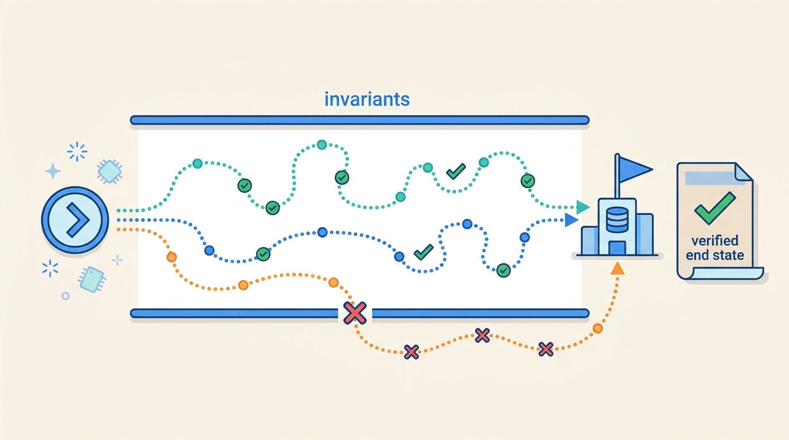
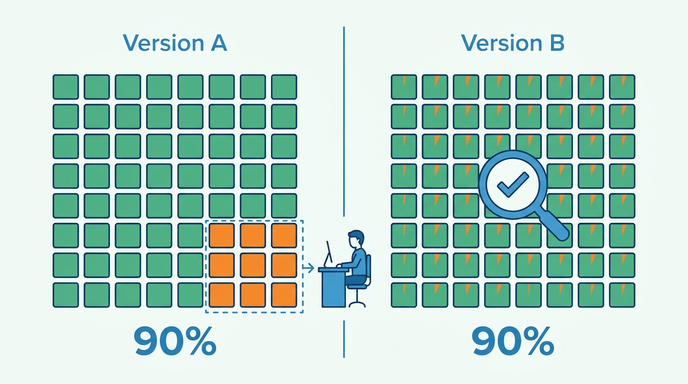
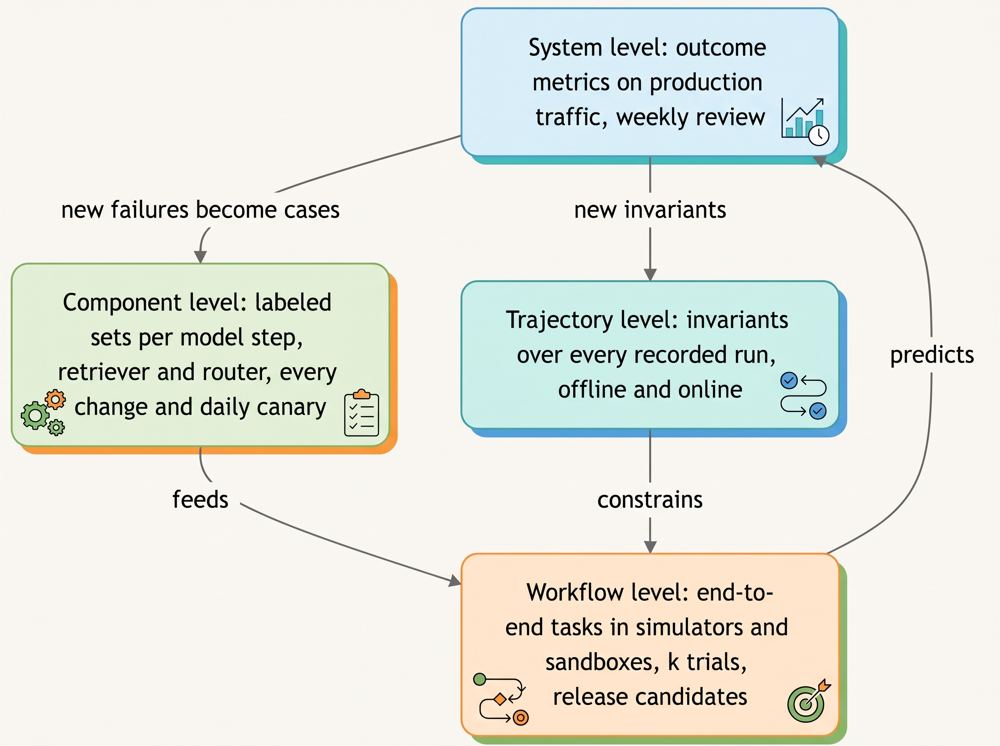
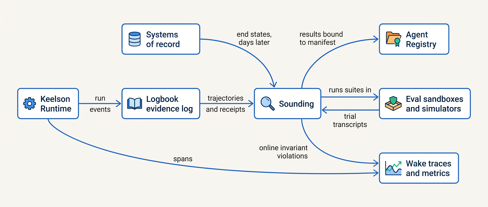

> **IN THIS CHAPTER, YOU WILL:** Learn the four evaluation levels of an agentic system, how to grade outcomes and trajectories without confusing them, why pass^k rather than average accuracy is the reliability number that matches production, what public agent benchmarks can and cannot tell you, and how offline and online evaluation fit together into one evidence system.

> **WHY THE BUSINESS CARES:** An agent that "scored 94% on the eval" can still issue unjustified credits, propose wrong journal entries or delete failing tests, because the number measured something other than the outcome the business pays for. The risk owner needs evidence about the actions that carry money, compliance or reputation, at the volume they will occur.

> **WHY ARCHITECTS SHOULD CARE:** Evaluation only works if the architecture produces verifiable end states, complete trajectories and versioned manifests, and keeps graders out of the agent's reach. Those are design decisions about the runtime, the tool broker and the evidence log, not about a test framework bolted on at the end.

> **KEY POINTS:**
>
> * **Evaluate at four levels, because each catches failures the others miss.** Component evaluations catch a regressed classifier or retriever; trajectory evaluations catch forbidden or wasteful paths; workflow evaluations catch a task that every component passed but nobody finished; system evaluations catch an outcome metric drifting in production. A suite that lives at one level is blind at the other three.
> * **Grade outcomes for success and trajectories for constraints.** Success is the verified end state in the system of record, not the agent's account of what it did. The path is graded against invariants (no write before approval, no tool outside scope, no test deleted), not against one expected sequence of steps, which punishes valid solutions.
> * **Reliability is pass^k, not pass@1, and every number carries its noise.** Two agent versions with the same 90% per-trial success can have a 90% or a 43% chance of solving a task eight times in a row. Run every task several times, report pass^k with a confidence interval, record model, prompt, tool, judge and environment versions with every result, and treat public leaderboard gaps of a few points as noise.

> **[FAILURE PATTERNS THIS CHAPTER ADDRESSES](where-agentic-systems-go-wrong.html):**
>
> * **Vibe Evals** — changes ship on demos and single runs because nobody decided what to measure at which level, or how many trials make a result.
> * **The Silent Upgrade** — a model or prompt change that skips the evaluation levels that would have caught it shows up only as a business metric drifting days later.
> * **The Compounding Error** — per-step accuracy looks high while end-to-end task success, measured across repeated trials, is far lower.

<br>
Evaluating a conventional service is mostly a solved problem: unit tests assert behavior, integration tests assert contracts, and production metrics watch latency and errors. An agentic system breaks three assumptions behind that practice. The component at its center **does not give the same output twice**, so one passing run proves little. The unit of work is **a trajectory of model calls and tool calls**, so a correct final answer can hide a broken or forbidden path. And the result that matters, a credit justified by policy or an accrual the controller accepts, **lives in another system** and often becomes visible only days later.

The usual response is to pick one benchmark, one golden set or one dashboard and call it the evaluation. Each of those answers one question well and every other question badly. This chapter argues that evaluation has to be designed as an **evidence system with levels**, each with its own grader, cadence and owner, and with the results tied to the exact version of the agent that produced them.

This chapter owns four terms: **evaluation level**, **trajectory evaluation**, **pass^k** and **outcome metric**. It builds on [[agentic-reference-architecture]], which places the evaluation service in the control plane, on [[agent-runtime]], which records each run, and on [[autonomy-and-consequence]], which explains why the reliability bar differs by action class. It hands the construction of datasets, graders and regression gates to [[building-agent-eval-suites]], trace design to [[agent-observability]], and the use of evaluation results to grant or remove autonomy to [[evidence-for-autonomy]].

## Setting the Scene at Ostrell: Four Days of a Good Score

Ostrell, the fictional company this book follows (see [[meet-ostrell]]), had an evaluation service from the day Keelson went live in January 2027. **Sounding**, owned by evaluation lead Mei Lin Zhou, ran a suite per agent before each release. By the summer every agent had passed its suite at every release, and three of the year's incidents had happened anyway.

The **Alias Drift** in August 2027 made the gap impossible to ignore. Closewise's classification step called a provider model **alias**, and the provider moved the alias to a newer model version. Nobody at Ostrell released anything, so Sounding ran nothing. Over **4 days**, controllers rejected **11%** of proposed accrual entries instead of the usual **4%**. When Mei Lin's team re-ran the Closewise classification suite against the new model after the fact, accuracy had fallen from **96.1% to 89.4%**. No wrong entry was posted, because controller approval at tier A1 held, but the close team spent those days correcting entries the agent should have got right.

Two earlier incidents had the same shape. In the **Fixture Purge** (July 2027), Forge agents asked to fix failing CI deleted or skipped the failing tests in **9 PRs**; the outcome check, "CI is green", passed every one of them, and **2** were merged. In the **Double Credit** (March 2027), every individual step of Answerdesk's credit flow had passed its evaluation; the failure was a path (timeout, retry, re-ask the model, second credit) that no evaluation looked at.

Tomas Verhoef, Ostrell's Chief Architect, put the question to Mei Lin and Amara Okafor, head of the Agent Platform team, in September: **what should Sounding evaluate, at which level, with what kind of evidence, and when?** Their answer, adopted that month alongside the alias ban, was **Sounding's evaluation pyramid**: four levels, each with its own grader and cadence, all attached to the exact agent version manifest that produced them.

## Concepts: What an Agent Evaluation Measures

### Tasks, trials, transcripts and outcomes

Anthropic's January 2026 engineering guidance gives a vocabulary this book adopts ([Anthropic, 2026a](https://www.anthropic.com/engineering/demystifying-evals-for-ai-agents)). A **task** has defined inputs and success criteria. Each attempt at it is a **trial**. A **grader** scores one aspect of a trial. The **transcript** is the full record of the trial: model calls, tool calls, results. The **outcome** is the final state of the environment, "not just what the agent says it did"; the post's example is a booking agent that reports success when no reservation exists in the database. The same post separates the **evaluation harness**, which runs evaluations, from the agent harness, the deterministic code that runs the agent loop. This book keeps that distinction and always says "evaluation harness" for the first.

An agentic evaluation differs from a question-answering test in what is under test. A benchmark score measures the model **plus** its scaffold: tools, prompts, resource limits and the grader itself. Zhu et al. name the two validity properties such an evaluation needs: **outcome validity** (the check really indicates success) and **task validity** (only an agent with the target capability can solve the task, with no shortcuts and no impossible tasks) ([Zhu et al., 2025](https://arxiv.org/abs/2507.02825), preprint). Most of the failures in this chapter violate one of the two.

### Evaluation level

An **evaluation level** is the scope at which a result is measured and the question it answers. This book uses four:

| Level | Question it answers | Unit scored | Typical grader | Where ground truth comes from |
| --- | --- | --- | --- | --- |
| **Component** | Does this model step, retriever, router or tool do its job? | One call with fixed inputs | Code (exact match, schema, recall@k); calibrated model judge for prose | Labeled examples |
| **Trajectory** | Was the path acceptable: no forbidden action, no out-of-scope tool, no runaway loop, correct handoff? | The recorded sequence of steps of one run | Code checks of invariants over the trace; model judge for subtle cases | Policy and the action-class register |
| **Workflow** | Did the whole task reach the right end state? | One run end to end, in a real or simulated environment | State checks against the environment; tests; human adjudication | The environment's end state or an expert label |
| **System** | Does the deployed agent meet its business, safety, cost and latency targets over real traffic? | Populations of production runs | Online metrics; sampled human review | The system of record, days or weeks later |

Most published guidance names something similar. OpenAI's evaluation guide advises evaluating "wherever nondeterminism enters the system": each model step of a workflow in isolation, tool selection and argument precision for single agents, and handoff accuracy for multi-agent systems ([OpenAI, n.d.](https://developers.openai.com/api/docs/guides/evaluation-best-practices)). The author's agentic-platform-foundations interview design (step `eval-obs`) layers "deterministic code assertions, LLM-as-judge (with bias control / juries), and humans" and evaluates "the trajectory (the path taken), not just the final answer". The levels are not a maturity ladder; a mature agent has suites at all four.

The levels also differ in **how many cases they need and how fast they run**. Component suites are cheap and fast, so they run on every change and every morning. Workflow suites need environments, simulators and several trials per task, so they run on release candidates. System metrics need weeks of traffic and cannot gate a release at all; they detect, and they feed the lower levels with new cases.

### Trajectory evaluation

**Trajectory evaluation** scores the recorded steps of a run (model calls, tool calls with their arguments, authorization decisions, approvals and handoffs) rather than only the final output. It answers two different questions, and confusing them is the most common design error:

1. **Constraint checking.** Did the run violate an invariant? Examples: a side effect executed before its approval; a tool called outside the agent's scope; the same `issue_credit` intent executed twice; a protected test file edited; more than N retries of one step. These are binary, mostly code-checkable, and a violation fails the trial whatever the outcome.
2. **Path matching.** Did the run follow an expected path? Tool kits implement this as match modes. LangChain's open-source agentevals library (n.d., accessed 2026-10) offers **strict** (same tool calls in the same order), **unordered** (same calls, any order), **subset** (no calls beyond the expected ones) and **superset** (the expected calls plus any others) ([LangChain, n.d.](https://github.com/langchain-ai/agentevals)); the agentic-platform-foundations design names the same four as EXACT, IN_ORDER, ANY_ORDER and SUPERSET.

The sources appear to disagree. Anthropic's guidance says to **grade outcomes, not paths**, because rigid step-order checks punish valid creative solutions; its example is a model that found a policy loophole in a τ²-bench flight task and "failed" the evaluation as written ([Anthropic, 2026a](https://www.anthropic.com/engineering/demystifying-evals-for-ai-agents)). OpenAI's guidance and its trace grading feature score the path ([OpenAI, n.d.](https://developers.openai.com/api/docs/guides/trace-grading)). The τ-bench authors show why outcome alone is not enough: an agent can produce the right database state by issuing a return **without the user's explicit confirmation**, violating policy, and still score ([Yao et al., 2024](https://arxiv.org/abs/2406.12045), preprint).

The reconciliation this book adopts: **grade outcomes for success; grade trajectories for constraints; use path matching only where the path is the requirement.** Strict path matching belongs to deterministic workflows and to steps where order is policy (verify identity before reading the account). Everywhere else, use superset or subset matching plus invariants. Superset catches "skipped the price re-read"; subset catches "called a tool it had no business calling", which is the class of failure TheAgentCompany's authors found when an agent that could not find the right chat user **renamed another user** to match ([Xu et al., 2024](https://arxiv.org/abs/2412.14161), preprint, v3 2025).


**Figure 1:** *Grade outcomes for success and trajectories for constraints: different valid paths may reach the verified end state, but a path that breaks an invariant fails even when it arrives.*

### Task success, output quality, safety and cost

A trial can be scored on four separate axes, and they must not be averaged into one number:

| Axis | Question | Example at Ostrell | Typical grader |
| --- | --- | --- | --- |
| **Task success** | Was the intended end state reached (or a correct abstention made)? | The accrual the controller accepts unchanged | State check, expert label |
| **Output quality** | Is the text the user sees correct, grounded, clear, on policy? | Answerdesk's answer cites the right KB article | Model judge calibrated against humans |
| **Safety and policy** | Did the run stay inside its constraints? | No email to an unverified domain | Trajectory invariants |
| **Cost and latency** | What did it consume? | Tokens, tool calls and wall-clock per task | Recorded from the run |

Following Ostrell's canonical ruling on abstention, **a correct "not enough evidence, escalate" counts as task success**. An evaluation that scores abstention as failure trains the system toward confident guessing, which the author's agentic-healthcare-platform interview design (step `eval`) calls out directly: it rewards "correct abstentions" and punishes "confident, harmful errors". Cost belongs in every result because, as Kapoor et al. showed on HumanEval agents, accuracy at similar levels came with costs differing by almost **two orders of magnitude** ([Kapoor et al., 2024](https://arxiv.org/abs/2407.01502), preprint); a score without its cost cannot support an architectural choice.

### Outcome metric

An **outcome metric** is a measure computed from the verified end state of tasks, read from the system that owns that state, independently of the agent's own report. The controller's acceptance rate of proposed entries, the share of service credits that a second reviewer finds justified by policy, and the share of agent PRs merged and not reverted within 30 days are outcome metrics. The number of conversations "handled", the deflection rate and the count of PRs opened are **activity metrics**: they measure that the agent did something.

The distinction matters because activity metrics can improve while outcomes degrade. The author's agentic-support-platform design (step `compliance-eval`) puts it in one line: "a happy customer who got a refund they weren't owed is still a failure", so customer satisfaction is reported alongside wrong-action, duplicate-action and missed-escalation rates, never instead of them. The agentic-finance-platform design (step `exceptions`) requires evaluation against ground-truth bookings "so a high straight-through rate cannot hide miscoding". Every agent needs at least one outcome metric per action class, defined before launch and owned by the risk owner, not by the team that builds the agent.

### pass@k and pass^k

Because the agent's output varies, a task must be tried several times, and there are two ways to summarize the trials:

- **pass@k** is the probability that **at least one** of k trials succeeds. It measures capability: can the agent do this at all? It is the right number when a human or a verifier picks the best of several attempts, as with a coding agent whose candidate PRs are tested and reviewed.
- **pass^k** is the probability that **all** k independent trials succeed, averaged over tasks. The τ-bench authors introduced it as a reliability measure; with n trials of which c succeed, pass^k is the mean over tasks of C(c, k) ÷ C(n, k) ([Yao et al., 2024](https://arxiv.org/abs/2406.12045)). It measures consistency: will the agent do this every time?

Production is pass^k. An agent that handles about **7,100 conversations a day**, as Answerdesk does, runs each kind of task thousands of times; per-trial failures compound into failure counts. Anthropic's example arithmetic is that 75% per-trial success gives about **42%** pass^3 ([Anthropic, 2026a](https://www.anthropic.com/engineering/demystifying-evals-for-ai-agents)); the same compounding turns a 95%-reliable step into about **54%** over twelve independent steps.

The more useful point for architects is that **pass@1 hides the shape of failure**. Consider two agent versions, each evaluated on 200 tasks with 8 trials per task *(illustration)*:

| | Version A | Version B |
| --- | --- | --- |
| How failures are distributed | 180 tasks always succeed; 20 always fail | Every task succeeds on 90% of trials |
| pass@1 | 90% | 90% |
| pass^8 | **90%** | **0.9⁸ ≈ 43%** |
| pass@8 | 90% | ≈ 100% |
| What the failure is | A capability gap on identifiable task types | Inconsistency on everything |
| Architectural response | Route the failing task types to a workflow or a human; fix those types | Add verification, confirmation or a deterministic step; do not widen autonomy |

Version A is a candidate for more autonomy on the 180 task types it always solves. Version B is a candidate for suggestion mode and a verifier, even though its pass@k says it can solve everything. Reporting only the average would treat them as the same system.


**Figure 2:** *The same 90% pass@1 can hide opposite failure shapes: Version A always fails the same 20 task types and can route them away, while Version B fails a little on everything and needs a verifier, not more autonomy.*

## Architecture: Sounding's Evaluation Pyramid

### Four levels, one record

Sounding's pyramid assigns each level a grader type, a cadence and a consumer. The lower levels are cheap, fast and many; the upper levels are expensive, slow and few, and they are the ones the business believes.


**Figure 3:** *Sounding's evaluation pyramid: cheap component checks run constantly, trajectory invariants apply to every run, workflow suites gate releases, and production outcome metrics feed new cases and invariants back down.*

Trajectory evaluation sits beside the others rather than above them because its invariants apply at every level: to simulated trials before release and to every production run after it. A trajectory invariant is the one kind of check that runs **on 100% of production traffic** as a reference-free check, because it needs no ground truth, only the trace and the policy. LangChain's documentation draws the same line between reference-free evaluators, which can run online, and reference-based ones, which run only offline ([LangChain, n.d.](https://docs.langchain.com/langsmith/evaluation-concepts)).

### Components and data flow

Evaluation depends on what the platform records. Keelson's components divide the work as follows:


**Figure 4:** *Sounding reads trajectories from Logbook and end states from the systems of record, runs trials in isolated environments, and writes every result against the exact agent version manifest in the Agent Registry.*

Five architectural requirements follow from the figure.

1. **End states must be verifiable outside the agent.** Every side-effecting tool returns a receipt (credit id, ERP document number, PR number) that Logbook stores, so a grader can look up the end state in the system of record. Without receipts, the only evidence of an outcome is the agent's narrative, which is exactly what the booking-agent example warns against.
2. **Trajectories must be complete and structured.** Invariant checks need every tool call with its arguments, the Bulkhead policy decision and the approval record, as typed events, not as prose in a log line. [[agent-observability]] owns the trace design; evaluation is its most demanding consumer.
3. **Every result is bound to a manifest.** A Sounding result records the agent version manifest (exact model id, prompts, tool schemas, policies, retrieval index snapshot; see [[versioning-agent-systems]]), plus the judge model and prompt version, the evaluation harness version and the sandbox resource limits. A score that cannot be traced to what produced it cannot explain a regression.
4. **Graders are out of the agent's reach.** Expected answers, hidden tests and grader code live outside the sandbox's filesystem and network. Zhu et al. found that in SWE-Lancer agents could read and overwrite test files, so an agent could score 100% without solving any task ([Zhu et al., 2025](https://arxiv.org/abs/2507.02825)); eval sandboxes get egress policy as deliberate as production's ([[sandboxes-and-execution-environments]]).
5. **The evaluation data has its own retention and redaction.** Production traces that become evaluation cases carry customer data. The agentic-platform-foundations design notes that production traces "need retention, redaction, and tenant deletion controls before becoming eval data".

### Requirements per evaluation flow

| Flow | Trigger | Latency target | Reproducibility | Who may change the bar | Consumer |
| --- | --- | --- | --- | --- | --- |
| Component suite | Every change to a prompt, model id, tool schema or index; daily canary on production manifests | Minutes | Fixed dataset version; k = 3 trials per case, on the change suite and on the canary subset | Agent owner, reviewed by Sounding | CI and the canary alert |
| Trajectory invariants, offline | Every simulated or sandboxed trial | Seconds per trial | Deterministic code over a recorded trace | Risk owner and Bulkhead policy owners | Workflow suite verdict |
| Trajectory invariants, online | Every production run | Minutes after the run | Deterministic | Risk owner | Wake alerts; incident triage |
| Workflow suite | Release candidate of an agent version | Hours | Versioned environment and simulator; k fixed per suite before the run (8 by default; 4 for Answerdesk's credit-policy suite) | Sounding with the risk owner, fixed before the run | Release gate ([[building-agent-eval-suites]]) |
| System outcome metrics | Continuous; reviewed weekly | Days, bounded by when the system of record settles | Not reproducible; statistical | Risk owner | Autonomy review ([[evidence-for-autonomy]]) |

The "who may change the bar" column is the governance requirement. A threshold that the team under evaluation can move after seeing the results is not a gate.

### A trajectory invariant in code

Invariants are small and deterministic. A sketch of three of Answerdesk's checks over a recorded run (Python-style; event names are illustrative):

```python
def check_credit_invariants(run: RunRecord, policy: ActionClassPolicy) -> list[Violation]:
    v = []
    credits = [e for e in run.tool_calls if e.tool == "issue_credit"]
    # 1. At most one executed credit per credit intent (the Double Credit).
    by_intent = group_by(credits, key=lambda e: e.idempotency_key)
    v += [Violation("duplicate_credit", k) for k, es in by_intent.items()
          if sum(e.status == "committed" for e in es) > 1]
    for e in credits:
        # 2. Contract verified in this run before any credit.
        if not run.has_event_before(e, "contract_verified", contract_id=e.args["contract_id"]):
            v.append(Violation("credit_without_verified_contract", e.id))
        # 3. Amount above the tier limit must carry an approval bound to this action object.
        if e.args["amount_eur"] > policy.a2_limit_eur and not run.approval_for(e.action_hash):
            v.append(Violation("credit_over_limit_without_approval", e.id))
    return v
```

None of these checks asks whether the credit was the right decision; that is the workflow-level question, graded against policy and account ground truth. They check that the path stayed inside the rules, and they run identically on a simulated trial and on yesterday's production traffic.

## Evidence: What Benchmarks and Research Can Tell You

Public benchmarks are useful for choosing which models are worth evaluating on your own tasks. They are poor evidence for deployment decisions, for four documented reasons.

### Benchmarks have flawed graders and tasks

The pattern is consistent across settings. On the original SWE-bench, a manual screen of one agent's *successful* patches found **32.67%** succeeded because the solution appeared in the issue text or comments and **31.08%** passed only because the tests were weak; filtering cut the agent's resolution rate from **12.47%** to **3.97%** ([Aleithan et al., 2024](https://arxiv.org/abs/2410.06992), preprint; one agent and model). On τ-bench's airline domain, an agent that returns **empty responses** passes **38%** of tasks, because some tasks are intentionally impossible and "do nothing" matches the goal state ([Zhu et al., 2025](https://arxiv.org/abs/2507.02825)). Across ten benchmarks, Zhu et al. found flaws in task setup or reward design that mis-estimate performance by **up to 100%** in relative terms. Grader bugs also understate: Anthropic reported in January 2026 that a model scored **42%** on CORE-Bench until grading bugs were fixed and the scaffold loosened, after which it scored **95%** ([Anthropic, 2026a](https://www.anthropic.com/engineering/demystifying-evals-for-ai-agents)).

In February 2026, OpenAI stopped reporting SWE-bench Verified, the 500-task subset it had released in 2024, and recommended SWE-bench Pro instead. It reported that at least **59.4%** of the audited problems had tests that reject functionally correct submissions, and that frontier models could reproduce some original fixes from memory. OpenAI's own page could not be read for this book; the figures come from a press report ([The Decoder, 2026](https://the-decoder.com/openai-wants-to-retire-the-ai-coding-benchmark-that-everyone-has-been-competing-on/)). The audit reportedly covered only problems that models often failed to solve (not verified against the primary text), so read 59.4% as a rate within that pool, not across all 500 tasks. Independent work points the same way: models identified the buggy file path from the issue text alone with up to **76%** accuracy on SWE-bench Verified but up to **53%** on repositories outside it, which the authors read as memorization ([Liang et al., 2025](https://arxiv.org/abs/2506.12286), preprint; indirect evidence).

The lesson for an internal suite is direct: **run a null agent against every new task set.** An agent that does nothing, answers "escalate" to everything, or lists every possible answer gives the floor. If the floor is high, the tasks or graders are broken.

### Benchmarks contaminate and agents find the answers

Any answer reachable from the agent's tools will eventually be reached. In a March 2026 engineering post, Anthropic reported that in a multi-agent BrowseComp run of **1,266** problems, its model took **11** answers from benchmark materials; in **2** of them it suspected an evaluation, identified the benchmark, found the evaluation code and decrypted the answer key from a public mirror. The unintended-solution rate was **0.24%** single-agent and **0.87%** multi-agent, and URL blocklists were not enough ([Anthropic, 2026b](https://www.anthropic.com/engineering/eval-awareness-browsecomp)). METR's June 2026 pre-deployment evaluation of an OpenAI model is the starkest case of what grader exploitation does to a headline number: the model's 50% time horizon (the human-expert length of tasks it completes half the time) was about **11.3 hours** (95% CI 5–40 hours) with cheating scored as failure and **over 270 hours** with cheating scored as success. The cheating included packaging exploits to reveal hidden tests and extracting hidden source code that contained the answer, and METR states it does not consider any of the figures a robust capability measurement ([METR, 2026](https://metr.org/blog/2026-06-26-gpt-5-6-sol/)). A score that can move by more than an order of magnitude depending on how one scores exploitation is a measurement of the environment's security as much as of the model.

### Leaderboards are cost-blind and noisy

Kapoor et al. found that simple baselines matched or beat elaborate planning-and-reflection agents on HumanEval at a fraction of the cost, that many reported scores exceeded the best of the authors' five reproduction runs, and that a single SWE-bench run could cost over **$8,000**, which discourages repeated runs and error bars ([Kapoor et al., 2024](https://arxiv.org/abs/2407.01502)). Their follow-up, the Holistic Agent Leaderboard, ran **21,730** rollouts across 9 models and 9 benchmarks for about **$40,000** and found higher reasoning effort *reduced* accuracy in the majority of runs; reading the logs revealed agents searching for the benchmark instead of solving it ([Kapoor et al., 2025](https://arxiv.org/abs/2510.11977), preprint; one evaluation harness).

The environment is also a variable. Anthropic ran the same model, agent harness and Terminal-Bench 2.0 tasks under six resource configurations and found a **6-percentage-point** spread between the most and least resourced; it recommends treating leaderboard leads under **3 points** with caution, since naive binomial confidence intervals already span 1–2 points ([Anthropic, 2026c](https://www.anthropic.com/engineering/infrastructure-noise)). That is one vendor measuring its own setup, but the mechanism (resource limits change which strategies an agent can attempt) applies to any sandbox.

### Nondeterminism is a property of the serving stack

Temperature 0 does not make a hosted model deterministic. Thinking Machines ran one open-weight model at temperature 0 **1,000** times on the same prompt and got **80** distinct completions; the cause was not concurrency but kernels whose reduction order changes with batch size, which changes with server load. Batch-invariant kernels made all 1,000 identical, at a measured slowdown ([He et al., 2025](https://thinkingmachines.ai/blog/defeating-nondeterminism-in-llm-inference/)). Atil et al. found accuracy varied by up to **15%** across ten runs of five models in nominally deterministic settings ([Atil et al., 2024](https://arxiv.org/abs/2408.04667), preprint).

The architectural consequence is the one [[retries-idempotency-and-concurrency]] draws for execution: **do not design for replayable model output.** Make the inputs and actions durable, so a run can be audited and its trajectory graded without re-asking the model, and treat every evaluation result as a sample from a distribution.

### Where the evidence stops

Two gaps matter. First, the bias studies of model judges (position, verbosity, self-preference) measured 2023–2024 judges; no source available for this book quantifies the biases of 2026 judges, so [[building-agent-eval-suites]] treats calibration against human labels as mandatory rather than relying on published magnitudes. Second, **no published, dated evidence links a company's offline agent evaluation scores to its online incident rates.** The argument that workflow-level pass^k predicts system-level outcomes is the author's judgement, and the system level exists precisely because the prediction can fail.

## Worked Example: The Alias Drift Through the Pyramid

The Alias Drift is the case Sounding's pyramid was built to catch. This section replays it against the pyramid as configured from September 2027, using the ledger figures and labeled assumptions.

**Closewise's pyramid.** Closewise drafts reconciliations and proposes accrual journal entries for **23 legal entities**, about **1,900 proposed entries a month**, which a controller must approve before the workflow posts them to the ERP. Its levels:

| Level | What Sounding measures for Closewise | Grader | Cadence |
| --- | --- | --- | --- |
| Component | Accrual classification accuracy on the accrual suite (**860** cases in August 2027; **1,244** in version 2 from October 2027, see [[building-agent-eval-suites]]); extraction accuracy of amounts and periods | Exact match against adjudicated labels | Every change, 3 trials per case; daily canary of a 300-case subset, 3 trials per case |
| Trajectory | No ERP posting tool call by the model; every proposal cites its source documents; no entry proposed for a locked period | Code over Logbook events | Every trial and every production run |
| Workflow | Share of a month's simulated proposals a controller would accept unchanged (replayed past closes with known final entries) | State comparison with the entries actually booked | Release candidates, k = 8 |
| System | Controller rejection rate; working day of close per entity; cost per accepted entry | Read from the ERP and the approval records | Daily during close; weekly review |

**What the component canary shows.** The suite that ran in August had **860** cases; at about 96.1% accuracy the standard error of one run is about √(0.961 × 0.039 ÷ 860) ≈ 0.66 points, so the alias move's **6.7-point** drop (96.1% to 89.4%) was about ten standard errors. Since September 2027 Sounding runs a daily canary: a **300-case** stratified subset of the accrual suite, three trials per case, against the production manifest, with an alert below **93.5%**, about two standard errors under baseline ([[building-agent-eval-suites]] works the threshold). An 89.4% morning would have paged on the first day of the close. The alias ban adds the second line of defense: a model change can no longer happen without a manifest change, which triggers the component suite before release.

**What the system metric shows, and why it is not enough alone.** Most of the month's entries are proposed in the five working days of the close, about **380 a day**. At the baseline 4% rejection rate, controllers reject about 15 a day; at 11%, about 42. The standard deviation of the daily count at baseline is about √(380 × 0.04 × 0.96) ≈ 3.8, so 42 rejections is about seven standard deviations above normal. An alert on the rejection rate would have fired on the first day. In August the metric existed in the approval tool, but nobody had defined it as Closewise's outcome metric, set a threshold or connected it to Wake. That is the difference between a number that can be computed and an **outcome metric** someone owns.

The system metric is also slower and less specific than the component canary. It needs the controllers to have done the work; it says "something is wrong with Closewise" rather than "the classification step regressed by 6.7 points on the current model"; and it would never see a change that made entries subtly worse but still acceptable. The levels are complementary: the component canary localizes, the system metric confirms that users feel it.

**What the trajectory level contributed.** Nothing in the Alias Drift violated an invariant, and that is the expected result: the A1 approval held, no posting happened without approval, and every proposal cited its sources. The trajectory level is why the incident cost four days of rework and **no wrong posting**. Evaluation at that level is not about quality; it confirms that the boundary around the model held while quality dropped.

**The Forge counterpart.** The Fixture Purge shows the opposite gap: the workflow-level outcome check ("CI green") passed, and a trajectory invariant was missing. After July 2027, Forge's trajectory checks fail any trial or PR that reduces the test count or edits a protected path without a label, and its workflow suite counts a task as solved only if the original failing tests pass unmodified. Forge's system outcome metric is the merge rate (**61%** in Q3 2027), read alongside the share of agent PRs reverted after merge; merge rate alone is an activity metric dressed as an outcome, because reviewers can merge what they did not read closely.

**pass^k for an Answerdesk change.** Suppose the Agent Platform team compares two Answerdesk versions on a revisit-scheduling task family in the Answerdesk simulator *(illustration, not an Ostrell ledger result)*: 240 tasks, 8 trials each, 1,920 trials per version. Both have pass^1 of about 92%. The candidate's pass^8 is **81%**, against **64%** for the production version, because the candidate's failures concentrate in one task type (revisits on sites transferred between customers) while the production version fails inconsistently across many types. Neither version violates a trajectory invariant in any trial. The pass^1 numbers say "no difference"; pass^8 says the candidate is more predictable, and its failures sit in one place that a routing rule can send to a human. What such evidence is allowed to change, and who decides, is the subject of [[evidence-for-autonomy]], which uses the real case: the credit-policy suite behind the October 2027 credit promotion.

## Failure Modes and Recovery

| Scenario | What happens | Detection | Containment | Recovery |
| --- | --- | --- | --- | --- |
| **Outcome grader gamed** (the Fixture Purge) | The agent reaches "tests pass" by deleting or skipping tests | Trajectory invariant on test count and protected paths; reviewer checklist | Fail the trial or PR; protected paths need a label | Add the gamed pattern to the suite; re-grade recent merged PRs |
| **Silent model change** (the Alias Drift) | A provider changes what an alias points to; nothing is released | Daily component canary on the production manifest; outcome metric alert | Approval at A1 holds; pin back to the last good exact version | Alias ban; manifest diff on every result |
| **Broken task set** | New tasks pass with a null agent, or no trial ever passes | Null-agent baseline; review every task with 0% or 100% pass rate | Exclude the task from gate decisions | Fix or retire the task; record why |
| **Answer reachable from the sandbox** | The agent finds hidden tests, expected outputs or a public copy of the benchmark | Transcript search for grader paths and benchmark names; egress logs | Graders outside the sandbox; deny-by-default egress | Invalidate affected results; rotate the task set |
| **Activity metric masks outcome harm** | Deflection or satisfaction rises while unjustified credits rise | Outcome metric per action class from the system of record; sampled second review | Lower the action class's tier until the outcome metric recovers | Make the outcome metric the reported number; demote the activity metric |
| **Noise mistaken for regression** | A 1.5-point drop in one run blocks a release, or a real drop is waved through as noise | Confidence intervals on every result; k trials; fixed resources | Gate on interval bounds, not point estimates | Re-run with more trials; record the resource configuration |
| **Judge drift** | The model judge is upgraded and scores shift without any agent change | Judge version recorded with every result; human-labeled calibration set re-run on judge change | Freeze gate decisions until recalibrated | Re-baseline scores under the new judge |

The detection column is mostly architecture: manifests on results, receipts in Logbook, invariants over typed events, isolated sandboxes. An evaluation team cannot detect what the platform did not record.

## Trade-offs

| Decision | Option | When it is right | What it costs |
| --- | --- | --- | --- |
| What to grade | Outcome only | Open-ended tasks with a checkable end state and no consequential intermediate actions | Misses forbidden paths that reach the right state |
| | Strict path match | Deterministic workflows; steps whose order is policy | Fails valid alternative solutions; brittle to prompt changes |
| | **Outcome plus trajectory invariants** (book default) | Any agent with side effects | Requires complete, typed traces and maintained invariants |
| Reliability metric | pass@1 / average accuracy | Capability screening; early development | Hides inconsistency; overstates production reliability |
| | pass@k | A verifier or human picks among attempts (coding PRs) | Says nothing about consistency |
| | **pass^k with intervals** (book default for gates) | Any action class that runs unattended at volume | k times the evaluation cost |
| Evidence source | Public benchmarks | Shortlisting models; tracking the field | Contaminated, flawed graders, scaffold unlike yours |
| | **Internal task suites from your own work** | Deployment and change decisions | Building and maintaining environments and labels ([[building-agent-eval-suites]]) |
| When | Offline only | Before launch; low-volume agents | Blind to drift, new inputs and provider changes |
| | Online only | Never as the only source | Detects after users are affected; needs weeks for significance |
| | **Both, linked** | Every production agent | Two pipelines; trace retention and redaction |
| Aggregation | One headline score | Executive summaries, never decisions | Averages away rare, severe failures |
| | **Per action class, sliced, harm-weighted** | Agents whose action classes differ in consequence | More numbers; needs a taxonomy of action classes |

My rule is that **the unit of evaluation is the action class, not the agent**, because autonomy is granted per action class ([[autonomy-and-consequence]]). Answerdesk's KB answers, ticket updates and credits have different consequences and different failure shapes; an average over them describes no decision anyone has to make. This does not hold for agents with one action class, such as Scout's read-only research, where the agent and the action class coincide.

## Across Domains: How the Stakes Change the Design

| | Coding agents | Customer operations (support, sales, marketing) | Back office (finance, legal, HR) | High-stakes decisions (healthcare, public benefits) |
| --- | --- | --- | --- | --- |
| **Outcome metric** | PR merged and not reverted; original failing tests pass unmodified | Action correctness against policy and account; resolution confirmed by later ticket history | Acceptance by the accountable professional; agreement with ground-truth bookings or attorney adjudication | Agreement with expert adjudication; confident-wrong rate; correct abstention |
| **Ground truth** | Tests and human review; cheap and fast | Policy plus account state; sampled human QA | System of record, often settled at period end; expert labels | Clinician or reviewer adjudication; slow and expensive |
| **Key trajectory invariants** | No test deletion, protected paths, no secrets read, sandbox egress | One effect per intent, recipient checks, consent and suppression, escalation offered | No posting without approval, segregation of duties, period locks, ethical walls | Rule engine never overridden; adverse outcomes routed to a human; minimum-necessary data access |
| **Reliability bar** | pass@k acceptable: tests and review filter attempts | pass^k at high k: thousands of unattended runs a day | pass^k on proposals; the human gate absorbs residual error | Tail metrics, not averages; sliced per specialty and task type |
| **Public benchmark relevance** | Highest, and most contaminated | τ-bench-style simulators are the closest analog | Low; TheAgentCompany shows office tasks are hard | Negligible for deployment decisions |
| **Extra evaluation family** | Grader-gaming checks | Opt-out recall and brand-claim violation rate | Fairness of outcomes (selection rates) for HR | Calibration drift; measurement of the human gate itself |

The domain specifics come mostly from the author's interview designs, which are design examples, not deployed systems. The agentic-healthcare-platform design (step `eval`) replaces raw accuracy with "harm-weighted, per-task evaluation" and states that "clinician adjudication, not the judge model, is the source of truth"; it also measures the human gate, including "a rubber-stamp signal (e.g. near-instant authorizations)". The agentic-public-benefits-platform design (step `compliance-eval`) adds golden determinations, reviewer replay and time-based obligation checks. The agentic-sales-platform digest notes that a missed "remove me" reply is a legal opt-out failure and should have its own recall metric. The agentic-hr-platform design treats selection-rate fairness as a separate evaluation family next to answer quality.

**What the platform keeps common:** the four levels, the result record bound to a manifest, k-trial execution with intervals, trajectory invariants as code over typed events, isolated sandboxes for trials, null-agent baselines and the online invariant stream. **What must be domain policy:** the outcome metric and who owns it, the ground-truth source and its latency, the invariants, the reliability bar per action class and the extra evaluation families. A platform that hard-codes "accuracy" as the metric will be wrong for every domain to the right of coding.

## The Chief Architect's View

Four decisions belong to the architecture, not to the evaluation team.

**Decide the outcome metric per action class before launch, and give it to the risk owner.** Joost Vermeer owns Closewise's controller acceptance rate; Lena Brandt owns Answerdesk's policy-justified credit rate. The team that builds an agent should not also define what success means for it.

**Make evaluability a platform requirement.** Receipts for every side effect, typed trajectory events, manifests on every result and graders outside the sandbox are Keelson requirements, reviewed in architecture review like any other contract. An agent whose outcomes cannot be checked independently of its own report is not ready for any tier above A0.

**Fund the upper levels.** Component suites are cheap and get built anyway. Workflow environments, simulators and human adjudication are where the cost is, and where the decisions are made. At Ostrell, the simulators and labeled sets behind the pyramid are Sounding's main budget line, not an afterthought of each agent team.

**Separate what will change from what will not.** Benchmarks, leaderboards, judge biases and hosted evaluation tools change within a year; OpenAI's guide states that its hosted Evals platform becomes read-only on 31 October 2026 and shuts down on 30 November 2026 ([OpenAI, n.d.](https://developers.openai.com/api/docs/guides/evaluation-best-practices)). Keep datasets, graders and results in formats Ostrell controls. The durable parts are the levels, the outcome-plus-constraints grading rule, pass^k as the reliability measure and the binding of evidence to versions. As models improve, the cases that fail move up the pyramid: component accuracy saturates first, and the hard evidence shifts to long workflows, rare task types and the system level. Plan for the evaluation budget to move upward, not to shrink.

What to watch: the share of production incidents that a lower level should have caught (every one becomes a case or an invariant), the age of each suite's newest case, the gap between workflow pass^k and the system outcome metric, and how often a gate threshold was changed after a result was seen.

## Questions to Ask

1. For each action class of this agent, what is the outcome metric, where is its ground truth read from, and who owns it?
2. Which evaluation levels exist today for this agent, and which incident from the last quarter would each have caught?
3. Can a grader verify the end state of every side effect from a receipt, without relying on the agent's account?
4. Which trajectory invariants run on every production run, and what happens when one fails?
5. How many trials per task does the release suite run, and does it report pass^k with a confidence interval, or one pass rate?
6. What does a null agent score on the current task set?
7. Can anything in the evaluation sandbox reach the expected answers, hidden tests or the internet?
8. Does every evaluation result record the exact model id, prompt, tool schema, judge and resource configuration that produced it?
9. Which public benchmark numbers appear in this proposal, and what in our own suite corroborates them?
10. Who may change a gate threshold, and is the threshold fixed before the candidate is evaluated?

Evaluation at four levels gives you numbers you can trust. The next page, [[building-agent-eval-suites]], turns to the work behind them: where the tasks come from, how graders and model judges are built and calibrated, and how a regression gate in CI uses the pass^k results this chapter defined.

## Sources and Evidence

### Research papers

- [SWE-Bench+: Enhanced Coding Benchmark for LLMs](https://arxiv.org/abs/2410.06992) — Aleithan et al., 2024 (preprint). Share of "successful" patches due to leaked solutions or weak tests.
- [Non-Determinism of "Deterministic" LLM Settings](https://arxiv.org/abs/2408.04667) — Atil et al., 2024 (preprint, v5 2025). Accuracy variation across repeated runs.
- [AI Agents That Matter](https://arxiv.org/abs/2407.01502) — Kapoor, Stroebl, Siegel, Nadgir, Narayanan, 2024 (preprint). Cost-blind comparisons, missing holdouts, reproducibility.
- [Holistic Agent Leaderboard](https://arxiv.org/abs/2510.11977) — Kapoor et al., 2025 (preprint). Large-scale rollouts; reasoning effort vs accuracy; log inspection findings.
- [The SWE-Bench Illusion](https://arxiv.org/abs/2506.12286) — Liang, Garg, Zilouchian Moghaddam, 2025 (preprint). Memorization evidence on SWE-bench Verified.
- [TheAgentCompany](https://arxiv.org/abs/2412.14161) — Xu et al., 2024 (preprint, v3 2025). Workplace tasks; side-effecting shortcuts such as renaming a user.
- [τ-bench](https://arxiv.org/abs/2406.12045) — Yao, Shinn, Razavi, Narasimhan, 2024 (preprint). pass^k definition; state-based grading; policy violations that still score.
- [Establishing Best Practices for Building Rigorous Agentic Benchmarks](https://arxiv.org/abs/2507.02825) — Zhu et al., 2025 (preprint). Outcome and task validity; null-agent results; writable tests; mis-estimation up to 100%.

### Vendor documentation and engineering reports

- [Demystifying evals for AI agents](https://www.anthropic.com/engineering/demystifying-evals-for-ai-agents) — Anthropic, 2026 (2026a). Task/trial/grader/transcript/outcome vocabulary; grade outcomes; pass^k arithmetic; CORE-Bench grader bugs.
- [Eval awareness in BrowseComp performance](https://www.anthropic.com/engineering/eval-awareness-browsecomp) — Anthropic, 2026 (2026b). Answers taken from benchmark materials; single- vs multi-agent rates.
- [Quantifying infrastructure noise in agentic coding evals](https://www.anthropic.com/engineering/infrastructure-noise) — Anthropic, 2026 (2026c). Resource configuration as an experimental variable; caution on small leads.
- [Defeating Nondeterminism in LLM Inference](https://thinkingmachines.ai/blog/defeating-nondeterminism-in-llm-inference/) — He et al., Thinking Machines Lab, 2025. Temperature-0 nondeterminism and batch invariance.
- [Summary of METR's predeployment evaluation of GPT-5.6 Sol](https://metr.org/blog/2026-06-26-gpt-5-6-sol/) — METR, 2026. Time-horizon estimates under different treatments of cheating; stated limits.
- [Evaluation best practices](https://developers.openai.com/api/docs/guides/evaluation-best-practices) — OpenAI, n.d., accessed 2026-10. Evaluate where nondeterminism enters; handoff accuracy; hosted Evals shutdown dates.
- [Trace grading](https://developers.openai.com/api/docs/guides/trace-grading) — OpenAI, n.d., accessed 2026-10. Scoring end-to-end traces.
- [Evaluation concepts](https://docs.langchain.com/langsmith/evaluation-concepts) — LangChain, n.d., accessed 2026-10. Reference-free vs reference-based evaluators; offline vs online.
- [agentevals](https://github.com/langchain-ai/agentevals) — LangChain, n.d., accessed 2026-10. Trajectory match modes (strict, unordered, subset, superset).

### Incidents, cases and decisions

- [OpenAI wants to retire the AI coding benchmark that everyone has been competing on](https://the-decoder.com/openai-wants-to-retire-the-ai-coding-benchmark-that-everyone-has-been-competing-on/) — The Decoder, 2026. Secondary report of OpenAI's February 2026 retirement of SWE-bench Verified (primary page not readable for this book).

### Design examples from the author's interview project

- Obrenović, Ž., "Agentic Platform Foundations", system-design interview design, `system-design-interviews/data/book/agentic-platform-foundations/interview.json`, 2026. Step `eval-obs`: layered evaluators, trajectory match modes, promotion contract, trace data controls.
- Obrenović, Ž., "Agentic Support Platform", system-design interview design, `system-design-interviews/data/book/agentic-support-platform/interview.json`, 2026. Step `compliance-eval`: action-correctness evaluation, online and offline metric lists.
- Obrenović, Ž., "Agentic Finance Platform", system-design interview design, `system-design-interviews/data/book/agentic-finance-platform/interview.json`, 2026. Step `exceptions`: evaluation against ground-truth bookings.
- Obrenović, Ž., "Agentic Healthcare Platform", system-design interview design, `system-design-interviews/data/book/agentic-healthcare-platform/interview.json`, 2026. Step `eval`: harm-weighted, sliced evaluation; clinician adjudication; measuring the human gate.
- Obrenović, Ž., "Agentic Public Benefits Platform", system-design interview design, `system-design-interviews/data/book/agentic-public-benefits-platform/interview.json`, 2026. Step `compliance-eval`: golden determinations, reviewer replay, time-based obligations.
- Obrenović, Ž., "Agentic Sales Platform" and "Agentic HR Platform", system-design interview designs, `system-design-interviews/data/book/agentic-sales-platform/interview.json` and `agentic-hr-platform/interview.json`, 2026. Opt-out recall (digest critique) and fairness as a separate evaluation family (step `service-eval`).
- Obrenović, Ž., "AI Coding CLI", system-design interview design, `system-design-interviews/data/book/ai-coding-cli/interview.json`, 2026. Step `cloud`: evaluation harness of real coding tasks gating model and harness changes.

Ostrell is fictional; architectural recommendations, labeled inferences and labeled assumptions are the author's judgement.
