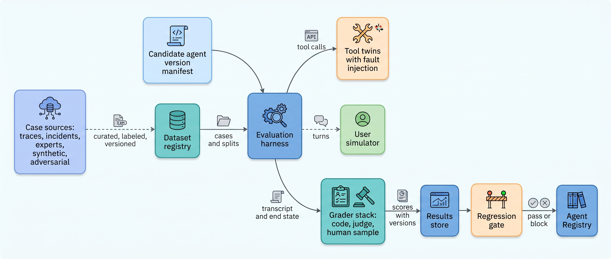
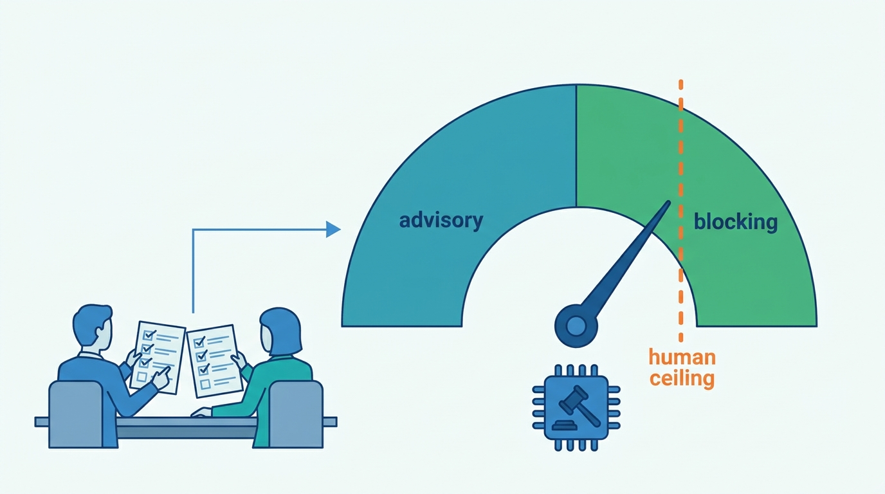
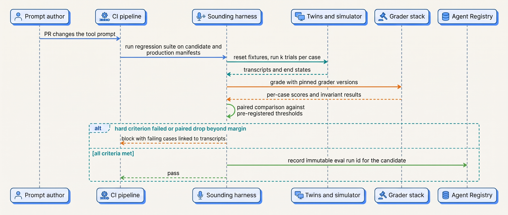
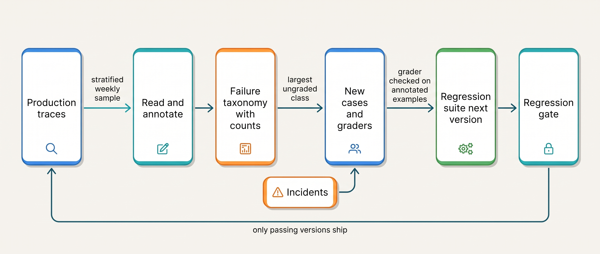
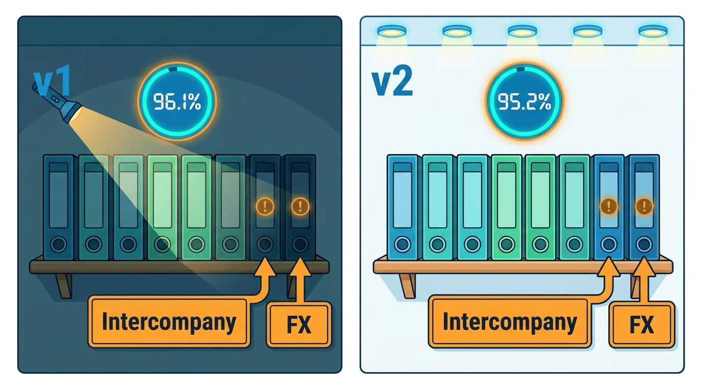

> **IN THIS CHAPTER, YOU WILL:** Learn how to assemble an agent's eval suite from production traces, incidents, expert-written and synthetic cases; how to build environments and user simulators that grade end state; how to design and calibrate code, model and human graders; and how to turn the results into regression gates that run on every change and every day.

> **WHY THE BUSINESS CARES:** A risk owner who signs off on an agent's autonomy is signing off on evidence. If the evidence is a demo and a spot check, the first sign of a regression is a customer, a controller or an auditor. A working eval suite turns "the new model seems fine" into a number with an error bar, a threshold set in advance, and a named owner.

> **WHY ARCHITECTS SHOULD CARE:** The eval suite is a system with its own data pipeline, environments, versioned components and failure modes. Graders can be gamed, judges drift, datasets go stale and simulators lie. If you design it as an afterthought, it gives false confidence; if you design it as part of the architecture, it is the cheapest control you have.

> **KEY POINTS:**
>
> * **The dataset is the asset; build it from failures, not from what is convenient.** Production traces, incident replays, expert-written edge cases and filtered synthetic variants each cover a gap the others leave. Version the dataset, keep a holdout the prompt authors never see, and run a "do nothing" agent against every new task set.
> * **Let code grade what code can check, and treat every model judge as a component with an error rate.** End state, invariants and schemas go to deterministic graders. Model judges score only what code cannot, from a different model family, against a human-labeled calibration set that is re-run whenever the judge, its prompt or the rubric changes.
> * **A regression gate is a statistical test triggered by any change to the manifest, not only by code.** Model id, prompt, tool schema, retrieval index, policy, judge and resource limits all trigger it. Use repeated trials, paired comparison against production on the same cases, thresholds fixed before the run, and a daily canary on the production manifest for changes nobody deployed.

> **[FAILURE PATTERNS THIS CHAPTER ADDRESSES](where-agentic-systems-go-wrong.html):**
>
> * **Vibe Evals** — without a versioned suite, graders and a gate, every change ships on a demo and a few hand-checked transcripts.
> * **The Silent Upgrade** — a provider alias moved or a judge was swapped, and no suite ran because nobody deployed anything.
> * **The Rubber Stamp** — a judge or reviewer that passes almost everything is an approval on paper; graders need measured precision and recall like any approver.

<br>
[[evaluating-agentic-systems]] decided **what** to evaluate: components, trajectories, workflows and systems, with pass^k as the reliability metric. This chapter is about **building the machinery** that produces that evidence on every change: the cases, the environments the agent runs in during evaluation, the graders that score each run, and the gates that turn scores into decisions.

The machinery is easy to underbuild. A team writes fifty prompts, adds a large language model (LLM) judge with a one-line instruction, and wires the average score into continuous integration (CI). The prompts are the cases the team already thought of; the judge is a second variable model with **no measured error rate**; one trial per case moves by a point or two from noise alone; and nothing runs when the provider changes the model behind an alias, because CI triggers on commits.

This chapter owns four terms: the **eval suite**, the **grader**, the **LLM-as-judge** and the **regression gate**. It builds on [[evaluating-agentic-systems]] (evaluation levels, trajectory evaluation, pass^k), on [[versioning-agent-systems]] for the manifest whose changes trigger the gate, and on [[sandboxes-and-execution-environments]] for isolating runs. It hands trace capture and replay to [[agent-observability]], and the use of gate results for promotion and demotion of autonomy tiers to [[evidence-for-autonomy]].

## Setting the Scene at Ostrell: The Suite That Was Never Asked

Ostrell, the fictional company this book follows (see [[meet-ostrell]]), runs Closewise, its month-end close agent, for **23** legal entities. Closewise proposes about **1,900** accrual journal entries a month; a controller approves each before the workflow posts it to the enterprise resource planning (ERP) system. When Closewise moved onto the Keelson Runtime in **April 2027**, Mei Lin Zhou's evaluation team in Sounding built its first accrual suite: **860** cases, mostly approved entries exported from the first quarter, each with the account and cost center the controller accepted. It scored **96.1%** on classification accuracy, and it ran whenever the Closewise team released a new prompt.

In **August 2027** came the Alias Drift. Closewise's classification step called a provider model alias; the provider moved the alias to a newer model version. Nobody released anything, so the suite did not run. Controllers' rejection rate rose from **4% to 11%** over **4 days** before Mei Lin's team traced it. Re-run after the fact, the suite showed **89.4%**. No wrong entry was posted, because A1 approval held: Joost Vermeer's controllers were doing the evaluation by hand. The postmortem found three faults beyond the alias, none about the model:

| Fault | What it meant |
| --- | --- |
| The gate was triggered by code releases only | A model change outside Ostrell's deploy pipeline was invisible |
| The suite was a convenience sample | 71% of cases came from two entities and three accrual types; intercompany, foreign-exchange (FX) revaluation and period-lock cases were almost absent |
| Labels were "what the controller approved" | Approved is not the same as correct (the Rubber Stamp analysis had shown the same for Answerdesk credits); nobody had re-adjudicated a sample |

Tomas Verhoef, Ostrell's Chief Architect, put the question to the architecture board in September: **what does an eval suite have to be, so that it detects a regression before a controller or a customer does, whatever caused the change?** This chapter follows the answer Sounding built for Closewise in Q4 2027, and the simulator it had built for Answerdesk since June.

## What an Eval Suite Is Made Of

### Definitions

An **eval suite** is a versioned collection of evaluation cases for one agent or task family, with the environments they run in, the graders that score them, the aggregation rules and the gate thresholds. It is a deployable artifact with an owner, a version and a changelog, like the agent it tests.

A **case** (Anthropic calls it a *task*) has inputs, an initial environment state and success criteria. Each attempt is a **trial**; its full record is the **transcript**; the **outcome** is the final environment state, "not just what the agent says it did" ([Anthropic, January 2026](https://www.anthropic.com/engineering/demystifying-evals-for-ai-agents)). The **evaluation harness** runs trials and collects results; it is distinct from the agent's own harness ([[agent-runtime]]).

A **grader** maps a transcript and outcome to a score on one dimension: pass/fail, a number, or "cannot tell". Graders are **code-based**, **model-based** or **human**. An **LLM-as-judge** is a model-based grader: a language model prompted to score another model's output or trajectory. A **regression gate** is an automated decision that blocks a change unless the suite's results on the changed version meet thresholds fixed before the run.

A **capability suite** starts at a low pass rate and measures progress; a **regression suite** sits near 100% and catches backsliding ([Anthropic, 2026](https://www.anthropic.com/engineering/demystifying-evals-for-ai-agents)). Gates run on regression suites; capability cases graduate into them once passed reliably.

### The anatomy of a case

A case is data, not a prompt in a spreadsheet. The minimum fields, as Sounding stores them:

```typescript
interface EvalCase {
  id: string;                 // stable; never reused
  suite: string;              // "closewise-accruals"
  suiteVersion: string;       // "2.3.0"
  source: "trace" | "incident" | "expert" | "synthetic" | "adversarial";
  provenance: { traceId?: string; incidentId?: string; author?: string;
                redactionPolicy: string; retainUntil: string };
  slice: Record<string, string>;   // entity, accrual type, language, risk tier
  input: unknown;                   // user turn, document refs, task request
  environment: { fixture: string; seed: number; faults?: FaultSpec[] };
  expected: {
    outcome?: unknown;              // reference end state, where one exists
    invariants: string[];           // ids of trajectory invariants that must hold
    abstainExpected?: boolean;      // "not enough evidence" is the right answer
  };
  graders: string[];                // grader ids with versions
  split: "dev" | "regression" | "holdout" | "capability";
  label: { by: string[]; adjudicated: boolean; agreement?: number };
}
```

Three fields carry the design. **`slice`** makes coverage measurable: without it, nobody can see that 71% of a suite is two entities. **`abstainExpected`** makes abstention a correct answer: escalating a case with missing evidence is success, answering it confidently is failure. **`provenance.retainUntil`** exists because cases mined from production are personal or confidential data with a retention clock.

## Where Cases Come From

### Five sources, five blind spots

| Source | What it covers well | What it misses | Cost and risk |
| --- | --- | --- | --- |
| **Production traces**, sampled and labeled | The real distribution of inputs, languages, phrasing, tool results | Rare and dangerous cases; anything production has not seen yet; labels inherit reviewer bias | Labeling effort; personal data; must be redacted and expire |
| **Incident replays** | The failures that already cost money; exact reproduction of tool faults | Only the past; one incident can over-weight a slice | Cheap per case, high value; needs the trace and tool receipts |
| **Expert-written cases** | Policy edge cases, rules the business knows matter, abstention cases | The phrasing and mess of real users | Expensive expert time; experts write tidy inputs |
| **Synthetic variants** (model-generated, filtered) | Volume; perturbations of real cases (amounts, currencies, languages, missing fields) | Realism; synthetic inputs share the generator's habits | Cheap to generate, expensive to filter; must be spot-checked |
| **Adversarial cases** | Prompt injection, policy-bypass attempts, gaming of graders | Ordinary quality | Needs security input; must be refreshed as attacks evolve |

Practitioner advice is consistent: start small and from real failures. Anthropic's January 2026 post calls "20-50 simple tasks drawn from real failures" "a great start" and asks that a task be unambiguous enough that "two domain experts would independently reach the same pass/fail verdict" ([Anthropic, 2026](https://www.anthropic.com/engineering/demystifying-evals-for-ai-agents)). OpenAI's guide lists "vibe-based" evaluation and datasets that do not reflect production traffic as anti-patterns ([OpenAI, n.d., accessed 2026-10](https://developers.openai.com/api/docs/guides/evaluation-best-practices)). Husain's 2024 essay recommends generating test inputs with a model, filtering them with assertions and having humans curate the rest ([Husain, 2024](https://hamel.dev/blog/posts/evals/)). These are recommendations, not measured results.

The author's agentic-platform-foundations interview design (step `eval-obs`) calls this loop a **production-failure to golden-set flywheel** and adds a constraint the vendor posts underplay: production traces "need retention, redaction, and tenant deletion controls before becoming eval data". A trace that becomes a case outlives its conversation, so a customer's deletion request has to reach the eval dataset too.

### Labels are the hard part

A case without a trustworthy label is worse than no case, because it trains the team to ignore failures. Three rules, each from a mistake that is easy to make:

- **The decision of a busy human is not ground truth.** Ostrell's v1 Closewise suite used "approved by the controller" as the label. The Rubber Stamp analysis had already shown, for Answerdesk credits, that **3.1%** of approved actions were not justified by policy. Approved labels need a re-adjudicated sample, and every rejected or edited entry needs a second reviewer.
- **Measure label agreement before trusting a metric.** If two experts agree on 85% of cases, an agent "accuracy" of 92% is partly measuring which expert labeled the case. Record agreement per slice in the case (`label.agreement`) and drop or rewrite cases that experts cannot agree on.
- **Criteria change when people look at outputs.** Shankar et al. observed what they call *criteria drift* in a 2024 user study of evaluator design: "users need criteria to grade outputs, but grading outputs helps users define criteria" ([Shankar et al., 2024](https://arxiv.org/abs/2404.12272), preprint, qualitative study). Plan for rubric revisions and version them; do not freeze the first draft.

### Splits, holdouts and baselines

A suite that prompt authors iterate against stops being a measurement. Of 17 agent benchmarks Kapoor et al. analyzed, seven had no holdout and no plan for one ([Kapoor et al., 2024](https://arxiv.org/abs/2407.01502), preprint). Keep three splits: **dev**, open to anyone changing prompts; **regression**, which runs in the gate and whose cases are not pasted into prompts; and **holdout**, owned by the evaluation team, run only at release and never shown to prompt authors. A widening regression–holdout gap means the agent has been tuned to the suite.

Run two cheap baselines against every new task set: a **null agent** that does nothing, and one that escalates everything. An agent returning empty responses passed **38%** of τ-bench airline tasks, because some tasks were impossible and "do nothing" matched the goal state ([Zhu et al., 2025](https://arxiv.org/abs/2507.02825), preprint). And balance cases that should trigger a behavior with cases that should not: "one-sided evals create one-sided optimization" ([Anthropic, 2026](https://www.anthropic.com/engineering/demystifying-evals-for-ai-agents)). A suite in which every credit request is justified rewards an agent that grants everything.

## Environments and Simulators

### Grade the end state, in an environment you can reset

An agent acts over several steps through tools, so a case needs an **environment**: tool endpoints, seeded data and, for conversational agents, someone to talk to. τ-bench gives the agent domain tools and a written policy, lets a model-simulated user converse with it, and grades by comparing the **final database state** with an annotated goal state ([Yao et al., 2024](https://arxiv.org/abs/2406.12045), preprint). Terminal-Bench packages each task as its own environment with an instruction, a reference solution and verification tests ([Merrill et al., 2026](https://arxiv.org/abs/2601.11868), preprint), a good template for any agent that runs commands.

For enterprise agents the environment is usually a set of **tool twins**: stateful fakes of the systems behind Toolyard (billing, ticketing, ERP, customer relationship management) that implement the real tool's contract, including idempotency keys, receipts and error codes (see [[tool-contracts]]). Unlike a mock, a twin holds state, so a grader can ask "how many credits exist for this customer after the trial?" rather than "did the agent say it issued one?" Anthropic's example is a booking agent that reports success when no reservation exists ([Anthropic, 2026](https://www.anthropic.com/engineering/demystifying-evals-for-ai-agents)).

Twins make **fault injection** possible, and that is where most dangerous behavior lives. The Double Credit becomes a case: the billing twin commits the credit, then times out at 30 seconds, and the grader checks that exactly one credit exists afterwards. Every trial starts from a clean environment; leftover state causes correlated failures ([Anthropic, 2026](https://www.anthropic.com/engineering/demystifying-evals-for-ai-agents)), and in WebArena shared rate limits made task order matter ([Kapoor et al., 2024](https://arxiv.org/abs/2407.01502)).

### Keep the answers out of reach

An agent optimizing for completion will use any route to it, including the grader. In SWE-Lancer, agents could read and overwrite the test files, so a score of 100% was possible without solving any task; a CVE-Bench grader could be satisfied through an outbound server on the same Docker network ([Zhu et al., 2025](https://arxiv.org/abs/2507.02825)). In a 2026 BrowseComp run, Anthropic reported its model locating the benchmark's code and decrypting the answer key in two of 1,266 problems; URL blocklists were insufficient ([Anthropic, March 2026](https://www.anthropic.com/engineering/eval-awareness-browsecomp)). METR's June 2026 evaluation of a frontier model reported "packaging exploits ... to reveal information about a task's hidden test suite" ([METR, 2026](https://metr.org/blog/2026-06-26-gpt-5-6-sol/)).

So the evaluation sandbox gets production's egress discipline ([[sandboxes-and-execution-environments]]): references, graders and oracles live outside the agent's file system and network reach, the agent has the same scoped tools as in production, and transcripts are searched for grader access. For coding agents, grading tests are copied in **after** the agent finishes.

### User simulators and their limits

A **user simulator** is a model prompted with a persona and a goal, playing the customer. It is the only practical way to run hundreds of multi-turn conversations per change, and the least trustworthy part of the environment: τ-bench's authors list the limited simulator model and bias from tuning user prompts against one agent among their limitations ([Yao et al., 2024](https://arxiv.org/abs/2406.12045)). τ²-bench adds *dual control*, where the user also acts on shared state; moving from no-user to dual-control dropped pass^1 by 18 and 25 points for the two models the authors report ([Barres et al., 2025](https://arxiv.org/abs/2506.07982), preprint; models since superseded). Coordination with a person who also acts is where agents degrade, so it is worth simulating.

Three rules follow. **Constrain the simulator with a persona card and hidden facts** (the contract number the customer knows, the mistake they will make). **Run it on a different model family from the agent.** And **validate it** against real transcripts before trusting its pass rates, as the Ostrell example below does.


**Figure 1:** *An eval suite is a data pipeline and a test environment: cases and a candidate manifest go in, graded end states with full version records come out, and only the gate talks to the Agent Registry.*

## Graders

### The grader stack

| Grader | What it checks | Strengths | Weaknesses | Use it for |
| --- | --- | --- | --- | --- |
| **State check** (code) | End state of twins or repository against reference or invariant | Objective, cheap, reproducible | Needs a reference or an invariant; blind to tone | Outcomes: credits issued, entries balanced, tests pass |
| **Trajectory invariant** (code) | Properties of the action sequence: no write before approval, no tool outside scope, no more than N retries, no re-ask of the model on a tool retry | Catches "right answer, forbidden path" | Only checks what you thought to forbid | Policy and safety constraints |
| **Schema and contract check** (code) | Tool arguments, handoff payloads, output formats | Exact; cheap | Shallow | Typed handoffs ([[coordination-and-handoffs]]), action objects |
| **Model judge, rubric** | Criteria code cannot check: explanation cites the right evidence, tone, completeness | Flexible; scales | Biased, variable, needs calibration | Prose quality, faithfulness of explanations |
| **Human** | Anything; final word on disputes | Ground truth for calibration | Slow, expensive, fatigues | Calibration sets, new failure classes, high-stakes adjudication |

Sources for the split: [Anthropic, 2026](https://www.anthropic.com/engineering/demystifying-evals-for-ai-agents); [OpenAI, n.d.](https://developers.openai.com/api/docs/guides/evaluation-best-practices); [LangChain, n.d.](https://docs.langchain.com/langsmith/evaluation-concepts).

The rule I use matches the one for policy in [[policy-enforcement-and-audit]]: **anything that can be checked by code is checked by code**, and a model judge scores only what remains. A code rule costs no inference or calibration and does not drift when a provider updates a model.

LangSmith's documentation separates **reference-based** graders, which need a label and run only offline, from **reference-free** graders, which can also run on live traffic ([LangChain, n.d., accessed 2026-10](https://docs.langchain.com/langsmith/evaluation-concepts)). Where you can, pair them: the reference-based check the gate uses, and a reference-free proxy that [[agent-observability]] runs on production traces.

### Outcomes for success, invariants for constraints

The sources disagree on whether to grade paths. Anthropic recommends grading "what the agent produced, not the path it took", because rigid step-order checks punish valid creative solutions; its own example is a model that solved a τ²-bench task through a policy loophole and so "failed" the eval as written ([Anthropic, 2026](https://www.anthropic.com/engineering/demystifying-evals-for-ai-agents)). OpenAI's guidance asks for tool-selection, argument-precision and handoff-accuracy evaluation of single and multi-agent systems ([OpenAI, n.d.](https://developers.openai.com/api/docs/guides/evaluation-best-practices)). The author's agentic-platform-foundations interview design (step `eval-obs`) offers trajectory match modes (`EXACT`, `IN_ORDER`, `ANY_ORDER`, `SUPERSET`) against an expected tool sequence.

The disagreement dissolves once success and constraints are separated. **Grade outcomes for success; grade trajectories for constraints.** τ-bench's authors note that a run can reach the right database state while violating policy, for example issuing a return without user confirmation ([Yao et al., 2024](https://arxiv.org/abs/2406.12045)). An outcome grader cannot see that; an invariant ("no `issue_return` before `user_confirmed`") can. This book adopts invariants as the default and uses match modes only where order is a requirement (verify identity before reading the account). Sequence matching for its own sake penalizes the agent for finding a shorter path.

## LLM-as-Judge: Evidence, Biases and Calibration

### What the research measured

Most evidence on model judges is from 2023–2024 and tests retired judges. The **bias categories and mitigations** have held up; the **magnitudes** have not been re-measured, so read the numbers as a class of failure, not your judge.

| Finding | What was measured | Limitation |
| --- | --- | --- |
| Strong judges reached "over 80%" agreement with human preferences, matching human–human agreement ([Zheng et al., 2023](https://arxiv.org/abs/2306.05685), NeurIPS 2023 Datasets and Benchmarks) | MT-Bench pairwise judgments; the 80%+ figure excludes ties; counting ties, judge–human agreement was 66% vs 63% human–human | Chat answers, not agent trajectories; 2023 judges |
| **Position bias**: the best 2023 judge gave a consistent verdict when answer order was swapped in only 65% of cases; weaker judges far less (same paper) | Swapped-order consistency | Few-shot prompting raised consistency to 77.5% |
| **Reference-guided grading** cut a judge's failure on math questions from 70% to 15% (same paper) | 20 math questions | Small sample; but the strongest single mitigation measured |
| **Self-preference**: judges rate their own outputs higher ([Panickssery et al., 2024](https://arxiv.org/abs/2404.13076), preprint); **length**: controlling for it raised AlpacaEval's correlation with human rankings from 0.94 to 0.98 ([Dubois et al., 2024](https://arxiv.org/abs/2404.04475), COLM 2024) | Summarization; leaderboard-level correlation | Controlled settings; aggregate, not per item |
| Only the largest of 13 judges aligned reasonably with humans, still below human–human agreement; high percent agreement coexisted with score gaps of up to 5 points ([Thakur et al., 2024](https://arxiv.org/abs/2406.12624), GEM² workshop 2025) | Exam-style QA scoring | Percent agreement is the wrong metric on its own |
| A model grader scoring 48,562 physician-written rubric criteria matched or beat the average physician on five of seven themes; physician–physician and model–physician agreement both fell between 55% and 75% ([Arora et al., 2025](https://arxiv.org/abs/2505.08775), preprint, HealthBench) | Macro F1 on 34 consensus criteria | The grading prompt was tuned with the same grader model; example-specific criteria were not meta-evaluated |

Two lessons matter most. **Human agreement is the ceiling, and it is often low**: if physicians agree only 55–75% of the time on a criterion, no judge can be validated beyond that, and the criterion may be the problem. And **atomic criteria grade better than overall scores**: HealthBench grades criterion by criterion, and Anthropic's 2026 guidance recommends one isolated judge per dimension plus an explicit "Unknown" option so the judge does not invent a verdict ([Anthropic, 2026](https://www.anthropic.com/engineering/demystifying-evals-for-ai-agents)).

### Designing a judge as a component

A judge is a second model in the loop with its own error rate and versions. Design it like the agent:

1. **Write the rubric as atomic criteria.** "The explanation names the source document that supports the account" is gradable; "the explanation is good" is not. Each criterion returns `met`, `not_met` or `cannot_tell`.
2. **Give the judge the reference** (policy clause, expected account, source document) where one exists; it is the best-measured mitigation.
3. **Use a different model family from the agent.** Beyond self-preference, the author's ai-coding-harness interview design (step `review-agents`) notes a judge "can share blind spots with the coding model — same family, same miss".
4. **For pairwise comparisons, run both orders** and count a win only if it holds both ways; with one 2023 judge, the winner of 66 of 80 comparisons depended on order ([Wang et al., 2023](https://arxiv.org/abs/2305.17926), preprint).
5. **Calibrate against human labels** before use, and again whenever the judge model, prompt or rubric changes. Use Cohen's kappa or per-class precision and recall, not raw agreement: where 95% of outputs pass, a judge that always says "pass" agrees 95% of the time ([Husain, 2024](https://hamel.dev/blog/posts/evals/) makes the same point).
6. **Pin and record the judge's version.** The ai-coding-harness design (step `scale`) describes a review lens whose precision fell from 0.9 to 0.5 after a model upgrade; it pins the judge per lens, re-benchmarks before upgrades and auto-demotes a lens whose precision falls.
7. **Start advisory, promote to blocking on measured precision.** A judge that blocks with frequent false positives gets switched off (same design, step `review-agents`).

```python
@dataclass(frozen=True)
class JudgeVersion:
    judge_id: str              # "closewise-explanation-faithfulness"
    model_id: str              # exact provider model id, never an alias
    prompt_hash: str
    rubric_version: str
    calibration_set: str       # "cw-expl-calib-2027-10" (human-labeled)
    kappa_vs_humans: float     # measured on the calibration set
    human_human_kappa: float   # the ceiling for this rubric
    mode: Literal["advisory", "blocking"]

def may_block(j: JudgeVersion, min_kappa: float = 0.6) -> bool:
    # A judge blocks only when it is calibrated and close to human agreement.
    return (j.mode == "blocking"
            and j.kappa_vs_humans >= min_kappa
            and j.kappa_vs_humans >= j.human_human_kappa - 0.05)
```

The thresholds in the code are illustrative; the shape is the point. **A judge's authority is a function of its measured agreement**, and the record that grants it is versioned like any other policy.


**Figure 2:** *A judge earns authority only through measured agreement with humans: Answerdesk's rubric judge rose from a kappa of 0.61 to 0.69 against a human–human ceiling of 0.72.*

## Regression Gates

### What triggers a gate

An agent's behavior changes when any element of its **agent version manifest** changes ([[versioning-agent-systems]]): model id, prompts, tool schemas, policy versions, retrieval index snapshot, memory schema, orchestration code, and its suite's judge and simulator versions. Some change without a deploy: a provider moves an alias, an index refresh rebuilds embeddings, someone edits a Bulkhead rule. So a gate needs three triggers:

| Trigger | Suite run | Budget (illustrative) | Blocks |
| --- | --- | --- | --- |
| **Change to any manifest element** (PR to prompt, tool schema, policy, model pin) | Fast regression subset on every PR; full regression suite before merge to the release branch | Minutes on PR; under an hour full | The change |
| **Release candidate** | Full regression plus holdout, k trials per case | Hours | The release |
| **Daily canary on the production manifest** | Stratified subset, run against production endpoints and current indexes | Under 30 minutes | Nothing directly; pages the eval owner and can trigger demotion per [[evidence-for-autonomy]] |

The daily canary is the one Ostrell lacked in August 2027, and the only trigger that does not depend on anyone knowing something changed.

### Gates are statistical

A single trial per case and a point threshold make a flaky gate. Thinking Machines ran one open-weight model 1,000 times at temperature 0 and got 80 distinct completions, traced to inference kernels that are not batch-invariant, so results depend on server load ([He et al., Thinking Machines Lab, 2025](https://thinkingmachines.ai/blog/defeating-nondeterminism-in-llm-inference/)). Atil et al. measured accuracy varying by up to 15% across ten runs in nominally deterministic settings ([Atil et al., 2024](https://arxiv.org/abs/2408.04667), preprint). Anthropic found that resource configuration alone moved Terminal-Bench 2.0 scores by 6 points for the same model and harness, and advised caution about leads under 3 points ([Anthropic, February 2026](https://www.anthropic.com/engineering/infrastructure-noise)).

Four practices make a gate a test rather than a coin toss:

- **Run k trials per case** and report pass^k for action-taking cases ([[evaluating-agentic-systems]] owns the metric). A 97% per-trial success rate is a pass^5 of 0.97⁵ ≈ 86%.
- **Compare paired, on the same cases**, candidate against the production manifest in the same window. Miller's 2024 paper on error bars for model evals recommends paired differences, clustered standard errors when trials share a case, and power analysis to size a suite ([Miller, 2024](https://arxiv.org/abs/2411.00640), preprint).
- **Fix thresholds before the run**, so nobody adjusts the bar to the result; [[evidence-for-autonomy]] applies the same rule to promotions.
- **Record everything that could explain a difference** (model id, prompt hashes, tool schemas, judge and simulator versions, resource limits, date) in a store you own. Hosted tooling is volatile: OpenAI's guide states that its hosted Evals platform becomes read-only on 31 October 2026 and shuts down on 30 November 2026 ([OpenAI, accessed 2026-10](https://developers.openai.com/api/docs/guides/evaluation-best-practices)).

Gates have **hard and soft criteria**. Hard criteria are zero-tolerance: no invariant violation in any trial, no injection case reaching a sink, no entry failing double-entry validation. Soft criteria are statistical: the paired drop stays within a margin and the lower confidence bound above a floor. Blocking on any soft drop blocks on noise; soft criteria alone let one catastrophic trial through as "within the margin".


**Figure 3:** *A regression gate runs candidate and production on the same cases with pinned graders, decides against thresholds fixed in advance, and leaves an immutable eval run that promotion can cite.*

The interview design's promotion contract (agentic-platform-foundations, step `eval-obs`; `api[POST /v1/agents/{id}/promote]`) is the right interface: promotion is "rejected unless its eval run passed the required suite and gate thresholds", and promotion itself is a pointer flip to an immutable version. The book closes its two gaps: the eval run records the full manifest including the model id, and the registry records who promoted what against which run.

## Error Analysis: How Suites Grow

A suite built once decays: new features, customers, attacks and model behaviors produce failures it has no case for. **Error analysis** keeps it alive: reading sampled transcripts, naming the failures, and turning each new failure class into cases and graders. "Read the transcripts!", says Anthropic's 2026 post, to tell agent mistakes from grader mistakes ([Anthropic, 2026](https://www.anthropic.com/engineering/demystifying-evals-for-ai-agents)). The Holistic Agent Leaderboard found unreported behaviors (agents searching for the benchmark instead of solving it, misusing credit cards in booking tasks) only through model-aided log inspection across 21,730 rollouts ([Kapoor et al., 2025](https://arxiv.org/abs/2510.11977), preprint).

The working loop:

1. **Sample** production traces weekly from [[agent-observability]], stratified by slice, over-sampling escalations, rejections, long and costly runs.
2. **Annotate** in free text first; a model may pre-cluster annotations, humans name the categories.
3. **Count failures per category and slice.** The largest category with no grader is the next thing to build.
4. **Write cases and graders** for it, and **check the grader against the annotated examples** before it enters the gate.


**Figure 4:** *Error analysis is the loop that keeps a suite honest: every week's sampled failures become next version's cases, and incidents enter the same path rather than a separate one.*

### Maintenance

"Owning and iterating on evaluations should be as routine as maintaining unit tests" ([Anthropic, 2026](https://www.anthropic.com/engineering/demystifying-evals-for-ai-agents)). Five recurring jobs:

| Job | Signal that it is due | Action |
| --- | --- | --- |
| **Retire broken cases** | A case no trial passes across several versions, or every trial passes including the null agent | Review: a 0% case is usually a broken task; a case the null agent passes tests nothing |
| **Refresh against saturation** | Regression suite at 100% for months; capability suite climbing past 90% | Graduate capability cases; add harder ones before the suite stops discriminating |
| **Re-calibrate judges** | Judge, prompt or rubric change; drift in judge-vs-human agreement on a monthly re-labeled sample | Re-run the calibration set; demote to advisory if agreement fell |
| **Expire data** | Case `retainUntil` reached; deletion request for a customer whose trace became a case | Delete or replace the case; keep the case id retired |
| **Re-validate environments** | Real tool contract changed (new error code, new field) | Update the twin first; a twin that drifts from the real tool makes the suite lie |

Without the last job, environments decay: in OSWorld, 13 of 46 Chrome tasks were broken by website changes ([Zhu et al., 2025](https://arxiv.org/abs/2507.02825)).

## What the Evidence Supports, and Where It Stops

The evidence supports four claims well. **Graders are often wrong**: the Agentic Benchmark Checklist found setup and reward flaws that misestimate performance by up to 100% in relative terms across ten benchmarks ([Zhu et al., 2025](https://arxiv.org/abs/2507.02825)), and grader bugs understate too (Anthropic reported a CORE-Bench score moving from 42% to 95% after grading fixes and a scaffold change; [Anthropic, 2026](https://www.anthropic.com/engineering/demystifying-evals-for-ai-agents)). **Tests are only as good as their coverage**: SWE-Bench+ found that 31% of one agent's "successful" patches passed only because tests were weak ([Aleithan et al., 2024](https://arxiv.org/abs/2410.06992), preprint). **Model judges carry systematic biases**, and **single runs are anecdotes**.

It is thin on what architects most want to know. No published study links a company's offline eval scores to its online incident rates; the research for this book found none. Bias magnitudes for 2026 judges are unmeasured, and no published study compares user simulators with real enterprise customers. Thresholds, trial counts and calibration targets in this chapter are the author's judgement; Ostrell numbers are illustrations.

## Worked Example at Ostrell: The Closewise Accrual Suite, Version 2

All figures in this section are fictional Ostrell facts or labeled assumptions.

**Cases.** Mei Lin Zhou's team and two of Joost Vermeer's senior accountants rebuilt the Closewise suite between September and October 2027. Version 2 has **1,244** cases:

| Source | Cases | How they were built |
| --- | --- | --- |
| Production traces | 520 | Stratified sample of April–August 2027 proposals: at least 15 per entity across all 23 entities, quotas per accrual type. Every rejected or edited entry and a 10% sample of approved ones re-adjudicated by a second accountant; second reviewers disagreed with the original decision on 6% of re-adjudicated cases, and those were resolved by a third |
| Incident replays | 64 | Entries controllers rejected during the 4 days of the Alias Drift and from the rejection log with a recorded reason, each re-adjudicated |
| Expert-written | 210 | Intercompany accruals, FX revaluation, period-lock edge cases, reversals of prior accruals, and 48 **abstention cases** with missing or contradictory evidence, where the correct output is "route to controller" |
| Synthetic variants | 300 | Model-generated perturbations of real cases (amounts, currencies, entity, a missing document), filtered by the code graders and spot-checked by an accountant: 412 generated, 300 kept |
| Holdout | 150 | Stratified like the trace sample, labeled by the accountants, owned by Sounding; never shown to the Closewise prompt authors |

**Graders.** Five, in order of authority:

1. **Invariants (code, hard)**: debits equal credits; account in the entity's chart of accounts at the pinned `coa_version`; entity and currency consistent; period open; evidence document attached. Zero violations allowed in any trial.
2. **Classification (code, soft)**: account and cost center exact match against the adjudicated label.
3. **Amount (code, soft)**: within €1 or 0.1% of the reference calculation.
4. **Abstention (code, soft)**: on the 48 abstention cases, recall of "route to controller"; on the rest, the false-abstention rate.
5. **Explanation faithfulness (model judge, advisory)**: four atomic criteria (names the supporting document, states the accrual basis, the amount in the text matches the entry, no claim absent from the evidence), each `met`, `not_met` or `cannot_tell`. Judge from the other commercial provider than the one Closewise's classification step uses. Calibrated on 200 explanations labeled by two accountants: human–human kappa **0.74**, judge-vs-consensus kappa **0.66**. Advisory until it is within 0.05 of the human ceiling.

**Gate (pre-registered for suite v2).** Three trials per case on the 1,094 regression cases, plus the 150 holdout cases at release. Pass requires:

- zero invariant violations in all 3,282 regression trials;
- classification accuracy with a 95% lower confidence bound (clustered by case) at or above **94.5%**, and a paired drop against the production manifest of no more than **1.0 point**;
- abstention recall at or above **90%** and false abstention at or below **3%**;
- holdout accuracy within **2 points** of regression accuracy.

With accuracy around 96% on 1,094 cases, the 95% confidence interval is roughly ±1.2 points, so a candidate needs a point estimate of about 95.7% to clear the floor. Assume a full run costs about **€60** in model spend and takes about 40 minutes.

**What the rebuilt suite found.** On its first run, v2 scored the then-production manifest at **95.2%**, not 96.1%: it would not have cleared its own floor. The v1 number had been inflated by its convenience sample; on the intercompany and FX slices v1 barely covered, accuracy was **88%**, and controllers had been catching those errors for months. The first gated change, a revised intercompany instruction, raised that slice to 93% and the overall score to **96.0%**, with no other slice moving beyond its margin.


**Figure 5:** *A convenience sample flatters the score: v1 showed 96.1% because it barely covered the intercompany and FX slices, and the stratified v2 suite measured the same agent at 95.2%.*

**Daily canary.** Every morning at 05:00 Rotterdam time, Sounding runs a **300-case** stratified subset, three trials per case, against the production manifest and indexes. At 96%, and clustering the trials by case, the standard error is at most about 1.1 points, so the alert threshold of **93.5%** sits at least 2.2 standard errors below baseline: at most about five false pages a year, which Mei Lin's team accepts (an assumption they review). A drop of the Alias Drift's size, more than six points, is about six standard errors, so the canary would have paged on the first morning, not on day four. The canary pages; demotion and rollback follow [[evidence-for-autonomy]] and [[staged-rollout-and-rollback]].

### The Answerdesk simulator

Answerdesk's suite grades conversations that take action. Built from June 2027 for the credit autonomy review, Sounding's Answerdesk simulator runs the **420-case** credit-policy suite. Each case has a **persona card** (language, patience, what the customer knows, the mistake they will make, such as quoting an old contract number), seeded billing and ticketing twin state, a goal, the expected end state and the applicable invariants. Each runs **four** trials, about 1,700 simulated conversations per full run (assume roughly **€100** in model spend).

Sources: 230 from redacted production conversations, persona cards extracted by a model and checked by support QA; 120 policy edge cases from Lena Brandt's QA leads; and 70 incident replays (the Double Credit timeout, Lost Handoff wrong-contract cases, credits the Rubber Stamp audit found unjustified). The injection suite derived from the Poisoned Ticket (the Poisoned Ticket plus 1,200 variants, owned by Farah Haddad's team; see [[prompt-injection-defense]]) runs in the same simulator; Answerdesk's release and promotion gate runs a fixed **200-case** stratified sample of its 1,200 variants. The billing twin commits a credit and then times out at 30 seconds; "exactly one credit per action object" must hold in every trial.

Before trusting the simulator, Mei Lin's team had two QA leads sort 50 simulated and 50 real transcripts, shuffled. They spotted the simulated ones **69%** of the time (chance is 50%): simulated customers were too cooperative, volunteered their contract number and never changed their request. Persona cards gained impatience, partial information and mid-conversation changes; a second blind test fell to **58%**, and several scenarios that had passed began to fail, as they should.

Reply quality is graded by a rubric judge with six atomic criteria. Calibrated on 300 conversations double-labeled by QA reviewers, it reached a kappa of **0.61** against a human–human **0.72**; splitting two compound criteria and adding `cannot_tell` raised it to **0.69**. Credit correctness is not judged at all: it is a state check on the billing twin against the policy table. In October 2027 this suite supplied the pass^4 of 0.962, and the injection suite's 200-case gate sample the 0 of 200 successful injections, that the autonomy review in [[evidence-for-autonomy]] used to promote credits up to €250 from A1 to A2.

## Failure Modes and Recovery

| Scenario | What happens | Detection | Containment | Recovery |
| --- | --- | --- | --- | --- |
| **Change outside the deploy pipeline** (alias moved, index rebuilt, policy edited) | Behavior shifts; no gate runs | Daily canary on the production manifest; manifest diff alert in the Agent Registry | Alias ban in production manifests; canary pages the eval owner | Treat as an unplanned release: full suite, then pin or roll back |
| **Agent reaches the grader** (reads tests, edits fixtures, finds answers) | Scores inflate; the Fixture Purge in production is the same failure at merge time | Transcript search for grader paths; test-count and protected-path graders | Graders and references outside the sandbox; tests copied in after the run | Invalidate affected runs; re-run; add a case for the exploit |
| **Judge drift** after a judge model or prompt change | Scores move with no agent change | Monthly re-labeled sample; judge pinned per version | Judge auto-demoted to advisory on agreement drop | Re-calibrate; re-grade the affected runs with the pinned old judge for comparison |
| **Simulator too cooperative** | Pass rates high; production conversations fail differently | Blind real-vs-simulated test; gap between simulator pass rate and production escalation reasons | Simulator results not used alone for promotion | Revise persona cards; re-baseline |
| **Label rot** (policy changed, labels did not) | Correct new behavior "fails"; teams start ignoring failures | Cluster of failures on cases older than a policy version | Cases carry policy version; stale cases quarantined | Re-adjudicate or retire; never mass-edit labels to the new output |
| **Eval data outlives consent** | A deleted customer's conversation still sits in the suite | Retention scan on `retainUntil`; deletion events joined to case provenance | Redaction at ingestion; expiry dates | Delete and replace case; keep id retired |

## Trade-offs

| Decision | Option A | Option B | When A is right | When B is right |
| --- | --- | --- | --- | --- |
| **Case source mix** | Mostly production traces | Mostly expert-written and synthetic | Mature agent with traffic; quality regressions are the risk | New agent, rare high-consequence cases, or traffic that cannot be retained |
| **Grader for open-ended output** | Model judge, calibrated | Human review sample | High volume; criteria are atomic and judge reaches near-human agreement | Low volume, high stakes, or human agreement itself is low |
| **Trajectory grading** | Invariants (forbidden actions, bounds) | Expected-sequence matching | Default: multiple valid paths exist | Order is a requirement (verify, then read) |
| **Environment** | Stateful tool twins | Recorded responses (cassettes) | Agents that write; fault injection needed | Read-only agents with stable sources |
| **Trials per case** | k = 3–5 with pass^k | One trial, larger suite | Action-taking agents; consistency matters | Classification-style steps where per-case variance is low and coverage matters more |
| **Gate strictness** | Blocking on hard criteria plus statistical margins | Advisory dashboard | Any agent above A0 for some action class | Capability suites; early prototypes |

My default for Keelson-style platforms: stateful twins and invariant graders, model judges only behind a calibration record, k trials for every action class above A0, and an owned results store. That holds while the agent takes actions with consequences. For a read-only internal assistant, recorded responses, one trial and an advisory dashboard are often enough.

## Across Domains: How the Stakes Change the Design

| Dimension | Coding agents | Customer operations (support, sales, marketing) | Back office (finance, legal, HR) | High-stakes decisions (healthcare, public benefits) |
| --- | --- | --- | --- | --- |
| **Ground truth** | Tests in the repository, plus reviewer judgement on intent | Policy tables and account state; QA reviewer labels for replies | Expert-adjudicated bookings, attorney-adjudicated citations, HR policy answers | Clinician adjudication; golden determinations under versioned rules |
| **Main environment** | Containerized repo snapshot with hidden tests copied in after the run | Tool twins plus user simulator | Twins of ERP, contract-lifecycle and HR information systems with period, lock and approval state | Synthetic records and rule-engine fixtures; no real patient or applicant data in dev |
| **Role of the model judge** | Review lenses, advisory until precision is proven (ai-coding-harness design, steps `review-agents`, `scale`) | Reply quality and tone; never policy correctness of an action | Explanation faithfulness; never the booking or the citation's existence | Triage only: "LLM-as-judge can triage trajectories, but clinician adjudication remains the ground truth" (healthcare design, step `eval`) |
| **Signature grader** | Test-count and protected-path checks (Ostrell's answer to the Fixture Purge) | Action correctness over satisfaction: "High CSAT [customer satisfaction] hides a wrong refund" (support design, step `compliance-eval`); opt-out recall for reply classification, which the sales design lacks | Accuracy against ground truth so that a high straight-through rate cannot hide miscoding (finance design, step `exceptions`) | Harm-weighted scoring: confident-wrong rate, abstention precision and recall (healthcare design, step `eval`); reviewer replay and injection tests (benefits design, step `compliance-eval`) |
| **Gate** | On every model or harness change (ai-coding-cli design, step `cloud`); merge stays human | Numeric thresholds, e.g. block if claim violations exceed 0.1% or median brand-voice score falls below 0.8 (marketing design, step `eval`) | Ship only if error rates hold at or below baseline, offline then shadow (legal design, step `workflows-eval`) | Same as back office, plus sliced by specialty or program, with sign-off by a named clinical or legal owner |
| **Eval data privacy** | Proprietary code; usually internal | Customer personal data; redaction and deletion propagation | Financial and employee data; separation of duties on who may see labels | Health or benefits data; minimum necessary, often synthetic only |

The platform keeps common the case schema, the dataset registry with provenance and expiry, the harness, twins and simulators, the grader framework with calibrated judges, the statistical gate and the daily canary. Domain policy decides who supplies ground truth and with what agreement, which graders are hard criteria, which judge roles are forbidden (no judge decides an adverse outcome for a person), the thresholds and who signs them. The deepest difference is the source of ground truth: cheap and partial in coding, expensive and expert in back office, expensive, expert and contested in high-stakes domains, which is why those designs demote the judge to triage.

## The Chief Architect's View

**What to decide.** That every agent above A0 for any action class has a regression suite with a named owner, and the Agent Registry refuses a production manifest without a passing eval run id. That the gate triggers on any manifest change and a daily canary runs on every production manifest. That model judges carry a calibration record and block only when it allows. And that eval datasets are governed data, with provenance, redaction, retention and deletion designed in.

**Who decides.** The platform team (at Ostrell, Amara Okafor's Agent Platform team with Mei Lin Zhou's Sounding) owns the harness, twins, simulator and grader frameworks and gate mechanics. Agent owners own their suites. Risk owners (Joost Vermeer for Closewise, Lena Brandt for Answerdesk) sign the hard criteria and thresholds, because a threshold states acceptable risk. Security owns the adversarial cases; see [[owning-agentic-systems]].

**What to watch.** Coverage by slice, not suite size; the regression–holdout gap; judge-vs-human agreement over time; gate failures overridden by humans, and why; the canary's false-page rate; and run cost against incident cost. The Double Credit cost €31,400, about three hundred full Answerdesk runs at the assumed price.

**What is durable and what will change.** Durable: grading end state in resettable environments; code before judges; calibration against humans; repeated, paired trials; graders out of the agent's reach; the loop from failures to cases. Volatile: which model is a good judge, bias magnitudes, simulator quality, hosted tooling and cost per run. As models improve, regression suites saturate faster and the interesting cases move to the tails: from "can it do the task" to "does it stay inside the invariants when the environment misbehaves". Budget for that shift, not for a suite built once.

## Questions to Ask

1. Which elements of this agent's version manifest can change without a deploy, and what runs when they do?
2. Where did the cases come from, what share comes from each source, and which slices have fewer than a dozen cases?
3. Who labeled the cases, how often do two labelers agree, and has anyone re-adjudicated "approved" labels?
4. What does the null agent score on this suite?
5. Which graders are model judges, what is each one's measured agreement with humans against human–human agreement, and is its version pinned?
6. Can the agent, during evaluation, reach the tests, the references or the grader's code?
7. How many trials per case does the gate run, is the comparison paired, and were the thresholds fixed before the candidate ran?
8. When a customer asks for deletion, how does their conversation leave the eval dataset?
9. When was the user simulator last validated against real transcripts, and how?

The suite tells you **that** behavior changed and roughly where. To find out **why**, and to feed next week's error analysis, you need traces of what each run did, captured and redacted in a form that both investigators and graders can use. That is the subject of [[agent-observability]].

## Sources and Evidence

### Research papers

- [τ-bench: A Benchmark for Tool-Agent-User Interaction in Real-World Domains](https://arxiv.org/abs/2406.12045) — Yao, Shinn, Razavi, Narasimhan, 2024 (preprint). State-based grading, user simulator, pass^k, policy violations an outcome grader misses.
- [τ²-Bench: Evaluating Conversational Agents in a Dual-Control Environment](https://arxiv.org/abs/2506.07982) — Barres, Dong, Ray, Si, Narasimhan, 2025 (preprint). Dual-control simulation and the drop in pass^1 when users also act.
- [Terminal-Bench: Benchmarking Agents on Hard, Realistic Tasks in Command Line Interfaces](https://arxiv.org/abs/2601.11868) — Merrill et al., 2026 (preprint). Task-as-environment format with reference solution and verification tests.
- [Establishing Best Practices for Building Rigorous Agentic Benchmarks](https://arxiv.org/abs/2507.02825) — Zhu et al., 2025 (preprint). Outcome and task validity; null-agent result on τ-bench; writable tests in SWE-Lancer; environment decay; up to 100% misestimation.
- [AI Agents That Matter](https://arxiv.org/abs/2407.01502) — Kapoor, Stroebl, Siegel, Nadgir, Narayanan, 2024 (preprint). Holdouts, reproducibility, task-order dependence.
- [Holistic Agent Leaderboard](https://arxiv.org/abs/2510.11977) — Kapoor et al., 2025 (preprint). Behaviors found only through log inspection across 21,730 rollouts.
- [SWE-Bench+: Enhanced Coding Benchmark for LLMs](https://arxiv.org/abs/2410.06992) — Aleithan et al., 2024 (preprint). Weak tests and leaked solutions inflating success.
- [Judging LLM-as-a-Judge with MT-Bench and Chatbot Arena](https://arxiv.org/abs/2306.05685) — Zheng et al., 2023 (NeurIPS 2023 Datasets and Benchmarks). Judge agreement, position, verbosity and self-enhancement bias, reference-guided grading.
- [Large Language Models are not Fair Evaluators](https://arxiv.org/abs/2305.17926) — Wang et al., 2023 (preprint). Order dependence and balanced position calibration.
- [LLM Evaluators Recognize and Favor Their Own Generations](https://arxiv.org/abs/2404.13076) — Panickssery, Bowman, Feng, 2024 (preprint). Self-preference.
- [Length-Controlled AlpacaEval](https://arxiv.org/abs/2404.04475) — Dubois, Galambosi, Liang, Hashimoto, 2024 (COLM 2024). Length bias and its control.
- [Judging the Judges](https://arxiv.org/abs/2406.12624) — Thakur et al., 2024 (GEM² workshop, ACL 2025). Judges below human agreement; percent agreement hides score gaps.
- [HealthBench: Evaluating Large Language Models Towards Improved Human Health](https://arxiv.org/abs/2505.08775) — Arora et al., 2025 (preprint). Physician-written atomic rubric criteria; model grader meta-evaluated against physicians.
- [Who Validates the Validators? Aligning LLM-Assisted Evaluation of LLM Outputs with Human Preferences](https://arxiv.org/abs/2404.12272) — Shankar, Zamfirescu-Pereira, Hartmann, Parameswaran, Arawjo, 2024 (preprint). Criteria drift in evaluator design.
- [Adding Error Bars to Evals: A Statistical Approach to Language Model Evaluations](https://arxiv.org/abs/2411.00640) — Miller, 2024 (preprint). Clustered standard errors, paired differences, power analysis.
- [Non-Determinism of "Deterministic" LLM Settings](https://arxiv.org/abs/2408.04667) — Atil et al., 2024 (preprint). Accuracy variation across repeated runs.

### Specifications, standards and regulation

- No specification governs eval suites. Trace formats that feed them are covered in [[agent-observability]].

### Vendor documentation and engineering reports

- [Demystifying evals for AI agents](https://www.anthropic.com/engineering/demystifying-evals-for-ai-agents) — Anthropic, 2026. Vocabulary, starting with 20–50 tasks from failures, balanced sets, isolated trials, grader mix, Unknown option, capability vs regression suites, ownership.
- [Quantifying infrastructure noise in agentic coding evals](https://www.anthropic.com/engineering/infrastructure-noise) — Anthropic, 2026. Resource configuration as a 6-point variable; caution on leads under 3 points.
- [Eval awareness in BrowseComp performance](https://www.anthropic.com/engineering/eval-awareness-browsecomp) — Anthropic, 2026. Model locating and decrypting an answer key; blocklists insufficient.
- [Evaluation best practices](https://developers.openai.com/api/docs/guides/evaluation-best-practices) — OpenAI, n.d., accessed 2026-10. Anti-patterns, judge guidance, tool and handoff evaluation, hosted Evals shutdown dates.
- [Evaluation concepts](https://docs.langchain.com/langsmith/evaluation-concepts) — LangChain (LangSmith), n.d., accessed 2026-10. Reference-based vs reference-free evaluators; offline vs online.
- [Defeating Nondeterminism in LLM Inference](https://thinkingmachines.ai/blog/defeating-nondeterminism-in-llm-inference/) — He et al., Thinking Machines Lab, 2025. Temperature-0 variation from non-batch-invariant kernels.
- [Your AI Product Needs Evals](https://hamel.dev/blog/posts/evals/) — Husain, 2024. Practitioner guidance on assertions, reading data, judge alignment and synthetic inputs.
- [Summary of METR's predeployment evaluation of GPT-5.6 Sol](https://metr.org/blog/2026-06-26-gpt-5-6-sol/) — METR, 2026. Detected cheating, including exploits to reveal hidden tests.

### Incidents, cases and decisions

- No public incident report documents an enterprise agent regression caught or missed by an internal eval suite; the Ostrell incidents in this chapter are fictional.

### Design examples from the author's interview project

- Obrenović, Ž., "Agentic Platform Foundations", system-design interview design, `system-design-interviews/data/book/agentic-platform-foundations/interview.json`, 2026. Step `eval-obs`: golden-set flywheel, trajectory match modes, promotion contract, trace retention before eval use.
- Obrenović, Ž., "AI Coding Harness", system-design interview design, `system-design-interviews/data/book/ai-coding-harness/interview.json`, 2026. Steps `review-agents` and `scale`: advisory-first judges, same-family blind spots, judge pinning and precision-based demotion.
- Obrenović, Ž., "AI Coding CLI", system-design interview design, `system-design-interviews/data/book/ai-coding-cli/interview.json`, 2026. Step `cloud`: evals gating model and harness changes.
- Obrenović, Ž., "Agentic Support Platform", system-design interview design, `system-design-interviews/data/book/agentic-support-platform/interview.json`, 2026. Step `compliance-eval`: action correctness over CSAT.
- Obrenović, Ž., "Agentic Sales Platform", system-design interview design, `system-design-interviews/data/book/agentic-sales-platform/interview.json`, 2026. Reply classification without an opt-out recall metric (a gap this chapter fills).
- Obrenović, Ž., "Agentic Marketing Platform", system-design interview design, `system-design-interviews/data/book/agentic-marketing-platform/interview.json`, 2026. Step `eval`: numeric release-gate thresholds.
- Obrenović, Ž., "Agentic Finance Platform", system-design interview design, `system-design-interviews/data/book/agentic-finance-platform/interview.json`, 2026. Step `exceptions`: evaluation against ground-truth bookings.
- Obrenović, Ž., "Agentic Legal Platform", system-design interview design, `system-design-interviews/data/book/agentic-legal-platform/interview.json`, 2026. Step `workflows-eval`: attorney-adjudicated set, shadow eval, baseline-relative gate.
- Obrenović, Ž., "Agentic Healthcare Platform", system-design interview design, `system-design-interviews/data/book/agentic-healthcare-platform/interview.json`, 2026. Step `eval`: harm-weighted evaluation, abstention metrics, clinician adjudication over judges.
- Obrenović, Ž., "Agentic Public Benefits Platform", system-design interview design, `system-design-interviews/data/book/agentic-public-benefits-platform/interview.json`, 2026. Step `compliance-eval`: golden determinations, reviewer replay, injection tests.

Ostrell is fictional; architectural recommendations, labeled inferences and labeled assumptions are the author's judgement.
