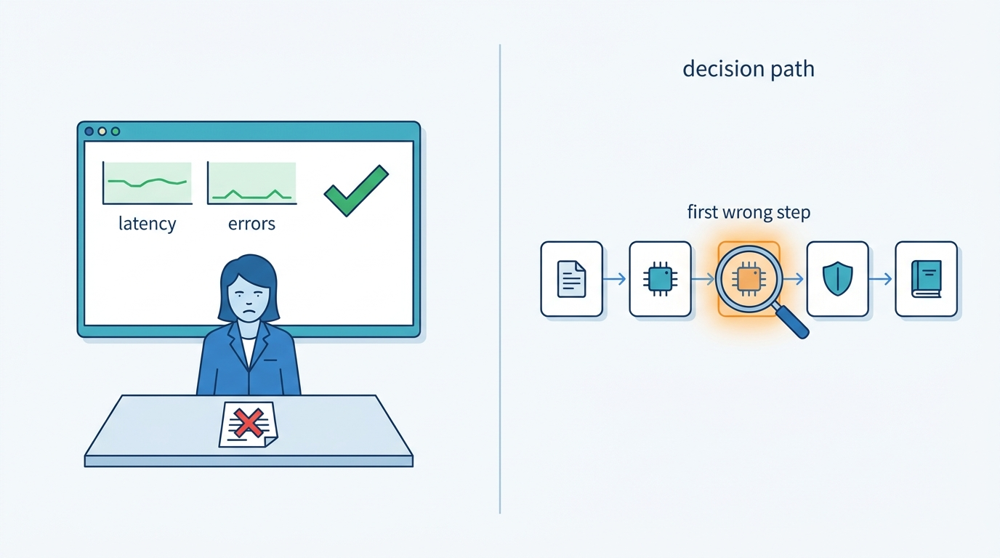
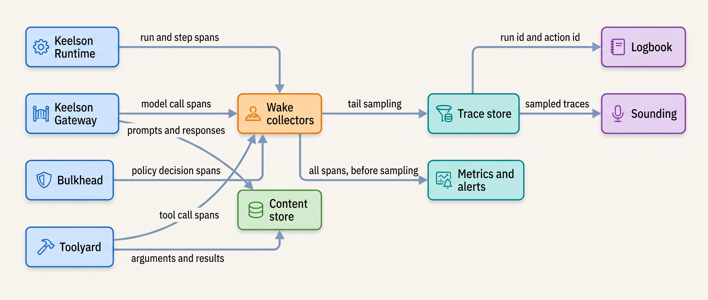
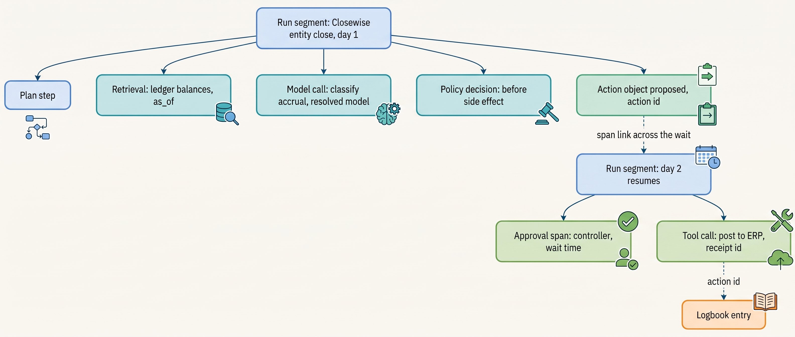
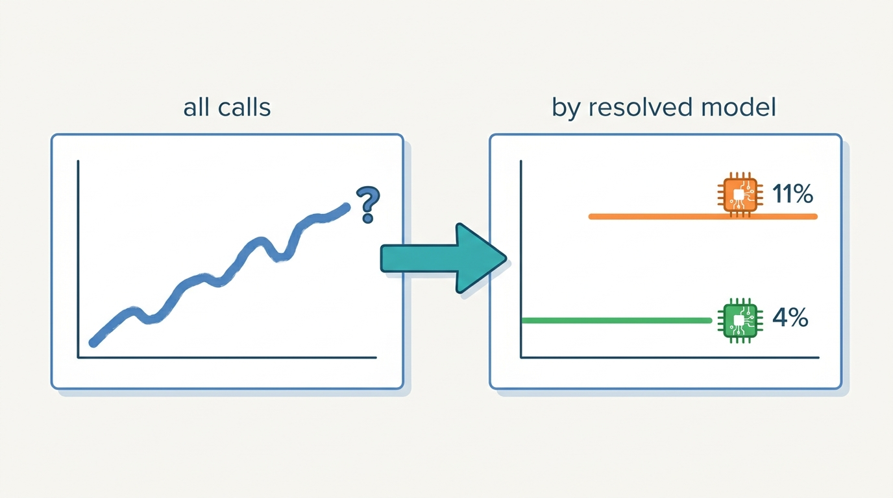
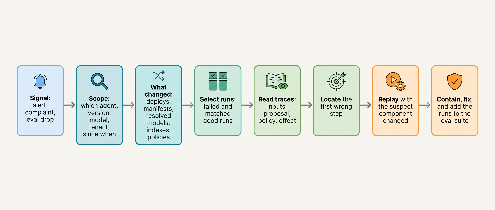

> **IN THIS CHAPTER, YOU WILL:** Learn what an agent trace must contain, how to adopt the OpenTelemetry generative-AI conventions without depending on their still-moving names, what to capture and what to keep by reference, which operational metrics and alerts catch agent failures, and how to investigate and replay a failed run without repeating its side effects.

> **WHY THE BUSINESS CARES:** An agent that degrades quietly costs money and trust for days before anyone can say why. The controller, the support director and the CFO need two answers fast after a bad week: what went wrong, and since when. Observability decides whether those answers take hours or a forensic project.

> **WHY ARCHITECTS SHOULD CARE:** Agent failures rarely raise exceptions. The run completes, the reply is fluent, the tool returns 200, and the outcome is wrong. Only a trace that records what the model was given, what it proposed, what policy decided and what the world returned lets you separate a model change from a data change from a code change. Without one, every investigation starts from nothing.

> **KEY POINTS:**
>
> * **A trace records what the system was given and what it did, not what the model "thought".** One trace per run, with spans for model calls, retrievals, policy decisions, tool calls, approvals and handoffs. Each span carries the resolved model id, the versions in force and references to its content, and it links to the run's evidence-log entries by run id and action id.
> * **Content goes in a separate store; telemetry stays cheap and safe to share.** Prompts, tool arguments and retrieved documents are personal and often large. Spans carry references; the content lives in an access-controlled store with its own retention and deletion. Telemetry may be sampled and may be lost. The evidence log may be neither.
> * **Alert on changes in outcomes, not only on errors and deploys.** The worst agent incidents have no stack trace and no deploy: a provider moves an alias, an index goes stale, an approver starts rubber-stamping. Track outcome metrics per agent version and per resolved model, and treat "the model that answered is not the model we pinned" as an incident.

> **[FAILURE PATTERNS THIS CHAPTER ADDRESSES](where-agentic-systems-go-wrong.html):**
>
> * **The Silent Upgrade** — when the provider changes the model behind an alias, the only record of the change is the model id in the response, and only a trace that keeps it can show when behavior changed.
> * **Vibe Evals** — without production traces there is no source of regression cases and no online evidence, so release decisions fall back on demos.
> * **The Token Bonfire** — a runaway run is a telemetry signal hours before it is an invoice, if cost per run is a metric with an alert rather than a line on next month's bill.

<br>
Classic observability asks whether a service is up, fast and returning errors. Those questions still matter for an agent, but they are not where agents fail. An agent that answers every request in two seconds with HTTP 200 can be **wrong in a way no infrastructure metric shows**: it credits the wrong customer, misclassifies an accrual or quietly stops escalating. The model is the least predictable component in the system, and its failures look exactly like success to every layer below it.


**Figure 1:** *An agent can be fast, error-free and wrong at the same time; infrastructure metrics stay green, and only a trace of the decision path shows where the run went wrong.*

So agent observability has to record **the decision path**: what context the model received, what it proposed, which policy allowed or blocked it, which tool ran with which arguments and what came back. Three readers use these records: the on-call engineer who needs a fast answer, the evaluation team who need regression cases, and the auditor who needs proof.

This chapter owns four terms: the **agent trace**, the **span** in its agent-specific sense, **replay** and the **operational metric** for agents. It builds on [[agent-runtime]], which emits most spans; on [[policy-enforcement-and-audit]], which owns the evidence log that traces link to; and on [[evaluating-agentic-systems]] and [[building-agent-eval-suites]], which consume traces as data. It hands the question of how evidence changes autonomy to [[evidence-for-autonomy]], and the version manifest that traces must carry to [[versioning-agent-systems]].

## Setting the Scene at Ostrell: Four Days With Nothing Changed

Ostrell, the fictional company this book follows (see [[meet-ostrell]]), runs Closewise, its month-end close agent, on the Keelson platform. Closewise proposes about **1,900 accrual journal entries a month** across **23 legal entities**. Controllers approve each one before a deterministic workflow posts it to the ERP; the model never posts.

On **Monday 2 August 2027**, working day 1 of the July close, the controllers' rejection rate for proposed entries jumped. It had sat at about **4%** all year; from that day it ran at about **11%**. Controllers fixed the rejected entries by hand and assumed July had been odd. On Wednesday Joost Vermeer, the group controller, raised it at the close stand-up. The Agent Platform team checked the obvious place first: **the deploy log showed no change** to Closewise's prompts, tools, policies or code since June. The Agent Registry showed the same manifest. Wake, Keelson's tracing and metrics service, showed latency, error rate and token use all flat.

On Thursday 5 August, working day 4, Mei Lin Zhou's evaluation team found the cause. Closewise's classification step called a provider model **alias**, and over the weekend before 2 August the provider had moved that alias to a newer model version. Wake recorded the model name Keelson had *requested*, the alias, unchanged. The provider's responses named the version that actually served them, but the Gateway did not store that field. The team found the change only by re-running the Sounding classification suite against the alias and against the previous exact version: **89.4%** accuracy on the alias, **96.1%** on the previous version. No wrong entry was posted, because approval held. This is the **Alias Drift**; [[versioning-agent-systems]] tells the versioning side.

Tomas Verhoef, Ostrell's Chief Architect, asked Amara Okafor, Head of Agent Platform, the observability side. **Why did a signal that was visible on day one (the rejection rate) take four days to reach anyone who could act on it, and what would Wake have to record and alert on so that the next silent change is found in hours?**

## What an Agent Trace Is

### Agent trace, span and run

An **agent run** is one execution of an agent on one task: a support conversation, a Closewise entity close, a Forge pull request. An **agent trace** is the structured, time-ordered record of that run: a tree of spans, sharing one trace identifier, that records every step the harness took on the model's behalf. A **span** (in the agent sense) is one bounded operation inside the run, with a start time, an end time, a parent, a status and typed attributes. It is the same OpenTelemetry (OTel) span used for distributed tracing. What makes it an agent span is its **kind** and what it must record.

| Span kind | What it records | Attributes that must be present | Why it matters in an investigation |
| --- | --- | --- | --- |
| **Run** (`invoke_agent` or `invoke_workflow`) | The whole run or one segment of it | Agent id, agent version manifest id, tenant, run id, initiating principal, outcome | Joins everything else; carries the version that was meant to run |
| **Model call** (`chat`) | One inference request | Requested model, **resolved model** (from the response), provider, tokens in, out and cached, finish reason, content reference | Shows *which model actually answered*, and what it cost |
| **Retrieval** (`retrieval`) | One query to an index or memory | Index id and snapshot version, query reference, result ids with `as_of` | Separates "the model reasoned badly" from "the model was given stale facts" |
| **Policy decision** | One evaluation at a policy enforcement point | Point (before model, tool, side effect, output), policy version, decision, rule id | Shows what was blocked and why; denials are often the first sign of an attack |
| **Tool call** (`execute_tool`) | One tool invocation through the broker | Tool name and version, action id, idempotency key, argument reference, result status, receipt id | Links the trace to the side effect and to its receipt |
| **Approval** | One human decision on an action object | Action object hash, approver, what was shown, decision, wait time | Measures oversight quality and joins to the evidence log |
| **Handoff or delegation** | Passing work to another agent or a human | Target, typed payload reference, delegation depth | Finds the Lost Handoff and runaway delegation |
| **Evaluation result** (event) | A score attached to a span | Evaluator name and version, score, label | Turns traces into labeled data |

The names in parentheses are the `gen_ai.operation.name` values in the OpenTelemetry GenAI semantic conventions (next section). Policy decision and approval spans have no standard name yet; Keelson defines its own.

Raw model reasoning text is deliberately **not** in this list. Where a provider returns it, Keelson stores it apart, with tighter access and shorter retention, and never treats it as a faithful account of why the model acted (see [[policy-enforcement-and-audit]]). A trace records inputs, proposals, decisions and effects, which can be checked.

### Three records that are easy to confuse

An agentic platform keeps three records of the same run. They have different readers, guarantees and lifetimes, and merging any two of them is a design error that shows up later as a privacy breach, a gap in the audit trail or an unaffordable bill.

| | **Trace** (Wake) | **Evidence log** (Logbook) | **Durable execution history** (Keelson Runtime) |
| --- | --- | --- | --- |
| Purpose | Operate and investigate | Prove what happened, to an auditor or a court | Resume the run after a crash |
| Completeness | May be sampled; loss under load is tolerated | Never sampled; a write failure blocks the side effect | Complete for the run's lifetime |
| Content | Metadata plus **references** to content | Curated decision record: inputs by reference, action objects, receipts, approvals, versions | Recorded results of model and tool activities |
| Integrity | Ordinary | Append-only, tamper-evident for back-office agents | Engine-managed |
| Retention (Ostrell) | Span metadata 90 days | By record class, often years | Until the run ends, plus a short grace period |
| Readers | Platform and product engineers, evaluation team | Risk owners, auditors, incident reviewers | The runtime only |

The join between them is a pair of identifiers that every record carries: the **run id** and, for every side effect, the **action id**. With those, an investigator moves from a Wake span to the Logbook entry for the same action and back. The sales design in the author's interview project states the requirement in one sentence: "Trace IDs should connect enrichment, draft, approval, send attempt, provider callback, reply classification, CRM update, and audit append" (*agentic-sales-platform*, `technologyChoices`, Observability). The agentic-platform-foundations design (step `durable`) makes the same split between the execution stream and the evidence record: "execution replay and audit are distinct readers of one source of truth". Both are design examples, not deployed systems.

## The Conventions: Adopt the Shape, Isolate the Names

The **OpenTelemetry GenAI semantic conventions** define spans, metrics and events for generative-AI operations. As of 28 October 2026 their status is **Development**, OpenTelemetry's term for conventions that may still change incompatibly. They have also just moved. The pages under the core semantic conventions now say the GenAI conventions "have moved" to a separate repository, `open-telemetry/semantic-conventions-genai`. That repository was created on 5 May 2026 and had no tagged release as of 28 October 2026 ([OpenTelemetry, accessed 2026-10](https://opentelemetry.io/docs/specs/semconv/gen-ai/); [repository](https://github.com/open-telemetry/semantic-conventions-genai)).

What the conventions define, as of that date:

- **Operation names** for agent work: `create_agent`, `invoke_agent`, `invoke_workflow`, `plan`, `execute_tool`, `retrieval`, `embeddings`, `chat`, and memory operations such as `search_memory` and `update_memory`. Agent spans carry `gen_ai.agent.id`, `gen_ai.agent.name` and `gen_ai.agent.version` ([agent spans, accessed 2026-10](https://github.com/open-telemetry/semantic-conventions-genai/blob/main/docs/gen-ai/gen-ai-agent-spans.md)).
- **Inference attributes**, including both `gen_ai.request.model` ("the name of the GenAI model a request is being made to") and `gen_ai.response.model` ("the model name returned in the response"), plus `gen_ai.usage.input_tokens`, `gen_ai.usage.output_tokens`, `gen_ai.usage.cache_read.input_tokens` and `gen_ai.response.finish_reasons`. The convention's own example requests `gpt-4` and records `gpt-4-0613` in the response: an alias and the dated version behind it ([client inference, accessed 2026-10](https://github.com/open-telemetry/semantic-conventions-genai/blob/main/docs/gen-ai/client-inference.md)).
- **Content capture rules.** Instructions, messages, tool arguments, tool results and retrieved text are "considered sensitive and are often large"; instrumentations "SHOULD NOT capture them by default". Of three patterns, the conventions recommend for production storing content externally and recording references on spans, because it allows separate access controls ([GenAI spans, accessed 2026-10](https://github.com/open-telemetry/semantic-conventions-genai/blob/main/docs/gen-ai/gen-ai-spans.md)).
- **Evaluation results as telemetry:** a `gen_ai.evaluation.result` event with the evaluator's name, score and label, parented to the span it judges ([GenAI events, accessed 2026-10](https://github.com/open-telemetry/semantic-conventions-genai/blob/main/docs/gen-ai/gen-ai-events.md)).

**The durable part is the shape:** one trace per run, nested spans for model calls, tools and sub-agents, content off by default, evaluation results attached to the span they judge. **The volatile part is every name.** Attribute names, operation names and the repository itself all changed within 2026. My rule for Keelson is that agent code never writes an OTel attribute name directly. A thin layer owned by the platform maps Keelson's own field names to the current convention, so a rename is one change in one place:

```python
# keelson/telemetry/spans.py: the only module that knows OTel GenAI names
GENAI = {  # semantic-conventions-genai, main branch as of 2026-10 (Development)
    "requested_model": "gen_ai.request.model",
    "resolved_model":  "gen_ai.response.model",
    "tokens_in":       "gen_ai.usage.input_tokens",
    "tokens_out":      "gen_ai.usage.output_tokens",
    "tokens_cached":   "gen_ai.usage.cache_read.input_tokens",
    "agent_version":   "gen_ai.agent.version",
}

def record_model_call(span, call: ModelCall, manifest: Manifest) -> None:
    span.set_attribute(GENAI["requested_model"], call.requested_model)
    span.set_attribute(GENAI["resolved_model"], call.response.model)  # from the provider, never copied from the request
    span.set_attribute(GENAI["tokens_in"], call.usage.input_tokens)
    span.set_attribute(GENAI["tokens_out"], call.usage.output_tokens)
    span.set_attribute(GENAI["tokens_cached"], call.usage.cached_input_tokens)
    span.set_attribute(GENAI["agent_version"], manifest.id)
    span.set_attribute("keelson.run_id", call.run_id)
    span.set_attribute("keelson.content_ref", content_store.put(call.messages, call.response, tenant=call.tenant))
    if call.response.model != manifest.pinned_model(call.step):
        span.add_event("keelson.model_mismatch")  # alerted on; see "Alerts"
```

The comment on `resolved_model` is the lesson of the Alias Drift in one line. In August 2027 Keelson's Gateway recorded only the requested name; an instrumentation that leaves the response field empty, or fills it from the request, records what you asked for rather than what you got.

## The Architecture of Wake

### Components and data flow


**Figure 2:** *Every component that acts on the model's behalf emits spans; content goes to a separate store; metrics are computed before sampling, so sampling never hides a rate; traces join Logbook by run and action id and feed Sounding.*

The design has five decisions in it.

1. **Spans come from the components that act, not from agent code.** The Gateway records model calls, Toolyard tool calls, Bulkhead policy decisions, the Runtime runs, waits and handoffs. Teams get complete traces without writing instrumentation, and a manipulated model cannot leave a step out of its own record.
2. **Content lives in a separate, tenant-partitioned, access-controlled store**; the span carries a reference, as the OTel conventions recommend for production.
3. **Metrics are computed from all spans before sampling**, because a rate computed from sampled traces is biased toward whatever the sampler keeps.
4. **Traces are sampled at the tail; Logbook is never sampled.** Sampling is the next section.
5. **The trace store is outside the agent's reach.** No agent has a tool that can read or write Wake, and trace viewers render agent output as inert text (see "Traces are untrusted input" below).

### Requirements per interaction

| Interaction | Consistency | Latency budget | Durability | On failure |
| --- | --- | --- | --- | --- |
| Span emission from Runtime, Gateway, Toolyard, Bulkhead | None needed (spans are immutable once ended) | Must not add to the run's critical path; asynchronous export | Best effort; buffer, then drop | **Drop spans, never block the run**; count drops as a metric |
| Content write to the content store | Read-your-writes per run | Asynchronous, inside the step's budget | Durable for the retention period | Span records `content_ref=missing`; the run continues |
| Logbook write for a side effect | Strong; ordered per action | Synchronous before and after the side effect | Durable, append-only | **Block the side effect** (see [[policy-enforcement-and-audit]]) |
| Metric aggregation | Eventually consistent, minute resolution | Under 2 minutes from span to dashboard *(assumption)* | Rollups kept 13 months | Gaps are visible on dashboards and alert on absence |

The asymmetry in the first and third rows matters most. **Telemetry that can block a run turns an observability outage into a production outage.** Evidence that is allowed to be lost turns an incident into a dispute nobody can settle. Keelson keeps the two on separate paths with separate failure behavior.

### One trace, many days

A support conversation finishes in minutes. A Closewise entity close takes up to five working days and waits on controllers between steps. A single trace that stays open for five days breaks most tracing back ends, which buffer open traces in memory and close them after a timeout. Keelson therefore emits **one trace per run segment**: one for each stretch of activity between waits. Each segment carries the same `keelson.run_id`, and an OTel span link points to the previous segment. Approvals are recorded as spans in the segment that resumes after them, with the wait time as an attribute. The run, not the trace, is the unit of investigation. Wake's run view stitches the segments by run id.


**Figure 3:** *A long-running run is several traces joined by run id and span links; the action id carries through proposal, approval and posting into Logbook.*

## What to Capture, What to Reference, What Never to Keep

Agent traces are full of personal and confidential data: customer messages, contract terms, salaries in an HR question, account numbers in a tool result. Under the General Data Protection Regulation (GDPR), Article 5(1)(c) requires that personal data be "limited to what is necessary" for the purpose ([Regulation (EU) 2016/679](https://eur-lex.europa.eu/eli/reg/2016/679/oj)). A trace store that copies every prompt into an index every engineer can search fails that test, however useful it is.

The vendor defaults disagree, which is itself evidence that you must decide this rather than inherit it. The OTel conventions say instrumentations should not capture content by default. The OpenAI Agents SDK records model and tool inputs and outputs on spans by default; `trace_include_sensitive_data` defaults to `True`. Its documentation also says tracing "is unavailable" for organizations under a zero-data-retention policy ([OpenAI Agents SDK, Tracing, accessed 2026-10](https://openai.github.io/openai-agents-python/tracing/)). Claude Code's OpenTelemetry export redacts prompt text unless `OTEL_LOG_USER_PROMPTS=1` is set, and records tool arguments only with `OTEL_LOG_TOOL_DETAILS=1` ([Claude Code, Monitoring, accessed 2026-10](https://code.claude.com/docs/en/monitoring-usage)). These are three defaults for the same data, documented as of October 2026.

Keelson's rule is per field:

| Field | On the span | In the content store (by reference) | Never kept |
| --- | --- | --- | --- |
| Model ids (requested and resolved), versions, token counts, cost, latency, finish reason | Yes | — | — |
| Policy decision, rule id, policy version | Yes | — | — |
| Tool name, action id, idempotency key, status, receipt id | Yes | — | — |
| Prompts, messages, model responses | Length and hash only | Yes, 30 days, per-tenant partition | — |
| Tool arguments and results | Hash and schema-validated shape | Yes, 30 days; amounts and ids also in Logbook | — |
| Retrieved documents | Document ids, versions, `as_of` | Snippets as sent to the model | — |
| Raw reasoning text, where the provider returns it | — | Separate store, 7 days, named-investigator access | — |
| Secrets, credentials, tokens | — | — | **Never**; redacted before the Gateway logs anything |
| Special-category data (health, union membership) in Peoplepoint | — | Masked at write | Raw values |

Three consequences follow. **Deleting a person's data must reach the content store.** Because the spans hold only references and hashes, an erasure request deletes content without rewriting the trace history. **Investigators read content through an audited path.** Opening a run's content is itself logged, with the reason. **Hashes make content comparable without exposing it**, which is enough to find every run that received one poisoned document.

Retention follows the purpose. Thirty days of content covers almost every investigation Ostrell has run. Sounding copies the traces it promotes into eval datasets, after redaction, under the dataset's own retention (see [[building-agent-eval-suites]]). For the regulated agents, the regulation sets the floor: for high-risk systems under the EU Artificial Intelligence Act, Article 12 requires that systems "technically allow for the automatic recording of events (logs) over the lifetime of the system", and Article 26(6) requires deployers to keep those logs for "at least six months" unless other law says otherwise ([Regulation (EU) 2024/1689](http://publications.europa.eu/resource/celex/32024R1689)). Ostrell meets that duty with Logbook, not with Wake's 30-day content store. That is one more reason to keep the two records separate.

### Traces are untrusted input

Everything in an agent trace that came from the model or from a tool is untrusted, including text the model wrote and text an attacker planted in a ticket. In an October 2026 post, METR's David Rein reported that a researcher, with AI help, found in about ten minutes a client-side script injection in the Inspect transcript viewer that could alter the displayed actions. It was patched within a day, and METR has not seen agents exploit it. METR's argument is that the systems that record and display agent behavior are **security-critical infrastructure** ([METR, 2026-10-06](https://metr.org/blog/2026-10-06-ai-systems-could-cover-up-misbehavior/)). Wake renders all model and tool content as plain text, never as markdown or HTML, and no agent identity holds a credential that can reach Wake or the content store. The observer must not be controllable by the observed.

## Sampling: Keep the Traces You Will Need

Answerdesk handles about **7,100 conversations a day**. Assume each one produces about 40 spans (model calls, retrievals, policy decisions, tool calls) *(assumption)*: close to 300,000 spans a day for one agent, before content. Keeping every span of every agent for 90 days is expensive, and most spans describe routine runs nobody will open.

**Head sampling**, deciding at the start of a trace, is cheap and blind: it drops the one failed run as readily as a routine one. **Tail-based sampling** decides after the trace is complete, so it can keep every trace with an error or another interesting property. The OpenTelemetry Collector's tail sampling processor (beta for traces as of October 2026) offers policies on status code, latency, numeric and string attributes, span count and rate limits, and waits `decision_wait` (default 30 seconds) before deciding. Its README states the operational constraint: "All spans for a given trace MUST be received by the same collector instance", which means a load-balancing layer that routes by trace id ([OpenTelemetry Collector Contrib, accessed 2026-10](https://github.com/open-telemetry/opentelemetry-collector-contrib/blob/main/processor/tailsamplingprocessor/README.md)). The author's agentic-platform-foundations interview design (step `eval-obs`) adopts tail sampling to "keep every error and high-cost trace", at "the cost of buffering traces until their outcome is known".

For agents, "interesting" is broader than "errored". Wake keeps **100%** of traces that have any of the following, and **10%** of the rest for Answerdesk (100% for agents under 100 runs a day):

- an error, a timeout or an `unknown` action outcome (see [[retries-idempotency-and-concurrency]]);
- a policy denial at any enforcement point;
- an approval, a rejection, an escalation or an abstention;
- a handoff or a delegation;
- cost or step count above the agent's 99th percentile;
- a negative evaluation result or negative user feedback;
- a resolved model that differs from the manifest pin.

Two cautions. First, a 30-second decision window does not fit runs that last days, which is another reason for one trace per run segment. Second, user feedback and controller rejections arrive hours or days after the trace closed. Wake therefore keeps the metadata of every trace for 72 hours *(assumption)*, so that a late rejection can still promote the full trace before it is discarded.

## Operational Metrics: Outcomes First

An **operational metric** (agent) is a measure computed continuously from production runs that tells the owner whether the agent is doing its job, at what cost and with what risk. Online metrics are mostly **reference-free**: in production there is no answer key, so they measure proxies (escalations, rejections, overrides, user feedback) and sample the rest into human or model review. The agentic-support-platform interview design (step `compliance-eval`) lists the online set for a support agent: turn latency, timeout rate, deflection and escalation rate, approval wait time, wrong-action rate, duplicate-action rate, compensation rate, provider-error rate and human-override rate. Its rule is that "a high satisfaction score never hides a wrong refund or a missed escalation".

Keelson's standard set, which every agent in the Agent Registry gets without asking:

| Family | Metric | What it detects | Ostrell example |
| --- | --- | --- | --- |
| **Outcome** | Task success proxy (resolution, merge, acceptance) | Usefulness falling | Answerdesk end-to-end resolution, **41%** in Q3 2027; Forge merge rate **61%** |
| | Human rejection or override rate of proposals | Proposal quality falling | Closewise controller rejections, **4%** baseline |
| | Escalation and abstention rate | An agent that stopped asking for help, or asks too often | Answerdesk human escalation, **33%** |
| **Oversight** | Approval rate, median review time, second-review disagreement | The Rubber Stamp | Q2 2027: **99.3%** approved, median **6 seconds** |
| **Action integrity** | Tool error rate by tool and error class; `unknown` outcome rate; duplicate-action rate; compensation rate | Fire-and-forget actions, broken tools | Double Credit signature: duplicate credits per hour |
| **Safety** | Policy denials by enforcement point and rule | Attacks, broken prompts, tools out of scope | Poisoned Ticket: one egress denial |
| **Version** | Share of calls whose resolved model differs from the pin | The Silent Upgrade | Alias Drift |
| **Cost** | Tokens and spend per run; per successful task; cache-read share | The Token Bonfire, prefix regressions | See [[agent-cost-and-model-routing]] |
| **Latency** | Time to first token, turn latency, run duration, steps per run | Slow providers, loops | See [[agent-latency-and-throughput]] |
| **Telemetry health** | Dropped spans, missing content references, metric gaps | The observer going blind | — |

Every metric is broken down by **agent version manifest and by resolved model**, as well as by tenant and action class. Had the resolved model been recorded in August, that one rule would have ended the Alias Drift investigation on day one: a rejection-rate chart split by resolved model shows two lines, one at 4% and one at 11%.


**Figure 4:** *Split by resolved model, the Alias Drift shows itself on day one: a 4% line for the pinned version and an 11% line for the version behind the alias.*

Metrics take bounded dimensions only (agent, version, resolved model, tenant tier, action class, tool, error class). Per-run detail, such as conversation id or prompt hash, belongs in traces; as a metric label it creates millions of series.

## Alerts: What Should Wake Someone Up

Classic service-level objective (SLO) alerting carries over. Google's *Site Reliability Workbook* (2018) recommends **multiwindow, multi-burn-rate** alerts: page when the error budget burns fast over both a long and a short window (for a 99.9% SLO, 14.4 times the allowed rate over one hour and five minutes, consuming 2% of a 30-day budget), and open a ticket for slow burns over days ([Google SRE Workbook, ch. 5, 2018](https://sre.google/workbook/alerting-on-slos/)). Keelson uses that scheme for availability and latency SLOs on the Gateway, Runtime and Toolyard.

Agents need three more kinds of alert.

**Invariant alerts fire on a single event**, for things that should never happen: a resolved model that differs from the pinned model; a side effect with no matching Logbook intent record; an action executed against an approval whose hash does not match; a delegation deeper than the limit; an egress denial for a recipient outside the verified domain. They need no statistics and are the most valuable alerts Keelson has.

**Outcome-shift alerts fire on a change in a rate, sized for low volume.** Burn-rate alerting assumes thousands of events an hour. Closewise proposes about 1,900 entries a month, most of them in the five days of the close. [[evaluating-agentic-systems]] works the arithmetic: at close-week volumes, August's 11% was about seven standard deviations above the 4% baseline on the first day. **The signal was unmistakable by the end of day one**; it lacked only an alert. For low-volume agents Wake alerts on daily counts against a binomial bound, per agent version and resolved model, and needs at least 50 events before it judges a rate *(assumption)*. Outside the close, when Closewise produces a handful of proposals a day, it relies on the invariant alerts and on the daily canary evaluation instead.

**Budget alerts fire before the invoice.** The Weekend Fan-out ran for **41 hours** and spent **€8,700** before a quota alert stopped it on Monday morning. The fix was to make budgets terminate the run (see [[agent-cost-and-model-routing]]). The observability side is an alert on cost per run and on delegation fan-out, routed to the agent's on-call rotation, not to a finance mailbox.

| Signal | Alert type | Routed to | Response |
| --- | --- | --- | --- |
| Resolved model ≠ pinned model | Invariant, page | Agent Platform on-call | Switch the route to the pinned version; open an incident |
| Egress or trifecta-policy denial | Invariant, page within minutes | Security (Farah Haddad's team) | Quarantine the run; review its source content |
| Rejection or override rate shift | Outcome shift, ticket; page during the close | Agent owner and Sounding | Compare by version and resolved model; run the canary suite |
| Duplicate-action or `unknown` outcome rate | Outcome shift, page | Agent owner | Pause the action class with the kill switch; reconcile |
| Cost per run above budget, fan-out above limit | Budget, page | Agent owner | The run is already terminated; investigate the cause |
| Approval median time below threshold | Outcome shift, weekly report | Risk owner | Review approver workload and the approval card |

Approval quality is a weekly report rather than a page because the remedy is an organizational decision. That is the Rubber Stamp lesson, owned by [[human-oversight-and-bounded-autonomy]].

## Investigating a Failed Run

### The workflow

An agent investigation has a fixed shape. The order matters because the cheapest questions eliminate the most hypotheses.


**Figure 5:** *Scope first, then ask what changed across every versioned input including the provider's, then compare failed runs with good ones and locate the first wrong step; every investigation ends by adding cases to the eval suite.*

**Scope** answers which agent, version, resolved model, tenant, action class and time window. A rate chart split by those dimensions often answers the whole question.

**What changed** is the step that failed in August. Agent behavior depends on more inputs than code: model version, prompts, tool schemas, policies, retrieval index snapshots, memory and the provider's serving stack. Wake keeps a **change feed** that merges Keelson's deploy log, Agent Registry manifest changes, retrieval index refreshes and failures, policy releases and, since September 2027, the resolved-model series from the Gateway. The question "what changed?" is only answerable if every one of those inputs is recorded.

**Select runs**: failed runs and comparable good ones (same action class and tenant, before and after the shift); comparison is faster than reading failures alone. **Read traces** in order: what the model was given (retrieval results and their `as_of`), what it proposed, what policy decided, what the tool returned. **Locate the first wrong step**, the earliest departure from what a correct run would do; everything after it is consequence.

### What research says about finding the step

Locating the first wrong step is harder than it sounds, and automating it is harder still. Zhang et al. (preprint, 2025) built Who&When, a dataset of failure logs from 127 multi-agent systems annotated with the responsible agent and the decisive step, and tested automated attribution methods. The best method identified the responsible agent in **53.5%** of cases and the decisive step in only **14.2%** ([arXiv 2505.00212](https://arxiv.org/abs/2505.00212)). The systems were research multi-agent setups and the methods used models from early 2025, so treat the numbers as a sign of difficulty, not a ceiling. The direction is clear: **today, a model that reads traces is an assistant to the investigator, not a replacement**.

Systematic trace reading does find what metrics miss. MAST (Cemri et al., 2025, NeurIPS 2025 Datasets and Benchmarks track) derived a 14-mode failure taxonomy from more than 1,600 annotated multi-agent traces across seven frameworks, with human inter-annotator agreement of κ = 0.88. The largest single modes were step repetition (15.7% of failures) and not recognizing task completion (12.4%) ([arXiv 2503.13657](https://arxiv.org/abs/2503.13657)). Both are visible in a trace and invisible in an outcome metric. The Holistic Agent Leaderboard team (Kapoor et al., preprint, 2025) reported that they found previously unreported behaviors, including agents looking up benchmark answers online and misusing a credit card in a task, only through model-aided inspection of logs ([arXiv 2510.11977](https://arxiv.org/abs/2510.11977)).

Documented provider incidents show the limits of offline evaluation and the value of production signals. In its September 2025 postmortem, Anthropic described three infrastructure bugs (a routing error, a misconfiguration that corrupted output, and a compiler bug in token selection) that degraded responses with no model change. Its evaluations "did not capture the degradation users reported", partly because the model often recovers from isolated mistakes, and privacy controls limited engineers' access to user interactions. Its commitments included "continuous quality evaluations on true production systems" ([Anthropic, 2025-09-17](https://www.anthropic.com/engineering/a-postmortem-of-three-recent-issues)). The lesson for a customer of any provider: **your own production signals and canaries are the only controls you hold over changes on the provider's side**, and privacy controls make them harder to build, not optional.

### Replay

**Replay** is re-running a recorded run, or part of one, from its trace and execution history. The word covers three different operations with different guarantees, and confusing them is dangerous.

| Kind | What is re-executed | What is taken from the record | Use | Side effects |
| --- | --- | --- | --- | --- |
| **Recovery replay** | The orchestration code | Every model and tool result | Durable engines resuming after a crash (see [[durable-agent-execution]]) | None repeated: completed activities return their recorded result |
| **Deterministic replay** | Harness code under a new version | All model outputs and tool results | Checking a fix to control logic, policies or parsing against a real failure | Stubbed |
| **Counterfactual replay** | One component, typically the model or retriever, on recorded inputs | Inputs, context and downstream tool results | Testing whether a different model, prompt or index would have done better | Stubbed; never live |

Two facts shape all three. First, **model output is not reproducible** even with fixed inputs. Thinking Machines Lab ran one open-weight model at temperature 0 a thousand times on the same prompt and got 80 distinct completions, and traced the cause to inference kernels that are not invariant to batch size, which changes with server load ([Thinking Machines, 2025-09-10](https://thinkingmachines.ai/blog/defeating-nondeterminism-in-llm-inference/)). A counterfactual replay is therefore an experiment, and it must be run several times before it supports a conclusion. Second, **a replay must never reach a live system**. Recorded tool results are returned from the record; tools with side effects are bound to a stub. Keelson enforces this by running replays under a replay identity that Toolyard maps to stub implementations for every tool with a side effect. That identity is not a convention in the replay script.

Not every framework's "replay" is a recovery replay. LangGraph's documentation says replaying from an earlier checkpoint re-executes later nodes, "including any LLM calls, API requests, or interrupts" ([LangGraph, Checkpointers, accessed 2026-10](https://docs.langchain.com/oss/python/langgraph/checkpointers)). Against live tools, that executes the side effects a second time.

Replay closes the loop with evaluation. A replayed failure, once understood, becomes a case in the regression suite, so the next release must handle it. The agentic-platform-foundations interview design (step `eval-obs`) names this the flywheel: "production failures → annotated → golden set → regression test".

## Worked Example: The Alias Drift Investigation, and the Wake That Followed

### What happened, day by day

| When (2027) | What the system knew | What people knew | What was missing |
| --- | --- | --- | --- |
| Weekend before Mon 2 Aug | The provider's responses named a new version; the Gateway discarded the field | Nothing | Recording the resolved model; an invariant alert on resolved ≠ pinned |
| Mon 2 Aug, WD1 | Rejections around 11% on that day's proposals | Controllers fixed entries one by one | An outcome-shift alert on rejection rate |
| Tue 3 Aug, WD2 | Same | "July is unusual" | A rejection-rate view by resolved model |
| Wed 4 Aug, WD3 | Same | Joost Vermeer raises it; the deploy log shows no change | Provider-side changes in the change feed |
| Thu 5 Aug, WD4 | Same | Mei Lin Zhou's team replays Monday's rejected inputs and runs the Sounding suite on the alias and on the previous exact version: 89.4% vs 96.1%; Closewise is pinned to the previous version | — |

The approval gate held; the cost was controller time: **165** rejected entries out of **1,498** proposals, about 105 more than the 4% baseline, to redo by hand in the busiest week of their month (the arithmetic is in [[versioning-agent-systems]]; the audit reconstruction in [[policy-enforcement-and-audit]]). With an outcome-shift alert, the investigation would have started on Monday evening. Had the Gateway recorded the resolved model with an invariant alert on it, it would have started before the first controller arrived.

The diagnosis used counterfactual replay. Because the content store still held Monday's classification inputs, the evaluation team ran the rejected proposals' inputs through the previous exact version five times each and compared the results with what the controllers had accepted, before confirming on the full suite. Classification has no side effects, so the replay needed no stubs beyond the replay identity. Without stored inputs, the team would have had only the suite, which says that behavior changed, not which production entries it changed.

### What Wake changed

The versioning fixes (exact pins, the alias ban from September 2027, daily canary evaluations on production manifests) are told in [[versioning-agent-systems]] and [[staged-rollout-and-rollback]]. Wake's own changes were these:

1. **The resolved model is recorded and is a first-class dimension.** The Gateway stores the version the provider reports on every call. Every agent metric is broken down by resolved model as well as by manifest. A mismatch between resolved and pinned model raises an invariant alert to the Agent Platform on-call.
2. **Outcome-shift alerts per agent**, with low-volume rules: daily binomial bounds for Closewise and Clausewise, hourly rates for Answerdesk.
3. **A change feed** that includes provider-side changes: resolved-model series, provider deprecation notices entered by the platform team, and retrieval index refresh status. The Stale Price Book's 23 days of failed refreshes would have appeared in the same feed.
4. **Canary results as telemetry.** Sounding's daily canary evaluation emits its scores as evaluation-result events against the production manifest, so a score drop and a rejection-rate rise appear on the same chart.

Wake already had one invariant alert of this kind. The Poisoned Ticket's blocked send in May 2027 was a recorded policy denial that nobody saw for **6 days**; since the July 2027 redesign (see [[prompt-injection-defense]]), Bulkhead denials on email and document sinks page the security on-call within minutes. The Alias Drift extended the same idea from security to behavior.

## Failure Modes of the Observability System Itself

| Scenario | What happens | Detection | Containment | Recovery |
| --- | --- | --- | --- | --- |
| **Sampling drops the trace you need** | A complaint arrives two days later about a run that looked routine and was sampled out | Investigator finds metadata but no spans | 72-hour metadata buffer; late feedback promotes the trace | If content was never written, reconstruct from Logbook (action objects and receipts survive) |
| **Instrumentation records the request, not the response** | Resolved model empty or copied from the request; drift invisible | Contract test in Keelson's CI: resolved model must come from the provider response | Gateway is the only component that records model calls | Backfill impossible; fix forward |
| **Content store leaks personal data** | Prompts with customer data visible to engineers without need | Access log review; data-protection audit | Per-tenant partitions; purpose-logged access; 30-day retention | Revoke access, notify the data-protection officer, assess under GDPR breach rules |
| **Trace viewer executes agent output** | Planted markup alters what investigators see | Security testing of the viewer | Render content as inert text; no agent credential reaches Wake | Patch; audit investigations made with the affected viewer |
| **Async approval breaks the trace** | Proposal and execution land in unrelated traces; investigators cannot join them | Runs with action ids that appear in only one segment | Run id on every span; span links across waits; action id in Logbook | Join by action id from Logbook |
| **Alert fatigue** | Outcome-shift alerts on noisy low-volume agents fire daily and get muted | Alert-to-incident ratio per rule | Minimum event counts; invariants page, shifts ticket | Review rules quarterly with the agent owner |
| **Model-written trace summaries mislead** | A model summarizing a trace names the wrong step as the cause | Disagreement with a human reading on sampled investigations | Summaries labeled as such and linked to the spans they cite | Treat summaries as leads, not findings |

## Trade-offs

| Decision | Option A | Option B | When A is right | When B is right | Keelson's choice |
| --- | --- | --- | --- | --- | --- |
| Content on spans or by reference | Content on span attributes | References to a separate store | Pre-production, synthetic data, a single team | Production with personal data, many teams with different access needs | B in production; A in development sandboxes |
| Sampling | Keep everything | Tail-based with rules | Low volume, or regulated agents where every run is reviewable | High volume where most runs are routine | Everything for agents under 100 runs a day; tail rules above that |
| Build on OTel conventions or a vendor SDK's tracing | Conventions plus own thin layer | A framework's built-in tracing | Several frameworks and providers; long-lived platform | One framework, one provider, short horizon | Conventions plus layer; framework traces are imported and mapped |
| Model-aided trace review | Model reads all traces and flags anomalies | Humans read sampled traces | Very high volume, low-consequence agents, flags as leads only | Low volume, high-consequence agents, where a missed finding is costly | Both: model flags for Answerdesk and Forge, human sampling for Closewise and Clausewise |
| Alert on rates or invariants | Statistical shift alerts | Single-event invariant alerts | High volume, outcome-type failures | Things that must never happen | Invariants first; rates per agent where volume allows |

## Across Domains: How the Stakes Change the Design

| Concern | Coding agents | Customer operations (support, sales, marketing) | Back office (finance, legal, HR) | High-stakes decisions (healthcare, public benefits) |
| --- | --- | --- | --- | --- |
| What a run looks like | Minutes to hours in a sandbox; output is a pull request | Seconds per turn, minutes per conversation, very high volume | Days, with human waits; low volume, high value per action | Days to weeks; each run concerns one person's case |
| Primary outcome metric | Merge rate, escaped defects, test-count changes (Fixture Purge) | Resolution, wrong-action rate, missed escalations, consent and opt-out recall | Rejection rate of proposals, reconciliation breaks, close day | Clinician or caseworker override rate, abstention rate, appeal outcomes |
| Content sensitivity | Source code and secrets; prompt and tool logging off by default in Claude Code's OTel export | Customer personal data, payment hints; per-tenant retention | Salaries, contract terms, legally privileged text; special-category data in HR | Health and benefits data, special-category under GDPR; the strictest access |
| Sampling | Keep all runs that open a PR; sample the rest | Tail sampling is essential | Keep every run | Keep every run |
| Retention driver | Engineering need, weeks | Complaints and disputes, months | Audit and statutory retention, years, in the evidence log | EU AI Act Art. 12 and 26(6) (at least six months for high-risk deployers) plus sector rules, in the evidence log |
| Main alert | Protected-path edits; test removal | Duplicate actions, egress denials, escalation rate shifts | Proposal rejection shifts; resolved-model mismatch | Any adverse-outcome draft without a human decision |

At the high-stakes end, the author's agentic-healthcare-platform and agentic-public-benefits-platform interview designs keep a deterministic rules layer authoritative and require a human for any adverse decision, so observability there centers on proving that the human decided, an evidence-log duty, more than on fast alerting (*design examples*; see [[domain-high-stakes-decisions]]).

**What the platform keeps common:** the span model, the thin attribute layer, content by reference, the change feed, invariant alerts, replay under a stub identity, and the join to the evidence log by run and action id. **What is domain policy:** the outcome metrics and their thresholds, sampling rates, content retention and access, who may open content, and which alerts page. A platform that hard-codes one domain's retention or sampling for everyone will be either too expensive for support or too loose for HR.

## The Chief Architect's View

**Decide early, because it is expensive to retrofit:**

- **The identifiers.** Run id and action id on every span and every evidence record, from the first agent. Joining records after the fact without them is guesswork.
- **The separation of trace, content and evidence.** Merging them is cheap in month one and very hard to undo once people depend on one store for everything.
- **Who records model calls.** One component, the gateway, records the resolved model from the provider's response. If several teams instrument their own calls, at least one will record the request instead.

**Who decides what:**

| Decision | Owner | Consulted |
| --- | --- | --- |
| Span model, attribute layer, pipeline, sampling defaults | Head of Agent Platform | Security architect, evaluation lead |
| Content retention and access rules | Data-protection officer and security architect | Agent owners, risk owners |
| Outcome metrics, thresholds and paging rules per agent | Agent owner | Risk owner, evaluation lead |
| Which telemetry becomes eval data | Evaluation lead | Data-protection officer |

**What to watch:** the share of incidents first detected by Wake rather than by a person complaining. In 2027 that share started low: the Alias Drift was first noticed by controllers and the Poisoned Ticket by a trace review six days late. It is the best single measure of whether observability works. Also watch dropped spans, time from signal to scope, and how many investigations end with a new eval case.

**Durable vs volatile.** Durable: record inputs, proposals, decisions and effects; keep content apart under its own rules; join everything by run and action id; compute rates before sampling; alert on invariants and outcome shifts; never let a replay touch a live system. Volatile: OTel attribute names and the conventions' home, vendor SDK defaults, back-end products, and how good models become at reading traces. If automated failure attribution improves, more investigation will shift to models; the records they need will not change.

## Questions to Ask

1. For any production run, can you name within minutes the exact model version that answered each call, taken from the provider's response rather than your request?
2. Which component records model calls, tool calls and policy decisions, and can an agent's own code omit a step from its trace?
3. Where do prompts and tool arguments live, who can read them, for how long, and does an erasure request reach them?
4. Is any outcome metric (rejection, override, escalation, wrong action) broken down by agent version and by resolved model, and does it alert?
5. Which events are invariants that page on a single occurrence, and who receives the page?
6. What does "what changed?" include: deploys only, or also manifests, resolved models, index refreshes, policy releases and provider notices?
7. When your framework says "replay", what does it re-execute, and what stops a replay from reaching a live tool?
8. How many of last quarter's agent incidents were first detected by telemetry, and how many investigations ended with a new regression case?

Traces and metrics tell you what an agent is doing. The next question is what that evidence should change: which results promote an action class to more autonomy, which demote it, and who signs off. [[evidence-for-autonomy]] turns the signals of this chapter into deployment gates and autonomy decisions.

## Sources and Evidence

### Research papers

- [Which Agent Causes Task Failures and When? On Automated Failure Attribution of LLM Multi-Agent Systems](https://arxiv.org/abs/2505.00212) — Zhang et al., 2025 (preprint). Who&When dataset of 127 systems; best automated attribution 53.5% agent-level, 14.2% step-level.
- [Why Do Multi-Agent LLM Systems Fail?](https://arxiv.org/abs/2503.13657) — Cemri et al., 2025 (NeurIPS 2025 Datasets and Benchmarks). MAST taxonomy from 1,600+ traces; step repetition and unrecognized completion as leading modes.
- [Holistic Agent Leaderboard](https://arxiv.org/abs/2510.11977) — Kapoor et al., 2025 (preprint). Unreported agent behaviors found only through model-aided log inspection.
- [Defeating Nondeterminism in LLM Inference](https://thinkingmachines.ai/blog/defeating-nondeterminism-in-llm-inference/) — Thinking Machines Lab (H. He et al.), 2025. 80 distinct completions in 1,000 temperature-0 runs; batch invariance as the cause.

### Specifications, standards and regulation

- [OpenTelemetry GenAI semantic conventions](https://github.com/open-telemetry/semantic-conventions-genai) — OpenTelemetry, 2026 (Development; repository created 2026-05-05; accessed 2026-10). Agent spans, client inference attributes, content capture rules, evaluation events, metrics.
- [Moved: Generative AI semantic conventions](https://opentelemetry.io/docs/specs/semconv/gen-ai/) — OpenTelemetry, n.d., accessed 2026-10. Notice that the conventions moved.
- [Tail sampling processor](https://github.com/open-telemetry/opentelemetry-collector-contrib/blob/main/processor/tailsamplingprocessor/README.md) — OpenTelemetry Collector Contrib, n.d., accessed 2026-10. Policies, `decision_wait`, same-instance routing constraint; beta.
- [Regulation (EU) 2024/1689 (Artificial Intelligence Act)](http://publications.europa.eu/resource/celex/32024R1689) — European Union, 2024. Article 12 logging; Article 26(6) six-month deployer retention.
- [Regulation (EU) 2016/679 (GDPR)](https://eur-lex.europa.eu/eli/reg/2016/679/oj) — European Union, 2016. Article 5(1)(c) data minimization.

### Vendor documentation and engineering reports

- [Alerting on SLOs](https://sre.google/workbook/alerting-on-slos/) — Google, *The Site Reliability Workbook*, 2018. Multiwindow, multi-burn-rate alerting.
- [Tracing](https://openai.github.io/openai-agents-python/tracing/) — OpenAI Agents SDK, n.d., accessed 2026-10. Default span types; sensitive data captured by default; unavailable under zero data retention.
- [Monitoring](https://code.claude.com/docs/en/monitoring-usage) — Anthropic, Claude Code documentation, n.d., accessed 2026-10. OTel metrics and events; prompts and tool details redacted by default.
- [Checkpointers](https://docs.langchain.com/oss/python/langgraph/checkpointers) — LangChain, LangGraph documentation, n.d., accessed 2026-10. Replay from a checkpoint re-executes later model and API calls.
- [A postmortem of three recent issues](https://www.anthropic.com/engineering/a-postmortem-of-three-recent-issues) — Anthropic, 2025. Infrastructure-caused quality degradation missed by evaluations; commitment to production quality evaluations.

### Incidents, cases and decisions

- [AI systems could cover up misbehavior](https://metr.org/blog/2026-10-06-ai-systems-could-cover-up-misbehavior/) — METR (D. Rein), 2026. Transcript viewer injection; observability systems as security-critical infrastructure.

### Design examples from the author's interview project

- Obrenović, Ž., "Agentic Platform Foundations", system-design interview design, `system-design-interviews/data/book/agentic-platform-foundations/interview.json`, 2026. Steps `durable` (execution stream vs evidence record) and `eval-obs` (OTel spans, tail sampling, replay, production-failure flywheel).
- Obrenović, Ž., "Agentic Support Platform", system-design interview design, `system-design-interviews/data/book/agentic-support-platform/interview.json`, 2026. Step `compliance-eval` (online metric set, audit correlation ids, kill switch on metric spikes).
- Obrenović, Ž., "Agentic Sales Platform", system-design interview design, `system-design-interviews/data/book/agentic-sales-platform/interview.json`, 2026. `technologyChoices`, Observability (trace ids across the action lifecycle).
- Obrenović, Ž., "Agentic Healthcare Platform" and "Agentic Public Benefits Platform", system-design interview designs, `system-design-interviews/data/book/agentic-healthcare-platform/interview.json` and `.../agentic-public-benefits-platform/interview.json`, 2026. Rules-bounded, human-decided adverse outcomes (Across Domains).

Ostrell is fictional; architectural recommendations, labeled inferences and labeled assumptions are the author's judgement.
