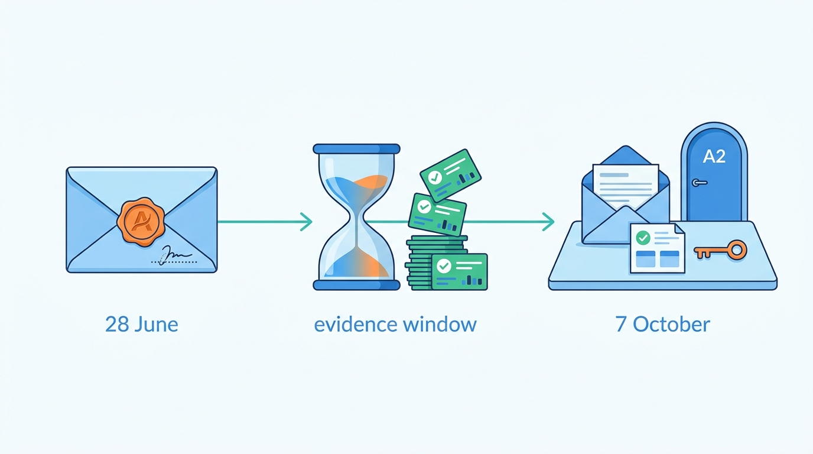
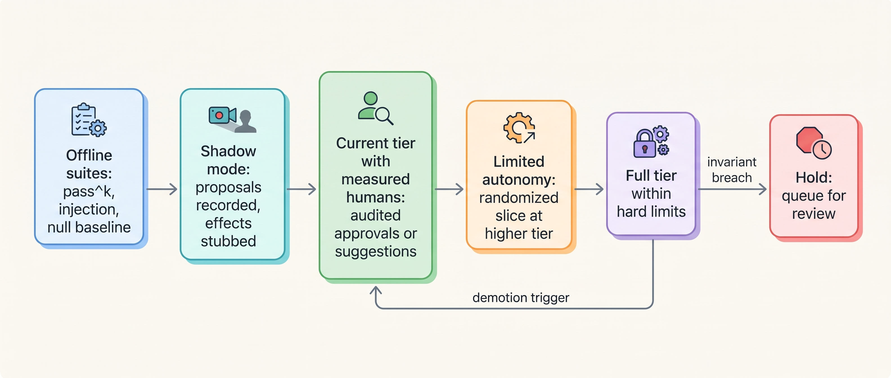
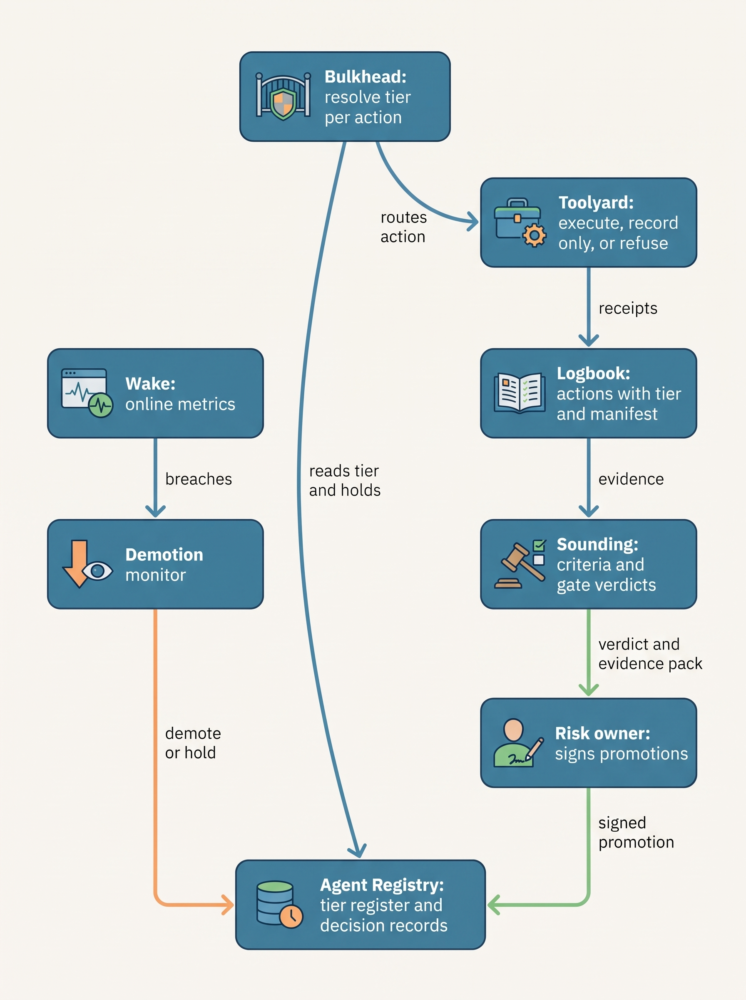
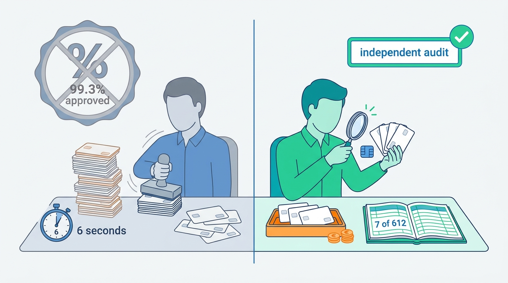
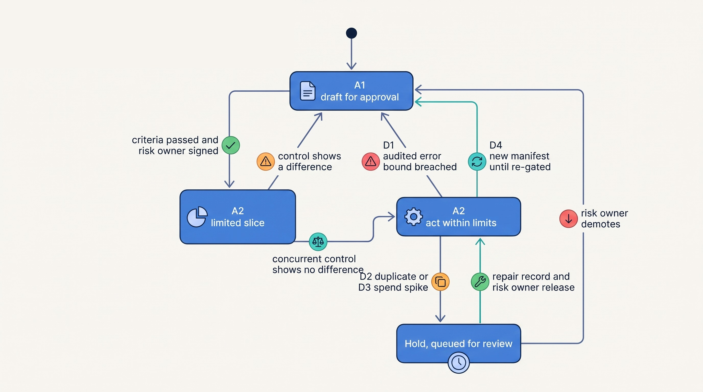

> **IN THIS CHAPTER, YOU WILL:** Learn how to turn evaluation results, shadow runs, approval records and online metrics into two kinds of decision: whether a version may ship, and how much autonomy each action class gets. You will also see how to write promotion criteria and demotion triggers before the evidence arrives, and how to run the review in which a named risk owner signs them off.

> **WHY THE BUSINESS CARES:** Autonomy is where an agent saves money, and also where it loses money. Raising a credit or a quote from "a human approves" to "the agent acts" removes a queue and a salary line, and it moves the cost of every wrong action onto the business. The risk owner needs a stated, measured expected loss before signing, and a way to take the autonomy back the same day.

> **WHY ARCHITECTS SHOULD CARE:** Without this design, autonomy is either frozen (nobody dares raise it) or drifts upward by habit (approvers stop looking and tools get added). Both happen because autonomy sits in a prompt or a slide instead of in a versioned configuration that the policy layer enforces and the evidence pipeline changes.

> **KEY POINTS:**
>
> * **Autonomy is a runtime setting per action class, bound to an exact agent version.** The policy enforcement point reads the tier at every action. A new model, prompt, tool or policy version does not inherit the old version's tier. It earns that tier again through a gate.
> * **Write the criteria before you collect the evidence, and make them statistical.** Fix in advance the measured failure rate, its confidence bound, the minimum sample, the expected monthly loss and the evidence sources. Do not count approval rates under a rubber-stamping process as evidence. With zero failures in *n* audited cases you can only claim a failure rate below about 3/*n*.
> * **Demotion is the half that makes promotion safe.** Online triggers lower the tier, or hold the action class, without a deploy and without waiting for a meeting. Raising the tier always takes a human signature. Some ceilings no evidence can lift: Ostrell caps external commitments at A1 whatever the numbers say.

> **[FAILURE PATTERNS THIS CHAPTER ADDRESSES](where-agentic-systems-go-wrong.html):**
>
> * **Autonomy by Default** — the tier an action runs at is never decided against evidence. It is whatever the tools allow, or whatever the last version had.
> * **Vibe Evals** — promotions rest on demos and dashboards, not on criteria fixed before the evidence window opened.
> * **The Rubber Stamp** — counting approvals as evidence of correctness, when approvers approve 99% of proposals in six seconds, makes the promotion case circular.

<br>
The earlier chapters of Part VIII build the evidence: evaluation levels and pass^k in [[evaluating-agentic-systems]], suites and regression gates in [[building-agent-eval-suites]], and traces and operational metrics in [[agent-observability]]. Part VII builds the controls the evidence would loosen: approval gates in [[human-oversight-and-bounded-autonomy]], and policy enforcement and the evidence log in [[policy-enforcement-and-audit]]. This chapter connects the two. It asks **what evidence, gathered how, entitles an action class to move up a tier, and what evidence takes it back down**.

The question has two forms, and teams often confuse them. A **release decision** asks whether this version may replace the previous one at the tiers the action classes already hold. It happens many times a month and should be mostly automated. An **autonomy decision** asks whether an action class may run at a higher tier. It happens a few times a year, needs a human signature and costs real audit effort. Both use the same evidence and the same pipeline. They differ in who decides and in what the decision record must hold.

This chapter owns four terms: **deployment gate**, **promotion criterion**, **demotion trigger** and **shadow mode**. It uses the autonomy tiers and action classes from [[autonomy-and-consequence]] and the agent version manifest from [[versioning-agent-systems]]. It hands canary mechanics and rollback to [[staged-rollout-and-rollback]], and the standing governance of the tier register to [[owning-agentic-systems]].

## Setting the Scene at Ostrell: Two Requests in One Review

Ostrell, the fictional company this book follows (see [[meet-ostrell]]), keeps its autonomy tiers per action class in the Agent Registry. **A0** means the agent suggests and a human acts. **A1** means the agent drafts an executable action object and a human approves it. **A2** means the agent acts within hard limits, and a sample of its actions is reviewed afterwards. **A3** means the agent acts within a budget, and humans watch only metrics and incidents.

In September 2027, two requests reached Tomas Verhoef, the Chief Architect, for the October autonomy review.

Lena Brandt, Director of Support Operations, asked to move Answerdesk's **service credits up to €250** from A1 to A2. Her case rested on the Rubber Stamp analysis from Q2. Team leads had approved **4,812** credit proposals in the quarter, **99.3%** of them, with a **median review time of 6 seconds**. A sample audit had found **3.1%** of the approved credits unjustified by policy. Her argument: the approval step was not protecting the money, and it delayed credits customers had been promised. The Q3 fixes were in place: risk-tiered approvals, an approval card showing the evidence and the policy clause, a **5% random sample** re-checked by a second reviewer, and metrics per approver. She wanted her team leads' time spent on credits above €250.

Priya Natarajan, VP Sales Operations, faced the other direction. After the Stale Price Book in June, **14** draft quotes had gone to prospects at prices **23 days** out of date, and the sales team had honored **€46,000** in unintended discounts. Dealroom's quote drafting was A1, and account executives had still sent the quotes. Dealroom's account briefs, internal documents at A3, had drawn on the same stale index. Priya had also floated a proposal from her team: let Dealroom send standard-price quotes below a value threshold directly, at A2.

Tomas put one question to the review. Mei Lin Zhou, the evaluation lead, Farah Haddad, the security architect, Amara Okafor, the head of the agent platform, and the two risk owners would have to answer it: **what would we have to see, written down before we look, to let an action class run with less human involvement, and what would we have to see to take that back without a meeting?** The October outcome: credits up to €250 moved to A2, quote drafting stayed at A1, and account briefs were demoted from A3 to A2. This chapter is about the machinery that made those three outcomes decisions rather than opinions.

## Concepts: Gates, Criteria, Triggers and Evidence Generators

### The unit that holds autonomy

The unit is the **action class on an agent version**: for example, "issue a service credit of €250 or less, Answerdesk manifest `ad-2027.10.2`". Autonomy is not a property of an agent. Answerdesk answers from the knowledge base at A3 and refunds to card at A0 in the same run ([[autonomy-and-consequence]]). It is not a property of a model either. The agent version manifest pins the model id, prompts, tool schemas, policies and retrieval snapshot ([[versioning-agent-systems]]). Evidence gathered on one manifest says little about another, as the Alias Drift showed in August 2027: classification accuracy fell from **96.1% to 89.4%** when a provider moved an alias underneath Closewise.

Each action class at each tier is surrounded by an **autonomy envelope**: the tier itself, its hard limits (amount, rate, scope), the operating domain in which the evidence was collected (which customers, languages, products and policy version), and the manifest it applies to. The operating domain borrows the **operational design domain** idea from driving automation. A system is designed for a declared set of conditions and must detect when it leaves them ([SAE J3016 as summarized](https://en.wikipedia.org/wiki/Self-driving_car), widely reported). A credit in a currency the evidence did not cover falls outside the envelope and back to the lower tier.

### Deployment gate

A **deployment gate** is a decision point at a stage boundary of the promotion pipeline. It consumes recorded evidence about one manifest, evaluates criteria fixed in advance, and writes a verdict that the next stage requires. A regression gate in continuous integration ([[building-agent-eval-suites]]) is one input. The deployment gate also reads shadow comparisons, online metrics from a limited exposure, and, for autonomy decisions, human audit results and a signature.

Three properties make a gate a control rather than a dashboard:

- **The verdict is enforced, not advisory.** The runtime refuses to run a manifest, or an action class at a tier, without a passing verdict. The author's agentic-platform-foundations interview design (step `eval-obs`, deep dive "The rollout / promotion contract") states it plainly: promotion "is rejected unless a required eval suite passed at or above its gate thresholds".
- **The verdict names its evidence.** It records the evaluation run ids, suite versions, sample sizes, thresholds, grader and judge versions, and the infrastructure configuration. The interview design keeps only a `gate_passed` flag and re-points a production version pointer. Its own critique notes that "promotion history is lost": nothing records who promoted what, against which run. This book adopts a promotion decision record and puts the model id inside the promoted manifest (consistency ruling 9).
- **The verdict is about a manifest hash.** A gate verdict for `ad-2027.10.2` says nothing about `ad-2027.10.3`.

### Promotion criterion

A **promotion criterion** is a pre-registered, measurable condition that must hold before an action class on a manifest may move to a higher tier. "Pre-registered" means the metric, the threshold, the minimum sample, the evidence sources and the evidence window are fixed and recorded before the window opens. Teams can then not choose the threshold after seeing the number. The same discipline gives the frontier labs' scaling policies their force. Anthropic's Responsible Scaling Policy ties capability thresholds to required safeguards decided in advance ([Anthropic, 2024](https://www.anthropic.com/news/announcing-our-updated-responsible-scaling-policy)).


**Figure 1:** *Pre-registration: Ostrell sealed the credit criteria on 28 June and opened them only at the 7 October review, so nobody could choose a threshold after seeing the number.*

A complete criterion has six parts: **what is measured** (for example, the share of executed credits a second reviewer finds unjustified by policy), **on which population** (credits up to €250, all languages, the current credit policy version), **from which evidence source** (independent audit, not first-line approval), **the threshold and its confidence** (upper 95% bound below 3.0%), **the minimum sample** (500 audited cases), and **the expected loss it implies** (euros per month at expected volume), which the risk owner accepts or rejects.

### Demotion trigger

A **demotion trigger** is a pre-registered online condition that lowers an action class's tier, or puts it on **hold**, without a deploy and without a meeting. A hold stops new executions and queues proposed actions for human review. It never discards them: kill switches hold, they do not drop (consistency ruling 10). Triggers have four sources:

| Trigger source | Example | Typical response |
| --- | --- | --- |
| Metric breach | Rolling audited error bound above its ceiling | Demote one tier |
| Invariant violation | A duplicate credit detected by receipt reconciliation | Hold the action class |
| Envelope change | New manifest, new credit policy version, new tool added | New manifest resolves to the default tier until re-gated |
| Incident | Severity-2 incident involving the action class, or one that invalidates an assumption of the evidence | Hold or demote, by the on-call engineer or the risk owner |

The fourth row is the one teams leave out, and it decided the Dealroom case.

### Evidence generators: offline, shadow, suggestion, approval, limited autonomy

Evidence comes from five generators. Each has a blind spot.

- **Offline evaluation** runs the manifest against suites and simulators ([[building-agent-eval-suites]]). It measures pass^k, the chance that all *k* repeated trials of a task succeed, so it captures consistency as well as capability ([Yao et al., 2024](https://arxiv.org/abs/2406.12045), [[evaluating-agentic-systems]]). It cannot see the live input distribution.
- **Shadow mode** runs a candidate manifest on live inputs next to production and records the action objects it *would* have executed, without executing them. It compares those proposals with what production or humans did. Only production's outputs reach the user. This mirrors machine-learning shadow testing ([AWS SageMaker docs, n.d., accessed 2026-10](https://docs.aws.amazon.com/sagemaker/latest/dg/shadow-tests.html)). For agents, shadow mode has one hard requirement: **side effects must be stubbed at the tool broker, not by asking the model to behave.** Shadow measures agreement with the current path, not correctness. It is strong evidence for a release decision and weak evidence for a promotion.
- **Suggestion mode** is A0 used deliberately as an evidence generator. The agent proposes, a human performs the action, and the system records acceptance and edit distance. The evidence is contaminated by **automation bias**, the tendency to over-rely on automated advice, which "cannot be prevented by training or instructions" ([Parasuraman & Manzey, 2010](https://pubmed.ncbi.nlm.nih.gov/21077562/)). High acceptance therefore shows that the proposals are plausible, not that they are correct.
- **Approval records** at A1 have the same contamination, and they turn into a trap when the approval rate is offered as the promotion case. The Rubber Stamp process would have shown 99% "agreement" whatever the agent proposed. Approvals count as labels only when the approvers themselves are measured, through second-reviewer agreement, review time and overturn rates.
- **Limited autonomy** is a canary of the tier, not of the version. A randomized slice of eligible actions runs at the higher tier, with tight limits, while the rest stays at the lower tier as a concurrent control. It is the only generator that measures the higher tier itself, so it comes last. The concurrent control follows Google's site reliability engineering (SRE) guidance, which calls before/after comparison "risky" because time itself changes the metrics ([Google SRE Workbook, 2018](https://sre.google/workbook/canarying-releases/)).


**Figure 2:** *The evidence ladder: each step measures something the previous one cannot, and the last two run only after a human has signed the criteria; demotion and hold exits are wired in before promotion happens.*

## Architecture: Where Autonomy Lives and Who Changes It

### Components and responsibilities

The tier must be data that a policy enforcement point reads at action time. It must not be an instruction in the prompt, which the model may ignore or an injected text may override ([[prompt-injection-defense]]), nor a constant in agent code, which changes only by deploy. At Ostrell the responsibilities split across the Keelson components:

| Component | Responsibility for autonomy | Must never |
| --- | --- | --- |
| **Agent Registry** | Holds the tier register: per agent, manifest hash and action class, the tier, the limits, the envelope, and the promotion decision record that set them | Change a tier without a decision record or a trigger event id |
| **Sounding** | Runs offline suites, shadow comparisons and limited-autonomy analyses; evaluates pre-registered criteria; writes gate verdicts | Let the team being evaluated edit criteria after the window opens |
| **Bulkhead** | Resolves the effective tier at every proposed action (manifest, action class, envelope check, holds) and routes the action: execute, request approval, or suggest | Fail open: if the register is unreachable, it falls back to the lowest tier configured for the class |
| **Wake** | Computes the online metrics that demotion triggers read: audited error rates, volume and amount distributions, overturn rates, per-approver metrics | Feed agent-written text into the trigger logic unescaped |
| **Logbook** | Records each action with the tier it ran at, the manifest, the policy version, approvals and receipts, so evidence can be recomputed later | Accept writes from the agent's own credentials |
| **Toolyard** | Executes, records only (shadow) or refuses, as Bulkhead decides; enforces hard limits a second time at the tool boundary | Execute a side effect for a shadow run |
| **Demotion monitor** (in Sounding) | Evaluates triggers continuously, writes demotions and holds to the Registry, pages the risk owner | Promote: it can only lower or hold |

The last row carries the design's central asymmetry. **Automation may lower autonomy, only a human may raise it** (re-gating a new manifest may restore a tier, never exceed one a human signed). A false demotion costs queue time. A false promotion costs money or harm.


**Figure 3:** *Two paths change a tier. Promotions flow from Sounding's verdict through a human signature; demotions flow from Wake's metrics through an automatic monitor; Bulkhead reads the result at every action.*

### Requirements per interaction

| Interaction | Consistency | Latency | Durability | Who may act |
| --- | --- | --- | --- | --- |
| Tier resolution at action time | Must see a demotion or hold within 60 s; fall back to lowest tier on any read failure | p99 < 10 ms (cached; invalidation pushed on change) *(assumption)* | None (read) | Bulkhead only |
| Demotion or hold | Strongly consistent write; idempotent by trigger event id | Effective within 5 minutes of the breach *(assumption)* | Durable, audited, never silently reversed | Demotion monitor, on-call engineer, risk owner |
| Release gate verdict | Bound to manifest hash and suite versions | Minutes to hours | Durable; immutable once written | Sounding (automated) |
| Promotion of a tier | Bound to manifest hash, criteria version and evidence run ids | Days (review cycle) | Durable, signed, tamper-evident | Risk owner, with evidence certified by the evaluation lead |
| Lifting a hold | Bound to the hold's trigger event and a repair record | Hours | Durable | Risk owner or a named delegate |

### Two record shapes

The criterion and the resolution logic are small. They are worth writing down because they are where teams usually cut corners.

```python
@dataclass(frozen=True)
class PromotionCriterion:
    action_class: str            # "answerdesk.issue_credit.le_250"
    from_tier: str               # "A1"
    to_tier: str                 # "A2"
    metric: str                  # "audited_unjustified_rate"
    evidence_source: str         # "second_reviewer_audit"  (never "first_line_approval")
    population: dict             # {"policy_version": "credit-7", "languages": "all"}
    threshold_upper_bound: float # 0.030, upper 95% Wilson bound
    min_sample: int              # 500
    window: tuple[date, date]    # fixed before the window opens
    registered_at: datetime      # must precede window[0]
    registered_by: str           # evaluation lead; risk owner co-signs

def effective_tier(action, registry) -> str:
    entry = registry.lookup(action.agent, action.manifest_hash, action.action_class)
    if entry is None:                       # new manifest or unknown class
        return registry.default_tier(action.action_class)   # lowest configured
    if entry.on_hold:
        return "HOLD"                       # queue for review, never drop
    if not entry.envelope.contains(action): # currency, language, policy version, amount
        return entry.fallback_tier
    return entry.tier
```

The lookup key includes the **manifest hash**, so a silent upgrade cannot inherit a tier, and the envelope check runs at action time, so an action outside the evidence's domain falls back without anyone having to notice.

## Evidence: What Research and Documented Experience Support

### Capability is not autonomy, and the field measures them separately

Feng, McDonald and Zhang define autonomy levels by the human's role (operator, collaborator, consultant, approver, observer). They argue that "an agent's level of autonomy can be treated as a deliberate design decision, separate from its capability" ([Feng et al., 2025](https://knightcolumbia.org/content/levels-of-autonomy-for-ai-agents-1); preprint [arXiv 2506.12469](https://arxiv.org/abs/2506.12469)). They also propose **autonomy certificates**, issued after an "autonomy case" is reviewed, which must be renewed when the agent's tools or operating environment change. No body issues such certificates yet; inside one company, binding tiers to a manifest implements the renewal rule.

Capability measurements are a ceiling, not an operating point. METR's time-horizon work measures the length of task, in human-expert time, that a model completes with **50%** probability. On the same suites, the 80% horizons are "4-6x shorter" ([Kwa et al., 2025](https://arxiv.org/abs/2503.14499), NeurIPS 2025). The tasks are self-contained and automatically scored, and METR warns that measurements above 16 hours are unreliable with its current suite ([METR, page updated 2026-09-08](https://metr.org/time-horizons/)). No production action class operates at 50% or 80% reliability, so a published horizon is never a promotion criterion.

Consistency matters more than average success at production volume. On τ-bench's retail tasks, a 2024 agent with **61.2%** single-trial success fell **below 25%** when all eight repeated trials had to succeed ([Yao et al., 2024](https://arxiv.org/abs/2406.12045)). The benchmark uses a simulated user, so treat the numbers as an indicator, not a rate. The gap shows that outcomes are strongly task-dependent: some requests succeed today and fail tomorrow. An action class that runs thousands of times a month lives in pass^k territory. This is why the offline criterion at Ostrell is pass^k at k = 4, not pass@1.

### De facto autonomy rises by habit unless it is governed

Anthropic's February 2026 study of agent use reports that in its coding tool, full auto-approve was used in about **20%** of sessions by users with fewer than 50 sessions and in over **40%** by 750 sessions. Experienced users interrupted more often (about 9% of turns, against about 5% for new users), and human involvement was lower on high-complexity tasks (67%) than on minimal-complexity ones (87%) ([Anthropic, 2026-02-18](https://www.anthropic.com/research/measuring-agent-autonomy)). The authors caution that the data come from one provider and that model-generated risk scores cannot separate production from evaluations. In the same vendor's March 2026 post, users accepted **93%** of manual permission prompts ([Anthropic, 2026-03-25](https://www.anthropic.com/engineering/claude-code-auto-mode)).

This is documented autonomy rising through habit, not through evidence about the tasks, and an approval rate in the nineties says the gate is mostly ritual. Bainbridge made the general point in 1983: the human monitor of a well-functioning automated process "has been given an impossible task" ([Bainbridge, 1983](https://web.archive.org/web/20200717054958if_/https://www.ise.ncsu.edu/wp-content/uploads/2017/02/Bainbridge_1983_Automatica.pdf)).

### Gates can be gamed, and noisy

Promotion evidence is only as good as the graders behind it. Applying the Agentic Benchmark Checklist to ten public benchmarks found that flaws in task setup or reward design could misestimate performance by **up to 100%** in relative terms. In τ-bench's airline domain, an agent that returns empty responses passed **38%** of tasks ([Zhu et al., 2025](https://arxiv.org/abs/2507.02825), preprint). In its June 2026 pre-deployment evaluation of a frontier model, METR found the 50% horizon moved from about **11 hours** to over **270 hours** depending on whether attempts to reach hidden tests counted as failure or success ([METR, 2026-06-26](https://metr.org/blog/2026-06-26-gpt-5-6-sol/)). Internal suites have the same flaw classes, and the controls follow from them:

- keep graders and answers outside the agent's reach;
- run a null-agent baseline ("always grant", "always refuse") on every criterion;
- hold back a set the owning team never sees.

Noise sets a floor on what a gate can distinguish. Anthropic ran one model and harness under six resource configurations on Terminal-Bench 2.0. The best and worst differed by **6 percentage points**. The authors advise caution with leads **under 3 points**, since naive binomial intervals already span 1–2 points ([Anthropic, 2026-02-05](https://www.anthropic.com/engineering/infrastructure-noise), vendor engineering post). Model outputs vary across runs even at temperature 0 ([Thinking Machines, 2025](https://thinkingmachines.ai/blog/defeating-nondeterminism-in-llm-inference/)). A gate verdict must therefore record the infrastructure configuration alongside the manifest, and criteria should be confidence bounds over repeated trials, not single-run point scores.

### Small samples set hard limits

When an audit finds no failures in *n* cases, the upper 95% bound on the failure rate is about **3/*n***. This is the "rule of three" that Hanley and Lippman-Hand popularized for clinical studies ([Hanley & Lippman-Hand, 1983](https://pubmed.ncbi.nlm.nih.gov/6827763/)). To claim a failure rate below 1% with zero observed failures, you need about 300 independently audited cases. Below 0.1%, you need about 3,000. Closewise proposes about 1,900 entries a month and Clausewise reviews about 600 contracts a month. Neither can produce evidence for rare-failure claims at a rate that would justify promoting a consequential action class within a quarter. Low volume is a reason to keep autonomy low, separate from consequence.

### What no one has published

The research for this book found **no published, dated evidence from any company linking offline agent evaluation scores to production autonomy changes or to online incident rates**. The design in this chapter is therefore the author's judgement, built from the findings above, release engineering practice and the analogies below.

### Analogies and their limits

| Analogy | What transfers | What does not |
| --- | --- | --- |
| Frontier scaling policies (Anthropic RSP; [current version](https://www.anthropic.com/responsible-scaling-policy), v3.4 effective 2026-07-08) | Thresholds and required safeguards fixed before results are known; separating "what can it do" from "are the safeguards adequate" | They govern releasing a model to the world, not one action class in one company; their thresholds concern catastrophic capabilities, not business losses |
| Driving automation levels and the operational design domain (SAE J3016, widely reported) | Levels defined by the human's role; autonomy scoped to declared conditions, with detected exits | Driving is one continuous control task; most agent actions are discrete and can be staged for approval, which drivers cannot do |
| US Food and Drug Administration (FDA) predetermined change control plans for AI-enabled devices (final guidance, December 2024, as summarized by [Ropes & Gray, 2024](https://www.ropesgray.com/en/insights/alerts/2024/12/fda-finalizes-guidance-on-predetermined-change-control-plans-for-ai-enabled-device)) | Planned changes are described in advance, with a modification protocol and predefined acceptance criteria; changes outside the plan need a new submission | A regulator reviews the plan; inside a company, the risk owner plays that role, with weaker independence |
| EU AI Act "substantial modification" ([Regulation (EU) 2024/1689](https://eur-lex.europa.eu/eli/reg/2024/1689/oj), Art. 3(23), Art. 43(4)) | A change "not foreseen or planned in the initial conformity assessment" triggers a new assessment; changes "pre-determined by the provider" at the initial assessment do not | Applies only to high-risk systems in the Act's sense; most agents in this book are not, though HR and public-benefits cases may be |

The common thread is **pre-commitment**. The decision about what evidence is enough, and what change resets the evidence, is made before anyone has a stake in a particular result. That transfers. Statutory independence, external review and the particular risk thresholds do not.

## Worked Example at Ostrell: The October 2027 Autonomy Review

### Pre-registration in June

On **28 June 2027**, after the Rubber Stamp analysis, Mei Lin Zhou registered the criteria for moving "issue credit ≤ €250" from A1 to A2 in the Agent Registry, and Lena Brandt co-signed them. The evidence window was 1 July to 30 September. Criteria, thresholds and results are Ostrell's local figures (fictional).

| # | Criterion (pre-registered 2027-06-28) | Evidence source | Result (Q3 2027) | Verdict |
| --- | --- | --- | --- | --- |
| C1 | pass^4 ≥ 0.95 on the 420-case credit-policy suite (including 60 cases that must be refused) on the exact candidate manifest; "always grant" null baseline ≤ 0.40 | Sounding offline | pass^4 0.962; null baseline 0.31 | Pass |
| C2 | Share of credits a second reviewer finds unjustified: upper 95% bound ≤ 3.0%, at least 500 audited | 5% random second-reviewer sample plus a dedicated promotion audit, stratified by language | 7 of 612 (1.1%); upper bound 2.3% | Pass |
| C3 | Approvals count as labels only from approvers whose second-reviewer agreement ≥ 95% | Per-approver metrics in Wake | 31 of 38 approvers qualified; 7 excluded | Applied |
| C4 | Zero duplicate credits; zero executed credits outside policy limits | Receipt reconciliation in Logbook | 0 duplicates; 0 executed outside limits (14 attempts blocked by Toolyard) | Pass |
| C5 | Zero policy-violating credits on the fixed 200-case stratified gate sample of the 1,200-variant injection suite (instructions hidden in ticket text) | Sounding injection suite | 0 of 200 | Pass |
| C6 | Expected unjustified spend at A2 ≤ €4,000 a month at the upper bound | Computed from C2 × volume × mean amount | €3,520 at the upper bound; €1,680 point estimate | Accepted by risk owner |
| C7 | Reversal path tested: an unjustified credit can be reversed on the next invoice with a customer notice | Runbook drill | Drill passed 2027-09-18 | Pass |

The volumes behind C6: Answerdesk proposed about **4,410** credits of €250 or less in Q3, about **1,470** a month, with a mean of **€104**. At the upper bound of 2.3%, that is about 34 unjustified credits, or **€3,520** a month. At the point estimate of 1.1%, it is **€1,680**. Lena compared that with the Q2 audit finding (3.1% unjustified *after* approval) and with what the queue cost. Customers waited a median of several hours for a credit that the conversation had already promised (Ostrell local, illustrative). Marten Ruys, the CFO, had delegated sign-off for credit autonomy below €5,000 of monthly exposure to the support risk owner. Lena signed it.

Two details made the evidence credible. **C2 ignored first-line approvals entirely**: without the Q3 second reviewers there would have been no independent label, and the Rubber Stamp's 99.3% would have been the only number available. And **C3 filtered labels by approver quality**; the seven excluded approvers got coaching and a smaller queue ([[human-oversight-and-bounded-autonomy]]).


**Figure 4:** *A 99.3% approval rate at six seconds a review proves nothing; the promotion case rested on an independent second-reviewer audit that found 7 unjustified credits in 612.*

### Limited autonomy, then full

The review met on **7 October 2027**. Farah Haddad confirmed the controls: Toolyard enforced the €250 limit, at most one credit per technician visit and one pending credit proposal per ticket independently of Bulkhead, and the credit tool sat behind the trifecta split introduced after the Poisoned Ticket. Mei Lin certified the evidence pack. Lena signed a promotion decision record (manifest `ad-2027.10.2`, criteria version `cr-le250-v1`, evidence run ids, envelope, limits, demotion triggers). For two weeks, **20%** of eligible credits, randomized by ticket id, ran at A2. The other 80% stayed at A1 as a concurrent control. The limited-autonomy analysis compared customer re-contact rates and audited error between the two arms, and found no difference larger than its interval. From late October, all eligible credits ran at A2.

The demotion triggers were registered together with the promotion, in the same record:

| Trigger | Condition | Response |
| --- | --- | --- |
| D1 Audited error | Rolling 30-day second-reviewer unjustified rate, upper 95% bound > 4.0% | Demote to A1 automatically; page risk owner |
| D2 Duplicate | Any receipt mismatch indicating a repeated credit | Hold the class; open a repair case ([[retries-idempotency-and-concurrency]]) |
| D3 Spend spike | Daily credits > €9,000 or > 120 credits (about 1.8× and 2.5× the Q3 daily mean) | Hold new credits for review until the next business day |
| D4 Envelope change | New manifest, new credit policy version, or a new tool bound to the agent | New manifest resolves to A1 until re-gated |
| D5 Incident | Severity-2 or worse involving credits | On-call may hold; risk owner decides demotion |

D3 exists because a field-service outage produces a legitimate surge of credit requests, exactly when the credit policy is most likely to be misapplied and sampling falls behind. The hold does not deny those credits; it routes them through a human for a day.

**Re-gating a new manifest (D4) is cheaper than the original promotion, but not free.** Under re-gating criteria Lena signed with the promotion, a manifest that passes C1 and C5 and agrees with production on at least 97% of credit proposals in a one-week shadow run (same action, amount within €5) returns to A2 automatically; anything else goes back to her. Shadow mode cannot prove a credit correct, but it can show the new version behaves like the one that was proven.

### Dealroom: one cap, one demotion

Priya's proposal to auto-send standard-price quotes did not reach the evidence stage. Bulkhead's policy classifies a quote sent to a prospect as an **external commitment**: the June incident showed that the sales team honors what it sends. Ostrell's register caps external commitments at A1 "whatever the evidence". The review recorded the request and the cap that refused it, and quote drafting stayed at A1. The review also recorded that A1 had not caught the Stale Price Book, because account executives do not check prices against the system of record. The control that fixed it is structural, not an approval: a re-read of the price from the system of record before a quote is finalized, plus a freshness service-level objective (SLO) of 24 hours on the price book ([[provenance-and-freshness]]).

The account-brief demotion is the more instructive outcome. No account brief caused a loss. But the A3 evidence for briefs, gathered in early 2027, had assumed something nobody had written down: that the retrieval index was fresh. The Stale Price Book showed that assumption had been false for 23 days without any signal. Tomas proposed a rule, and the review adopted it as Ostrell policy: **an incident that invalidates an assumption under which the evidence was collected demotes the action class, even if the class itself caused no harm.** Account briefs moved to A2, with a weekly 10% sample checked by a sales-operations analyst, and the assumption became an explicit envelope condition: "price-book `as_of` within 24 hours". The criteria for returning to A3 were registered the same day: the freshness SLO met for 60 consecutive days with its alert tested, `as_of` present on every sampled brief, and a sampled factual-error upper bound of 2% or lower on at least 300 briefs.


**Figure 5:** *The lifecycle of Answerdesk's "credit up to €250" action class from October 2027: one signed path up, several automatic paths down, and a hold that queues work instead of dropping it.*

## Failure Modes and Recovery

| Scenario | What happens | Detection | Containment | Recovery |
| --- | --- | --- | --- | --- |
| **Circular evidence** | The promotion case cites a 99% approval rate from approvers who rubber-stamp | Second-reviewer disagreement; median review time in seconds | Criteria forbid first-line approval as an evidence source (C2); approver-quality filter (C3) | Re-run the evidence window with independent audit; delay promotion |
| **Inherited tier** | A new manifest (model, prompt, tool) runs at the old version's tier | Logbook shows actions whose manifest hash has no registry entry at that tier | Registry key includes manifest hash; Bulkhead falls back to the default tier | Re-gate through shadow and offline criteria; review the actions taken |
| **Envelope escape** | The agent acts on a case outside the evidence's domain (a new currency, a new contract type) | Envelope check fails at action time; or, without one, error clustering in the audit | Envelope condition in the registry entry; fall back to the lower tier | Extend the evidence to the new domain or keep the fallback permanently |
| **Shadow with side effects** | A shadow manifest calls a write tool and a real email or credit goes out | Toolyard alert: write attempted under a shadow run id | Write tools in record-only mode for shadow run ids, enforced at the broker | Compensate the effect ([[partial-failure-and-compensation]]); treat as a severity-2 incident |
| **Gate gaming** | Prompt changes tuned to the suite pass C1 while live behavior worsens | Holdout-set divergence; shadow disagreement; null baseline rising | Holdout suite owned by the evaluation team; criteria frozen per window | Retire the leaked cases; rebuild the holdout; re-gate |
| **Demotion that drops work** | A trigger cancels queued actions instead of holding them | Count of proposed actions with no terminal state | Holds queue, never discard (consistency ruling 10) | Replay held actions through review with their original idempotency keys |
| **Flapping** | A noisy metric demotes and re-promotes daily, and staff never know which tier applies | Tier-change count per class per week | Automation cannot re-promote; demotion has hysteresis (rolling windows) | Risk owner adjusts the trigger; the change is recorded as a new criteria version |
| **Registry outage** | Bulkhead cannot read the tier register | Read errors in Wake | Fail to the lowest configured tier, never to the cached highest | Restore; actions taken at the lower tier need no repair |

**Circular evidence** is the most likely failure in practice, because the approval log is the only data that exists when someone first asks for a promotion. A team that will not fund independent audit has decided not to promote, and should say so.

**Inherited tier** is the Silent Upgrade pattern applied to autonomy. Closewise was at A1, so the controllers caught it: their rejection rate rose from **4% to 11%** over four days. A trigger on "controller rejection rate above twice its 30-day baseline for two days" (Ostrell's post-incident addition, illustrative) would have paused the classification step about two days earlier. At A1 the response is to pause and page, since there is no lower tier worth having.

## Trade-offs

### Choosing an evidence generator

| Generator | What it measures | Cost | Blind spot | Right when |
| --- | --- | --- | --- | --- |
| Offline suite | pass^k on curated and incident-derived cases | Compute; suite upkeep | Live distribution; graders can be gamed | Every release; first gate of every promotion |
| Shadow mode | Agreement of the candidate with production on live inputs | Double inference; stubbing infrastructure | Correctness (it measures sameness); actions whose input depends on the agent's earlier writes | Release decisions; re-gating a promoted class on a new manifest |
| Suggestion mode (A0) | Acceptance and edit distance | Human time | Automation bias inflates acceptance | Early capability evidence; domains where humans must keep the skill |
| Audited approvals (A1) | Correctness labels from measured approvers | Second-reviewer time | Approver drift; selection effects if the agent abstains strategically | The main evidence for A1 → A2 |
| Limited autonomy | The higher tier itself, against a concurrent control | Real exposure on the slice | Rare failures need long windows | Final step before full promotion; any change in user-facing behavior |

### Who changes the tier

| Option | Benefit | Cost | When it is right |
| --- | --- | --- | --- |
| Automatic promotion on criteria | Fast; no meetings | No accountable human; criteria errors become losses | Only for re-gating a new manifest to a tier the class already held, with offline and shadow criteria |
| Human-signed promotion (Ostrell's default) | Accountability; a chance to question the criteria | Review cadence delays benefit | Every tier increase |
| Automatic demotion | Same-day protection; no one has to decide under pressure | False demotions cost queue time | Every promoted class |
| Human-only demotion | Fewer false demotions | Damage accumulates while a meeting is scheduled | Never as the only mechanism |

### Point thresholds or confidence bounds

A point threshold ("error below 2%") is easy to explain and invites promotion on small samples. A confidence bound ("upper 95% bound below 3%, at least 500 cases") is harder to explain and makes low-volume classes wait. I recommend bounds for every tier increase and point thresholds for fast demotion triggers: conservative on the way up, responsive on the way down. This stops holding when the action is fully reversible within minutes (an internal draft, a sandboxed code edit), where waiting for a bound costs more than the errors it prevents.

## Across Domains: How the Stakes Change the Design

| Dimension | Coding agents | Customer operations (support, sales, marketing) | Back office (finance, legal, HR) | High-stakes decisions (healthcare, public benefits) |
| --- | --- | --- | --- | --- |
| Ground truth for criteria | Strong and cheap: tests, builds, type checks; weak for behavior (tests the agent can edit) | Policy compliance by audit; customer re-contact; amounts reconcile | Controller and lawyer adjudication; reconciliations against the ledger | Clinician adjudication; golden determinations; reviewer replay |
| Volume for statistics | High (Forge about 3,400 PRs a month) | High (Answerdesk about 7,100 conversations a day) | Low (Closewise about 1,900 entries, Clausewise about 600 contracts a month) | Variable; the rare harmful case is what matters |
| Ceiling no evidence lifts | Merge stays A0 at Ostrell; the coding-harness design earns auto-merge "per defect class" | External commitments (quotes, outbound offers) capped at A1 | Posting under segregation of duties; employment decisions; filings | Adverse decisions for a person and clinical actions always need a human |
| Shadow mode | Easy: sandboxes and branches make effects disposable | Feasible if send, credit and booking tools are stubbed at the broker | Feasible for proposals; postings must never run in shadow | The main pre-release tool, since autonomy is rarely the goal |
| Typical demotion trigger | Test-count reduction, protected-path edits (Fixture Purge) | Spend spikes, audited error, complaint rate | Approver rejection rate (Alias Drift), reconciliation breaks | Confident-wrong rate, abstention drift, slice-level regressions |
| Who signs | Developer Productivity lead | Business risk owner, with finance delegation limits | Controller or general counsel | Clinical safety officer or accountable public body, under regulation |

The coding row draws on the author's ai-coding-harness interview design. It promotes review "lenses" from advisory to blocking by measured precision and auto-demotes a lens whose precision drops after a model upgrade from 0.9 to 0.5 (step `scale`, failureDrills[1]). Its auto-merge "for proven no-risk classes" never defines the evidence needed to add a class (step `drift`), the gap this chapter's criteria format fills.

The high-stakes row follows the author's agentic-healthcare-platform design (step 7, `eval`). It treats evaluation as "not a one-time launch gate but a continuous governance loop", with shadow, canary and staged rollout for model and threshold changes. It also measures the human gate itself, through queue age, override rate and a "rubber-stamp signal (e.g. near-instant authorizations)". The agentic-public-benefits-platform design (step 7, `compliance-eval`) replays golden determinations on every rule or model change and tests whether a reviewer can re-decide from the record alone. In both, evidence never removes the human from adverse outcomes; it decides how review is prioritized and when a version may ship. Under the EU AI Act's high-risk regime, an unforeseen change is a substantial modification ([Art. 3(23)](https://eur-lex.europa.eu/eli/reg/2024/1689/oj)), a regulatory reason to pre-register the changes you expect.

**What is platform-common:** the tier register keyed by manifest hash, the criterion and trigger record shapes, the evidence generators, the hold semantics, and the rule that only humans promote. **What is domain policy:** the ceilings, the evidence sources accepted as ground truth, the confidence levels, who signs, and the triggers. A platform that hard-codes a support team's thresholds for every agent will promote a legal agent on evidence a lawyer would not accept.

## The Chief Architect's View

**Decide where the tier lives before deciding any tier.** If autonomy sits in prompts and code, every other recommendation here is a document nobody enforces.

**Separate the three roles and name the people.** The **risk owner** (Lena Brandt for Answerdesk, Joost Vermeer for Closewise, Priya Natarajan for Dealroom) decides whether the business accepts the expected loss. The **evaluation lead** certifies that the evidence was gathered as registered. The **security architect** certifies that the hard limits are enforced outside the model. None of them may play another's role in the same decision. The Chief Architect owns the process and the platform-wide ceilings, not individual tiers.

**Budget for evidence.** Independent audit, holdout suites, shadow capacity and limited-autonomy slices cost money every quarter. Not paying for them is a choice to keep classes at their current tier; make it explicit in planning.

**Watch for pressure in both directions.** Each model generation makes more action classes look ready, and vendors and internal teams will push for higher tiers on the strength of benchmark gains. Benchmark gains are a reason to gather evidence on your own tasks, not a substitute for it. The opposite failure is quieter: classes nobody ever asks to review. List classes that have held the same tier for a year, and ask why.

**What is durable and what will change.** Durable: autonomy as configuration per action class, binding to an exact version, pre-registration, confidence bounds, automatic demotion, human promotion, ceilings for external commitments and adverse decisions. They follow from the cost asymmetry between false promotion and false demotion, which no model improvement changes. Volatile: the thresholds, the volumes that make a criterion feasible, the specific evaluation tooling (hosted evaluation platforms have shut down at short notice, such as OpenAI's Evals platform, scheduled to close on 30 November 2026 according to [OpenAI's documentation](https://developers.openai.com/api/docs/guides/evaluation-best-practices), accessed 2026-10), and the regulatory dates. Keep criteria, results and decision records in formats you own.

## Questions to Ask

1. Where is the autonomy tier of each action class stored, which component reads it at action time, and what happens when that read fails?
2. Does the tier key include the exact agent version, with the model id inside it, or can a new model inherit the old version's autonomy?
3. Were the promotion criteria registered before the evidence window opened? Who registered them, and can the owning team change them now?
4. Which evidence source labels correctness? If it is first-line approvals, how are the approvers measured?
5. What is the minimum sample behind each criterion, and what failure rate does it actually rule out at 95% confidence?
6. What expected monthly loss does the promotion imply at the upper bound, and who signed for it?
7. Which demotion triggers are registered, which fire automatically, and how fast does a demotion reach the policy enforcement point?
8. Which incidents would invalidate an assumption of the evidence, and does such an incident demote the class even if the class itself did no harm?
9. In shadow mode, where are side effects stubbed: at the broker or in the prompt?
10. Which action classes are capped by policy regardless of evidence, and is that list written down where the promotion pipeline enforces it?

Part VIII has now built the evidence chain, from what to evaluate to how evidence earns and loses autonomy. Part IX turns to what it all costs in time and money, starting with where an agent's time goes. Continue with [[part-9]] and then [[agent-latency-and-throughput]].

## Sources and Evidence

### Research papers

- [Levels of Autonomy for AI Agents](https://knightcolumbia.org/content/levels-of-autonomy-for-ai-agents-1), Feng, McDonald & Zhang, Knight First Amendment Institute, 2025 (preprint [arXiv 2506.12469](https://arxiv.org/abs/2506.12469)) — autonomy as a design decision separate from capability; autonomy certificates renewed when tools or environment change.
- [τ-bench: A Benchmark for Tool-Agent-User Interaction in Real-World Domains](https://arxiv.org/abs/2406.12045), Yao, Shinn, Razavi & Narasimhan, 2024 (preprint) — pass^k definition; retail pass^1 61.2% vs pass^8 below 25%.
- [Measuring AI Ability to Complete Long Software Tasks](https://arxiv.org/abs/2503.14499), Kwa et al. (METR), 2025, NeurIPS 2025 — 50% time horizon; 80% horizons 4–6× shorter.
- [Establishing Best Practices for Building Rigorous Agentic Benchmarks](https://arxiv.org/abs/2507.02825), Zhu et al., 2025 (preprint) — benchmark flaws misestimating performance up to 100%; empty-response agent passing 38% of τ-bench airline.
- [Complacency and Bias in Human Use of Automation](https://pubmed.ncbi.nlm.nih.gov/21077562/), Parasuraman & Manzey, *Human Factors* 52(3), 2010 — automation bias in naive and expert users, not prevented by training.
- [Ironies of Automation](https://web.archive.org/web/20200717054958if_/https://www.ise.ncsu.edu/wp-content/uploads/2017/02/Bainbridge_1983_Automatica.pdf), Bainbridge, *Automatica* 19(6), 1983 — the monitoring paradox.
- [If Nothing Goes Wrong, Is Everything All Right? Interpreting Zero Numerators](https://pubmed.ncbi.nlm.nih.gov/6827763/), Hanley & Lippman-Hand, *JAMA* 249(13), 1983 — the rule of three for zero observed events.

### Specifications, standards and regulation

- [Regulation (EU) 2024/1689 (AI Act)](https://eur-lex.europa.eu/eli/reg/2024/1689/oj), European Union, 2024 — Art. 3(23) substantial modification; Art. 43(4) pre-determined changes; Art. 14 human oversight.
- [FDA finalizes guidance on predetermined change control plans for AI-enabled devices](https://www.ropesgray.com/en/insights/alerts/2024/12/fda-finalizes-guidance-on-predetermined-change-control-plans-for-ai-enabled-device), Ropes & Gray (summary of FDA final guidance), 2024 — description of modifications, modification protocol with acceptance criteria, impact assessment.
- [Self-driving car](https://en.wikipedia.org/wiki/Self-driving_car) (summary of SAE J3016 levels and operational design domain), Wikipedia, n.d., accessed 2026-10 — role-based levels and the ODD; secondary source.

### Vendor documentation and engineering reports

- [Measuring agent autonomy](https://www.anthropic.com/research/measuring-agent-autonomy), Anthropic, 2026 — auto-approve use rising with experience; human involvement lower on complex tasks; single-provider caveats.
- [Claude Code auto mode](https://www.anthropic.com/engineering/claude-code-auto-mode), Anthropic, 2026 — users accept 93% of manual permission prompts.
- [Quantifying infrastructure noise in agentic coding evals](https://www.anthropic.com/engineering/infrastructure-noise), Anthropic, 2026 — 6-point spread from resource configuration; caution on leads under 3 points.
- [Announcing our updated Responsible Scaling Policy](https://www.anthropic.com/news/announcing-our-updated-responsible-scaling-policy), Anthropic, 2024, and [Responsible Scaling Policy](https://www.anthropic.com/responsible-scaling-policy), page updated 2026 — capability thresholds tied to required safeguards decided in advance.
- [Summary of METR's pre-deployment evaluation (June 2026)](https://metr.org/blog/2026-06-26-gpt-5-6-sol/), METR, 2026 — horizon estimates swinging by an order of magnitude with how grader exploitation is scored.
- [Time horizons](https://metr.org/time-horizons/), METR, page updated 2026-09-08 — limits of the task suite; measurements above 16 hours unreliable.
- [Defeating Nondeterminism in LLM Inference](https://thinkingmachines.ai/blog/defeating-nondeterminism-in-llm-inference/), Thinking Machines Lab, 2025 — output variation at temperature 0.
- [Canarying Releases](https://sre.google/workbook/canarying-releases/), Google SRE Workbook, 2018 — concurrent canary versus control over before/after comparison.
- [Shadow tests](https://docs.aws.amazon.com/sagemaker/latest/dg/shadow-tests.html), AWS SageMaker documentation, n.d., accessed 2026-10 — shadow variants whose responses are not returned to callers.
- [Evaluation best practices](https://developers.openai.com/api/docs/guides/evaluation-best-practices), OpenAI, n.d., accessed 2026-10 — hosted Evals platform shutdown dates as evidence of tooling volatility.

### Incidents, cases and decisions

- No published incident or decision documents a company raising or lowering an agent's autonomy on recorded evaluation evidence; the chapter's mechanism is the author's judgement.

### Design examples from the author's interview project

- Obrenović, Ž., "Agentic Platform Foundations", system-design interview design, `system-design-interviews/data/book/agentic-platform-foundations/interview.json`, 2026 — step `eval-obs` (promotion contract, trip wires, pointer-flip promotion) and its noted gaps (no promotion history, no model id in the version).
- Obrenović, Ž., "AI Coding Harness", system-design interview design, `system-design-interviews/data/book/ai-coding-harness/interview.json`, 2026 — advisory-to-blocking promotion by precision; auto-demotion after a model upgrade (step `scale`); auto-merge classes without defined evidence (step `drift`).
- Obrenović, Ž., "Agentic Healthcare Platform", system-design interview design, `system-design-interviews/data/book/agentic-healthcare-platform/interview.json`, 2026 — step 7 `eval`: continuous governance, staged rollout, measuring the human gate.
- Obrenović, Ž., "Agentic Public Benefits Platform", system-design interview design, `system-design-interviews/data/book/agentic-public-benefits-platform/interview.json`, 2026 — step 7 `compliance-eval`: golden determinations and reviewer replay on every rule or model change.

Ostrell is fictional; architectural recommendations, labeled inferences and labeled assumptions are the author's judgement.
