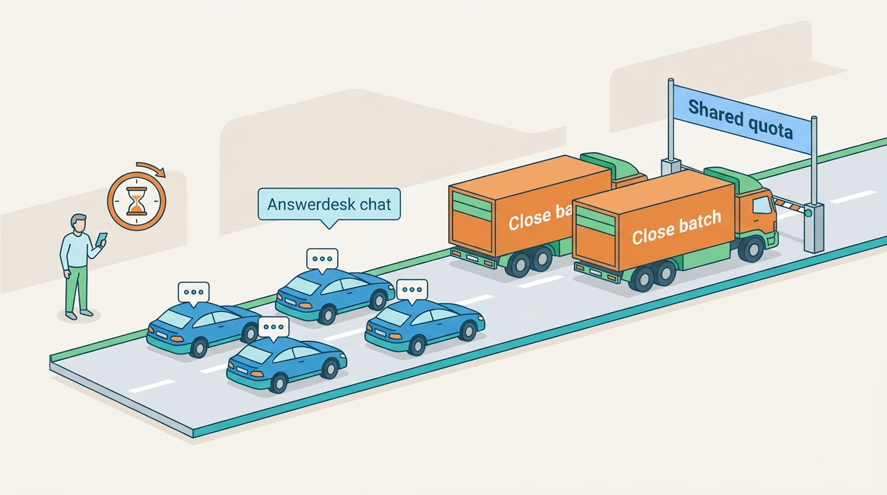
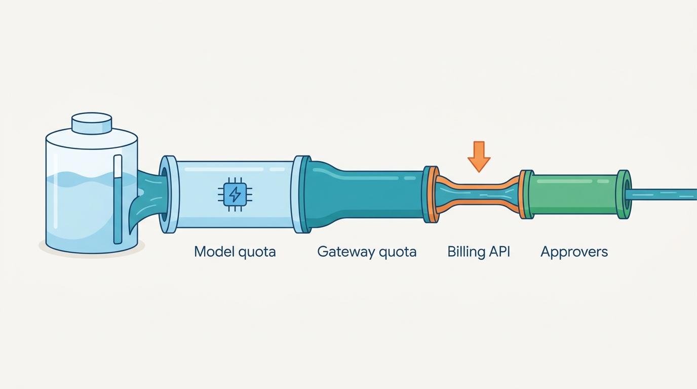
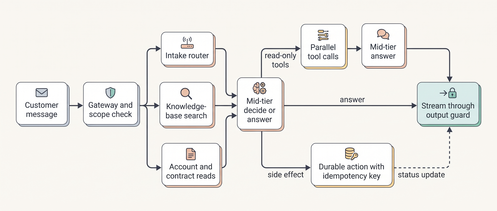
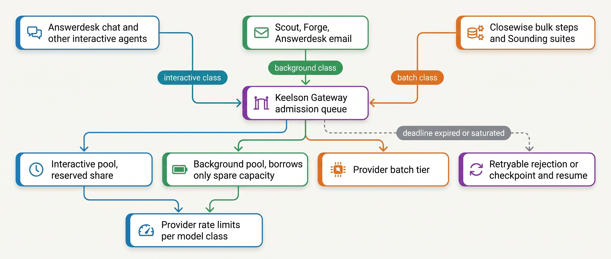
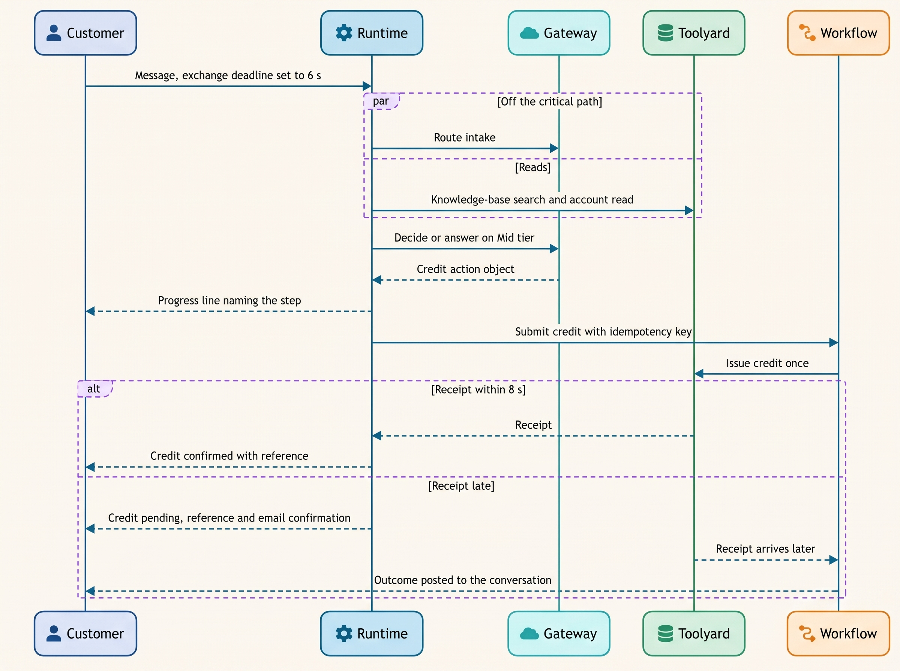

> **IN THIS CHAPTER, YOU WILL:** Learn to break an agent's response time into its parts, set a latency budget for each interaction mode, shorten the critical path with parallel, speculative and deferred work, and find the rate-limit ceiling that caps how much agent work the platform can carry.

> **WHY THE BUSINESS CARES:** A support agent that takes ten seconds to answer loses customers to abandonment, and one that is fast only when nothing else is running loses them on the busiest day. The same rate limits that pace customer conversations also pace the month-end close and the nightly evaluations, so one team's batch job can become another team's outage.

> **WHY ARCHITECTS SHOULD CARE:** Agent latency is set by how many model calls and tool calls sit in series, not by how fast any one call is. Throughput is set by limits you share with every other agent in the organization. Both are architecture decisions: what runs in parallel, what may be speculated, what is deferred, and which workload gets capacity first.

> **KEY POINTS:**
>
> * **Budget milestones, not averages.** Set a percentile target for each user-visible milestone (first visible content, answer complete, action outcome) per interaction mode, split it across the steps on the critical path, and enforce it with one deadline that every model call and tool call inherits.
> * **Shorten the critical path before you buy speed.** Serial model calls and output tokens dominate agent latency. Merge or remove model calls, move routing and reads off the critical path, run only read-only and idempotent work in parallel or speculatively, and send slow side effects to durable background execution. A faster model tier comes last.
> * **Throughput has a ceiling you share.** Provider token and request limits, downstream system limits and human queues cap what the platform can carry, and the tightest one wins. Give each workload its own quota pool and priority class, admit work through a queue with deadlines, and never retry a rate-limit error inside an interactive exchange.

> **[FAILURE PATTERNS THIS CHAPTER ADDRESSES](where-agentic-systems-go-wrong.html):**
>
> * **The Agent Committee** — every extra agent or model hop in series adds a full model call to the critical path, so a committee of agents is slow before it is wrong.
> * **The Different Second Answer** — a timeout set without a budget turns into a retry that re-asks the model, which is how slow tools become duplicate actions.
> * **The Token Bonfire** — retry storms, hedged calls and parallel fan-out buy latency with tokens and quota; without per-workload limits they burn both.

<br>
Agent latency surprises teams because they think of it as the speed of a model. A single model call has a **time to first token (TTFT)**, which covers queueing, network and the processing of the input, and then an output rate measured in **output tokens per second (OTPS)**. An agent exchange is a chain of such calls with tool calls between them, and **the user waits for the whole chain**. Three serial model calls at two seconds each are six seconds, however fast the model is.

Throughput surprises them again. Providers meter requests and tokens per minute per organization; billing, ticketing and the human escalation queue have their own limits. **An agent platform shares these limits across every agent it runs**, so a slow agent in production is often not a slow model but another workload using the same quota.

This chapter owns three terms: the **latency budget** of an agent interaction, the **critical path** of an agent run, and the **rate-limit ceiling**. It builds on [[agent-runtime]], which runs the loop and enforces budgets, on [[models-and-the-model-gateway]], which holds the quotas, and on [[agent-interaction-design]], which sets what the user sees while they wait. It hands the money side of the same decisions to [[agent-cost-and-model-routing]] and prompt caching and context size to [[caching-and-context-budgets]].

## Setting the Scene at Ostrell: The Close-Day Queue

Ostrell, the fictional company this book follows (see [[meet-ostrell]]), runs Answerdesk, its customer-support agent for Ostrell Field, on the Keelson platform. Answerdesk handles about **7,100 conversations a day**, by chat and by email. In Q3 2027 Lena Brandt, Director of Support Operations, had two latency numbers on her dashboard that she did not like. For chat exchanges that called a tool, the 95th-percentile (p95) time until the customer saw any text was **9.6 seconds**, and the p95 time until the answer was complete was **11.8 seconds**. Her team's analysis showed that chat conversations whose first answer took more than 8 seconds were abandoned about twice as often as the rest (Ostrell figures, fictional).

Then came **Tuesday 2 November 2027**, working day 2 of the October close. Between 09:10 and 11:40, Closewise re-ran its classification step for six legal entities after a chart-of-accounts mapping change. At the same time, a delayed run of Sounding's daily canary evaluation started. Both used the same Mid-tier provider account as Answerdesk. Ostrell's organization-wide input-token limit with that provider was reached within minutes. Keelson Gateway passed the provider's HTTP 429 (rate-limited) responses back, and the Answerdesk runtime retried them with exponential backoff inside the customer's exchange. Chat p95 time to first visible text rose to **14 seconds**, **2.1%** of exchanges hit the 30-second hard limit and fell back to "a colleague will follow up", and abandonment in the window rose from **9% to 17%**. No wrong action was taken. Nothing was broken except the user experience, and the cause was a batch job in another department.


**Figure 1:** *On 2 November a finance batch job and an evaluation run filled the same provider quota as Answerdesk, and customer chats queued behind them.*

Wake, Keelson's tracing service, raised the latency alert at 09:35. Amara Okafor's Agent Platform team contained it by hand, stopping the Sounding canary run and asking Group Finance to defer the reclassification, which the controller's office agreed to shortly before 11:30 ([[owning-agentic-systems]] covers the on-call gap this exposed). The review, chaired by Tomas Verhoef, Ostrell's Chief Architect, asked two questions. **Where does an Answerdesk exchange's time go, and what would it take to make it fast enough for chat?** And **how much agent work can Keelson carry at once before one workload starves another?**

## Concepts: Milestones, Budgets, Critical Paths and Ceilings

### The anatomy of one model call

A model call has two phases. **Prefill** processes the input tokens and produces the first output token; **decode** produces the remaining output tokens one at a time. The time a caller sees is roughly:

*model call latency ≈ queueing + network + prefill (TTFT) + output tokens ÷ OTPS*

OpenAI's latency guide (undated, accessed October 2026) states the consequence as a rule of thumb: "cutting 50% of your output tokens may cut ~50% of your latency", whereas "cutting 50% of your prompt may only result in a 1–5% latency improvement" ([OpenAI, n.d.](https://developers.openai.com/api/docs/guides/latency-optimization)). Agent contexts of tens of thousands of tokens make prefill less negligible than that, which is one reason prompt caching (reuse of the computed state of an identical prompt prefix; see [[caching-and-context-budgets]]) also reduces TTFT.

**Reasoning tokens are output tokens.** Models with an internal reasoning phase generate tokens the user never sees, and these are produced at the decode rate before the visible answer starts. Anthropic's Claude Code documentation notes that thinking tokens "are billed as output tokens, and the default budget can be tens of thousands of tokens per request", and that on several current models thinking cannot be turned off, so effort levels are the control (as of October 2026; [Anthropic, n.d.](https://code.claude.com/docs/en/costs)). Reasoning effort is therefore a latency dial as much as a quality dial, and it should be set per step, not per agent.

### The anatomy of an exchange

An **exchange** (one user message and the agent's reply) can take several **turns**, where a turn is one runtime cycle: one model call plus the tool calls it proposes (both terms are owned by [[agent-runtime]]). An exchange therefore contains several model calls and tool calls. Its latency is the length of the longest chain of steps that depend on each other, plus any waiting for capacity.

The **critical path** of an agent run is that chain: the sequence of dependent steps from the run's input to a user-visible milestone. A step on the critical path adds its full latency to what the user sees. A step off it, because it runs in parallel with a longer step or after the milestone, adds cost and load but no latency until it starts to compete for capacity. Most latency work on agents is **moving steps off the critical path or removing them**, not making steps faster.

Agent critical paths differ from ordinary request paths in three ways. **Their length is decided at run time**: the model chooses whether to call a tool and whether to call another, so budgets must be enforced dynamically by a deadline, not only designed. **The slowest step is usually a model call producing tokens**: a 400-millisecond tool is rarely the problem; 600 reasoning tokens before a 40-token tool call usually is. And **retries extend the path**: a retry with backoff inside an exchange can cost more than the step itself, as on 2 November.

### Milestones and the latency budget

Users do not experience one latency. In a chat they notice when something appears, when the answer is complete, and, for actions, when they learn the outcome. The **latency budget** of an agent interaction is a percentile target for each user-visible milestone, set per interaction mode, allocated across the steps on the critical path, and enforced at run time by a deadline that every step inherits.

| Milestone | What the user sees |
| --- | --- |
| **First visible content** | The first answer text, or an honest progress line that names the step under way ("Checking your service contract…") |
| **Answer complete** | The full response, after output checks |
| **Action outcome** | Confirmation that an action happened, failed or is pending, with a reference |
| **Task complete** | For delegated or background work: the result is delivered |

A typing indicator is not first visible content. A progress line counts only if deterministic code produces it from the step actually being executed. The budget is a percentile because agent latency has a long tail (long reasoning, extra tool calls, slow backends); a p50 target hides exactly the exchanges that cause abandonment.

### Interaction modes set the budget

[[agent-interaction-design]] defines the **interaction modes**: conversational, copilot inline, delegated asynchronous task, background agent, and escalation to a human. Each implies a different budget and a different throughput unit. This is the requirements table Tomas's review produced for Keelson's agents. Values marked *(assumption)* are illustrative targets, not ledger facts.

| Agent and mode | First visible content (p95) | Completion (p95) | Throughput unit | Priority class | Never skipped for speed |
| --- | --- | --- | --- | --- | --- |
| Answerdesk chat (conversational) | ≤ 2 s | answer ≤ 6 s; action outcome ≤ 30 s, else asynchronous status | exchanges per second | interactive | Bulkhead policy checks; scope resolution; output redaction |
| Answerdesk email | n/a | reply within 4 business hours *(assumption)* | conversations per hour | deferred | Same as chat |
| Dealroom (copilot in the customer relationship management (CRM) system) | ≤ 3 s *(assumption)* | brief ≤ 45 s *(assumption)* | briefs per hour | interactive | Price re-read from the system of record |
| Clausewise (plugin in the contract-lifecycle-management (CLM) tool) | ≤ 5 s *(assumption)* | redline ≤ 3 min *(assumption)* | contracts per day | interactive-tolerant | Playbook checks |
| Scout (delegated task) | acknowledgment ≤ 2 s | median 14 min (ledger); hard stop at the run budget | runs per hour | background | Run budget; delegation depth 2; 8 parallel sub-agents |
| Forge (headless coding) | n/a | pull request within the continuous-integration (CI) window *(assumption)* | pull requests per day | background | Sandbox, protected paths, test-count grader |
| Closewise (workflow with model steps) | n/a | close by working day 5 (ledger) | entries per working day | batch with deadline | Controller approval before posting |
| Sounding evaluations | n/a | before the next promotion window *(assumption)* | eval cases per hour | batch | None of the graders |

The last column matters as much as the budgets. **No budget justifies skipping an authorization or policy check.** Latency work moves checks, parallelizes them and caches their inputs; it does not remove them. A team that meets its p95 by bypassing Bulkhead has not optimized latency; it has changed the autonomy of the agent without review (see [[policy-enforcement-and-audit]]).

### Throughput and the rate-limit ceiling

For an agent platform the throughput limits are not CPU or memory. They are:

1. **Provider limits** in requests per minute (RPM), input tokens per minute (ITPM) and output tokens per minute (OTPM), per organization and model class. Anthropic documents them (as of October 2026) as a token bucket "continuously replenished … rather than being reset at fixed intervals", so a 60 RPM limit "might be enforced as 1 request per second" and bursts can fail under the minute's limit ([Anthropic, n.d.](https://platform.claude.com/docs/en/api/rate-limits)).
2. **Gateway quotas** the platform sets per agent, tenant or workload.
3. **Downstream limits**: every tool's backend (billing, ticketing, the enterprise resource planning (ERP) system) has its own queries-per-second (QPS) cap.
4. **Human capacity**: approvers and escalation staff process a fixed number of items per hour.

The **rate-limit ceiling** of a workload is the highest sustained throughput it can reach, in its own unit, given the tightest of these limits it shares with other workloads. It is a minimum, not a sum: an agent with ample model quota that needs one billing call per action is capped by billing's QPS. And it moves: on providers that count only uncached input tokens toward ITPM, the ceiling depends on the prompt-cache hit rate, so a deploy that breaks the cache lowers the ceiling without any error.


**Figure 2:** *A workload's rate-limit ceiling is the tightest limit it shares, not the sum: ample model quota does not help an agent capped by a backend's request rate.*

Little's law (concurrency = arrival rate × time in the system) connects the two: an exchange twice as long holds twice as many in-flight requests at the same arrival rate, so latency work also raises what fixed capacity can carry.

## Architecture: Where the Budget Is Enforced

### The components and their responsibilities

Latency and throughput are not owned by one component. In the Keelson reference layout (see [[agentic-reference-architecture]]) the responsibilities split as follows:

| Component | Latency responsibility | Throughput responsibility |
| --- | --- | --- |
| **Channel and session layer** | Streams content; shows progress lines; carries the exchange's absolute deadline | Long-lived connections; sheds new conversations with a "high volume" state when admission says no |
| **Keelson Runtime** | Owns the critical path: sets the deadline, runs read-only steps in parallel, enforces per-step timeouts, cancels children when the deadline passes | Holds the run budget (tokens, cost, wall clock; [[agent-runtime]]) |
| **Keelson Gateway** | Routes each step to its configured model tier; streams; distinguishes retryable from non-retryable errors | Quota pools per workload class; priority admission; per-pool usage metrics; never blocks an interactive call behind a batch call |
| **Toolyard** | Per-tool latency profile and timeout; declares each tool read-only or side-effecting, idempotent or not | Per-tool and per-backend rate limits; circuit breakers |
| **Bulkhead** | Policy checks fast enough to sit on the critical path (cached policy bundles, no model calls in the hot path) | None; policy is never shed |
| **Durable workflow engine** | Takes slow side effects off the exchange | Queues and resumes background and batch work |
| **Wake** | Measures TTFT, OTPS, steps per exchange and milestone latency separately | Measures per-pool consumption against limits, queue depth and age |

Two rules follow: **the deadline lives in the runtime and every other component receives it**, and **the gateway owns capacity allocation**, because only it sees every workload's demand on the same provider.

### Deadline propagation

Google's SRE book recommends that "servers should employ deadline propagation": a downstream call inherits the remaining time of the original absolute deadline, and "cancellations should be propagated throughout the entire stack" ([Beyer et al., Google, 2016](https://sre.google/sre-book/addressing-cascading-failures/)). An agent exchange is the same problem with a dynamic call graph. The runtime sets an absolute deadline when the exchange starts, each model call and tool call gets a timeout that is the smaller of its own profile and the remaining budget, and when the deadline passes the runtime cancels outstanding work and produces the fallback response.

The fallback is designed, not improvised. For Answerdesk it is a deterministic message that says what is pending and how the customer will hear about it, and a status recorded on the exchange (`timed_out`) so that evaluation can count it. The author's agentic-support-platform interview design (step `live-loop`) uses the same shape: retrieval and account reads run in parallel under one exchange deadline, and when the account read misses the deadline the agent streams an "I'm checking that" fallback and marks the exchange `status=timed_out, retry pending` (Obrenović, 2026). The design gives text chat a p95 exchange target under 2.5 seconds with first token under 800 milliseconds. Those are the design's illustrative assumptions, not measurements.

A sketch of an exchange executor with propagated deadlines (Python-like, simplified):

```python
async def run_exchange(exchange: Exchange, budget: ExchangeBudget) -> ExchangeResult:
    deadline = now() + budget.answer_complete_p95          # absolute, e.g. +6.0 s
    progress = ProgressEmitter(exchange, first_visible_by=now() + budget.first_visible)

    # Intake router and reads start together; every read still passes Bulkhead.
    route   = start(route_intake(exchange, timeout=remaining(deadline, cap=0.6)))
    kb      = start(kb_search(exchange.text, timeout=remaining(deadline, cap=0.5)))
    account = start(read_account(exchange.scope, timeout=remaining(deadline, cap=0.5)))

    ctx = await gather_until(deadline, route, kb, account)   # missing reads -> marked absent
    if ctx.route.escalate:
        return await escalate(exchange, ctx)                       # escalation package, no model call

    step = await gateway.call(step="decide_or_answer", tier="Mid", effort="low",
                              context=ctx, stream=True, timeout=remaining(deadline))
    if step.is_answer:
        return await stream_through_output_guard(step, deadline)

    if all(toolyard.is_read_only(c.tool) for c in step.tool_calls):
        progress.emit_for(step.tool_calls)                     # names the real step
        results = await gather_until(deadline, *[toolyard.call(c, timeout=remaining(deadline))
                                                 for c in step.tool_calls])
        return await answer(ctx, results, deadline)

    # Side effect: record the action object, hand it to durable execution, do not wait.
    action = await runtime.submit_action(step.action_object)   # idempotency key minted here
    return acknowledge(action, wait_for_outcome=min(budget.action_outcome, remaining(deadline)))
```

Three choices in the sketch carry the chapter's argument. The intake router and the reads run **at the same time**, so routing is off the critical path whenever the reads take longer. **Only read-only tool calls run in the exchange's parallel branch.** And a side-effecting action is **submitted to durable execution with its idempotency key and not awaited past the action-outcome budget**; the conversation gets a reference and a status, and the outcome arrives later. That last choice is what turns the Double Credit's 30-second timeout from a retry problem into a status update (see [[retries-idempotency-and-concurrency]] and [[side-effects-and-external-actions]]).


**Figure 3:** *After the redesign, an Answerdesk exchange has at most two model calls on its critical path; the intake router and the reads run in parallel, and side effects leave the exchange for durable execution.*

### Streaming and the output guard

Streaming sends tokens to the user as they are generated, which makes first visible content arrive at roughly TTFT instead of at completion. It conflicts with output checks: a policy check that needs the whole answer (redaction of personal data, a check that a promised credit matches the action object, a ban on unapproved commitments) cannot run on text the user has already seen.

There are three workable designs. **Buffer by sentence**: run fast deterministic checks (pattern-based redaction, forbidden-commitment phrases) on each sentence before release, at the cost of a few hundred milliseconds. **Stream text, gate commitments**: let explanation stream, but render anything that commits Ostrell (an amount, a date, an action) from a structured field only after the action object has passed Bulkhead. **Do not stream**: right for short answers with heavy checks, and for voice, where retracted speech is worse than silence. Answerdesk combines the first two. The rule it encodes is general: **anything that can be retracted may stream; anything that commits must pass the gate first.**

### Parallel tool calls, sub-agents and the tail

Model APIs now let a model emit several tool calls in one response. Anthropic's documentation (as of October 2026) states that "The API doesn't prescribe an execution order", advises that "Independent, read-only operations are usually safe to run in parallel", and that tools "with side effects, shared state, or ordering requirements might be better run sequentially" ([Anthropic, n.d.](https://platform.claude.com/docs/en/agents-and-tools/tool-use/parallel-tool-use)). The decision belongs in Toolyard's tool contract, not in the model's output: each tool declares whether it is read-only and idempotent, and the runtime parallelizes only those (see [[tool-contracts]]).

Parallelism has a cost that grows with fan-out. Jeffrey Dean and Luiz André Barroso's "The Tail at Scale" works the arithmetic for web search: if one server in a hundred requests is slow, a request that must "collect responses from 100 such servers in parallel" is slow **63%** of the time ([Dean and Barroso, CACM, 2013](https://research.google/pubs/the-tail-at-scale/)). A lead agent that waits for the slowest of eight sub-agents or five tools inherits the tail of the slowest. The paper's remedy is to design "a predictably responsive whole out of less predictable parts": deadlines, partial results and hedging.

**Hedged requests** send a second copy of a slow request to another replica and use whichever answers first. Dean and Barroso report a Google benchmark in which hedging after a 10-millisecond delay cut the 99.9th-percentile latency of a 1,000-key read across 100 servers "from 1,800ms to 74ms while sending just 2% more requests", and suggest waiting for the 95th-percentile expected latency before hedging, which limits extra load to about 5% (2013). For model calls, a hedge is a second paid generation from the same quota: defensible for short read-only calls such as a classifier, never for a call whose output may become an action, and never near the pool's ceiling.

Sub-agents are the larger version of the same choice. Anthropic reported in June 2025 that running three to five sub-agents in parallel "cut research time by up to 90% for complex queries", in a system using about 15 times the tokens of a chat ([Anthropic, 2025](https://www.anthropic.com/engineering/multi-agent-research-system)): wall-clock time bought with tokens and quota. Whether that is worth it belongs to [[single-and-multi-agent-designs]] (and coordination to [[coordination-and-handoffs]]); here the point is that **parallel sub-agents shorten the critical path only for separable, read-mostly work, and all of them draw on the same rate-limit ceiling.**

### Admission control, priority classes and quota pools

The 2 November incident was a capacity-allocation failure. Keelson Gateway had one provider account per tier and handed requests to it in arrival order. The fix is the pattern that the author's agentic-platform-foundations interview design (step `capacity`) sets out, adapted to Ostrell:

- **Quota pools.** The gateway divides each provider limit into pools per workload class: *interactive* (Answerdesk chat, Peoplepoint, Dealroom, Clausewise), *background* (Scout, Forge, Answerdesk email), *batch* (Closewise bulk steps, Sounding). Each pool has a reserved share and may borrow unused capacity from lower classes, never from higher ones.
- **Priority admission with deadlines.** Work enters a queue tagged with its class and an absolute deadline. The design example's overload rules are the ones Keelson adopted: interactive sessions get first-step priority; background runs "can be admitted late or checkpointed to the durable log and resumed"; "expired entries return a deterministic retryable status … rather than executing stale"; and when the queue is saturated the gateway "sheds with 429 + Retry-After instead of unbounded queue growth" (Obrenović, 2026, step `capacity`, deep dive "Overload behavior").
- **Separate workspaces or keys** for evaluation and developer tooling. Anthropic documents per-workspace limits that protect "other Workspaces from potential overuse", while "Organization-wide limits always apply" (n.d., accessed 2026-10). Separate keys isolate usage and billing; only gateway pools give priority.
- **Batch tiers for batch work.** As of October 2026 the three large providers sold asynchronous batch processing at about half price; Anthropic documents that "most batches" finish within an hour and expire after 24 hours ([Anthropic, n.d.](https://platform.claude.com/docs/en/build-with-claude/batch-processing)). Closewise's bulk steps and Sounding's suites belong there, out of the interactive limits (price in [[agent-cost-and-model-routing]]).


**Figure 4:** *Quota pools turn one shared provider limit into per-class capacity; interactive work never queues behind batch work, and expired work is rejected rather than executed late.*

### Retries inside an exchange

Two kinds of 429 need opposite handling. A **rate-limit** 429 is retryable later. A **spend-cap** 429 is not: Anthropic returns `enforced_spend_limit_reached` with no `retry-after` until the next month (n.d., accessed 2026-10). It also throttles "a sharp increase in usage" and advises to "increase your traffic gradually", which matters when a new agent is switched on for every tenant at once.

Keelson's rule: **never wait out a rate limit in the customer's exchange.** If the interactive pool is exhausted, the gateway routes the step to an evaluated fallback route or fails fast, and the runtime gives the designed fallback response. Retries belong to one layer: the Google Site Reliability Engineering (SRE) book shows three layers retrying four times each turning one action into 64 attempts, and recommends retrying only while retries are below 10% of requests ([Beyer et al., 2016](https://sre.google/sre-book/handling-overload/)). In Keelson that layer is the gateway. And a retried model call is never a retried action. A timeout on a side-effecting tool is an unknown outcome, resolved by looking up the receipt with the idempotency key, never by re-asking the model ([[retries-idempotency-and-concurrency]]).

## Evidence: What Research and Practice Say

**Parallel execution of planned tool calls.** LLMCompiler (Kim et al., ICML 2024) has a planner emit a dependency graph of function calls and runs independent calls in parallel. Against ReAct-style sequential execution it reported up to 3.7 times lower latency and up to 6.7 times lower cost, with similar or better accuracy, on short multi-hop question-answering and puzzle benchmarks ([Kim et al., 2024](https://arxiv.org/abs/2312.04511)). The paper also states the limits: the planner and the final answer cannot be parallelized (about 1.9 and 1.6 seconds on one benchmark), the slowest parallel search averaged about twice the mean task latency, and on the WebShop benchmark the planner made the system slower than ReAct. The models were 2023-era and the tasks were closed-world and free of side effects. The durable lesson is the shape: **parallelism pays when the dependency graph is wide, and serial planning and synthesis set a floor.**

**Speculative decoding and speculative actions.** Speculative decoding has a small draft model propose tokens that the large model verifies in parallel "without changing the distribution"; Leviathan, Kalman and Matias reported a 2–3 times speedup on a T5-XXL model with identical outputs ([Leviathan et al., ICML 2023](https://arxiv.org/abs/2211.17192)). API customers benefit only if the provider uses it, and no provider page reviewed says whether fast tiers do. Speculative actions (Ye et al., preprint, 2025, revised 2026) apply the idea to agent steps: a fast model predicts the next tool call, which starts early and is kept only if the authoritative model agrees. The abstract reports up to 55% next-action prediction accuracy and up to 20% lower latency across gaming, e-commerce and web-search environments ([Ye et al., 2025](https://arxiv.org/abs/2510.04371)). Both figures are upper bounds in simulated environments, and the abstract does not say how speculated actions with irreversible effects are handled. Architecturally, **speculation is lossless only for reads and for staged actions** that can be discarded.

**Fast tiers.** As of October 2026 two large providers sold a "fast" mode at about twice the standard price and the third a priority tier at 1.8 times. Anthropic describes its fast mode as the same model "with a faster inference configuration", with gains "focused on output tokens per second (OTPS), not time to first token (TTFT)", and notes that requests at different speeds do not share cached prefixes ([Anthropic, n.d.](https://platform.claude.com/docs/en/build-with-claude/fast-mode)). A fast tier helps long answers and code more than short exchanges dominated by TTFT and serial calls. Tier names and prices changed within the year; treat them as dated.

**Cache-aware rate limits.** Anthropic's rate-limit documentation states that "for most Claude models, only uncached input tokens count toward your ITPM rate limits", and gives an example in which a 2,000,000 ITPM limit with an 80% cache hit rate "could effectively process 10,000,000 total input tokens per minute" (n.d., accessed 2026-10). This is one provider's rule, and it does not apply to every model. Where it applies, **the prompt-cache hit rate is a capacity parameter**.

**Timeouts.** AWS guidance is to choose a timeout from the downstream latency percentile matching the acceptable false-timeout rate, for example p99.9 for 0.1% ([Brooker, AWS, 2019](https://builder.aws.com/content/3EumjoZascWd1oZiEgL8ORlv3qE/timeouts-retries-and-backoff-with-jitter)). For model calls with a long reasoning tail that can be minutes, so a streaming call with an idle timeout (no token for N seconds) detects a stuck call sooner, and the exchange's deadline sets the total.

**What is missing.** No published, dated engineering report found for this book gives a production agent's latency breakdown by step, its p95 by milestone and its rate-limit headroom over time. The architecture below is therefore reference-architecture judgement built on the mechanisms above, with Ostrell's numbers as illustration.

## Worked Example at Ostrell: Rebuilding the Answerdesk Exchange

### The exchange before

Jonas Lindqvist, principal engineer for Keelson Runtime, took a week of Wake traces from October 2027 and decomposed a typical Answerdesk chat exchange that called a tool. The p50 timings below are Ostrell figures (fictional); the p95 figures for the whole exchange are the ones on Lena's dashboard.

| # | Step (serial, Q3 2027) | p50 |
| --- | --- | --- |
| 1 | Channel, session load, scope resolution | 0.09 s |
| 2 | Intake router v2 (rules, then an Embed-tier classifier, then a Mid-tier router for about 12% of conversations), before anything else | 0.45 s |
| 3 | Knowledge-base (KB) search, then account read, then contract read, one after the other | 0.75 s |
| 4 | Planning call on the Large tier: about 500 reasoning tokens, then a tool call | 3.10 s |
| 5 | Tool call (technician availability) | 0.60 s |
| 6 | Answer call on the Mid tier, about 220 tokens, generated in full | 2.80 s |
| 7 | Output check on the complete answer, then send | 0.35 s |
| | **Critical path, p50** | **8.1 s** |

Nothing ran in parallel and nothing streamed: the output check needed the whole answer, so the first visible text arrived at the end. Three model calls sat in series; the slowest was a Large-tier call whose reasoning effort had been set once, for the whole agent, in the prototype. Credit exchanges also waited for billing, whose p95 was 9 seconds behind the 30-second timeout of the March Double Credit.

### The budget

Lena and Tomas agreed the chat budget in the table above: **first visible content ≤ 2 s at p95; answer complete ≤ 6 s at p95; action outcome ≤ 30 s at p95, otherwise an asynchronous status with a reference.** Jonas split it across the critical path:

| Segment | Allocation (p95) | Mechanism |
| --- | --- | --- |
| Channel, session, scope, Bulkhead pre-checks | 0.15 s | Cached policy bundles; no model call |
| Intake router ∥ KB search ∥ account and contract reads | 0.50 s | Parallel; routing off the critical path; each read has a 0.5 s cap |
| Decide-or-answer call, Mid tier, low reasoning effort | 1.60 s to tool call; TTFT 0.9 s when answering | One call that either streams the answer or emits tool calls |
| Read-only tool calls in parallel | 0.70 s | Toolyard read-only flag; per-tool timeout from its p99 |
| Answer call, streamed, at most about 180 tokens | 2.20 s | Length guidance and a hard output cap |
| Sentence buffer and redaction | 0.15 s | Deterministic checks per chunk |
| **Total, read-tool exchange** | **5.3 s** | Leaves 0.7 s of headroom against 6 s |

For an exchange the model answers from the knowledge base alone, the critical path is 0.15 + 0.50 + 0.9 + 0.15 ≈ **1.7 s** to first visible text. For a read-tool exchange, first visible content is a deterministic progress line ("Checking technician availability for your site…") emitted when the decide call returns its tool calls, at about 2.3 s at p50. That missed the 2-second target at p95 in the first week; Jonas moved the progress line to the moment the route was known and the reads had started, which is honest because the reads are real steps.

Five changes delivered the allocation, each evaluated in Sounding first because each could change behavior:

1. **Removed the Large-tier planning call.** Mei Lin Zhou's team showed on the Answerdesk suite that a Mid-tier call with low reasoning effort chose the same tool on 97.8% of cases and that the 2.2% of disagreements were mostly exchanges the router already sent toward a human (Ostrell figures, fictional). Exchanges the router marks as complex, and the drafting of credit and revisit action objects, still use the Large tier, with a longer budget and an early progress line.
2. **Moved the intake router off the critical path** by starting it with the reads; later exchanges reuse the stored route unless the rules flag a topic change, so the slower Mid-tier routing step is rare after the first exchange. The KB search on the raw message is speculative: on about 11% of exchanges the route needs no KB article (account access, legal and privacy, human triage) and the search is wasted, which costs money, not risk.
3. **Parallelized the reads and read-only tools** using Toolyard's read-only flags.
4. **Streamed through a sentence buffer,** with amounts, dates and actions in a structured field rendered only after Bulkhead.
5. **Took credits and revisits off the exchange.** Since October 2027, credits of €250 or less are A2 (act within limits). The runtime now records the action object with its idempotency key, hands it to the durable workflow engine and waits at most 8 seconds for the receipt. If the receipt arrives, the customer sees the outcome in the exchange; if not, they see "Your credit of €40 is being processed, reference C-…; you will get a confirmation by email", and the outcome posts to the conversation when it arrives.

### Throughput: the Answerdesk ceiling

Jonas then computed Answerdesk's rate-limit ceiling on the Mid tier. All figures are Ostrell figures (fictional), and provider A's limit is a fictional contract value.

- Peak load: Monday 09:00–10:00, about **2.1 chat exchanges per second**, plus email work that can wait.
- Per exchange after the redesign: **1.6 Mid-tier calls** on average, about **14,000 input tokens per call** (system prompt, the 14 always-loaded tool definitions, policy excerpts, history and retrieved articles; see [[context-engineering]]), **78% served from the prompt cache** at the Monday peak (above July's 76% monthly average, because peak traffic keeps more prefixes warm; [[caching-and-context-budgets]]), and about **350 output tokens per exchange** including reasoning.
- Uncached input per exchange: 1.6 × 14,000 × 0.22 ≈ **4,900 tokens**.
- Peak demand: 2.1 × 60 × 4,900 ≈ **620,000 uncached ITPM**; 2.1 × 60 × 350 ≈ **44,000 OTPM**; about **200 RPM**.
- Provider A counts only uncached input toward ITPM. Ostrell's organization limit for the Mid model class is **2,000,000 ITPM**, shared by all agents. After the redesign, the interactive pool reserves **1,000,000 ITPM** for Answerdesk.

Answerdesk's ceiling on that pool is 1,000,000 ÷ (60 × 4,900) ≈ **3.4 exchanges per second**, about 1.6 times the Monday peak. That headroom depends on the cache. At a 40% hit rate, which is what a deploy that reorders the tool definitions would cause, uncached input per exchange rises to about 13,400 tokens, and the ceiling falls to about **1.2 exchanges per second**, below the Monday peak. **A prompt-layout bug becomes a capacity incident.** Keelson now alerts on the cache hit rate per agent as a capacity signal as well as a cost signal ([[caching-and-context-budgets]]).

Provider B, the second Mid-tier provider, counts all input tokens, so as a failover route it carries only about a fifth of the throughput for the same nominal limit. The gateway's failover table records each route's ceiling, and every route must pass the same Sounding suite: an unevaluated model is a different agent ([[versioning-agent-systems]]).

Downstream, billing accepts **20 credit requests per second**, far above Answerdesk's peak of under one, so it is not binding. The human ceiling is: about a third of conversations, around **2,300 a day**, escalate to support staff, and credits above €250 still need A1 approval. **A faster agent does not raise the escalation queue's throughput**; staffing does. When that queue's age passes its target, Answerdesk offers callback slots instead of a live handoff.

### The result

The redesign was evaluated in Sounding in November 2027 and shipped in December behind a 5% canary. On the canary, chat p95 time to first visible content was **1.8 seconds** and p95 answer completion for read-tool exchanges was **5.6 seconds**; 96% of action exchanges showed the outcome within the exchange (Ostrell figures, fictional). The redesign did not change the A2 limits or any policy check. On the cost side, removing the Large-tier call more than paid for the speculative searches; the arithmetic is in [[agent-cost-and-model-routing]].


**Figure 5:** *An Answerdesk action exchange waits for a receipt only within its action-outcome budget; the durable workflow, not the exchange, owns the side effect.*

## Failure Modes and Recovery

| Scenario | What happens | Detection | Containment | Recovery |
| --- | --- | --- | --- | --- |
| **Shared quota exhausted by another workload** (2 November 2027) | Interactive exchanges wait on 429 backoff; p95 rises; abandonment doubles | Wake alert on p95 by milestone; per-pool usage near limit | Interactive pool reserved; batch classes borrow only spare capacity; no backoff inside an exchange | Move batch work to the provider batch tier; review pool shares monthly against demand |
| **Retry storm** | Nested retries multiply one slow provider minute into many times the load | Retry ratio per layer | One retry layer with a retry budget; fail fast in exchanges | Remove nested retries; non-retryable handling for spend-cap 429s |
| **Straggler in a parallel fan-out** | One slow read or sub-agent holds the whole exchange or run | Per-branch span latency; exchange p99 rises while branch p50s are flat | Per-branch timeout from the deadline; proceed with the result marked absent | Hedge only short read-only calls; fix or cache the slow backend |
| **Prompt-cache hit rate collapses after a deploy** | TTFT rises; uncached tokens double; ceiling falls below peak | Cache hit rate per agent; uncached ITPM per pool | Roll back the prompt layout change | Prefix-stability tests in Sounding before promotion ([[caching-and-context-budgets]]) |
| **Speculative step leaks a side effect** | A predicted tool call that writes runs before the model confirms it | Toolyard rejects speculative calls to non-read-only tools; audit of speculative flags | Speculation allowed only for read-only tools and staged drafts | Treat any leak as an incident; compensate through [[partial-failure-and-compensation]] |
| **Streamed text fails the output guard** | Customer saw a sentence that should have been redacted or a promise not backed by an action | Guard verdict after release; mismatch between text and action object | Sentence buffer; commitments only in gated structured fields | Retraction message; incident review; move the pattern into the per-chunk check |
| **Stale queued work executes after its deadline** | A queued interactive exchange runs after the customer left; an action happens nobody is waiting for | Queue age on admission; `deadline_expired` count | Deadline on every queued item; expiry returns a retryable status | Re-offer through the asynchronous channel; never execute side effects for expired exchanges |
| **Latency fallback silently lowers quality** | A faster or failover model meets the budget but resolves fewer conversations | Resolution and escalation rate per route; Sounding scores per route | Only evaluated routes in the failover table | Route back; evaluate before re-enabling ([[evaluating-agentic-systems]]) |

The last row is the one teams miss. **A latency fix is a behavior change.** Removing a call, lowering reasoning effort, using a smaller model or capping output all change what the agent does, and each needs an evaluation gate ([[staged-rollout-and-rollback]]).

## Trade-offs: Ways to Meet the Budget

| Technique | Latency effect | Cost and capacity effect | Risk | When it is right |
| --- | --- | --- | --- | --- |
| **Remove or merge serial model calls** | Large: one model call per removed step | Usually lower | Quality change; needs evaluation | First choice when two calls in series can be one |
| **Lower reasoning effort or cap output per step** | Large: output tokens dominate decode time | Lower | Quality change on hard cases | Steps with narrow, well-evaluated decisions |
| **Smaller model tier for a step** | Medium to large | Lower | Quality change; possible extra turns or escalations | Classification, extraction, routing ([[routing-and-delegation]]) |
| **Parallel read-only tool calls and reads** | Medium; bounded by the slowest branch | Slightly higher (some reads wasted) | Low if the read-only flag is true | Always, for independent reads |
| **Speculative reads** | Medium | Higher; wasted work on misprediction | Low for reads; data-access policy still applies | High-probability reads on the critical path |
| **Speculative actions** | Small to medium (research reports up to 20%) | Higher | High unless the action is staged and discardable | Drafts and staged writes only |
| **Streaming** | Large on first visible content; none on completion | None | Retracted text; guard bypass | Text channels with retractable content |
| **Asynchronous completion of side effects** | Large on the exchange; the outcome arrives later | None | User confusion if status is unclear | Actions whose backend p95 exceeds the exchange budget |
| **Fast or priority tier** | Medium on output rate; little on TTFT | About 1.8–2 times the price (October 2026) | Separate cache and limits | Long outputs on interactive paths after the steps above |
| **Hedged model requests** | Cuts the tail of short calls | Duplicate tokens and quota | Doubles load near the ceiling | Short read-only calls, with a quota guard |
| **Prompt caching and stable prefixes** | Medium on TTFT for long contexts | Large saving; raises cache-aware ceilings | Silent misses | Always ([[caching-and-context-budgets]]) |

I would apply the techniques roughly in table order. **Structural changes come before paid speed**: they make every later step cheaper and survive price and tier changes. A fast tier bought before the critical path is fixed pays twice for the same three serial calls.

The trade-off that needs a named owner is **latency against autonomy**. A team under latency pressure will propose to raise an action's tier ("let the agent issue the credit without waiting for approval, approvals are slow") or to drop a check. That is an autonomy decision with a latency argument, and it goes through the autonomy review in [[evidence-for-autonomy]], not through a performance ticket.

## Across Domains: How the Stakes Change the Design

| Dimension | Coding agents | Customer operations (support, sales, marketing) | Back office (finance, legal, HR) | High-stakes decisions (healthcare, public benefits) |
| --- | --- | --- | --- | --- |
| **What the latency budget protects** | Developer flow in an interactive command-line interface (CLI); CI window for headless agents | A live conversation; voice cannot hold silence | A deadline (close by working day 5) more than a response time | Clinician workflow during a consultation; for benefits, statutory deadlines measured in days |
| **Typical targets (design examples and Ostrell)** | Interactive CLI: first token p50 < 1 s, p99 < 3 s (ai-coding-cli design, capacity assumptions); Forge: minutes per pull request | Text exchange p95 < 2.5 s, first token < 800 ms (agentic-support-platform design); Answerdesk ≤ 2 s first content, ≤ 6 s answer | Legal memo p95 first draft < 90 s (agentic-legal-platform design, capacity assumptions); Closewise has no interactive budget | Interactive p95 < 6 s end-to-end, longer tasks go to a worklist (agentic-healthcare-platform design) |
| **Binding throughput ceiling** | Sandbox and CI runner capacity; human review of pull requests | Provider quota at peak; for sales outreach, inbox sending caps, not model throughput (agentic-sales-platform design) | Human checkers and controllers; ERP posting windows and API limits | Clinician sign-off queue; electronic health record (EHR) read and write rate limits with 5–15 reads per query (healthcare design) |
| **What may run in parallel** | Read-only search and review sub-agents; one writer per branch | Reads and read-only tools; never two actions on one account | Extraction across documents; posting stays sequential and idempotent | Evidence gathering; never parallel adverse determinations |
| **What may be speculated** | Code search, test runs in a sandbox | Reads; drafts | Draft entries in a staging store | Retrieval only |
| **Degradation under load** | Queue background tasks; keep interactive sessions | Shed new conversations with a "high volume" state; async status for actions | Queue to the next posting window; add temporary reviewers, never relax the gate | Shed decision support, never safety checks; worklist instead of a live answer |
| **What latency must never buy** | Skipping the verifier or protected-path rules | Skipping scope or policy checks; unbacked promises in streamed text | Auto-approval to drain a backlog | Skipping a deterministic rule or a human decision on an adverse outcome |

Domain figures come from the author's interview designs and are illustrative (Obrenović, 2026). The public-benefits design is the extreme case: its latency is days, and its throughput is bounded by about 40 caseworker decisions per worker per day, so its job is deadline-aware queueing, not speed (agentic-public-benefits-platform design, step `gate`).

**What the platform keeps common:** deadline propagation, the read-only and idempotent flags on tools, quota pools and priority classes, admission with expiry, one retry layer, milestone metrics in Wake, and the rule that side effects leave the interactive exchange for durable execution. **What is domain policy:** the budget values, which milestone matters, what degrades first under load, and the list in the last row. The last row is the same principle in four forms: **when the system runs short of time or capacity, it gives up speed, not safety.** In the high-stakes domains that is a regulatory expectation as much as an engineering one.

## The Chief Architect's View

The decisions I would make explicit, and who owns them:

- **Budgets per interaction mode** belong to the product owner (Lena for Answerdesk), recorded in the Agent Registry; the platform makes them measurable and enforceable.
- **Quota pools and priority classes** belong to the Agent Platform team (Amara), reviewed monthly against demand. A new agent declares its class and expected peak before it gets production keys.
- **The order of latency fixes** is a platform standard, and any fix that changes behavior passes Sounding.
- **The checks latency never buys** belong to the risk owners and security (Farah Haddad for Bulkhead policy), not to the teams under latency pressure.

What I would watch: p95 by milestone; steps per exchange and output tokens per step; per-pool consumption and the cache hit rate behind it; the share of exchanges ending in the deadline fallback; human queue age. The OpenTelemetry (OTel) generative-AI semantic conventions (Development status, 2026) define metrics for operation duration, time to first token and time per output token ([OpenTelemetry, 2026](https://github.com/open-telemetry/semantic-conventions-genai)); Wake records them per step so milestones can be computed from spans ([[agent-observability]]).

Durable: critical-path reasoning, Little's law, deadline propagation, fan-out tail arithmetic, and the dominance of output tokens and serial calls. Volatile: model speeds, fast-tier prices and names, provider limits and how they count cached tokens. As models get faster per call, I expect agents to spend the gain on more steps rather than shorter exchanges, so **the budget, not the model, has to be the constraint the design is built against.**

## Questions to Ask

1. Which user-visible milestones does this agent have, and what is the p95 target for each, per interaction mode?
2. What is on the critical path of a typical exchange, step by step, and how many model calls are in series?
3. Where is the deadline set, and does every model call, tool call and sub-agent inherit it and get cancelled when it passes?
4. Which tools are declared read-only and idempotent, and is that the only set the runtime parallelizes or speculates on?
5. What does the user see when the deadline passes, and is that outcome counted in evaluation?
6. Which side effects wait inside the exchange, and what is the asynchronous path for the ones that do not finish within the budget?
7. Which quota pool and priority class does this workload use, what is its rate-limit ceiling in its own unit, and how does that ceiling change with the cache hit rate?
8. Which layer retries model calls, what is its retry budget, and how are spend-cap errors told apart from rate-limit errors?
9. Which human queue caps this agent's throughput, and what happens to new work when it is past its target?
10. Which latency fixes changed behavior, and which evaluation approved them?

Latency and throughput decide whether an agent is usable and whether the platform can carry it. They also decide much of what the agent costs, because the same tokens that sit on the critical path are the ones on the invoice. [[agent-cost-and-model-routing]] takes the Answerdesk exchange and the Weekend Fan-out and exchanges them into cost per successful task.

## Sources and Evidence

### Research papers

- [The Tail at Scale](https://research.google/pubs/the-tail-at-scale/) — Jeffrey Dean and Luiz André Barroso, *Communications of the ACM*, **2013**. Fan-out tail arithmetic (63% of requests slow at 100 servers), hedged requests and the Bigtable benchmark (1,800 ms to 74 ms with 2% more requests).
- [An LLM Compiler for Parallel Function Calling](https://arxiv.org/abs/2312.04511) — Sehoon Kim et al., ICML **2024** (preprint 2023). Parallel execution of planned tool calls; latency and cost gains and stated limits.
- [Fast Inference from Transformers via Speculative Decoding](https://arxiv.org/abs/2211.17192) — Yaniv Leviathan, Matan Kalman, Yossi Matias, ICML **2023**. Draft-and-verify decoding with identical outputs.
- [Speculative Actions: A Lossless Framework for Faster Agentic Systems](https://arxiv.org/abs/2510.04371) — Ye et al., preprint **2025** (revised April 2026; no venue stated on arXiv). Next-action speculation; up to 55% prediction accuracy and 20% latency reduction, upper bounds.

### Specifications, standards and regulation

- [OpenTelemetry GenAI semantic conventions](https://github.com/open-telemetry/semantic-conventions-genai) — OpenTelemetry, **2026** (Development status). Metrics for operation duration, time to first token, time per output token, agent and tool durations.

### Vendor documentation and engineering reports

- [Latency optimization](https://developers.openai.com/api/docs/guides/latency-optimization) — OpenAI, n.d., accessed 2026-10. Seven latency principles; output versus prompt length heuristic.
- [Parallel tool use](https://platform.claude.com/docs/en/agents-and-tools/tool-use/parallel-tool-use) — Anthropic, n.d., accessed 2026-10. No prescribed execution order; parallelize independent read-only calls.
- [Fast mode](https://platform.claude.com/docs/en/build-with-claude/fast-mode) — Anthropic, n.d., accessed 2026-10. Output-speed gains, not TTFT; separate caches by speed.
- [Rate limits](https://platform.claude.com/docs/en/api/rate-limits) — Anthropic, n.d., accessed 2026-10. Token-bucket enforcement, cache-aware ITPM, spend-cap 429s, acceleration limits, workspace limits.
- [Batch processing](https://platform.claude.com/docs/en/build-with-claude/batch-processing) — Anthropic, n.d., accessed 2026-10. Batch completion and expiry behavior.
- [Manage costs effectively (Claude Code)](https://code.claude.com/docs/en/costs) — Anthropic, n.d., accessed 2026-10. Thinking tokens as output tokens; per-user throughput sizing by team size.
- [How we built our multi-agent research system](https://www.anthropic.com/engineering/multi-agent-research-system) — Anthropic, **2025**. Parallel sub-agents cut research time by up to 90% at about 15 times chat tokens.
- [Addressing Cascading Failures](https://sre.google/sre-book/addressing-cascading-failures/) and [Handling Overload](https://sre.google/sre-book/handling-overload/) — Betsy Beyer et al. (eds.), Google, *Site Reliability Engineering*, **2016**. Deadline propagation, cancellation, retry amplification and retry budgets.
- [Timeouts, retries and backoff with jitter](https://builder.aws.com/content/3EumjoZascWd1oZiEgL8ORlv3qE/timeouts-retries-and-backoff-with-jitter) — Marc Brooker, Amazon Web Services, **2019**. Choosing timeouts from latency percentiles.

### Incidents, cases and decisions

- No public, dated incident report of a production agent's latency or rate-limit outage was found for this chapter. The Close-Day Queue is fictional.

### Design examples from the author's interview project

- Obrenović, Ž., "Agentic Support Platform", system-design interview design, `system-design-interviews/data/book/agentic-support-platform/interview.json`, 2026. Step `live-loop`: exchange deadline, parallel reads, fallback reply, channel degradation, capacity sizing.
- Obrenović, Ž., "Agentic Platform Foundations", system-design interview design, `system-design-interviews/data/book/agentic-platform-foundations/interview.json`, 2026. Step `capacity`: admission queue, priority classes, deadline expiry, shedding with 429 and Retry-After.
- Obrenović, Ž., "AI Coding CLI", system-design interview design, `system-design-interviews/data/book/ai-coding-cli/interview.json`, 2026. Step `inference`: first-token targets, streaming, session-affine routing.
- Obrenović, Ž., "Agentic Healthcare Platform", "Agentic Legal Platform", "Agentic Sales Platform" and "Agentic Public Benefits Platform", system-design interview designs, `system-design-interviews/data/book/<name>/interview.json`, 2026. Domain latency targets and throughput ceilings used in Across Domains.

Ostrell is fictional; architectural recommendations, labeled inferences and labeled assumptions are the author's judgement.
