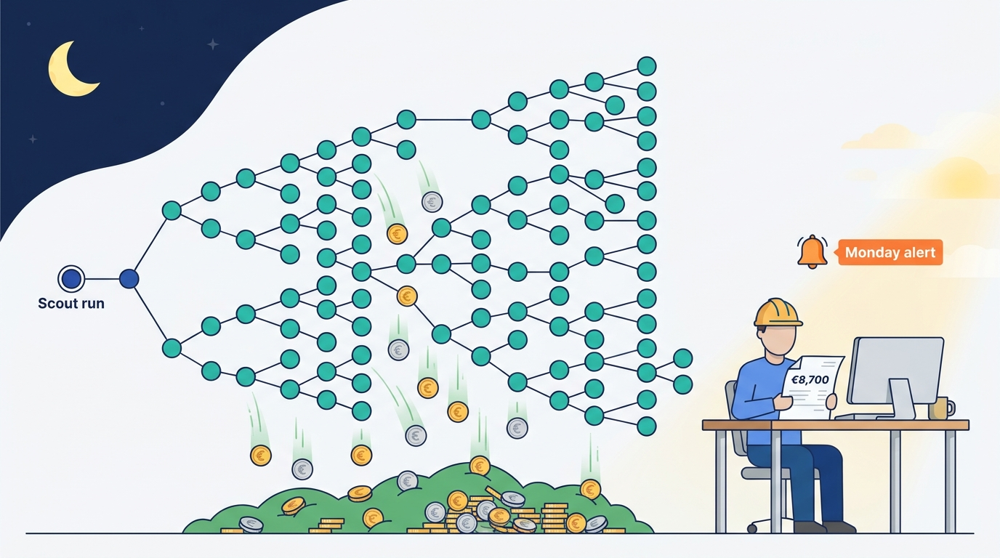
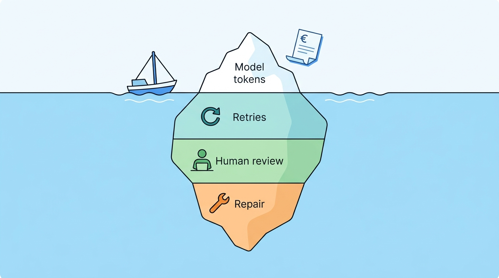
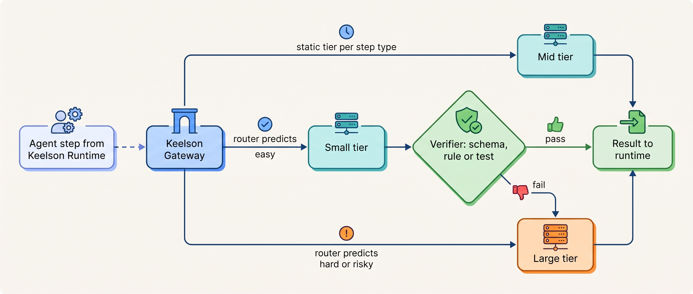
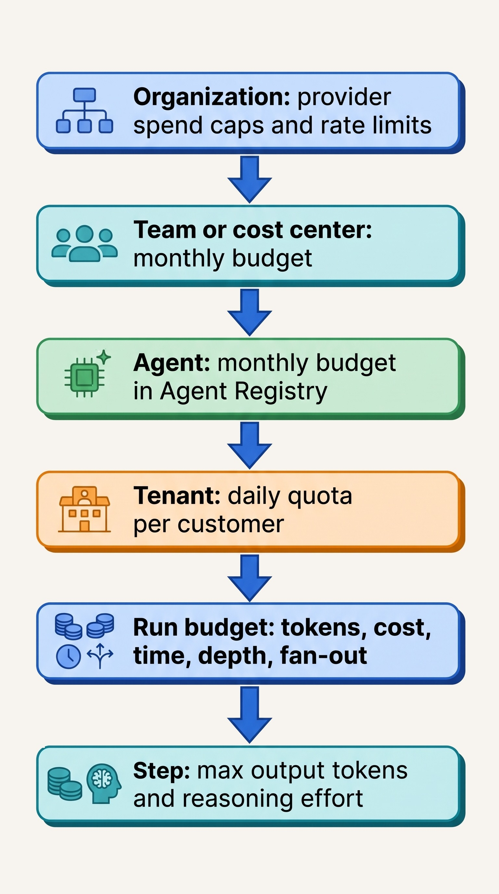
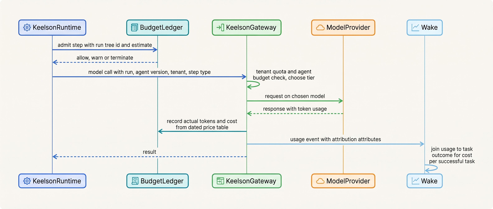
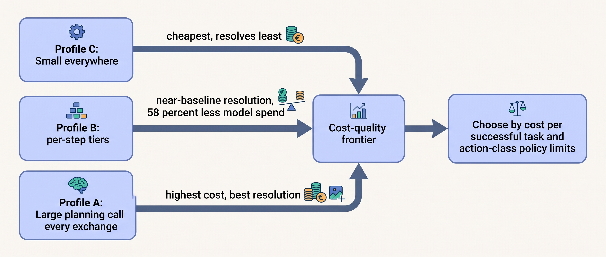

> **IN THIS CHAPTER, YOU WILL:** Take an agentic task apart into what it actually costs (re-read context, output and reasoning tokens, tools, retries, fan-out, human review and repair), learn to measure cost per successful task, and design the model routing, budgets and cost attribution that keep the number honest and bounded.

> **WHY THE BUSINESS CARES:** The CFO's question is not "what does a token cost?" but "what does one resolved conversation, one closed reconciliation or one merged pull request cost, and is that cheaper than the alternative?" Without per-task cost and hard budgets, an agent's business case cannot be checked, and one bad weekend can spend a quarter's margin on a single run.

> **WHY ARCHITECTS SHOULD CARE:** Cost is an emergent property of the loop, the context layout, the delegation policy and the retry design, not of the price list. The controls that bound it (terminating budgets, per-step model choice, attribution tags on every call) must be designed into the gateway and the runtime; they cannot be bolted on from a billing dashboard.

> **KEY POINTS:**
>
> * **Measure cost per successful task, not cost per token.** Divide everything the attempt consumed (model calls, tools, retries, failed runs, human approval and repair) by the tasks that actually succeeded. A cheaper model that resolves fewer tasks, or needs more human repair, usually raises this number.
> * **Choose models per step, and make every router or cascade earn its place with an evaluation.** Most steps in an agent loop do not need the strongest model, but a router is only as good as its quality signal. Evaluate routing on end-to-end task success and total cost together, on a cost–quality frontier, against a simple baseline.
> * **Budgets must terminate, not alert.** Put token, money, wall-clock, depth and fan-out limits per run in the runtime; per agent, tenant and team in the gateway; and attribute every call to a run, an agent version and an owner. An alert that fires on Monday morning is an invoice, not a control.

> **[FAILURE PATTERNS THIS CHAPTER ADDRESSES](where-agentic-systems-go-wrong.html):**
>
> * **The Token Bonfire** — runs without budgets let loops, fan-out and retries spend until an organization-wide quota or a human notices.
> * **The Agent Committee** — sub-agents multiply token spend roughly by the number of independent contexts, and nobody wrote down the task value that was supposed to pay for it.
> * **Vibe Evals** — model and routing choices are made on demos or on accuracy alone, without the cost of each configuration next to its success rate.

<br>
An agentic task does not have a price; it has a **cost distribution**. The same request to the same agent can take three model calls or thirty, stop at one tool or fan out to forty sub-agents, succeed on the first try or after two retries and a human repair. The provider's price list only tells you the cost of a unit of input and output. What the task costs depends on decisions the architecture makes: how much context each step re-reads, which model each step uses, how far the agent may delegate, what happens on a retry, and when someone stops the run.

That is why this chapter treats cost as a design property, measured per outcome and bounded by the runtime. **Cost per successful task** is the metric; the **model cascade** and the router are the main levers on its model component; the **run budget** is the control that bounds its tail; and **cost attribution** is what lets an owner be held to a number.

This chapter owns four terms: **cost per successful task**, **model cascade**, **run budget** and **cost attribution** for agents. It builds on [[models-and-the-model-gateway]], which places the gateway that meters and routes every model call; on [[agent-runtime]], which owns the loop where run budgets are enforced; on [[single-and-multi-agent-designs]], which decides when fan-out is worth it; and on [[evaluating-agentic-systems]], whose pass^k reliability metric feeds the denominator. It sits between [[agent-latency-and-throughput]], which owns the time dimension and rate limits, and [[caching-and-context-budgets]], which owns prompt caching and context discipline in depth.

## Setting the Scene at Ostrell: The Invoice With No Owner

Ostrell, the fictional field-service software group this book follows (see [[meet-ostrell]]), learned what an unbounded run costs on the first weekend of **February 2027**. A Scout research run on "competitor pricing across 14 markets" spawned sub-agents, which spawned sub-agents. Nothing limited depth, fan-out or spend per run. It ran for **41 hours**, made **1,900 sub-agent runs**, consumed about **310 million tokens** and spent **€8,700** before an organization-level quota alert reached an engineer on Monday morning. The report it produced was unusable: the same markets appeared in several duplicated sections. This is the Weekend Fan-out.


**Figure 1:** *The Weekend Fan-out: with no depth, fan-out or spend limit, one Scout run spawned 1,900 sub-agent runs and spent €8,700 before an alert reached an engineer on Monday.*

When Marten Ruys, the CFO, asked what the other agents cost, the Agent Platform team could answer only per provider API key and per month. Keelson Gateway logged tokens per request, but requests did not carry the run, the agent version, the tenant or the outcome. Nobody could say what one resolved Answerdesk conversation cost or which team should have paid for Scout's weekend.

Tomas Verhoef, Ostrell's Chief Architect, put three questions to the architecture review in March 2027:

1. **What does a successful task cost** for each agent, including the attempts that fail and the human work around them?
2. **Which model should each step use**, and how do we know a cheaper choice did not cost us more in failed tasks?
3. **What stops a run**, a tenant or an agent from spending without limit, and who owns each limit?

## The Cost Anatomy of an Agentic Task

### Task, run and step

Three units need to be distinct before any cost can be measured. A **task** is the unit of business value: a customer issue resolved, a reconciliation drafted, a pull request merged. A **run** is one execution of an agent toward a task; a task can have several runs (a retry after a crash, a re-run after a human rejected the first output). A **step** is one model call or tool call inside a run. Providers bill steps. Businesses value tasks. The architecture's job is to connect the two.

### Where the money goes

| Cost component | What drives it | Why it surprises teams |
| --- | --- | --- |
| **Re-read input** | Every model call re-sends system prompt, tool definitions, task and the history of earlier tool calls and results | Total input grows roughly with the square of the number of turns; it dominates agent bills |
| **Output and reasoning tokens** | Answer length, tool-call arguments, reasoning effort | Reasoning tokens are billed as output and can run to tens of thousands per call |
| **Tool and retrieval costs** | Paid APIs, search, embeddings, sandbox compute, browser sessions | Large tool results are paid for again on every later turn as input |
| **Retries and failed runs** | Timeouts, invalid tool calls, model errors, crashed runs restarted from scratch | Failed runs consume the same tokens as successful ones and produce nothing |
| **Fan-out** | Sub-agents, parallel branches, multi-agent debate | Spend multiplies roughly by the number of independent contexts |
| **Human oversight** | Approvals, sampled audits, escalations handled by people | Often the largest item, and it rises when you fix rubber-stamping |
| **Repair** | Reversing wrong actions, honoring wrong commitments, re-work | Invisible on the model invoice; sits in another team's budget |

The first row is the one architects most often underestimate. Anthropic's Claude Code documentation states that the tool "sends your full conversation with every request", and each batch of tool results is another request ([Anthropic, n.d., accessed 2026-10](https://code.claude.com/docs/en/costs)). In its July 2025 engineering post, Manus reported an average **input-to-output ratio of about 100:1** in its agent and called the cache hit rate "the single most important metric for a production-stage AI agent" ([Ji, 2025](https://manus.im/blog/Context-Engineering-for-AI-Agents-Lessons-from-Building-Manus)); that is one product's ratio, not a measured distribution, but the direction is consistent with the mechanism.

The mechanism is simple arithmetic. If a loop starts with a fixed prefix of *P* tokens and each turn adds Δ tokens (the tool call plus its result), turn *k* sends *P + kΔ* tokens, and *n* turns read *nP + Δ·n(n+1)/2* tokens in total. With an illustrative *P* = 10,000, Δ = 3,000 and *n* = 50, the loop reads about **4.3 million input tokens**, although no single request exceeds 160,000 *(assumption; arithmetic, not a measurement)*. Prompt caching multiplies the quadratic term by a smaller price; compaction, tool-result clearing and sub-agents attack the term itself. Both belong to [[caching-and-context-budgets]] and [[context-engineering]]. The architectural point for this chapter is that **cost must be modeled per task as a function of expected turn count**.

Fan-out is the second multiplier. In its June 2025 engineering post on its multi-agent research system, Anthropic reported that "agents typically use about 4× more tokens than chat interactions, and multi-agent systems use about 15× more tokens than chats", and that the multi-agent configuration beat a single agent by 90.2% on an internal research evaluation whose size and composition are not published ([Anthropic, 2025](https://www.anthropic.com/engineering/multi-agent-research-system)). Its condition was economic: the task's value must be "high enough to pay for the increased performance". Claude Code's documentation reports that agent teams use "approximately 7x more tokens than standard sessions" when teammates run in plan mode ([Anthropic, n.d., accessed 2026-10](https://code.claude.com/docs/en/costs)). These multipliers describe specific systems and model generations; the durable part is that **fan-out buys breadth and wall-clock time, not efficiency**.

### The price dimensions

The unit price itself has three independent dimensions, and each is a design choice:

| Dimension | Range across providers (as of October 2026) | Design consequence |
| --- | --- | --- |
| **Model tier** | On one provider's list on 28 October 2026, input prices ran from $0.10 to $10 per million tokens across current models, a 100× spread ([Anthropic pricing, accessed 2026-10-28](https://platform.claude.com/docs/en/about-claude/pricing)) | The tier per step is the largest lever on model spend |
| **Latency class** | Batch at 50% off at all three large providers (flex at the same price at two of them); fast or priority tiers at 1.8–2× standard (pricing pages, accessed 2026-10-28) | Work with a deadline in hours belongs on the batch path, which must then be resumable |
| **Cache state** | Cached reads at 0.025–0.1× base input; cache writes free to 2.5× depending on provider, model and cache lifetime (provider caching pages, accessed 2026-10-28) | Prompt layout is a cost decision; see [[caching-and-context-budgets]] |

Treat every number in that table as volatile, and remember that prices do not only fall. As of its 27 October 2026 update, Google's Gemini API pricing page listed scheduled **doublings** of input and output prices for several current models from 1 December 2026 and 1 January 2027 ([Google, 2026](https://ai.google.dev/gemini-api/docs/pricing)). **Keep price tables in configuration, with effective dates, owned by the platform team**, and compute cost from recorded token counts at read time, so that history can be re-priced. That is also the recommendation of Kapoor and colleagues for evaluation results: report token counts so cost "can be recalculated as prices change" ([Kapoor et al., 2024](https://arxiv.org/abs/2407.01502)).

## Cost per Successful Task

### The definition

**Cost per successful task** is the total cost incurred by all attempts at a class of tasks over a period, divided by the number of those tasks that succeeded:

```python
def cost_per_successful_task(period, task_class) -> Money:
    attempts = runs(period, task_class)            # every run, including failed and retried ones
    cost = (
        sum(model_cost(r) for r in attempts)       # tokens x dated price table
        + sum(tool_cost(r) for r in attempts)      # paid APIs, sandbox minutes
        + platform_allocation(task_class, period)  # gateway, runtime, evidence log, evals
        + oversight_cost(task_class, period)       # approvals, sampled audits (minutes x loaded rate)
        + repair_cost(task_class, period)          # reversals, honored errors, rework
    )
    successes = count(t for t in tasks(period, task_class) if t.outcome.is_success)
    return cost / successes
```

Three decisions hide inside that function, and each must be written down per agent.

**What counts as success.** The outcome definition comes from [[evaluating-agentic-systems]]: a resolved conversation, a reconciliation the accountant accepted unchanged, a merged pull request that was not reverted within 14 days. **A correct abstention or escalation counts as success** when the policy says the agent should not have acted, as the book's consistency rules require; otherwise the metric rewards an agent for guessing. A deflection that the customer abandons does not count.

**Agent-side or blended.** The agent-side number divides only the agent's own costs. The blended number adds the cost of humans finishing the tasks the agent did not, and divides by all tasks completed by anyone. The agent-side number tells the platform team whether the agent is efficient; the blended number tells the CFO whether the system as a whole is cheaper than the alternative. Report both, because a change can improve one and worsen the other.

**Where repair is booked.** The Double Credit cost **€31,400** in duplicate credits in March 2027, and the Stale Price Book cost **€46,000** in honored discounts in June 2027. Neither appeared on any model invoice. If repair costs stay in the billing or sales budget, the agent looks cheaper than it is, and the reliability work that prevents them looks like pure overhead.


**Figure 2:** *The model invoice shows only the tip: retries, failed runs, human oversight and repair sit below the waterline, and cost per successful task counts them all.*

### Why not cost per token or per request

Cost per token rewards cheaper models even when they fail more. Cost per request rewards shorter calls even when the agent needs more of them. Neither sees retries, failed runs, fan-out or humans. Reliability enters through the denominator: an agent whose per-attempt success is 75% does not succeed three times in a row 75% of the time; Anthropic's January 2026 evaluation guide works through the arithmetic, about 42% for pass^3 ([Anthropic, 2026](https://www.anthropic.com/engineering/demystifying-evals-for-ai-agents)). For a task that must succeed on the first attempt (a customer will not wait for a second run), per-attempt reliability is what fills the denominator, and every failed attempt is pure numerator.

The best public evidence for the metric is *AI Agents That Matter* (Kapoor, Stroebl, Siegel, Nadgir and Narayanan, July 2024 preprint). On HumanEval, with five runs per agent, a simple "warming" baseline on one model scored **93.2% at $2.45** in total, while a tree-search agent (LATS) on the same model scored **88.0% at $134.50**; the authors found "no significant accuracy difference" between their simple baseline and the best agent architecture, with costs differing "by almost two orders of magnitude" ([Kapoor et al., 2024](https://arxiv.org/html/2407.01502)). The models and benchmark are from 2024 and are superseded; the method, accuracy plotted against cost and compared with simple baselines, is the durable result.

The documented business counter-example comes from customer service. Klarna's February 2024 press release claimed its assistant did "the equivalent work of 700 full-time agents" ([Klarna, 2024](https://www.klarna.com/international/press/klarna-ai-assistant-handles-two-thirds-of-customer-service-chats-in-its-first-month/)), a vendor claim never independently audited. In May 2025 its chief executive was widely reported, from a Bloomberg interview, as saying that "cost unfortunately seems to have been a too predominant evaluation factor", with "lower quality" as the result ([Fortune, 2025](https://www.fortune.com/2025/05/09/klarna-ai-humans-return-on-investment)). Reporting describes a partial change of staffing strategy, not a withdrawal of the assistant. The lesson for the metric is that **a cost number without an outcome-quality definition in its denominator measures deflection, not resolution**.

## Model Selection: Static Assignment, Routers and Cascades

### Three ways to choose a model

Model choice is a per-step decision, not a per-agent constant. Keelson Gateway offers four tiers: **Large** (frontier reasoning models from two commercial providers), **Mid**, **Small** (including an open-weight model in Ostrell's own cloud account) and **Embed**. There are three ways to decide which tier a step uses. The general design of routers (thresholds from a cost matrix, calibration, a human route) belongs to [[routing-and-delegation]]; this section covers the router whose handlers are model tiers.

| Mechanism | Decides | Quality signal | Best for |
| --- | --- | --- | --- |
| **Static per-step assignment** | At design time, per step type (classify, extract, plan, propose action, summarize) | The eval suite for that step | Steps whose difficulty does not vary much across inputs |
| **Router** | Before the call, per input | A classifier or rule predicting difficulty or risk | High-volume steps with a mix of easy and hard inputs and a learnable signal |
| **Model cascade** | After the call: try a cheaper model, verify, escalate to a stronger one if verification fails | A verifier: schema check, test, rule, confidence, grader | Steps with a cheap, reliable check on the output |

A **model cascade** is a sequence of models of increasing cost, in which each output is checked and the request moves to the next model only when the check fails. FrugalGPT (Chen, Zaharia and Zou, 2023 preprint) introduced the term for language models and claimed, on 2023 single-turn tasks and prices, that a learned cascade could "match the performance of the best individual LLM (e.g. GPT-4) with up to 98% cost reduction" ([Chen et al., 2023](https://arxiv.org/abs/2305.05176)). RouteLLM (Ong et al., 2024–2025 preprint) trained routers between one strong and one weak model on preference data and reported costs reduced "by over 2 times in certain cases" without quality loss ([Ong et al., 2024](https://arxiv.org/abs/2406.18665)). Both measured single queries, not multi-step agent tasks; both depend on the price gap between tiers at the time, which has changed since.

Two findings cut the other way. The escalation baseline in *AI Agents That Matter* (cheap model first, stronger model on failure) was by far the cheapest strong option at **$0.27**, and also the least accurate, at **85.0%** against 93.2% ([Kapoor et al., 2024](https://arxiv.org/html/2407.01502)). And Anthropic reported in June 2025 that, on its research workload, "upgrading to Claude Sonnet 4 is a larger performance gain than doubling the token budget on Claude Sonnet 3.7" ([Anthropic, 2025](https://www.anthropic.com/engineering/multi-agent-research-system)): a stronger model can be cheaper per success if it needs fewer turns. The Holistic Agent Leaderboard (Kapoor et al., October 2025 preprint, 21,730 rollouts across 9 models and 9 benchmarks) reported "higher reasoning effort reducing accuracy in the majority of runs" ([HAL, 2025](https://arxiv.org/abs/2510.11977)), which makes reasoning effort a second dial that needs the same evaluation as the tier.

The disagreement resolves into a rule: **routing pays when a reliable, cheap quality signal exists for the step; without one, cheap-model retries and human repair can cost more than the expensive model.**

### Where each mechanism sits


**Figure 3:** *Routers decide before the call; cascades decide after it, and only a verifier the model cannot influence makes escalation safe.*

Four rules keep routing from becoming a source of silent failure.

1. **The verifier is not the model's own confidence.** Self-reported confidence is poorly calibrated: Ostrell's audit of the Answerdesk intake router found a confidence of 0.9 or higher on 83% of its misroutes ([[routing-and-delegation]]), and the author's agentic-healthcare-platform interview design rejects a "single global threshold on the model self-score" because it is "poorly calibrated and gameable" (design example, step 3). Prefer structural checks (schema validity, a deterministic rule, a test, a lookup against the system of record).
2. **Route on risk as well as difficulty.** A step that proposes a side effect (a credit, a journal entry, a quote) should be routed by the consequence of being wrong, not only by predicted difficulty. A router may move a step *up* a tier for risk; it should never move an action proposal *down* without an evaluation of that action class.
3. **A cascade adds latency on every escalation.** In an interactive exchange the second call lands on the critical path; [[agent-latency-and-throughput]] owns that budget. If the escalation rate is high, the cascade is slower *and* more expensive than starting on the stronger model.
4. **Routing configuration is versioned.** Router thresholds, the tier per step and the verifier are part of the agent version manifest ([[versioning-agent-systems]]) and roll out through canaries ([[staged-rollout-and-rollback]]). A router retrained on last month's traffic is a behavior change.

## Budgets, Quotas and Attribution

### The run budget

A **run budget** is a set of hard limits attached to one run and all its descendants: tokens, money, wall-clock time, steps, delegation depth and parallel fan-out, enforced by the runtime outside the model. "Budget" here means a limit that terminates or holds work, not a number on a dashboard. The author's agentic-platform-foundations interview design states the requirement directly: "budgets must terminate, not just alert", and it lists "budget as an alert" as a trap; its worked sizing sets the per-run hard cap at about 200,000 tokens, "<2× the p95 session" (design example, step `capacity`). The 2× rule is a sensible starting point: a cap close to p95 cuts legitimate long runs; a cap far above it lets runaways spend for a long time.

Agent frameworks increasingly ship these limits but do not turn them all on. As of the documentation accessed in October 2026, the Claude Agent SDK's sub-agent controls default to a spawn depth of 3 and 20 concurrent sub-agents, with **no default spend limit**; when a configured `max_budget_usd` is reached it refuses new spawns, stops background sub-agents and ends the query with an error ([Anthropic, n.d., accessed 2026-10](https://code.claude.com/docs/en/agent-sdk/subagents)). The same page warns that prompt instructions "only steer Claude, so set the limits as well". **A framework default is not a budget policy**; the platform should set and record its own.

What happens at exhaustion matters as much as the limit. A run that hits its budget in the middle of a side effect must not leave the action half-done or start a new one. The runtime's rule at Ostrell is: stop issuing new model calls and new tool calls, let an already-dispatched tool call finish or reach its timeout, record the outcome (including `unknown`, per [[retries-idempotency-and-concurrency]]), hold any queued action objects for review rather than dropping them, and produce a partial result marked as budget-terminated. That is the same "hold, not drop" rule as a kill switch.

```python
@dataclass(frozen=True)
class RunBudget:
    max_tokens: int
    max_cost_eur: Decimal
    max_wall_clock: timedelta
    max_depth: int
    max_parallel_children: int

def admit_step(run: Run, step: PlannedStep) -> Admission:
    spent = budget_ledger.spent(run.root_id)          # aggregated over the whole run tree
    estimate = estimate_cost(step, price_table.at(now()))
    b = run.budget
    if run.depth > b.max_depth or run.active_children >= b.max_parallel_children:
        return Admission.reject("delegation_limit")
    if spent.cost + estimate > b.max_cost_eur or spent.tokens + step.max_tokens > b.max_tokens:
        return Admission.terminate("budget_exhausted")   # hold queued actions, wrap up
    if now() - run.started_at > b.max_wall_clock:
        return Admission.terminate("deadline")
    if spent.cost + estimate > Decimal("0.8") * b.max_cost_eur:
        return Admission.allow(warn="budget_80pct")
    return Admission.allow()
```

The check runs **before** every model and tool call, on a ledger aggregated across the whole run tree, so a sub-agent cannot escape its parent's budget by starting fresh. When a run delegates, Keelson reserves the child's slice of the budget atomically on the root ([[single-and-multi-agent-designs]]), so parallel children cannot jointly overspend.

### The budget hierarchy

Run budgets bound one run. They do not stop a thousand well-behaved runs from adding up, a tenant from flooding an agent, or one agent from consuming the organization's shared provider limits. Budgets therefore nest.


**Figure 4:** *Each level bounds a different failure: the step bounds one call, the run bounds a loop or fan-out, the tenant bounds a noisy customer, the agent and team bound a slow drift in spend, and the provider cap is the last resort, not the plan.*

| Level | Enforced by (Keelson) | Failure it bounds | Action at limit | Who sets it |
| --- | --- | --- | --- | --- |
| Step | Keelson Gateway (max output tokens, effort) | One runaway generation | Truncate; mark the step | Agent owner, per step type |
| Run | Keelson Runtime budget ledger | Loops, fan-out, retry storms | Terminate and hold | Agent owner, within platform maximum |
| Tenant | Keelson Gateway quota, Bulkhead policy | One customer flooding a shared agent | Queue or reject with a retryable error | Product owner per contract tier |
| Agent | Agent Registry budget, Gateway enforcement | Gradual spend drift; a bad release | Alert at 50% and 80%; throttle new runs at 100% | Agent owner; raise needs risk owner sign-off |
| Team | Wake cost reports, Gateway | Portfolio overrun | Showback monthly; hard stop only for experimental agents | Finance with the department head |
| Organization | Provider spend caps and rate limits | Everything else | Provider returns errors | Agent Platform team |

The provider level deserves one warning. Anthropic's rate-limit documentation, accessed October 2026, states that at the monthly spend cap requests return HTTP 429 with `enforced_spend_limit_reached` and no `retry-after`, until the next month begins ([Anthropic, n.d., accessed 2026-10](https://platform.claude.com/docs/en/api/rate-limits)). That 429 is **not retryable**, unlike a rate-limit 429, and client code that retries it with backoff will spin until the month turns. The gateway must tell the two apart. If the provider cap is the control that fires, every agent in the organization stops at once.

### Cost attribution

**Cost attribution** for agents means that every billable event (model call, tool call, sandbox minute, human review) carries enough identifiers to assign its cost to a task, a run, an agent version, a tenant and an owner, and to join it to the task's outcome. Without the outcome join, attribution produces a cost-per-agent report, not a cost per successful task.

| Attribute | Example | Why it is needed |
| --- | --- | --- |
| `run_id`, `root_run_id`, `parent_run_id` | Run tree of a Scout task | Aggregate fan-out; enforce the run budget across descendants |
| `task_id` and outcome | Answerdesk conversation, `resolved` | The denominator |
| `agent_id`, `agent_version` | `answerdesk`, manifest hash | Compare versions; attribute a regression to a release |
| `step_type`, model tier, exact model id | `propose_action`, Large | Evaluate routing per step |
| `tenant_id` | A Field customer | Tenant quotas; contract profitability |
| `action_class` | `issue_credit_le_250` | Cost per action class for autonomy reviews |
| `cost_center` | Support Operations | Showback |
| Token counts by category | input, cached input, cache write, output, reasoning | Re-pricing when the price table changes |

The OpenTelemetry GenAI semantic conventions define token-usage attributes and agent spans, but as of 28 October 2026 they carry **Status: Development** and are maintained in a separate GenAI repository ([OpenTelemetry, accessed 2026-10-28](https://github.com/open-telemetry/semantic-conventions-genai/blob/main/docs/gen-ai/README.md)). Emit them, but keep the attribution schema above as your own contract behind a thin mapping layer; the trace design is in [[agent-observability]].

## The Architecture at Ostrell

After the March 2027 review, the controls were placed where they could not be bypassed: the budget ledger in Keelson Runtime, the meter and the router in Keelson Gateway, the budget policies in Bulkhead and the reports in Wake.


**Figure 5:** *The runtime admits each step against the run tree's budget before the call; the gateway enforces tenant and agent quotas, records actual usage with attribution, and Wake joins cost to outcome.*

The responsibilities and requirements per interaction:

| Interaction | Owner | Consistency | Latency | Durability | Who may change it |
| --- | --- | --- | --- | --- | --- |
| Step admission against run budget | Keelson Runtime | Strong per run tree (one ledger row per root run) | < 5 ms, on the critical path | Durable with the run's workflow state, so a resumed run keeps its spend | Nobody at run time; limits come from the manifest |
| Tenant and agent quota check | Keelson Gateway | Approximate (token bucket), may overshoot by in-flight calls | < 2 ms | Counters may be rebuilt from usage events | Agent owner within limits set in Agent Registry |
| Usage recording | Keelson Gateway → Wake | At-least-once, deduplicated by request id | Asynchronous | Retained with traces; token counts kept for re-pricing | Nobody; append-only |
| Price table | Agent Platform team | Versioned with effective dates | Read at recording and reporting time | Version-controlled configuration | Platform team, reviewed |
| Routing profile per agent | Agent owner | Pinned in the agent version manifest | Read at call time | In the manifest | Through Sounding's regression gate and staged rollout |

One placement choice is worth defending. The run budget lives in the **runtime's durable state**, not only in the gateway's counters, because Keelson Runtime records model and tool calls as activities on its durable workflow engine ([[durable-agent-execution]]). If a run crashes and resumes, the spend so far resumes with it. A gateway-only counter would forget the money already spent by a run that restarted after a deploy.

## Worked Example at Ostrell: Cost per Resolved Conversation

In October 2027 Lena Brandt, Director of Support Operations, brought Answerdesk's Q3 numbers to the quarterly business review. Answerdesk handles **2.6 million conversations a year**, about 650,000 a quarter. In Q3 2027 its end-to-end resolution rate was **41%**, human escalation **33%**, and the remaining 26% were abandoned or resolved by the customer. All figures below are Ostrell's (fictional); per-unit costs not in the ledger are labeled assumptions.

**The baseline, per 1,000 conversations (Q3 2027).** Each Answerdesk exchange (one customer message and the reply) ran a Large-tier planning call whose reasoning effort had been set once, for the whole agent, during the 2026 prototype, followed by a Mid-tier answer call; the intake classifier ([[routing-and-delegation]]) and the quarantined reader of inbound email, added after the Poisoned Ticket, ran on cheaper tiers. [[agent-latency-and-throughput]] tells the same exchange's story from the latency side. The €120 already includes the July 2027 prefix-layout change, which cut input spend per conversation by about two thirds ([[caching-and-context-budgets]]).

| Item | Per 1,000 conversations | Basis |
| --- | --- | --- |
| Model spend | €120 | Wake usage events, re-priced with the Q3 price table |
| Platform allocation (gateway, runtime, Logbook, Wake, Sounding runs) | €30 | Agent Platform showback |
| Oversight: A1 credit approvals and 5% second-review sample | €10 | About 7 approvals per 1,000 conversations at a loaded rate *(assumption for the per-minute rate)* |
| **Agent-side total** | **€160** | |
| Resolved conversations | 410 | Outcome from Logbook |
| **Agent-side cost per resolved conversation** | **€0.39** | €160 ÷ 410 |
| Human handling of an escalated conversation | €5.50 each | Support Operations' average |

The agent-side number looked excellent. The blended number told the real story: the 330 escalations per 1,000 cost €1,815 in human time, more than eleven times the agent's own cost. **The cost lever was resolution, not tokens.** Oversight behaves the same way: fixing the Rubber Stamp in Q3 raised review time per approval, and promoting credits of €250 or less to A2 in October 2027 removed approvals where sampling gave enough assurance ([[evidence-for-autonomy]]).

**The routing evaluation (November 2027).** After the 2 November latency incident, Mei Lin Zhou's team ran three routing profiles through Sounding's Answerdesk simulator on the same 2,000-conversation regression suite, five trials each, recording cost and outcome for every trial:

| Profile | Steps by tier | Resolution (suite) | Credit proposals violating policy | Model spend per 1,000 | Change in blended cost per 1,000 vs baseline |
| --- | --- | --- | --- | --- | --- |
| **A. Baseline** | Large-tier planning call every exchange; Mid-tier answer | 41.0% | 1.2% | €120 | — |
| **B. Per-step** | One Mid-tier decide-or-answer call at low reasoning effort; Large only for exchanges the classifier marks complex and for drafting credit and revisit action objects; speculative KB search | 40.7% | 1.3% | €50 | **−€57** |
| **C. Small everywhere** | Every model step after intake on Small | 35.2% | 4.0% | €15 | **+€150** |

The last column assumes that 80% of conversations that are no longer resolved end in an escalation at €5.50 *(assumption)*. For profile B, €70 of model savings minus about 2.4 extra escalations (€13) gives a net saving of about €57 per 1,000 conversations, or **about €148,000 a year** at 2.6 million conversations. For profile C, €105 of model savings is outweighed by about 46 extra escalations (€255), and the policy-violation rate on credit proposals more than triples, which the autonomy review would not accept for an A2 action class at any price.

The shape of profile B is the general pattern: **cheaper tiers where the output has a cheap check or a human downstream, the expensive tier where a wrong output becomes an action.** Its model spend includes the speculative knowledge-base searches wasted on about 11% of exchanges; removing the Large planning call paid for them many times over. The 0.3-point difference in resolution between A and B was within the run-to-run spread of the suite, so the team treated it as a possible loss, not as noise, and kept it in the blended calculation. Profile B shipped with the latency redesign in December 2027, behind a canary on 5% of conversations at first, with resolution, escalation and cost per resolved conversation as the guardrail metrics ([[staged-rollout-and-rollback]]).


**Figure 6:** *Cost-aware evaluation places each configuration on a cost–quality frontier; the decision uses cost per successful task and the policy limits of the action classes, not the cheapest point.*

## The Weekend Fan-out, Replayed Under Budgets

The second worked example tests the controls against the incident that motivated them. Since the Weekend Fan-out, Scout's manifest carries a run budget: delegation depth at most **2**, at most **8** parallel sub-agents, and a default of **8 million tokens, €90 and 90 minutes** per run, which the Strategy & Insights lead may raise up to 3× for a named run. The default is sized for Scout's orchestrator–worker runs, which use about 2.4× the tokens of single-agent runs on Sounding's Scout suite ([[single-and-multi-agent-designs]]), not for its typical 14-minute run.

Under those limits the competitor-pricing run cannot grow as it did. With depth 2 and 8 children per agent, the run tree holds at most 8 + 64 = **72 sub-agent runs**, against 1,900 in February. The cost cap stops it far earlier than the tree limit: at the run's observed burn rate (about €210 an hour, €8,700 over 41 hours), €90 is reached in about 25 minutes and the 80% warning in about 20, before the token or wall-clock limit. The run would have terminated within half an hour of starting, on the Saturday, with a partial report marked as budget-terminated, and a task-level alert to its requester. The loss is €90, not €8,700.

Two lessons followed. Wake now tracks **budget-termination rate** per agent: a rise means either a runaway or a cap that no longer fits the work. And the original report was unusable because sub-agents repeated each other's work. A budget bounds the waste but does not remove it; the delegation contract in [[coordination-and-handoffs]] (distinct subtasks, one writer per section) is what makes a run worth its budget.

## Failure Modes and Recovery

| Scenario | What happens | Detection | Containment | Recovery |
| --- | --- | --- | --- | --- |
| **Recursive fan-out** (the Weekend Fan-out) | Sub-agents spawn sub-agents; spend grows with the tree | Run-tree size and cost per root run in the budget ledger; 80% warning | Depth, fan-out and cost caps in the runtime; terminate and hold | Partial result delivered; owner reviews the delegation prompt and contract |
| **Retry storm** | A tool times out; each retry re-asks the model with the full context | Retries per run, cost per run vs p95 | Retry budget per step; never re-ask the model on a tool retry ([[retries-idempotency-and-concurrency]]) | Unknown outcomes go to the repair queue; the step resumes from its recorded intent |
| **Silent cache regression** | A deploy reorders a JSON field or adds a timestamp to the prefix; cache hit rate falls and input cost multiplies with no error | Cache hit rate per agent and route as a service level indicator; cost per run step change | Canary compares cost per task against control | Roll back the prompt layout; add a prefix-stability test to CI ([[caching-and-context-budgets]]) |
| **Router drift** | A router or provider change sends more hard inputs to the cheap tier; resolution falls slowly while model spend looks better | Cost per successful task and escalation rate per routing branch; daily canary eval on production manifests | Pin router version in the manifest; route action proposals by risk | Revert routing profile; retrain with the new traffic in shadow before re-release |
| **Tenant loop** | A customer's auto-responder and Answerdesk reply to each other, opening thousands of conversations | Conversations per tenant per hour against its baseline | Tenant quota at the gateway; loop detection on repeated near-identical inbound messages | Contact the customer; quarantine the sender address; exclude the loop from outcome metrics |
| **Provider spend cap reached** | Non-retryable 429s stop every agent on that provider at once | Gateway distinguishes `enforced_spend_limit_reached` from rate limits | Agent-level budgets fire well before the provider cap; fallback route to the second provider for critical agents | Raise the cap through the provider; review which agent drove the overrun |
| **Budget terminates mid-action** | A run hits its cap between proposing and executing a side effect | Runs ending in `budget_exhausted` with open action objects | Hold, not drop: in-flight call completes or reaches `unknown`; queued actions wait for review | A human approves or cancels held actions; the task restarts from its checkpoint with a fresh budget if justified |

The author's ai-coding-cli interview design names a transcript rewrite that breaks the cache as a "silent 10x cost regression" (design example, step `inference`). The defense is to monitor cost per task as an operational metric with the same alerting discipline as latency.

## Trade-offs

| Decision | Option | When it is right | What it costs |
| --- | --- | --- | --- |
| Model choice | One strong model for every step | Low volume, high value per task, no cheap verifier (Closewise classification) | Highest model spend; simplest to evaluate and debug |
| | Static per-step tiers | Step types differ in difficulty but each type is consistent | An eval suite per step type |
| | Learned router | High volume, mixed difficulty, a learnable signal | Router training data, drift monitoring, another versioned artifact |
| | Cascade with verifier | A cheap, reliable check exists (schema, test, rule) | Extra latency on every escalation; useless if the escalation rate is high |
| Budget enforcement | Alert only | Never for production runs | The Weekend Fan-out |
| | Hard terminate per run | Every agent | Some legitimate long runs are cut; needs a re-run path with a raised budget |
| | Hold and request approval to continue | Long, valuable asynchronous runs (Scout) | A human in the loop for overruns; latency |
| Price class | Standard interactive | Customer-facing exchanges | Full price |
| | Batch or flex | Evaluation runs, nightly reconciliation drafts, enrichment | Up to 24 hours' delay; work must be resumable and idempotent |
| Fan-out | Single agent | Most tasks; shared context; coding | Wall-clock time on breadth-first tasks |
| | Sub-agents with budgets | Separable, valuable, breadth-first research | Several times the tokens; needs a written economic justification |

My recommendation for most enterprise agents is static per-step tiers first, a cascade only where a deterministic verifier exists, and a learned router only for very high-volume steps after the static profile has been measured. **The expensive tier stays on any step whose output becomes an action**, until an evaluation of that action class says otherwise. That recommendation does not hold for agents whose volume is small enough that the evaluation effort costs more than the model spend it would save: for Clausewise at about 600 contracts a month, one strong model and a careful prompt are cheaper than a routing program.

## Across Domains: How the Stakes Change the Design

| | Coding agents | Customer operations (support, sales, marketing) | Back office (finance, legal, HR) | High-stakes decisions (healthcare, public benefits) |
| --- | --- | --- | --- | --- |
| **Unit of success** | Merged PR not reverted (Forge: ~3,400 agent PRs a month, 61% merged) | Resolved conversation; quote accepted by the account executive | Entry approved unchanged; redline accepted | Draft or evidence package accepted by the accountable professional; correct abstention |
| **Dominant cost** | Reviewer time and CI compute; tokens in long sessions | Human escalation and approval labor at volume | Expert review time (controllers, lawyers) | Clinician or caseworker time; the human queue is the capacity limit |
| **Where cheap tiers fit** | Search, summarization, sub-agent exploration; tests are a cheap verifier | Intent detection, KB answers with grounding checks | Extraction with deterministic matching after it | Retrieval and formatting only; not on safety-relevant reasoning without evaluation per task type |
| **Budget shape** | Per session and per repository per day; bounded CI fix rounds | Per exchange, per conversation, per tenant | Per close cycle and per entity; batch-eligible | Per query token budget; queue-depth limits on human sign-off |
| **Price class** | Interactive for CLIs; batch-eligible for nightly harness jobs | Interactive; latency-bound | Mostly batch or flex | Interactive for point-of-care queries; batch for casework preparation |
| **Repair cost of a wrong cheap answer** | Low inside a sandbox; high once merged | Money and commitments to customers | Misstated books, privileged disclosures | Harm to a person; due-process failures |

The domain specifics come from Ostrell and from the author's interview designs. The ai-coding-harness design prices inferential PR review at about 50,000 tokens and $0.20–0.50 per PR, "affordable at PR granularity, ruinous on every edit event", and orders controls by cost: CPU time is cheaper than tokens, which are cheaper than human attention (design example, `capacity`). The agentic-healthcare-platform design sets an inference budget of about 4,000–8,000 tokens per query with bounded context and treats sign-off queue age as an operational limit (design example, `capacity`). The agentic-research-platform design's funnel (about 2,000 proposals a day, 1,500 dry-runs, 50–150 authorized wet-lab runs on 10–40 instrument slots) shows the extreme case: the scarce resource is physical and human, and tokens barely register (design example, `capacity`). The agentic-support-platform design, by contrast, specifies a per-exchange latency budget and a smaller fallback model but **no cost per conversation** at all, a gap the book's Answerdesk example fills with illustrative numbers.

**What the platform keeps common:** the cost-per-successful-task definition, attribution schema, budget ledger, budget hierarchy, price tables with effective dates, routing as versioned configuration and cost recorded with every evaluation result. **What is domain policy:** what counts as success, which steps may run on cheaper tiers, the budget values, and how far cost may weigh against quality. In back office and high-stakes domains, the policy should say plainly that cost is not a reason to route a safety- or rights-relevant step to a cheaper model without an evaluation of that task type.

## The Chief Architect's View

**Decide the metric before the model.** Each agent owner writes down the success definition, both cost-per-success numbers and the baseline to beat (the human process, or the workflow without a model). The Agent Registry entry carries them, and Marten Ruys's team reviews them quarterly ([[owning-agentic-systems]]).

**Put the controls where they cannot be bypassed.** Run budgets in the runtime's durable state; tenant and agent quotas in the gateway; budget policy as code in Bulkhead; attribution on every call. The platform sets maximums; agent owners set values within them; raising an agent's monthly budget needs the risk owner's sign-off, because spend is a proxy for blast radius.

**Own the price table.** The Agent Platform team keeps provider prices, multipliers and their effective dates as reviewed configuration, re-prices history from token counts, and re-runs routing evaluations when prices change.

**Expect the routing to be thrown away.** Tier boundaries, price gaps and which steps need the strongest model change with each model generation. What stays is per-step model choice as configuration, frontier evaluation, terminating budgets and attribution.

**Watch four numbers per agent:** cost per successful task (agent-side and blended), budget-termination rate, cache hit rate, and cost per run at p95. A step change in any of them is an incident to investigate, even when no error fired.

## Questions to Ask

1. What is this agent's unit of success, and does a correct escalation or abstention count as one?
2. What is the agent-side and the blended cost per successful task, and what baseline does it beat?
3. Where are retries, failed runs, approvals and repair costs counted, and in whose budget?
4. Which steps run on which model tier, and which evaluation shows that the cheaper choices did not lower task success or raise policy violations?
5. If there is a router or cascade, what is its quality signal, is the signal independent of the model's own confidence, and what is the escalation rate?
6. What are the run budget's limits (tokens, money, wall-clock, depth, fan-out), how do they relate to p95, and what happens to in-flight and queued actions when one is hit?
7. Which budgets sit above the run (tenant, agent, team), who sets them, and which one fires before the provider's spend cap?
8. Can every model call be attributed to a run, an agent version, a tenant and an outcome? Can history be re-priced when prices change?
9. Is cost recorded next to every evaluation result, and is the release gate looking at cost per task as well as quality?

Cost per successful task depends heavily on how much context each step re-reads and whether the provider can reuse it. The next chapter, [[caching-and-context-budgets]], takes up prompt caching, prefix stability and context budgets, and how to get their savings without serving stale or wrong answers.

## Sources and Evidence

### Research papers

- [AI Agents That Matter](https://arxiv.org/abs/2407.01502) (full text: [HTML](https://arxiv.org/html/2407.01502)) — Kapoor, Stroebl, Siegel, Nadgir, Narayanan; **2024** (preprint). Cost-controlled agent evaluation, HumanEval cost–accuracy results, escalation baseline, re-pricing from token counts.
- [Holistic Agent Leaderboard: The Missing Infrastructure for AI Agent Evaluation](https://arxiv.org/abs/2510.11977) — Kapoor, Stroebl, Kirgis et al.; **2025** (preprint). 21,730 rollouts; higher reasoning effort reduced accuracy in most runs.
- [FrugalGPT: How to Use Large Language Models While Reducing Cost and Improving Performance](https://arxiv.org/abs/2305.05176) — Chen, Zaharia, Zou; **2023** (preprint). Origin of the LLM cascade; claimed cost reductions on 2023 tasks and prices.
- [RouteLLM: Learning to Route LLMs with Preference Data](https://arxiv.org/abs/2406.18665) — Ong et al.; **2024, revised 2025** (preprint). Learned routers between a strong and a weak model.

### Specifications, standards and regulation

- [OpenTelemetry GenAI semantic conventions](https://github.com/open-telemetry/semantic-conventions-genai/blob/main/docs/gen-ai/README.md) — OpenTelemetry; **n.d., accessed 2026-10**. Token-usage attributes and agent spans; status Development.

### Vendor documentation and engineering reports

- [How we built our multi-agent research system](https://www.anthropic.com/engineering/multi-agent-research-system) — Anthropic; **2025**. 4× and 15× token multipliers; economic condition for multi-agent; model upgrade beating a doubled token budget.
- [Demystifying evals for AI agents](https://www.anthropic.com/engineering/demystifying-evals-for-ai-agents) — Anthropic; **2026**. pass^k arithmetic (75% per trial, about 42% for pass^3).
- [Manage costs effectively (Claude Code)](https://code.claude.com/docs/en/costs) — Anthropic; **n.d., accessed 2026-10**. Full conversation re-sent per request; agent-team token multiplier.
- [Subagents in the Agent SDK](https://code.claude.com/docs/en/agent-sdk/subagents) — Anthropic; **n.d., accessed 2026-10**. Default spawn depth and concurrency; no default spend limit; `max_budget_usd` behavior.
- [Pricing](https://platform.claude.com/docs/en/about-claude/pricing) — Anthropic; **n.d., accessed 2026-10-28**. Tier price spread, batch discount, cache multipliers, location premium.
- [Rate limits](https://platform.claude.com/docs/en/api/rate-limits) — Anthropic; **n.d., accessed 2026-10**. Spend caps and the non-retryable `enforced_spend_limit_reached` error.
- [Gemini Developer API pricing](https://ai.google.dev/gemini-api/docs/pricing) — Google; **last updated 2026-10-27**. Batch discount; scheduled price increases from December 2026 and January 2027.
- [Pricing](https://developers.openai.com/api/docs/pricing) and [Prompt caching](https://developers.openai.com/api/docs/guides/prompt-caching) — OpenAI; **n.d., accessed 2026-10**. Batch, flex and fast tiers; cache write and read pricing.
- [Context Engineering for AI Agents: Lessons from Building Manus](https://manus.im/blog/Context-Engineering-for-AI-Agents-Lessons-from-Building-Manus) — Yichao Ji, Manus; **2025**. About 100:1 input-to-output ratio; cache hit rate as the key metric.

### Incidents, cases and decisions

- [Klarna AI assistant handles two-thirds of customer service chats in its first month](https://www.klarna.com/international/press/klarna-ai-assistant-handles-two-thirds-of-customer-service-chats-in-its-first-month/) — Klarna; **2024**. Vendor claim of FTE-equivalent savings (unaudited).
- [Fortune report on Klarna's return to human support staff](https://www.fortune.com/2025/05/09/klarna-ai-humans-return-on-investment) — Fortune, 9 May 2025; **2025**. Widely reported CEO statement that cost was "a too predominant evaluation factor"; partial change of strategy.

### Design examples from the author's interview project

- Obrenović, Ž., "Agentic Platform Foundations", system-design interview design, `system-design-interviews/data/book/agentic-platform-foundations/interview.json`, step `capacity`, 2026. Terminating budgets, per-run cap below 2× p95, per-tenant budgets.
- Obrenović, Ž., "Agentic Support Platform", system-design interview design, `system-design-interviews/data/book/agentic-support-platform/interview.json`, step `live-loop` and `capacity`, 2026. Per-exchange latency budget and fallback model; absence of a cost-per-conversation model.
- Obrenović, Ž., "AI Coding CLI", system-design interview design, `system-design-interviews/data/book/ai-coding-cli/interview.json`, step `inference`, 2026. Cache-breaking transcript rewrite as a silent cost regression.
- Obrenović, Ž., "AI Coding Harness", system-design interview design, `system-design-interviews/data/book/ai-coding-harness/interview.json`, `capacity`, 2026. Per-PR review cost; CPU, tokens and human attention as a cost order.
- Obrenović, Ž., "Agentic Healthcare Platform", system-design interview design, `system-design-interviews/data/book/agentic-healthcare-platform/interview.json`, `capacity` and step 3, 2026. Per-query token budget; rejection of model self-score thresholds.
- Obrenović, Ž., "Agentic Research Platform", system-design interview design, `system-design-interviews/data/book/agentic-research-platform/interview.json`, `capacity`, 2026. Proposal-to-wet-lab funnel; physical and human capacity as the binding constraint.

Ostrell is fictional; architectural recommendations, labeled inferences and labeled assumptions are the author's judgement.
