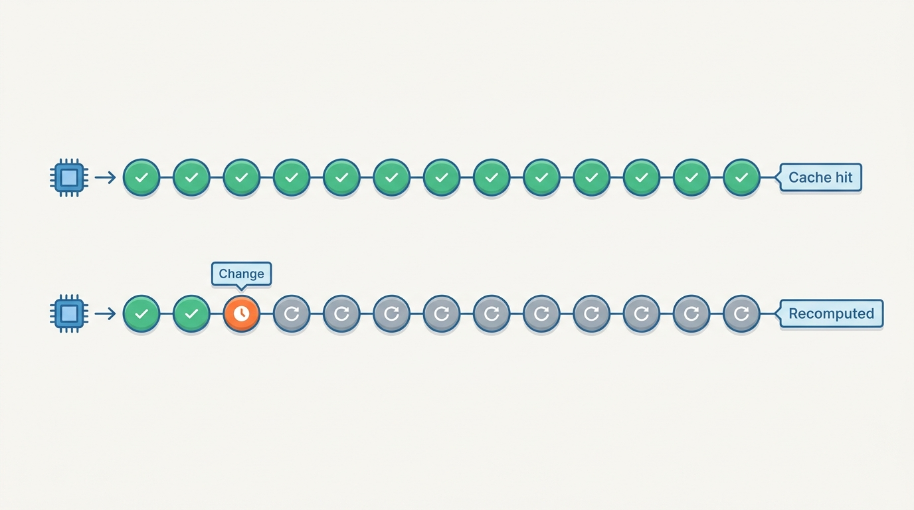
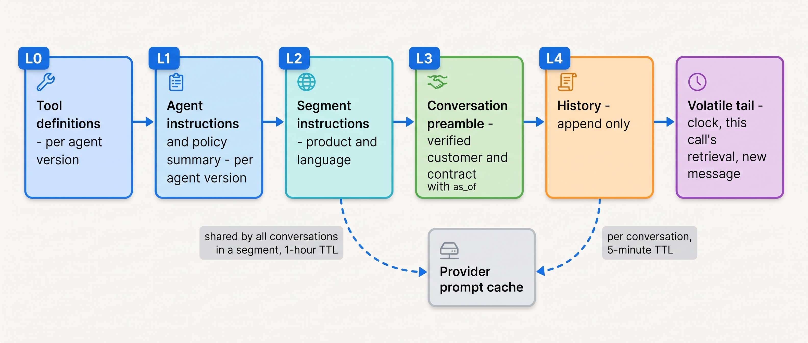
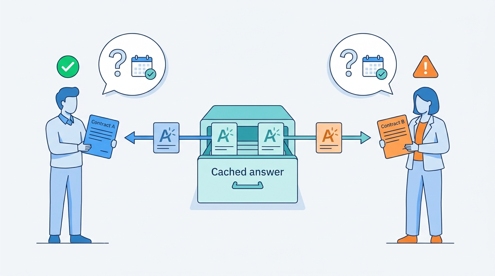
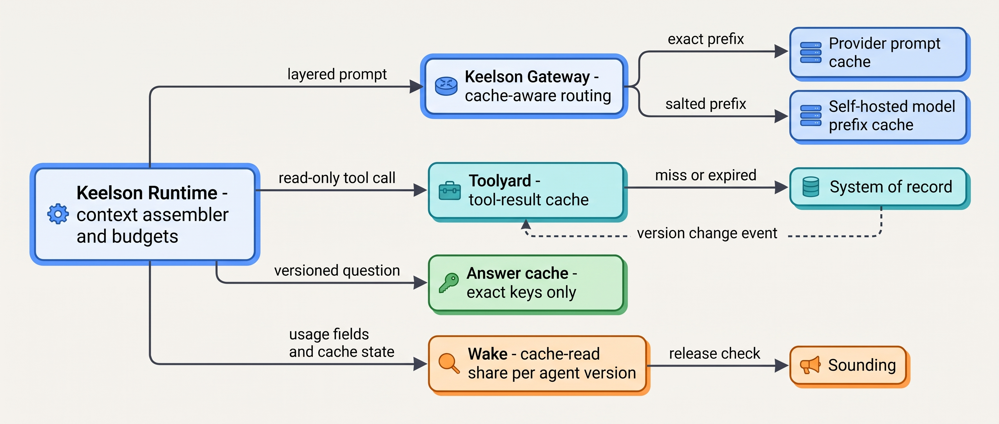

> **IN THIS CHAPTER, YOU WILL:** Learn how provider prompt caches work and how to design a prompt layout that keeps them warm, where response, tool-result, semantic and plan caches are safe and where they serve wrong answers, how to set and enforce context budgets per step, when to compact, and which work belongs on batch tiers.

> **WHY THE BUSINESS CARES:** An agent re-reads its whole context on every model call, so input tokens, not output, are most of the bill. A prompt layout that breaks the cache can make every conversation cost two to three times what it should. A cache that serves an out-of-date price or another customer's answer costs more than the tokens it saved.

> **WHY ARCHITECTS SHOULD CARE:** Prompt layout, cache keys, invalidation rules and context budgets are architecture, not tuning. They cut across the gateway, the runtime, the tool broker and the release pipeline, and they fail silently: a cache miss returns a correct answer at full price, and a stale cache hit returns a wrong answer at a discount.

> **KEY POINTS:**
>
> * **Prefix stability is a design constraint, not an optimization.** Provider prompt caches match exact prefixes, so the context must be ordered from most stable to least stable (tools, instructions, segment, conversation, history, then a volatile tail) and serialized deterministically. One timestamp at the top of the system prompt can turn caching into a surcharge.
> * **A cache is correct only if its key carries everything that makes the answer correct.** Exact response caches and tool-result caches are safe when the key includes tenant, scope, tool or prompt version and source version, and the TTL is shorter than the data's freshness SLO. Semantic caches match on similarity, not on those facts; keep them away from answers that depend on the customer, the contract or the date, and never let any cached value finalize an action.
> * **Budget the context per step and enforce it in the runtime.** Give each step a token budget split by source, cap tool results at the broker, and compact in large, infrequent steps with pinned fields, because every compaction or clearing also invalidates the cache. Put work with a deadline of hours on batch tiers, which roughly halve the price, and make it resumable because batches can expire.

> **[FAILURE PATTERNS THIS CHAPTER ADDRESSES](where-agentic-systems-go-wrong.html):**
>
> * **The Token Bonfire** — an agent whose prompt layout defeats the provider cache pays full price for the same tens of thousands of tokens on every call, and nobody notices because nothing errors.
> * **Context Soup** — an unbudgeted context grows with every turn and every tool result until relevant facts are drowned and the cost grows with the square of the turn count.
> * **The Fire-and-Forget Action** — a cached tool result or a cached answer used to decide an action means the action ran on data nobody re-read.

<br>
An agent loop sends the model its system prompt, its tool definitions, the task and everything that happened so far, **on every call**. Claude Code's cost documentation says it plainly: the tool "sends your full conversation with every request" ([Anthropic, n.d., accessed 2026-10](https://code.claude.com/docs/en/costs)). Manus reported in 2025 that its agent's "input-to-output ratio averages about 100:1" ([Manus, 2025](https://manus.im/blog/Context-Engineering-for-AI-Agents-Lessons-from-Building-Manus)). In an agent, **the price of input tokens is the price of the system**, and most of those tokens were already sent on the previous call.

Two mechanisms attack that waste: **caching** (reuse a computed prefix, an unchanged tool result, an answer already given) and **context discipline** (send fewer tokens, by budgeting each call and compacting history). Both trade correctness risk for cost and latency, and both fail silently.

The chapter owns three terms: the **prompt cache** (a provider-side or inference-server cache of the computed state of a prompt prefix), **prefix stability** (the property that the leading part of a prompt is byte-identical across calls) and the **context budget** (a per-step limit on the tokens the runtime may put into one model call, split by source). It builds on [[context-engineering]], which decides what goes into the working context; on [[provenance-and-freshness]], which sets the freshness rules a cache must respect; and on [[agent-cost-and-model-routing]], which owns run budgets and cost per successful task. It hands version manifests and the release checks that protect cache behavior to [[versioning-agent-systems]].

## Setting the Scene at Ostrell: The Timestamp That Cost Two Thirds of the Bill

Ostrell, the fictional company this book follows (see [[meet-ostrell]]), runs **Answerdesk**, its support agent for Ostrell Field, on the Keelson platform. Answerdesk handles about **7,100 conversations a day**. In May 2027, two months after the Double Credit, Lena Brandt's Support Operations team got its first monthly cost report broken down by agent from Wake, Keelson's tracing and metrics service. Answerdesk's model spend was far above the business case.

Amara Okafor's Agent Platform team pulled the usage fields from Keelson Gateway's request log. Both commercial providers report, per call, how many input tokens were written to the cache, read from it and processed uncached. Across May, **11%** of Answerdesk's input tokens were read from cache. About 60% were cache *writes*, which cost more than plain input at both providers. Answerdesk was paying a premium to fill a cache it almost never read.

Jonas Lindqvist found three causes in an afternoon:

1. The system prompt opened with `Current time: 2027-05-14T09:41Z. Customer: <name>`. Every call had a different first line, so no two calls shared a prefix past it.
2. Toolyard, the tool broker, assembled Answerdesk's tool list from its MCP servers in the order they answered, which varied from call to call. Tool definitions come first in the prompt, so a reordering invalidated everything after them.
3. Bulkhead, the policy engine, *removed* the credit tools from the list when a conversation was not yet verified and added them back afterwards. Each change of tool set was a full cache miss.

Every answer was correct; every call succeeded. Tomas Verhoef, Ostrell's Chief Architect, asked the question this chapter answers: **what should the platform guarantee about prompt layout, caching and context size, so that cost and latency are controlled by design, and so that no cache can ever make an answer or an action wrong?** The answer was the **Keelson prefix layout**, adopted in June 2027, and a set of caching and budget rules that the rest of this chapter works through.

## How Prompt Caching Works

### The mechanism

A transformer computes internal state (the key-value or KV cache) for every input token before it generates output. That computation, the **prefill**, is most of the cost and much of the time to first token for long prompts. A **prompt cache** keeps the prefill state of a prompt prefix so that a later request with the same prefix skips recomputing it. Three properties follow from the mechanism and hold at every provider:

- **Matching is exact and positional.** A hit requires "100% identical prefix content" ([Anthropic prompt caching docs, n.d., accessed 2026-10](https://platform.claude.com/docs/en/build-with-claude/prompt-caching)). A change at token *k* invalidates every token after *k*, even if the rest is identical.
- **Entries expire.** Caches live in accelerator memory or close to it and are evicted after minutes to hours of inactivity.
- **Misses are silent.** A miss returns the same answer at full price. Anthropic's documentation notes that prompts below the minimum cacheable length are processed uncached "and no error is returned"; the only signal is the usage fields.


**Figure 1:** *Prompt caching matches exact prefixes by position: one changed token near the top, such as a timestamp, forces every token after it to be recomputed.*

### What providers offer, as of October 2026

The details differ by provider and change often. The table is a dated snapshot, kept here so the reader can see the shape of the differences; the durable lesson is in the paragraphs after it.

| Property (snapshot, as of October 2026) | Anthropic | OpenAI | Google (Gemini API) |
| --- | --- | --- | --- |
| Mode | Explicit breakpoints (up to 4) or one-field automatic caching | Automatic by default; explicit breakpoints optional | Implicit by default; explicit cache objects not supported on the newest models |
| Write price vs base input | 1.25× (5-minute TTL), 2× (1-hour TTL) | Charged on the newest models: 1.25× (30-minute TTL), 2.5× (12-hour TTL); free on earlier models | No write charge listed for implicit caching |
| Read price vs base input | 0.1× by default; lower (0.05× or 0.025×) on some current models | 0.1× (0.05× on some current models) | About 0.05×–0.1×, derived from the price table |
| Minimum cacheable prefix | 512–4,096 tokens, by model | 1,024 tokens | 4,096 tokens on current models |
| Isolation | Per organization; also per workspace on the Claude API | Not shared across organizations or regional processing boundaries | Not stated on the caching page |

Sources: [Anthropic prompt caching](https://platform.claude.com/docs/en/build-with-claude/prompt-caching), [OpenAI prompt caching](https://developers.openai.com/api/docs/guides/prompt-caching) and [Gemini context caching](https://ai.google.dev/gemini-api/docs/caching), all n.d. or last updated October 2026, accessed 2026-10.

Four details matter architecturally because they are easy to miss:

- **The order of invalidation is fixed.** Anthropic builds the cache in the order `tools` → `system` → `messages`; changing tool definitions invalidates everything, and changing `tool_choice`, images or the thinking configuration invalidates the messages ([Anthropic, n.d., accessed 2026-10](https://platform.claude.com/docs/en/build-with-claude/prompt-caching)). Requests at different speed settings "do not share cached prefixes" ([Anthropic fast mode, n.d., accessed 2026-10](https://platform.claude.com/docs/en/build-with-claude/fast-mode)). A different model or provider is a cold cache, and a change of thinking or effort settings invalidates at least the cached messages.
- **TTLs nest.** Anthropic requires longer-TTL entries to appear before shorter ones in the prompt, and its 5-minute TTL is refreshed on every hit at no cost. A shared prefix that many conversations use stays warm on traffic alone; a single conversation's history does not survive a customer who replies twenty minutes later.
- **Routing affects hits.** OpenAI's guide says that, on its earlier models, cache keys "influence routing; they do not pin requests to a machine or guarantee a cache hit", and advises about 15 requests per minute per key, above which overflow routing can cause misses; on its newest models routing is automatic ([OpenAI, n.d., accessed 2026-10](https://developers.openai.com/api/docs/guides/prompt-caching)). A cache is local to the servers that hold it; the platform's routing decides whether a request lands there.
- **Caching raises throughput, not only savings.** Anthropic's rate-limit page states that for most of its models "only uncached input tokens count toward your ITPM rate limits" (input tokens per minute); with an 80% hit rate, a 2,000,000 ITPM limit "could effectively process 10,000,000 total input tokens per minute" ([Anthropic rate limits, n.d., accessed 2026-10](https://platform.claude.com/docs/en/api/rate-limits)). Capacity planning in [[agent-latency-and-throughput]] should be done in uncached tokens.

The same mechanism exists inside self-hosted inference servers. vLLM's automatic prefix caching hashes KV blocks by their token content and prefix, and documents a per-request `cache_salt` that limits reuse to requests carrying the same salt, as a way to isolate tenants ([vLLM prefix caching design, n.d., accessed 2026-10](https://docs.vllm.ai/en/stable/design/v1/prefix_caching.html)). Ostrell's open-weight Small-tier model runs on such a server in Ostrell's own cloud account, so Keelson owns that cache's isolation directly.

### Why a cached prompt is a security surface

A prompt cache makes response time depend on what other requests sent. Gu, Li, Kuditipudi, Liang and Hashimoto built statistical timing audits of real APIs and found "global cache sharing across users in seven API providers, including OpenAI" in 2025, which lets an attacker who can send prompts infer, from fast responses, prefixes that other users sent ([Gu et al., ICML 2025](https://arxiv.org/abs/2502.07776)). The audit measured providers' behavior at one point in time; several providers have since documented per-organization isolation, and the Anthropic page above states that different organizations never share caches. The durable conclusions are narrower: **the cache's sharing scope is a data-isolation boundary**, it should be documented by the provider and checked by the buyer, and inside one organization the platform decides who shares a cache with whom. The author's ai-coding-cli interview design makes the same point from the retention side: persisted cache state "may be incompatible with zero-retention tenant policies", so a tenant policy offers `prompt_cache: enabled | in_memory_only | disabled` alongside transcript retention (*design example*, `ai-coding-cli/interview.json`, `dataModel[tenant_policies]`).

## The Prompt Layout as Architecture

### Prefix stability

**Prefix stability** is the property that the first *N* tokens of an agent's prompts are byte-identical across all calls that should share a cache. It is a property of the whole platform, not of a prompt file. The system prompt author, the tool broker's serializer, the policy engine's tool masking, the memory service's injection and the gateway's routing each can break it.

Manus's 2025 engineering post lists the rules operators learned: keep the prefix stable ("A common mistake is including a timestamp"), keep the context append-only, "Ensure your serialization is deterministic" because unstable JSON key order causes silent misses, and mask tools rather than remove them, because changing tool definitions mid-task invalidates the cache ([Manus, 2025](https://manus.im/blog/Context-Engineering-for-AI-Agents-Lessons-from-Building-Manus)). That post is documented experience about one product; it reports no measured hit rates. The author's ai-coding-cli interview design derives the same rule from the other direction: because the transcript is append-only, the prefix is stable and prefix caching follows; it names a transcript rewrite that breaks the cache a "silent 10x cost regression" and treats cache-hit rate as a regression metric (*design example*, `ai-coding-cli/interview.json`, step `inference`). Protocols are adapting: the MCP specification revision of 2026-07-28 says servers SHOULD return `tools/list` in deterministic order "to enable client-side caching and improve LLM prompt cache hit rates" ([MCP changelog, 2026](https://modelcontextprotocol.io/specification/2026-07-28/changelog)).

### The Keelson prefix layout

The layout orders the context by how often each part changes and how many calls share it. Each layer has an owner and a version, and the runtime's context assembler, not the prompt author, builds the prompt from them.


**Figure 2:** *The Keelson prefix layout orders the prompt from most stable to least stable; everything before the volatile tail is cacheable, and the layers shared by many conversations come first and carry the longer TTL.*

| Layer | Content | Changes when | Shared by | Owner | Rule |
| --- | --- | --- | --- | --- | --- |
| **L0** Tool definitions | Tool schemas and descriptions, sorted by tool id, canonical JSON | Agent version changes | Every call of the agent version | Toolyard | Never filtered per call; Bulkhead denies at the broker instead |
| **L1** Agent instructions | Role, procedures, policy summary, output contracts | Agent version changes | Every call of the agent version | Agent owner | No dates, names or ids |
| **L2** Segment | Product line, language, contract-type instructions | Segment configuration changes | All conversations in the segment | Agent owner | Only segments with enough traffic to stay warm |
| **L3** Conversation preamble | Verified customer, contract summary, provenance envelope with `as_of` | Once per conversation; re-issued only on re-verification | One conversation | Runtime | Written once; corrections go in the tail, not here |
| **L4** History | Turns, tool calls, tool results, in order | Appended each step | One conversation | Runtime | Append-only; rewritten only by compaction |
| **Tail** | Current time, this call's retrieved evidence, the new message | Every call | Nobody | Runtime | Never cached; the only place volatile data may go |

Three design choices in the table carry most of the value.

**Tool masking moved from the prompt to the broker.** Before June 2027 Bulkhead removed unauthorized tools from the list. Now the list is fixed per agent version, and Bulkhead denies an unauthorized call at Toolyard, returning the denial as a tool result. That is also the right security design: authorization belongs at the policy enforcement point, not in what the model is shown (see [[policy-enforcement-and-audit]]). Where a provider supports restricting the callable subset without changing the definitions, OpenAI documents `allowed_tools` in `tool_choice` as a way to restrict the callable subset while not modifying the tool list, "so you can maximize savings from prompt caching" ([OpenAI function calling, n.d., accessed 2026-10](https://developers.openai.com/api/docs/guides/function-calling)), the runtime may use it as a second layer, never as the only one.

**Volatile data lives only in the tail.** The clock, request ids, the latest account snapshot and the retrieved knowledge-base (KB) articles for this call are placed after the last cache breakpoint. When the tail of one call becomes history for the next, it joins the cached prefix then, once, in order.

**Segments earn their layer.** Answerdesk serves three products in nine languages, so L2 could have 27 variants. A variant shares a cache only if traffic keeps it warm: at Answerdesk's volume, the Dutch and English Field segments see several calls a minute, while Assure in Polish sees a few an hour. Keelson keeps a segment in L2 only if its traffic keeps the 1-hour entry warm; low-traffic segments put their instructions in L3. That rule is a judgement about hit rate against prompt size; it is the kind of choice that has to be re-measured when volumes shift.

### What the layout bought

The layout went live for Answerdesk on 9 June 2027. By July, **76%** of Answerdesk's input tokens were read from cache. The arithmetic below uses illustrative multipliers close to the October 2026 snapshot (cache write 1.25×, read 0.1×) and Ostrell's measured token shares; it is the reference arithmetic Ostrell's finance partner used, not a provider invoice.

| | Read from cache | Written to cache | Uncached | Relative input spend |
| --- | --- | --- | --- | --- |
| No caching at all *(baseline)* | 0% | 0% | 100% | 1.00 |
| May 2027 (broken prefix) | 11% × 0.1 | 60% × 1.25 | 29% × 1.0 | **1.05** |
| July 2027 (Keelson prefix layout) | 76% × 0.1 | 9% × 1.25 | 15% × 1.0 | **0.34** |

Two lessons are in the middle row. A broken prefix with caching enabled costs **more** than no caching, because every call pays the write premium for an entry nobody reads. And the problem was invisible in every dashboard except one that showed the three usage fields side by side. Input spend per conversation fell by about two thirds; the quadratic growth of input with turn count was still there, now multiplied by a smaller price. Only the context budget and compaction, below, attack the growth itself.

## Caches Above the Model: Responses, Tool Results, Plans

A prompt cache never changes an answer: the model still runs, on the same tokens. Every other cache in an agentic system **replaces a computation with a stored result**, and is correct only if the stored result would still be the computed one. The rule I use: **a cache key must contain everything the correct result depends on, and the TTL must be shorter than the time the result stays correct.** The cases below differ in how hard that is to satisfy.

### Exact response caches

An exact response cache stores a model's answer under a key built from the normalized request. It is safe for answers that depend only on versioned, non-personal inputs: a policy answer keyed by (question template, jurisdiction, policy version, effective date, prompt version, model id). The author's agentic-hr-platform interview design caches hot policy answers exactly this way, "per (jurisdiction, effective-date)", and treats cache and index invalidation as part of the policy corpus's lifecycle (*design example*, `agentic-hr-platform/interview.json`, `capacity`, step `grounding`). At Ostrell, Peoplepoint caches policy answers keyed by policy version and jurisdiction; a new policy version is a new key, so invalidation is by construction rather than by event.

An exact cache is wrong when the key leaves something out. The commonest omissions are tenant or user scope (one customer's answer served to another), the prompt or model version (an answer from last month's agent version served after a release), and the source version (an answer from a superseded policy).

### Tool-result caches

Read-only tool calls are often expensive: a search, a warehouse query, a call to a rate-limited external provider. Caching their results is ordinary engineering with one agent-specific rule: **a cached tool result may inform the model's proposal, but it may never be the basis on which an action is executed.** That is the re-read-before-act rule from [[provenance-and-freshness]] applied to caches.

Toolyard caches results only for tools declared read-only in their contract (see [[tool-contracts]]). The key is (tool version, argument hash, tenant, source version where the source exposes one), and the TTL comes from the data class:

| Data class | Example | Cache rule at Toolyard | Why |
| --- | --- | --- | --- |
| Versioned documents | KB articles | Keyed by article version; no TTL needed | A new version is a new key |
| Slowly changing reference data | Price book | TTL ≤ 1 h, below the 24 h freshness SLO; `as_of` carried into context; never used to finalize a quote | The Stale Price Book |
| Live account state | Contract, open tickets, credits issued | Not cached for action decisions; short TTL for display only | Credits and revisits depend on current state |
| Side-effecting tools | `issue_credit`, `schedule_revisit` | Never cached | Idempotency receipts are records, not caches |

The last row needs saying because the two are often confused. An idempotency key and a stored receipt make a retried action return the original outcome instead of acting twice (see [[retries-idempotency-and-concurrency]]). That is a **record of an effect**, with the durability and audit rules of a record. A cache can be dropped at any time without changing behavior; a receipt store cannot.

The author's agentic-legal-platform interview design shows the strongest form of the freshness rule: citation checks against an external legal authority are cached "per (citation, version)" within a freshness SLA, refreshed before finalization, and "a stale_served status is never allowed to gate an approval"; it calls stale good-law status "a correctness bug, not just a latency issue" (*design example*, `agentic-legal-platform/interview.json`, step `citation-gate`). Recording the cache state of each provider call (`hit`, `fresh_miss`, `stale_served`, `refreshed`) in the call ledger, as that design does, makes the rule auditable.

### Semantic caches

A **semantic cache** returns a stored answer when a new request is *similar* to an earlier one, usually by embedding distance under a threshold. It is attractive for high-volume support traffic, where many questions are paraphrases. It is also the cache most likely to be wrong in a way nobody sees, because similarity is not equivalence: "Does my contract cover weekend callouts?" from two customers is one question in embedding space and two different answers in fact.

The research is candid about the threshold problem. Schroeder et al. argue that semantic caches built on a single static similarity threshold give no correctness guarantee and produce "unexpected error rates"; their vCache learns a threshold per cached prompt to meet a user-set error bound and reports up to 12.5× higher hit rates and up to 26× lower error rates than static-threshold baselines on their benchmarks ([Schroeder et al., ICLR 2026](https://arxiv.org/abs/2502.03771)). That is progress, and it states the point: **a semantic cache has an error rate**, and the architecture has to decide where an error rate is acceptable. The benchmarks are of single prompts; none of them measures answers whose correctness depends on account data the query does not contain.

Ostrell ran exactly that test. In August 2027 the Agent Platform team ran a semantic response cache for Answerdesk in shadow mode for three weeks: the cache proposed an answer, the agent answered as usual, and Sounding, Keelson's evaluation service, compared them. **2.3%** of would-be hits were wrong for the customer's contract, mostly entitlement questions (callouts, response times, parts coverage) where the cached answer was right for a different contract tier. At Answerdesk's volume that would have been dozens of wrong answers a day, each one a possible commitment the company might have to honor (see [[domain-customer-operations]]). The cache was rejected for Answerdesk. Keelson allows semantic caching only for answers with no personal or contract-dependent content, with the KB version in the key, and never for an answer that leads to an action.


**Figure 3:** *Similarity is not equivalence: in Ostrell's three-week shadow test, 2.3% of would-be semantic-cache hits were wrong for the customer's contract.*

Semantic and response caches also widen a poisoning path. A cached answer derived from untrusted content is served to everyone whose question is similar, so one injected instruction becomes a stored, replicated output (see [[prompt-injection-defense]]). Keelson's rule is that nothing whose context included untrusted inbound content, such as an email ticket, is written to a shared answer cache.

### Plan caches

A newer idea caches the *plan* rather than the answer: Zhang, Wornow, Wan and Olukotun extract plan templates from completed agent runs and adapt them to new, similar tasks, reporting average cost reductions of 50.31% and latency reductions of 27.28% across several agent applications with performance maintained ([Zhang et al., NeurIPS 2025](https://arxiv.org/abs/2506.14852)). The workloads are benchmarks without side effects or approvals. I treat a plan cache as procedural memory under the governance of [[agent-memory]] and would try it first on read-only work such as Scout's.

## Context Budgets

### Definition and enforcement

A **context budget** is a per-step limit on the tokens the runtime may put into one model call, divided among sources: tools, instructions, state summary, retrieved evidence, recent history and a reserve for output. It differs from a run budget (the total tokens, money and wall-clock a run may spend, owned by [[agent-cost-and-model-routing]]): the context budget caps the *size* of each call; the run budget caps the *sum*.

Why budget a call that the model's context window would accept? Because cost and quality both degrade before the window is full. On the cost side, input grows with the square of the turn count: [[agent-cost-and-model-routing]] works through a 50-turn loop that reads about 4.3 million input tokens although no single call exceeds 160,000 (illustrative arithmetic). On the quality side, Chroma's 2025 technical report tested 18 models and found performance degrading with input length on simple tasks, with focused prompts of about 300 tokens beating full prompts of about 113,000 on a conversational-memory task ([Hong, Troynikov and Huber, 2025](https://www.trychroma.com/research/context-rot)); NoLiMa found 11 of 13 long-context models below half of their short-context score at 32,000 tokens when the needle had no literal overlap with the question ([Modarressi et al., ICML 2025](https://arxiv.org/abs/2502.05167)). Chroma sells a retrieval database and its report is not peer reviewed; the 2024–2025 models these studies measured are superseded. The direction has held across model generations; the thresholds have not, so measure your own agent at the context lengths it reaches in production.

The budget only works if the runtime enforces it. A prompt instruction to "be concise in tool calls" is not a budget. Keelson enforces three limits in code:

1. **Tool results are capped at the broker.** Toolyard truncates or paginates any tool result above the tool's declared size limit and returns a handle the agent can page through. Anthropic's code-execution-with-MCP post gives one illustrative example where keeping intermediate results out of the model's context cut token use "from 150,000 tokens to 2,000 tokens" ([Anthropic, 2025](https://www.anthropic.com/engineering/code-execution-with-mcp)); it is an example, not a benchmark, but every byte a tool returns is paid for again on every later call.
2. **Retrieval has a slot.** The retrieved-evidence share of the budget is a hard cap: the retriever returns its best items until the slot is full (see [[retrieval-and-grounding]]).
3. **History has a trigger.** When history passes its share, the runtime compacts; it does not let history crowd out evidence.

```typescript
// Keelson context assembler: budget check before every model call (sketch)
type Budget = { tools: number; instructions: number; preamble: number;
                history: number; evidence: number; outputReserve: number };

function assemble(step: Step, b: Budget): Prompt {
  const evidence = takeUntil(step.retrieved, b.evidence);      // best-first, hard cap
  let history = step.history;
  if (tokens(history) > b.history) {
    history = compactWithPins(history, PINNED_FIELDS);         // see policy below
    wake.record("compaction", { step: step.id, expectedCacheRebuild: true });
  }
  const prompt = layout([step.L0, step.L1, step.L2, step.L3, history],
                        tail(step.clock, evidence, step.message));
  if (tokens(prompt) + b.outputReserve > step.modelLimit) throw new BudgetExceeded(step.id);
  return prompt;
}
```

### Answerdesk's budget

| Slot | Ceiling (tokens) | Notes |
| --- | --- | --- |
| L0–L3 prefix: 14 always-loaded tools (≈ 3,000), instructions and policy summary (1,800), segment (400), preamble and pinned facts (600) | ≈ 5,800 | Fixed per agent version and conversation; served from cache |
| L4 history | 16,000 triggers compaction | Compacted earlier when the tail needs room |
| Tail: retrieved KB evidence | ≤ 6,000 | Hard cap; lowest-ranked passages dropped and recorded |
| Tail: new message and tool results | ≤ 2,500 per result | Truncated with a pointer |
| **Total per model call** | **24,000** | Hard limit, plus an output reserve |

The slot ceilings add up to more than 24,000 on purpose: the total is the hard limit, and the assembler compacts history before the trigger when a call needs the full evidence slot ([[context-engineering]] has the full segment table, Ostrell figures, fictional). The budget is far below any current model's window. It was set by evaluation, not by the window: Mei Lin Zhou's team ran Answerdesk's Sounding suite at evidence caps of 3,000, 6,000 and 12,000 tokens and found no gain in grounded-answer rate above 6,000 (Ostrell illustration). This chapter's point is that the numbers are versioned configuration in the agent's manifest and enforced by the runtime.

### Compaction policy: when, not how

[[context-engineering]] owns *how* to compact: summarize older turns, keep recent turns verbatim, pin what must survive. This chapter adds *when*, because **compaction and clearing are cache events**. Anthropic's context-editing documentation states that clearing tool results invalidates cached prompt prefixes, and provides a `clear_at_least` setting so that a clearing removes enough tokens to be worth the cache rewrite it causes ([Anthropic context editing, n.d., accessed 2026-10](https://platform.claude.com/docs/en/build-with-claude/context-editing)). Claude Code shows "expected rebuilds" after compaction or tool-result clearing in its cache-health display ([Anthropic, n.d., accessed 2026-10](https://code.claude.com/docs/en/costs)).

That gives three rules:

- **Compact rarely and in large steps.** Each compaction costs one cache rebuild of the history layer plus the summarization call. Compacting a little every turn pays that cost every turn. Answerdesk compacts once history passes 16,000 tokens and cuts it to about 4,000.
- **Pin what must survive, verbatim.** Answerdesk pins the ticket id, contract id, verified customer, and every open commitment (a promised revisit, a credit proposed for approval). The Lost Handoff showed what happens when a contract id drops out of a summary; compaction is a handoff from the agent to itself. The author's ai-coding-cli design pins "task/constraints/acceptance criteria verbatim", records the files read, and requires a re-read before editing a file known only from the summary (*design example*, `ai-coding-cli/interview.json`, step `compaction`).
- **The summary is a derived view, never the record.** The full history stays in Logbook, Keelson's evidence log, and in the runtime's durable state (see [[task-state-and-checkpoints]]). A summary is a lossy cache of the history, used for the model's next call only.

## Batch Tiers and Resource Limits

Not every model call has a user waiting. All three large providers sell the same models at roughly half price for asynchronous work, as of October 2026: Anthropic's Message Batches discount input and output by 50%, with "most batches completing within 1 hour", expiry after 24 hours and no charge for expired requests, and batch and cache discounts stack ([Anthropic batch processing](https://platform.claude.com/docs/en/build-with-claude/batch-processing) and [pricing](https://platform.claude.com/docs/en/about-claude/pricing), n.d., accessed 2026-10); OpenAI and Google list equivalent batch and flex tiers at 50% ([OpenAI pricing](https://developers.openai.com/api/docs/pricing); [Gemini pricing](https://ai.google.dev/gemini-api/docs/pricing), accessed 2026-10). Because a batch may take longer than five minutes, Anthropic suggests the 1-hour cache TTL for context shared across a batch.

Prices also rise: Google's pricing page, updated 27 October 2026, schedules doublings for several current models from 1 December 2026 and 1 January 2027 (see [[agent-cost-and-model-routing]]), so Keelson Gateway keeps price tables as configuration with effective dates.

A batch path is an architectural commitment, not a billing flag. The work must be **resumable per item** (a batch can expire half-finished), **idempotent** (a resubmitted item must not double its effect) and **deadline-aware** (the system needs a rule for when to abandon the batch tier and pay standard price). At Ostrell, two workloads moved to batch tiers in Q3 2027:

| Workload | Deadline | Why batch fits | Guard |
| --- | --- | --- | --- |
| Sounding nightly regression runs | Next morning | Thousands of independent cases; the shared suite prefix caches well | Cases keyed by (suite version, case id); expired cases resubmitted |
| Closewise pre-close reconciliation drafts | Before working day 1 of close | Drafts for 23 entities are independent and internal | Each draft keyed by (entity, period, account); falls back to standard tier if a batch is not complete by 04:00 on day 1 |

Closewise *postings* never go near a batch: they are executed by the workflow after approval, as before.

**Resource limits** close the loop: per-tool result sizes, a maximum number of retrieved items and a maximum output length per step, each with a defined outcome (truncation with a handle, a compaction, or a `BudgetExceeded` that ends the step and escalates). The Weekend Fan-out was a missing run budget; the same failure inside one call is a 300,000-token tool result.

## Architecture: Where Each Cache and Budget Lives


**Figure 4:** *Each cache sits with the component that owns its key: the runtime owns layout and budgets, the gateway owns routing to warm caches, the broker owns tool-result freshness, and Wake makes every cache's behavior visible to the release pipeline.*

| Interaction | Latency need | Freshness need | Cache allowed | Budget and limits |
| --- | --- | --- | --- | --- |
| Answerdesk chat exchange | Conversational | KB by version; account live before acting | Prompt cache; KB tool results by version | 24,000 per call; evidence ≤ 6,000 |
| Answerdesk email exchange | Minutes | Same | Shared layers only; conversation history usually cold | Same |
| Dealroom quote draft | Seconds to minutes | Price book ≤ 24 h; re-read before finalizing | Prompt cache; price book ≤ 1 h for drafting only | Per-step budget; quote finalization reads live |
| Closewise reconciliation draft | Hours | Ledger balances as of period end | Prompt cache; batch tier | Per-entity budget; batch deadline fallback |
| Forge coding session | Interactive to minutes | Repository state is the sandbox's own | Prompt cache over the append-only transcript | Turn and token caps; compaction with pins |
| Scout research run | Minutes to hours | Sources cited with retrieval date | Prompt cache; search results cached per run; plan cache candidate | Run budget; per-sub-agent context budget |

Keelson Gateway routes each request with a cache key derived from (agent version, layer hashes), within the provider's documented per-key rate, and labels failover spend separately: a failover to another provider or tier is an expected cold cache, not a layout regression.

## Failure Modes and Recovery

| Scenario | What happens | Detection | Containment | Recovery |
| --- | --- | --- | --- | --- |
| **Silent prefix regression** | A release reorders JSON keys in a tool schema; cache-read share drops from 76% to 8%; spend triples; every answer is correct | Wake's cache-read share per agent version, alerting on a drop of more than 15 points against the previous version | Release gate in Sounding fails a candidate whose replayed traffic shows a lower read share | Canonical serializer with a byte-equality test; roll back the manifest |
| **Stale tool result used to act** | A cached price or contract state feeds a quote or credit | Provenance envelope with `as_of`; Bulkhead rejects finalization when `as_of` is older than the action's freshness rule | Side-effecting paths read the system of record, never the cache | Re-read and re-propose; review actions taken since the cache rule changed |
| **Semantic cache wrong hit** | A paraphrase from a different contract tier returns a confident wrong answer | Only visible by comparison: shadow evaluation against uncached answers | Semantic caching barred from contract-dependent and action-leading answers | Invalidate the cache; correct affected conversations from Logbook |
| **Cross-tenant cache leak** | An answer or tool-result cache key omits tenant; one customer's data appears in another's answer | Key-schema lint in Toolyard; Sounding cross-tenant probe tests | Tenant id mandatory in every key; per-tenant salt on the self-hosted prefix cache | Purge the cache; treat as a data incident under [[agent-threat-model]] |
| **Compaction drops a commitment** | Summary loses a promised revisit; the agent tells the customer nothing is scheduled | Sounding grades compaction summaries against pinned-field presence; a pinned-field diff after each compaction | Pinned fields carried verbatim, outside the summary | Rebuild context from the full history in Logbook |
| **Batch expires before close** | A reconciliation batch is half complete at the deadline | Batch status polled by the workflow; deadline timer | Per-item results already stored; only missing items remain | Resubmit missing items on the standard tier; idempotent keys prevent duplicates |
| **Poisoned answer cached** | An answer shaped by injected text in an inbound email is stored and served to similar questions | Injection test suite; provenance flag `untrusted_in_context` on cache writes | No shared-cache writes from contexts with untrusted content | Purge entries written from flagged contexts |

## Trade-offs

| Option | Saves | Correctness risk | Right when | Wrong when |
| --- | --- | --- | --- | --- |
| Provider prompt cache with stable layout | Input cost (to about 0.1× on hits), prefill latency, rate-limit headroom | None to the answer; isolation scope must be checked | Always, for any agent with a repeated prefix above the minimum length | Zero-retention tenants who exclude persisted cache state |
| Exact response cache | Whole model calls | Key omissions (tenant, version, source) | Versioned, non-personal answers with high repeat rates | Answers depending on account, contract or time |
| Read-only tool-result cache | Tool latency, external rate limits | Staleness | TTL below the freshness SLO; proposals only | Any value an action executes on |
| Semantic cache | Whole model calls on paraphrases | A non-zero error rate by design | Non-personal FAQ answers with a measured error bound | Entitlements, prices, eligibility, anything leading to an action |
| Plan cache | Planning calls and steps | Reused plan that does not fit the new task | Read-only, repetitive analysis tasks | Action paths without review |
| Aggressive per-turn compaction | Context size | Lost facts; frequent cache rebuilds | Rarely | Almost always; compact in large steps instead |
| Batch tier | About 50% of price | None to the answer; deadline risk | Deadlines of hours, resumable items | Interactive exchanges; work without per-item idempotency |

My recommendation follows the risk column: every agent gets the stable layout, the prompt cache and a release check that protects it; tool-result caching is a broker feature with data-class rules; exact answer caches are allowed where the key is versioned; semantic and plan caches are opt-in exceptions, each with a shadow evaluation behind it. This assumes provider caches stay exact-prefix and isolated per organization.

## Across Domains: How the Stakes Change the Design

The prompt cache and the layout are the same everywhere: they never change an answer. What changes by domain is how much error a cache *above* the model may introduce and how freshness is defined.

| Concern | Coding agents | Customer operations | Back office | High-stakes decisions |
| --- | --- | --- | --- | --- |
| Context shape | Long, append-only, file-heavy sessions; the ai-coding-cli design targets more than 90% of input from cache | Many short conversations sharing agent and segment prefixes; per-conversation history often cold on email | Long instructions and playbooks shared by many items; batchable | Case files per person; long shared rule and guideline prefixes |
| Response or semantic cache | Rarely useful; each task differs | Exact cache for versioned FAQ answers; semantic only for non-personal content | Exact cache keyed by policy or playbook version | No answer cache for decisions about a person; cache only reference lookups |
| Tool-result freshness | Repository is the sandbox's own; re-read files after compaction | Account state live before acting; price book SLO | Ledger balances as of a period; authority lookups per version, refreshed before finalization | Rules and eligibility data by effective date; never served stale into a decision |
| Batch tier | Evaluation runs, scheduled maintenance | Evaluation, post-conversation quality review | Reconciliations, diligence batches, close preparation | Retrospective audits, fairness monitoring |
| Retention conflict | Transcript and cache retention per tenant | Customer transcripts with personal data | Privilege and confidentiality | Health and benefits data; strict isolation of any cache holding case data |

The contrast designs make the high-stakes column concrete. The author's agentic-public-benefits-platform interview design rests decisions on an authoritative rules layer that the model cannot override (*design example*, `agentic-public-benefits-platform/interview.json`); a cached eligibility answer served after a rule change would be an adverse decision made on superseded law, which is why that column allows caching of reference lookups only, keyed by effective date. The clinical design in `agentic-healthcare-platform/interview.json` raises the same point for contraindication checks.

My judgement: the layout rules, the cache-read-share metric, broker-side tool-result caching with data-class TTLs, the rule that no cached value executes an action, and context-budget enforcement are **platform-common**. Whether a domain may use answer caches at all, which data classes exist and their freshness SLOs, and whether persisted cache state is allowed for a tenant are **domain policy**, set by the risk owner.

## The Chief Architect's View

**Decide and write down:**

- **The layout contract.** Which layers exist, who owns each, and that volatile data goes only in the tail. Make it a runtime feature, not prompt-writing advice; otherwise every team rediscovers the timestamp.
- **The cache-key rule.** Every cache above the model names its key fields, its TTL source and whether its values may influence actions. No such cache ships without that record in the Agent Registry.
- **Budgets as manifest configuration.** Context budgets per step, tool result limits and compaction triggers are versioned with the agent, evaluated, and changed by release, not by hand (see [[versioning-agent-systems]]).
- **The batch policy.** Which workloads must use batch tiers, their deadline fallbacks and their idempotency keys.

**Who decides.** The platform team owns the layout, the gateway routing and the broker cache. Agent owners own their segment layers and budgets, within platform limits. Risk owners decide whether a domain may use answer caches and set data-class freshness. Security decides cache isolation scope and the zero-retention exceptions.

**What to watch.** Cache-read share per agent version and per route; cache writes against reads (a high write share is the signature of a broken prefix); compaction frequency and the pinned-field check; batch completion against deadline; and spend from failovers, labeled separately.

**What is durable and what will change.** Durable: input re-reading dominates agent cost; exact-prefix caches reward stable, append-only layouts; misses are silent; caches above the model trade correctness for cost and need keys and TTLs that carry correctness; enforcement belongs in code. Volatile: every multiplier, TTL, minimum length and tier name in this chapter, which providers charge for writes, and how large a context a model handles well. If providers move to caching that tolerates small prefix changes, the layout rules relax; the cache-key rule for caches above the model does not.

## Questions to Ask

1. What share of this agent's input tokens is read from cache, what share is written, and who is alerted when either moves?
2. Does anything volatile (time, ids, names, per-call tool filtering, unsorted JSON) appear before the last cache breakpoint?
3. Which release would show us that a prompt or tool change broke the cache, before it reached production traffic?
4. For each cache above the model, what is the key, where does the TTL come from, and can its value ever be the basis of an executed action?
5. Who is allowed to share a cache with whom, at the provider and on our own inference servers, and is that consistent with tenant retention policies?
6. What is each step's context budget, where is it enforced, and what happens when a tool returns more than its limit?
7. When does this agent compact, what is pinned, and how do we know a summary did not drop a commitment?
8. Which of our workloads have deadlines of hours and still run at interactive prices?
9. If a semantic cache is proposed, what error rate did shadow evaluation measure, on which questions, and who accepted it?

The prefix layout, the cache keys and the context budgets are all configuration that changes with every release. A layout that is correct today breaks the next time someone adds a tool or reorders a schema. [[part-10]] turns to that change, starting with [[versioning-agent-systems]], which makes this configuration part of a versioned manifest so that a change to any of it is visible, evaluated and reversible.

## Sources and Evidence

**Research papers**

- [Auditing Prompt Caching in Language Model APIs](https://arxiv.org/abs/2502.07776) — Gu, Li, Kuditipudi, Liang, Hashimoto; ICML 2025 (2025). Timing audits found global cache sharing across users at seven providers at the time; caches as an isolation boundary.
- [vCache: Verified Semantic Prompt Caching](https://arxiv.org/abs/2502.03771) — Schroeder et al.; ICLR 2026 (2025, revised 2026). Static similarity thresholds give no correctness guarantee; per-prompt thresholds with error bounds.
- [Agentic Plan Caching: Test-Time Memory for Fast and Cost-Efficient LLM Agents](https://arxiv.org/abs/2506.14852) — Zhang, Wornow, Wan, Olukotun; NeurIPS 2025 (2025). Plan-template reuse, 50.31% average cost and 27.28% latency reduction on benchmark applications.
- [Context Rot: How Increasing Input Tokens Impacts LLM Performance](https://www.trychroma.com/research/context-rot) — Hong, Troynikov, Huber; Chroma technical report (2025). Degradation with input length across 18 models; vendor report, not peer reviewed.
- [NoLiMa: Long-Context Evaluation Beyond Literal Matching](https://arxiv.org/abs/2502.05167) — Modarressi et al.; ICML 2025 (2025). Performance below half of short-context baselines at 32K tokens for most models tested.

**Specifications, standards and regulation**

- [Model Context Protocol changelog, 2026-07-28 revision](https://modelcontextprotocol.io/specification/2026-07-28/changelog) — MCP project (2026). Deterministic `tools/list` order to improve prompt cache hit rates.

**Vendor documentation and engineering reports**

- [Prompt caching](https://platform.claude.com/docs/en/build-with-claude/prompt-caching) — Anthropic (n.d., accessed 2026-10). Multipliers, TTLs, minimum lengths, invalidation order, isolation.
- [Fast mode](https://platform.claude.com/docs/en/build-with-claude/fast-mode), [Rate limits](https://platform.claude.com/docs/en/api/rate-limits), [Batch processing](https://platform.claude.com/docs/en/build-with-claude/batch-processing), [Pricing](https://platform.claude.com/docs/en/about-claude/pricing), [Context editing](https://platform.claude.com/docs/en/build-with-claude/context-editing) — Anthropic (n.d., accessed 2026-10). Speed as part of the cache key; cache-aware rate limits; batch discounts and expiry; clearing invalidates caches.
- [Manage costs effectively](https://code.claude.com/docs/en/costs) — Anthropic, Claude Code docs (n.d., accessed 2026-10). Full conversation re-sent per request; cache-health display and expected rebuilds.
- [Code execution with MCP](https://www.anthropic.com/engineering/code-execution-with-mcp) — Anthropic (2025). Illustrative token reduction from keeping intermediate results out of context.
- [Prompt caching](https://developers.openai.com/api/docs/guides/prompt-caching), [Function calling](https://developers.openai.com/api/docs/guides/function-calling), [Pricing](https://developers.openai.com/api/docs/pricing) — OpenAI (n.d., accessed 2026-10). Automatic caching, write charges on newest models, routing by cache key, `allowed_tools`, batch and flex tiers.
- [Context caching](https://ai.google.dev/gemini-api/docs/caching) and [Pricing](https://ai.google.dev/gemini-api/docs/pricing) — Google (last updated 2026-10-23 and 2026-10-27). Implicit caching, minimum lengths, batch tiers, scheduled price increases.
- [Prefix caching design](https://docs.vllm.ai/en/stable/design/v1/prefix_caching.html) — vLLM project (n.d., accessed 2026-10). Content-hashed KV blocks and per-request `cache_salt` isolation for self-hosted models.
- [Context Engineering for AI Agents: Lessons from Building Manus](https://manus.im/blog/Context-Engineering-for-AI-Agents-Lessons-from-Building-Manus) — Yichao Ji, Manus (2025). 100:1 input-to-output ratio; stable prefix, deterministic serialization, tool masking.

**Incidents, cases and decisions**

- No public, dated engineering writeup was found that reports a production agent's cache hit rate together with its cost before and after a layout change; the Ostrell figures are illustrative.

**Design examples from the author's interview project**

- Obrenović, Ž., "AI Coding CLI", system-design interview design, `system-design-interviews/data/book/ai-coding-cli/interview.json`, 2026 — steps `context`, `compaction`, `inference`; `dataModel[tenant_policies]`. Append-only prefix caching, cache-hit rate as a regression metric, pinned compaction, cache retention per tenant.
- Obrenović, Ž., "Agentic Platform Foundations", system-design interview design, `system-design-interviews/data/book/agentic-platform-foundations/interview.json`, 2026 — step `capacity`. Prefix caching and terminating budgets in a shared platform.
- Obrenović, Ž., "Agentic Legal Platform", system-design interview design, `system-design-interviews/data/book/agentic-legal-platform/interview.json`, 2026 — step `citation-gate`. Version-keyed, freshness-bounded cache that may never gate an approval when stale.
- Obrenović, Ž., "Agentic HR Platform", system-design interview design, `system-design-interviews/data/book/agentic-hr-platform/interview.json`, 2026 — `capacity`, step `grounding`. Policy answers cached per jurisdiction and effective date.
- Obrenović, Ž., "Agentic Public Benefits Platform" and "Agentic Healthcare Platform", system-design interview designs, `system-design-interviews/data/book/agentic-public-benefits-platform/interview.json` and `agentic-healthcare-platform/interview.json`, 2026. Authoritative rules layers that bound what may be cached in high-stakes decisions.

Ostrell is fictional; architectural recommendations, labeled inferences and labeled assumptions are the author's judgement.
