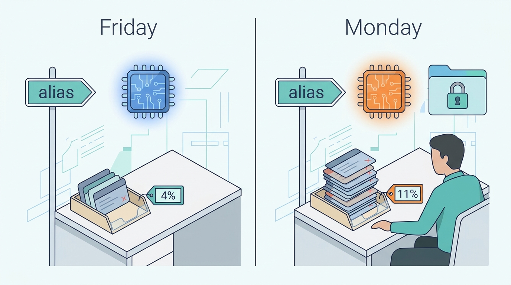
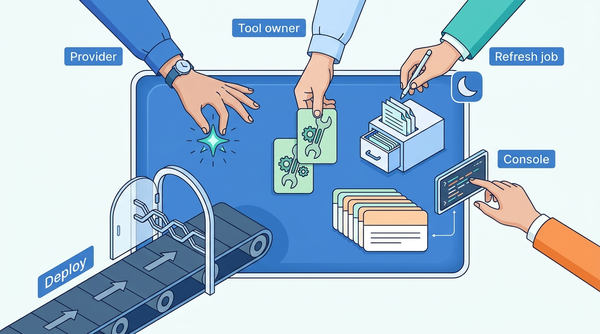
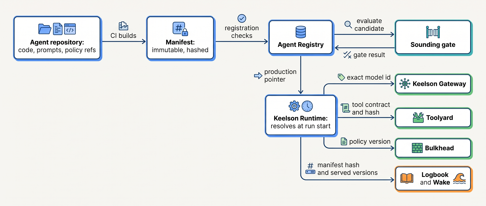
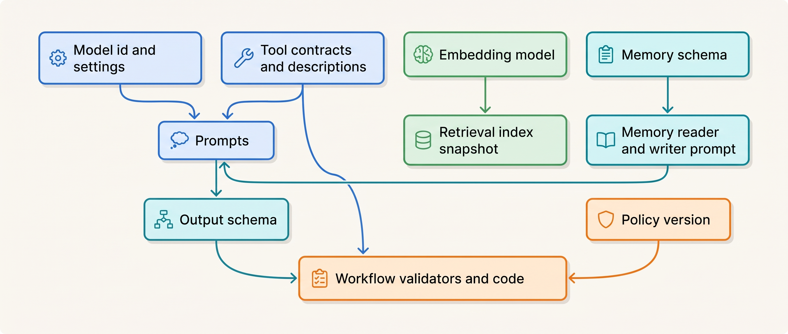

> **IN THIS CHAPTER, YOU WILL:** Learn which artifacts define an agent's behavior, how to bind them into one immutable agent version manifest, how to keep tool contracts, prompts, policies, indexes and memories compatible as each of them changes, and what reproducibility you can and cannot promise.

> **WHY THE BUSINESS CARES:** An agent's behavior can change on a day when nobody at the company shipped anything. A risk owner who cannot say which model, prompt and policy produced a given decision cannot defend it to an auditor, a regulator or a customer, and cannot undo it quickly when it goes wrong.

> **WHY ARCHITECTS SHOULD CARE:** In an ordinary service, the deployable unit is the code. In an agentic system, most behavior lives outside the code. If those artifacts are not versioned together, no release process, rollback or audit can work.

> **KEY POINTS:**
>
> * **The agent version is a manifest, not a code commit.** Bind the exact model identifier and API version, prompts, tool contracts with description hashes, policy, index snapshot, memory schema and orchestration build into one immutable, content-hashed manifest, promoted, rolled back and recorded on every run as one unit.
> * **Aliases and unpinned dependencies are changes you did not ship.** A model alias, a `-latest` pointer, a remote MCP server that edits its tool descriptions or a prompt edited in a console all change behavior without a release. Ban them in production manifests, and record the version that actually served each call, not the one you asked for.
> * **A pin fixes the inputs, not the behavior.** Providers retire pinned models within months and change serving infrastructure under a fixed identifier, and model output varies between runs anyway. Plan migrations as recurring work, run a fixed canary evaluation against production manifests every day, and promise reproducibility as replay of recorded outputs, not as re-execution.

> **[FAILURE PATTERNS THIS CHAPTER ADDRESSES](where-agentic-systems-go-wrong.html):**
>
> * **The Silent Upgrade** — a provider alias moved Closewise to a new model with no release, no evaluation and no record of the change.
> * **Memory Without Expiry** — memories written by a defective agent version carry no version stamp, so they cannot be found and expired when the version is withdrawn.
> * **Vibe Evals** — without a fixed suite re-run against production on a schedule, a behavior regression shows up first as frustrated reviewers, days later.

<br>
An agentic system changes in more places than the code. The model is rented and retired on the provider's schedule. Prompts are text a product owner may edit. Tool descriptions are part of the prompt, and tool schemas are contracts with other teams' services. Policies decide what the agent may do. The index is rebuilt nightly, and memory grows with every session. **Each of these changes the agent's behavior, and most of them are not code.**

The architectural answer is old: name the unit of change, make it immutable, give it an identity, and make every run record which identity it ran. What is new is the size of that unit, and the fact that **some of its parts change even when you pin them**.

The chapter owns three terms: the **agent version manifest**, **alias drift** and the **behavior regression**. It builds on [[models-and-the-model-gateway]], which introduces version pinning at the gateway; on [[tool-contracts]] and [[tool-ecosystems-and-mcp]] for tool versioning and manifests; on [[task-state-and-checkpoints]] and [[durable-agent-execution]] for in-flight runs; and on [[agent-memory]] for memory records. It hands the release process (shadow, canary, ramp and rollback) to [[staged-rollout-and-rollback]], and the gate that decides promotion to [[evidence-for-autonomy]].

## Setting the Scene at Ostrell: The Alias Drift

Ostrell, the fictional company this book follows (see [[meet-ostrell]]), runs Closewise, the finance agent that proposes accrual journal entries for its **23 legal entities**, about **1,900 proposed entries a month**. Controllers approve each entry before deterministic workflow code posts it to the enterprise resource planning (ERP) system; the model never posts (A1). One step in the Closewise workflow classifies each candidate accrual: account, cost center, accrual type. It called a Mid-tier model from one of Ostrell's two commercial providers.

The Closewise team had configured that step with the provider's **alias**, a model name that the provider points at whichever version it currently recommends. Keelson Gateway supported exact pinning but did not require it, and the alias saved a migration every few months.

The July close began on Monday **2 August 2027**. Over that weekend the provider moved the alias to a newer model version. Nothing at Ostrell was deployed. From the first day of the close, controllers rejected about **11%** of proposed entries, against a usual **4%**: accrual types were wrong more often, and cost centers were plausible but not the ones the entity used. Joost Vermeer raised it at the Wednesday close stand-up. On Thursday, working day 4, Mei Lin Zhou's evaluation team traced the change and pinned the previous version.

The trace took four days because the obvious places were empty: no commits that week. Wake, Ostrell's tracing service, recorded the model name Keelson had *requested*: the alias, unchanged. The provider's responses named the version that had actually served them, but the Gateway did not store that field. Mei Lin's team found the change by replaying Monday's rejected inputs and re-running the Closewise accrual suite in Sounding, the evaluation service, against the alias and the previous exact version: classification accuracy was **89.4%** on the alias and **96.1%** on the previous version. **No wrong entry was posted**, because every entry still needed a controller's approval. The cost was controller time: over the four days the drifted model proposed **1,498** entries and controllers rejected **165** of them, about **105 more** than the usual 4% rate would have produced, each redone by hand in the busiest week of the month.


**Figure 1:** *Over one weekend the provider moved the alias to a newer model version while nothing at Ostrell was deployed, and controller rejections rose from about 4% to about 11%.*

Joost, the group controller and Closewise's risk owner, then asked Tomas Verhoef, the Chief Architect, two questions. *Which version of Closewise produced each entry my controllers rejected?* and *What else in Keelson can change like this without anyone deploying anything?* The records could not answer the first. The second is this chapter's subject.

## What an Agent Version Is Made Of

### The artifacts that define behavior

Each row changes what the agent does.

| Artifact | Typical owner | Rate of change | What changes when it does | Who can change it without a deploy? |
| --- | --- | --- | --- | --- |
| Orchestration code (loop, workflow, validators) | Agent team | Weekly | Control flow, budgets, validation | Nobody, if code is deployed normally |
| Prompts (system prompt, templates, few-shot examples) | Agent team, often product owners | Weekly to daily | Tool selection, tone, refusals, format | Anyone with console access, if prompts live in a prompt service |
| Model identifier, API version, sampling and effort settings | Agent team, platform team | Months | Nearly everything | **The provider**, if an alias is used |
| Tool contracts (schema, description, annotations) | Tool-owning teams | Weeks | Which tools are chosen and how arguments are filled | **The tool owner**, if the tool is fetched live from a server |
| Policies (permissions, limits, autonomy tiers) | Risk owner, security | Weeks | What the agent may do | Policy administrators |
| Retrieval index (content, chunking, embedding model) | Data or content owners | Daily | What evidence the model sees | **The refresh job**, every night |
| Memory schema and memory-writing prompt | Platform team, agent team | Months | What is remembered and how it is read back | Nobody, if the schema is migrated deliberately |
| Provider serving stack (hardware, kernels, routing) | **The provider** | Unannounced | Output distribution under a fixed model ID | **The provider, always** |

The last column is the point. In an ordinary service, behavior changes with a deploy. Here four or five parties can change it without one. Some of these changes are legitimate (the index *should* refresh nightly); others should never happen in production (an alias swap, a console prompt edit, a tool description changed after review). **The job of versioning is to turn every legitimate change into an identified, recorded event, and to make the illegitimate ones impossible.**


**Figure 2:** *In an ordinary service behavior changes with a deploy; in an agent the provider, a tool owner, the nightly index refresh and a console prompt edit can each change it without one.*

This is the ML-systems debt that Sculley and colleagues described in 2015, where "configuration issues" and "changes in the external world" were already named as risk factors ([Sculley et al., NIPS 2015](https://papers.nips.cc/paper_files/paper/2015/hash/86df7dcfd896fcaf2674f757a2463eba-Abstract.html)); agents add more configuration and more external world. Two kinds of change follow. **Authored changes** are the ones your organization makes: code, prompts, tool contracts you own, policies. **Ambient changes** happen around you: provider retirements, serving-stack changes, upstream tool changes, content arriving in the index. You cannot stop them all. You can pin what can be pinned, record what cannot, and measure behavior often enough to notice.

### Three definitions

An **agent version manifest** is an immutable, content-addressed record naming the exact version of every authored and pinnable artifact that determines one agent's behavior (the rows of the table above, except the provider's serving stack). Its hash is the agent's version identity; any change produces a new manifest.

**Alias drift** is a behavior change caused by a name that resolves to different artifacts over time without a change on the consumer's side: a provider's model alias or `-latest` name, a tool fetched by name from a server that has updated it, a prompt referenced by label in a prompt service, an index referenced as "current".

A **behavior regression** is a measured, statistically supported decline in an agent's task-level outcome, trajectory constraints, cost or format compliance between two identified versions, or between two periods of the same version. It must be *measured*, because a feeling that the agent "got worse" is a hypothesis, and it must name *versions*, because a regression you cannot attribute cannot be rolled back.

**Version pinning**, introduced in [[models-and-the-model-gateway]], is the narrower act of naming an exact model identifier instead of an alias. It is necessary for a manifest and not sufficient, as the section on models shows.

## The Manifest as the Unit of Release

### What goes in, and what does not

The manifest names everything that is versioned and pinned *for this agent*. It refers to shared artifacts by version; it does not copy them. It does not contain things that are per-run inputs (the customer's ticket, the entity's trial balance), secrets (credentials stay in Toolyard, Ostrell's tool broker) or live data that the agent is supposed to read fresh (the price book, the ERP's open periods). The test I use: **if changing it should require an evaluation run, it belongs in the manifest; if it changes per task, it is input; if it must be current, it is a tool call.**

Closewise's classification agent after September 2027 looks like this (abridged; the field names are Keelson's):

```yaml
agent: closewise-accrual-classifier
manifest_version: cw-2027.09.3
build: keelson-runtime-workflows@4f1c2e9           # orchestration code, git commit
model:
  provider: provider-b
  model_id: "<exact versioned model id>"           # aliases rejected at registration
  api_version: "<provider API version>"
  settings: { effort: medium, max_output_tokens: 2000 }
  fallback: none                                   # an untested fallback is a silent upgrade
prompts:
  system: prompts/closewise/classifier-system@v14  sha256:9b2e...
tools:
  - name: coa_lookup        contract: 2.1   description_sha256: c03f...
  - name: entity_profile    contract: 1.4   description_sha256: 7d19...
policy: bulkhead/closewise@2027-09-01.2
retrieval:
  index: accounting-policies
  snapshot: aps-2027-08-30T02:00Z
  embedding_model: "<exact embed model id>"
memory: none
eval_binding: sounding/closewise-accrual@suite-v1  # recorded with the gate, not part of behavior
manifest_sha256: e5a0...                           # computed over everything above
```

Three fields need comment. `fallback: none` is deliberate: a gateway that silently falls back to another model under load has created an alias with extra steps; a fallback, if needed, is named in the manifest and evaluated like the primary. `eval_binding` records the suite the manifest was gated on ([[building-agent-eval-suites]]). And `memory: none` is a statement, not an omission.

The author's agentic-platform-foundations interview design has the same structure: an `agent_versions` record, "an immutable, deployable version of an agent (prompt, tool bindings, policy binding)", promoted by re-pointing `agents.production_version_id` only if its evaluation run passed (design example, `agentic-platform-foundations/interview.json`, step `eval-obs`). It leaves the model identifier out, so a provider model change would skip the gate. **This book departs from it: the exact model identifier is part of the manifest**, as in the author's coding-CLI design, which gates "every model or harness change" on evaluations (`ai-coding-cli/interview.json`, step `cloud`).

### Where the manifest lives and who acts on it


**Figure 3:** *The manifest is built from the repository, registered and gated once, then resolved at the start of each run; the Gateway, Toolyard and Bulkhead enforce the versions it names, and every run records the manifest hash and the versions that actually served it.*

The control plane holds manifests; the data plane enforces them ([[agentic-reference-architecture]]). The **Agent Registry** stores every manifest and a pointer per environment and cohort; promotion and rollback move the pointer and never edit a manifest. **Keelson Runtime** resolves the pointer once, at run start, and keeps the hash in run state. The **Gateway** refuses a model identifier that differs from the manifest's; **Toolyard** refuses a tool whose description hash differs; **Bulkhead** evaluates the named policy version. **Logbook** (the evidence log) and **Wake** record the manifest hash per run and the served model version per call.

| Interaction | Consistency | Latency budget | Durability | Who may change it |
| --- | --- | --- | --- | --- |
| Register a manifest | Strong; validation must pass before the record exists | Seconds; CI-time | Permanent; manifests are never deleted while any record refers to them | CI on merge to the agent repository |
| Move a production pointer | Strong, single writer per agent and cohort | Seconds | Every move is a recorded event with actor, gate result and reason | Promotion pipeline; break-glass rollback by the agent owner |
| Resolve the manifest at run start | Read of the pointer at that instant; then fixed for the run | Milliseconds; cached by hash | Hash stored in run state | Nobody; the run is pinned |
| Model call through the Gateway | Must match the manifest exactly | No added hop beyond the gateway | Requested and served model version on the span | Nobody at run time |
| Tool call through Toolyard | Contract version and description hash must match | Microseconds of check | Contract version in the tool-call record | Tool owner, only by publishing a new contract version |

### Registration checks

Most of the value of a manifest comes from what the registry refuses. Keelson's registration is a short, deterministic check:

```python
def register(m: Manifest, catalog: Catalog, registry: Registry) -> ManifestId:
    if any(ref.is_floating() for ref in m.all_references()):      # alias, label, "latest"
        raise Rejected("floating reference")
    if any(catalog.model_state(x) != "active" for x in m.models()):
        raise Rejected("model not active")
    for t in m.tools:                                               # reviewed text is what is served
        if catalog.description_hash(t.name, t.contract) != t.description_sha256:
            raise Rejected(f"tool {t.name}@{t.contract} not served as reviewed")
    if m.prompt_references() - m.bound_names():                     # prompt names an unbound tool or field
        raise Rejected("prompt mentions unbound names")
    if m.memory and not catalog.can_read_all_stored(m.memory.schema_version):
        raise Rejected("no reader for stored memory schema versions")
    return registry.store_immutable(m, sha256(m.canonical_bytes()))
```

The prompt check is cheap and catches a common break: a prompt that still tells the model to call `get_contract_by_id` after the tool was renamed. None of these checks evaluates behavior; that is Sounding's job. They make sure that what Sounding evaluates is exactly what will run.

### Configuration as code, flags as selectors

Prompts and policies are configuration, and configuration changes cause incidents. Google's SRE workbook observes that a majority of incidents are triggered by binary or configuration pushes and recommends giving configuration the same canary scrutiny as code ([Google SRE Workbook, "Canarying Releases", 2018](https://sre.google/workbook/canarying-releases/)). A prompt edited in a vendor console or a feature-flag service escapes code review, the evaluation gate and the manifest.

There is also dated evidence that a vendor-hosted prompt store is itself a dependency with a lifecycle: in a notice dated 3 June 2026, OpenAI announced the shutdown of its reusable prompts endpoint (`v1/prompts`), its Evals platform and Agent Builder on 30 November 2026, advising customers to "move reusable prompt content into your application code" ([OpenAI, Deprecations, accessed 2026-10](https://developers.openai.com/api/docs/deprecations)). Vendors of runtime prompt configuration argue the opposite, that prompts and model settings should be managed outside application code and rolled out gradually ([LaunchDarkly, AgentControl docs, accessed 2026-10](https://launchdarkly.com/docs/home/agentcontrol)).

Both positions fit one rule. **The source of truth for prompts, tool bindings and policies is the agent repository, reviewed and evaluated like code. A flag service may only select among manifests that passed registration and the gate**, plus operational toggles (kill switch, lower effort) that the manifest names as permitted states. Flags are "inventory which comes with a carrying cost" ([Hodgson, martinfowler.com, 2017](https://martinfowler.com/articles/feature-toggles.html)); give every flag that selects a manifest an owner and an expiry.

## Compatibility Between the Parts

A manifest freezes one combination. Over time each part moves on its own schedule, and the question becomes which combinations are valid. The parts are coupled in specific ways, and the coupling decides what a change must re-test.


**Figure 4:** *Coupling inside one manifest: a change upstream invalidates the evidence for everything downstream of it. A model change re-tests prompts and output handling; an embedding-model change invalidates the whole index; a memory-schema change touches both the store and the prompt that reads it.*

### Tool contracts and prompts

A tool's name, description and input schema are text the model reads; they are part of the prompt in every sense that matters ([[tool-contracts]] treats tool design in depth). Changing a tool contract is therefore a prompt change for every agent that binds it. The compatibility classes I use for tool contracts:

| Change to a tool contract | Class | What the tool owner must do | What the consuming agent must do |
| --- | --- | --- | --- |
| Add an optional input field with a safe default; add an output field | Minor | Publish new minor version; keep old one served | Nothing until it adopts the new version; then re-run its suite |
| Reword the description, examples or error messages | Minor for code, **behavioral for agents** | Publish new version with new description hash | Re-run its suite before binding; tool choice may shift |
| Rename a field, add a required field, narrow an enum, change units or meaning | Major | New major version served alongside the old for a deprecation window | Migrate prompt and validators; full gate |
| Change side-effect semantics (idempotency, destructiveness, scope) | Major and policy-relevant | New major version; risk review | Full gate; Bulkhead policy review |

The second row is where agent systems differ from ordinary API versioning. A description edit breaks no client compiled against the schema, yet it changes which tool the model picks and how it fills arguments. Toolyard therefore versions descriptions and hashes them, and the manifest binds the hash.

Tool descriptions served from outside the organization are also an attack surface. In April 2025, Invariant Labs demonstrated **tool poisoning** (instructions hidden in a Model Context Protocol (MCP) tool description) and the **rug pull**, in which a server changes a tool description after the user approved it; they proposed pinning servers and tools by hash as a mitigation, without a measured effect ([Invariant Labs, 2025](https://invariantlabs.ai/blog/mcp-security-notification-tool-poisoning-attacks)). The author's coding-CLI interview design applies the same idea to extensions: a content-hash pin that drops a changed MCP server back to "unreviewed" (design example, `ai-coding-cli/interview.json`, step `extensibility`, failure drill 2). Toolyard does the same: when a third-party issue-tracker server changed two tool descriptions in September 2027, the hash mismatch kept it out of Forge for 31 hours until review. A manifest with description hashes turns a rug pull into a refused call.

The protocol under the tools moves too. MCP versions are dates marking "the last date backwards incompatible changes were made", and four such revisions shipped between March 2025 and July 2026; the 2026-07-28 revision removed sessions and the `initialize` handshake ([MCP specification, versioning, accessed 2026-10](https://modelcontextprotocol.io/specification/versioning)). The protocol revision belongs in the tool contract record, so that upgrading Toolyard's MCP servers is an identified change, not a side effect of a library bump ([[tool-ecosystems-and-mcp]]).

### Policies and approvals

A policy version is part of the manifest because policy decides what the agent may do, and it interacts with approvals in flight. This book's approval model binds an approval to the exact action object and the policy version in force; if either changes before execution, the approval is void ([[human-oversight-and-bounded-autonomy]]). Keelson therefore keeps the old policy version bound to runs already in flight, so their pending approvals stay valid; only a security or correctness fix migrates runs in flight, and that voids their pending approvals.

### Retrieval indexes and embedding models

A retrieval index has two kinds of version. Its **content** changes every refresh, and that is usually intended: the agent should see the new price book. Its **representation** (chunking rules, metadata schema and embedding model) changes rarely and changes everything. Vectors produced by two different embedding models are not comparable, so a query embedded with the new model against an index embedded with the old one returns plausible-looking, wrong neighbors, with no error. This follows from how embedding spaces are trained; I know of no public measurement of the effect on agent tasks.

The manifest therefore names the embedding model and a **snapshot** identifier for the index. Content refreshes produce new snapshots under the same representation version; the agent picks them up through the freshness rules of [[provenance-and-freshness]], with the snapshot identifier recorded per retrieval so a decision can be traced to what the index held. A representation change is a **new index built side by side**, evaluated with the agent's suite and switched by a manifest change. It is never an in-place rebuild. The overlap costs double storage, which is cheap.

## Models: Deprecation, Aliases and Drift

### What a model identifier guarantees

Providers publish lifecycle policies, and they differ. As of October 2026:

| Provider | Stated notice before retirement | Alias behavior | Source |
| --- | --- | --- | --- |
| Anthropic | "at least 60 days' notice before model retirement for publicly released models"; deprecated models "are likely to be less reliable" | "Every Claude model ID is a pinned snapshot" for recent generations; for older models the alias was "a convenience pointer that resolves to the dated ID" | [Model deprecations](https://platform.claude.com/docs/en/about-claude/model-deprecations); [Models overview](https://platform.claude.com/docs/en/about-claude/models/overview), accessed 2026-10 |
| OpenAI | General-availability models "At least 6 months"; specialized variants at least 3 months; previews possibly much shorter, "such as 2 weeks" | Retires "specific snapshots"; alias guidance not verified for this chapter | [Deprecations](https://developers.openai.com/api/docs/deprecations), accessed 2026-10 |
| Google (Gemini API) | Previews deprecated "with at least 2 weeks notice"; no fixed period stated for stable models | Stable names "usually don't change"; `-latest` aliases are "hot-swapped" with each release | [Gemini models](https://ai.google.dev/gemini-api/docs/models), updated 2026-10-22 |

Three durable lessons sit under these volatile numbers. **Every hosted model has a finite life**: Anthropic's deprecation history shows about 60–62 days from each notice to retirement since early 2026. **Partner clouds run their own schedules**, as the same page states. And **migration can force code changes**: Anthropic's API version dated 2026-10-21 removed the `temperature`, `top_p` and `top_k` parameters, which now return HTTP 400. Recording the API version in the manifest makes such a change visible.

Sixty days is enough to run a suite, not to build one. **Model migration is recurring work with a calendar**: each model in use will be replaced once or twice a year, and the suite that judges the replacement must exist before the notice arrives. Finding every caller of a deprecated model is then a registry query, "which production manifests name this identifier", which works only because aliases are banned.

### Behavior changes under a fixed name

Pinning fixes the weights you call. It does not fix behavior, for three reasons with evidence.

**First, versions differ in behavior in ways that matter to agents.** Chen, Zaharia and Zou compared the March and June 2023 versions of two OpenAI models on seven tasks and reported large shifts, including GPT-4's accuracy on identifying prime numbers falling from 84% to 51%, and more formatting mistakes in generated code ([Chen et al., 2023, *Harvard Data Science Review* 2024](https://arxiv.org/abs/2307.09009)). Narayanan and Kapoor showed that the prime-number test set contained only primes and that the code test checked direct executability rather than correctness, so much of the measured "decline" was behavior change, not capability loss; they agreed that "Code that is deployed to users might simply break if the model underneath changes its behavior" ([Narayanan and Kapoor, 2023](https://www.normaltech.ai/p/is-gpt-4-getting-worse-over-time)). The models are retired; the lesson is current. **Format compliance, refusal behavior and instruction following are the most fragile properties, and they are the ones an agent's tool calls depend on.** A drift check must separate "the output format changed" from "the answer got worse".

**Second, providers change things under a fixed identifier.** Anthropic's postmortem of September 2025 describes three infrastructure bugs (a routing error, a misconfiguration that corrupted token selection and a sampling compiler bug) that degraded output for some requests in August and September 2025 with no model change; the routing error peaked at 16% of one model's requests in the worst hour. Anthropic reported that its evaluations "did not capture the degradation users reported" and committed to "continuous quality evaluations on true production systems" ([Anthropic, "A postmortem of three recent issues", 2025](https://www.anthropic.com/engineering/a-postmortem-of-three-recent-issues)). OpenAI's April 2025 rollback of a sycophantic GPT-4o update in ChatGPT, three days after launch, makes the same point from the other side: OpenAI wrote that offline evaluations "generally looked good" (OpenAI, 2 May 2025, read via [Simon Willison's quotation](https://simonwillison.net/2025/May/2/what-we-missed-with-sycophancy/) because the primary page could not be fetched). That was a consumer-product update, not an API snapshot change.

**Third, output varies between runs anyway.** Thinking Machines ran one open-weight model at temperature 0 a thousand times on one prompt and got 80 distinct completions, because inference kernels are not batch-invariant and results depend on server load; batch-invariant kernels made all thousand identical, at a measured slowdown ([Thinking Machines, 2025](https://thinkingmachines.ai/blog/defeating-nondeterminism-in-llm-inference/)). Atil et al. found accuracy varying by up to 15% across ten runs of nominally deterministic settings ([Atil et al., preprint, 2024](https://arxiv.org/abs/2408.04667)). A single re-run cannot confirm or rule out a regression.

I found no public postmortem of a *customer's* agent incident caused by a provider retirement or alias move; the Alias Drift is fiction, inferred from the provider behaviors above.

### What follows for the architecture

1. **Pin and record.** The Gateway refuses aliases for production manifests and records, per call, both the requested identifier and the model version the provider reports serving. Where a provider reports a backend configuration fingerprint (OpenAI documents a `system_fingerprint` that changes when it updates numerical configuration ([OpenAI cookbook, archived c. 2023](https://developers.openai.com/cookbook/examples/reproducible_outputs_with_the_seed_parameter))), record it too.
2. **Probe production daily.** Sounding runs a small, fixed canary slice of each production manifest's suite against the production Gateway route every day, several trials per case, and publishes the result to Wake as a time series per manifest and per provider route. An upstream change shows up as a step in a flat line. Because before/after comparisons are confounded by time (SRE workbook), the canary compares against its own recent baseline with a stated noise band.
3. **Validate structure at the boundary.** Structured outputs and schema validation in the workflow catch the format half of drift immediately, per call. They do not catch a well-formed wrong answer; the canary and reviewers' rejection rate do.

## Memory and State Migrations

Code and configuration can be rolled back; stored data cannot be "un-written" by changing a pointer. Two stores in an agentic system carry data written by one version and read by another: durable task state and long-term memory.

### Runs in flight

A run that started on manifest *N* should finish on manifest *N*. Changing the model or prompt halfway through a run means the recorded history describes decisions the new version would not have made, and changing the orchestration code can break deterministic replay outright: Microsoft's Durable Functions documentation warns that "Code changes that affect running orchestrations can break replay behavior" ([Microsoft Learn, Durable Functions code constraints, 2026](https://learn.microsoft.com/en-us/azure/azure-functions/durable/durable-functions-code-constraints)). Anthropic described the same constraint for its research agent, using "rainbow deployments to avoid disrupting running agents" by shifting traffic gradually while old and new versions run side by side ([Anthropic, "How we built our multi-agent research system", 2025](https://www.anthropic.com/engineering/multi-agent-research-system)).

Keelson's rule: **the manifest hash is part of run state, and workers for every manifest with live runs stay deployed until those runs finish or are cancelled.** For Closewise, a manifest promoted on working day 3 of the close serves new runs only; runs started on day 1 finish on the old one, whose pinned model must still be served. That is one more reason to schedule migrations away from the close. The mechanics of versioning workflow code in a durable engine belong to [[durable-agent-execution]]; the task-state schema and its evolution to [[task-state-and-checkpoints]].

### Long-term memory

Tidemark, Ostrell's memory service, stores per-user and per-tenant memories with provenance, trust level and expiry. Every memory record also carries two version stamps: the **schema version** of the record, and the **manifest hash of the agent version that wrote it**. The first makes migration possible. The second makes recall possible: when a version is withdrawn because it wrote bad memories, Tidemark can quarantine exactly what it wrote. Without the stamp, those memories keep coming back, which is Memory Without Expiry with a version-control cause.

Schema changes follow the event-sourcing playbook, adapted:

| Migration strategy | How it works | Use when | Risk |
| --- | --- | --- | --- |
| Read-time upcasting | Reader converts old records to the new shape on read; store keeps old records | Additive changes; new field has a safe default | Reader carries conversion code for every live version |
| Backfill | Batch job rewrites old records into the new schema, keeping the originals | Field meaning changes; queries need the new field | Job must be idempotent and resumable; originals kept for audit |
| Re-extract | Re-run the memory-writing step over the original sources with the new prompt | The extraction logic itself was wrong | Costs model calls; output differs from the original even for good records |
| Quarantine and expire | Mark records from a defective version untrusted; let them expire or be reviewed | A version wrote harmful or poisoned memories | Users lose some useful memories |

The memory-writing prompt decides *what* is remembered, and its effects outlive its manifest, so a change to it gets the full gate plus a review of sample records it writes in shadow. [[agent-memory]] covers write policies; this chapter insists only that every write is stamped.

## Reproducibility: What You Can Promise

Auditors and incident reviewers ask: *can you reproduce what the agent did?* Only two of three meanings can be promised.

| Level | What it means | Achievable? | What it requires |
| --- | --- | --- | --- |
| **Re-identify** | Say exactly which versions of every artifact produced a decision | Yes, always | Manifest hash per run; served model version per call; index snapshot and tool contract version per call |
| **Replay** | Reconstruct the run from recorded inputs, outputs and tool results, step by step | Yes, for as long as records are retained | Logbook decision record with model outputs, tool calls and receipts; content stored by reference with retention ([[policy-enforcement-and-audit]]) |
| **Re-execute** | Run the same inputs through the same versions and get the same outputs | Approximately at best; impossible after the model is retired | Pinned model still served, same settings, and luck or batch-invariant self-hosted inference |

**Promise re-identification and replay. Do not promise re-execution.** A hosted model is retired within months, and even while it is served, the same request can return a different completion. The recorded output in the evidence log is the account of what the model proposed; a re-run is a new experiment, never evidence of what happened. Bit-exact re-execution is possible only with self-hosted, batch-invariant inference, at the cost Thinking Machines measured.

The author's agentic-finance-platform interview design takes the same position: its decision record holds the versions of the chart of accounts, control policy and models alongside evidence and approvals, with "a documented reproduce path" for an auditor a year later, and that path is replay of the record (design example, `agentic-finance-platform/interview.json`, step `decision-record`).

## Worked Example at Ostrell: After the Alias Drift

### September 2027: closing the gaps

The fix had four parts.

| Gap in August | Change in September 2027 | Owner |
| --- | --- | --- |
| The alias was allowed | Registration rejects any alias, label or "latest" reference in a production manifest; all seven agents re-registered with exact identifiers | Amara Okafor (Agent Platform) |
| Wake recorded the requested model, not the served one | Gateway records requested and served model version on every model-call span and in Logbook | Jonas Lindqvist (Keelson Runtime) |
| No regular evaluation of production | Daily canary eval on every production manifest; result as a Wake time series with an alert on a step outside the noise band | Mei Lin Zhou (Sounding) |
| No record linking a rejected entry to a version | Every proposed entry in the staging store carries the manifest hash; controllers' rejections are queryable by manifest | Closewise team, with Joost Vermeer |

Replay the August drift against the September system. The alias move is irrelevant: the manifest pins the previous exact version and the Gateway refuses anything else. The newer version arrives later as a one-line pull request, evaluated by Sounding before any controller sees its output. Joost's first question becomes a query: rejections grouped by manifest hash.

The daily canary is still needed once aliases are gone, for the upstream change the 2025 postmortem described: fixed identifier, changed serving. A drop shows as a step on one provider route only, with the served-version field unchanged. The decision is then whether to switch to a pre-gated alternative manifest naming a different model, which exists only if it was registered and gated in advance.

### October 2027: a promotion is a policy version

The September regime made a later change easy to read. In October 2027, after the autonomy review in [[evidence-for-autonomy]], Answerdesk's credits of €250 or less moved from A1 (draft for approval) to A2 (act within limits, with sampling). In Keelson this was neither a prompt edit nor a code change. It was a new Bulkhead policy version with the A2 limits, a new Answerdesk manifest whose only difference was the policy field, and a tier-register entry keyed by the new manifest hash:

```diff
 agent: answerdesk
-manifest_version: ad-2027.09.7
+manifest_version: ad-2027.10.2
 model: { ...unchanged... }
 prompts: { ...unchanged... }
 tools: { ...unchanged... }
-policy: bulkhead/answerdesk@2027-09-12.1    # issue_credit <= 250 EUR: A1
+policy: bulkhead/answerdesk@2027-10-08.1    # issue_credit <= 250 EUR: A2; hold above 9,000 EUR or 120 credits a day
 memory: { schema: tidemark/answerdesk-user@4 }
```

The single-field diff meant the gate evaluated exactly one change, Lena Brandt, who owns Answerdesk, could read and sign it, and every later credit carried a manifest hash saying under which policy it was issued, so the sampled review compared like with like. The rollout, starting with a randomized 20% slice, is in [[staged-rollout-and-rollback]].

### A migration calendar

The registry query that the alias ban made possible also produced Ostrell's first model-migration calendar in November 2027: each production manifest, its pinned model identifiers, each model's published "not sooner than" retirement floor, and the date by which a candidate manifest must have passed Sounding. Seven agents named eleven distinct model identifiers *(Ostrell, illustrative)*. It made one rule explicit: **no Closewise model migration is promoted in the first seven working days of a month**, so a new model serves at least two weeks of ordinary work before it meets a close.

## Failure Modes and Recovery

| Scenario | What happens | Detection | Containment | Recovery |
| --- | --- | --- | --- | --- |
| **Alias moves** (the Alias Drift) | Provider repoints an alias; behavior shifts with no deploy | Before Sept 2027: reviewers' rejection rate, days later. After: impossible in production, because registration rejects aliases | A1 approval holds; Gateway refuses unpinned ids | Pin previous exact version; evaluate the new one as a candidate |
| **Pinned model degrades upstream** | Serving change under a fixed identifier, as in the 2025 postmortem | Daily canary step on one provider route; served-version field unchanged | Hold autonomy at current tier; demotion trigger if a guardrail breaches ([[evidence-for-autonomy]]) | Switch the pointer to a pre-gated alternative manifest; report to provider |
| **Tool description changed by its owner or a remote server** | Model picks tools differently; or a rug pull injects instructions | Toolyard hash check fails at call time | Call refused; run fails safe or escalates | Tool owner publishes a new contract version; agent adopts it through the gate |
| **Embedding model changed in place** | Queries and index in different vector spaces; retrieval returns wrong neighbors silently | Retrieval relevance canary drops; grounding checks fail more often | Manifest names embedding model; Runtime refuses mismatch | Rebuild side by side; switch by manifest |
| **Run resumes on a new version after a deploy** | Mid-run model or code change; replay fails or decisions mix versions | Manifest hash in run state differs from worker's | Workers per live manifest stay deployed | Finish on old manifest, or cancel and restart under the new one with compensation ([[partial-failure-and-compensation]]) |
| **Defective version writes memories** | Bad memories persist after the version is withdrawn | Memory-quality sampling; complaints tied to recalled facts | Quarantine by writer manifest hash | Expire or re-extract the affected records |
| **Retirement notice with no suite ready** | 60 days to migrate an agent nobody can evaluate | Migration calendar shows a floor inside the next quarter | Freeze other changes to that agent | Build the minimal suite from production traces first; migrate; then grow the suite |

Detection depends on **recording the served version, not the requested one**; containment depends on **refusing to run anything whose hash is not registered**.

## Trade-offs

| Decision | Option A | Option B | Choose A when | Choose B when |
| --- | --- | --- | --- | --- |
| Model reference | Exact version, migrated deliberately | Alias, take improvements automatically | Any agent whose errors cost money, rights or trust; anything with a regression suite | Throwaway prototypes and internal experiments with no consumer of their output |
| Prompt source of truth | Repository, reviewed and gated | Runtime prompt service | Default | Never as the source of truth; acceptable as a selector among gated manifests |
| Runs in flight | Finish on the version they started | Migrate to the new version | Long-running and approval-bound runs (Closewise, Scout) | Short runs where restarting is cheap and side-effect free |
| Provider strategy | One provider per agent, pinned | Pre-gated alternative manifest on a second provider | Low-consequence agents; cost of a second suite run is not justified | Agents whose degradation is a business incident (Closewise during close, Answerdesk) |
| Reproducibility | Replay from recorded outputs | Re-execution with deterministic self-hosted inference | Default for every domain | A regulator or contract requires bit-exact reruns and the latency cost is acceptable |

The cost is real: migrations become explicit work several times a year per agent, and old manifests must stay runnable while their runs finish. The alternative is that some of your behavior changes are decided by other organizations' release calendars.

## Across Domains: How the Stakes Change the Design

| Concern | Coding agents | Customer operations (support, sales, marketing) | Back office (finance, legal, HR) | High-stakes decisions (healthcare, public benefits) |
| --- | --- | --- | --- | --- |
| What must be pinned beyond the platform default | Harness version and model per run; local CLIs that auto-update are an ambient change to track | Prompt and policy versions per tenant cohort; knowledge-base snapshot | Model, prompts, chart-of-accounts, control-policy and playbook versions per decision | Rule packages, guideline and formulary versions per case, alongside the model |
| What triggers re-evaluation | Any model or harness change; judge model changes for review lenses | Prompt, tool, model or KB representation change; tone and refusal drift | Any change to the classification or drafting path; period-end timing | Any change at all, plus legal or clinical review of rule changes |
| Reproducibility required | Replay of the PR and CI result is enough; the diff is the artifact | Replay of the conversation and actions for complaints | Replay for auditors, often a year or more later | Replay of the determination with every version, for appeal or clinical review |
| Migration timing constraints | Low; avoid mid-sprint changes to shared harnesses | Avoid peak seasons; migrate by tenant cohort | Never during close or filing windows | Planned, documented changes; may need a new conformity assessment |

The domain specifics come from the author's interview designs (design examples). The coding-harness design pins the judge model per review lens after a failure drill in which a lens's precision fell from 0.9 to 0.5 following a model upgrade (`ai-coding-harness/interview.json`, step `scale`, failure drill 2). The public-benefits design pins an effective-dated, jurisdiction-tagged rule package to each determination, (`agentic-public-benefits-platform/interview.json`, steps `naive` and `rules`). The healthcare design records guideline and formulary versions and a patient-snapshot timestamp in each evidence bundle, and a rule version on every safety check (`agentic-healthcare-platform/interview.json`, steps `grounding` and `safety`).

Regulation adds a duty in the last column. For high-risk systems under the EU Artificial Intelligence Act (Regulation (EU) 2024/1689), Annex IV requires the technical documentation to state "the version of the system reflecting its relation to previous versions" and "relevant changes made by the provider to the system through its lifecycle", and Article 43(4) requires a new conformity assessment after a "substantial modification", except for changes "pre-determined by the provider" at the initial assessment and documented under Annex IV point 2(f) ([Annex IV](https://artificialintelligenceact.eu/annex/4/); [Article 43](https://artificialintelligenceact.eu/article/43/)). For a benefits or clinical agent, a model migration is therefore also a regulatory event. Declaring in advance which kinds of change are expected (a model swap under a fixed suite and threshold, for example) is the architectural way to keep routine migrations from becoming new assessments; whether a given migration is substantial is a legal judgement.

**What is platform-common:** the manifest format, registration checks, the alias ban, served-version recording, run stickiness, memory write stamps and the daily canary mechanism. **What is domain policy:** which extra artifacts are pinned per decision (rule packages, playbooks, chart of accounts), how long manifests and records are retained, the windows in which migrations are forbidden, and who signs off a model change. One mechanism, five sets of parameters.

## The Chief Architect's View

**Decide the unit of release once, for every agent.** The decision that matters is that an agent version is a manifest including the exact model identifier, and that nothing runs in production unless its manifest is registered. Gates, rollout, rollback, audit and migration planning all assume it, so I would make it a platform invariant enforced by the Gateway and Runtime, not a guideline.

**Make the ambient changes visible, then boring.** You cannot stop providers from retiring models or changing their serving stacks. You can make each change appear as a dated entry (a retirement floor on the calendar, a step on a canary line, a changed served-version field), so that an upstream change costs a planned pull request, not a four-day investigation.

**Separate who owns an artifact from who binds it.** Tool, policy and content owners version their artifacts; agent owners decide when to adopt them and own the evidence; the platform team owns the registry, the checks, the canary and the migration calendar.

**Budget the cost honestly.** Assume one or two migrations per model per year, each costing suite runs, a reviewed diff and a staged rollout. Agents with a small, reliable suite migrate cheaply; agents without one are the ones that drift. That is a cost argument a CFO like Marten Ruys can follow.

**What is durable and what will change.** Durable: immutable versions, content hashes, a single pointer per environment, recorded served versions, data stamped with the version that wrote it, and replay over re-execution. Volatile: notice periods, alias semantics, the MCP revision in force, which parameters an API version accepts, and whether deterministic inference becomes cheap enough to make re-execution routine. Keep the volatile facts in the migration calendar, not the architecture.

**What to watch.** Calls whose served version differs from the manifest (should be zero); days from a retirement notice to a gated candidate; canary step alerts per month and how many were provider-side; live manifests per agent (more than three suggests old versions are not being retired).

## Questions to Ask

1. If I pick any decision your agent made last month, can you tell me the exact model version that served it, the prompt version and the policy version, from records, in minutes?
2. Does any production configuration refer to a model alias, a "latest" label, a prompt by label or a tool fetched live from a server you do not pin by hash?
3. What happens to a run that is in flight when you promote a new version? Which version finishes it, and what happens if that version's model is retired first?
4. How do you find every agent that uses a model when its provider announces a retirement, and how long before the retirement floor will the replacement have passed your gate?
5. Is your embedding model named in the agent's version, and what is your plan for changing it without serving mismatched vectors?
6. Can you find and quarantine every memory a withdrawn agent version wrote?
7. What do you promise an auditor: re-identification, replay or re-execution? What record makes that promise true?
8. For regulated agents, which kinds of change have you declared in advance as expected, and who decides whether a migration is substantial?

## From Versions to Releases

A manifest makes a change identifiable and a rollback a pointer move. It does not decide how much traffic sees a new version, which metrics stop it, or what to do about the credits, emails and journal entries it already produced. The next chapter, [[staged-rollout-and-rollback]], takes the Closewise model migration that this chapter put on the calendar and runs it through shadow, canary and ramp, with a forward-fix plan for everything a pointer move cannot undo.

## Sources and Evidence

### Research papers

- [How is ChatGPT's behavior changing over time?](https://arxiv.org/abs/2307.09009) — Chen, Zaharia and Zou, 2023 (*Harvard Data Science Review*, 2024). Behavior shifts between March and June 2023 model versions; evidence on retired models.
- [Is GPT-4 getting worse over time?](https://www.normaltech.ai/p/is-gpt-4-getting-worse-over-time) — Narayanan and Kapoor, 2023. Critique: behavior change versus capability loss; flawed test sets.
- [Non-Determinism of "Deterministic" LLM Settings](https://arxiv.org/abs/2408.04667) — Atil et al., 2024, revised 2025 (preprint). Run-to-run accuracy variation in nominally deterministic settings.
- [Defeating Nondeterminism in LLM Inference](https://thinkingmachines.ai/blog/defeating-nondeterminism-in-llm-inference/) — He et al., Thinking Machines, 2025 (research lab post). Batch invariance as the cause of temperature-0 variance; cost of deterministic kernels.
- [Hidden Technical Debt in Machine Learning Systems](https://papers.nips.cc/paper_files/paper/2015/hash/86df7dcfd896fcaf2674f757a2463eba-Abstract.html) — Sculley et al., NIPS 2015. Configuration and external-world changes as ML system debt; background for the inventory of artifacts.

### Specifications, standards and regulation

- [MCP specification: versioning](https://modelcontextprotocol.io/specification/versioning) and [2026-07-28 changelog](https://modelcontextprotocol.io/specification/2026-07-28/changelog) — Model Context Protocol project, n.d. and 2026, accessed 2026-10. Date-based protocol versions, incompatible revisions, deprecation policy.
- [EU AI Act, Annex IV](https://artificialintelligenceact.eu/annex/4/) and [Article 43](https://artificialintelligenceact.eu/article/43/) — Regulation (EU) 2024/1689, 2024. Version documentation duties; substantial modification and pre-determined changes.

### Vendor documentation and engineering reports

- [Model deprecations](https://platform.claude.com/docs/en/about-claude/model-deprecations) — Anthropic, n.d., accessed 2026-10. 60-day notice, lifecycle states, partner schedules, parameter removal in API version 2026-10-21.
- [Models overview](https://platform.claude.com/docs/en/about-claude/models/overview) — Anthropic, n.d., accessed 2026-10. Pinned snapshot identifiers and alias semantics.
- [Deprecations](https://developers.openai.com/api/docs/deprecations) — OpenAI, n.d., accessed 2026-10. Notice periods; shutdown of hosted prompts, Evals and Agent Builder on 2026-11-30.
- [Reproducible outputs with the seed parameter](https://developers.openai.com/cookbook/examples/reproducible_outputs_with_the_seed_parameter) — OpenAI cookbook, archived c. 2023, accessed 2026-10. `system_fingerprint` as a backend-configuration marker.
- [Gemini models](https://ai.google.dev/gemini-api/docs/models) — Google, updated 2026-10-22. Stable names, hot-swapped `-latest` aliases, preview notice.
- [A postmortem of three recent issues](https://www.anthropic.com/engineering/a-postmortem-of-three-recent-issues) — Anthropic, 2025. Quality degradation from infrastructure bugs under fixed model identifiers; evaluations missed it.
- [How we built our multi-agent research system](https://www.anthropic.com/engineering/multi-agent-research-system) — Anthropic, 2025. Rainbow deployments for long-running agents.
- [Durable Functions code constraints](https://learn.microsoft.com/en-us/azure/azure-functions/durable/durable-functions-code-constraints) — Microsoft Learn, 2026. Code changes breaking replay of running orchestrations.
- [Canarying Releases](https://sre.google/workbook/canarying-releases/) — Google SRE Workbook, 2018. Configuration pushes as incident triggers; concurrent control over before/after comparison.
- [Feature Toggles (aka Feature Flags)](https://martinfowler.com/articles/feature-toggles.html) — Pete Hodgson, martinfowler.com, 2017. Flags as inventory with carrying cost.
- [AgentControl](https://launchdarkly.com/docs/home/agentcontrol) — LaunchDarkly, n.d., accessed 2026-10. The runtime prompt-configuration position (vendor documentation).

### Incidents, cases and decisions

- [MCP Security Notification: Tool Poisoning Attacks](https://invariantlabs.ai/blog/mcp-security-notification-tool-poisoning-attacks) — Invariant Labs, 2025. Tool poisoning and rug pulls; hash pinning proposed.
- OpenAI, "Expanding on what we missed with sycophancy", 2025-05-02, read via [Simon Willison's quotation](https://simonwillison.net/2025/May/2/what-we-missed-with-sycophancy/), 2025. A provider update that passed offline evaluations and was rolled back in three days.

### Design examples from the author's interview project

- Obrenović, Ž., "Agentic Platform Foundations", system-design interview design, `system-design-interviews/data/book/agentic-platform-foundations/interview.json`, 2026 — immutable agent versions, pointer-flip promotion gated on evaluation runs (step `eval-obs`); model id missing from the agent version (departure).
- Obrenović, Ž., "AI Coding Agent CLI", system-design interview design, `system-design-interviews/data/book/ai-coding-cli/interview.json`, 2026 — evaluations gating every model or harness change (step `cloud`); content-hash pinning of extensions (step `extensibility`).
- Obrenović, Ž., "Coding Agent Harness", system-design interview design, `system-design-interviews/data/book/ai-coding-harness/interview.json`, 2026 — judge model pinned per review lens (step `scale`).
- Obrenović, Ž., "Agentic Finance Platform", system-design interview design, `system-design-interviews/data/book/agentic-finance-platform/interview.json`, 2026 — versioned decision record and reproduce path (step `decision-record`).
- Obrenović, Ž., "Agentic Public Benefits Platform", system-design interview design, `system-design-interviews/data/book/agentic-public-benefits-platform/interview.json`, 2026 — rule packages pinned per determination (steps `naive`, `rules`).
- Obrenović, Ž., "Agentic Healthcare Platform", system-design interview design, `system-design-interviews/data/book/agentic-healthcare-platform/interview.json`, 2026 — guideline, formulary and rule versions in evidence bundles (steps `grounding`, `safety`).

Ostrell is fictional; architectural recommendations, labeled inferences and labeled assumptions are the author's judgement.
