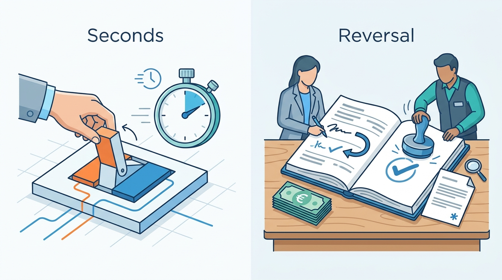
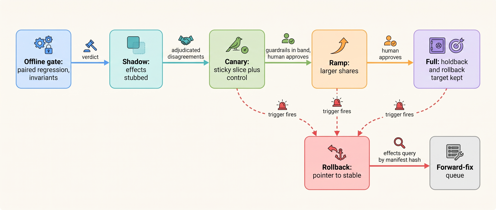
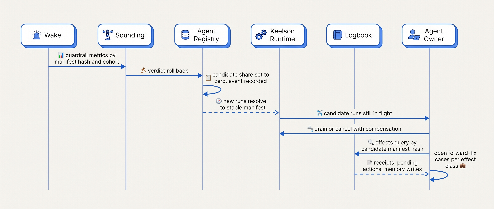
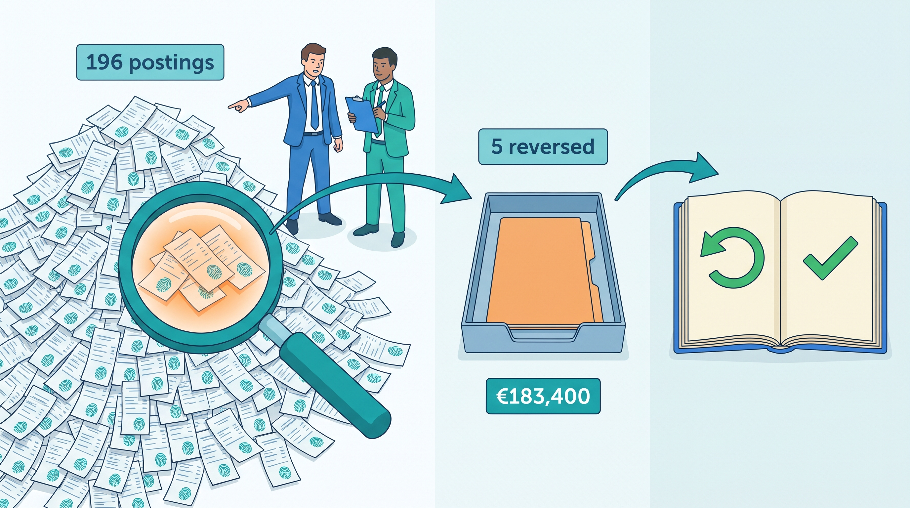

> **IN THIS CHAPTER, YOU WILL:** Learn how to take a new agent version from an offline gate through shadow, canary and ramp to full traffic; how to choose the rollout unit, guardrail metrics and rollback triggers; what rolling back a policy, model, tool contract, code or memory schema actually restores; and how to plan the forward fix for the emails, credits, journal entries and memories a rollback leaves behind.

> **WHY THE BUSINESS CARES:** Every agent version will be replaced, often because a provider retires its model. A release that reaches every customer or legal entity at once turns one defect into a company-wide correction job. A staged release limits how many effects a defect can produce, and a written forward-fix plan tells the risk owner, before signing, what a bad week would cost to repair.

> **WHY ARCHITECTS SHOULD CARE:** Rollout is where the manifest, the regression gate, the evidence log and the autonomy register either work together or show their gaps. An agent's side effects outlive the version that produced them, so "roll back" must mean two things: stop the version from acting, and find and repair what it already did.

> **KEY POINTS:**
>
> * **A rollout is a sequence of evidence stages, each with exits fixed before it starts.** Offline gate, shadow, canary with a concurrent control, ramp, full. Each stage names its rollout unit, guardrails, minimum sample and rollback trigger in advance. Automation may roll back or hold; only a named human advances a stage.
> * **Rollback moves a pointer; it does not move the world.** New runs stop using the bad version within minutes. Runs in flight stay pinned to it, the previous model must still be served, and sent emails, posted entries, issued credits and written memories stay where they are.
> * **Write the forward-fix plan before the first canary.** For every effect class, state how to find each effect the version caused (receipts keyed by manifest hash), what corrects it, who approves the correction and what executes it — never the version being rolled back. Size canary exposure to the correction work you can afford.

> **[FAILURE PATTERNS THIS CHAPTER ADDRESSES](where-agentic-systems-go-wrong.html):**
>
> * **The Silent Upgrade** — a version that reaches all traffic at once, with no concurrent control, becomes an incident before anyone can attribute the change.
> * **Vibe Evals** — a release that passes offline and then "looks fine" on a dashboard had no pre-registered guardrail that would have stopped it.
> * **The Fire-and-Forget Action** — effects recorded without the manifest hash that produced them cannot be found, so a rollback ends the defect but leaves its output unrepaired.

<br>
[[versioning-agent-systems]] made an agent version nameable: an immutable manifest binding exact model, prompts, tool contracts, policy, index snapshot, memory schema and orchestration build. [[building-agent-eval-suites]] and [[evidence-for-autonomy]] built the gates that decide whether a manifest may ship and at which tier each action class runs. This chapter covers the time between "the gate passed" and "every run uses the new version", and the way back.

For an ordinary service that is well-understood release engineering. Two properties of agents change it. **Offline evidence is weaker**: production inputs are wider than any suite, and behavior varies between runs, so more evidence must come from live traffic under control. And **the version acts on other systems**. A bad web release returns bad responses until it is reverted; a bad agent release also sends messages, issues credits, proposes journal entries and writes memories. A rollback stops the next action. It does not recall the last one.

This chapter owns three terms: the **canary** as applied to agents, the **rollback plan** for an agent release, and the **forward fix**. It uses the manifest from [[versioning-agent-systems]], the regression gate from [[building-agent-eval-suites]], and deployment gates, shadow mode and demotion triggers from [[evidence-for-autonomy]]. It relies on [[durable-agent-execution]] for runs in flight and [[partial-failure-and-compensation]] for compensation, and hands standing ownership of releases to [[owning-agentic-systems]].

## Setting the Scene at Ostrell: A Retirement Notice for Closewise

Ostrell, the fictional company this book follows (see [[meet-ostrell]]), runs **Closewise** for the month-end close of its **23 legal entities**: about **1,900 proposed accrual entries a month**, about **380 per working day** across the five-day close. A controller approves each entry; deterministic workflow code then posts it to the enterprise resource planning (ERP) system (tier A1). One step classifies each candidate accrual by account, cost center and accrual type. Since the Alias Drift, it has been pinned to an exact Mid-tier model version in the manifest `cw-2027.09.3` of `closewise-accrual-classifier`.

In October 2027 the provider announced that version's retirement, "not sooner than" **31 March 2028** *(Ostrell, illustrative date)*. Ostrell's November migration calendar put Closewise first, under the rule from [[versioning-agent-systems]]: **no Closewise model migration is promoted in the first seven working days of a month**.

Joost Vermeer, group controller and Closewise's risk owner, agreed on three conditions. No close runs entirely on a version no close has run on before. He can stop the new version within minutes without asking an engineer. And before any entry from the new version posts, someone writes down how the company would find and correct every such entry if it proved wrong.

Release processes usually skip the third condition. Tomas Verhoef, the Chief Architect, put it to the architecture forum: **"Rolling back Closewise takes seconds. Rolling back an approved entry that has posted takes a reversal, a second approval and maybe a footnote in the management report. Which of those is our rollback plan?"** Both are.


**Figure 1:** *Rolling back the version takes seconds; rolling back an approved entry that has posted takes a reversal, a second approval and maybe a footnote, so the rollback plan needs both.*

## Concepts: Stages, Units, Guardrails and the Two Halves of Rollback

### Release, rollout and stages

A **release decision** ([[evidence-for-autonomy]]) asks whether a manifest may replace the current one at the tiers its action classes already hold. A **rollout** executes it: it raises the share of live runs that resolve to the candidate, from zero to all, reversibly at every step. Each standard stage produces evidence the previous one cannot.

| Stage | What runs | What reaches users and systems | What it measures | Blind to |
| --- | --- | --- | --- | --- |
| **Offline gate** | Candidate on suites and simulators | Nothing | Paired regression against production; hard invariants ([[building-agent-eval-suites]]) | Live inputs; real effects |
| **Shadow** | Candidate beside production on live inputs; effects stubbed at the tool broker | Nothing from the candidate | Agreement with production; format, latency, cost on real inputs | Correctness; effects; human reaction |
| **Canary** | Candidate on a small, randomized, sticky slice, with concurrent control | Real effects, bounded by slice and tier limits | Guardrails against control | Rare failures; small regressions |
| **Ramp** | Larger shares and more tenants | Real effects at scale | The same, with more power and coverage | Behavior at 100% (shared caches, quotas) |
| **Full** | All eligible runs; previous manifest kept as rollback target | All effects | Long-run outcomes; the daily canary eval continues | Nothing new about the change |

[[evidence-for-autonomy]] defines shadow mode; this chapter adds one rule: **shadow outputs never enter a store that production reads.** A shadow proposal in the same staging store as real ones is one query away from becoming real.

### Canary (agent)

A **canary**, for an agent, is a partial, time-limited exposure of a candidate manifest to a randomized, sticky slice of live runs, against a concurrent control on the current manifest, with guardrails, minimum sample and rollback triggers fixed before exposure. It adapts the SRE workbook, which defines canarying as "a partial and time-limited deployment of a change in a service and its evaluation", "effectively an A/B testing process", and calls before/after comparison "risky" because time changes metrics ([Google SRE Workbook, "Canarying Releases", 2018](https://sre.google/workbook/canarying-releases/)). Agents add three requirements:

- **Sticky per run, and per larger unit when state is shared.** A run never changes manifest midway ([[versioning-agent-systems]]). When later runs read what earlier ones wrote (memories, drafts, history), assignment must hold for that whole unit.
- **Concurrent control.** Provider-side changes and weekly load patterns make before/after comparisons even less reliable for agents than for services.
- **Real effects, bounded.** Unlike shadow, a canary acts. Tier limits, share and duration set the most damage it can do, and the forward-fix plan must be able to repair that much.

Ostrell's limited-autonomy slice in [[evidence-for-autonomy]] canaries a higher *tier* on a fixed manifest; this chapter's canary tests a new *manifest* at fixed tiers. **A stage that changes version and tier together measures neither.**

### Rollout unit, assignment key and guardrails

The **rollout unit** is what the slice is made of (runs, conversations, customer accounts, tenants, legal entities, repositories); the **assignment key** is the identifier hashed to place a unit in canary or control. Statistical power favors small units randomized across the population. Blast radius and accountability favor large units whose owners know they are in the canary. The usual answer is **nested**: a few large units form the canary cohort, and small units are randomized within it.

A **guardrail metric** is a live measurement that must stay inside a pre-registered band for the rollout to continue. It answers "is the candidate safe to keep running?", not "is it better?".

| Family | Examples | Response to a breach |
| --- | --- | --- |
| **Invariants** | Duplicate effect; action outside policy limits; served model ≠ pinned; shadow write reaching a sink | Roll back immediately |
| **Harm proxies** | Reviewer rejection or override rate; customer re-contact; reversals | Roll back if canary is worse than control beyond a margin |
| **Behavior shape** | Abstention, escalation, refusal, tool-error and policy-denial rates; schema failures | Hold for review; movement in *either* direction is a signal |
| **Operations** | p95 latency, cost per task, cache-read share, rate-limit errors | Page; hold if a budget is breached |

Shape metrics are two-sided because a candidate that escalates less may have stopped recognizing what it should hand to a human. Operations metrics need a warm-up allowance: a new prompt starts with a cold prompt cache ([[caching-and-context-budgets]]).

### Rollback plan (agent) and forward fix

A **rollback plan** is a record, approved before the canary, with five parts: the **rollback target** (a registered, gated manifest whose model is still served); the **triggers** and who may pull them; the treatment of **runs in flight** (drain, cancel with compensation, or migrate); the **effects query** that lists everything the candidate did; and the **forward-fix playbook** per effect class.

A **forward fix** is a corrective change applied after an effect, because going back is impossible or not enough. The term has two senses. One is rolling the *version* forward, shipping a patch instead of reverting; Google's Customer Reliability Engineering team advises against that under pressure, because "a hastily deployed roll-forward fix either fails to fix the original problem, or indeed makes things worse": "the releasing team rolls back first and investigates the problem second" ([Hilton, Google Cloud blog, 2017](https://cloud.google.com/blog/products/gcp/reliable-releases-and-rollbacks-cre-life-lessons)). **This chapter uses the other sense: repairing effects** — reversing a credit, posting a reversal, sending a correction, quarantining memories. It is the half of rollback a pointer move cannot do.

| Effect class | Example | Undone by rollback? | Forward fix |
| --- | --- | --- | --- |
| Proposal not yet acted on | Closewise proposal awaiting approval; Forge pull request (PR) not merged | Mostly | Void items bound to the candidate's manifest hash |
| Approval in progress | A1 approval card | Yes, if approvals bind the action's content hash and are re-checked at execution | Void; re-propose under the rollback target |
| Reversible external effect | Service credit; technician revisit | No | Compensation: reverse with notice; cancel and rebook ([[partial-failure-and-compensation]]) |
| Ledger posting | Approved accrual in the ERP | No | Reversal entry in an open period, under segregation of duties |
| Communication | Email or chat reply sent | No | Human-approved correction; record of the commitment made |
| Written memory | Tidemark record from the candidate | No; it keeps being recalled | Quarantine by writer manifest hash; expire or re-extract ([[agent-memory]]) |
| Decision a person acted on | Benefits notice; followed clinical recommendation | No | Re-determination, notice and appeal; clinical review |
| Merged code | Forge PR merged and deployed | No | Revert PR; restore tests; re-run the pipeline |

The first two columns follow from the tool contracts' reversibility classes ([[tool-contracts]], [[side-effects-and-external-actions]]), so the playbook is written once per agent and adjusted per release, not improvised during an incident.

## Architecture: Pointers, Cohorts and the Effects Ledger

### Components and responsibilities

Rollout adds no service to Keelson, only responsibilities.

| Component | Rollout responsibility | Must never |
| --- | --- | --- |
| **Agent Registry** | Rollout plan; a pointer per cohort (stable, candidate, holdback); every pointer move as an event | Advance a stage without a recorded human approval |
| **Keelson Runtime** | Resolves the manifest at run start from plan and assignment key; records cohort and hash in the task record; keeps workers for every manifest with live runs | Move a run to another manifest midway, except a security or correctness migration, which voids pending approvals |
| **Toolyard** (tool broker) | Executes for canary runs; records only for shadow run ids | Execute a side effect for a shadow run |
| **Bulkhead** (policy engine) | Resolves each action class's tier per manifest hash; applies tier clamps | Let a new manifest inherit an unearned tier |
| **Sounding** (evaluation service) | Offline gates, shadow comparisons, guardrail verdicts against pre-registered bands | Change a band after its stage starts |
| **Wake** and **Logbook** | Guardrail metrics by manifest hash and cohort, computed before sampling; every receipt stamped with the producing manifest hash | Report blended metrics only; hold a receipt without its hash |

A **holdback** is a small share kept on the old manifest after full rollout as a long-running control. The author's agentic-platform-foundations interview design calls promotion and rollback "a versioned pointer flip, not a redeploy" (design example, `agentic-platform-foundations/interview.json`, step `eval-obs`). This book adds what it leaves out: a pointer per cohort, a recorded event per move, and a rollback target checked to be runnable.


**Figure 2:** *Each stage produces evidence the previous one cannot, and every exposed stage has a pre-registered exit. A rollback always leads to the effects query, because the pointer move stops new effects but repairs none.*

### Requirements per interaction

| Interaction | Consistency | Latency budget | Durability | Who may act |
| --- | --- | --- | --- | --- |
| Assign a run to a cohort | Deterministic from key and plan version; fixed for the run | Milliseconds | Cohort, plan version, manifest hash in task record | Keelson Runtime only |
| Advance a stage | Single writer per agent; passing verdict required | Seconds once approved | Event: actor, verdict id, reason | Pipeline, after the named approver signs |
| Roll back | Single writer; **no verdict required** | Under 5 minutes from trigger to new runs on stable *(Ostrell target)* | Event with the trigger that fired | Pre-registered automation; agent owner; on-call |
| Shadow execution | Output never reaches a sink or production store | Off the critical path | Separate shadow store | Toolyard enforces record-only |
| Effects query | Complete over receipts, pending actions and memory writes for a hash | Minutes | Logbook retention | Agent owner, risk owner |
| Forward-fix action | Each correction is its own action object with tier and approval | Per effect class | Logbook, linked to the original effect | Humans or deterministic code; never the rolled-back manifest |

**Advancing needs evidence and a signature; going back needs neither.** It is the same asymmetry as for tiers in [[evidence-for-autonomy]]. A rollback that needs a meeting happens a day late.

The assignment function must be the only place a manifest is chosen:

```python
def resolve_manifest(run: RunRequest, plan: RolloutPlan) -> ManifestRef:
    """Called once by Keelson Runtime at run start; result stored in the task record."""
    if run.parent_cohort is not None:            # delegated and follow-up runs inherit
        return plan.pointer(run.parent_cohort)
    if plan.excluded(run):                       # held-back tenants, entities, segments
        return plan.pointer("stable")
    key = plan.assignment_key(run)               # entry_id, customer_account_id, repo_id ...
    bucket = int(sha256(f"{plan.salt}:{key}".encode()).hexdigest(), 16) % 10_000
    return plan.pointer(plan.stage.cohort_for(bucket))   # "candidate", "stable" or "holdback"
```

Hashing a stable key with a per-plan salt keeps assignment sticky across retries and stops the same customers landing in every canary. The verdict side checks invariants first (any violation rolls back), then harm bands (roll back), then shape and operations (hold), then minimum sample and soak time; its best result is "ready for approval", never "advance". Progressive-delivery tools encode the same logic: in Argo Rollouts a failed analysis "causes the Rollout to abort, setting the canary weight back to zero", and an inconclusive one pauses until a person resumes or aborts ([Argo Rollouts documentation, n.d., accessed 2026-10](https://argo-rollouts.readthedocs.io/en/stable/features/analysis/)). Those tools move traffic between deployments. For an agent the pointer belongs in the agent registry, because the change is often a model identifier or policy version, not a deployment.

## What Rollback Restores, Layer by Layer

Every manifest field rolls back the same way in principle: move the pointer. Each layer has preconditions, and a plan that does not check them names a target it cannot reach.

| Layer changed | Precondition for rollback | What it leaves behind |
| --- | --- | --- |
| **Policy** (tiers, limits) | Previous policy version registered; or an immediate tier clamp | Actions executed under the new policy; approvals bound to it are void |
| **Prompt or settings** | Previous prompts still bind tools that exist | Runs in flight on the candidate; their outputs |
| **Model** | **Previous model still served**, quota reserved for full traffic | The same; after the provider's retirement date there is no previous model |
| **Tool contract** | Old contract still served (Ostrell: 90-day deprecation window) | Effects made through the new contract |
| **Orchestration code** | Old workers deployed; state written by new code readable by old code | Runs started on the new build finish on it or are cancelled |
| **Index snapshot** | Old snapshot retained | Answers already given |
| **Memory schema or writing prompt** | Readers for both versions; writer stamp on every record | Memories already recalled into decisions |

**The model row has an expiry date.** For a migration forced by retirement, the rollback target expires on the retirement date; after that the only fallback is a pre-gated alternative manifest, for example naming the other provider's model ([[versioning-agent-systems]]). A rollback plan should state its target's expiry the way a certificate does.

**The code row is a routing change plus a decision about runs in flight.** "Code changes that affect running orchestrations can break replay behavior" ([Microsoft Learn, Durable Functions code constraints, 2026](https://learn.microsoft.com/en-us/azure/azure-functions/durable/durable-functions-code-constraints)), so Keelson keeps in-flight tasks on the code path they started with ([[task-state-and-checkpoints]]). Rollback routes *new* runs to the old build; the agent owner then drains the candidate's runs, cancels them with compensation, or, for a security or correctness defect, migrates them and voids their pending approvals. Anthropic described "rainbow deployments to avoid disrupting running agents", running old and new versions side by side while traffic shifts ([Anthropic, 2025](https://www.anthropic.com/engineering/multi-agent-research-system)).

**Schema changes must be made rollback-safe before they ship.** Google's schema advice carries over: a "feature-free release" that reads the new schema, then the schema change, then the feature, so "you can roll back to a previous version without having to also roll back the schema". The same post recommends rolling back "just because" every few weeks to "find any traps with incompatible versions" (Hilton, 2017). I would make a passed rollback drill within the last month a precondition for any canary.


**Figure 3:** *Rollback in two halves: the registry stops new runs on the candidate without a human; the agent owner then handles runs in flight and starts the forward fix from an effects query that works only if every receipt carries the manifest hash.*

## Rolling Out by Tenant, by Action Class and Behind Flags

**Per tenant.** Exclusion lists let some tenants, entities or segments enter later, for contractual (negotiated enterprise terms), regulatory (thin suite coverage of a jurisdiction) or statistical reasons (a segment too small to read at canary scale). Every exclusion needs an exit criterion, or the excluded tenants stay on the old version until its model is retired.

**Per action class.** A run uses one manifest, so a rollout cannot send a candidate's reads to full traffic while its credits stay on the old version. It controls the *tier* each action class runs at under the candidate. Ostrell's register resolves a new Answerdesk manifest's credit class to A1 until it is re-gated ([[evidence-for-autonomy]]), so its answers run at their usual tiers while credits wait for approval. The order matters. When Answerdesk's routing profile B ([[agent-cost-and-model-routing]]) went to a 5% canary in December 2027, its manifest had already passed re-gating in shadow, so its credit class ran at A2 in both arms. Otherwise the canary arm would have differed from control in routing *and* tier, and no change in re-contact rate could have been attributed. **Re-gate the tier in shadow, then canary the version at unchanged tiers.**

**Behind flags.** Flags let operators change behavior in seconds, which rollback and kill switches need. Pete Hodgson's taxonomy separates release, experiment, ops and permissioning toggles and warns that toggles are "inventory which comes with a carrying cost" ([Hodgson, martinfowler.com, 2017](https://martinfowler.com/articles/feature-toggles.html)). For agents, **a flag selects among registered manifests or clamps a tier; it never carries prompt text, a model name or a policy rule** ([[versioning-agent-systems]]). Keelson has three kinds: rollout pointers (expire with the plan), tier clamps and holds (permanent, owned by the agent owner), and kill switches (hold queued actions, never drop them).

## Sizing a Canary: What Small Slices Can See

A canary is a small-sample statistical test; compute what it can detect before running it *(Ostrell figures fictional; arithmetic is standard two-proportion approximation)*.

**Closewise over one close.** With about 190 controller decisions per arm and a 4% rejection rate, the standard error of the arm difference is about 2 points. An Alias-Drift-sized jump, 4% to 11%, is about 3.5 standard errors and visible within the close; a 1-point regression is invisible. **The canary catches gross and unexpected failures; small regressions must be caught by the offline gate**, whose paired comparison on 1,094 cases resolves about a point ([[building-agent-eval-suites]]).

**Answerdesk over one week.** At about 7,100 conversations a day, a 5% canary sees about 2,500 a week; with resolution near 41%, the standard error against control is about 1 point. Profile B's offline 40.7% against 41.0% is a difference no week-long canary can confirm. The week can rule out a 3-point drop and anything an invariant catches.

So **guardrail bands must be wider than the slice's noise**, or the canary rolls back on chance; for rare events, zero failures in *n* runs bounds the rate only below about 3/*n* ([[evidence-for-autonomy]]). And **traffic shape sets the calendar**: Answerdesk produces evidence daily, but Closewise produces almost all of it in five days a month, so a Closewise canary is measured in closes, and a mid-month soak tests operations, not accuracy.

## Evidence: Documented Releases and Rollbacks

**No published study compares rollout strategies (shadow length, canary share, assignment unit) for agentic systems.** The design here rests on general release-engineering practice and on dated accounts in which a change to a model, its serving stack, its harness or comparable configuration reached users and was reverted.

| Date | Change and reversal | What the account teaches |
| --- | --- | --- |
| 19 July 2024 | CrowdStrike pushed a Rapid Response Content update, which it stresses "is not code or a kernel driver", at 04:09 UTC and reverted it at 05:27; a Content Validator bug had let a faulty template instance pass ([CrowdStrike, 2024](https://www.crowdstrike.com/blog/falcon-content-update-preliminary-post-incident-report/)) | Configuration needs staging: CrowdStrike committed to staggered deployment "starting with a canary deployment". The revert protected hosts connecting afterwards; the report does not claim it repaired hosts already affected |
| 25–28 April 2025 | OpenAI rolled back a GPT-4o update in ChatGPT after three days; offline evaluations "generally looked good" and A/B tests suggested users liked it (OpenAI, 2 May 2025, via [Willison](https://simonwillison.net/2025/May/2/what-we-missed-with-sycophancy/)) | Aggregate preference metrics can reward a regression. OpenAI wrote that "user memory contributes to exacerbating the effects": stored state takes part in a version's behavior |
| Aug–Sept 2025 | Anthropic: three infrastructure bugs degraded output with no model change; fixed or rolled back 2–18 September ([Anthropic, 2025](https://www.anthropic.com/engineering/a-postmortem-of-three-recent-issues)) | Evaluations "did not capture the degradation users reported"; production probes are needed under a pinned identifier |
| Mar–Apr 2026 | Anthropic: three changes to its coding agent's harness (a lower default reasoning effort, a caching change that, after an idle session, dropped prior reasoning on every turn, a system-prompt line limiting verbosity) degraded quality; all reverted or fixed by 20 April ([Anthropic, 2026-04-23](https://www.anthropic.com/engineering/april-23-postmortem)) | Harness configuration is behavior. The changes "made it past multiple human and automated code reviews, as well as unit tests, end-to-end tests, automated verification, and dogfooding". Commitments: "soak periods, a broader eval suite, and gradual rollouts", and per-model evals "for every system prompt change" |
| July 2025 | Replit's agent deleted a production database; the CEO cited backups, "one-click restore for your entire project state" and dev/prod separation ([The Register, 2025](https://www.theregister.com/2025/07/22/replit_saastr_response/)) | A restore point covers state inside your boundary; effects in other systems need their own repair path |

Three lessons recur. **Offline evidence passed every time**, which is the strongest documented argument for a canary with concurrent control: the first stage where real inputs meet real effects under a comparison that controls for time. **Configuration, prompts and harness settings caused as many regressions as models**, which matches the SRE workbook's observation that most incidents follow binary or configuration pushes, and supports this book's rule that every manifest field change goes through the same stages. And **reverting restored future behavior, never past output**: no account claims the rollback repaired crashed hosts, conversations already shaped by a sycophantic model, or sessions run with dropped context. For an agent with tools, past output is a ledger entry, a credit or an email. That step is my inference from the pattern, not the vendors' claim.

The author's interview designs reach the same structure. The agentic-legal-platform design stages changes "behind a holdout: canary a fraction of traffic, compare against the held-back baseline, and keep the prior model/verifier/corpus version pinned for instant rollback" (design example, `agentic-legal-platform/interview.json`, step `workflows-eval`). The agentic-support-platform design contains a bad "policy/model rollout" by lowering "the autonomy tier for the affected action kinds", rolls back the version, then creates "repair tasks (including compensations for actions that shouldn't have fired)" (design example, `agentic-support-platform/interview.json`, step `compliance-eval`). The agentic-platform-foundations design asks which metric "blocks promotion, which metric trips automatic rollback in production, and which trips human review rather than rollback" (step `eval-obs`), the split this chapter's guardrail families follow.

## Worked Example at Ostrell: The Closewise Model Migration

All figures here are fictional Ostrell facts or labeled assumptions.

### The plan, signed before anything ran

Mei Lin Zhou, the evaluation lead, and the Closewise team wrote the plan in late October 2027; Joost signed it. Each classification is a short child run of the classifier agent, so run and entry coincide, and the assignment key is the **entry id**: a re-classification after an evidence change lands in the same arm.

| Plan element | Content |
| --- | --- |
| Candidate | `cw-2027.10.2`: new exact model id and prompt `classifier-system@v15`; nothing else changed |
| Rollback target | `cw-2027.09.3`; model served until at least 31 March 2028; quota reserved for full traffic; rollback drill passed 27 October |
| Fallback after expiry | Pre-gated alternative manifest naming the other provider's Mid-tier model, gated by 15 January 2028 |
| Stages | Offline gate → shadow over the October close → canary in five entities, 50/50 by entry id, through the November close → year-end decision → full with 5% holdback |
| Automatic rollback | Any invariant violation, served ≠ pinned model or shadow write outside the shadow store; canary rejection rate above control by > 3 points with ≥ 100 decisions per arm, or above 9% absolute |
| Hold and page | Abstention rate outside 0.5×–2× control; p95 latency +50%; cost per classification +40% |
| Who may roll back / advance | Sounding automation, the Closewise agent owner, or an entity controller for their own entity / Joost, on Mei Lin's certified verdict |
| Effects query | Every staging-store proposal and ERP receipt carrying the candidate's hash |
| Forward-fix playbook | Pending proposals: void and re-propose under `cw-2027.09.3`. Posted entries: adjudicate all of the candidate's postings in the affected entity and period; corrections as reversal-and-repost proposals generated by deterministic code from adjudicated values, approved by a controller other than the original approver, posted with idempotency keys in the next open period |

The playbook follows the agentic-finance-platform design, where "a correction is a new reversed/reversal proposal, never an edit" (design example, `agentic-finance-platform/interview.json`, step `ledger`), and consistency ruling 14: only an approved action object crosses into the ERP.

### Offline gate and shadow

The first candidate (model only, 25 October) failed one criterion: false abstention **4.1%** against a 3% ceiling; the new model sent well-evidenced entries to controllers, safe but pointless. Prompt v15 tightened the abstention instruction, and the second candidate passed the suite v2 gate on 28 October: zero invariant violations in 3,282 trials, accuracy **96.3%** against production's **96.0%** (paired +0.3 points), abstention recall **92%**, false abstention **2.4%**, holdout within 1.1 points.

Over the October close (**1–5 November**), both manifests classified every candidate accrual; the candidate's proposals went to a shadow store controllers never saw. They agreed on account, cost center and accrual type for **1,822 of 1,936 (94.1%)**. Two senior accountants adjudicated all **114** disagreements: the candidate was right in **52**, production in **44**, both wrong in **18** — net +8 entries, about 0.4 points, consistent with the offline result. **Shadow measured agreement; adjudicating the disagreements turned it into a correctness estimate.** That adjudication, about 11 accountant-hours, was the stage's real cost; the extra model spend, roughly €60 *(assumption)*, was not. Shadow also showed output tokens **+31%** and p95 latency **2.6 s → 3.1 s**; Joost accepted an 18% higher cost per classification.

### Canary

On Wednesday **17 November** (working day 13), the canary started in five entities chosen with Joost: **Ostrell Assure UK**, **Ostrell Parts Benelux** and three smaller service entities, about 20% of monthly entries. The two largest, including Ostrell Field Deutschland GmbH, stayed out. Within the cohort, entries split 50/50 by entry-id hash. Controllers knew their entities were in the canary; approval cards showed the manifest version but not the arm, because an arm label would have biased the rejection guardrail.

The mid-month weeks produced about **140** canary classifications: enough for operations, nothing for accuracy, as the sizing predicted. The November close (**Wednesday 1 to Tuesday 7 December**) gave **196** canary entries against **188** control. Rejections: **10 (5.1%)** against **8 (4.3%)**, well inside the 3-point band. No trigger fired.

### The forward fix: five entries the guardrail could not see

On Tuesday 7 December, working day 5, the Ostrell Assure UK controller noticed in her balance review that a provision account opened on 1 November, for warranty accruals under Assure's new extended-cover contracts, was nearly empty. A staging-store query by manifest hash took twenty minutes: eight extended-cover accruals had gone through the canary arm, the candidate had classified all eight to the general warranty provision account, controllers had rejected three and approved five, and the five had posted. The control arm had classified its extended-cover entries correctly. The account post-dated the October shadow, so shadow could not have seen the case.

The plan ran as written.

1. **Rollback (16:40 the same day).** The Closewise agent owner set the candidate share to zero; no candidate runs were in flight because the close had finished.
2. **Effects query.** Logbook returned **196** postings under the candidate's hash and no pending proposals. Because the guardrail had missed this error, Joost had all 196 re-adjudicated, not only Assure UK's. Two accountants took two days and found only the five, **€183,400** in total.
3. **Forward fix.** With November locked, deterministic code generated five reversal-and-repost pairs in December from the adjudicated accounts — a reclassification between two balance-sheet provision accounts, with no profit-and-loss effect. A deputy controller who had not approved the originals approved them; they posted with idempotency keys tied to the original entries, and the November management pack for Ostrell Assure UK carried a one-line note.
4. **Re-gate.** Twenty-four extended-cover cases joined suite v2, and prompt v16 added the account's purpose to the instruction. Candidate `cw-2027.12.1` passed the gate on 10 December; a **replay shadow** of the November close's recorded inputs classified all eight cases correctly with agreement elsewhere unchanged. The canary resumed in the same cohort on Wednesday 15 December.

Two lessons shaped later releases. **The harm guardrail did not catch the defect**: controllers approved five of eight wrong entries, so rejection rates barely moved, and the catch came from a human control outside the rollout design. Ostrell's plans now re-adjudicate every candidate-arm posting to an account opened in the current or previous period. And **the forward fix was cheap because exposure was small and receipts were labeled**. At 100%, the defect would have hit every extended-cover entity; without manifest hashes on receipts, finding the entries would have cost the week of manual reconstruction the Stale Price Book cost Dealroom ([[provenance-and-freshness]]).


**Figure 4:** *Because every receipt carried the candidate's manifest hash, all 196 canary postings could be found and re-adjudicated, and the five wrong entries worth €183,400 were reversed and reposted.*

### The year-end decision

The plan's next step was a mid-December ramp. But the December close, in early January 2028, is year-end, with auditors' cut-off procedures and annual accruals that appear in no other close. Joost chose neither "year-end on the new version" nor "pause the canary". The cohort stayed as it was through year-end, giving annual accruals a concurrent comparison in five entities. Full rollout is scheduled for **Monday 17 January 2028**, with a **5% holdback** on `cw-2027.09.3` through the January close; the old model's retirement date falls after that close, so the rollback target stays real for every close the candidate has not yet run.

| Stage | Window | Exposure | Result |
| --- | --- | --- | --- |
| Offline gate | 25–28 Oct 2027 | None | Candidate 1 failed false abstention; candidate 2 passed |
| Shadow | 1–5 Nov | 1,936 shadow classifications | 94.1% agreement; adjudicated net +0.4 points |
| Canary | 17 Nov – 7 Dec | 196 posted entries, five entities | Guardrails in band; five misclassified entries posted (€183,400) |
| Rollback and forward fix | 7–10 Dec | Candidate share 0 | 196 adjudicated; 5 reversed and reposted; 24 cases added |
| Canary resumed | 15 Dec through year-end | Same cohort, `cw-2027.12.1` | Annual accruals compared in five entities |
| Full with holdback | From 17 Jan 2028 (planned) | 95% / 5% | Holdback removed after the January close if guardrails hold |

## Failure Modes and Recovery

| Scenario | Detection | Containment | Recovery |
| --- | --- | --- | --- |
| **Big-bang release**: a manifest goes to 100% on gate pass | Outcome shift with no control to compare; complaints | Tiers and approvals only | Roll back; forward fix at full scale; require an exposed stage for every manifest change |
| **Shadow leaks an effect**: a shadow run calls a write tool or lands in a production store | Toolyard alert on a write under a shadow run id | Record-only mode at the broker; separate shadow store | Compensate; severity-2 incident ([[evidence-for-autonomy]]) |
| **Cohort flapping**: one customer sees both versions; memories cross versions | Differing manifest hashes under one conversation or account | Assignment key at the level of shared state; child runs inherit cohort | Fix the key; exclude mixed units from the analysis |
| **Rollback target not runnable**: model retired, quota unreserved, workers gone | Failed rollback drill; expiry on the migration calendar | Pre-gated alternative manifest; reserved quota | Switch to the alternative; forward fix as usual |
| **Rollback breaks runs in flight**: old code cannot read new state | Replay or deserialization errors | Expand/contract schemas; route new runs only | Finish in-flight runs on the new build, or cancel with compensation |
| **Guardrail blind to the defect**: humans approve wrong effects (the Assure UK entries) | Out-of-band human control; post-hoc adjudication of the canary arm | Small exposure; labeled receipts | Effects query; full adjudication; forward fix; new check |
| **Faulty version fixes itself**: the rolled-back agent is asked to correct its own errors and repeats them | Corrections carrying the rolled-back hash | Corrections generated by deterministic code or humans | Void and regenerate from adjudicated values |

## Trade-offs

| Rollout unit | Power | Blast radius and accountability | State consistency | Right when |
| --- | --- | --- | --- | --- |
| Run or entry | Highest | Spread; nobody owns the canary | Only if runs share no state | Stateless steps inside a chosen cohort |
| Conversation or task | High | Spread | Within the task | Chat agents without long-term memory |
| Customer account | Medium | One customer, one behavior | Across conversations and memories | Agents with per-user memory (Answerdesk with Tidemark) |
| Tenant or legal entity | Low; few, heterogeneous units | Contained; a named owner can opt out | Holds | Enterprise customers; high-consequence back office |
| Nested: entities as cohort, entries randomized | Medium | Contained to the cohort | Where the inner unit is stateless | Closewise; most back-office agents |

**Automatic or human rollback.** Automation is right for invariants, served-model mismatches and large harm breaches: it acts in minutes, at night, and does not hesitate to admit a failed release. Humans are right for shape and cost alerts, where context matters (an outage, a known surge). Bands set too tight make automation flap. The default is asymmetric: automation may roll back or hold; a human decides to resume.

**Roll back or roll forward the version.** Roll back first whenever the target is runnable. The exceptions are narrow: the target is itself unsafe (it has the security flaw the candidate fixed), its model is retired with no gated alternative, or the candidate changed a schema the old version cannot read. A roll-forward release then still passes an abbreviated gate (hard invariants, the incident's cases, a replay shadow). Either way, the forward fix of effects is separate work.

## Across Domains: How the Stakes Change the Design

| Concern | Coding agents | Customer operations (support, sales, marketing) | Back office (finance, legal, HR) | High-stakes decisions (healthcare, public benefits) |
| --- | --- | --- | --- | --- |
| Rollout unit | Repository or task | Customer account; enterprise tenants later | Entity or matter as cohort, items randomized within | Site, program or caseload |
| Shadow | Cheap: sandboxes and branches make effects disposable | Feasible with send, credit and booking stubbed at the broker | Ideal: outputs are proposals experts can adjudicate | The main release tool for "model and threshold changes" (design example, `agentic-healthcare-platform/interview.json`, step `eval`) |
| What a canary exposes | PRs to reviewers; merge stays human | Customers to replies, credits, commitments | Approvers to proposals; postings after approval | Professionals to drafts; never an adverse decision without a human |
| Not undone by rollback | Merged, deployed code; deleted tests (the Fixture Purge) | Sent messages, credits, representations a tribunal may hold the company to ([Moffatt v. Air Canada, 2024](https://decisions.civilresolutionbc.ca/crt/crtd/en/item/525448/index.do)) | Postings, payments, filed documents | Notices sent; decisions people acted on |
| Forward fix | Revert PR, restore tests | Credit reversal with notice (the drill in [[evidence-for-autonomy]]); human-approved corrections; memory quarantine | Reversal proposals in an open period under segregation of duties | Bounded batch re-determination of affected cases (design example, `agentic-public-benefits-platform/interview.json`, step `rules`); notice and appeal |
| Release windows | Few hard freezes | Outage peaks, campaign launches | Close, year-end, audit fieldwork | Enrollment surges; regulatory review |

Coding is the outlier: git and the PR gate keep most effects reversible until merge, so canaries are cheap and the forward fix is a revert; the author's coding-CLI design gates "every model and prompt change" on versioned evals with "canary rollouts" (design example, `ai-coding-cli/interview.json`, step `cloud`). At the other end, the forward fix touches people: a case is re-determined and re-noticed, not just corrected in a database. Under the EU AI Act, an unforeseen change to a high-risk system can be a substantial modification (Regulation (EU) 2024/1689, [Art. 3(23)](https://eur-lex.europa.eu/eli/reg/2024/1689/oj)), a reason to keep rollout plans and their evidence as records.

**Platform-common:** pointers per cohort, sticky assignment, record-only shadow at the broker, guardrail verdicts with asymmetric authority, the effects query by manifest hash, rollback drills, the rollback-plan record. **Domain policy:** the rollout unit, windows, bands, who advances, and above all the forward-fix playbook, where the consequence profile shows most directly: a revert, a credit reversal, a reversal entry, a re-determination.

## The Chief Architect's View

**Make the rollout plan a required record.** The Agent Registry should refuse to expose a candidate to live traffic unless a plan names stages, unit, guardrails with bands, rollback target with expiry, triggers, approvers and forward-fix playbook. Most of it is copied from the previous plan; the risk owner signs the bands and the playbook.

**Price the forward fix before the canary.** The right canary size is what the business can afford to correct if the candidate is wrong in a way the guardrails cannot see. For Closewise that was five entities and one close, about 200 postings to re-adjudicate in the worst case. A risk owner can sign that; "5%" means nothing to them.

**Keep the rollback target real.** Its model, workers, quota and readable schemas are part of the release and cost money while the candidate ramps. Track its expiry on the migration calendar and register a gated alternative before it expires.

**Separate who stops from who advances.** Anyone accountable for a slice of the effects (on-call, the agent owner, an entity controller for their entity) may stop it; only the risk owner advances. The asymmetry is cheap and is what makes people willing to run canaries.

**What to watch.** Share of manifest changes with at least one exposed stage (should be all); rollbacks per quarter and how many a guardrail caught rather than a human outside the rollout (that ratio shows where guardrails are blind); time from trigger to rollback; forward-fix days per rollback; rollback targets within 30 days of expiry; overdue drills.

**Durable and volatile.** Durable: staged exposure with concurrent control, sticky assignment, the stop/advance asymmetry, labeled receipts, and the fact that a pointer move repairs nothing. Volatile: traffic-shifting tools, retirement cadences, and how far offline evaluation can stand in for live exposure. Better evaluations will shorten shadow and canary stages, not remove them, because effects in real systems can only be observed live.

## Questions to Ask

1. What is the rollback target, is its model still served, and until when?
2. What is the rollout unit and assignment key, and does assignment hold across every run that shares state?
3. Is there a concurrent control at every exposed stage, or are we comparing before and after?
4. Which guardrails roll back automatically and which hold, were their bands fixed before exposure, and what size of regression can this canary detect?
5. Does any stage change the version and an autonomy tier together?
6. Where are shadow side effects stubbed, and can shadow output reach a store production reads?
7. If we roll back now, what happens to runs in flight, and can the old code read what the new code wrote?
8. Can we list every effect, including memories, this manifest produced within minutes?
9. For each effect class, what is the forward fix, who approves it, what executes it, and is the rolled-back version kept out of it?
10. When did we last roll this agent back on purpose?

## From Releases to Owners

A staged rollout makes a change survivable; the forward-fix plan makes a bad change repairable. Both assume someone owns the agent: writes the plan, holds the pager, signs the bands, keeps the rollback target alive and decides when a model on the calendar must move. The next chapter, [[owning-agentic-systems]], takes up that ownership: who owns and operates an agent, how the agent registry carries it from proposal to retirement, and how Keelson's operating model is meant to change in 2028.

## Sources and Evidence

### Research papers

- No published study compares rollout strategies (shadow duration, canary share, assignment unit) for LLM-based agents; the sizing arithmetic uses the standard two-proportion approximation and the rule of three, as in [[evidence-for-autonomy]].

### Specifications, standards and regulation

- [Regulation (EU) 2024/1689 (Artificial Intelligence Act)](https://eur-lex.europa.eu/eli/reg/2024/1689/oj) — European Union, 2024. Art. 3(23), substantial modification.
- [Durable Functions code constraints](https://learn.microsoft.com/en-us/azure/azure-functions/durable/durable-functions-code-constraints) — Microsoft Learn, 2026. Code changes to running orchestrations can break replay.
- [Analysis and progressive delivery](https://argo-rollouts.readthedocs.io/en/stable/features/analysis/) — Argo Rollouts documentation, n.d., accessed 2026-10. Failed analysis aborts to stable; inconclusive pauses.

### Vendor documentation and engineering reports

- [Canarying Releases](https://sre.google/workbook/canarying-releases/) — Google SRE Workbook, 2018. Canary definition; concurrent control; configuration pushes as incident triggers.
- [Reliable releases and rollbacks — CRE life lessons](https://cloud.google.com/blog/products/gcp/reliable-releases-and-rollbacks-cre-life-lessons) — Adrian Hilton, Google Cloud blog, 2017. Roll back first; feature-free release for schema changes; rollback drills.
- [Feature Toggles (aka Feature Flags)](https://martinfowler.com/articles/feature-toggles.html) — Pete Hodgson, martinfowler.com, 2017. Toggle categories and carrying cost.
- [How we built our multi-agent research system](https://www.anthropic.com/engineering/multi-agent-research-system) — Anthropic, 2025. Rainbow deployments for long-running agents.
- [A postmortem of three recent issues](https://www.anthropic.com/engineering/a-postmortem-of-three-recent-issues) — Anthropic, 2025. Serving regressions without model change; evaluations missed them.
- [An update on recent Claude Code quality reports](https://www.anthropic.com/engineering/april-23-postmortem) — Anthropic, 2026-04-23. Harness setting, caching and system-prompt changes reverted; soak periods, per-model evals and gradual rollouts committed.
- [What we missed with sycophancy](https://simonwillison.net/2025/May/2/what-we-missed-with-sycophancy/) — Simon Willison, 2025, quoting OpenAI's 2 May 2025 post (primary not fetchable). Rollback after three days; offline evaluations and A/B tests missed it; memory's role.

### Incidents, cases and decisions

- [Falcon Content Update preliminary post-incident review](https://www.crowdstrike.com/blog/falcon-content-update-preliminary-post-incident-report/) — CrowdStrike, 2024. Configuration content reverted after 78 minutes; staggered canary deployment committed.
- [Moffatt v. Air Canada, 2024 BCCRT 149](https://decisions.civilresolutionbc.ca/crt/crtd/en/item/525448/index.do) — Civil Resolution Tribunal of British Columbia, 2024. A company is liable for its chatbot's representations; a small-claims decision, persuasive only.
- [Replit responds to SaaStr database deletion](https://www.theregister.com/2025/07/22/replit_saastr_response/) — The Register, 2025. Snapshot restore and dev/prod separation, as reported.

### Design examples from the author's interview project

- Obrenović, Ž., "Agentic Platform Foundations", system-design interview design, `system-design-interviews/data/book/agentic-platform-foundations/interview.json`, 2026 — step `eval-obs`: pointer-flip promotion and rollback; three kinds of trip wire.
- Obrenović, Ž., "Agentic Legal Platform", system-design interview design, `system-design-interviews/data/book/agentic-legal-platform/interview.json`, 2026 — step `workflows-eval`: canary against a held-back baseline; prior versions pinned for rollback.
- Obrenović, Ž., "Agentic Support Platform", system-design interview design, `system-design-interviews/data/book/agentic-support-platform/interview.json`, 2026 — step `compliance-eval`: contain by lowering tier, roll back, repair with compensations.
- Obrenović, Ž., "Agentic Finance Platform", system-design interview design, `system-design-interviews/data/book/agentic-finance-platform/interview.json`, 2026 — step `ledger`: corrections as new reversal proposals.
- Obrenović, Ž., "AI Coding CLI", system-design interview design, `system-design-interviews/data/book/ai-coding-cli/interview.json`, 2026 — step `cloud`: evals gating model and prompt changes; canary rollouts.
- Obrenović, Ž., "Agentic Healthcare Platform", system-design interview design, `system-design-interviews/data/book/agentic-healthcare-platform/interview.json`, 2026 — step `eval`: shadow, canary and staged rollout for model and threshold changes.
- Obrenović, Ž., "Agentic Public Benefits Platform", system-design interview design, `system-design-interviews/data/book/agentic-public-benefits-platform/interview.json`, 2026 — step `rules`: rule-package rollback; bounded batch re-determination.

Ostrell is fictional; architectural recommendations, labeled inferences and labeled assumptions are the author's judgement.
