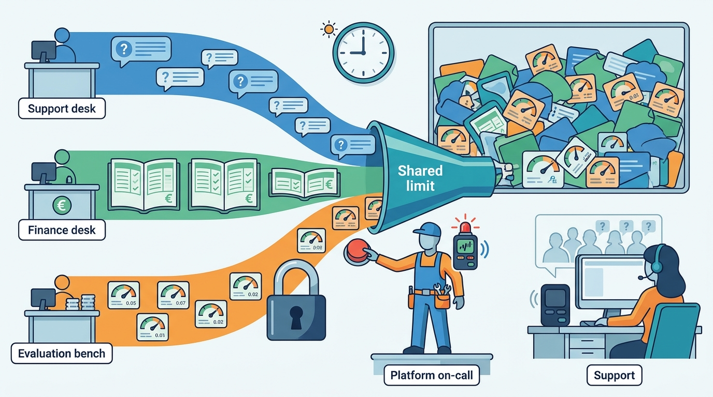
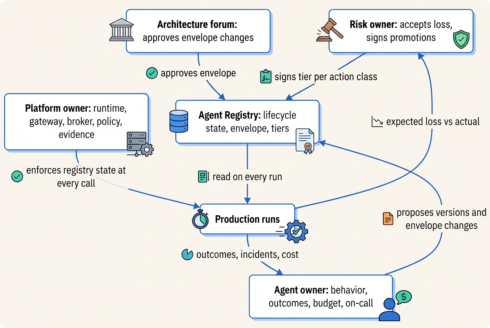
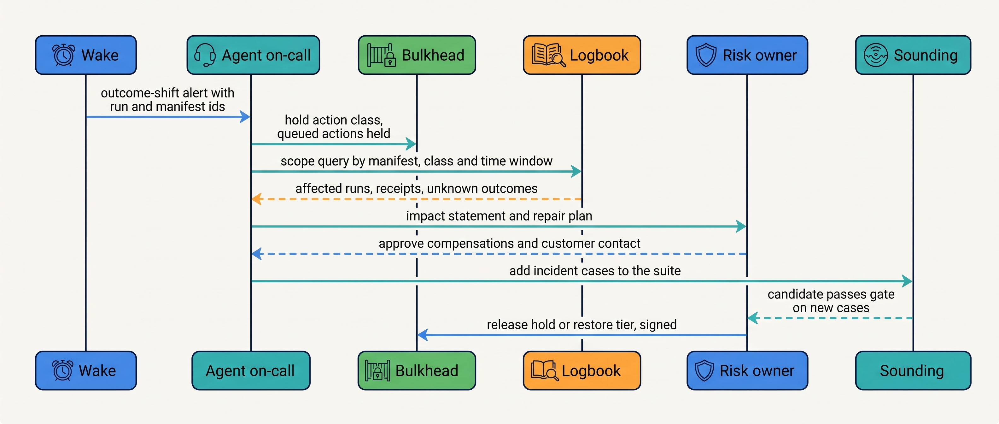
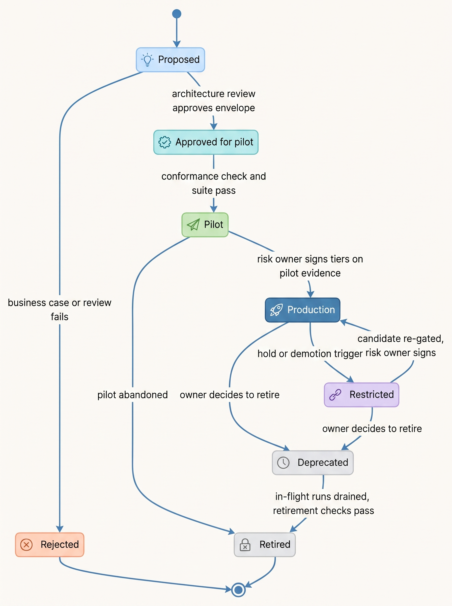
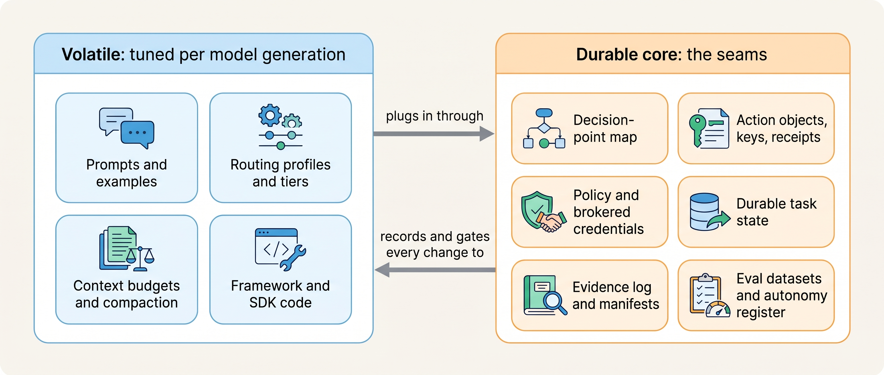
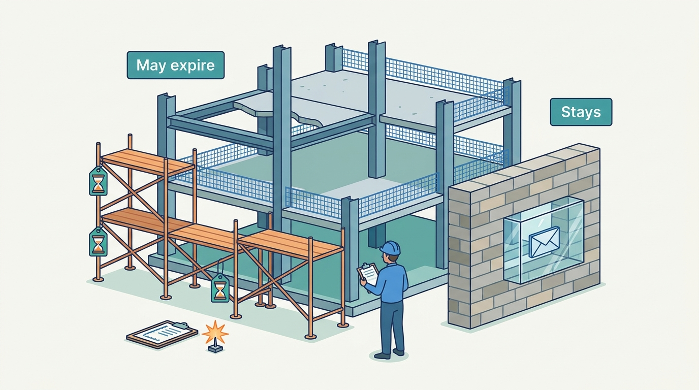

> **IN THIS CHAPTER, YOU WILL:** Learn how to split ownership of an agent between the platform team, the product team and the risk owner, how to run on-call and incident response for systems whose worst failures throw no errors, how to manage an agent's lifecycle from proposal to retirement through a registry, and which parts of the architecture to keep stable while models change underneath it.

> **WHY THE BUSINESS CARES:** An agent that issues credits, proposes journal entries or drafts quotes is a delegated business process. When it goes wrong at 09:10 on a close day, someone must be able to stop it within minutes, someone must own the loss, and someone must decide whether it runs again. If those are three different people who have never met, the incident lasts hours.

> **WHY ARCHITECTS SHOULD CARE:** Every control in this book needs an owner who keeps it working. A kill switch nobody may press, a tier nobody reviews, an eval suite nobody updates and a retired agent whose credentials still work are all failures of the operating model, not of the code.

> **KEY POINTS:**
>
> * **Split ownership by what fails, not by who wrote the code.** The platform team owns the mechanisms (runtime, gateway, broker, policy engine, evidence, evaluation). One named **agent owner** owns the agent's behavior, outcomes, budget and on-call. A **risk owner** per action class owns the acceptable loss and signs every autonomy promotion. Anyone on call may hold or demote an action class; only the risk owner may raise it.
> * **The registry is the lifecycle, and the platform enforces it.** An agent moves from proposal to pilot to production, and down to restricted, deprecated and retired, only through recorded transitions. Gateway, broker and policy engine refuse runs the registry state does not allow. Architecture review is proportionate: a change inside the agent's approved envelope passes on automated conformance checks; a change that moves the envelope (a new action class, identity, trifecta leg or topology) goes to review.
> * **Keep the seams; expect to replace most of what lies between them.** Decision-point maps, action objects with idempotency keys and receipts, policy and credentials outside the model, durable task state, the evidence log, version manifests, eval datasets and the autonomy register follow from the model's variability and from distributed-systems constraints. Prompts, routing tiers, context budgets, multi-agent multipliers and framework APIs change with each model generation. Better models move decision points from code to the model, by evidence; they do not remove the seams.

> **[FAILURE PATTERNS THIS CHAPTER ADDRESSES](where-agentic-systems-go-wrong.html):**
>
> * **Autonomy by Default** — tiers that nobody owns and nobody re-reviews become permanent grants, and an agent nobody retired keeps its tools and credentials.
> * **The Silent Upgrade** — when no single owner holds the migration calendar, the provider's schedule becomes the release process.
> * **The Token Bonfire** — a budget with no owner who may raise or cut it, and no on-call who may stop the spend, is an alert, not a limit.

<br>
The previous chapters built controls around one variable component; this one is about keeping them true after launch. **An agentic system is operated, not delivered.** Its model is retired on someone else's schedule, its approvers get tired, its costs move with prices and its regulation changes dates. What is new is that the worst agent incidents are **behavior incidents**: no error, no deploy, a plausible output that is wrong more often than last week. They do not page anyone unless someone designed the page, and they cannot be stopped unless someone has the authority to stop them.

The chapter owns three terms: the **agent owner**, the **agent registry** (as the lifecycle record) and **architecture review** for agents. It builds on the control plane in [[agentic-reference-architecture]], the autonomy register in [[autonomy-and-consequence]] and [[evidence-for-autonomy]], the kill switch in [[partial-failure-and-compensation]], the manifest in [[versioning-agent-systems]] and the release process in [[staged-rollout-and-rollback]]. It closes Parts I–X by asking which of those decisions should last, and hands over to the domain chapters in [[part-11]].

## Setting the Scene at Ostrell: Three Owners and No One in Charge

Ostrell, the fictional company this book follows (see [[meet-ostrell]]), ran seven agents on its Keelson platform in 2027. On Tuesday **2 November 2027**, working day 2 of the October close, three workloads shared one Mid-tier provider account: Answerdesk's support chat, a Closewise reclassification of six entities, and a late Sounding canary run. At 09:10 the account hit its organization input-token limit. Chat p95 time to first visible text rose to **14 seconds**, **2.1%** of turns hit the 30-second hard limit, and abandonment went from **9% to 17%**; no wrong action was taken ([[agent-latency-and-throughput]]).

Wake, the tracing service, alerted at 09:35 and paged the Keelson platform on-call engineer. Diagnosis took ten minutes; containment took two hours. The on-call engineer could stop the canary run, which Sounding owned, and did so after reaching Mei Lin Zhou's team. The reclassification was Group Finance's work on a close day, and the platform on-call had no authority to defer it; the request went to the controller's office, which agreed to defer it shortly before 11:30. Support Operations, whose customers were waiting, had not been paged at all: Answerdesk had no on-call rotation of its own, because "Keelson is on call." The queue cleared at 11:40.


**Figure 1:** *On the close day three workloads shared one provider limit, and the only person paged could stop just one of them: diagnosis took ten minutes, containment two hours.*

The incident review, chaired by Tomas Verhoef, the Chief Architect, did not find a missing component. Quota pools, priority classes and batch tiers were the technical fix. It found three missing decisions. **Who is on call for an agent's behavior, as opposed to the platform's health? Who may stop another team's agent workload, and with what authority? Who owns a shared limit that three agents consume?** The same questions had come up all year: the Poisoned Ticket found in a trace review six days late, the Alias Drift found by controllers before any alert, a Weekend Fan-out that ran 41 hours because watching Scout's spend was nobody's job.

In December 2027 Tomas, Amara Okafor (Head of Agent Platform) and Marten Ruys (CFO) wrote the **Keelson 2.0 roadmap for 2028**. Most of it is not new technology but ownership, lifecycle and what to keep stable while models change.

## Concepts: Owners, the Registry and the Envelope

**Agent owner.** The one named person accountable for what an agent does in production: its outcomes against the success definition, its budget, its eval suite, its on-call rotation and the decision to retire it. The agent owner is a person, not a team, because a team cannot be paged into a decision. At Ostrell the agent owner is a business leader (Lena Brandt for Answerdesk, Joost Vermeer for Closewise, Priya Natarajan for Dealroom, Ilse de Wit for Clausewise, Sam Kowalczyk for Forge), with an engineering lead who runs the agent's code and rotation.

**Risk owner.** The person who accepts the expected loss of an action class at its tier and signs promotions ([[evidence-for-autonomy]]). Usually the agent owner, but not always: Lena Brandt is the risk owner for Answerdesk credits only up to **€5,000 a month** of expected exposure, because Marten Ruys delegated that much and no more. A support agent that issues credits spends Finance's money.

**Platform owner.** The team that owns the mechanisms every agent shares: at Ostrell, Amara Okafor's Agent Platform team (**14 engineers in January 2027, 19 by December 2027**) for Keelson Runtime, Gateway, Toolyard, Bulkhead, Tidemark, Logbook and Wake, and Mei Lin Zhou's team for Sounding.

**Agent registry.** The control-plane record of every agent and every agent version: owners, lifecycle state, action classes and their tiers keyed by manifest hash, the decision-point map, the rung justification, budgets, freshness rules, the outcome metric and its baseline, and the retirement plan. Here it is not a catalog but the **state machine that decides what may run**.

**Envelope.** The approved boundary of an agent: its action classes and their tier ceilings, its identities and scopes, its tools by risk class, its trifecta position ([[agent-threat-model]]), its topology and delegation limits, and its budget maxima. Changes inside the envelope are routine releases. Changes that move it are architecture decisions.

**Architecture review (agent).** The review that approves a new envelope or a change to one. It is not the evaluation gate, which decides whether a version may run inside an approved envelope ([[evidence-for-autonomy]]).

| Concern | Owned by | Not owned by | Why the split |
| --- | --- | --- | --- |
| Runtime, gateway, broker, policy engine, evidence, tracing work as specified | Platform owner | Agent owner | One implementation, many consumers; a fix lands once |
| Agent behavior, outcome metric, suite, prompts, tool selection, budget values | Agent owner | Platform owner | The team that knows the domain judges correctness |
| Expected loss per action class; promotions; residual-risk statements | Risk owner | Agent owner's engineers | The person who bears the loss decides whether to accept it |
| Tool contract and its system of record | System-of-record owner | Agent owner | The tool encodes the system's invariants ([[tool-ecosystems-and-mcp]]) |
| Trust labels, sink policy, trifecta exceptions review | Security architect | Agent owner | Security controls must not be tuned by the team under delivery pressure |
| The envelope rule, the one-path rule, the durable core | Chief Architect via architecture forum | Any single team | These bind every agent and outlive every team |


**Figure 2:** *Three owners act on one record. The registry carries what each decided; the platform enforces it on every run; outcomes flow back to the people who own the agent and its risk.*

## Architecture: Making Ownership Enforceable

Ownership written in a wiki is a description. Ownership the platform enforces is a control. The design rule Ostrell adopted in the 2028 roadmap is: **every authority in the operating model is a field in the registry that some component reads**.

### The registry entry

A registry entry has an agent layer (identity, owners, lifecycle state) and a version layer (immutable manifests with their tiers). The agent layer:

```typescript
type LifecycleState =
  | "proposed" | "approved_for_pilot" | "pilot" | "production"
  | "restricted" | "deprecated" | "retired" | "rejected";

interface AgentRegistryEntry {
  agentId: string;                       // stable, never reused
  agentOwner: PersonRef;                 // one person, not a team
  engineeringLead: PersonRef;
  riskOwners: Record<ActionClass, { person: PersonRef; exposureCapEurMonth: number }>;
  onCall: { rotation: RotationRef; coverage: "24x7" | "business_hours" | "calendar_windows" };
  state: LifecycleState;
  envelope: EnvelopeRef;                 // approved by architecture review, versioned
  envelopeDecision: DecisionRecordRef;
  successDefinition: { outcomeMetric: string; baseline: string; costPerSuccessTarget: number };
  productionManifests: ManifestHash[];   // at most three live
  nextReview: { envelope: Date; tiers: Date };  // tiers re-reviewed at least yearly
  retirementPlan: RetirementPlanRef;     // written at registration, not at retirement
}
```

**`riskOwners` carries an exposure cap**, so the CFO's delegation is data Bulkhead can check, not a memo. **`nextReview.tiers`** exists because an unreviewed tier becomes a permanent grant. **`retirementPlan` is written at registration**, when the team still knows everything the agent touches.

Gateway, Toolyard and Bulkhead read `state` on every call: no credentials or model calls for proposed, rejected or retired agents; only A0/A1 tiers and the pilot cohort in pilot; floor tiers in restricted; no new runs once deprecated. Registration checks read `envelope`, the promotion workflow reads `riskOwners`, Wake routes behavior alerts by `onCall`, and the Gateway throttles on the agent's monthly budget.

### The requirements of governance actions

Governance actions are interactions like any other, with latency, consistency and authority requirements. Getting them wrong is how the Close-Day Queue took two hours.

| Action | Who may act | Takes effect within | Consistency | Record |
| --- | --- | --- | --- | --- |
| **Hold** an action class (kill switch) | Agent on-call, platform on-call, security on-call, automated demotion trigger | Minutes; Bulkhead replicas in under a minute | Strong for the hold flag; queued actions held, never dropped | Registry decision record + Logbook event |
| **Demote** a tier | Same as hold, plus the risk owner | Minutes | Strong at Bulkhead; fall back to the lowest configured tier if the register is unreachable | Decision record with trigger |
| **Defer another team's workload** under a shared limit | Platform on-call, by the pool rules agreed in advance | Minutes | Gateway priority classes | Decision record; owner notified, not asked |
| **Promote** a tier | Risk owner, after the evaluation lead certifies the evidence | Days | Keyed by manifest hash | Signed decision record |
| **Register** a new agent or move an envelope | Architecture forum | Target 10 working days | Registry transaction | Envelope decision record |
| **Raise** a monthly budget | Risk owner | Same day | Gateway quota update | Decision record |
| **Retire** | Agent owner, after drain checks pass | After the last in-flight run ends | Registry state transition | Retirement record, kept with the evidence |

The asymmetry is deliberate, and it is the same one as in [[evidence-for-autonomy]]: **reducing autonomy is cheap, fast and open to many people; increasing it is slow and needs one named signature.** A false hold costs minutes of manual work; a false promotion costs whatever the agent does until someone notices. The Close-Day Queue went slowly because the right to defer another team's work had never been granted to anyone on call.

## Operations: On-Call and Incident Response for Behavior

### Two rotations, two kinds of alert

Ostrell's 2028 operating model separates two rotations, because they answer different questions.

- **Platform on-call** (Agent Platform team, 24×7): is Keelson working? Component availability, error rates, latency, Gateway quotas, provider outages, dropped spans, the daily query for side effects without a policy decision.
- **Agent on-call** (each agent's team, coverage set by consequence): is this agent doing the right thing? Outcome-shift alerts, the served-model-differs-from-pinned invariant, approval rejection rates, unknown-outcome rates per tool, budget burn, Sounding canary scores, injection-related denials on that agent's sinks.

Coverage follows consequence and calendar. Answerdesk gets **24×7** coverage from Support Operations' engineers. Closewise gets **close-window coverage** (working days −1 to 5), because a regression during close is a business incident and one in mid-month is a ticket. The other five agents get business hours, because a person (analyst, lawyer, account executive, employee, PR reviewer) stands between their output and the outside world. Security on-call (Farah Haddad's team) receives sink-policy denials, as since July 2027 ([[prompt-injection-defense]]).

Bainbridge's 1983 observation about automation applies to the agent rotation with full force: "the most successful automated systems, with rare need for manual intervention, … may need the greatest investment in human operator training" ([Bainbridge, 1983](https://web.archive.org/web/20200717054958if_/https://www.ise.ncsu.edu/wp-content/uploads/2017/02/Bainbridge_1983_Automatica.pdf)). Ostrell's answer is a quarterly game day per agent, like the June 2027 Closewise game day in [[task-state-and-checkpoints]].

### The agent incident runbook

Classic incident management still applies: "Stop the bleeding, restore service, and preserve the evidence for root-causing", with separate command, operations and communications roles ([Google, 2016](https://sre.google/sre-book/managing-incidents/)). What changes for agents is the meaning of each step.

The author's agentic-support-platform interview design (step 7, `compliance-eval`, deep dive "Incident response") gives a sequence that fits: **detect** a spike in wrong-action, duplicate, compensation or human-override rate; **contain** by lowering the autonomy tier for the affected action kinds or tenants; **roll back** the policy or model version; **repair** by sampling affected conversations and creating compensation tasks; and **stay safe meanwhile** by keeping the agent read-only for the affected classes, "so it can still answer and escalate but cannot act on the suspect path." It is a design example, not a deployed process; its key move: **containment is a change of autonomy, not a shutdown.**


**Figure 3:** *An agent incident in the order that matters: hold first, scope from the evidence log, repair with the risk owner, and restore autonomy only after the incident has become an eval case and a candidate has passed it.*

Four rules make the runbook work:

1. **Hold before diagnosing.** Holding is cheap and reversible, so it needs no diagnosis; queued actions are held, not discarded ([[partial-failure-and-compensation]] owns the kill-switch mechanics).
2. **Scope from records, not from memory.** The first useful question is "which runs, on which manifest, took which actions since when?" Logbook and Wake answer it by run id, action id and manifest hash ([[agent-observability]]). In June 2027 the sales team needed a week to reconstruct what the stale price book had touched because those ids were missing ([[provenance-and-freshness]]).
3. **Repair is a business decision.** Whether to claw back 212 duplicate credits or let customers keep them is the risk owner's call, not the engineer's. The Stale Price Book's €46,000 of honored discounts was such a decision.
4. **Restore by evidence.** The incident becomes cases in the suite ([[building-agent-eval-suites]]); autonomy returns when a version passes them. An incident that invalidates an assumption under which evidence was collected demotes the class even if it caused no harm, which is Ostrell's policy since October 2027.

### Regulatory incident duties

Under the EU Artificial Intelligence Act (Regulation (EU) 2024/1689), Article 73 requires providers of high-risk systems to report a serious incident "not later than 15 days" after becoming aware of it, with shorter limits for widespread infringements and deaths ([AI Act Art. 73](https://artificialintelligenceact.eu/article/73/), accessed 2026-10). Article 26 requires deployers to assign oversight to people with "the necessary competence, training and authority" and to keep logs for at least six months ([Regulation (EU) 2024/1689](http://publications.europa.eu/resource/celex/32024R1689)). The Annex III high-risk obligations, including Article 26, apply from **2 December 2027** ([Regulation (EU) 2026/1744](http://publications.europa.eu/resource/celex/32026R1744)). An organization that builds an agent for its own use may be its provider as well as its deployer (a legal judgement). So **the incident runbook needs a regulatory branch for any agent the registry marks high-risk**, with a named person who decides whether an incident is reportable and a clock that starts at awareness. Outside regulated scope, NIST's AI Risk Management Framework 1.0 (January 2023) gives the same structure a name: its Govern function is where the registry and the review sit ([NIST, 2023](https://www.nist.gov/itl/ai-risk-management-framework)).

## Lifecycle: From Proposal to Retirement


**Figure 4:** *The agent lifecycle as the registry enforces it. Every arrow is a recorded decision; only Restricted can be entered automatically.*

| State | Entry gate | What may run | Exit |
| --- | --- | --- | --- |
| **Proposed** | Registry entry with owner, decision-point map, rung justification | Nothing in production; replay experiments on recorded cases | Review approves or rejects |
| **Approved for pilot** | Envelope decision by the architecture forum | Nothing yet | Onboarding conformance check passes |
| **Pilot** | Conformance check (egress, secrets, pinned manifest, a tier for every class) | Shadow mode and A0/A1 only, named cohort, capped budget | Risk owner signs production tiers, or the pilot ends |
| **Production** | Signed tiers per action class | Within tiers; staged rollout per version ([[staged-rollout-and-rollback]]) | Hold, demotion or deprecation |
| **Restricted** | Hold or automated demotion | Read-only or floor tiers for affected classes | Re-gated candidate and signature |
| **Deprecated** | Owner's decision with a date | In-flight runs only | Retirement checks |
| **Retired** | Retirement checks pass | Nothing; identity disabled | Terminal; the agent id is never reused |

### Retirement is an engineering task

The failures at the end of the lifecycle are quiet: a retired agent whose identity still holds scopes, whose trigger still fires, whose memories a successor recalls, or whose evidence was deleted with its database. A retirement check covers six things, each a query, not a promise:

1. **Runs drained.** No task in a non-terminal state; pending approvals voided.
2. **Authority removed.** Identity disabled, grants revoked, keys and triggers removed.
3. **Memory handled.** Tidemark records it wrote are expired or handed to a named successor with provenance ([[agent-memory]]).
4. **Dependants found.** No other agent's manifest, router or handoff target names the retired agent.
5. **Evidence kept.** Logbook retention is not shortened; past decisions must stay explainable.
6. **Assets archived.** Suite, datasets and last manifests, because a successor's evaluation starts from them.

Ostrell retired its first agent in June 2027. The Answerdesk **billing specialist agent**, the receiver of the Lost Handoff, was folded back into Answerdesk as a tool set on **2027-06-07** ([[coordination-and-handoffs]]). Its registry entry moved to deprecated that day and to retired on **2027-06-21**, after the last in-flight billing conversation ended. The check found one thing the team had forgotten: the triage router still listed the specialist as a handoff target for one rarely used route, which would have failed closed at Toolyard but would have stranded conversations. The route was removed before retirement. Retirement exposed a dependency nobody had written down, and the registry, not anyone's memory, found it.

## Architecture Review for Agents

Too little review, and every team ships its own trifecta; too much, and teams route around the platform. Microsoft's Cloud Adoption Framework advises organizations to "Transfer AI delivery to the platform teams" and to "Replace the CoE gatekeeper model that blocks work with an advisory group that sets guardrails" ([Microsoft, 2025, updated 2026-10-15](https://learn.microsoft.com/en-us/azure/cloud-adoption-framework/scenarios/ai/center-of-excellence)); this is vendor guidance, not measured effect. The 2025 DORA survey of nearly 5,000 professionals found AI adoption associated with higher delivery throughput and lower stability, and called AI an amplifier of existing strengths and weaknesses; it reports correlation, and covers AI-assisted development, not agentic products ([Google Cloud, 2025](https://cloud.google.com/blog/products/ai-machine-learning/announcing-the-2025-dora-report)). Read together: put the guardrails into a platform, and spend review effort only where the guardrails cannot decide.

In Team Topologies terms, agent teams are stream-aligned and Keelson is a platform team providing "a compelling internal product" consumed as a service ([Team Topologies, n.d., accessed 2026-10](https://teamtopologies.com/key-concepts)). Ostrell's 2027 mistake was to consume everything as a service, including on-call for behavior, which a platform cannot own.

### The envelope rule

Ostrell's rule since the Keelson 2.0 roadmap: **a change that stays inside the approved envelope needs no architecture review; a change that moves the envelope always does.**

| Change | Inside the envelope? | Path |
| --- | --- | --- |
| Prompt edit, new few-shot examples, compaction threshold, context budget within limits | Yes | Manifest release through the regression gate |
| New read-only tool from an existing system of record, same data classes | Yes | Toolyard review; conformance check |
| New write tool, wider argument range, higher limit | **No** | Review: it is a new or changed action class |
| New identity, scope or data class; private data added to an agent that reads untrusted content | **No** | Review with security: a trifecta leg may move |
| Delegation tool, a second agent, a handoff | **No** | Review against the topology rule ([[single-and-multi-agent-designs]]) |
| Moving a decision point from code to the model | **No** | Review with a rung justification and baseline |

Raising a class's ceiling always moves the envelope; external commitments stay capped at A1. The onboarding conformance check that has gated Agent Registry acceptance since GA is extended in 2028 to fail any manifest whose tools, identities or classes fall outside the envelope.

### What the review asks

The review is short because the book's earlier chapters each reduce to one or two questions. The forum's checklist for a new envelope:

| Area | Question | Chapter |
| --- | --- | --- |
| Justification | For each model-held decision point: what does the model decide that code could not, what checks it, and what does that cost per verified outcome against the next simpler design? | [[when-agents-are-justified]] |
| Autonomy | What is each action class, its consequence and reversibility, its ceiling and its starting tier? | [[autonomy-and-consequence]] |
| Path | Does every effect cross runtime, policy enforcement point, broker and evidence log? | [[agentic-reference-architecture]] |
| Effects and state | Is every write an action object with an idempotency key, a receipt and an unknown-outcome path, and what survives a crash or a week-long wait? | [[side-effects-and-external-actions]], [[task-state-and-checkpoints]] |
| Trust and authority | Which trifecta legs does it hold, whose identity does it use, and what does an injected run do in the worst case? | [[agent-threat-model]], [[agent-identity-and-least-privilege]] |
| Oversight | Which gates exist, what does an approver see, and how is approval quality measured? | [[human-oversight-and-bounded-autonomy]] |
| Evidence | What is the outcome metric, who owns it, and which suite gates every manifest change? | [[evaluating-agentic-systems]] |
| Economics | What are the run budget, the monthly budget and the cost-per-success target? | [[agent-cost-and-model-routing]] |
| Operations | Who is the agent owner, who is on call, and what is the retirement plan? | this chapter |

The operations row is the one most often blank, and the only one no platform component can fill in.

## Evolving the Architecture as Models Change

How should the architecture adapt as models, prices and providers change? Freezing the 2027 design keeps workarounds for weaknesses later models no longer have; rebuilding around each new model throws out the controls with the workarounds.

### What the evidence says about change

The evidence is clear about direction and unclear about speed. METR's time-horizon measurements, on self-contained, automatically scored software and research tasks, found the task length frontier models complete with 50% success doubling roughly every seven months over 2019–2025, faster since; METR's March 2026 note reports that reasonable analysis choices move one recent model's 50% horizon by about 1.5× and its 80% horizon by about 2×, and its page calls measurements above 16 hours unreliable ([Kwa et al., 2025](https://arxiv.org/abs/2503.14499); [METR, 2026](https://metr.org/notes/2026-03-20-impact-of-modelling-assumptions-on-time-horizon-results/); [METR, updated 2026-09-08](https://metr.org/time-horizons/)). Treat them as a trend on benchmark tasks, not as any enterprise's horizon. Anthropic's February 2026 study of agent use in practice describes a "deployment overhang": models capable of more autonomy than users grant ([Anthropic, 2026](https://www.anthropic.com/research/measuring-agent-autonomy); one provider's data, with the authors' caveats). And METR's 2025 randomized trial of experienced developers found tasks took 19% longer with early-2025 AI tools while the developers believed they had been sped up ([Becker et al., 2025](https://arxiv.org/abs/2507.09089), preprint, 16 developers). Benchmark capability, autonomy granted and value delivered move at different speeds.

The platform layer moves too. OpenAI shut down its Assistants API on 2026-08-26 and announced the shutdown of hosted reusable prompts, its Evals platform and Agent Builder for 2026-11-30, advising users to "move reusable prompt content into your application code" ([OpenAI, n.d., accessed 2026-10](https://developers.openai.com/api/docs/deprecations)). Microsoft archived AutoGen in favor of its Agent Framework ([Microsoft, n.d., accessed 2026-10](https://github.com/microsoft/autogen)), and Anthropic retires models with at least 60 days' notice ([Anthropic, n.d., accessed 2026-10](https://platform.claude.com/docs/en/about-claude/model-deprecations)).

No published study follows an enterprise agent architecture across several model generations and reports which parts survived. What follows is the author's judgement, built from the durable-versus-volatile assessments at the end of each chapter in this book.

### The durable core

The test for durability is a question about cause: **does this part exist because the model is weak today, or because the model's output varies, because effects reach other systems, or because someone is accountable?** Weakness is temporary. Variation, external effects and accountability are not: a model that is right 99.9% of the time still proposes something different on a retry, a timeout still leaves an outcome unknown, and a regulator still asks who decided.

| Durable (keep stable, change only by architecture decision) | Why it lasts | Volatile (expect to replace) | Why it moves |
| --- | --- | --- | --- |
| Decision-point map; code, model or human per point | Control flow has to be auditable whatever the model ([[what-makes-a-system-agentic]]) | Which points are held by the model | Better models justify moving points, by evidence |
| Action objects, idempotency keys, receipts, unknown outcome as a state | External systems and networks fail the same way regardless of the model ([[retries-idempotency-and-concurrency]]) | Retry counts, timeouts, receiver key semantics | Receivers and providers change |
| Policy enforcement and credentials outside the model | No model has a boundary between instructions and data ([[prompt-injection-defense]]) | Detection classifiers, attack rates, confirmation thresholds | Models get harder to inject; vendors publish improving numbers |
| Durable task state; resume, never re-ask | Runs outlive processes, deploys and approvers ([[durable-agent-execution]]) | Engine APIs, history limits | Longer runs raise the stakes, not the need |
| Evidence log separate from traces | Audit and regulation ask what happened and why ([[policy-enforcement-and-audit]]) | Trace attribute names, back-end products | OTel conventions still in Development status |
| Version manifest with exact model id; served version recorded | Providers change things under you ([[versioning-agent-systems]]) | Model ids, notice periods, API versions | Provider schedules |
| Eval datasets, graders, pass^k, regression gates | Variation needs repeated measurement ([[evaluating-agentic-systems]]) | Judge models, benchmarks, simulators | Suites saturate; judges change |
| Autonomy register per action class; human promotion, automatic demotion | Cost asymmetry of false promotion ([[evidence-for-autonomy]]) | Tier values and thresholds | Evidence changes |
| Terminating budgets per run, agent and tenant | Loops and fan-out multiply cost by design ([[agent-cost-and-model-routing]]) | Prices, routing profiles, prompts, context budgets, multi-agent multipliers, framework APIs | All are tuned to a model generation or a price table |


**Figure 5:** *The volatile parts plug into the durable core and are gated by it. A new model generation replaces the left box; the right box decides whether the replacement is better.*

### What better models change, and what they do not

I expect four effects, in decreasing order of confidence:

- **Decision points move from code to the model.** Rules and branches that existed because an earlier model could not handle the variation become candidates for a model call. The move goes through envelope review with a rung justification measured on replayed cases, and it can go either way: better models also let a single call cover what once needed a loop ([[when-agents-are-justified]]).
- **Runs get longer.** Longer horizons make durable state, version stickiness, wait timers and budgets for the whole task tree more important, not less ([[durable-agent-execution]]).
- **Workarounds become waste.** Prompt scaffolding, extra verification calls and multi-agent splits justified only by context limits should be removed by evidence, as they were added.
- **Low-consequence confirmations can be relaxed.** If measured injection and error rates fall, some A1 classes earn A2 by the normal promotion process.

What capability gains do not change: the model is still not a security boundary, a call to an external system is still executed at least once and made exactly-once in effect only by keys and receipts, an approval still has to be bound to what was approved, a person is still accountable for an adverse decision about another person, and irreversible external commitments stay capped at A1 at Ostrell whatever the evidence. **The rule I use: a capability gain may change a value in the registry; it may not remove a field.**

### Avoiding framework lock-in

Anthropic's 2024 guidance suggested that "developers start by using LLM APIs directly", warning that frameworks add layers that hide prompts and responses ([Anthropic, 2024](https://www.anthropic.com/engineering/building-effective-agents); the page notes that its tooling advice has aged). The author's agentic-platform-foundations interview design states the boundary more sharply: agent frameworks "must not hide durable state, approvals, idempotency keys, or tenant budgets" (`agentic-platform-foundations/interview.json`, `technologyChoices`, orchestration; a design example).

I would apply three tests to any framework or managed agent service:

1. **The seam test.** Do task state, approvals, idempotency keys, budgets and evidence live in your stores, under your schemas?
2. **The portability test.** Are prompts, tool contracts, manifests, eval datasets and results in your repository in open formats? OpenAI's November 2026 shutdowns are the dated example of why a vendor-hosted prompt or eval store is a dependency with a lifecycle.
3. **The quarter test.** Could one agent move to another framework, or another provider, in one quarter, with the suite deciding whether the move worked? Untested means unknown.

Keelson passes the first two by construction (open-source durable engine, MCP terminated at Toolyard, manifests and suites in Ostrell's repositories) and had never run the third.

## Worked Example at Ostrell: The Keelson 2.0 Roadmap for 2028

Tomas Verhoef, Amara Okafor and Marten Ruys approved the roadmap on **2027-12-14**. Its premise was written on the first page: *Keelson's components are mostly in place; 2028 is about owners, lifecycle and change.* At that date the Agent Registry held eleven agent entries: seven in production, the retired billing specialist, the rejected Invoice Chaser, and two proposals for 2028. The seven production agents carried **21 action classes** in the autonomy register.

| # | Roadmap item | What changes | Owner | Target |
| --- | --- | --- | --- | --- |
| 1 | **Agent on-call** | Every production agent has a rotation in the registry; coverage by consequence (Answerdesk 24×7, Closewise close windows, others business hours); Wake routes behavior alerts to it | Agent owners; Amara for routing | Q1 2028 |
| 2 | **Hold and defer rights** | Any on-call (agent, platform, security) may hold an action class; platform on-call may defer lower-priority pool workloads under pre-agreed rules, notifying owners | Tomas (principle); Amara (mechanism) | Q1 2028 |
| 3 | **Registry lifecycle v2** | Enforced states (Figure 4); risk owner per action class with exposure cap; retirement plan at registration; yearly tier re-review with a list of classes past due | Amara | Q1 2028 |
| 4 | **Envelope rule** | Conformance check compares each manifest with the approved envelope; forum reviews only envelope changes, target 10 working days | Tomas | Q2 2028 |
| 5 | **Quarterly agent portfolio review** | CFO's team, Tomas and risk owners review per agent: cost per successful task against baseline, budget use, incidents, tier changes, overdue reviews | Marten | From Q1 2028 |
| 6 | **Capability re-baselining** | Twice a year, Sounding re-runs rung justifications for code-held decision points and the multi-agent baseline on the current model generation | Mei Lin Zhou | H1 and H2 2028 |
| 7 | **Portability drill** | Run Peoplepoint's policy-answer loop on a pre-gated manifest for the second commercial provider and on the open-weight Small-tier model; keep pre-gated alternatives for Closewise and Answerdesk | Jonas Lindqvist | Q2 2028 |
| 8 | **AI Act classification register** | Each agent's Annex III and Article 6(3) assessment recorded with its envelope; adding a tool that ranks or decides about people re-opens it; regulatory branch in the incident runbook | Ilse de Wit with Farah Haddad | Current agents assessed November 2027; enforced Q1 2028 |

Three items deserve a closer look.

**Item 6 is where capability change enters the architecture.** The first plan names three 2027 decisions whose reasons may expire. Scout's orchestrator–worker design beat a single agent on breadth tasks (0.64 → 0.81) at 2.4× the tokens ([[single-and-multi-agent-designs]]); if a single agent with longer usable context closes the gap, Scout loses the delegation tool. Answerdesk's intake router uses rules, a calibrated classifier, a Mid-tier LLM router and a human queue ([[routing-and-delegation]]); if the LLM stage's calibration improves, the classifier may handle less. Closewise's single-call accrual classification is a candidate for a cheaper tier. One thing is explicitly **not** a candidate: Answerdesk's quarantined reader, which keeps raw inbound email away from the planner. Its reason, the absence of an instruction–data boundary inside any model, is not a capability gap. A model that is harder to inject may earn fewer confirmations on the email tool; it does not earn the removal of the separation.


**Figure 6:** *Capability re-baselining re-tests the 2027 decisions whose reasons may expire, while the quarantined reader stays, because no model has an instruction–data boundary.*

**Item 7 tests a claim the platform had made but never demonstrated:** that providers sit behind the Gateway and Sounding decides parity. Peoplepoint's low-consequence policy answers let the drill run on a production cohort.

**Item 8 has a date the company does not control** (2 December 2027). In the November 2027 assessment none of Ostrell's agents was high-risk: Peoplepoint refuses anything about performance, pay or termination and routes it to HR, which keeps it out of Annex III point 4(b) by design, and Ostrell does not score credit or insurance for natural persons. The register ties that assessment to the envelope, so the next team that adds a candidate-ranking tool to an HR agent meets the question at review, not at an audit.

The two proposals show the lifecycle working before any code runs. **Partsline** (Ostrell Parts order exceptions) asks for A3 status answers, A1 substitution offers to customers (an external commitment, capped at A1) and A0 supplier requests, piloting in shadow mode. **Claimcheck** (Ostrell Assure warranty claims) would draft assessments only; a denial is an adverse outcome for a customer, so every decision class is capped at A1 with the claim handler deciding. Neither had passed review in December 2027.

## Failure Modes and Recovery

| Scenario | What happens | Detection | Containment | Recovery |
| --- | --- | --- | --- | --- |
| **No authority on call** (the Close-Day Queue) | A shared limit is hit; the on-call can see the cause but may not stop another team's workload | Wake alert; containment time far above diagnosis time | Pre-agreed pool rules let platform on-call defer lower-priority work | Incident review adds the missing right to the registry; game day tests it |
| **Orphaned agent** | Owner leaves or reorganizes; nobody updates the suite, budget or tiers | Registry: owner field points to an inactive person; reviews past due | Agent moves to restricted after a grace period | New owner named by the business, or deprecation |
| **Stale tier** | An action class holds the same tier for years while tools and models change | Registry list of classes past their review date | Overdue classes are flagged in the portfolio review; after a grace period, held at their current tier with no promotion possible | Fresh evidence review, signed again or demoted |
| **Zombie agent** | Retired in name; identity, triggers or grants still active | Retirement checks; daily query for calls from retired agent ids | Gateway and Toolyard refuse calls for retired ids | Complete the retirement checks; incident if any call succeeded |
| **Capability-driven removal of a control** | A team removes a separation or gate because the new model "doesn't need it" | Envelope diff at registration | Conformance check fails the manifest | Review asks the cause question: weakness, or variation, effect, accountability? |

An orphaned agent differs from an orphaned service: it keeps acting, with authority, while nobody watches.

## Trade-offs

| Decision | Option A | Option B | Choose A when | Choose B when |
| --- | --- | --- | --- | --- |
| Where agents are built | Central AI team builds every agent | Product teams build agents on a shared platform | Fewer than a handful of agents, one domain, platform not yet built | More than a few domains; domain judgement decides correctness (Ostrell's choice) |
| Governance style | Gatekeeping review of every change | Guardrails in the platform plus envelope review | Early pilots with no conformance automation | Platform enforces the one-path rule and conformance checks |
| Behavior on-call | Platform team covers all agents | Each agent team covers its own agent | A single agent, or agents with identical consequence profiles | Several agents with different domains and calendars |
| Runtime | Adopt a framework or managed agent service | Build a thin runtime on a durable engine and open protocols | Seams stay in your stores and the framework passes the portability test | You need control of state, approvals, keys and budgets that no framework offers on your terms |

The cost of option B is people: review, per-agent on-call, re-baselining and drills. Ostrell's estimate for 2028 is about a quarter of the platform team's capacity plus a rotation in each agent team *(assumption, for planning)*. The alternative is paying for the same work during incidents.

## Across Domains: How the Stakes Change the Design

| Concern | Coding agents | Customer operations (support, sales, marketing) | Back office (finance, legal, HR) | High-stakes decisions (healthcare, public benefits) |
| --- | --- | --- | --- | --- |
| Typical risk owner | Engineering productivity lead; repository owners for merge | Support or sales director; CFO for money above a delegated cap | Controller, general counsel, HR director; a licensed professional for legal work | A licensed clinician or an accountable public official, bound by identity to each adverse decision |
| On-call coverage | Business hours; the PR gate absorbs failures | Customer hours, often 24×7; reputation moves in hours | Calendar windows (close, filing deadlines) | Service hours plus a defined safe fallback to manual work |
| What triggers architecture review | New credentials, new repository classes, auto-merge for any class | New commitment types, new channels, consent or suppression changes | Any new write to a system of record; segregation-of-duties changes | Any change to the rules layer or to what the human sees before deciding |
| Retirement constraint | Cheap; branches and PRs are the record | Customer commitments and suppression lists outlive the agent | Evidence kept for audit, often years | Decisions must stay explainable and appealable after the agent is gone |
| External duties | Few, beyond licensing and IP | Disclosure to customers (AI Act Art. 50), consumer law | Internal control frameworks, employment-law notice for HR agents | Annex III high-risk duties from 2 Dec 2027: deployer oversight and logs (Art. 26), impact assessment for public bodies (Art. 27), incident reporting by providers (Art. 73) |

Design examples from the author's interview project show the same machinery: the coding-harness design measures "harness health" (sensor fire rates, escapes) and turns every escape into a new guide or sensor (`ai-coding-harness/interview.json`, step `scale`); the sales design's fleet pause holds work per tenant, domain or fleet (`agentic-sales-platform/interview.json`, `api[4]`); the public-benefits design binds every adverse determination to an accountable caseworker's identity (`agentic-public-benefits-platform/interview.json`, step `naive`).

**What is platform-common:** the registry and its lifecycle, the owner fields, the hold-and-demote rights, the envelope rule and conformance checks, the incident runbook's shape, retirement checks and the durable core. **What is domain policy:** who the risk owner is and how high their delegation goes, on-call coverage, which changes count as moving the envelope, retention after retirement, and the regulatory branch of the runbook.

## The Chief Architect's View

**Decide the three owners before the first agent ships.** Platform owner, agent owner, risk owner per action class, each a named person in the registry. If you cannot name the agent owner, the agent is not ready for production, whatever its eval scores say.

**Make reduction of autonomy a right of the on-call and promotion a right of the risk owner.** The asymmetry is the cheapest safety mechanism in the book. A kill switch that needs a meeting is not a kill switch.

**Govern the envelope, not the release.** Let checks and the regression gate handle everything inside the envelope; a forum that reviews prompt edits will soon be routed around.

**Own the change calendar centrally.** Model retirements, price changes, framework end-of-life and regulatory dates belong in one calendar, held by the platform team. The Silent Upgrade is what happens when that calendar belongs to nobody.

**What is durable and what will change.** Durable: one owner per agent, risk owners per action class, enforced lifecycle states, cheap holds and signed promotions, envelope review, retirement as an engineering task, and the seams in Figure 5. Volatile: team sizes, the forum's cadence, the list of decision points held by the model, the routing profiles, the frameworks and the regulatory dates. Over 2027, Ostrell changed almost every number in its agents and almost none of the seams. That is the pattern I expect to continue: **models will make more decisions, faster and over longer horizons, and the architecture will spend less effort compensating for their weaknesses and the same effort bounding their effects.**

**What to watch.** The share of agent incidents first detected by automation; time from alert to containment; action classes past their review date; agents above their cost-per-success baseline; and agents that have passed a portability drill.

## Questions to Ask

1. Who is the one named owner of this agent, and who is on call for its behavior tonight, as distinct from the platform's health?
2. For each action class, who is the risk owner, what expected loss have they accepted, and up to what exposure does their authority go?
3. Who may hold an action class during an incident without asking anyone, and how long does a hold take to reach every enforcement point?
4. What is this agent's approved envelope, and which kinds of change move it? Who reviewed the last one?
5. When were the tiers of this agent's action classes last reviewed, and which classes have never been?
6. What is the retirement plan: what does the agent touch that would outlive it (memories, triggers, commitments, evidence)?
7. Which parts of this design exist because today's model is weak, and how will you find out when that reason has expired?
8. If your agent framework or hosted service were shut down next quarter, where do your task state, approvals, keys, prompts and eval datasets live?

## From the Platform to the Domains

Parts I–X described one platform and the decisions that bound one variable component: where it decides, what it touches, what it remembers, how its actions are made durable, reversible or approved, how evidence earns it autonomy, what it costs, and how it changes. The domain chapters now hold the platform still and vary the stakes. [[part-11]] introduces four domains (coding agents, customer operations, back office and high-stakes decisions) and shows, end to end, which parts of this architecture stay the same and which become domain policy when the person affected by an error is a developer, a customer, an auditor or a patient.

## Sources and Evidence

### Research papers

- [Measuring AI Ability to Complete Long Software Tasks](https://arxiv.org/abs/2503.14499) — Kwa et al., METR, 2025 (NeurIPS 2025; revised 2026). Time-horizon trend on self-contained software and research tasks; 50% vs 80% horizons; external-validity limits.
- [Impact of modelling assumptions on time horizon results](https://metr.org/notes/2026-03-20-impact-of-modelling-assumptions-on-time-horizon-results/) — METR, 2026. Sensitivity of recent horizons to analysis choices by 1.5–2×.
- [Time horizons](https://metr.org/time-horizons/) — METR, updated 2026-09-08. Page no longer actively updated; measurements above 16 hours unreliable.
- [Measuring the Impact of Early-2025 AI on Experienced Open-Source Developer Productivity](https://arxiv.org/abs/2507.09089) — Becker, Rush, Barnes and Rein, 2025 (preprint). 19% longer completion time with AI; perception opposite to measurement; 16 developers.
- [Ironies of Automation](https://web.archive.org/web/20200717054958if_/https://www.ise.ncsu.edu/wp-content/uploads/2017/02/Bainbridge_1983_Automatica.pdf) — Lisanne Bainbridge, *Automatica* 19(6), 1983. Operators of reliable automation need more training, not less; basis for game days.

### Specifications, standards and regulation

- [Regulation (EU) 2024/1689 (AI Act), Official Journal text](http://publications.europa.eu/resource/celex/32024R1689) — European Union, 2024. Deployer duties (Art. 26), log retention of at least six months, fundamental-rights impact assessment (Art. 27).
- [AI Act Article 73: Reporting of serious incidents](https://artificialintelligenceact.eu/article/73/) — consolidated reading of Regulation (EU) 2024/1689, n.d., accessed 2026-10. 15-day, 2-day and 10-day reporting deadlines for providers.
- [Regulation (EU) 2026/1744 (Digital Omnibus on AI)](http://publications.europa.eu/resource/celex/32026R1744) — European Union, 2026. Annex III high-risk obligations moved to 2 December 2027.
- [AI Risk Management Framework](https://www.nist.gov/itl/ai-risk-management-framework) — NIST, AI RMF 1.0 released 2023-01-26; Generative AI Profile (NIST AI 600-1) 2024-07-26. Govern, Map, Measure, Manage as a reference structure for agent governance.

### Vendor documentation and engineering reports

- [Building effective agents](https://www.anthropic.com/engineering/building-effective-agents) — Anthropic, 2024 (page notes tooling has changed). Advice to start with model APIs directly; frameworks hide prompts and responses.
- [Measuring AI agent autonomy in practice](https://www.anthropic.com/research/measuring-agent-autonomy) — Anthropic, 2026. "Deployment overhang"; one provider's usage data with the authors' caveats.
- [Model deprecations](https://platform.claude.com/docs/en/about-claude/model-deprecations) — Anthropic, n.d., accessed 2026-10. At least 60 days' notice before retirement.
- [Deprecations](https://developers.openai.com/api/docs/deprecations) — OpenAI, n.d., accessed 2026-10. Assistants API shutdown 2026-08-26; hosted prompts, Evals and Agent Builder shutdown 2026-11-30.
- [AutoGen repository](https://github.com/microsoft/autogen) — Microsoft, n.d., accessed 2026-10. Project archived; users directed to Microsoft Agent Framework.
- [Establish an AI Center of Excellence](https://learn.microsoft.com/en-us/azure/cloud-adoption-framework/scenarios/ai/center-of-excellence) — Microsoft Cloud Adoption Framework, 2025, updated 2026-10-15. From gatekeeping CoE to guardrails in platform teams (vendor guidance).
- [Announcing the 2025 DORA report](https://cloud.google.com/blog/products/ai-machine-learning/announcing-the-2025-dora-report) — Google Cloud, 2025. Survey of nearly 5,000 professionals; AI as amplifier; throughput up, stability down; platform quality correlated with AI value.
- [Managing Incidents](https://sre.google/sre-book/managing-incidents/) — Google, *Site Reliability Engineering*, 2016. Incident roles; "stop the bleeding, restore service, and preserve the evidence".
- [Key concepts](https://teamtopologies.com/key-concepts) — Team Topologies (Skelton and Pais), n.d., accessed 2026-10. Stream-aligned and platform teams; interaction modes.

### Incidents, cases and decisions

- The Ostrell incidents referenced here (Close-Day Queue, Double Credit, Stale Price Book, Alias Drift, Poisoned Ticket, Weekend Fan-out, Lost Handoff) are fictional and are told in full in the chapters linked from the text. No public postmortem was found of a customer-side agent incident caused by unclear ownership; the operating-model recommendations are the author's judgement.

### Design examples from the author's interview project

- Obrenović, Ž., "Agentic Support Platform", system-design interview design, `system-design-interviews/data/book/agentic-support-platform/interview.json`, 2026 — incident response as detect, contain by lowering autonomy, roll back, repair, stay read-only (step `compliance-eval`, deep dive "Incident response").
- Obrenović, Ž., "Agentic Platform Foundations", system-design interview design, `system-design-interviews/data/book/agentic-platform-foundations/interview.json`, 2026 — frameworks must not hide state, approvals, keys or budgets (`technologyChoices`); promotion as a pointer flip gated on evaluation runs (step `eval-obs`).
- Obrenović, Ž., "Coding Agent Harness", system-design interview design, `system-design-interviews/data/book/ai-coding-harness/interview.json`, 2026 — human steering loop, escape analysis and harness health (step `scale`).
- Obrenović, Ž., "Agentic Sales Platform", system-design interview design, `system-design-interviews/data/book/agentic-sales-platform/interview.json`, 2026 — fleet pause that holds work, scoped by tenant, domain or fleet (`api[4]`).
- Obrenović, Ž., "Agentic Public Benefits Platform", system-design interview design, `system-design-interviews/data/book/agentic-public-benefits-platform/interview.json`, 2026 — adverse determinations bound to an accountable caseworker's identity (step `naive`, `Identity` node).

Ostrell is fictional; architectural recommendations, labeled inferences and labeled assumptions are the author's judgement.
