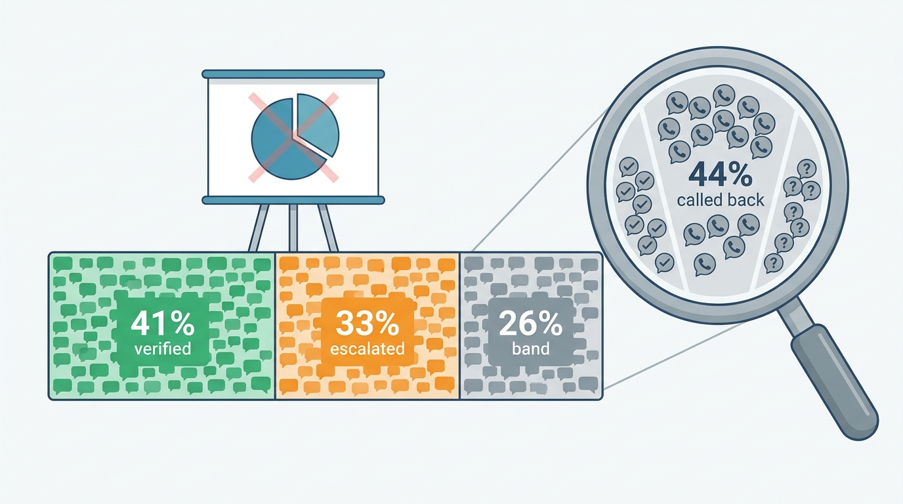
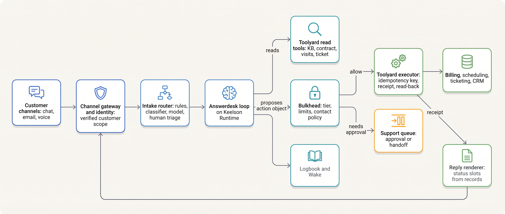
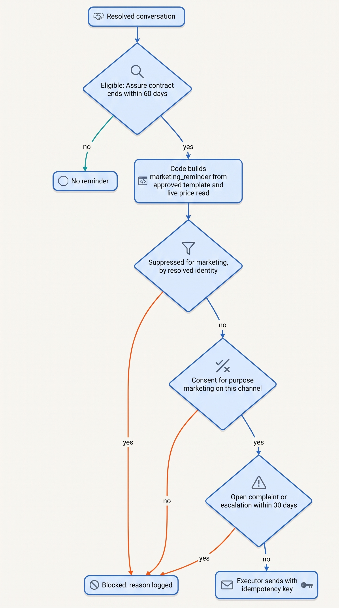
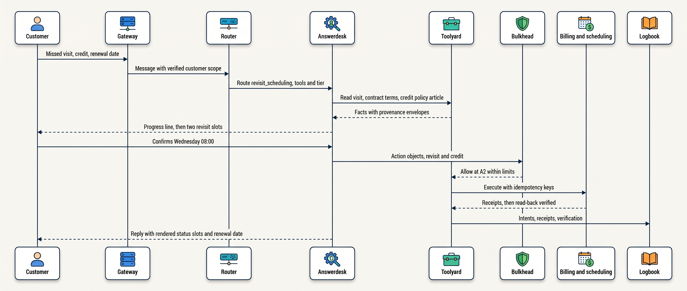
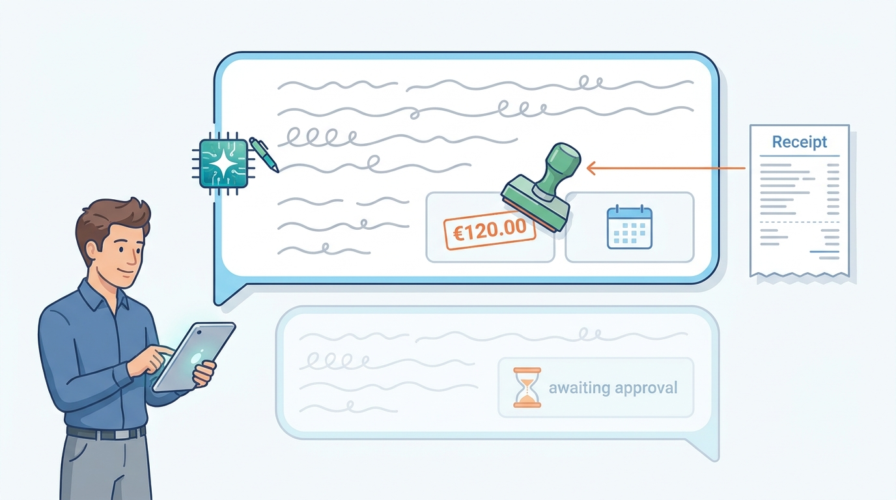

> **IN THIS CHAPTER, YOU WILL:** Learn the consequence profile of support, sales and marketing agents, and follow one Answerdesk conversation end to end through routing, grounding, actions, words and audit. You will also see the controls this domain needs per action class, what courts, companies and research have documented about customer-facing agents, and which parts of the design carry over to other domains.

> **WHY THE BUSINESS CARES:** A customer-facing agent speaks for the company thousands of times a day. A tribunal has held an airline to what its chatbot said. A company that measured its assistant mostly by cost later said that quality had suffered. The business case depends on resolved customers, not on conversations kept away from staff.

> **WHY ARCHITECTS SHOULD CARE:** Failures here repeat at volume, happen in front of the customer and become commitments the moment they are typed. The controls that matter (status rendered from records, contact policy at send time, a verified outcome metric) sit outside the model and cannot be added later with a prompt.

> **KEY POINTS:**
>
> * **Every sentence is a representation, and every promise is an action.** The organization owns what its agent says (*Moffatt v. Air Canada*, 2024). So amounts, dates, eligibility and "done" are rendered from receipts and policy records, and the model writes only the prose around them.
> * **Outbound contact is gated twice, by suppression and by consent for the purpose.** A global, identity-resolved do-not-contact list and consent recorded per purpose are checked at send time by the executor, not at drafting time by the agent. Either one blocks. A service answer and a sales offer in the same chat are different purposes.
> * **Measure verified resolution, not deflection.** "Handled without a human" counts abandoned customers as successes. Define resolution with a re-contact window and verified effects, track it next to escalation correctness and commitment accuracy, and do not let a containment figure into the business case.

> **[FAILURE PATTERNS THIS CHAPTER ADDRESSES](where-agentic-systems-go-wrong.html):**
>
> * **The Fire-and-Forget Action** — in a live conversation the agent's words are part of the action, and a reply that says "done" before a receipt exists is an effect nobody verified.
> * **The Lethal Trifecta** — a support agent reads text from anyone, sees customer data and can send messages and money, so the domain sits on all three legs by default.
> * **Vibe Evals** — deflection and satisfaction scores look like evaluation, but a high score can hide wrong credits, abandoned customers and invented policy.

 
Customer operations is where most organizations first put an agent in front of the public, and where most public embarrassments come from. Support, sales and marketing agents run at **high volume**, so a rare failure becomes a daily one. They act **in the customer's presence**, so every error is witnessed. And they **speak for the company**, so a fluent sentence that is wrong is, legally and commercially, the company's sentence.

Earlier chapters built the parts on Ostrell's Answerdesk and Dealroom. Here they run as one system, and the question is what the domain adds. My answer has three parts: **representation** (the words), **contact** (who may be addressed, and for what), and **outcome** (what counts as success).

The chapter owns four terms: the **consequence profile**, the set of consequence properties that drive a domain's controls; **verified resolution**, together with its two impostors, **deflection** and **containment**; and the **contact policy**, the combined suppression and consent check on outbound contact. It builds on [[autonomy-and-consequence]], [[side-effects-and-external-actions]], [[agent-interaction-design]] and [[evidence-for-autonomy]]. Part XI continues with the back office in [[domain-back-office]].

## Setting the Scene at Ostrell: The Two-Thirds Slide

Ostrell, the fictional field-service software group this book follows (see [[meet-ostrell]]), runs **Answerdesk**, its customer-support agent for Ostrell Field, at about **2.6 million conversations a year**, roughly **7,100 a day**. In Q3 2027 it resolved **41%** of conversations end to end against a 2028 target of 45%. It escalated **33%** to human support staff. Its action classes run at Ostrell's autonomy tiers, from A0 (suggest only) through A1 (draft for approval) and A2 (act within limits, sampled afterwards) to A3 (act autonomously); see [[autonomy-and-consequence]]. The remaining **26%** were abandoned or resolved by the customer without help.

In late November 2027 a finance analyst preparing the 2028 budget showed Marten Ruys, the CFO, a slide: **"Answerdesk handles two-thirds of customer conversations without a human."** The arithmetic was right (41% plus 26%), and the slide proposed cutting the support staffing plan to match. Marten asked Lena Brandt, Director of Support Operations and Answerdesk's owner, why her dashboard said 41%.

The same week brought two more requests from the business. Ostrell Assure product marketing asked for Answerdesk to **end resolved conversations with a renewal offer** when the customer's service contract expired within 60 days. And Priya Natarajan, VP Sales Operations, asked for **Dealroom**, the sales agent in the customer relationship management (CRM) system, to draft follow-up emails after each quote. Account executives would send them, as they send quotes.

Tomas Verhoef, Ostrell's Chief Architect, put all three on one architecture forum agenda. The slide was about **what counts as success**; the renewal offer about **who may be contacted, and for what purpose**; the follow-up emails about **who executes an outbound message the agent drafts**. The forum's question was: **what does customer operations demand that Keelson's general mechanisms do not already give, and where must those demands be enforced?**

## The Consequence Profile of Customer Operations

### Five properties, weighted for this domain

A **consequence profile** is the set of consequence properties that decides which controls a domain needs. The domains research brief behind this book uses five: legal or similarly significant effect on a person, irreversibility, asymmetry of power, professional duty of the human in the loop, and representation to the public. Customer operations scores high on two, medium on two and low on one:

| Property | Customer operations | Why it scores that way | Control it forces |
| --- | --- | --- | --- |
| **Representation to the public** | **High** | The agent speaks for the company in every reply. Its statements about price, policy and eligibility are attributed to the organization. | Ground policy statements in versioned records; render commitments from receipts; disclose the agent |
| **Volume and repetition** *(added for this domain)* | **High** | Thousands of near-identical tasks a day turn a 1% failure into a daily count | pass^k-style evaluation; rate and total limits; sampling at volume |
| **Irreversibility** | Medium, varies per action | A knowledge-base (KB) answer can be corrected. A sent email or a refund that has settled cannot be undone. A credit can be offset only by a debit the customer sees. | Per-action-class tiers; approval or human execution for the irreversible tail |
| **Asymmetry of power** | Medium | The customer usually knows less than the company about policy, but can complain, leave or go to a tribunal | Escalation that is always available; honest status; no "deflect by default" |
| **Legal effect on a person** | Low to medium | Support decisions rarely decide a person's rights. Contact without consent and invented policy terms do have legal weight. | Contact policy; policy statements checked against the authoritative source |

The added row is my judgement, not part of the brief's frame. In customer operations **the same task runs thousands of times a day**, so the model's variance shows up as a rate rather than as an anecdote.

### The three sub-domains differ in where the gate sits

Support, sales and marketing share the profile but differ in mechanics. The author's three interview designs for these sub-domains show the differences clearly. They are design examples, not deployed systems, and their numbers are illustrative:

| Dimension | Support | Sales | Marketing |
| --- | --- | --- | --- |
| Where the gate sits | **Inside a live exchange**, under a latency budget | Before an asynchronous send, re-checked at send time | Before publish, re-checked at activation and for every regenerated variant |
| Typical effect | Money or account change for one customer | An email that cannot be unsent; sender reputation for the whole fleet | Public brand exposure to many people at once |
| Untrusted input | The customer, sometimes adversarial (fraud, social engineering) | Enriched and scraped web text | The brief and scraped competitor content |
| Binding constraint | Turn latency and approver throughput | Warmed-inbox caps and reputation | Generation spend and the approval queue |
| Human role | Approver of the risky tail; owner after handoff | Sender of approved drafts; closer of deals | Brand owner approving high-risk claims |

The support design puts it in one sentence: other verticals gate before an asynchronous action, but "support gates INSIDE a live loop under a turn-taking latency budget" (agentic-support-platform design, description).

## Resolution, Deflection and Containment

The slide's error is common enough to need precise terms. They are defined here for the whole book:

- **Deflection** is a conversation that did not reach a human. It measures cost avoided, and it says nothing about the customer.
- **Containment** is deflection measured by the bot's own logs: the conversation ended in the agent channel. It counts customers who gave up as successes.
- **Verified resolution** is a conversation in which the customer's issue was resolved without a human. Three conditions must hold: every effect the agent committed to has a verified receipt, no commitment is still open, and the customer does not re-contact Ostrell about the same issue on any channel within **7 days**.

At Ostrell, "end-to-end resolution rate" has meant verified resolution since Answerdesk's GA. The **41%** figure meets all three conditions. The 26% the slide added contains customers who solved the problem themselves, customers who gave up, and customers who called or emailed instead.

Tomas asked Lena's quality team to sample **400** of the Q3 conversations in the 26% band, using the same method as their escalation reviews (Ostrell figures, one team's sample, no control group). **44%** of those customers had re-contacted Ostrell about the same issue within 7 days, most by phone. **31%** appeared resolved by the customer, for example by finding the article and following it. In **25%** the outcome could not be determined. Counting the 26% band as success would have added re-contacts to the cost model as savings.

**Figure 1:** *The two-thirds slide added the 26% band to the 41% verified resolution; in a sample of 400 from that band, 44% of customers had re-contacted Ostrell about the same issue within 7 days.*

The forum's ruling: **verified resolution is the only headline figure.** Containment appears only next to its re-contact rate, and staffing changes rest on resolution and escalation handling time. The two figures answer different questions, and only one of them is about customers.

Beside resolution, the support design puts action correctness ahead of satisfaction, because "high CSAT [customer satisfaction] hides a wrong refund" (agentic-support-platform design, step `compliance-eval`). Ostrell's Answerdesk scorecard, reviewed weekly by Lena Brandt as risk owner, has six measures (Q3 2027 figures):

| Measure | Definition | Value |
| --- | --- | --- |
| **Verified resolution** | As defined above | 41% |
| **Escalation correctness** | Sampled escalations that needed a human, plus sampled non-escalations that should have escalated (missed escalations) | Tracked per route since the router audit; see [[routing-and-delegation]] |
| **Commitment accuracy** | Replies whose stated amounts, dates and statuses match records | 2 of 500 sampled credit conversations stated a pending credit as done (September 2027) |
| **Grounding** | Answers with a claim unsupported by the cited source | 2.4% (Q3 2027 audit); see [[retrieval-and-grounding]] |
| **Policy-violating credit proposals** | Credit proposals outside the credit policy, from the Sounding suite | 1.2% |
| **Cost per resolved conversation** | Agent-side cost divided by verified resolutions | €0.39; a human-handled escalation costs €5.50 ([[agent-cost-and-model-routing]]) |

## The Reference Design

### From three interview designs to one support-centred architecture

The reference design adapts the author's support, sales and marketing interview designs to Ostrell's Keelson platform. It is a design example, not a description of a deployed system. Where the designs disagree, the book reconciles them as follows:

1. **One approval model.** Support approvals expire by time, sales approvals never expire, marketing approvals expire when the claim library changes. The book's rule covers all three: an approval binds the exact action object version (content hash), expires by time, and is void if the action, the policy version or the evidence changed.
2. **Approval does not fit inside an exchange.** The support design gates "inside the loop", but its own sizing implies about 50 approvals a second at peak, roughly 1,500 concurrent approvers. The book treats an A1 action as an **asynchronous continuation of the conversation**: the reply renders `awaiting_approval` with a time, and the outcome follows on the same thread.
3. **Money returned to a customer is not "compensatable".** Taking back a refund means charging the customer again. The book treats a settled card refund as irreversible from the platform's side; Ostrell keeps card refunds at A0.
4. **Suppression and consent are both modeled.** The sales design has suppression without purposes, the marketing design consent by purpose without a platform-wide scope, the support design neither. The book requires both, and either one blocks.

**Figure 2:** *The customer-operations reference design on Keelson. The model proposes and writes prose; deterministic components resolve identity, decide tier and contact policy, execute with keys and receipts, and render every commitment the customer reads.*

### Components and who owns what

| Component | Responsibility in this domain | Owned by | Chapter that owns the mechanism |
| --- | --- | --- | --- |
| Channel gateway | Authenticates the session; resolves verified customer scope **before** any account read; marks the speaker on every message | Support Operations with Platform | [[agent-interaction-design]] |
| Intake router | 11 routes; selects skill, tool set and model tier; never grants authority | Support Operations | [[routing-and-delegation]] |
| Context assembler | Keelson prefix layout; pinned facts (ticket, contract, verified customer, open commitments) written by code | Agent Platform | [[context-engineering]], [[caching-and-context-budgets]] |
| Quarantined reader | Extracts typed `TicketFacts` from inbound email; the planner never reads raw third-party text | Agent Platform | [[prompt-injection-defense]] |
| Read tools | Hybrid KB search with tenant filter; contract terms; visits; ticket | System-of-record owners | [[retrieval-and-grounding]] |
| Bulkhead | Tier per action class, amount and rate limits, contact policy, egress rules | Security and risk owners | [[policy-enforcement-and-audit]] |
| Toolyard executor | Idempotency keys, receipt lookup on timeout, read-back verification, business uniqueness keys | Agent Platform | [[retries-idempotency-and-concurrency]] |
| Reply renderer | Status slots for every action mentioned; blocks replies that state an unapplied outcome | Agent Platform | [[side-effects-and-external-actions]] |
| Handoff service | Escalation package from records; ownership transfer makes the agent read-only | Support Operations | [[coordination-and-handoffs]] |
| Sounding, Wake, Logbook | Suites and simulators; traces and outcome metrics; evidence of each run | Evaluation lead; Platform | [[building-agent-eval-suites]], [[agent-observability]] |

Two of these exist because of this domain: the **reply renderer**, because the domain's signature failure is words that do not match state, and the **contact policy** inside Bulkhead, because its signature obligation is to people who do not want to be contacted.

### Requirements per interaction

| Interaction | Latency | Consistency | Durability | Who may act |
| --- | --- | --- | --- | --- |
| Chat answer from KB or contract | First visible ≤ 2 s p95; complete ≤ 6 s p95 | Policy cached by article version; account state read live | Turn record in task state | Agent at A3, with groundedness check |
| A2 action (credit ≤ €250, revisit) | Outcome ≤ 30 s p95; at most 8 s waiting for a receipt within the exchange | Dependencies re-read before dispatch | Intent recorded before dispatch; receipt after | Agent, within limits enforced by Toolyard |
| A1 action (credit > €250) | Asynchronous: hours, with approval expiry | Approval void on any change of action, policy or evidence | Approval record bound to content hash | Team lead approves; platform executes |
| Escalation to a person | Package built in seconds; queue service-level agreement (SLA) by route | Ownership is a field written by the runtime | Package by reference, with versions | Specialist; agent read-only |
| Outbound contact (reminder, follow-up) | None in the exchange | Contact policy checked **at send time** | Send attempt with idempotency key | Executor only; never the model directly |
| Email reply | No exchange latency budget (deferred class) | Same as chat | Same as chat | Same as chat |

The latency numbers are the chat budget agreed in October 2027 ([[agent-latency-and-throughput]]).

## The Contact Policy: Suppression and Consent by Purpose

### Two different records, one check

The **contact policy** is the check an executor applies before any outbound message an agent prepared reaches a person. It reads two records, and either one can block:

- **The suppression list** is a global do-not-contact record keyed by a **resolved contact identity**, not by an address. Each entry has a scope (all marketing, or all proactive contact), a reason (opt-out, complaint, bounce, legal hold, abuse, deletion request) and its provenance. The sales design's two rules carry over directly. A platform-scope row blocks in every tenant. A data-subject deletion erases the profile "but preserves a minimal suppression row (identity_key + reason)" (agentic-sales-platform design, step `send-gate`). Without that row, deleting a person's data would make them contactable again.
- **Consent by purpose** records, per contact, which purposes the organization may use them for and on what basis. The marketing design's `consent` record (channel, purpose, legal basis, state) is the shape: "Compliance is not one boolean" (agentic-marketing-platform design, step `compliance`). At Ostrell the purposes are `service` (answering and resolving the customer's own case; contract basis), `service_proactive` (outage notices, visit reminders), and `marketing` (offers, renewals, upgrades).

In the EU, an objection to direct marketing ends processing "for such purposes" ([General Data Protection Regulation (GDPR), Art. 21(3)](https://eur-lex.europa.eu/eli/reg/2016/679/oj)), and unsolicited marketing email to individuals generally needs prior consent, with a narrow existing-customer exception ([ePrivacy Directive 2002/58/EC, Art. 13](https://eur-lex.europa.eu/eli/dir/2002/58/oj)). Rules for business contacts vary by member state and for US recipients. **Ostrell applies the stricter rule to every contact in every market**, a policy choice that makes one check possible.

### Purpose is decided by code, from the action class

A customer who asks "when does our Assure contract renew?" has asked a service question, answered from the contract record. A sentence adding "and you can upgrade to Assure Plus" is marketing, even in the same reply. If the model wrote both, each sentence's purpose would be whatever the model produced.

The forum's ruling separated them:

1. **The model has no marketing action.** Answerdesk's tools and prompts contain no offers or renewal language.
2. **A renewal reminder is a separate action object**, class `marketing_reminder`, created by code after a conversation is marked resolved. Its text is a template approved by Assure marketing and Legal; its prices come from a live, version-checked price-book read, because model-derived facts may never source a commitment ([[provenance-and-freshness]]).
3. **The executor checks the contact policy at send time**: suppression for scope `marketing`, consent for purpose `marketing` on the channel, and no open complaint or escalation in the last 30 days. Any one blocks. A block is logged with its reason; it is not an error.

**Figure 3:** *The renewal reminder is created by code after resolution and gated at send time. Suppression and consent are separate checks, and either one blocks; the model never decides to sell.*

## End to End: One Answerdesk Conversation

One conversation shows the whole design: a composite with illustrative identifiers, but canonical mechanisms and limits.

**Monday 6 December 2027, 09:12.** Ruben Smit (fictional), operations planner at Van Dijk Installatietechniek in Eindhoven (fictional), opens chat from the Ostrell Field web app. His session is authenticated, so the channel gateway resolves the **verified customer scope**, the Field account and Ruben's contact identity, before any read. The first message carries a disclosure and a speaker label. He writes: *"Your technician didn't turn up on Friday for the heat-pump service at our client's site in Veldhoven. We lost half a day with the client waiting. Also, when does our Assure contract renew?"*

**Figure 4:** *One Answerdesk conversation end to end. The model routes nothing and executes nothing: it reads through Toolyard, proposes action objects, and writes prose around status slots that the runtime fills from receipts.*

The flow, step by step:

1. **Route.** No rule matches; the v2 router's calibrated classifier assigns `revisit_scheduling` and flags a secondary contract question. The route selects skill, tool set and model tier, and grants no authority ([[routing-and-delegation]]).
2. **Assemble context.** The context assembler builds the call in the prefix layout, with the verified customer and a contract summary carrying its `as_of` in the preamble ([[caching-and-context-budgets]]). The context manifest goes to Logbook before the call; pinned facts are written by code.
3. **Read.** Answerdesk calls the visit lookup: visit booked for Friday 3 December, status `not_attended`, technician no-show code. It calls `get_contract_terms`: Assure contract active, end date 31 January 2028. It calls `kb_search`, which returns the missed-visit credit policy article at its current version. Every result carries a provenance envelope ([[provenance-and-freshness]]).
4. **Offer choices.** A deterministic progress line arrives within the 2-second budget. Answerdesk then offers two revisit slots from the scheduling system; it does not choose one. **The customer acts on shared state here**, where τ²-bench found agents weakest: in its telecom domain, dual control cut pass^1 by 18 and 25 points for the two models compared ([Barres et al., 2025](https://arxiv.org/abs/2506.07982), preprint, simulated users). So the slot choice is a confirmation card, and confirmation is not approval ([[agent-interaction-design]]).
5. **Propose actions.** Ruben confirms Wednesday 08:00. Answerdesk proposes two action objects: a revisit for that slot, and a service credit of **€120** with reason `TECH_NO_SHOW` under the policy clause it retrieved. Keelson Runtime freezes each into an action object with a content hash and an idempotency key minted from the agent, run and action ids ([[retries-idempotency-and-concurrency]]).
6. **Decide.** Bulkhead reads the tier register by manifest hash and action class. Revisits are A2, at most one per ticket. Credits up to €250 are A2. The checks pass: the amount is within the limit, the business key `credit:{ticket}:{visit}:TECH_NO_SHOW` is unclaimed, the daily counters are below the hold thresholds of €9,000 and 120 credits, and the target is the verified customer's account. Allow both.
7. **Execute and verify.** Toolyard dispatches both with their keys. Scheduling returns a booking reference. Billing returns a credit note in 3.1 seconds, inside the 8-second receipt wait. Toolyard reads both back and finds them as intended. Receipts and verifications go to Logbook.
8. **Reply.** The reply renderer fills the status slots: the revisit date and booking reference, and *"I've applied a €120.00 credit (credit note …) for Friday's missed visit; it will appear on your next invoice."* The renewal answer is a slot too: *"Your Assure contract runs until 31 January 2028."* The model writes the apology and the connecting prose. A deterministic scan blocks any reply that states an amount, date or completion verb without a matching status ([[side-effects-and-external-actions]]).
9. **After the conversation.** No marketing appears in the chat. Code creates a `marketing_reminder` once the conversation is resolved (the contract ends within 60 days); the contact policy finds no marketing consent for Ruben and blocks it, with the reason logged. Wake keeps the trace under tail sampling (10% of ordinary Answerdesk runs; 100% of runs with denials, approvals or escalations). One in ten executed A2 credits goes to a second reviewer ([[human-oversight-and-bounded-autonomy]]).
10. **Resolution, a week later.** The technician attends on Wednesday. The revisit's completion status reaches the task record, Ruben does not re-contact Ostrell within 7 days, and the conversation counts toward verified resolution on **13 December**, not on the day of the chat.

Three variations complete the picture. **A credit above €250** would be A1: the reply renders `awaiting_approval` with a time, and the outcome follows on the same thread. **An email ticket** would pass through the quarantined reader first ([[prompt-injection-defense]]). **An escalation** would build escalation package v2 from records and make Answerdesk read-only on the ticket ([[coordination-and-handoffs]]).

## Dealroom: The Same Domain, a Different Gate

Dealroom shows what changes when the counterpart is a prospect rather than a customer in a live chat. Its **4,000 quotes a month** are **external commitments**, capped at A1 whatever the evidence; the account executive sends them, and the CRM refuses a quote whose price-book version was superseded ([[evidence-for-autonomy]]).

Priya's follow-up email request was approved with the same shape as quotes, as a new Dealroom action class registered in January 2028. Dealroom drafts a `follow_up_email` action object with executor `account_executive`. The CRM's send path applies the contact policy **at send time**: suppression by resolved identity, consent for the purpose (a quote follow-up to a prospect's named contact is `marketing` unless it answers that contact's own question), and the price-book version of any price the email mentions. The sales design names the reason for re-checking at send time rather than at draft time: "A late opt-out blocks the queued send — suppression is authoritative at send time" (agentic-sales-platform design, step `send-gate`). An approval at draft time is a check of the past.

The sales interview design's binding constraint, **sender reputation** (about 67,000 warmed inboxes, auto-pause above 2% bounces or 0.1% complaints, all design assumptions), does not bind at Ostrell: Dealroom works only on accounts already in the CRM, and humans send every message. The forum recorded that automated prospecting would change this. The design's rep approval of every sequence, about 1,500 a tenant a day, is not adopted: approval belongs at the template or sequence-policy level, with sampling, or it becomes the Rubber Stamp.

**Ostrell runs no marketing agent in 2027**; the renewal reminder is a template, deliberately. The marketing interview design shows what a marketing agent would need: a gate split into "deterministic claim/regulatory checks … plus model-judged brand-voice conformance", approvals that expire when the claim library changes, and a bandit that allocates only among cleared variants (agentic-marketing-platform design, steps `brand-gate` and `optimize`). Once an optimizer asks an agent for new variants, generation is continuous, so the gate must be continuous too.

## Controls by Action Class

The controls table is the domain's contract. It collects what earlier chapters built, per action class, with the tier from Ostrell's register as of December 2027:

| Agent | Action class | Tier | Hard limits (enforced by) | Oversight | Evaluation | Audit |
| --- | --- | --- | --- | --- | --- | --- |
| Answerdesk | Answer from KB or contract record | A3 | Tenant filter in the index query; claim-level groundedness check; abstention path | QA sampling | Grounding audit; retrieval set | Context manifest; cited versions |
| Answerdesk | Create or update ticket | A3 | Refused while a human owns the ticket (Toolyard) | None per action | Trajectory invariants | Logbook |
| Answerdesk | Schedule technician revisit | A2 | One per ticket; customer confirms the slot (Toolyard) | Sampled review | Long-conversation suite | Intent, receipt, read-back |
| Answerdesk | Service credit ≤ €250 | A2 | €250; one per visit; daily hold > €9,000 or > 120 credits (Toolyard, Bulkhead) | 10% second-reviewer sample of executed credits | Credit-policy suite, 420 cases, pass^4; 200-case injection gate sample (of the 1,200-variant suite) | Intent, key, receipt, read-back |
| Answerdesk | Service credit > €250 | A1 | Approval bound to content hash, with expiry; void on change | Team lead with evidence and policy clause | Same suites | Approval record |
| Answerdesk | Refund to card | A0 | Billing staff perform it | Billing desk | — | Ticket |
| Answerdesk | Email to an unverified recipient | A0 | Recipients only from CRM and the verified account | A person sends | Injection suite | Bulkhead denial alerts |
| Platform code | Renewal reminder | Not a model action | Contact policy at send; approved template; live price read | Assure marketing owns the template | Contact-policy test set | Send attempt with block reasons |
| Dealroom | Account brief (internal) | A2 | Price-book `as_of` within 24 h | 10% weekly sample | Brief suite | Provenance envelopes |
| Dealroom | Quote to prospect | A1 (cap) | CRM refuses superseded price-book versions | Account executive sends | Quote suite | CRM send event as receipt |
| Dealroom | Follow-up email (from January 2028) | A1 | Contact policy at CRM send time | Account executive sends | Contact-policy test set | CRM send event |

Three readings follow. **The words are controlled as tightly as the money**: the A3 answer class carries the most controls, because representation is the domain's highest-scoring property. **No customer-facing class above C1 runs at A3**, and the A2 limits sit in Toolyard, not in a prompt. **The contact policy sits at every outbound sink and never inside the model.**

## What the Documented Evidence Says

### Courts and public cases: the organization owns the words

***Moffatt v. Air Canada*, 2024 BCCRT 149 (14 February 2024).** An Air Canada website chatbot told a customer he could apply for a bereavement fare retroactively. The airline's policy said otherwise. British Columbia's Civil Resolution Tribunal held the airline liable for negligent misrepresentation: the airline is responsible for information on its website whether it comes from a static page or a chatbot, there was "no reason why the customer should know that one section of the website is accurate" and another not, and the airline did not take reasonable care that the chatbot was accurate. Damages were CA$650.88 ([ML Taikins, 2024](https://www.mltaikins.com/insights/that-wasnt-me-that-was-my-chatbot)). The tribunal called the argument that the chatbot was responsible for its own actions "a remarkable submission" ([Law360 Canada, 2024](https://www.law360.ca/ca/articles/1804075)). It is a small-claims decision, not precedent; these accounts are secondary because the tribunal's site refused automated access; and the sources do not say whether the chatbot used a language model. The architectural reading does not depend on any of that: **policy statements must come from, or be checked against, the authoritative policy source, and an agent that cannot ground one should hand off.**

**Cursor's support bot (April 2025).** Users of the Cursor code editor were logged out when switching machines. An AI support bot answered their emails that this was expected under a one-device policy. No such policy existed. A co-founder apologized publicly ("We have no such policy"), called it "an incorrect response from a front-line AI support bot", and said AI-generated email support responses would be clearly labeled from then on ([The Register, 18 April 2025](https://www.theregister.com/2025/04/18/cursor_ai_support_bot_lies/)). It adds two points to *Moffatt*: the bot invented a policy to **explain an unrelated technical fault**, and the undisclosed email channel made the answer read as the company's position.

**New York City's MyCity chatbot (March 2024).** The Markup reported that the city's business-advice chatbot told users that landlords need not accept housing vouchers and that businesses could go cash-free, contrary to city law, and that it answered the voucher question differently for different reporters ([The Markup, 29 March 2024](https://themarkup.org/news/2024/03/29/nycs-ai-chatbot-tells-businesses-to-break-the-law)). The city kept the pilot behind a disclaimer that it "may occasionally produce incorrect, harmful or biased content." **A disclaimer is not a control.**

These are reported cases, not a sample: they show what the failure looks like and who answers for it, not how often it happens.

### Deployment claims and walk-backs: date them, and read the metric

**Klarna, February 2024.** Klarna's press release said its assistant had handled "2.3 million conversations, two-thirds of Klarna's customer service chats" in its first month, doing "the equivalent work of 700 full-time agents", with customer satisfaction "on par with human agents", a "25% drop in repeat inquiries", resolution "in less than 2 mins compared to 11 mins previously", and an estimated "$40 million USD in profit improvement" for 2024 ([Klarna, 27 February 2024](https://www.klarna.com/international/press/klarna-ai-assistant-handles-two-thirds-of-customer-service-chats-in-its-first-month/)). These are company-reported, unaudited first-month figures; the satisfaction method was not described.

**Klarna, May 2025.** Fortune reported the CEO, Sebastian Siemiatkowski, saying that "cost unfortunately seems to have been a too predominant evaluation factor", that "what you end up having is lower quality", and that "really investing in the quality of the human support is the way of the future for us". A spokesperson said the company was "very much still AI-first", and two new agents were working as freelance customer support ([Fortune, 9 May 2025](https://fortune.com/2025/05/09/klarna-ai-humans-return-on-investment/)). Headlines that Klarna "replaced AI with humans" overstate a correction of evaluation and staffing strategy; the assistant was not withdrawn. I found no primary-source figure for the assistant's current share of chats, so the public evidence stops there.

The lesson concerns the metric, not Klarna. **"Two-thirds of chats" is a containment figure.** The repeat-inquiry figure was the release's only outcome measure, and the walk-back named quality as what cost-led evaluation missed.

### Research: inconsistency at volume, and benchmarks that flatter

τ-bench's retail and airline domains are the closest public analogue to support work: a simulated customer, domain tools, a written policy, and grading on the final database state ([Yao et al., 2024](https://arxiv.org/abs/2406.12045), preprint, 2024 models). The best function-calling agent solved 61.2% of retail tasks in one trial but fewer than 25% in all eight, which is **inconsistency at volume**. And **removing the domain policy from the prompt barely hurt retail (61.2 → 56.8) but collapsed airline (33.2 → 10.8)**, because airline rules are ad hoc. Company-specific policy is what support agents apply and what the models followed least reliably, which argues for policy as checks in the tool layer.

Benchmark scores in this domain can also flatter. An agent that returns empty responses passes 38% of τ-bench airline tasks, because some tasks are deliberately impossible and doing nothing matches the goal state ([Zhu et al., 2025](https://arxiv.org/abs/2507.02825), preprint). **A benchmark that rewards inaction has the same flaw as a containment metric**: it scores the customer who was not helped. Use these results to choose what to evaluate (pass^k, dual control, policy adherence by trajectory), not to forecast a resolution rate.

### Regulation: disclosure applies now

Article 50(1) of the EU AI Act requires systems "intended to interact directly with natural persons" to inform people that they are interacting with an AI system unless that is obvious. It has applied since 2 August 2026, and the Digital Omnibus on AI did not move it ([Regulation (EU) 2024/1689](http://publications.europa.eu/resource/celex/32024R1689); [Regulation (EU) 2026/1744](http://publications.europa.eu/resource/celex/32026R1744)). Disclosure is a **state of the conversation**, a speaker label on every message kept through handoffs and across channels ([[agent-interaction-design]]). Support agents are not, as such, in the Act's Annex III high-risk list; one that also decided creditworthiness would bring in those obligations, which apply from 2 December 2027.

### Where the evidence stops

No company has published an audited resolution rate for a customer-service agent with a stated definition, a re-contact window and a comparison with human handling. No public study measures how often customer-facing agents make commitments that are not backed by a record. The vendor numbers available in this field are claims about one's own system, usually in first-month or best-segment form. **The design in this chapter therefore rests on documented failures, regulatory text, simulated benchmarks and the author's judgement.** It does not rest on measured production outcomes from other companies.

## Failure Modes and Recovery

Most of the domain's failure scenarios are the book's recurring incidents, because Ostrell learned most lessons here first. The table collects them; two get a closer look below.

| Scenario | What happens | Detection | Containment | Recovery |
| --- | --- | --- | --- | --- |
| **The Promised Credit** (May 2027) | Replies say a credit is applied while it awaits approval | Customer complaint; quality sample (38% of 500 credit conversations) | Rendered status slots; text scan blocks unbacked outcomes | 20 customers honored, €2,310; see [[side-effects-and-external-actions]] |
| **The Double Credit** (March 2027) | A timed-out credit is retried by re-asking the model | Billing reconciliation | Keys minted before dispatch; receipt lookup; no re-sampling | 212 customers with duplicate credits, €31,400; see [[retries-idempotency-and-concurrency]] |
| **The Poisoned Ticket** (May 2027) | Hidden text in an email asks for contract PDFs to go to an outsider | Trace review, 6 days later | Recipient allowlist from verified identity blocked the send | Quarantined reader; egress policy; injection suite |
| **The Stale Price Book** (June 2027) | Dealroom drafts quotes from a 23-day-stale index | Deal-desk analyst's manual comparison | None at the time; account executives sent 14 quotes | €46,000 honored; freshness SLO; CRM refuses superseded versions |
| **The Shadow Reminder Gap** (November 2027) | Opt-outs recorded under another address would not have blocked reminders | Shadow-mode contact-policy audit | Shadow mode: nothing sent | Suppression keyed by resolved identity; see below |
| **The Sync Outage Misroute** (July 2027) | A surge about an outage lands on self-service routes | Re-contact by route; manual escalation | Rules on external signals; strict path for critical classes | Router v2; `service_incident` recall 71% → 97% |
| **Credit farming** *(assumption)* | A customer claims missed visits repeatedly to collect credits | Per-account credit frequency in Wake | One credit per visit; visit status from the scheduling system, not the customer | Fraud queue; account-level A1 override |

### The Promised Credit: words ahead of state

The Promised Credit is the domain's signature failure, and an evaluation that grades only the final state would never see it: the model wrote the reply and proposed the credit in the same turn, and nothing tied the sentence to the action's state. **Detection** came from a customer, then a 500-conversation sample. **Containment** is structural: since June 2027 a reply may mention an action only through a status slot filled from the action's record, and in a September 2027 re-audit 2 of 500 replies still stated a pending credit prematurely, and no customer was told of a credit that did not happen ([[side-effects-and-external-actions]]). **Recovery** was commercial: Lena honored all 20 customers, €2,310, on the principle *Moffatt* states.

**Figure 5:** *The model writes the apology and the connecting prose, but the amount, the date and the word that says it is done are stamped in from the action's receipt; without a receipt, the reply can only say the credit is awaiting approval.*

### The Shadow Reminder Gap: suppression keyed by the wrong thing

The renewal reminder ran in **shadow mode** from **8 to 21 November 2027**: the action objects were created and the contact policy evaluated, but nothing was sent. **3,610** resolved conversations involved an Assure contract ending within 60 days. The contact policy blocked **2,050** for lack of marketing consent, **118** as suppressed and **52** for an open complaint or a recent escalation. That left **1,390** eligible (Ostrell figures).

Farah Haddad's team compared the eligible set with the marketing email tool's own unsubscribe records. **31** of the 1,390 had unsubscribed there under a different email address than the one in the CRM. The suppression check was keyed by email address, so it missed them: 31 people who had said no would have been contacted.

**Detection** worked only because the rollout started in shadow and someone audited the eligible set against a second source. **Containment** was the shadow mode. **Recovery** changed the data model, not the agent: suppression entries are keyed by the resolved contact identity with all known addresses and channels; opt-outs from the marketing tool, the CRM, support conversations and data-subject requests reach the one list within 15 minutes; deletion leaves a minimal suppression row. The re-run moved the 31 to suppressed, and the reminder went live in December 2027 with a contact-policy test set (every suppression source × channel × purpose) in Sounding.

## Trade-offs

### Measuring the agent

| Metric as headline | What it rewards | What it hides | When it is right |
| --- | --- | --- | --- |
| Deflection or containment | Keeping customers away from staff | Abandonment, re-contact, wrong actions | Never as a headline; only as a capacity input next to re-contact |
| Customer satisfaction | Pleasant conversations | Wrong credits that pleased the customer; non-respondents | As a secondary signal with response-rate reporting |
| **Verified resolution** | Effects done and the issue not reopened | Slow to compute (7-day window); misses customers who never return | Headline figure, with escalation correctness and commitment accuracy beside it |
| Cost per resolved conversation | Efficiency per real outcome | Quality, unless paired with the above | Business case and model-routing decisions |

My recommendation follows from the consequence profile. **Spend the domain's design budget on representation and contact, because that is where the profile scores high.** Spend it on per-action reversibility next, because that is where volume multiplies harm. These choices assume a customer-facing agent at high volume that speaks for the company. In a low-volume internal helpdesk the same rigor on words may cost more than it saves.

## What Transfers to Other Domains

Most of this machinery is not specific to customer operations; the weight given to it is:

| Mechanism | Transfers as is | What changes elsewhere |
| --- | --- | --- |
| Action objects, keys, receipts, read-back | Everywhere | Back office adds segregation of duties and staging stores; coding uses the sandbox and the pull request instead ([[domain-back-office]], [[domain-coding-agents]]) |
| Status slots rendered from records | Any agent that tells a person something happened | Coding: test counts and diff stats in the PR from CI, not from model prose |
| Contact policy (suppression + consent by purpose) | Any agent that sends to people: HR notices, collections, patient outreach | High-stakes domains add statutory notice duties that **require** contact, so "blocked" needs an escalation path, not just a log line ([[domain-high-stakes-decisions]]) |
| Verified resolution with a re-contact window | Any service desk, internal or external | Back office: rejected or reversed entries are the re-contact; high stakes: appeals and overturns |
| Ownership transfer makes the agent read-only | Every human handoff | Unchanged |
| Routing on external signals during surges | Any high-volume intake | Low-volume domains rarely need it |
| Volume-driven controls (daily holds, sampling at a fixed rate) | High-volume classes anywhere | Back office reviews every item at lower volume; sampling replaces review only where volume forces it |

What does **not** transfer is the default tier. Customer operations can run A2 actions because the per-action consequence is capped (a €250 credit, one revisit) and repeat counts are limited. A back-office posting or a benefits determination has no equivalent small cap, which is why those domains stay at A1 or below for their consequential classes. The pattern travels; the limits that justify autonomy do not.

## The Chief Architect's View

**Decide the headline metric before the first pilot.** The two-thirds slide was the figure the system produced most easily. If verified resolution is not defined, instrumented and owned by the risk owner from the start, containment fills the gap.

**Put the domain's two signature controls in the platform, not in the agent.** The reply renderer and the contact policy belong in Keelson. Lena Brandt owns the policy content: the credit clauses, the reminder template, the exclusions. Farah Haddad owns the enforcement points. Assure marketing owns templates and purposes but not the check. No product team should be able to send to a person without passing the contact policy.

**Fund identity resolution for contacts.** The Shadow Reminder Gap was a data problem that looked like an agent problem. Suppression is only as good as the identity it is keyed by, and every new channel (voice, messaging apps) adds addresses the list must know.

**Watch the pressure in both directions.** Teams will push to add selling to service conversations and to raise tiers because benchmarks improved. The rule I use: the model may explain and resolve; offers come from templates and price records; a tier rises only on Ostrell's own audited evidence ([[evidence-for-autonomy]]). The opposite risk is an agent that escalates everything. Escalation correctness catches both.

**What is durable and what will change.** Durable: the organization owns the words; commitments are rendered from records; contact needs both a suppression check and consent for the purpose; outcome metrics beat activity metrics; per-action caps make autonomy affordable. Volatile: model tiers per turn, latency budgets, the regulatory dates in Article 50 and Annex III, and every vendor's deployment numbers. Better models will raise first-try resolution. They will not change who answers for a wrong promise.

## Questions to Ask

1. What is the written definition of "resolved", which effects must be verified, and how long is the re-contact window?
2. Where does containment appear, and is it ever reported without its re-contact rate?
3. Which components can put an amount, a date or "done" in front of a customer, and is any of them the model?
4. Which policy statements can the agent make without a cited, versioned source, and what happens when it has none?
5. Is suppression keyed by a resolved person identity across all channels and addresses, and does deletion leave a suppression row?
6. Which outbound action classes exist, what purpose is each one, and who decided that: code or the model?
7. Where is the contact policy checked: at draft, at approval, or at send? Which component holds the send attempt?
8. How does an A1 approval reach a customer who has left the chat, and what does the customer see before then?
9. What happens to routing when the status page declares an incident?
10. Which per-action caps and daily holds make each A2 class affordable, and are they enforced in the tool broker or in a prompt?

Customer operations bounds the model with records, caps and contact rules, because its errors are frequent, public and cheap one at a time. The back office has the opposite profile: fewer actions, each one posted to a system of record, under segregation of duties and a close calendar. Continue with [[domain-back-office]].

## Sources and Evidence

### Research papers

- [τ-bench: A Benchmark for Tool-Agent-User Interaction in Real-World Domains](https://arxiv.org/abs/2406.12045), Yao, Shinn, Razavi & Narasimhan, **2024** (preprint) — simulated customer-service tasks; pass^k; retail pass^1 61.2% vs pass^8 below 25%; policy-removal ablation (airline 33.2 → 10.8); reward does not check every policy requirement.
- [τ²-Bench: Evaluating Conversational Agents in a Dual-Control Environment](https://arxiv.org/abs/2506.07982), Barres, Dong, Ray, Si & Narasimhan, **2025** (preprint) — performance drops of about 18–25 points when the user also acts on shared state.
- [Establishing Best Practices for Building Rigorous Agentic Benchmarks](https://arxiv.org/abs/2507.02825), Zhu et al., **2025** (preprint) — empty-response agent passing 38% of τ-bench airline tasks.

### Specifications, standards and regulation

- [Regulation (EU) 2024/1689 (AI Act)](http://publications.europa.eu/resource/celex/32024R1689), European Union, **2024** — Art. 50 disclosure for systems interacting with natural persons.
- [Regulation (EU) 2026/1744 (Digital Omnibus on AI)](http://publications.europa.eu/resource/celex/32026R1744), European Union, **2026** — Annex III application moved to 2 December 2027; Art. 50(1) unchanged.
- [Regulation (EU) 2016/679 (GDPR)](https://eur-lex.europa.eu/eli/reg/2016/679/oj), European Union, **2016** — Art. 21(3): objection to direct marketing ends processing for that purpose.
- [Directive 2002/58/EC (ePrivacy Directive)](https://eur-lex.europa.eu/eli/dir/2002/58/oj), European Union, **2002** — Art. 13: consent for unsolicited electronic marketing, existing-customer exception.

### Vendor documentation and engineering reports

- [Klarna AI assistant handles two-thirds of customer service chats in its first month](https://www.klarna.com/international/press/klarna-ai-assistant-handles-two-thirds-of-customer-service-chats-in-its-first-month/), Klarna, **2024** — the February 2024 claims (2.3 million conversations, 700 FTE equivalent, $40 million estimate); company-reported, unaudited.
- [Klarna and the return on investment of AI versus humans](https://fortune.com/2025/05/09/klarna-ai-humans-return-on-investment/), Fortune, **2025** — the CEO's May 2025 statements on cost-led evaluation and quality; "still AI-first"; two freelance agents.

### Incidents, cases and decisions

- [That wasn't me, that was my chatbot](https://www.mltaikins.com/insights/that-wasnt-me-that-was-my-chatbot), ML Taikins, **2024** — summary of *Moffatt v. Air Canada*, 2024 BCCRT 149: liability for chatbot statements, reasonable care, CA$650.88.
- [Court rejects Air Canada's 'remarkable' denial of liability](https://www.law360.ca/ca/articles/1804075), Law360 Canada, **2024** — the tribunal's "remarkable submission" wording.
- [Cursor AI's own support bot hallucinated its usage policy](https://www.theregister.com/2025/04/18/cursor_ai_support_bot_lies/), The Register, **2025** — invented one-device policy; co-founder's apology; AI email replies to be labeled.
- [NYC's AI chatbot tells businesses to break the law](https://themarkup.org/news/2024/03/29/nycs-ai-chatbot-tells-businesses-to-break-the-law), The Markup, **2024** — unlawful advice, inconsistent answers, disclaimer instead of control.

### Design examples from the author's interview project

- Obrenović, Ž., "Agentic Support Platform", system-design interview design, `system-design-interviews/data/book/agentic-support-platform/interview.json`, **2026** — gate inside the live loop (description); reversibility matrix (step `action-gate`); idempotency and reconciliation (step `txn-safety`); read-only agent after handoff (step `escalation`); action correctness over CSAT (step `compliance-eval`).
- Obrenović, Ž., "Agentic Sales Platform", system-design interview design, `system-design-interviews/data/book/agentic-sales-platform/interview.json`, **2026** — identity-resolved suppression with tombstone, send-time re-check (step `send-gate`); inbox caps as the binding constraint (capacity, step `deliverability`).
- Obrenović, Ž., "Agentic Marketing Platform", system-design interview design, `system-design-interviews/data/book/agentic-marketing-platform/interview.json`, **2026** — split brand/claim gate and C2PA (step `brand-gate`); policy-constrained bandit that freezes when its feeds go stale (step `optimize`); consent by purpose (step `compliance`).

Ostrell is fictional; architectural recommendations, labeled inferences and labeled assumptions are the author's judgement.
