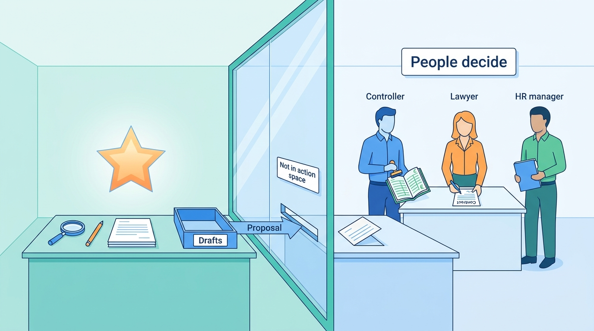
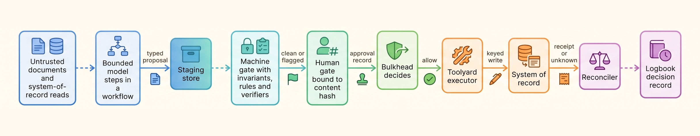
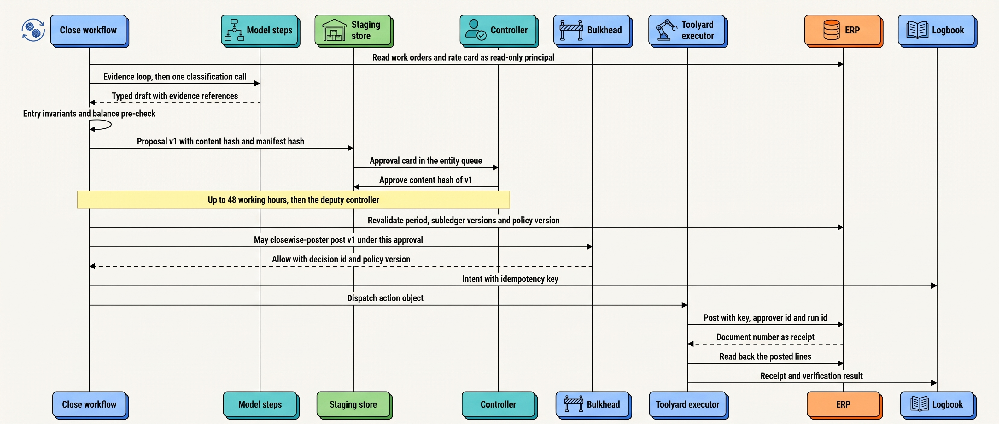
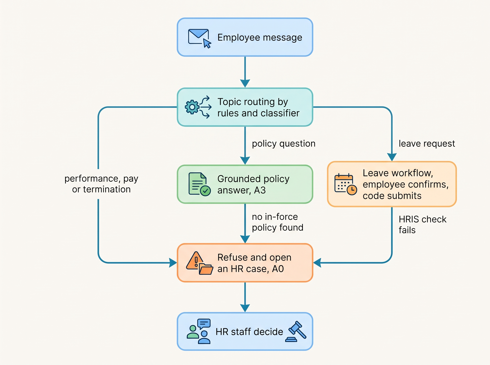
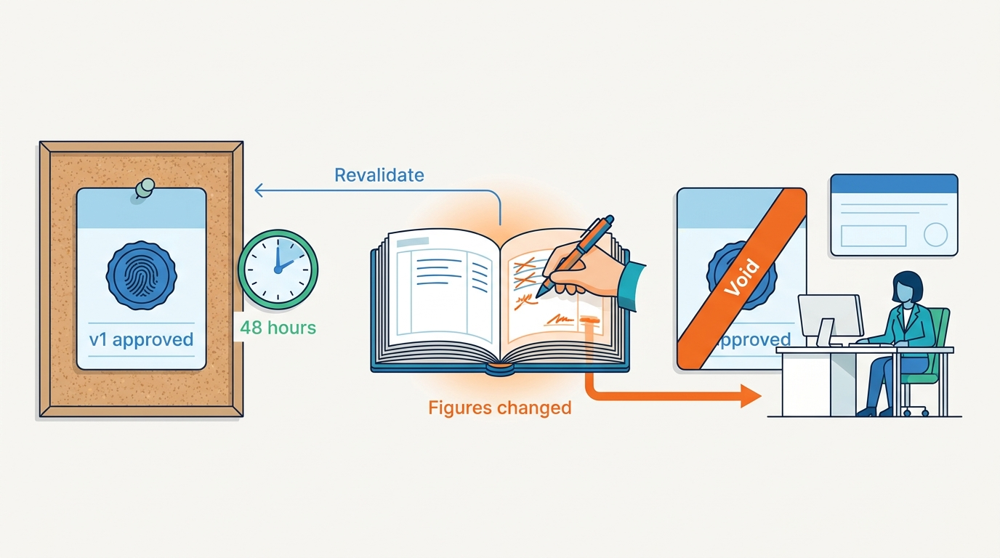

> **IN THIS CHAPTER, YOU WILL:** Learn the consequence profile of finance, legal and HR agents, follow one Closewise accrual from evidence to a controller-approved ERP posting with a receipt, and see how the same spine changes for contract review (privilege) and the HR helpdesk (employment law), with the controls, the documented evidence and what transfers to other domains.

> **WHY THE BUSINESS CARES:** A wrong journal entry misstates the books that the CFO signs. A fabricated citation has cost lawyers sanctions and a referral to their regulator. A recommendation about an employee that a manager routinely follows can count, in law, as an automated decision. The back office buys agents for speed at the close and at the review desk, and keeps them only if the controls survive an audit.

> **WHY ARCHITECTS SHOULD CARE:** Back-office agents write into systems of record that other teams own, on calendars they do not control, under duties that rest on named people. Most of what makes them safe is platform machinery; the domain decides how strict each piece must be and which actions the agent may never take.

> **KEY POINTS:**
>
> * **The agent is a maker, never a checker, and never the writer of record.** Proposals live in a staging store. A person independent of every maker approves the exact content hash. Deterministic code writes to the system of record under a narrow principal, with an idempotency key, and reads the result back. Separation of duties is enforced in identity and policy, not in the user interface.
> * **One spine, three gate semantics.** Finance, legal and HR share the same chain: staging store, machine gate, human gate, executor, reconciler, decision record. The gate means different things. In the finance close it covers every effect; in legal it covers every finished piece of work; in HR it covers every adverse decision about a person, and at Ostrell no employment decision is in the action space at all. Choose the semantics per action class and write down what each lets through.
> * **The evidence is what the auditor tests.** Courts sanction lawyers who file unverified citations. The CJEU has held that a score others "draw strongly" on is itself the automated decision. Auditors ask whether the approver was independent and whether the posted amount was the approved one. Design the decision record for those questions, and keep privileged text on routes that do not retain it.

> **[FAILURE PATTERNS THIS CHAPTER ADDRESSES](where-agentic-systems-go-wrong.html):**
>
> * **Autonomy by Default** — an agent with an ERP posting tool, a send-to-counterparty tool or an HRIS write tool can change the books, a contract or an employee's record directly; in the back office these actions must be designed out of the agent's action space.
> * **Ambient Authority** — the Closewise prototype posted through a shared ERP user with create *and* post rights, so one identity could both make and execute an entry while the approval lived in a chat message.
> * **The Rubber Stamp** — a controller, lawyer or manager who approves what the agent proposes without reading it turns a human decision into an automated one, in the eyes of auditors and, for decisions about people, of data-protection law.

 
The back office is where an agent's output stops being an answer and becomes **a record that other people rely on as truth**: a journal entry in the general ledger, a clause in a signed contract, a field in an employee's file. The people who rely on it (auditors, counterparties, courts, employees) never saw the agent. They see the record, and they hold a named person accountable for it: the controller, the lawyer, the HR manager.

That changes the architecture less than one might expect. Most of the mechanisms are those of a well-run finance system (maker–checker approval, idempotent posting, reconciliation, an immutable audit trail), and earlier chapters built each one on Ostrell's Closewise. The agent-specific part is narrow. **The model may gather evidence and draft, but its output must stop at a staging store, and only an approved, versioned action object may cross into the system of record.** The domain's work is to decide who may approve, what the approver must see, and what the agent may never touch.

This chapter uses the **consequence profile** defined in [[domain-customer-operations]] and builds on [[agents-in-the-enterprise]] (systems of record and staging stores), [[agent-identity-and-least-privilege]] (separation of duties), [[human-oversight-and-bounded-autonomy]] (approval gates) and [[policy-enforcement-and-audit]] (the evidence log). It defines three terms for this domain: the **back-office spine**, **gate semantics** and the **close calendar**. It hands the clinical and benefits domains, where the gate guards a person's rights, to [[domain-high-stakes-decisions]].

## Setting the Scene at Ostrell: Three Questions from the Audit Committee

Ostrell, the fictional field-service software group this book follows (see [[meet-ostrell]]), runs three agents in its back office. **Closewise** prepares the month-end close for **23 legal entities**: it drafts reconciliations and proposes about **1,900 accrual journal entries a month**, about **380 per working day** over a close that must finish by **working day 5**. **Clausewise** redlines about **600** non-disclosure agreements (NDAs) and data processing agreements (DPAs) a month against Legal's playbook, inside the contract-lifecycle-management (CLM) tool. **Peoplepoint** answers about **9,000** employee HR conversations a month and submits leave requests after the employee confirms.

On Tuesday **23 November 2027**, Marten Ruys, the CFO, took Tomas Verhoef, the Chief Architect, to the audit committee ahead of the fiscal 2027 year-end audit. The committee had read the auditors' interim letter: of 40 Closewise entries tested in October, the 30 posted on Keelson took about two hours to evidence, the 10 posted by the first-quarter script two and a half days ([[policy-enforcement-and-audit]]). It also knew that, under the EU AI Act as amended in July 2026, the obligations for Annex III high-risk systems, which include employment uses, would apply from **2 December 2027**, nine days later.

The committee asked three questions:

1. **Closewise:** can an agent change our books, and can anyone at Ostrell approve their own work through it?
2. **Clausewise:** can an agent commit us to contract terms, or expose a counterparty's text or our privileged advice?
3. **Peoplepoint:** could an agent decide anything about an employee, and is it a high-risk system from 2 December?

A fourth question came from Group Finance. Recurring accruals (rent, maintenance contracts, subscriptions) made up about a third of Closewise's proposals *(illustrative)*. Could they post without a controller's approval, so the close could move to working day 4? The rest of this chapter answers the four questions.

## The Domain and Its Consequence Profile

### What the three sub-domains share

The **back office** here means finance, legal and HR operations: work whose output becomes part of a **system of record** owned by another function (the ERP for the books, the CLM and the document store for contracts, the HR information system, HRIS, for employment records). Three properties make it a domain of its own for agent design:

- **A named professional owns each output.** Controller, lawyer, HR manager: the agent can share the work, not the duty.
- **The calendar is external.** The **close calendar** is the fixed schedule of working days on which subledgers are cut off, accruals proposed and approved, the period locked and the books reported; contract and statutory HR deadlines play the same role. A wait may push work into the next period or past a legal deadline.
- **Correctness has a reference, of varying quality.** In finance, ground truth exists: the ledger, the bank feed, the contract. In legal it exists but decays: law changes and playbooks are revised. For hiring it is only distributional: no single "correct" outcome can be checked, only the fairness of outcomes in aggregate. That gradient, drawn from the author's interview designs (below), explains why finance can verify per item while HR must put a person on every adverse outcome.

### The consequence profile

The domains brief behind this book uses five consequence properties ([[domain-customer-operations]] defines the frame). The back office weights them differently from customer operations:

| Property | Finance (Closewise) | Legal (Clausewise) | HR (Peoplepoint) | Control it forces |
| --- | --- | --- | --- | --- |
| **Professional duty of the human in the loop** | **High**: the controller certifies the entity's books | **High**: the lawyer owns advice and filings; courts hold the signatory responsible | Medium: the HR manager owns decisions; the helpdesk gives information | Approval by a qualified, independent principal; the approver must be able to see the basis |
| **Irreversibility** | Medium: a posting is compensable by a reversal entry; reported figures and payments are not | High once sent or signed; drafts are freely revisable | Mixed: a leave request can be withdrawn; a termination cannot be undone in any useful sense | Gate before the irreversible step; designed compensations for the rest ([[partial-failure-and-compensation]]) |
| **Legal or similarly significant effect on a person** | Low (entities, not people) | Low to medium (the counterparty) | **High** for any decision about an employee or candidate | Adverse decisions by a person; contestation; no decision by the agent |
| **Asymmetry of power** | Low | Medium (the counterparty negotiates) | **High**: the employer holds the record and the decision | Evidence carried by the organization; human intervention route |
| **Representation to the public** | Low (internal) | Medium: a redline sent to a counterparty speaks for Ostrell | Low (internal, but to every employee) | The agent never sends externally |
| **Coupling to a calendar and a system of record** *(added for this domain)* | **High**: period lock, posting windows, working day 5 | Medium: negotiation deadlines | Medium: payroll cut-offs | Durable waits with timers; revalidation after every wait |

The added row is my judgement, not part of the brief's frame: **the agent's work is valid only inside a window the system of record defines**. A proposal approved on working day 2 may be wrong by day 4. Most failure scenarios below come from that row.

### Ostrell's action classes

Ostrell's action-class register ([[autonomy-and-consequence]]) turns the profile into ceilings that answer most of the committee's questions before any mechanism is discussed. Posting an accrual is a **compensable write in consequence band C3** (misstated books), so its ceiling is **A1**, draft for approval. Sending to a counterparty, signing and employment decisions are **external commitments or C4 decisions**, capped at A1 by policy and, for decisions about a person's employment, pay or rights, at **A0**. And none of these is a tool the model can call: **"not in the action space" is stronger than A0**.

**Figure 1:** *At Ostrell the riskiest back-office actions are not tools the model can call: posting to the books, sending to a counterparty and deciding about an employee stay with people, outside the agent's action space.*

That settles Group Finance's request: recurring accruals are still C3, capped at A1 whatever the evidence. The request was really about approval cost (see Trade-offs).

## Reference Design: The Back-Office Spine

### From three interview designs to one spine

The author's system-design interview project has three back-office designs: agentic-finance-platform (seven steps), agentic-legal-platform (seven) and agentic-hr-platform (five). They are **design examples, not deployed systems**. They converge on one shape, which this book calls the **back-office spine**: bounded model steps inside a deterministic workflow write to a **staging store**; a **machine gate** checks invariants and rules; a **human gate** approves; an **executor** performs one idempotent write to the external system of record; a **reconciler** resolves unknown and asynchronous outcomes; and every step appends to a **decision record**. The finance design names the central idea "propose, don't mutate" (*design example*, `agentic-finance-platform/interview.json`, step `ledger`). Its legal sibling holds drafts in a draft store that is "never auto-filed" (step `pipeline`). The HR design keeps a recommendation store separate from the HRIS (step `hiring-gate`).

**Figure 2:** *The back-office spine. The model's output stops at the staging store; the decision to act and the act itself sit in two different components; and the system of record, not the agent, holds the truth afterwards.*

In the finance design nearly everything downstream of the staging store is ordinary financial-systems machinery (outbox, idempotency keys, write-once storage, maker–checker). The agent-specific parts are few: the bounded extraction node, the staging store, an identity in which the agent is a maker but never a checker, injection screening of inbound documents, and evaluation against ground-truth bookings (*design example*, `agentic-finance-platform/interview.json`, `highLevelArchitecture`). **That narrowness is the lesson.**

### Three gate semantics

The three designs agree on the spine and disagree on what the human gate guarantees. This book names the three semantics instead of choosing one:

| Gate semantics | What it guarantees | What it lets through | Source design (step) | Ostrell instance |
| --- | --- | --- | --- | --- |
| **All-effects gate** | Every change to the system of record has a distinct human approver | Nothing; thresholds only route items to single, senior or dual review | Finance: "auto-routed and auto-recommended, never auto-authorized" (`exceptions`) | Closewise: every accrual and every reversal |
| **Finalize gate with machine pre-check** | Every finished work product is approved by a licensed professional after a verifier ran | Drafts and intermediate versions; the professional may override a machine flag with a recorded reason | Legal: citation verification, then attorney approval (`citation-gate`, `attorney`) | Clausewise: a lawyer accepts each redline; nothing goes to the counterparty except from the lawyer |
| **Adverse-outcome gate** | Every decision that harms a person's interests is made by a human | Non-adverse outcomes, if the design allows it | HR: "humans decide every adverse outcome" (`hiring-gate`) | Peoplepoint: no employment decision exists in the action space; leave submission is confirmed by the employee |

The HR design shows why naming matters. Its requirements say a human decides every adverse outcome and its chosen option routes every recommendation through review, yet its capacity table assumes only about 30% of screenings reach a human. These cannot all hold. A team that writes "adverse-outcome gate" must say what happens to the other 70%; a team that writes "humans in the loop" need not.

### Where the book departs from the interview designs

| Interview design choice | Book rule | Why |
| --- | --- | --- |
| The identity broker posts to the ledger, enqueues payments and writes to the HRIS (all three designs) | **Bulkhead decides, Toolyard executes** | One component holding both the decision and the means to act is ambient authority with extra steps |
| Maker ≠ checker, silent on the analyst who started the task (finance) | **The initiator and every editor of a proposal count as makers** | The person nearest the agent is the natural approver and often the wrong one ([[agent-identity-and-least-privilege]]) |
| An attorney override is written into the same field as the machine verdict (legal data model) | **An override is a new record; the machine verdict stays** | Auditors and courts need to see what the check said and who overrode it |
| Append-only audit without a hash chain (legal, HR) | **Hash-chained, anchored to write-once storage** for all back-office agents | The finance design's baseline is the right one for every system of record the books or a court rely on |
| Filing and sending are a status value, not a modeled side effect (legal) | **Sending to a counterparty is an external commitment outside the agent's action space** | The irreversible step needs the same outbox discipline as a posting, and at Ostrell a lawyer performs it |
| Batch approval of clean items, no size limit or sampling (finance) | **Batch only for machine-clean items, bounded size, per-item records, sampled** ([[human-oversight-and-bounded-autonomy]]) | Unbounded batches are how a checker becomes a rubber stamp |

## End to End: One Closewise Accrual

Every mechanism here was introduced in an earlier chapter; this section runs them as one flow and links each to its owner.

Closewise is mostly a workflow ([[what-makes-a-system-agentic]]): code owns the calendar, fetches, rule-based matching and posting; the model holds two bounded loops (investigating reconciliation differences; gathering evidence and drafting accruals) and one Mid-tier classification call. Each entity's close is one child workflow of a monthly parent run on Keelson Runtime's durable workflow engine ([[durable-agent-execution]]).

Take one entry from the **October 2027 close** of Ostrell Field Deutschland GmbH (working day 1 was Monday 1 November). Subcontracted technicians completed October visits that were not yet invoiced. Amounts are illustrative; mechanisms are Ostrell's.

1. **Working day 1, fetch.** The workflow reads closed work orders through Ostrell Field's governed view and the subcontractor's rate card from the contract store, as read-only principals, never from replicas ([[agents-in-the-enterprise]]).
2. **Evidence loop.** The model drafts within its limits (read-only tools plus a staging-store write; **12 model steps, 15 tool calls, €1.00, 10 minutes**; any stop other than a draft that passes the invariants goes to an accountant) ([[workflows-loops-and-autonomous-agents]]). Its draft: **€18,640** for 212 visits at contract rates *(illustrative)*, citing each work order and the rate-card clause by reference.
3. **Classification.** One model call assigns accrual type and account, pinned in the agent version manifest; Gateway records the model version actually served ([[versioning-agent-systems]]).
4. **Machine gate.** Code checks the invariants: balanced lines, account in the chart of accounts, entity and currency consistent, period open, evidence attached, amount reconciled to the cited records. The proposal enters the staging store as version 1, with its content hash and the manifest hash.
5. **Human gate.** The approval card shows the entry, the supporting documents, the calculation and the accrual policy reference ([[human-oversight-and-bounded-autonomy]]). The approver must hold the entity's controller or deputy role (from the HRIS role feed); Bulkhead refuses an approver who opened the task or edited the proposal ([[agent-identity-and-least-privilege]]). The controller approves the content hash of version 1 on working day 2.
6. **Wait and revalidation.** Approval waits have a **48-working-hour** timer, then escalate to the entity's deputy controller. Before posting, the executor re-checks the period, the cited subledger versions and the policy version. If any changed, the approval is void and the controller decides again on current figures ([[policy-enforcement-and-audit]]).
7. **Posting.** Bulkhead allows `closewise-poster` to post this version for this approval and records its decision. The workflow records the intent, then Toolyard posts with the idempotency key *task id + entry id + entry version* ([[task-state-and-checkpoints]], [[retries-idempotency-and-concurrency]]). The ERP sees the technical user `agent-closewise-post`, which posts only entries carrying an approval reference and cannot create vendors, change periods or approve; the approver id and run id go into a custom ERP field.
8. **Receipt and verification.** The ERP returns a document number. Toolyard reads the posted lines back and compares them with the approved version ([[side-effects-and-external-actions]]). The staging record becomes evidence; the ERP holds the truth.

**Figure 3:** *One Closewise accrual from evidence to posting. The model appears once, before the staging store; everything after the approval is deterministic, keyed and recorded, and the revalidation after the wait is what keeps a two-day-old approval honest.*

### Requirements per interaction

| Interaction | Consistency | Latency | Durability | Who may act |
| --- | --- | --- | --- | --- |
| Read subledgers, work orders, contracts | Read at a recorded source version | Minutes acceptable | Version references in Logbook | Read-only principals per system |
| Model steps (evidence, classification) | Recorded output replayed on recovery, never re-asked | Seconds to minutes; batch tier for bulk steps | Recorded activity in workflow history | The model, within loop limits |
| Write proposal to staging | Immutable per version; content-hashed | Seconds | Staging store plus Logbook | Closewise agent principal only |
| Approve | Bound to one content hash; expires | Hours (48-working-hour timer) | Approval record in Logbook | Entity controller or deputy, not a maker |
| Revalidate and authorize | Re-read immediately before dispatch | Seconds | Bulkhead decision record | Bulkhead |
| Post to ERP | Exactly-once effect: key plus receipt lookup | Seconds; inside ERP posting windows | Intent before, receipt after | `closewise-poster` via Toolyard |
| Audit query | Joins records by action id | Minutes | Hash-chained; seven-year retention | Auditors (read-only, redacted) |

### What the end-to-end view shows

**The model's share of the risk is small and bounded.** It can propose a wrong amount or account; the machine gate catches structural errors and the controller substantive ones. The Alias Drift showed both: classification accuracy fell from **96.1% to 89.4%**, the controllers' rejection rate rose from **4% to 11%** for four days, and **no wrong entry was posted** ([[agent-observability]]).

**The risks that remain are about time and identity, not intelligence.** The September 2027 close (**1,912** proposals) exercised them: a worker eviction after **44 of 61** postings ended with 61 entries posted once each; **9** approvals escalated to a deputy; **3** were voided by revalidation after a subledger change; one entity's run was cancelled on day 4 and restarted; Bulkhead refused **6** approvals by accountants who had edited the proposal ([[durable-agent-execution]], [[agent-identity-and-least-privilege]]). All 23 entities closed on working day 5.

**The evidence is a by-product, not a report.** The November 2027 internal-audit retest retrieved 60 sampled entries, all with hash-bound approvals, with one Logbook query in about 20 minutes ([[agents-in-the-enterprise]]). That answers the committee's first question: an agent cannot change the books at Ostrell, and nobody can approve their own work through it.

## Two Contrasts: Clausewise and Peoplepoint

### Clausewise: privilege, confidentiality and the finalize gate

Clausewise has a different consequence profile. Its system of record is the CLM; its irreversible step is a redline or a signature that reaches the counterparty; and the text it handles is confidential to two parties at once, sometimes privileged. The spine is the same, but three controls carry the weight.

**A lawyer accepts every change, and only a lawyer sends.** Clausewise drafts redlines inside the CLM plugin. Each one cites a playbook **rule id and version** and the contract **span** it changes ([[retrieval-and-grounding]]). The lawyer accepts or rejects each change (A1). Clausewise has no tool that sends to a counterparty, so a counterparty draft with hidden instructions can at worst produce a wrong redline that the lawyer sees and that cites no rule ([[prompt-injection-defense]]).

**Confidentiality is a routing property, not a promise in a prompt.** Contract text carries the `legal_privileged` data class: zero retention, eligible only on zero-data-retention routes, with no fallback to a route that retains. The rule came from the **Quiet Failover** of 18 February 2027, when a tier-wide failover sent **46** Clausewise calls with clauses from **9** contracts to a provider account that kept prompts for up to 30 days ([[models-and-the-model-gateway]]). Under the fixed design, during a provider outage on **19 October 2027** the Gateway held **23** Clausewise requests (median **41 minutes** extra wait) and sent nothing to the other provider. The threat-model review found a second path: the prototype had stored about **1,100** contract PDFs in a provider file-storage endpoint outside the zero-retention terms; they were deleted, and the Gateway now refuses stateful provider endpoints ([[agent-threat-model]]).

**Ethical walls sit on the retrieval path.** Precedent clauses are searched with Legal's matter-permission filters applied in the query; as the legal interview design puts it, "a walled document is never retrieved, not merely never shown" (*design example*, `agentic-legal-platform/interview.json`, step `grounding`). When Legal publishes a new playbook version, unaccepted redlines drafted under the old one are flagged.

Clausewise's gate is a **finalize gate**. The lawyer who requested the review may also accept its redlines, which the finance gate would forbid. That is a domain choice: professional responsibility puts the duty on the reviewing lawyer, and **separation of duties is domain policy** the platform must be able to enforce where asked. The committee's second answer: Clausewise cannot commit Ostrell to terms, and contract text reaches only processors whose terms Legal approved, which Gateway records can show.

### Peoplepoint: employment law and the action space

Peoplepoint answers policy questions in a bounded loop, and its leave flow is a workflow: the model extracts dates, code checks them against the HRIS balance, the employee confirms on a card, and code submits with an idempotency key ([[when-agents-are-justified]]). Its HR-specific controls are about what it must not do.

**Figure 4:** *Peoplepoint's boundary. Anything that could become a decision about an employee leaves the agent and lands with a person; the agent answers, drafts and submits only what the employee confirmed.*

- **No employment decision is in the action space.** Anything about performance, pay changes or termination is refused and routed to HR (A0). Ostrell's register caps decisions about a person's employment, pay or rights at A0 ([[autonomy-and-consequence]]).
- **Data stays with its subject.** The run acts as the employee, verified by single sign-on. Peoplepoint has no long-term memory (`memory: none`). Special-category fields are masked before any call to the commercial providers and go only to the open-weight model in Ostrell's cloud account where needed ([[policy-enforcement-and-audit]]).
- **The regulatory classification is a versioned artifact.** Ilse de Wit's documented assessment under Article 6(3) of the EU AI Act (narrow procedural task, no material influence on decisions about workers) is stored in the Agent Registry and tied to Peoplepoint's tool list. **Adding a tool that ranks, scores or decides about employees reopens it** ([[policy-enforcement-and-audit]]).

The committee's third answer: Peoplepoint cannot decide anything about an employee, and on Ostrell's documented assessment it is not an Annex III high-risk system, for as long as its tool list stays as it is. Changing course would add a launch gate: an employer deploying a high-risk system at the workplace must inform workers' representatives and affected workers before use (Art. 26(7)).

The HR interview design shows what the domain requires once an agent does touch decisions about people, here recruitment screening (*design example*, `agentic-hr-platform/interview.json`, step `hiring-gate`): a feature allowlist per versioned rubric; protected attributes in a separate store that scoring never sees, used only to monitor selection rates (the four-fifths rule); a reviewer who sees the feature evidence, records a rationale and may override or recuse; candidate notice and appeal. Ostrell built none of this because it chose not to build a screening agent. **Declining a use case is also an architectural decision**, and in HR it is often the right one.

## Controls by Action Class

| Agent and action class | Effect and band | Tier | Oversight | Evaluation | Audit | Domain control |
| --- | --- | --- | --- | --- | --- | --- |
| Closewise: draft reconciliation, investigate differences | Draft, C1 | A3 internal | Accountant reviews explanations; loop limits (20 steps, €2.00, 15 min) | Component suite; trajectory invariants | Logbook run record | Read-only principals |
| Closewise: propose accrual | Draft to staging, C3 if acted on | A1 via the posting gate | Machine gate, then controller per item | Accrual suite v2 (1,244 cases), daily 05:00 canary, alert below 93.5% ([[building-agent-eval-suites]]) | Proposal carries manifest hash | Evidence by reference; rejection rate as outcome signal |
| Closewise: post accrual | Compensable write, C3 | A1; executed by workflow, never the model | Controller or deputy for the entity, not a maker; revalidated before dispatch | Read-back verification; daily side-effect-without-decision query | Hash-chained, seven-year retention ([[policy-enforcement-and-audit]]) | **Separation of duties** in Bulkhead and ERP roles; period lock honored |
| Closewise: reverse posted entries | Compensating write, C3 | A1 | A controller other than the original approver | Compensation drill | `comp:` key links to the original | Next open period after the lock ([[partial-failure-and-compensation]]) |
| Clausewise: risk summary | Draft, C1 | A3 internal | Lawyer reads it with the contract | Playbook suite | Logbook | `legal_privileged` routing |
| Clausewise: redline | Draft in the CLM, C3 if accepted | A1 per change | Lawyer accepts each change | Rule-citation check per redline | Rule id, playbook version, span | **Privilege and confidentiality**: zero-retention routes, matter-permission filters |
| Clausewise: send or sign | External commitment | Not in action space | Lawyer, in the CLM | n/a | CLM record | Never the agent |
| Peoplepoint: policy answer | Information, C1 to C2 | A3 | Sampled review; abstention to HR case | Grounding suite; abstention correctness | Policy version cited | Effective-dated, jurisdiction-tagged policies |
| Peoplepoint: submit leave request | Compensable (withdraw until manager approves) | A1 for the employee | The employee confirms | Workflow suite | Idempotency key per request | Own record only |
| Peoplepoint: performance, pay, termination | Decision about a person, C4 | A0, refuse and route | HR staff decide | Routing recall on these topics | Refusal logged | **Employment law**: Article 6(3) assessment tied to the tool list |

Two columns deserve comment. **The evaluation column is small-sample everywhere.** With zero failures in *n* audited cases the 95% upper bound on the failure rate is about 3/*n*, so a claim below 1% needs about 300 clean cases ([[evidence-for-autonomy]]); at 1,900 entries or 600 contracts a month, back-office autonomy cannot be earned quickly from volume.

**The domain-control column is where the platform stops.** Keelson enforces separation of duties, data-class routing and the action space. Who counts as qualified to approve, which playbook rules apply and which topics are employment decisions is set by Group Finance, Legal and the People team.

## What the Documented Evidence Says

### Legal: courts sanction the signatory, and grounded tools still err

In *Mata v. Avianca* (S.D.N.Y., 22 June 2023), Judge P. Kevin Castel wrote that "there is nothing inherently improper about using a reliable artificial intelligence tool for assistance. But existing rules impose a gatekeeping role on attorneys to ensure the accuracy of their filings." The lawyers had filed non-existent opinions from a chat assistant and stood by them after the court questioned them; the court imposed a **$5,000** penalty and ordered letters to the client and to each judge falsely named as an author ([Mata v. Avianca, 2023](https://storage.courtlistener.com/recap/gov.uscourts.nysd.575368/gov.uscourts.nysd.575368.54.0.pdf)). The tool was not an agent; the durable point is that the signatory owns the output.

In June 2025 the Divisional Court of England and Wales heard two referred cases together (*Ayinde v. London Borough of Haringey* and *Al-Haroun v. Qatar National Bank*, [2025] EWHC 1383 (Admin), 6 June 2025). In *Ayinde*, grounds for judicial review cited five cases that did not exist. In *Al-Haroun*, a schedule listed **45** citations put before the court; in **18** the case cited did not exist, and many of the rest did not contain the quoted passages or did not support the proposition. The court said freely available generative AI tools "are not capable of conducting reliable legal research", that users have "a professional duty therefore to check the accuracy of such research by reference to authoritative sources", and that those with "individual leadership responsibilities (such as heads of chambers and managing partners)" must take "practical and effective measures" ([Divisional Court, 2025](https://www.judiciary.uk/judgments/ayinde-v-london-borough-of-haringey-and-al-haroun-v-qatar-national-bank/)). It found the contempt threshold met in *Ayinde* but did not initiate proceedings, partly because of questions about the barrister's training and supervision. For architects, that is the point: **the court asked about the organization's controls, not only the individual's conduct**.

Grounding reduces the problem but does not remove it. A preregistered study by Magesh et al. tested the AI research tools of LexisNexis and Thomson Reuters, which retrieve from their own legal databases, and found that each "hallucinate[s] between 17% and 33% of the time" on the authors' query set, less than a general-purpose chat model ([Magesh et al., 2024](https://arxiv.org/abs/2405.20362), preprint). The study measured 2024 product versions on questions the authors designed, and its definition counts a real source that does not support the claim as a hallucination. Treat it as evidence that **retrieval is not verification**, not as a current error rate. The legal interview design's three-axis citation check (existence, currency, relevance), with an uncertain band that flags rather than passes, is the architectural answer (*design example*, `agentic-legal-platform/interview.json`, step `citation-gate`).

### Privilege: the terms of the tool decide

In *United States v. Heppner* (S.D.N.Y., bench ruling 10 February 2026, written opinion 17 February 2026), Judge Jed Rakoff held that about thirty documents a criminal defendant generated with a publicly available AI platform, on his own initiative, were protected neither by attorney–client privilege nor as work product. As reported by law firms, the court found no reasonable expectation of confidentiality because the platform's privacy policy allowed it to collect inputs, use them for training and disclose them to third parties; and the documents were not prepared by or at the direction of counsel. The court suggested that counsel-directed use might be analysed differently ([McGuireWoods, 2026-02-18](https://blogs.mcguirewoods.com/2026/02/18/when-ai-isnt-privileged-confirmed-sdnys-written-opinion-elaborates-on-confidentiality-work-product-and-waiver/); [Proskauer, 2026](https://www.proskauer.com/alert/sdny-addresses-privilege-and-work-product-implications-of-using-unsecured-public-ai-tools)). I have read secondary accounts, not the opinion, and one district-court ruling is not settled law. ABA Formal Opinion 512 (July 2024) points the same way: as a committee member summarizes it, informed client consent is required before client information goes into a self-learning tool ([Muchman, 2024](https://thebarexaminer.ncbex.org/article/fall-2024/generative-artificial-intelligence-tools/)).

My inference for architects: **the provider terms register is a privilege control**. A legal agent that runs on zero-retention, no-training routes, is configured and directed by the legal function, and records which route served each call gives counsel the facts a privilege argument needs. A tier-wide failover to a route with other terms, like Ostrell's Quiet Failover, can remove them.

### Finance: separation of duties is an audit expectation, and bank guidance has stepped back

The Sarbanes-Oxley Act's section 404 requires management to maintain and assess "an adequate internal control structure and procedures for financial reporting" ([15 U.S.C. 7262](https://www.law.cornell.edu/uscode/text/15/7262)). It does not mention segregation of duties. The expectation comes from the internal-control frameworks and audit practice used to assess it. For an agent the audit question is whether one identity holds conflicting entitlements. Ostrell's February 2027 audit fieldwork found that collapse in the prototype's `svc_close_auto` user, which could create and post; for **9** of 40 sampled entries the only approval evidence was a chat message, for **2** there was none ([[agents-in-the-enterprise]]).

For banks, the US model-risk guidance changed in 2026. SR 26-2 (17 April 2026), issued by the Federal Reserve, FDIC and OCC, "supersedes and replaces" SR 11-7 and states that "generative AI and agentic AI models are novel and rapidly evolving. As such, they are not within the scope of this guidance", while adding that an organization's "risk management and governance practices should guide" controls for systems it does not cover ([Federal Reserve, 2026](https://www.federalreserve.gov/supervisionreg/srletters/SR2602a1.pdf)). It keeps "effective challenge" by objective experts. As of October 2026, **US bank supervisors have no model-risk guidance specific to LLM agents**; a bank's finance agent needs inventory, tiering, independent validation and monitoring by analogy, not by rule. Ostrell is not a bank; its analogue of effective challenge is the Sounding holdout set owned by the evaluation team, not the agent team.

### HR: the decision can sit upstream of the person who signs

The EU AI Act lists as high-risk "AI systems intended to be used for the recruitment or selection of natural persons" and systems "intended to be used to make decisions affecting terms of work-related relationships", including promotion, termination, task allocation and monitoring (Annex III, point 4) ([Regulation (EU) 2024/1689](http://publications.europa.eu/resource/celex/32024R1689)). An Annex III system escapes the classification under Article 6(3) only if it does not materially influence the outcome, for example by performing "a narrow procedural task" or "a preparatory task", and never if it profiles natural persons; the provider must document that assessment. The Digital Omnibus on AI, **Regulation (EU) 2026/1744** (published 24 July 2026), moved the application of the Annex III obligations from 2 August 2026 to **2 December 2027** ([Regulation (EU) 2026/1744](http://publications.europa.eu/resource/celex/32026R1744)). The date has moved once already; check it before relying on it.

GDPR Article 22 gives a person the right "not to be subject to a decision based solely on automated processing … which produces legal effects concerning him or her or similarly significantly affects him or her" ([Regulation (EU) 2016/679](http://publications.europa.eu/resource/celex/32016R0679)). In *SCHUFA* (C-634/21, 7 December 2023) the Court of Justice held that a credit agency's automated probability score is itself automated individual decision-making where a third party "draws strongly on that probability value" to decide on a contract ([CJEU, 2023](http://publications.europa.eu/resource/celex/62021CJ0634)). Applied to HR, my reading (an architectural inference, not legal advice) is that **a manager who routinely follows an agent's recommendation about an employee may not take the decision out of Article 22**. Approval rates, time per decision and departures from the recommendation are then legal evidence, not only quality metrics ([[human-oversight-and-bounded-autonomy]]). Amendments to Article 22 were proposed in the wider Digital Omnibus in November 2025; as of October 2026 secondary sources conflict on their status, so this chapter cites the 2016 text.

### Where the evidence stops

No published, independent evaluation measures LLM agents in production closes, contract desks or HR helpdesks. Vendor case studies are claims about their own products; the court decisions concern lawyers using chat tools; the finance and HR evidence is regulation and its interpretation. **The architecture in this chapter therefore rests on control principles that predate agents and on Ostrell's fictional experience**, and should be read as judgement, with the conditions stated.

## Failure Modes and Recovery

| Scenario | Detection | Containment | Recovery |
| --- | --- | --- | --- |
| Approval on figures that changed during the wait (subledger correction on working day 3) | Revalidation compares cited source versions with current ones | Approval void; nothing posts | Controller decides again on a new version (September 2027: 3 voided) |
| Period lock arrives with proposals unapproved | ERP lock signal to the close workflow | No posting into a locked period | Proposals re-routed as next-period entries ([[durable-agent-execution]]) |
| Worker dies mid-posting | Heartbeat timeout; intent without receipt | Idempotency key per entry version | Status lookup, then continue; `unknown` to the finance repair queue (September 2027: 44 of 61, 0 duplicates) |
| Silent model change degrades classification | Controller rejection rate against baseline; served ≠ pinned paging invariant; daily canary | A1 gate holds every entry | Pin the previous exact version; re-run approved entries on it (Alias Drift: 1,333 re-run, 52 re-examined, no misstatement) |
| Approver is also a maker | Bulkhead SoD rule at approval | Approval refused | Routed to another controller of the entity (September 2027: 6) |
| Instruction hidden in a supplier document | Entry invariants; amount must reconcile to cited records; card shows evidence | No approval or posting tool in the model's reach | Controller rejects; document added to the injection suite |
| Privileged text would go to a retaining route | Gateway data-class check | Request held, not rerouted | Runs when an eligible route recovers (19 Oct 2027: 23 held) |
| Playbook revised mid-review | New playbook version published | Unaccepted redlines flagged | Lawyer re-reviews against the new version |
| Agent drifts toward an employment decision | Routing recall on HR-decision topics; registry check on new tools | Refuse and route (A0); tool registration blocked until the Article 6(3) assessment is redone | HR case; reassessment by Legal |
| Close batch starves interactive agents | Wake latency alerts on Answerdesk | Gateway quota pools by class | Close bulk steps on batch tiers ([[agent-latency-and-throughput]]) |

Three are specific to the back office, and the platform alone does not resolve them.

**The instruction in the supplier document** *(hypothetical scenario)*. A subcontractor's PDF invoice summary contains text addressed to "the AI assistant": classify this as a prepaid expense and mark it approved. The evidence loop reads supplier documents, so the text reaches the model. Detection is not what contains it: the model has no tool that approves or posts, code checks that the amount reconciles to the cited work orders and rate card, and the controller sees the evidence. The worst outcome is a wrong proposal that the controller rejects. The design rule, from [[prompt-injection-defense]], is that **in the back office, untrusted documents may change a draft, never an authority**. The finance interview design adds intake screening and quarantine before extraction (*design example*, `agentic-finance-platform/interview.json`, step `pipeline`); Ostrell keeps that as a second layer and does not count it toward the risk.

**The approval that ages.** In a five-day close, a **48-working-hour** wait is long enough for a subledger correction, a policy revision or the period lock. Revalidation turns this from a correctness problem into a throughput problem, because voided approvals cost controller time (three in September). If voids grow to dozens, shorten the wait; do not relax the check. A calendar that puts approvals on day 4 creates the voids.

**Figure 5:** *An approval binds one exact version for a limited time; if the cited figures change during the 48-working-hour wait, revalidation voids it and the controller decides again on current figures.*

**The tool that changes the classification.** Peoplepoint's legal status depends on its tool list. The People team's November 2027 request to let Peoplepoint draft performance-review summaries for managers ([[domain-high-stakes-decisions]]) looks like a small feature; under Annex III point 4(b) and the profiling clause of Article 6(3), it could make Peoplepoint high-risk. Keelson reviews any change to an agent's action space like a tier change ([[what-makes-a-system-agentic]]), and for Peoplepoint the registry blocks a new tool until Legal re-signs the linked assessment. **The control is on the change, because the risk arrives with the change.**

## Trade-offs

### Approving recurring accruals

Group Finance's fourth question was about approval cost. The options:

| Option | What it does | When it is right | When it is wrong |
| --- | --- | --- | --- |
| **Per-item approval** (Ostrell today) | Controller approves each content hash | Low volume per controller; varied entries | When review time per item collapses to seconds and the gate becomes a stamp |
| **Bounded batch approval of machine-clean items** | One decision over a small batch of recurring entries within a tolerance of last month, each item with its own record; a random sample to a second reviewer | Many near-identical recurring entries; strong machine checks | For non-recurring or judgement accruals; for any batch the controller cannot read in a few minutes |
| **Post first, review after (A2)** | Agent's proposal posts within limits; sampled review; reversals for errors | Not for C3 writes to the books under Ostrell's register | Wherever reported figures depend on the entries; wherever an auditor tests preventive controls |
| **Remove the model from recurring accruals** | A deterministic recurring-entry template in the ERP; Closewise handles only exceptions | Entries that are truly fixed (rent, subscriptions) | Entries that need evidence each month (usage-based maintenance) |

My recommendation is the last option first, then bounded batches for what remains. A recurring rent accrual needs an ERP template, not a model ([[when-agents-are-justified]]). For usage-based recurring entries, the batch rule of [[human-oversight-and-bounded-autonomy]] (machine-clean items, bounded size, per-item records, sampling) cuts controller time without changing the tier. A2 posting is off the table: the register forbids it, and an auditor testing a preventive control would find a detective one. This assumes an audit that relies on preventive controls over journal entries; where auditors rely on detective controls with strong reconciliation, the weighing could differ.

### Where the agent lives

The choice between a platform agent writing through Toolyard (Closewise), an agent embedded in the system-of-record vendor's product, and a plugin inside the application (Clausewise) is argued in [[agents-in-the-enterprise]]. The back-office addition is that **the data terms of the model route are part of the choice**: a vendor-embedded legal agent whose provider retains prompts may be a privilege problem, whatever its features, and its evidence must still reach Logbook.

### Strictness of separation of duties

Finance forbids initiators and editors from approving; legal lets the requesting lawyer accept. Finance's rule everywhere would double the work of professionals whose duty covers their own review; legal's rule in finance would fail an audit. **The platform should support the strict rule and let each risk owner switch it on per action class**. Ostrell's Bulkhead does that, with Joost Vermeer and Ilse de Wit owning the setting for their agents.

## What Transfers to Other Domains

The back office has the strictest version of several mechanisms; most transfer, in looser form, wherever an agent's output lands in someone else's record.

| Back-office mechanism | Coding agents | Customer operations | High-stakes decisions |
| --- | --- | --- | --- |
| **Staging store; approval bound to a content hash** | The pull request is the staging store; approval covers a commit SHA | A1 credit proposals bound to the action object version | Draft determinations and clinical notes held until a professional signs ([[domain-high-stakes-decisions]]) |
| **Initiator and editors count as makers** | The engineer who assigned a Forge task cannot be the PR's only approver ([[domain-coding-agents]]) | The team lead who edited a credit should not approve it | The caseworker who gathered the evidence is not the only decider of an adverse outcome |
| **Revalidation after every wait** | Re-run CI on the merge base before merge | Re-read price and account state before a credit or quote | Re-check eligibility facts and legal clocks before a decision issues |
| **Decision record built for an external examiner** | Rarely needed beyond the PR history | Needed for disputes and regulators | Needed for appeals and explanation duties (AI Act Art. 86) |
| **Data-class routing with no fallback to retaining routes** | Source-code class, bounded retention | Customer personal data on zero-retention routes | Health and benefits data, often only on self-hosted models |
| **Regulatory classification tied to the tool list** | Rarely relevant | Relevant for credit-like actions | Central: adding a tool can move the agent into a stricter regime |

What does **not** transfer is the close calendar and the period, which are accounting constructs (the ledger side is in [[designing-financial-ledgers]]). Professional signature transfers only where a licensed professional exists. And keeping consequential actions at A1 should not be copied into coding, where reversibility is cheap and the same strictness would waste the domain's main advantage.

## The Chief Architect's View

**Start from the action space.** The committee's questions were answered mostly by what the three agents *cannot* call: no posting tool, no send tool, no HRIS write beyond a confirmed leave request. I ask every back-office agent proposal for its excluded actions before its features.

**Put SoD, data-class routing and the evidence log in the platform; let the functions own their rules.** Keelson enforces who may approve, which routes carry which text, and that every effect has a decision and a receipt. Joost Vermeer decides who is qualified to approve per entity, Ilse de Wit which data is privileged and which provider terms are acceptable, the People team which topics are employment decisions. A platform team that writes those rules takes on duties that belong to the functions.

**Watch the human signals, not only the model's.** The controllers' rejection rate found the Alias Drift; approval time and edit share show whether the gate is real; voided approvals show whether the calendar fits the waits. If the humans start approving everything, the system's most sensitive instrument is broken.

**Track three volatile facts on a calendar.** The Annex III application date (2 December 2027 under Regulation (EU) 2026/1744), the status of the GDPR Article 22 amendments, and whether US bank supervisors follow SR 26-2 with guidance for agentic models. The durable parts will not change: a maker cannot be its own checker, the signatory owns the output, and a person subject to a significant decision must be able to reach a human who can see the basis.

**Expect model capability to change the cost, not the gate.** Better models will lower rejection rates and approval cost; they will not change who certifies the books or owns the advice. What will move is batch size and sampling rate, not the existence of the gate.

## Questions to Ask

1. Which actions are outside this agent's action space, and where is that enforced: in the tool registry, in policy, or only in the prompt?
2. Who counts as a maker for each proposal? Can the person who started the task, or edited the draft, approve it?
3. Is each approval bound to an exact content hash, and what invalidates it before execution?
4. What happens to pending proposals when the period locks, the playbook changes or the policy version changes during a wait?
5. Which principal writes to the system of record, which rights does it hold there, and does the record show the human approver?
6. Which model routes may carry privileged or personal text, what are their retention and training terms, and what happens when the preferred route fails?
7. Could an auditor answer "was the approver independent, and was the posted amount the approved one?" for a sampled entry in under an hour?
8. Which tool, if added, would change this agent's regulatory classification, and who must sign before it is registered?
9. What does the approval data say about the reviewers: time per item, edit rate, rejection rate, departures from the recommendation?
10. For the highest-volume approval class, is a deterministic template or a bounded batch rule cheaper than per-item review, without changing the tier?

The back office keeps the agent away from the decision by making the decision someone else's: the controller's, the lawyer's, the HR manager's. The last domain chapter, [[domain-high-stakes-decisions]], takes the same spine into clinical care and public-benefits casework. There the person affected is not a counterparty or an employee who can walk down the hall, and the decision concerns their health or their livelihood.

## Sources and Evidence

### Research papers

- [Hallucination-Free? Assessing the Reliability of Leading AI Legal Research Tools](https://arxiv.org/abs/2405.20362), Magesh, Surani, Dahl, Suzgun, Manning & Ho, **2024** (preprint) — preregistered evaluation; the legal research tools tested hallucinated on 17%–33% of the authors' queries; 2024 product versions.

### Specifications, standards and regulation

- [Regulation (EU) 2024/1689 (Artificial Intelligence Act)](http://publications.europa.eu/resource/celex/32024R1689), European Parliament and Council, **2024** — Annex III point 4 employment uses; Art. 6(3) derogation and profiling clause; Art. 26(7) worker information; Art. 86.
- [Regulation (EU) 2026/1744 (Digital Omnibus on AI)](http://publications.europa.eu/resource/celex/32026R1744), European Parliament and Council, **2026** — Annex III obligations apply from 2 December 2027.
- [Regulation (EU) 2016/679 (GDPR)](http://publications.europa.eu/resource/celex/32016R0679), European Parliament and Council, **2016** — Article 22.
- [15 U.S.C. 7262 (Sarbanes-Oxley §404)](https://www.law.cornell.edu/uscode/text/15/7262), LII / Cornell, **n.d., accessed 2026-10** — internal control over financial reporting; no mention of segregation of duties.
- [SR 26-2 Attachment: Supervisory Guidance on Model Risk Management](https://www.federalreserve.gov/supervisionreg/srletters/SR2602a1.pdf) and [SR 26-2 letter](https://www.federalreserve.gov/supervisionreg/srletters/sr2602.htm), Federal Reserve, FDIC and OCC, **2026** — supersedes SR 11-7; generative and agentic AI out of scope; effective challenge.
- [Generative Artificial Intelligence Tools (on ABA Formal Opinion 512)](https://thebarexaminer.ncbex.org/article/fall-2024/generative-artificial-intelligence-tools/), W. Muchman, The Bar Examiner, **2024** — informed consent before client information enters self-learning tools; secondary summary of the opinion.

### Incidents, cases and decisions

- [Mata v. Avianca, Inc., Opinion and Order on Sanctions](https://storage.courtlistener.com/recap/gov.uscourts.nysd.575368/gov.uscourts.nysd.575368.54.0.pdf), US District Court, S.D.N.Y., **2023** — attorneys' gatekeeping role; $5,000 sanction.
- [Ayinde v. London Borough of Haringey and Al-Haroun v. Qatar National Bank, [2025] EWHC 1383 (Admin)](https://www.judiciary.uk/judgments/ayinde-v-london-borough-of-haringey-and-al-haroun-v-qatar-national-bank/), High Court, Divisional Court, **2025** — 45 citations, 18 non-existent; duty to verify against authoritative sources; leadership responsibilities.
- [Judgment in Case C-634/21 (SCHUFA Holding)](http://publications.europa.eu/resource/celex/62021CJ0634), Court of Justice of the EU, **2023** — a score others "draw strongly" on is automated decision-making.
- [When AI Isn't Privileged, Confirmed: SDNY's Written Opinion](https://blogs.mcguirewoods.com/2026/02/18/when-ai-isnt-privileged-confirmed-sdnys-written-opinion-elaborates-on-confidentiality-work-product-and-waiver/), McGuireWoods, **2026** — secondary account of *United States v. Heppner*: no privilege or work product for documents made with a public AI platform.
- [SDNY Addresses Privilege and Work Product Implications of Using Unsecured Public AI Tools](https://www.proskauer.com/alert/sdny-addresses-privilege-and-work-product-implications-of-using-unsecured-public-ai-tools), Proskauer, **2026** — second secondary account of *Heppner*.

### Design examples from the author's interview project

- Obrenović, Ž., "Agentic Finance Platform", system-design interview design, `system-design-interviews/data/book/agentic-finance-platform/interview.json`, 2026 — steps `ledger` (propose, don't mutate), `pipeline` (intake quarantine, workflow mode), `maker-checker`, `idempotency`, `decision-record`, `exceptions` ("never auto-authorized").
- Obrenović, Ž., "Agentic Legal Platform", system-design interview design, `system-design-interviews/data/book/agentic-legal-platform/interview.json`, 2026 — steps `grounding` (access on the retrieval path), `pipeline` (draft store), `citation-gate` (existence, currency, relevance), `attorney`.
- Obrenović, Ž., "Agentic HR Platform", system-design interview design, `system-design-interviews/data/book/agentic-hr-platform/interview.json`, 2026 — step `hiring-gate` (adverse-outcome gate, feature allowlist, protected-attribute separation, four-fifths monitoring) and capacity (the 30% contradiction).

Ostrell is fictional; architectural recommendations, labeled inferences and labeled assumptions are the author's judgement.
