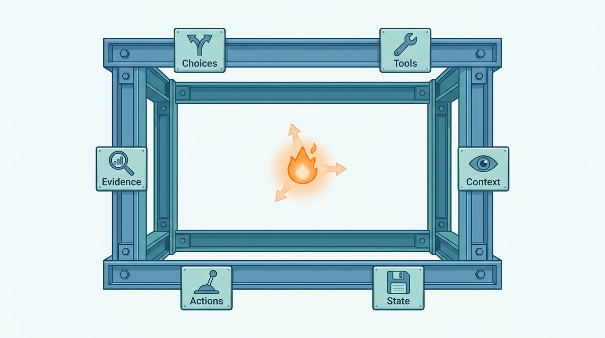
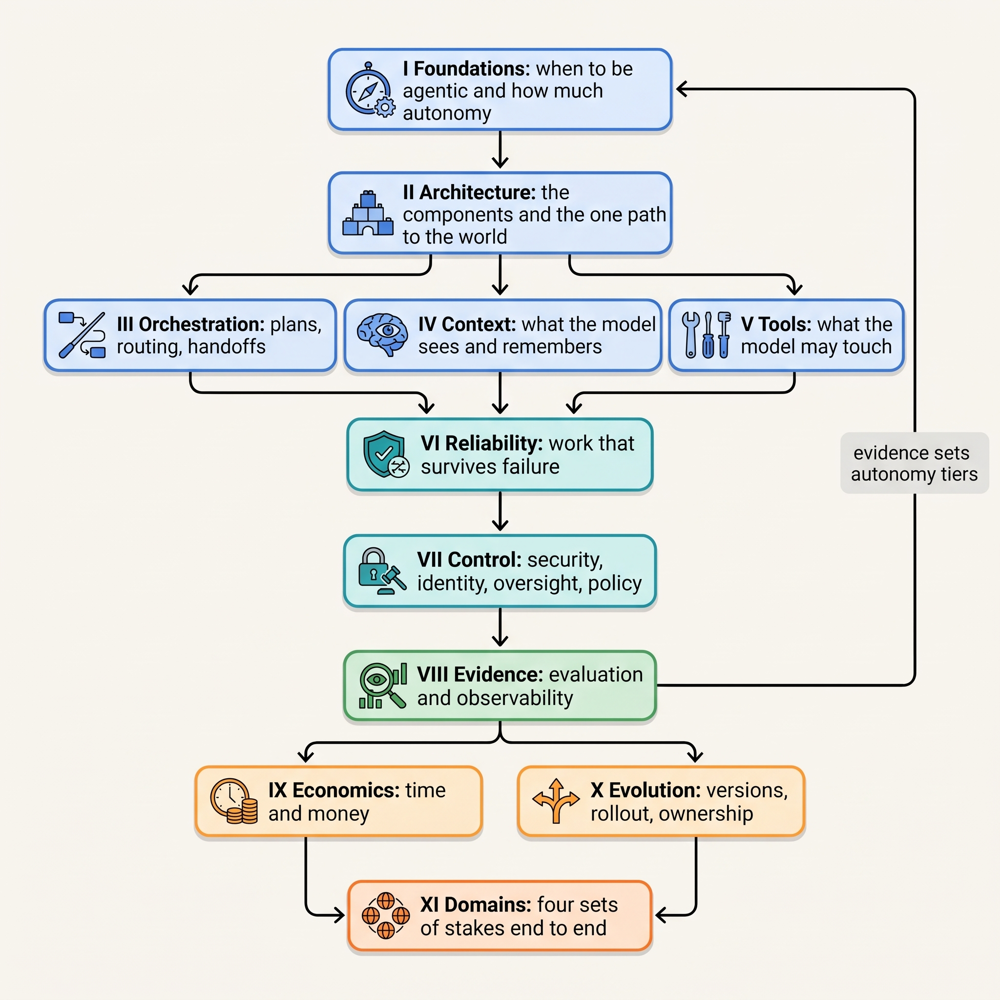

> **IN THIS SECTION, YOU WILL:** Learn what this book argues, who it is for and how its eleven parts build on each other; find the chapters for the decision in front of you; and learn to tell the seven kinds of statement apart, and why every volatile fact carries a date.

> **WHY THE BUSINESS CARES:** An agent that answers customers, proposes journal entries or opens pull requests moves money, commitments and code. The business pays for every action the model got wrong and nobody stopped, and for every week a useful agent waits because nobody can show it is safe.

> **WHY ARCHITECTS SHOULD CARE:** The model is the one component in the system whose output you cannot predict from its input. Everything else, from the tool contract to the evidence log, is yours to design, and that design decides what a wrong proposal can reach.

> **KEY POINTS:**
>
> * **An agentic system is an ordinary distributed system with one unusual component.** A model proposes the next action, and its proposals vary. The architecture's job is to bound that component: what it may decide, what it may touch, what it sees, what survives a crash and which actions need a human.
> * **Three consequences shape every chapter.** Autonomy is a budget granted per action class and earned with evidence; the rest of the system must be more reliable than usual because the model is not; and evaluation is part of the architecture, feeding deployment gates and autonomy tiers.
> * **Eleven parts form a learning path, and a routing table lets you start with the decision on your desk.** Every statement says what kind it is: research finding, documented experience, specification, the author's recommendation, an illustration from Ostrell (the fictional company the book follows), a labeled assumption or a design example from the author's interview project.

 
In March 2027, a support agent at Ostrell, the fictional company this book follows, called the billing system to issue a service credit. The call timed out after 30 seconds. The runtime treated the timeout as a failure and retried the step by **asking the model again**. The model proposed the credit again, once at a different amount. Billing had processed the first call. By the time anyone noticed, **212 customers had received duplicate credits worth €31,400**.

Nothing in that incident needed a better model. The model did what models do: given the same situation twice, it proposed two slightly different actions. What failed was the system around it. A timeout was read as "did not happen" instead of "unknown". The retry re-ran a decision instead of re-sending a recorded action. The billing tool accepted the same intent twice because it carried no idempotency key. Each of those is **an ordinary distributed-systems mistake, made worse by one component whose output varies**.

This book is about designing systems where that component is useful and its mistakes stay small.

## Why This Book Exists

By late 2026 most engineering organizations have built something they call an agent: a support assistant, a coding harness, a research tool, a workflow with model steps. Few have decided, explicitly, what the model may decide and what stays in code. **The questions that come up in design reviews are architectural, not about prompts**: Where does task state live when a run lasts a week? What happens when a tool call times out? Which credential does the agent hold, and on whose behalf? Who approved this action, and what did they see? Which evidence lets this agent issue credits without an approval, and what would take that right away?

The available writing tends to answer other questions. Framework documentation explains how to wire a loop in one library. Model announcements compare benchmark scores. Vendor material promises that agents will run whole functions. All have their uses, and none tells a Chief Architect where to put the boundary or how to defend it.

So it helps to say what this book is not:

| This book is not | Why not, and what it does instead |
| --- | --- |
| **A framework tutorial** | Frameworks change every few months, and a design tied to one library's abstractions outlives neither. The book describes responsibilities (runtime, gateway, broker, policy enforcement, evidence log) that any framework or in-house code must provide, and shows short, language-neutral code only where a mechanism needs it. |
| **A model comparison** | Model capabilities move faster than a book can be revised, and no real model version is recommended anywhere. The book treats models as replaceable components behind a gateway, chosen per role and step by evaluation ([[models-and-the-model-gateway]], [[agent-cost-and-model-routing]]). |
| **A case for or against agents** | Many systems sold as agents are better as workflows with one or two model steps. The book's first question is whether an agent is justified at all ([[when-agents-are-justified]]), and its answer is often "only at this step". |
| **A survey of everything** | Model training, fine-tuning, the internals of transformers and the design of general-purpose chat assistants appear only where they change an architectural decision. |

## The Central Idea

An agentic system is **an ordinary distributed system with one unusual component: a model that proposes the next action, and whose proposals vary**. Given the same inputs twice, it may choose a different tool, different arguments or a different order. It can be talked into things by text it reads. Every step costs money and time. And its action space, unlike that of most services, can be open-ended.

The rest is familiar: timeouts, retries, idempotency, partial failure, authorization, consistency between stores, versioned releases. [[what-makes-a-system-agentic]] argues that only four properties are new (variable proposals, an open action space, untrusted text reaching the component that decides, and a cost per step) and that **"agent" is a property of a decision point, not of a product**. At each decision point, code, the model or a human chooses the next step. The model's output is a proposal; deterministic code validates it, authorizes it, executes it and records it.

The architecture's job, then, is to **bound the component that decides**. Every chapter is about one place where that boundary sits:

- **Which choices** the model makes, and which stay in code or with a human.
- **Which tools, data and credentials** it can reach, and through what.
- **What it sees** at each step, and how stale or untrusted that is.
- **What survives** a crash, a deploy or a week-long wait.
- **Which actions** are idempotent, reversible, compensable or need a human.
- **Which evidence** (evaluations, traces, incident history) widens or narrows its autonomy.

**Figure 1:** *The model is the one bright, variable component; the book is about the sturdy frame around it, which decides which choices it makes, which tools it reaches, what it sees, what survives, which actions it may take and which evidence widens its autonomy.*

Three consequences follow, and they run through the book.

**Autonomy is a budget, not a property.** An agent is not "autonomous" or "supervised". Each **action class**, one kind of action such as "issue a service credit up to €250", gets its own tier, sized by the consequence and reversibility of a mistake and earned with evidence. The same platform can run a coding agent that rewrites files freely inside a sandbox, a support agent that grants a €250 credit on its own, and a benefits-casework design in which the model may only draft. [[autonomy-and-consequence]] builds the tier register; [[evidence-for-autonomy]] shows how a class is promoted or demoted.

**The model is the least reliable component, so the rest must be more reliable than usual.** Durable task state, idempotent tools with receipts, typed contracts, policy enforced outside the model, and an append-only evidence log are what make a variable component safe to run. A team that would accept an at-least-once retry in an ordinary service cannot accept it when a retry re-asks the model and gets a different answer, as the Double Credit showed ([[retries-idempotency-and-concurrency]]).

**Evaluation is part of the architecture, not a phase.** The system must produce the traces and datasets that tell you whether a change made it better, and those results must feed release gates and autonomy tiers. An agent whose prompt, model, tools and policies can change without an evaluation will drift, and nobody will be able to say when ([[evaluating-agentic-systems]], [[versioning-agent-systems]]).

These three ideas are recommendations, not findings: they are the author's reading of the evidence the chapters cite, and each chapter states where they stop holding.

## Who This Book Is For

The book is written for people who design, review, operate or fund systems in which a model plans and acts over several steps:

- **Chief, enterprise and solution architects** who must decide what an agent platform provides and what each team builds.
- **Principal and staff engineers** who build agent runtimes, tool integrations, evaluation pipelines or coding harnesses.
- **Engineering, platform and security leaders** who own the risk, the cost and the on-call for agents in support, sales, finance, legal, HR, research and engineering.

The book takes the perspective of **a Chief Architect of a company that runs several agents on one internal platform**. Most of the reasoning applies to a single agent; the trade-offs show more clearly when seven agents share a gateway, a tool broker and a policy set.

**What it assumes.** You know distributed systems, APIs, queues, identity and access management, data platforms and security basics, and you have made and defended architecture decisions. The book does not explain OAuth, a container or a vector database.

**What it does not assume.** Agent, machine-learning and regulatory vocabulary. Terms such as action class, trajectory, pass^k, context manifest, prompt injection, the lethal trifecta, the Model Context Protocol (MCP) and the EU AI Act's deployer duties are defined in one clause where they first matter and in depth in the chapter that owns them. The [[glossary]] names that chapter for every term.

## Eleven Parts as a Learning Path

The parts follow the order in which the decisions depend on each other. Part I decides whether a step should be agentic at all and how much autonomy its actions may have; Part II lays out the components; Parts III to V design what the model plans, sees and touches; Part VI makes the work survive failure; Part VII controls it; Part VIII produces the evidence that sets autonomy; Parts IX and X make it affordable and changeable; Part XI tests everything against four domains.

| Part | The part's argument | Chapters |
| --- | --- | --- |
| **Preface** | What the book is for, how agentic systems fail, and the company the examples follow | This page, [[where-agentic-systems-go-wrong]], [[meet-ostrell]] |
| **[[part-1]]** FOUNDATIONS | **"Agent" is a property of a decision point**; choose the lowest rung that handles the real variation, size autonomy per action class by consequence and reversibility, and bound every loop with limits the model cannot change | 1–4 |
| **[[part-2]]** ARCHITECTURE | **Most of the system is ordinary machinery**; every path from a model's output to the world crosses the same four components, and when the control plane fails, the system degrades autonomy, not availability | 5–9 |
| **[[part-3]]** ORCHESTRATION | **A plan is data, routing selects but never authorizes, and a handoff is a transaction**; add a second agent only on evidence and for a stated reason | 10–13 |
| **[[part-4]]** CONTEXT | **The working context is computed, not accumulated**; memory is written through a policy, task state is what the orchestrator recorded, and every fact carries its source and age | 14–18 |
| **[[part-5]]** TOOLS | **Authority lives in the tool broker, not in the protocol**; a schema-valid call is not a correct call, a sandbox needs an egress boundary, and intent and execution are two records | 19–22 |
| **[[part-6]]** RELIABILITY | **Record the decision and replay the record**; retry the recorded action, never the model, and treat partial failure as a state to resolve | 23–25 |
| **[[part-7]]** CONTROL | **Prompt injection is unsolved, so authority comes from identity and policy, never from content**; an approval is a record, and policy is enforced where the action cannot route around it | 26–30 |
| **[[part-8]]** EVIDENCE | **Evaluate at four levels, measure reliability as pass^k, and write autonomy criteria before collecting the evidence**; demotion is the half that makes promotion safe | 31–34 |
| **[[part-9]]** ECONOMICS | **Measure cost per successful task, budget milestones not averages, and make budgets terminate**; a cache is correct only if its key carries everything that makes the answer correct | 35–37 |
| **[[part-10]]** EVOLUTION | **The agent version is a manifest, not a commit**; rollback moves a pointer, not the world, and ownership is split by what fails | 38–40 |
| **[[part-11]]** DOMAINS | **The same platform, four sets of stakes**: coding, customer operations, back office, and clinical and public-benefits decisions, each end to end | 41–44 |
| **Reference** | The interview designs behind the book, templates, definitions and sources | [[source-coverage]], [[toolkit]], [[glossary]], [[bibliography]] |

**Figure 2:** *The book's map: Part I sets the autonomy budget, Parts II to VII build and bound the system that spends it, Part VIII produces the evidence that adjusts the budget, and Parts IX to XI make it affordable, changeable and fit for each domain.*

Read Part I first even if you skip elsewhere: later chapters justify their limits by pointing back to its tier register and its decision-point map. Each chapter follows the same shape: opening callouts with three key points and the failure patterns it addresses; an Ostrell scene that poses the question; concepts, architecture, evidence and a worked example; failure modes and recovery; trade-offs; an **"Across Domains: How the Stakes Change the Design"** comparison in Parts II to X; the Chief Architect's view; questions for a design review; and Sources and Evidence.

### Four domains, one platform

The same mechanism carries different stakes in different places, so the chapters keep comparing four columns: **coding agents**, **customer operations** (support, sales, marketing), **back office** (finance, legal, HR) and **high-stakes decisions** (healthcare, public benefits). The comparison keeps returning to one question: what can the platform keep common, and what must be domain policy?

| | Coding agents | Customer operations | Back office | High-stakes decisions |
| --- | --- | --- | --- | --- |
| **What makes autonomy cheap or expensive** | A sandbox, tests the agent cannot edit, and a pull request as the gate | Every sentence to a customer is a representation; every promise is an action | Segregation of duties: the agent is a maker, never a checker | A person's health, rights or income; harm may be irreversible |
| **Typical ceiling** | High inside the sandbox; merge stays human | Act within limits for small, reversible actions | Draft for approval for anything that posts or signs | Draft only; rules or a licensed human decide |
| **Where the book works it end to end** | [[domain-coding-agents]] | [[domain-customer-operations]] | [[domain-back-office]] | [[domain-high-stakes-decisions]] |

Where the domains do not differ for a topic, the chapter says so in a paragraph rather than inventing differences.

## Start With the Decision in Front of You

The parts are a learning sequence for a first reading. If a decision is already waiting, find the row that matches it, read the chapter in the **Start with** column, and follow the **Then** column if you need more. Return to Part I whenever a term or a tier is unfamiliar.

| Your immediate need | Start with | Then |
| --- | --- | --- |
| A team proposes an agent, and you must decide whether a workflow or plain code would do | [[when-agents-are-justified]] | [[what-makes-a-system-agentic]], [[workflows-loops-and-autonomous-agents]] |
| Someone asks how much the agent may do without approval | [[autonomy-and-consequence]] | [[human-oversight-and-bounded-autonomy]], [[evidence-for-autonomy]] |
| You are designing the shared platform several agent teams will use | [[agentic-reference-architecture]] | [[agent-runtime]], [[models-and-the-model-gateway]], [[owning-agentic-systems]] |
| Teams want to split one agent into several, or connect agents with an agent-to-agent protocol | [[single-and-multi-agent-designs]] | [[coordination-and-handoffs]], [[routing-and-delegation]] |
| Answers degrade as conversations grow, or the agent cites the wrong document | [[context-engineering]] | [[retrieval-and-grounding]], [[caching-and-context-budgets]] |
| Product wants the agent to remember users across sessions | [[agent-memory]] | [[provenance-and-freshness]], [[policy-enforcement-and-audit]] |
| An agent acted on stale data, such as an old price list | [[provenance-and-freshness]] | [[retrieval-and-grounding]], [[agent-observability]] |
| You are exposing internal systems as tools, or adopting MCP servers | [[tool-contracts]] | [[tool-ecosystems-and-mcp]], [[agent-identity-and-least-privilege]] |
| An agent will run model-written code or shell commands | [[sandboxes-and-execution-environments]] | [[agent-threat-model]], [[domain-coding-agents]] |
| An agent will send emails, issue refunds, post entries or change records | [[side-effects-and-external-actions]] | [[retries-idempotency-and-concurrency]], [[partial-failure-and-compensation]] |
| Runs last hours or weeks, wait for approvals, and must survive deploys | [[durable-agent-execution]] | [[task-state-and-checkpoints]], [[versioning-agent-systems]] |
| A retry or a timeout caused a duplicate action | [[retries-idempotency-and-concurrency]] | [[side-effects-and-external-actions]], [[durable-agent-execution]] |
| The security team asks about prompt injection and data exfiltration | [[agent-threat-model]] | [[prompt-injection-defense]], [[agent-identity-and-least-privilege]] |
| Human approvals exist, but nobody knows whether they catch anything | [[human-oversight-and-bounded-autonomy]] | [[agent-interaction-design]], [[policy-enforcement-and-audit]] |
| Changes ship on demos, and you need a regression gate | [[building-agent-eval-suites]] | [[evaluating-agentic-systems]], [[staged-rollout-and-rollback]] |
| Nobody can explain why a run did what it did | [[agent-observability]] | [[policy-enforcement-and-audit]], [[task-state-and-checkpoints]] |
| The invoice grew faster than usage, or a run looped over a weekend | [[agent-cost-and-model-routing]] | [[caching-and-context-budgets]], [[workflows-loops-and-autonomous-agents]] |
| A provider changed a model, or you plan a migration to another one | [[versioning-agent-systems]] | [[staged-rollout-and-rollback]], [[models-and-the-model-gateway]] |

Two rows start somewhere unexpected, on purpose. The duplicate-action row starts with retries rather than with the tool, because the Double Credit was caused by re-asking the model, not by the billing API. The approvals row starts with oversight rather than with interface design, because a gate whose approvers are never measured is a ceremony, whatever the screen looks like.

## How to Read the Evidence

**Evidence-led and vendor-neutral.** The book draws on research papers and preprints; official specifications such as the Model Context Protocol, the Agent2Agent protocol, the OpenTelemetry semantic conventions for generative AI and OAuth; official vendor documentation; engineering reports from teams that built and ran agentic systems; incident analyses and court and regulator decisions; and regulation, from the EU AI Act and the GDPR to sector rules. Every substantive technical claim carries a nearby citation, and the [[bibliography]] collects them.

**Seven kinds of statement.** Writing about agents becomes unreliable when a benchmark result, a vendor's account of its own system, a specification, an opinion, an example and a guess read in one voice. Every chapter keeps them apart:

| Kind of statement | How to recognize it | An example from the book |
| --- | --- | --- |
| **Research finding** | A paper or preprint, with what was measured, on what setting, and its main limitation; "preprint" when not peer reviewed | "On τ-bench's simulated retail customer-service tasks, the strongest model tested in June 2024 succeeded on 61% of tasks in one trial but on fewer than 25% in all of eight trials ([Yao et al., 2024](https://arxiv.org/abs/2406.12045)), a simulated-user benchmark, so treat it as an indicator, not a rate." |
| **Documented experience** | An engineering writeup, incident report, court or regulator decision, with the organization and year in the sentence | "In its June 2025 engineering post on its multi-agent research system, Anthropic reported that 'agents typically use about 4× more tokens than chat interactions, and multi-agent systems use about 15× more tokens than chats' ([Anthropic, 2025](https://www.anthropic.com/engineering/multi-agent-research-system))." It describes Anthropic's system, not yours. |
| **Specification or documentation** | A standard, protocol, official documentation or regulation, with its version or date and a link to the official text | "The 2026-07-28 revision of the MCP specification made the protocol stateless: it removed protocol sessions and the `initialize` handshake ([MCP Specification 2026-07-28: Key Changes](https://modelcontextprotocol.io/specification/2026-07-28/changelog))." |
| **Recommendation or judgement** | The author's view as a Chief Architect, often in the first person, with the reasoning and the conditions under which it does not hold | "Retry the recorded action, never the model. Re-asking is right only when a proposal fails validation before it is dispatched, and then it is a new decision with a new action object and key." |
| **Illustration** | An Ostrell scene or number, labeled fictional the first time in each chapter; its figures agree across the book | "Answerdesk's credits up to €250 moved from draft-for-approval to act-within-limits in October 2027." |
| **Assumption** | An illustrative volume, latency target or cost that is neither an Ostrell fact nor documented, marked "Assume…" or *(assumption)* | "Assume a step that is right 95% of the time and twelve such steps in a chain with no check between them." |
| **Design example from the interview project** | Material adapted from the author's system-design interview designs, labeled with the design and step, never presented as a deployed system | "The author's agentic-public-benefits-platform interview design holds a case when its rule engine cannot decide, and never defaults to denial." |

Three distinctions are easy to lose. **A vendor's engineering post is documented experience about its own system only**; it is not evidence that a pattern works elsewhere, and vendor marketing is not evidence at all. **An Ostrell figure, such as Answerdesk's 41% verified resolution, is an illustration, not a benchmark.** And **a recommendation that sounds like a fact**, such as "a citation is a pointer, not proof", is still a recommendation, with reasoning and exceptions. Argue with it.

### Why volatile facts carry dates

**The research for this book was done in October 2026**, and facts were checked against public sources then unless a chapter says otherwise. In this field, much of what is true in one quarter is wrong in the next, so the book separates durable principles from volatile details and dates every volatile one:

- **Protocol versions.** MCP published four revisions in the twenty months after its first, 2024-11-05; the latest, 2026-07-28, removed sessions and the handshake ([[tool-ecosystems-and-mcp]]). A chapter that says "MCP supports…" without a revision is already out of date.
- **Prices, quotas and limits.** Model prices, caching discounts, context-window sizes and rate limits change without notice. The chapters on economics show the arithmetic with dated or labeled numbers; the arithmetic transfers, the amounts do not ([[agent-cost-and-model-routing]]).
- **Regulation dates.** The EU AI Act ([Regulation (EU) 2024/1689](http://publications.europa.eu/resource/celex/32024R1689)) applies in stages, and the stages move: the Digital Omnibus on AI ([Regulation (EU) 2026/1744](http://publications.europa.eu/resource/celex/32026R1744)), published on 24 July 2026, moved the application of the high-risk obligations for Annex III systems from 2 August 2026 to **2 December 2027**. The book is set in 2027, so which date applies decides what an Ostrell agent must do ([[human-oversight-and-bounded-autonomy]], [[policy-enforcement-and-audit]]).
- **Models.** No chapter recommends a specific model version. Ostrell's models are tiers (Large, Mid, Small, Embed) behind a gateway, and its providers are unnamed.

Check the source before relying on a date-sensitive statement.

### The limits of the evidence

Three limits deserve stating once, plainly, because they shape how much weight the book's recommendations can bear.

**The field moves fast.** Patterns described here as current practice were invented, renamed or abandoned within the two years before October 2026. The book bets on the mechanisms that do not depend on a model's capability (idempotency, durable state, least privilege, evaluation tied to release gates) and labels as volatile what does.

**Evidence from production is thin, and much of it is vendor-reported.** Benchmarks such as τ-bench measure agents against simulated users and sandboxed tools. Engineering posts describe the author's own system, rarely with the data behind their numbers. Incident reports exist mostly for security failures and are demonstrations, not incidence rates. **No published study compares, for example, whether a policy gateway measurably reduces harm in production**, or how often human approvals catch errors across organizations. Where the evidence runs out, the chapters say so.

**Many recommendations are judgement.** The tier register, the four-component path from proposal to effect, the rule that only a human promotes an action class, and the domain ceilings are the author's architecture, reasoned from distributed-systems practice, the cited evidence and the interview designs. They are labeled as recommendations, with the conditions under which they fail. Treat them as positions to test in your own design reviews, not as findings.

## Ostrell, the Running Example

**Ostrell Group is fictional.** It is a field-service software company headquartered in Rotterdam, with €1.3 billion of revenue in fiscal 2026 and about 5,200 employees, selling scheduling and work-order software (Ostrell Field), spare parts (Ostrell Parts) and service contracts (Ostrell Assure). By 2027 it runs **seven agents on one internal platform, Keelson**: Answerdesk in support, Closewise in the month-end close, Dealroom in sales, Peoplepoint in HR, Clausewise in contract review, Scout in research and Forge for coding. Each agent's action classes carry a tier from A0 (suggest) to A3 (act autonomously), and irreversible external commitments are capped at draft-for-approval whatever the evidence. Nine recurring incidents in 2027, from the Half-Posted Accrual to the Alias Drift, each exposed a missing boundary, and the chapters tell each one in depth. Ostrell is a composite of patterns, not a disguise for any company; its numbers are illustrations, not benchmarks. [[meet-ostrell]] introduces its agents, platform, people and incidents. When Tomas Verhoef, its Chief Architect, decides, ask what the equivalent decision would be in your organization.

Ostrell keeps its agents away from decisions about a person's health, rights, pay or employment. For that end of the range the book uses two design examples, clinical documentation and public-benefits casework, which are neither Ostrell nor deployed systems.

## How the Interview Designs Were Used

The book draws selectively on twelve of the author's **system-design interview designs**: an agentic platform foundation; support, sales, marketing, finance, legal, HR, research, healthcare and public-benefits platforms; and an AI coding command-line interface (CLI) and a coding harness. Each is a design exercise that starts from a naive architecture and evolves it one failure at a time, step by step, until the design holds.

They are **design examples, not descriptions of deployed systems**. They show how an architecture responds to a named failure, which makes them good teaching material. They are not evidence of how such a system behaves in production, and their numbers are illustrative. When a chapter uses one, it names the design and the step ("The author's agentic-support-platform interview design (step 4) adds…") and lists it in Sources under *Design examples from the author's interview project*. Where the designs disagreed with each other or with the evidence, the book reconciled them and says how. [[source-coverage]] maps each design to the chapters that use it, the patterns the book adopted and where it departs.

**No internal material.** Nothing here comes from confidential documents or inside knowledge of any company. Where a chapter needs a situation the public record cannot supply, it uses Ostrell.

## The Failure Patterns and the Reference Pages

Agentic systems rarely fail through one bad decision. They fail through recurring patterns that each looked reasonable when chosen. The next page, [[where-agentic-systems-go-wrong]], names sixteen of them, among them **The Agent-Shaped Hammer**, **Autonomy by Default**, **The Compounding Error**, **The Fire-and-Forget Action**, **The Different Second Answer**, **The Lethal Trifecta**, **The Rubber Stamp**, **Vibe Evals** and **The Silent Upgrade**, each with its warning signs, mechanism, cost and the chapters that address it. The Double Credit at the top of this page is two of them at once: a Fire-and-Forget Action without an idempotency key, and a Different Second Answer from a retry that re-asked the model. Every chapter opens by naming the patterns it works on.

Four reference pages close the book:

- **[[source-coverage]]** maps the twelve interview designs to the chapters that use them.
- **[[toolkit]]** collects templates: the agent justification canvas, the autonomy tier register, the action class table, the tool contract template, the threat-model worksheet, the approval gate spec, the eval plan, the agent version manifest, the rollout plan, the agent registry entry and a design-review checklist. Start with the one that changes this week's decision.
- **[[glossary]]** defines the book's terms in one line each and names the chapter that owns each one.
- **[[bibliography]]** lists every source, numbered and grouped by type, with the pages that cite it.

## A Living Journal

This book is a living journal and a work in progress, which I revise as I learn more through [my work](https://obren.io). In this field that is not a courtesy: some chapters will need new evidence within months. Every chapter has a "View spec" link in its byline that opens the specification it was written against, including its open questions. Read the book as current thinking with its limits stated, not as a finished text.

I developed the book through AI-mediated authoring: I set the concept, the structure, the chapter contracts and the arguments; AI tools supported research against public sources, drafting from those contracts, consistency checks across chapters and editing; I reviewed and decided. A book about bounding a component that proposes was itself written that way, with specs as the contract and review as the gate. The specs and the scripts that build this site are in the [book's GitHub repository](https://github.com/zeljkoobrenovic/spec-driven-journals). The content, its judgements and its errors are my responsibility.

## Where to Go Next

If you read in order, turn next to [[where-agentic-systems-go-wrong]], then [[meet-ostrell]], so that every chapter's opening scene lands in a company you know, and begin Part I with [[what-makes-a-system-agentic]]. Either way, keep the Double Credit in mind: a model that proposed what models propose, and a system that did not know whether its own action had happened. Every chapter is part of the answer.

## Sources and Evidence

*Research papers*

- [τ-bench: A Benchmark for Tool-Agent-User Interaction in Real-World Domains](https://arxiv.org/abs/2406.12045), Yao, Shinn, Razavi and Narasimhan, **2024** (preprint): pass^k and the gap between single-trial and repeated-trial success.

*Specifications, standards and regulation*

- [MCP Specification 2026-07-28: Key Changes](https://modelcontextprotocol.io/specification/2026-07-28/changelog), MCP project, **2026**: the stateless redesign that removed sessions and the handshake.
- [Regulation (EU) 2024/1689 (AI Act)](http://publications.europa.eu/resource/celex/32024R1689), European Union, **2024**: the staged application of the AI Act.
- [Regulation (EU) 2026/1744 (Digital Omnibus on AI)](http://publications.europa.eu/resource/celex/32026R1744), European Parliament and Council, **2026**: Annex III high-risk obligations moved to 2 December 2027.

*Vendor documentation and engineering reports*

- [How we built our multi-agent research system](https://www.anthropic.com/engineering/multi-agent-research-system), Anthropic, **2025**: token multiples for agents and multi-agent systems, as documented experience about Anthropic's own system.

*Design examples from the author's interview project*

- Obrenović, Ž., system-design interview designs, `system-design-interviews/data/book/` (twelve designs: `agentic-platform-foundations`, `agentic-support-platform`, `agentic-sales-platform`, `agentic-marketing-platform`, `agentic-finance-platform`, `agentic-legal-platform`, `agentic-hr-platform`, `agentic-research-platform`, `agentic-healthcare-platform`, `agentic-public-benefits-platform`, `ai-coding-cli`, `ai-coding-harness`), **2026**: design examples, mapped in [[source-coverage]]; not descriptions of deployed systems.

Research, specification and documented-experience sources for each topic are listed in the chapter that owns it and collected in the [[bibliography]]. Ostrell is fictional; architectural recommendations, labeled inferences and labeled assumptions are the author's judgement.
