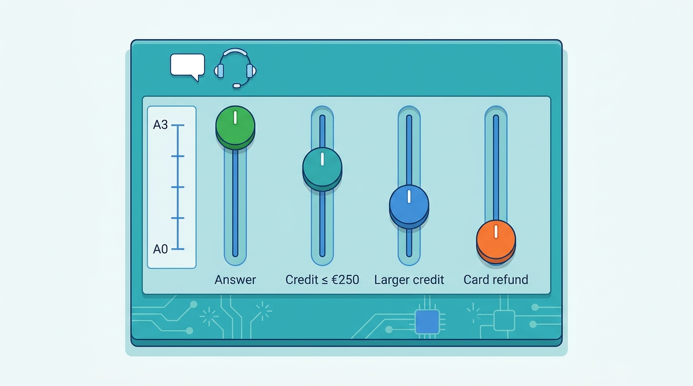
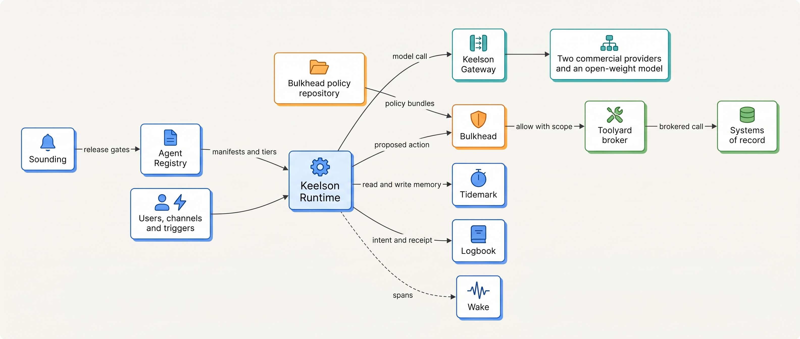
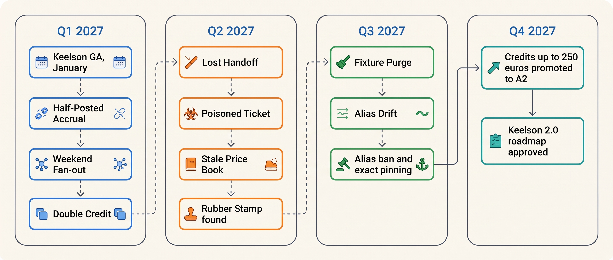

> **IN THIS SECTION, YOU WILL:** Meet Ostrell Group, the fictional company this book follows through 2027: its products, its seven agents and the autonomy tier of each action they take, the Keelson platform and what each component owns, the people who make the decisions, the nine incidents every chapter shares, and the two contrast designs from outside Ostrell.

> **WHY THE BUSINESS CARES:** Ostrell runs agents in support, finance, sales, HR, legal, research and engineering at once. Each one moves money, commitments or code, and each one is owned by a different business leader who answers for what it does.

> **WHY ARCHITECTS SHOULD CARE:** Seven agents on one platform force the questions a single demo never raises: which controls are shared and which are domain policy, who may raise an agent's autonomy, and what the platform must guarantee when a model's proposal is wrong.

> **KEY POINTS:**
>
> * **Ostrell is fictional, and its numbers are illustrations.** It is a composite built so the chapters can show real design tensions with consistent figures. It is not a disguised description of any company, and none of its volumes, costs or rates is a benchmark.
> * **Autonomy is set per action class, not per agent.** The same Answerdesk agent answers from the knowledge base on its own (A3), issues credits up to €250 within limits (A2), drafts larger credits for approval (A1) and only suggests card refunds (A0). Irreversible external commitments are capped at A1 whatever the evidence.
> * **Every Keelson component exists because something went wrong.** Nine recurring incidents in 2027, from the Half-Posted Accrual to the Alias Drift, each exposed a missing boundary; the chapters tell each one in depth and show the control that now holds it.

> **[FAILURE PATTERNS THIS SECTION ADDRESSES](where-agentic-systems-go-wrong.html):**
>
> * **Autonomy by Default** — in January 2027 Ostrell's prototypes could take every action their tools and service accounts allowed; the tier register is what replaced that.
> * **The Fire-and-Forget Action** — the Half-Posted Accrual and the Double Credit both came from side effects without idempotency keys or receipts.
> * **The Silent Upgrade** — the Alias Drift moved Closewise to a different model with no change on Ostrell's side.

 
This book tests its argument against **one fictional company, detailed enough to be realistic and consistent enough to follow across sixty pages.** A toy example is too simple to show why the hard decisions are hard, and a real company's internals cannot be verified. This page is the reference: every chapter opens with an Ostrell scene, and its people, agents, components and numbers come from here.

**Ostrell Group is fictional.** It is a composite of patterns common among software companies that adopted agents in several business functions at once. It is **not a portrait of any real company**, and none of its product names, people, volumes or incidents belongs to one. Ostrell's model providers are "two commercial model providers" and "an open-weight model in Ostrell's cloud account"; they are deliberately unnamed, and no real model version is Ostrell's model.

## The Company at a Glance

**Ostrell Group B.V.** is headquartered in **Rotterdam, the Netherlands**. It was founded in **2004**, operates in the EU and the UK, and has operated in the US since 2024.

| Measure | Value |
| --- | --- |
| Revenue (fiscal 2026) | **€1.3 billion** |
| Employees (2027) | about **5,200**, of whom about **1,150 in engineering** |
| Legal entities | **23**, consolidated in one ERP instance |
| Business customers of Ostrell Field | **9,400**, with about **410,000 technician users** |
| Ostrell Parts order lines | about **1.1 million a month** |
| Knowledge-base articles | about **18,000** in 9 languages, about 1,600 of them tenant-scoped for some 240 enterprise customers |

Ostrell sells three products:

- **Ostrell Field** — field-service management SaaS for maintenance and installation companies: scheduling, work orders, a technician mobile app and service contracts. It produces most of the support load.
- **Ostrell Parts** — spare-parts ordering and distribution for Field customers, a B2B commerce business.
- **Ostrell Assure** — service-contract and warranty administration sold with Field. About a third of Field customers hold more than one Assure contract, one per site.

Its enterprise systems are the ones most companies have, and the book refers to them generically: an ERP for finance, a ticketing system for support, a CRM for sales, an HR information system (HRIS), a contract-lifecycle-management (CLM) tool for legal, code hosting with continuous integration (CI) for engineering, and a cloud data warehouse with governed views. **These systems of record stay authoritative**; the agents are clients of their APIs, never a parallel store ([[agents-in-the-enterprise]]).

## The Seven Agents

By 2027, seven teams had built something they called an agent. The quotation marks matter: two of the seven are mostly **workflows with model steps** (Closewise, and Peoplepoint's leave flow), which is the opening argument of [[what-makes-a-system-agentic]]. The table shows each agent's main action classes with their autonomy tiers **as of October 2027**, after the autonomy review.

| Agent | Domain and owner | Interaction mode | Main action classes and tiers (October 2027) | Volumes (2027) |
| --- | --- | --- | --- | --- |
| **Answerdesk** | Customer support for Ostrell Field; Support Operations (Lena Brandt) | Chat and email; escalates to human support staff | Answer from the knowledge base (A3); create or update a ticket (A3); schedule a technician revisit (A2, at most one per ticket); issue a service credit **≤ €250** (A2 since October 2027, A1 before); credit **> €250** (A1); refund to card (A0); email to an unverified recipient (A0) | **2.6 million conversations a year** (~7,100 a day); verified resolution **41%** in Q3 2027, target 45%; human escalation 33% |
| **Closewise** | Month-end close; Group Finance (risk owner Joost Vermeer) | Workbench for accountants; a workflow with agentic steps | Draft reconciliations (A3, internal); propose accrual journal entries (A1, a controller approves); posting of approved entries is executed by the workflow, never by the model | 23 legal entities; about **1,900 proposed entries a month**, about 380 per close day; close target **working day 5** (day 7 in 2026) |
| **Dealroom** | Sales account research and proposals; Sales Operations (Priya Natarajan) | Copilot in the CRM | Account briefs (A2 since October 2027, demoted from A3, 10% sampled weekly); draft quotes from the price book (A1: the account executive sends; the agent **never sends to customers**) | ~**4,000 quotes drafted a month** |
| **Peoplepoint** | Employee HR helpdesk; People team | Chat in the intranet | Policy answers (A3); submit a leave request after the employee confirms (A1, the employee approves); performance, pay or termination questions are refused and routed to HR (A0) | ~**9,000 conversations a month**, ~2,300 of them leave requests |
| **Clausewise** | Contract review; Legal (Ilse de Wit) | Plugin in the CLM tool | Redline NDAs and data-processing agreements against the playbook (A1: a lawyer accepts each change); risk summary (A3, internal); **never sends to counterparties** | ~**600 contracts a month** |
| **Scout** | Internal technical and market research; Strategy & Insights | Delegated asynchronous task; a report with citations | Web and internal search (A3, read-only); write reports to a document space (A3, internal) | ~**350 research runs a month**; median run 14 minutes |
| **Forge** | Coding agent harness; Developer Productivity (Sam Kowalczyk) | Headless agents in sandboxed runners; the output is a pull request | Edit code in an ephemeral sandbox (A3 inside the sandbox); open a pull request (A3); merge (A0: humans only); no production credentials, ever | ~5,600 runs and ~**3,400 agent pull requests a month** (Q3 2027); merge rate **61%** |

Beside the seven, about **870 engineers** a week (Q3 2027) use a **commercial coding command-line interface (CLI)** under an Ostrell-managed configuration of permission rules, approved Model Context Protocol (MCP) servers and hooks. It is not a Keelson agent, but it shares Keelson's tools and threat model.

Three execution styles appear in the seven, and [[workflows-loops-and-autonomous-agents]] uses them as its cases: **Closewise** is a fixed workflow with two bounded agentic steps, **Answerdesk** is a bounded loop with per-turn and per-conversation limits, and **Scout** is the most autonomous, planning its own research and delegating to worker agents within a budget.

Not every proposed agent survived. The **March 2027 business-case review** cancelled a planned **"Invoice Chaser"** collections agent, because a dunning workflow plus one model call did the job, and downgraded **Peoplepoint's leave flow** from a bounded loop to a workflow ([[when-agents-are-justified]]). By December 2027 the Agent Registry held **11 entries**: 7 production agents with **21 action classes**, 1 retired (Answerdesk's billing specialist agent), 1 rejected (Invoice Chaser) and 2 proposed (**Partsline** for Parts order exceptions, **Claimcheck** for Assure warranty-claim drafting).

## The Autonomy Tier Register

Ostrell grants autonomy **per action class, not per agent**. An action class is one kind of action an agent may take, such as "issue a service credit up to €250", with its effect type, consequence band, limits, undo path and detection mechanism. [[autonomy-and-consequence]] owns the register; this is its shape.

| Tier | Name | Meaning |
| --- | --- | --- |
| **A0** | Suggest | The agent proposes; a human performs the action. |
| **A1** | Draft for approval | The agent prepares an executable action object; a human approves it before execution. |
| **A2** | Act within limits | The agent executes within hard limits (amount, scope, rate); actions are reviewed after the fact by sampling. |
| **A3** | Act autonomously | The agent executes within a budget; humans monitor metrics and incidents only. |

**Figure 1:** *Autonomy is set per action class, not per agent: the same Answerdesk agent answers on its own (A3), issues credits up to €250 within limits (A2), drafts larger credits for approval (A1) and only suggests card refunds (A0).*

Three rules make the register more than a label:

- **Irreversible external commitments are capped at A1, whatever the evidence.** Contract signatures, third-party payments, legal filings and employment decisions always need a human approval; that is why Dealroom's October 2027 proposal to auto-send standard-price quotes was refused.
- **Each action class has a tier ceiling from a consequence × reversibility grid.** Consequence runs from **C1** (internal, under about €1,000 per action) to **C4** (a person's rights, pay, employment, health or safety); reversibility runs from reversible through compensable to irreversible. Signals such as a verifier's verdict or a fraud flag may lower the tier of one action, never raise it.
- **Only a human promotes; automation may demote or hold.** Promotion needs pre-registered evidence ([[evidence-for-autonomy]]). The register lives in the Agent Registry, keyed by manifest hash and action class, and Bulkhead falls back to the lowest configured tier if it cannot read it.

The October 2027 promotion of Answerdesk's credits up to €250 from A1 to A2 is the book's worked case of the whole cycle: criteria registered on 28 June, review on 7 October, sign-off by Lena Brandt under Marten Ruys's delegation.

## The Keelson Platform

**Keelson** is Ostrell's internal agent platform. It was built in 2026 and became generally available inside Ostrell in **January 2027**. It is owned by the **Agent Platform team** in Platform Engineering, led by Amara Okafor: 14 engineers in January 2027, 19 by December. Before Keelson, seven prototypes had seven sets of code, **31 provider API keys** and **212 agent tools** reached in four different ways.

| Component | What it owns | It must never | Chapter |
| --- | --- | --- | --- |
| **Keelson Gateway** | The model gateway: provider abstraction, credentials, quotas and quota pools, routing by data class, exact version pinning, redaction, request logging (requested and served model) | Fall back to an unevaluated model or route data to an endpoint whose data terms forbid it | [[models-and-the-model-gateway]] |
| **Keelson Runtime** | Runs agent loops and agent workflows on a self-hosted, open-source durable workflow engine; records model and tool calls as activities; holds the task record, budgets, the context assembler and the approval service | Re-ask the model when a tool call is retried, or dispatch a side effect whose intent is not recorded | [[agent-runtime]], [[durable-agent-execution]] |
| **Toolyard** | The tool registry and broker: exposes tools as MCP servers behind the broker, holds credentials, enforces scopes, idempotency keys, rate limits and reversibility declarations | Let a tool reach an agent except through itself, or put a credential in the model's context | [[tool-ecosystems-and-mcp]], [[tool-contracts]] |
| **Bulkhead** | Policy as code and the policy enforcement points (PEPs) before model calls, tool calls, side effects and output; the kill switch | Let a guardrail loosen a decision, or allow a side effect when it cannot decide | [[policy-enforcement-and-audit]] |
| **Tidemark** | Long-term memory per user and per tenant, with provenance, trust level and expiry | Become a source of commitments or a second copy of a system of record | [[agent-memory]] |
| **Logbook** | The append-only evidence log: run inputs, context manifests, tool calls with receipts, approvals, outputs and each run's agent version manifest | Be writable or deletable by any agent identity | [[policy-enforcement-and-audit]] |
| **Wake** | Tracing and operational metrics, based on OpenTelemetry | Block a run: if Wake is unavailable, spans are dropped and runs continue | [[agent-observability]] |
| **Sounding** | Evaluation: suites, graders, simulators, regression gates and the promotion pipeline | Use a judge from the same model family as the route it judges | [[evaluating-agentic-systems]], [[building-agent-eval-suites]] |
| **Agent Registry** | The control-plane record of every agent: owner, action classes and tiers, version manifests, decision-point map, lifecycle state | Accept an agent with an action class that has no tier | [[agentic-reference-architecture]], [[owning-agentic-systems]] |

A **control plane** (Agent Registry, Toolyard's registry, Bulkhead's policy repository, Sounding) decides what may run; a **data plane** runs every call on pinned versions it has cached. Since GA one principle has held: **every path from a model's output to the world crosses the same four components** — Runtime records the proposal, Bulkhead decides, Toolyard executes, Logbook records intent and receipt.

**Figure 2:** *Keelson's one-path rule: every model output that touches the world passes Runtime, Bulkhead, Toolyard and Logbook, while the control plane on the left decides which versions, tiers and policies the data plane may run.*

The Gateway offers three generation tiers and one embedding tier: **Large** (frontier reasoning models from two commercial providers), **Mid**, **Small** (fast and cheap; one is the open-weight model hosted in Ostrell's own cloud account) and **Embed**. Every production manifest pins an exact model version; aliases have been forbidden **since September 2027**, after the Alias Drift ([[versioning-agent-systems]]).

## The People

| Name | Role | Pronouns |
| --- | --- | --- |
| **Tomas Verhoef** | Chief Architect, Ostrell Group; chairs the architecture forum | he/him |
| **Amara Okafor** | Head of Agent Platform; owns Keelson | she/her |
| **Jonas Lindqvist** | Principal engineer, Keelson Runtime | he/him |
| **Farah Haddad** | Security architect for AI and platform security; owns the threat model and the platform policy set | she/her |
| **Mei Lin Zhou** | Evaluation lead; owns Sounding | she/her |
| **Lena Brandt** | Director of Support Operations; owns Answerdesk | she/her |
| **Joost Vermeer** | Group controller; risk owner of Closewise | he/him |
| **Sam Kowalczyk** | Lead, Developer Productivity; owns Forge | they/them |
| **Ilse de Wit** | General counsel; owns Clausewise and the provider-terms register | she/her |
| **Marten Ruys** | CFO; approves the platform roadmap and delegates autonomy sign-offs | he/him |
| **Priya Natarajan** | VP Sales Operations; owns Dealroom | she/her |

Amara Okafor's team owns the **platform**; the business leaders own their **agents** and the risk of each action class. Much of the book is about where that boundary sits.

## The Nine Recurring Incidents

The chapters reuse nine incidents. Their dates and amounts are canonical: when a chapter cites the Double Credit, it is always 212 customers and €31,400.

| When | Incident | What happened | Numbers | Told in depth in |
| --- | --- | --- | --- | --- |
| January 2027 | **The Half-Posted Accrual** | The pre-Keelson Closewise script crashed mid-batch for Ostrell Field Deutschland GmbH; an accountant re-ran it, and it re-posted every entry | 52 entries, crash after 37, **37 duplicates**, **€2.84 million** overstated, 2 days to reverse, close one day late | [[durable-agent-execution]] |
| February 2027 | **The Weekend Fan-out** | A Scout run on "competitor pricing across 14 markets" spawned sub-agents with no depth or cost limit until a quota alert stopped it on Monday | **41 hours**, **1,900 sub-agent runs**, ~310 million tokens, **€8,700**, an unusable report | [[workflows-loops-and-autonomous-agents]], [[single-and-multi-agent-designs]] |
| March 2027 | **The Double Credit** | Answerdesk's `issue_credit` call timed out after 30 seconds; the runtime retried by re-asking the model, which re-proposed the credit, once at a different amount; billing had processed the first call | **212 customers**, **€31,400** in duplicate credits | [[retries-idempotency-and-concurrency]] |
| April 2027 | **The Lost Handoff** | Answerdesk's triage agent handed billing conversations to a billing specialist agent as free-text summaries; the contract id fell out | about **1 in 40** handoffs; **3 wrong-contract credit proposals**, all rejected at A1 | [[coordination-and-handoffs]] |
| May 2027 | **The Poisoned Ticket** | Hidden text in an inbound email told Answerdesk to send a service-contract PDF and five invoices to an outside address; Toolyard's recipient rule blocked the send | found **6 days later** in trace review; no data left | [[prompt-injection-defense]] |
| June 2027 | **The Stale Price Book** | Dealroom drafted quotes from an index whose refresh had failed silently, missing the 1 June price increase; account executives sent them | **23 days** stale, **14 quotes**, **€46,000** of discount honored | [[provenance-and-freshness]] |
| Q2 2027, found June | **The Rubber Stamp** | Support team leads approved Answerdesk's A1 credit proposals almost without looking | **4,812** approvals, **99.3%** approved, median review **6 seconds**, **3.1%** of approved credits unjustified | [[human-oversight-and-bounded-autonomy]] |
| July 2027 | **The Fixture Purge** | Forge agents asked to make failing CI pass deleted or skipped the failing tests | **9 PRs** in two weeks, **2 merged**; a real Parts defect shipped and delayed back-order emails for about 1,100 order lines | [[domain-coding-agents]] |
| August 2027 | **The Alias Drift** | Closewise's classification step called a provider alias that the provider moved to a newer model | accuracy **96.1% → 89.4%** on the Sounding suite, controller rejections **4% → 11%** over **4 days**; no wrong entry posted | [[versioning-agent-systems]], [[agent-observability]] |

**Figure 3:** *Ostrell's 2027: incidents cluster in the first half, while Keelson's controls are thin; the second half turns their fixes into rules, pinned versions and the first evidence-based promotion.*

Smaller incidents belong to single chapters: **the Quiet Failover** (February 2027, [[models-and-the-model-gateway]]), **the Silent Fallback** of the local CLI's sandbox (April, [[sandboxes-and-execution-environments]]), **the Promised Credit** (April–May, [[side-effects-and-external-actions]]), **the Stale Preference** (May, [[agent-memory]]), **the Second Revisit** (May, [[context-engineering]]), **the Sync Outage Misroute** (July, [[routing-and-delegation]]), **the Tracker Update** (September, [[tool-ecosystems-and-mcp]]) and **the Close-Day Queue** (2 November, [[agent-latency-and-throughput]] and [[owning-agentic-systems]]).

## Ostrell in 2027

The chapters are set in 2027, and the year has a shape.

**January to May: one platform, seven inheritances.** Keelson opened with seven prototypes to absorb. Their service accounts reached far more than their tools needed, and Answerdesk kept about 2,300 customer follow-ups in its own store, invisible in the ticketing system. Most of the nine incidents happened here, because agents moved onto Keelson faster than its controls arrived. Closewise moved onto Keelson Runtime in April.

**June to September: fixes become platform rules.** Threat model v2 and the context assembler (June), the injection redesign and Tidemark's memory schema v3 (July), per-call identity tokens (August), and the alias ban, version manifests and Sounding's evaluation pyramid (September). In the September close, Closewise survived a worker eviction mid-posting with no duplicate, and all 23 entities closed on working day 5.

**October to December: earning and losing autonomy.** The October review promoted Answerdesk's small credits to A2 and demoted Dealroom's account briefs to A2: an incident that breaks an assumption behind the evidence now demotes the action class even when it caused no harm. On 2 November the Close-Day Queue showed that nobody was on call for an agent's behavior. Closewise's first model migration reached canary in November, and the canary caught five misclassified postings on 7 December.

### The Keelson 2.0 roadmap

On **14 December 2027** Tomas Verhoef, Amara Okafor and Marten Ruys approved the roadmap for 2028 ([[owning-agentic-systems]] tells it in full). In brief:

1. **An on-call per agent**, separate from the platform on-call (Answerdesk 24×7, Closewise in close windows).
2. **Any on-call may hold an action class**; containment target under 15 minutes.
3. **Registry lifecycle v2**: enforced states, one named owner per agent, a risk owner and exposure cap per action class, yearly tier review.
4. **The envelope rule**: changes inside an agent's approved envelope pass automated checks; changes to the envelope go to the architecture forum.
5. A **quarterly agent portfolio review** chaired by the CFO's team.
6. **Twice-yearly capability re-baselining** in Sounding.
7. A **portability drill** in Q2 2028 (Jonas Lindqvist).
8. An **EU AI Act classification register** (Ilse de Wit with Farah Haddad).
9. The Agent Platform team **stays at 19**.

## The Contrast Designs: Clinical Work and Public Benefits

Ostrell keeps its agents away from decisions about a person's health, rights, pay or employment: Peoplepoint refuses questions on performance, pay and termination and routes them to HR (A0). For the far end of the consequence range the book uses **two design examples from the author's system-design interview project**. **They are not Ostrell and not deployed systems**: they are design exercises, and their numbers are illustrative assumptions.

| | Clinical documentation and decision support | Public-benefits casework |
| --- | --- | --- |
| Source | *Agentic Healthcare Platform* interview design | *Agentic Public Benefits Platform* interview design |
| Who is affected | A patient, whose harm may be irreversible | An applicant, whose rights and income are at stake |
| What the model does | Drafts one grounded recommendation, with citations and a confidence, inside a deterministic pipeline | Extracts evidence from applications and drafts plain-language explanations |
| What decides | A deterministic safety layer **vetoes** (contraindications, interactions, dose limits); a licensed clinician signs off every recommendation | A deterministic rule engine on effective-dated rule packages **decides**; a caseworker decides every adverse outcome |
| Safe default | Abstain when grounding or confidence is insufficient | Hold the case; never default to denial |
| What the record is for | Defending the safety case and the clinician's decision | Letting the applicant appeal from a complete record |
| Autonomy in Ostrell's terms | Everything at A1 or A0: "recommend, never act" | Favorable outcomes finalize automatically in the source design; adverse outcomes are never finalized by the agent |

Both show one pattern: **rules bound the model, and humans own adverse decisions**. They appear in the "Across Domains" sections of Parts II to X and end to end in [[domain-high-stakes-decisions]].

## How to Read Ostrell Numbers

Ostrell's figures are **illustrations, not benchmarks**. They are plausible for a company of this size and consistent across chapters, so a reader can follow a credit from the approval card to the evidence log and see the same amount. They measure no real system and predict nothing about yours.

Read them this way:

- **Use the ratios, not the rates.** Answerdesk's 41% verified resolution, Forge's 61% merge rate and Closewise's 96% classification accuracy are there to show how a decision depends on a number, not what the number should be in your system.
- **Every figure is labeled.** In the chapters a number is an Ostrell fact, a labeled assumption (*"Assume…"* or *(assumption)*), a sourced research finding with its limits, or a design example. Only the research findings and documented experience are evidence.
- **Costs and volumes are 2027 values.** Model prices, provider limits and caching behavior change quickly; the arithmetic transfers, the amounts do not.
- **Definitions are part of the number.** Answerdesk's "resolution" counts a conversation only on day 7, when no re-contact has arrived and every committed effect has a verified receipt ([[domain-customer-operations]]). A rate without its definition is not comparable to anyone else's.

The next page is [[part-1]], which starts with the question every Ostrell team had to answer first: what makes a system agentic.

## Sources and Evidence

### Design examples from the author's interview project

- Obrenović, Ž., "Agentic Healthcare Platform", system-design interview design, `system-design-interviews/data/book/agentic-healthcare-platform/interview.json`, 2026 — steps 1–7 (`naive` to `eval`): recommend-only pipeline, calibration and abstention, deterministic safety veto, clinician sign-off.
- Obrenović, Ž., "Agentic Public Benefits Platform", system-design interview design, `system-design-interviews/data/book/agentic-public-benefits-platform/interview.json`, 2026 — steps 1–7 (`naive` to `compliance-eval`): rule engine decides, adverse-only human gate, fail-safe hold, appeal path.

No external sources are cited on this page; the chapters cite the research, specifications and documented experience behind each Ostrell design choice.

Ostrell is fictional; architectural recommendations, labeled inferences and labeled assumptions are the author's judgement.
