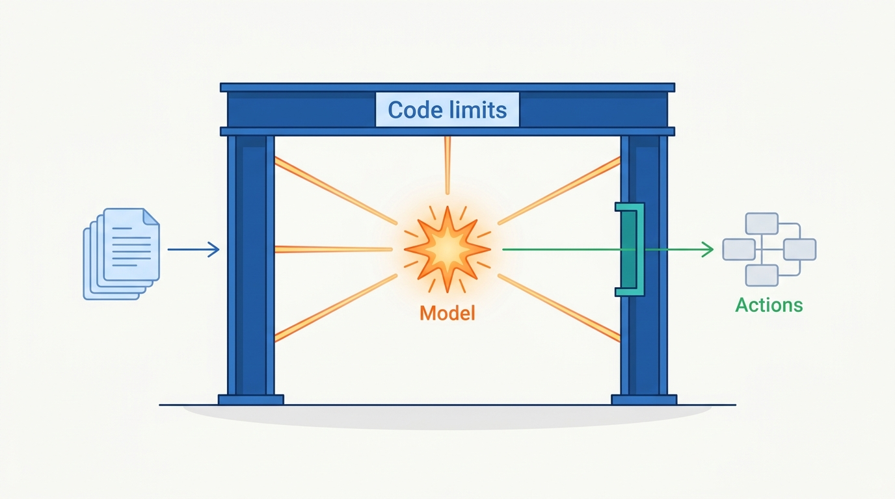
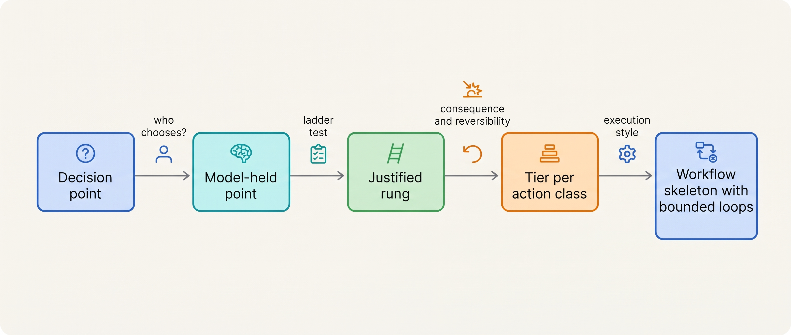

> **IN THIS PART, YOU WILL:** Learn to map every decision point of a system to code, the model or a human, test whether each model-held point beats a simpler design, size what each model-chosen action may do by consequence and reversibility, and pick the execution style, with its budgets and stop conditions, step by step.

> **WHY THE BUSINESS CARES:** An agent costs more to build, run, supervise and evaluate than a workflow, and one wrong decision can repeat hundreds of times before anyone notices. Before funding one, the business needs to know what the model decides that code could not, what a verified outcome costs, and what the worst case is.

> **WHY ARCHITECTS SHOULD CARE:** These are the first boundary decisions of any agentic system. They fix where validation, policy, budgets and evidence go, and every later control is cheaper when they are made per decision point, not per product.

> **KEY POINTS:**
>
> * **"Agent" describes a decision point, not a product.** Ask at each point who chooses the next step. Where the model chooses, it chooses from an action space that deterministic code defines and enforces; the prompt is not a limit.
> * **Climb the ladder only as far as the task forces you.** Code, a single model call, a workflow with model steps, a bounded loop and an autonomous agent are five architectures. A higher rung must beat the one below on cost per verified outcome, and needs a check that is cheap, independent and on time.
> * **Autonomy is a budget per action class, spent inside limits the model cannot change.** Consequence and reversibility set a ceiling that no evidence lifts. Budgets, stop conditions and a workflow skeleton bound how the steps run.

> **[FAILURE PATTERNS THIS PART ADDRESSES](where-agentic-systems-go-wrong.html):**
>
> * **The Agent-Shaped Hammer** — exposed by the decision-point map and the ladder test, which demand a baseline one rung down.
> * **Autonomy by Default** — replaced by action classes with tiers, ceilings and limits enforced outside the model.
> * **The Compounding Error** — reduced by fewer model-decided steps, checks between them and loops whose budgets and stop conditions are owned by code.

 
An agentic system is an ordinary distributed system with one unusual component: a model that proposes the next action, and whose proposals vary. Before Part II builds anything around it, Part I asks **where that model should choose what happens next, and how much its choice may do**.

**Figure 1:** *An agentic system is an ordinary system with one unusual part: a model whose proposals vary, held inside limits that code defines and enforces.*

The four chapters form **one line of reasoning**. First, find the decision points where the model, not code or a human, holds the next step. Second, ask of each one whether it should: a lower rung that handles the task wins. Third, for the model-chosen actions that remain, decide how much each may do without a person, by what it changes and how it can be undone. Fourth, decide how the steps run, and write down the budgets and stop conditions that end them. Each chapter narrows what the one before allowed.

**Figure 2:** *The argument of Part I: only decision points that survive the ladder test reach the model, only tiered action classes may act, and every loop runs inside limits code enforces.*

Ostrell, the fictional field-service group this book follows, supplies the thread. When its agent platform, Keelson, opened in **January 2027**, the decision-point maps of seven "agents" showed two to be mostly workflows. In February the **Weekend Fan-out** ran one Scout research task for 41 hours and €8,700, because nothing in code defined "done". In March a **business-case review** cancelled the Invoice Chaser collections agent (an illustrative €206,000 a year against €38,000 for a dunning workflow with one model call) and turned Peoplepoint's leave flow from a loop into a workflow, raising success on the same 250 cases from 91% to 98.4%. The **Double Credit** (212 customers, €31,400) showed a model making a familiar retry failure stranger. The part ends with a tier register (A0–A3) per action class and a limits block per registry entry.

Part I lets you answer: at which points does the model choose, and what enforces its limits there? What does the model decide that a rule, one call or a fixed workflow could not, and what checks the result? What is the worst outcome of one action, one run and one detection window? And how does each run end, and who decides that it is done?

## Chapters in this part

[[what-makes-a-system-agentic]] decides **what counts as an agent**: the model holding the locus of control over several steps, inside an action space code enforces. Ostrell's seven decision-point maps are the case.

[[when-agents-are-justified]] decides **whether a model-held decision point should exist**: the five-rung decision ladder, verifiability, error compounding and cost per verified outcome against the rung below. The Invoice Chaser and the Peoplepoint leave flow are the cases.

[[autonomy-and-consequence]] decides **how much a model-chosen action may do without a person**: action classes on a consequence–reversibility grid, tiers with ceilings, and blast radius over the detection window. Ostrell's tier register and the promotion of Answerdesk's credits up to €250 to A2 are the cases.

[[workflows-loops-and-autonomous-agents]] decides **how the steps run**: workflows, bounded loops with budgets and stop conditions, autonomous agents with durable state and milestones, and the workflow skeleton that combines them. Closewise, Answerdesk and Scout's post–Fan-out limits are the cases.

Begin with [[what-makes-a-system-agentic]].
