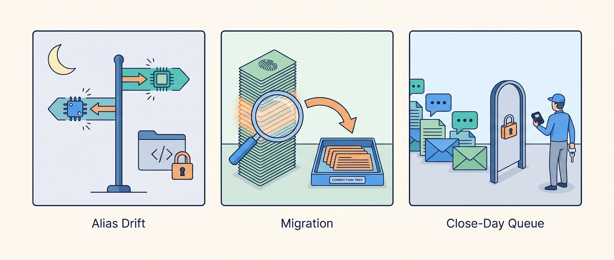
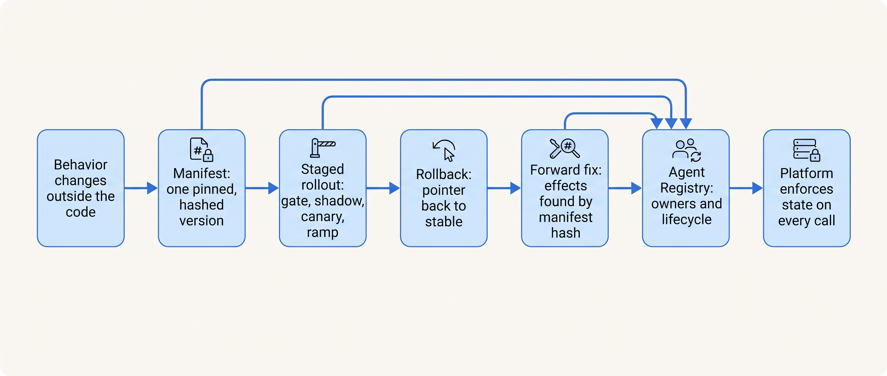

> **IN THIS PART, YOU WILL:** Learn what an agent version is made of and how to pin it, how to release a new version through shadow, canary and ramp and what rolling it back does and does not undo, and who owns, operates and retires an agent, and which parts of the architecture to keep stable as models change.

> **WHY THE BUSINESS CARES:** An agent's behavior can change on a day when nobody at the company shipped anything, and every model it uses will be retired on the provider's schedule. A risk owner needs to know which version produced a decision, how much a bad release could cost to repair, and who can stop it within minutes.

> **WHY ARCHITECTS SHOULD CARE:** Gates, audits, rollbacks and autonomy promotions all assume a nameable version and a named owner. Without a manifest, a rollback has no target; without labeled receipts, it has no list of effects to repair; without an owner, a kill switch has nobody allowed to press it.

> **KEY POINTS:**
>
> * **The agent version is a manifest, not a commit.** Exact model identifier, prompts, tool contracts with description hashes, policy, index snapshot, memory schema and orchestration build are bound into one immutable, hashed manifest, pinned per run and recorded with the served model version on every call. Aliases are banned, and a daily canary evaluation watches for change under the pin.
> * **Rollback moves a pointer; the forward fix repairs the world.** Each manifest goes through offline gate, shadow, canary with a concurrent control and ramp, with exits fixed in advance. Stopping a version takes minutes; finding and correcting what it already did needs receipts keyed by manifest hash and a playbook signed before the first canary.
> * **Ownership is a field some component reads.** One agent owner, a risk owner per action class and an enforced registry lifecycle from proposal to retirement. Anyone on call may hold; only the risk owner may promote. The seams that bound the model stay; most of what sits between them is replaced with each model generation.

> **[FAILURE PATTERNS THIS PART ADDRESSES](where-agentic-systems-go-wrong.html):**
>
> * **The Silent Upgrade** — answered with manifests that ban aliases, served-version recording, staged exposure for every manifest change and a migration calendar held by one owner.
> * **The Fire-and-Forget Action** — a rollback stops new effects but repairs none, so every receipt carries the hash of the version that produced it and every release has a forward-fix playbook.
> * **Autonomy by Default** — a tier nobody re-reviews and a retired agent whose credentials still work are closed by registry states the platform enforces and yearly tier reviews.

 
Part IX ended with configuration that changes with every release: a prompt layout, a routing profile, budgets. Part X asks **how an agentic system changes safely once it is live, and who keeps it safe**. The answer runs in one line. An agent's behavior lives mostly outside its code and changes on other organizations' calendars, so the unit of change has to be named and pinned. A named unit can be released in stages and stopped by moving a pointer. But a pointer move does not recall a posted entry or a sent email, so the release needs a repair plan. And none of this holds unless someone owns it.

Ostrell, the fictional company this book follows, met each step in 2027. In the **Alias Drift** of August, a provider moved a model alias over the weekend before the July close; controllers rejected about 11% of Closewise's proposed entries against a usual 4%, and the trace took four days because the Gateway had not stored the served version. In the **Closewise model migration** of November and December, done properly, guardrails stayed in band, yet five misclassified entries worth €183,400 posted in the canary arm; labeled receipts let the team re-adjudicate all 196 postings and reverse the five. And in the **Close-Day Queue** of 2 November, diagnosis took ten minutes and containment two hours, because nobody on call had the right to defer another team's workload.

**Figure 1:** *Ostrell met each step of Part X in 2027: a model alias that moved without a deploy, a migration whose five wrong entries were found by manifest hash, and a queue that nobody on call had the right to defer.*

**Figure 2:** *A pinned manifest makes a change nameable, a staged rollout makes it survivable, a forward fix makes it repairable, and the registry names who decides each step and makes the platform enforce it.*

By the end you should be able to answer, for any agent: which exact versions produced a given decision, from records, in minutes; what you promise an auditor, replay or re-execution; what the rollback target is and until when its model is served; what this canary can detect and what the business can afford to correct if it misses something; who may hold an action class tonight and who alone may raise it; and which parts of the design exist only because today's model is weak.

The part closes Parts I–X with the durable core: decision-point maps, action objects with keys and receipts, policy outside the model, durable state, the evidence log, manifests, eval datasets and the autonomy register. Over 2027 Ostrell changed almost every number in its agents and almost none of these seams. [[part-11]] then holds the platform still and varies the stakes across four domains.

## Chapters in this part

[[versioning-agent-systems]] decides **what an agent version is**: an immutable manifest with the exact model identifier, registration checks that refuse aliases and unreviewed tool descriptions, run stickiness, memory records stamped with the version that wrote them, and replay rather than re-execution as the reproducibility promise. The Alias Drift and the migration calendar it made possible are the case.

[[staged-rollout-and-rollback]] decides **how a version reaches traffic and how it comes back**: stages with pre-registered exits, nested rollout units, guardrail families, a rollback target with an expiry date and a forward-fix playbook per effect class. The Closewise model migration, from 94.1% shadow agreement to the five reversed entries and the year-end decision, is the case.

[[owning-agentic-systems]] decides **who owns, operates and evolves an agent**: agent owner, risk owners with exposure caps, two on-call rotations, an enforced registry lifecycle with retirement checks, the envelope rule for architecture review, and the durable core. The Close-Day Queue and the Keelson 2.0 roadmap for 2028 are the case.

Begin with [[versioning-agent-systems]].
