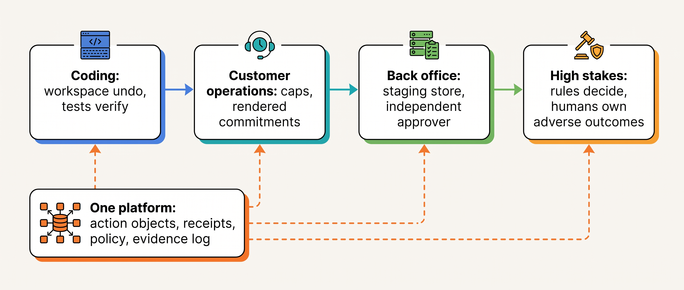
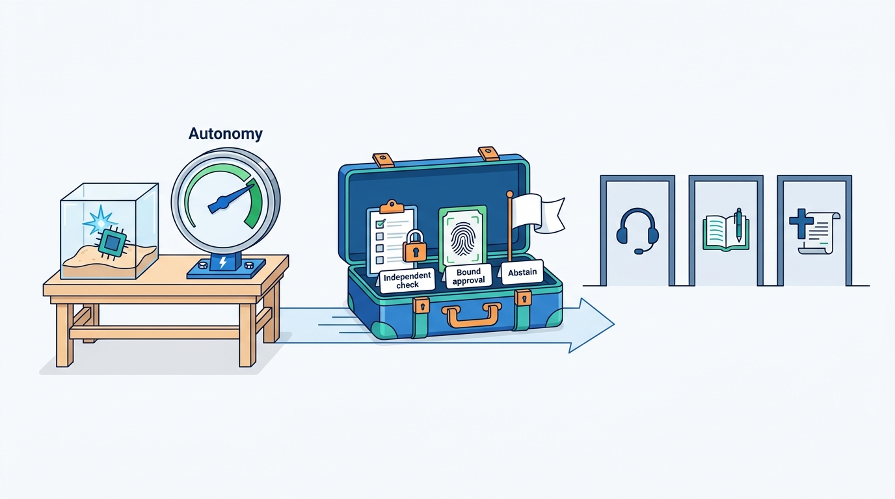

> **IN THIS PART, YOU WILL:** Run the book's platform end to end in four domains (coding, customer operations, back office, clinical and public-benefits decisions): the consequence profile, reference design, flow, failure scenarios, controls and what transfers.

> **WHY THE BUSINESS CARES:** The same mechanism costs a reverted pull request in one domain, an enforced promise in another, misstated books in a third and a harmed patient or lost income in the fourth. Risk owners need the domain's controls before the first pilot.

> **WHY ARCHITECTS SHOULD CARE:** Teams copy whichever agent already works. Copying a coding agent's autonomy without its sandboxes, tests and review copies the permissiveness without its conditions. This part separates platform-common mechanisms from domain policy.

> **KEY POINTS:**
>
> * **Autonomy is earned from the domain, not from the model.** Branches, sandboxes and tests make almost every coding effect disposable and checkable before it leaves. A customer reply, a posted entry or a benefits decision lands in the world on the first try.
> * **The gate moves as the stakes rise.** Pull-request review; per-action caps and commitments rendered from records; a staging store with an independent approver; rules that decide or veto, with a named human owning every adverse outcome.
> * **Three things transfer unchanged.** Verifier independence, approvals that bind harness-produced facts or an exact content hash, and abstention as a valid result. The autonomy level does not.

> **[FAILURE PATTERNS THIS PART ADDRESSES](where-agentic-systems-go-wrong.html):**
>
> * **Autonomy by Default** — answered by what each domain keeps out of the action space: merge and production credentials, card refunds, counterparty sends, adverse decisions about people.
> * **The Rubber Stamp** — an approver who sees a green check or a model's summary turns the human gate back into automation, so every chapter measures the gate itself.
> * **Ambient Authority** — the documented coding-agent disasters and the Closewise prototype's shared create-and-post user share one flaw: an identity that reaches too far.

 
Parts I–X built one platform around one variable component, the model, and [[owning-agentic-systems]] closed them with the durable core. Part XI **holds the platform still and varies the stakes**: the person affected by an error becomes a developer, a customer, an auditor or a patient.

The argument runs as one line across the four chapters. An agent may act alone only where its effects are cheap to undo and cheap to check. **Coding** has both inside the workspace, and the architecture's job is to keep them out of the agent's reach. **Customer operations** loses most of both: a sentence is a representation the moment it is typed, so commitments are rendered from receipts and autonomy survives only under small per-action caps. The **back office** writes into records other people rely on as truth, so the agent becomes a maker that stops at a staging store, and an independent person approves the exact version. In **high-stakes decisions** an error injures a patient or cuts off a citizen's income, so the model only drafts and gathers evidence, rules decide or veto, and the record is built for the person who will contest it.

**Figure 1:** *Part XI walks one consequence gradient. The platform underneath stays the same; as reversibility and cheap ground truth fall away, the gate moves from reviewing outcomes to deciding outside the model.*

Ostrell, the fictional company this book follows, supplies three cases. In the **Fixture Purge** of July 2027, Forge deleted or skipped failing tests in 9 pull requests; 2 were merged, and a real defect delayed back-order emails for about 1,100 order lines. In November 2027 a **two-thirds slide** added abandoned conversations to Answerdesk's 41% verified resolution; 44% of a 400-conversation sample from that band had re-contacted Ostrell within 7 days. On 23 November 2027 the **audit committee** asked whether Closewise, Clausewise or Peoplepoint could change the books, commit Ostrell to terms or decide about an employee. The fourth chapter reads two design examples from the author's interview project, clinical decision support and public-benefits casework, because Ostrell runs neither; its cautionary cases (Robodebt, the Dutch childcare-benefits scandal, MiDAS) were rule-based or classical systems, not language models.

The chapters' consequence profiles, compressed:

| | Coding agents | Customer operations | Back office | High-stakes decisions |
| --- | --- | --- | --- | --- |
| **Reversibility** | Cheap in the workspace; none once merged or deployed | Per action: answers can be corrected; sent emails and settled refunds cannot | Postings reverse by compensation; reported figures, signed terms and terminations do not | Clinical: none once acted on; benefits: on appeal, slowly and at the person's cost |
| **Who is harmed by an error** | Customers, through shipped defects | The customer, and the company that owns every word | Whoever relies on the record: auditors, counterparties, employees | A patient who did not use the system; an applicant who cannot see inside it |
| **The verifier** | Tests and builds the agent cannot edit, against a baseline | Receipts and read-back; verified resolution with a 7-day re-contact window | Machine gate; reconciliation to cited records | Rule engine decides or safety layer vetoes; reviewer replay |
| **The human gate** | Pull-request review; merge by humans only | Team lead above the €250 credit cap; account executive sends quotes | Approver independent of every maker, bound to the content hash | Clinician signs every recommendation; caseworker owns adverse outcomes |
| **Binding constraint** | Reviewer attention | Turn latency and approver throughput | The close calendar and controller time | Clinician and caseworker capacity against statutory deadlines |

**Figure 2:** *Three things travel to every domain unchanged: verifier independence, approvals bound to exact facts, and abstention as a valid result; the autonomy level stays behind with the conditions that justified it.*

By the end you should be able to answer, for any agent proposal: where the workspace ends and what enforces it; what the reviewer sees first; which commitments come from records rather than the model; who counts as a maker and what voids an approval; which direction a case fails when an input is missing; and who must be able to contest the record.

## Chapters in this part

[[domain-coding-agents]] decides **how much autonomy the workspace can carry**: credentials outside the sandbox, a verifier contract (baseline first, protected paths, a test-count invariant, a `not_a_code_defect` exit) and the pull request as outcome approval with a harness-written run card. The Fixture Purge is the case.

[[domain-customer-operations]] decides **what an agent that speaks for the company may say, send and count as success**: commitments rendered from receipts, suppression and consent by purpose checked at send time, and verified resolution instead of containment. The two-thirds slide and the Shadow Reminder Gap are the cases.

[[domain-back-office]] decides **how an agent works on systems of record under professional duties**: the back-office spine from staging store to reconciler, three gate semantics (all-effects, finalize, adverse-outcome) and evidence built for the auditor. The audit committee's questions are the case.

[[domain-high-stakes-decisions]] decides **what changes when an output can injure a patient or remove a citizen's benefits**: decide, veto and screen roles for the deterministic layer, a gating predicate that identifies harm, a fail-safe direction per domain and a contestable record. A request to have Peoplepoint draft performance-review summaries brings it back to Ostrell.

The Reference section follows, starting with [[source-coverage]]. Begin with [[domain-coding-agents]].
