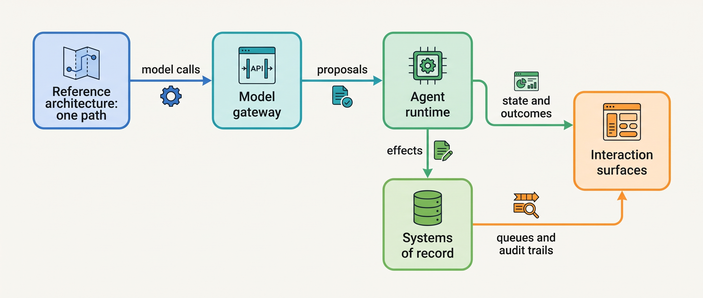
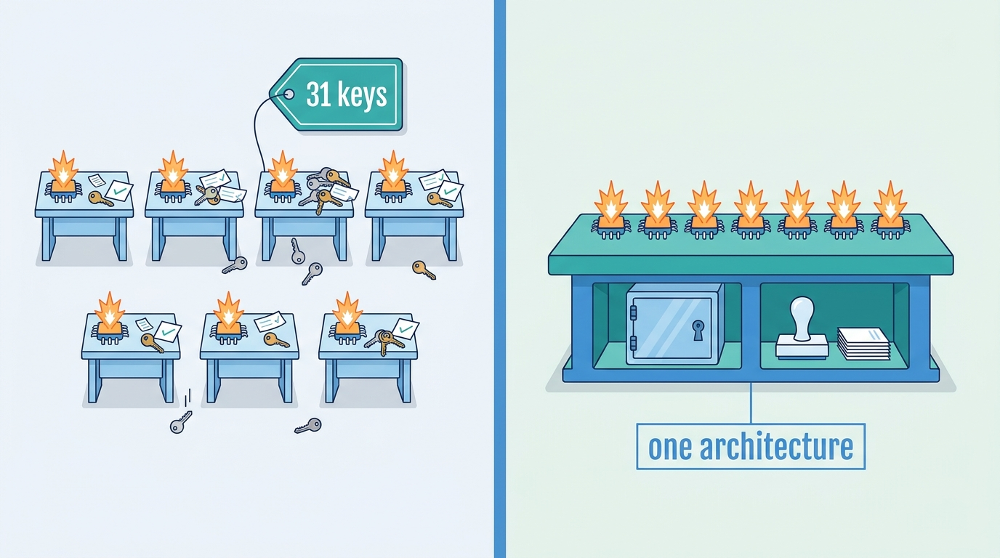

> **IN THIS PART, YOU WILL:** Learn the components of an agentic system and the one path from proposal to effect, then design the gateway, the runtime, the enterprise connections and the human surfaces.

> **WHY THE BUSINESS CARES:** Without shared components, every agent team builds its own model client, tool access and approvals, and gets a different part wrong. One architecture pays for the hard parts once and answers "who saw this, who approved that?" alike for every agent.

> **WHY ARCHITECTS SHOULD CARE:** These components decide whether Part I's tiers and limits are enforced or only hoped for. A credential the agent can read or a "Done" written by the model turns every later control into documentation.

> **KEY POINTS:**
>
> * **There is one path from model output to the world, and every component on it has a prohibition.** The runtime records, the policy enforcement point decides, the tool broker executes with credentials the model never sees, and the evidence log records intent and receipt.
> * **The gateway and the runtime enforce; they do not choose.** The gateway serves only declared, evaluated, data-eligible routes. The runtime owns the run's lifecycle, budgets and inbox, and checks for new input before every side effect.
> * **The organization's records stay the truth, at both ends.** Systems of record stay authoritative and name the agent and the human in their audit trails. Surfaces render outcomes from records, and an escalation hands over a typed package and the authority with it.

> **[FAILURE PATTERNS THIS PART ADDRESSES](where-agentic-systems-go-wrong.html):**
>
> * **Ambient Authority** — replaced by brokered credentials, one gateway holding every provider key, and a named agent identity per duty in each audit trail.
> * **The Token Bonfire** — contained by gateway quotas per agent and tenant and run budgets the runtime admits before every call.
> * **The Lost Handoff** — answered by hand-offs that become tasks in existing queues and escalation packages built by code.

 
Part I decided where a model may choose and how much each choice may do, and left a tier register and limits per agent. This part builds **the system that makes those decisions hold**, and fixes for each component **what it owns and what it must never do**.

The five chapters form **one line of reasoning**. First, draw the map: every component, its plane and the single path from proposal to effect. Then follow a run along it. Every model call leaves through the gateway, which decides how the system reaches models. The runtime decides when a model is called and what happens to its output, but never authorizes or executes. Effects land in systems of record that stay authoritative, so integration decides what the agent may touch and under whose name. Last, people meet the run, and the interaction mode decides who waits, where state lives and what the screen may claim.

**Figure 1:** *The argument of Part II. The map fixes one path; each later chapter makes one of its boundaries enforceable.*

Ostrell, the fictional field-service group this book follows, supplies the thread. When its platform, Keelson, launched in **January 2027**, the seven prototypes held **212 agent tools**, 118 on service-account keys, and **31 provider API keys**. In February auditors sampled **40** ERP entries posted by an integration account whose approvals the ERP could not show, and the **Quiet Failover** sent clauses from 9 contracts to a provider legal had not cleared. In May and June, corrections that arrived seconds too late sent technicians to the wrong site or date in **23** conversations. In August, **38%** of 500 escalated customers were asked again for what they had given. Each fix landed in a named component: a gateway that held legal requests during an outage, an inbox check that cut wrong-site bookings to 1, an audit sample answered in 20 minutes, an escalation package that cut re-asking to 9%.

**Figure 2:** *Without shared components every agent team builds its own model access, keys and approvals; one architecture pays for the hard parts once, for all seven agents.*

By the end of Part II you will be able to answer, for any agent: which components does each path to the world cross, and which one decides? Which provider may see this step's data? What is one run, and what stops it? Whose name is in the audit trail? And what on the screen is a record, and what is prose?

## Chapters in this part

[[agentic-reference-architecture]] decides **which components exist and what each must never do**: the responsibilities table, the one-path rule and its conformance check, and the control and data planes. Keelson's nine 2027 incidents, mapped to components, are the case.

[[models-and-the-model-gateway]] decides **how the system reaches models**: model roles and tiers, pinned routes, data classes matched to provider terms, and failover only to declared, evaluated, eligible routes. The Quiet Failover and the October 2027 outage are the cases.

[[agent-runtime]] decides **what the component that runs the loop owns**: the run's lifecycle, the turn as a validation pipeline, budget admission, the inbox, and build versus adopt. The message that arrived four seconds late is the case.

[[agents-in-the-enterprise]] decides **how agents attach to systems of record without becoming shadow systems**: four integration patterns, governed reads, writes through a staging store and an executor, and hand-offs into existing queues. Closewise and Answerdesk are the cases.

[[agent-interaction-design]] decides **how people meet the agent**: five interaction modes, facts rendered from records, confirmation versus approval, and the escalation package with ownership transfer. Answerdesk's escalation package v2 and Forge's run card are the cases.

Begin with [[agentic-reference-architecture]]. Part III, [[part-3]], then turns from the system's shape to the work's.
