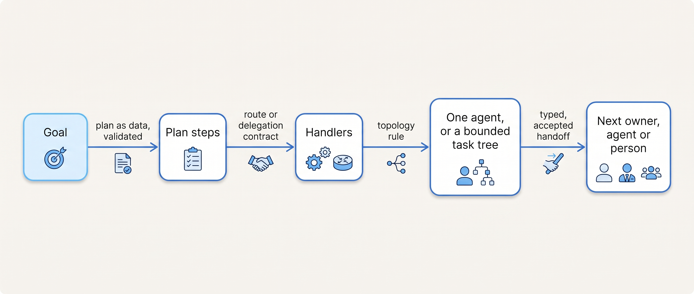
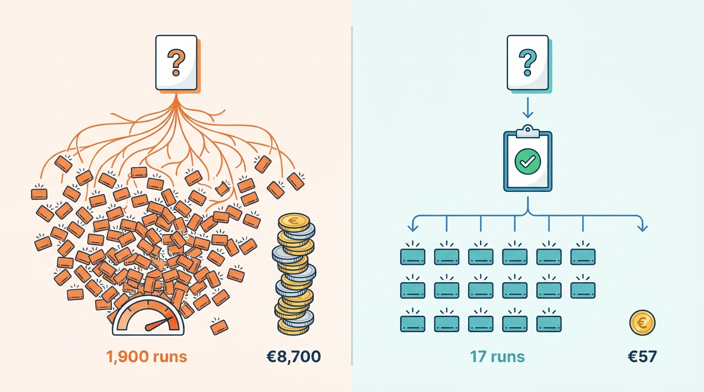

> **IN THIS PART, YOU WILL:** Decide who writes a plan and what checks it, where work is routed and what travels with a delegation, when a second agent earns its place, and how work and responsibility change hands without loss.

> **WHY THE BUSINESS CARES:** Orchestration failures are quiet and expensive: a research question that becomes a weekend of model spend, an outage report answered with a help-center article, a credit proposed on the wrong contract. Each time, every component reports success.

> **WHY ARCHITECTS SHOULD CARE:** Every place where work crosses a boundary can bypass controls built elsewhere in the platform. Framework defaults decide these crossings silently, and the defaults differ between products.

> **KEY POINTS:**
>
> * **The model proposes; code decides what crosses.** A plan is typed data validated for scope, policy and budget before the first worker starts. A route selects a handler and never grants authority. A delegation is a contract the runtime enforces.
> * **Add agents only on evidence.** A second agent is justified by context isolation, parallel read-only breadth, separated authority or independent verification, shown against a single-agent baseline. Many readers, one writer, and one budget for the whole task tree.
> * **A handoff moves ownership, so it is a recorded transaction.** Identifiers and commitments are filled by code from receipts, and the transfer completes only when the receiver accepts. The best handoff is the one you remove.

> **[FAILURE PATTERNS THIS PART ADDRESSES](where-agentic-systems-go-wrong.html):**
>
> * **The Compounding Error** — reduced by plans with checkable steps, a verifier before synthesis, and completion decided by the runtime, not claimed by the model.
> * **The Agent Committee** — replaced by a topology rule that grants the delegation tool only for a named reason and an eval against one agent, with one accountable agent per task tree.
> * **The Lost Handoff** — closed by typed delegation contracts and handoff payloads whose identifiers, decisions and commitments come from records, not from a model's summary.

 
Part II gave the system its components, from the model gateway and runtime to the interaction layer. Part III turns to **the shape of the work**: how a task is planned, who handles each part, how many agents take part and how work changes hands.

The four chapters form **one line of reasoning about boundaries**. A plan turns a goal into steps, so it is the cheapest place to check scope and cost. Each step needs a handler, and a route or delegation decides which, and what authority and budget go with it. Whether that handler should be a separate agent is a topology decision with its own costs. When work moves to another owner, the transfer must carry what the receiver needs and record who is accountable. At every boundary the model may propose; code validates, enforces and records what crosses.

**Figure 1:** *The argument of Part III. Work crosses four boundaries on its way from a goal to its owner; at each one the model proposes and code decides what crosses, with what authority and budget.*

Ostrell, the fictional field-service group this book follows, supplies the cases. In February 2027 the **Weekend Fan-out** turned one Scout question on 14 markets into 1,900 sub-agent runs and €8,700 over 41 hours; rebuilt around plan-as-data, the same question ran in April as 17 worker runs for about €57. In April the **Lost Handoff** dropped the contract id from about 1 in 40 billing handoffs, and A1 approval caught 3 wrong-contract credits; a typed payload brought missing ids to zero across about 25,000 handoffs. In May the architecture forum gave Scout conditional fan-out: 0.81 against 0.64 on breadth tasks, no gain on depth tasks. On 13 July the **Sync Outage Misroute** sent 64 of 143 outage reports to the help center; router v2 raised incident recall from 71% to 97%.

**Figure 2:** *The same Scout question, before and after plan-as-data: 1,900 sub-agent runs and €8,700 in February 2027, 17 worker runs and about €57 in April.*

By the end of Part III you will be able to answer, for any agentic system: who writes its plans, and what checks them before execution? What does each misroute cost, and is the router's confidence checked against outcomes? Can a delegate ever hold more authority or budget than its parent? What evidence justifies each additional agent, and who may write shared state? And who owns work between a handoff's offer and its acceptance?

Each of these decisions ends in a model call whose context somebody assembled; the Lost Handoff was at bottom a context failure. [[part-4]] turns to context.

## Chapters in this part

[[planning-and-decomposition]] decides **who writes the plan and what checks it**: implicit planning for short loops, code-authored plans for known procedures, and model-written plan-as-data that a validator checks before execution and that changes only on named replan triggers. Scout's 14-market re-run and Closewise's fixed close plan are the cases.

[[routing-and-delegation]] decides **where work goes and what travels with it**: a staged router with a cost matrix, calibrated thresholds and a human route, and a delegation contract with attenuated authority and a carved budget. The Sync Outage Misroute and Answerdesk's router v2 are the cases.

[[single-and-multi-agent-designs]] decides **when another agent adds value**: five topologies, the four reasons to split, one writer per artifact and budgets on the whole task tree. Scout's conditional fan-out, the Answerdesk fold-back and the rejected Dealroom committee are the cases.

[[coordination-and-handoffs]] decides **how work and responsibility change hands**: an accepted, recorded transfer of ownership with a typed payload, shared task state inside the platform, and A2A (Agent2Agent) protocols only at organizational boundaries. The Lost Handoff and Ostrell's first inbound A2A pilot are the cases.

Begin with [[planning-and-decomposition]].
