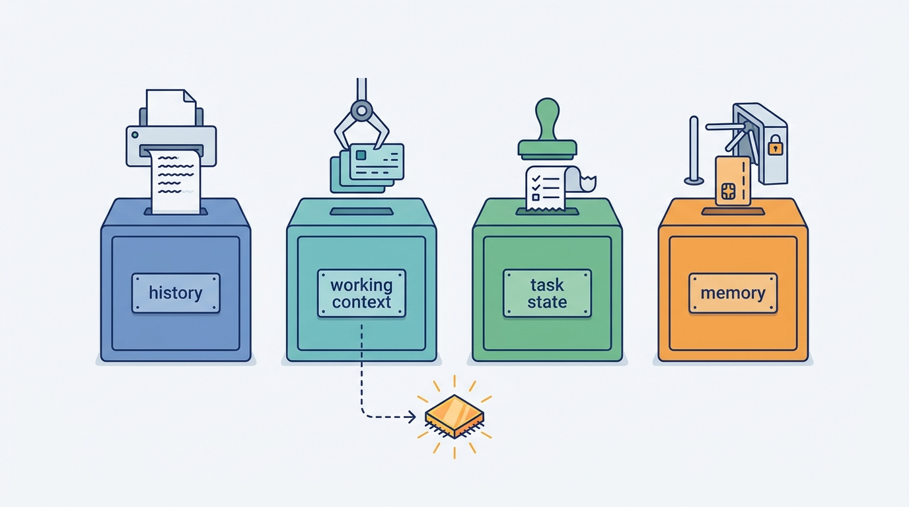
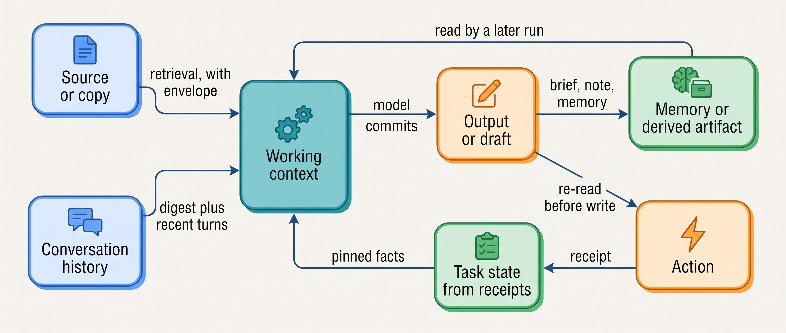

> **IN THIS PART, YOU WILL:** Decide what the model sees on each call, how its knowledge is found and checked, what it may remember, what survives a crash, and how a wrong fact is contained as it moves between stores.

> **WHY THE BUSINESS CARES:** An old price becomes €46,000 of honored discounts, a stale memory sends technicians to failed visits, and a re-run script posts €2.84 million of accruals twice. Each time the model followed its inputs.

> **WHY ARCHITECTS SHOULD CARE:** "What the agent knows" is four stores with different writers and lifetimes, and frameworks blur them. When one store stands in for another, an error made once is read as fact at every later step.

> **KEY POINTS:**
>
> * **Four stores, four writers.** The runtime appends history, the assembler computes each call's context, the orchestrator writes task state from receipts, and a gated policy writes memory. The model writes none of them directly.
> * **What must stay true never passes through the model.** Pinned facts, step results and receipts come from tool results, not from a summary or a note. Facts a system of record holds are read live, not remembered.
> * **Every fact carries its source and age, and code checks them before acting.** Provenance envelopes, freshness SLOs (service-level objectives) at the point of use, re-read before write, and lineage.

> **[FAILURE PATTERNS THIS PART ADDRESSES](where-agentic-systems-go-wrong.html):**
>
> * **Context Soup** — replaced by a budgeted, labeled context with a manifest per call, and a few versioned, permission-filtered retrieval results.
> * **Amnesiac Execution** — closed by a task record of model decisions, intents and receipts, so a crash resumes instead of repeating.
> * **Memory Without Expiry** — governed by keyed memories with provenance, expiry per class and quarantine by source; a model-written artifact is never fresher than its oldest input.

 
[[part-3]] ended on the Lost Handoff: identifiers fell out of free-text summaries passed between agents. Part IV shows that the same loss happens inside one agent, from one step to the next, unless **the system keeps four stores apart**:

| Store | Written by | Lives for | Holds |
| --- | --- | --- | --- |
| **Conversation history** | Runtime, append-only | Session plus audit retention | Everything said and returned |
| **Working context** | Context assembler | One model call | What the model sees now |
| **Durable task state** | Orchestrator, from receipts | Task plus retention | What actually happened |
| **Long-term memory** | Gated write policy | Per class, always finite | What only the conversation knew |

**Figure 1:** *Four stores, four writers: history, working context, task state and memory each have their own writer, and the model writes none of them directly.*

The five chapters form **one line of reasoning about these stores**. The working context is computed from the others, so its assembler decides what the model sees. Retrieval fills it with knowledge the agent does not own; grounding checks the answer against it. Memory outlives sessions, so it gets the strictest write path. Recovery depends on task state, so the model may not write it at all. Errors still cross between them: a stale fact enters context, the model builds on it, a brief or memory stores it, and a later run reads it back as fact. So every fact carries its source and age, and **code checks them before any action**.

**Figure 2:** *The argument of Part IV. The working context is computed from the other stores. A wrong fact can travel from output to memory and back into context, so it carries its source and age, and code re-reads the system of record before acting.*

Ostrell, the fictional field-service group this book follows, supplies the cases. In January 2027 the pre-Keelson **Half-Posted Accrual** script crashed after 37 of 52 postings and was re-run: 37 duplicates; on a June game day the Keelson task record resumed the same batch with none. In February a grounding audit found unsupported claims in 11.2% of Answerdesk answers; by Q3 it was 2.4%. In May a sliding window lay behind 41 of 57 rejected second-revisit proposals, and the **Stale Preference** caused 11 failed visits. In June the **Stale Price Book** sent 14 quotes at old prices, and three more drafts copied old prices from Dealroom's own account briefs after the index was fixed.

By the end of Part IV you will be able to answer, for any agent: what did the model see on a given call? Which facts must survive compaction, and who writes them? Who sets the retrieval scope, and what happens when nothing supports an answer? What does it remember that a system of record already holds? What happens if you kill its worker mid-run? And if a source was wrong for three weeks, how fast can you find everything it touched?

Re-read before write becomes part of a tool's contract in [[part-5]].

## Chapters in this part

[[context-engineering]] decides **who builds what the model sees**: a budgeted, labeled context, compaction with pinned facts, and a manifest per call. The Second Revisit is the case.

[[retrieval-and-grounding]] decides **how knowledge is found and checked**: permissions inside the query, four checks per cited claim, and "no evidence" as a valid outcome. Answerdesk's grounding audit is the case.

[[agent-memory]] decides **what persists across sessions and how it ends**: only what no system of record holds, written through a policy, expiring and erasable. The Stale Preference is the case.

[[task-state-and-checkpoints]] decides **what survives a crash, a deploy or a long wait**: an orchestrator-written task record, intent before effect, and resume that never re-asks the model. The Half-Posted Accrual is the case.

[[provenance-and-freshness]] decides **how stale and wrong facts are contained**: envelopes, freshness bounds at use, re-read before write, and lineage for invalidation. The Stale Price Book is the case.

Begin with [[context-engineering]].
