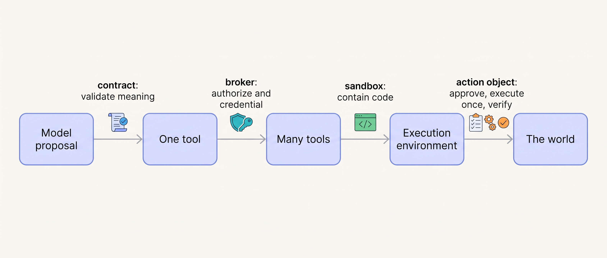
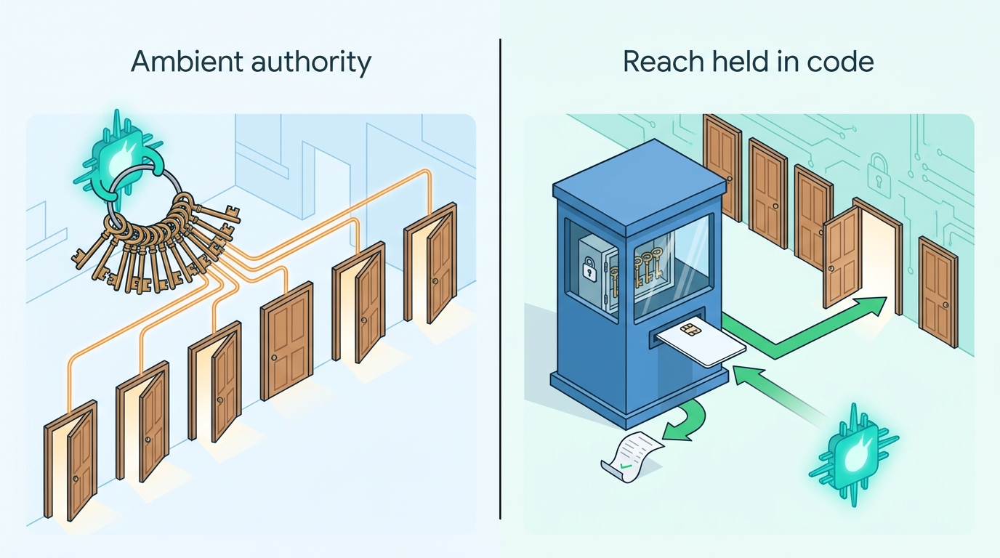

> **IN THIS PART, YOU WILL:** Decide what a tool lets the model write, which tools a run may call and who holds their credentials, where model-written commands run, and how an action that changes the world is approved, executed once and proven.

> **WHY THE BUSINESS CARES:** Tools are where an agent's output becomes the company acting: a credit, an email, a quote. A badly shaped tool credits the wrong account; an agent's sentence can promise a credit nobody approved, which the company may have to honor.

> **WHY ARCHITECTS SHOULD CARE:** The tool boundary is the narrowest and most testable seam in an agentic system, and expensive to retrofit once agents run unattended.

> **KEY POINTS:**
>
> * **The model proposes; code decides at every layer.** A tool contract lets the model write only what it uniquely knows and validates everything again outside it. A broker computes the authorized tool set, holds the credentials and treats tool definitions as supply-chain input.
> * **When the action is code, the environment is the boundary.** Unattended model-written code runs behind a separate kernel, egress denied by default, credentials outside, one reviewed exit. Permission rules, hooks and classifiers decide intent; the sandbox bounds impact.
> * **An effect is an object, a receipt and the words about it.** Each external effect is a hashed action object that a limit or a person authorizes and the broker executes once; a receipt and a read-back prove it. A reply states an outcome only as the action's state renders it.

> **[FAILURE PATTERNS THIS PART ADDRESSES](where-agentic-systems-go-wrong.html):**
>
> * **The Fire-and-Forget Action** — closed by typed results with receipts, runtime-minted idempotency keys, read-back verification and replies tied to action state.
> * **Ambient Authority** — removed by brokered credentials and run-scoped tokens valid only at the proxies, with the local coding CLI a named, bounded exception.
> * **The Lethal Trifecta** — made a decision, not an accident, by classifying every tool on its three legs and denying sandbox egress by default.

 
Part IV decided what the agent knows. Part V turns to **what it can do**.

The four chapters follow one line of reasoning, each boundary wider than the last. **One tool** is a contract: code checks meaning, not just syntax. **Many tools** need one registry and one broker on every call path, because authority cannot live in the prompt or the protocol. **When the tool is "run this command"**, the environment becomes the boundary. And **when a call changes something outside**, the effect needs a stable object that approvals, keys, receipts and the agent's words all refer to. At each boundary the model proposes; code validates, authorizes, contains and records.

**Figure 1:** *The argument of Part V. A proposal crosses four boundaries on its way to an effect; at each one code decides what passes and records it.*

Ostrell, the fictional field-service software group this book follows, supplies the cases. Of **1,000** credit tool calls from early 2027, every one parsed, yet 31 named the wrong account and in 6 conversations the model told the customer a credit had been issued after an unreadable error; the credit tool of 7 June 2027 removed the account argument altogether. Toolyard, the registry and broker, began with 212 agent tools and no list of owners, and in September 2027 took a tracker server offline for 31 hours when its definitions changed. Forge's red team found an organization-wide token within reach of agent commands. The **Silent Fallback** left 118 workstations running the coding CLI unsandboxed for 9 days. And the **Promised Credit** cost €2,310, after 38% of sampled replies announced credits nobody had yet approved.

**Figure 2:** *An agent can do only what its tools, credentials and environment allow, so reach held in code, not handed to the model, is reach that can be designed.*

By the end of Part V you will be able to answer: which arguments does the model write that a system of record already knows? Can we switch any tool off everywhere in a minute? Which boundary, by name, contains model-written code, and what happens when it cannot start? What voids an approval? And what stops a reply from stating an outcome that has not happened?

Part V assumed that an action's intent survives a crash, a deploy and an overnight approval wait. [[part-6]] makes that true.

## Chapters in this part

[[tool-contracts]] decides **what a tool lets the model write and what code checks**: tools shaped around one decision, two schemas, errors written for the model and side-effect semantics in a reviewed contract. Answerdesk's credit tool redesign is the case.

[[tool-ecosystems-and-mcp]] decides **which tools a run may call, and who answers for them**: MCP (Model Context Protocol) terminated at a broker that authorizes, holds credentials, pins definitions by hash and revokes from one place. Toolyard and the Tracker Update are the cases.

[[sandboxes-and-execution-environments]] decides **where model-written commands run and what keeps them inside**: isolation that follows autonomy and code provenance, three boundaries designed together, and permission modes and hooks on top. Forge's runners and the Silent Fallback are the cases.

[[side-effects-and-external-actions]] decides **how an effect is proposed, approved, executed and proven**: action objects, dry runs, receipts of stated strength, reversibility classes and external commitments capped at approval. The Promised Credit and Dealroom's quotes are the cases.

Begin with [[tool-contracts]].
